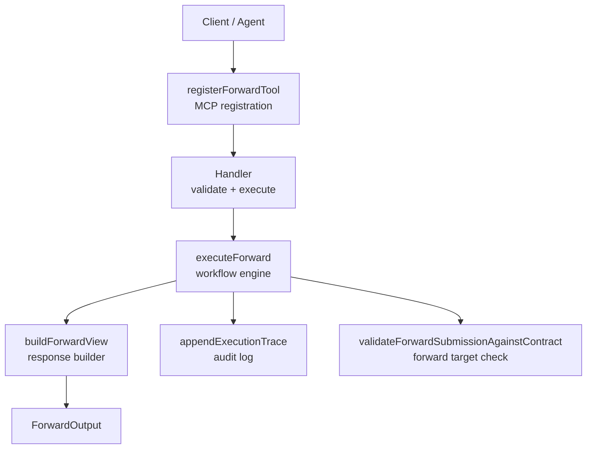
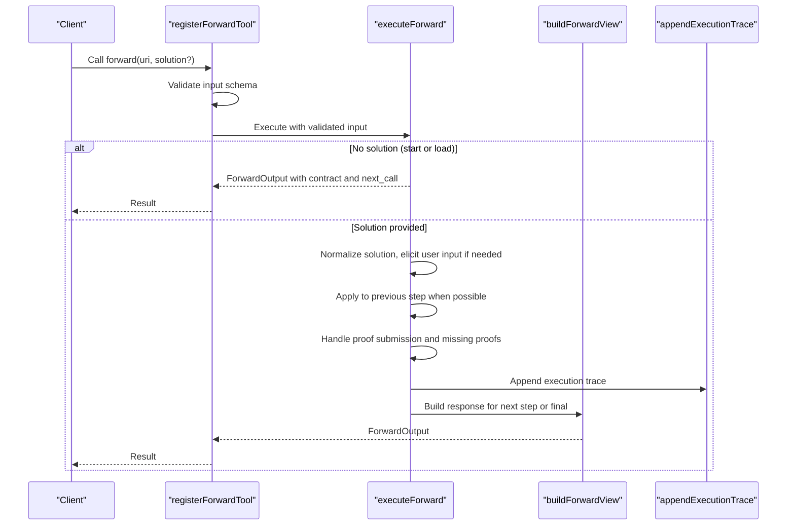
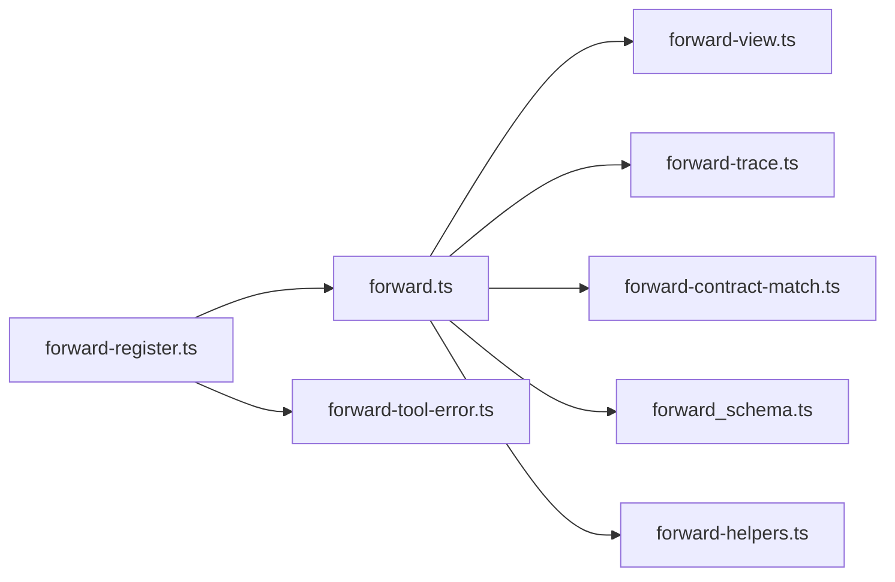
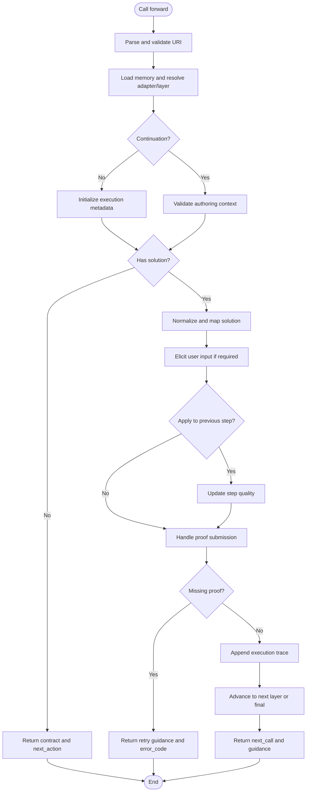

# Forward Tool

<cite>
**Referenced Files in This Document**
- [forward-register.ts](file://src/tools/forward-register.ts)
- [forward.ts](file://src/tools/forward.ts)
- [forward_schema.ts](file://src/tools/forward_schema.ts)
- [forward-contract-match.ts](file://src/tools/forward-contract-match.ts)
- [forward-helpers.ts](file://src/tools/forward-helpers.ts)
- [forward-trace.ts](file://src/tools/forward-trace.ts)
- [forward-view.ts](file://src/tools/forward-view.ts)
- [forward-tool-error.ts](file://src/tools/forward-tool-error.ts)
</cite>

## Table of Contents
1. [Introduction](#introduction)
2. [Project Structure](#project-structure)
3. [Core Components](#core-components)
4. [Architecture Overview](#architecture-overview)
5. [Detailed Component Analysis](#detailed-component-analysis)
6. [Dependency Analysis](#dependency-analysis)
7. [Performance Considerations](#performance-considerations)
8. [Troubleshooting Guide](#troubleshooting-guide)
9. [Conclusion](#conclusion)
10. [Appendices](#appendices)

## Introduction
The SquadRules forward tool executes workflow steps for adapters and layers. It implements a deterministic, auditable execution model where agents call the tool to:
- Start an adapter run by loading its first layer contract.
- Continue a run by submitting solutions that match the current step’s contract.
- Advance through linear or branching workflows until completion, then finalize with reward.

The tool enforces input validation, contract matching, proof-of-work challenges, state persistence across phases, and structured audit traces.

## Project Structure
The forward tool is implemented as a registered MCP tool whose handler validates inputs, delegates execution logic, and returns structured results. The core files are:
- Registration and MCP wiring
- Execution engine
- Input/output schemas and normalization
- Contract matching helpers
- View builders and UI summaries
- Audit trace recording
- Error formatting

**Diagram sources**
- [forward-register.ts:18-65](file://src/tools/forward-register.ts#L18-L65)
- [forward.ts:91-339](file://src/tools/forward.ts#L91-L339)
- [forward-view.ts:210-274](file://src/tools/forward-view.ts#L210-L274)
- [forward-trace.ts:64-87](file://src/tools/forward-trace.ts#L64-L87)
- [forward-contract-match.ts:17-53](file://src/tools/forward-contract-match.ts#L17-L53)

**Section sources**
- [forward-register.ts:18-65](file://src/tools/forward-register.ts#L18-L65)
- [forward.ts:91-339](file://src/tools/forward.ts#L91-L339)

## Core Components
- MCP registration and metrics: registers the tool, validates input, measures duration and sizes, and formats errors.
- Execution engine: resolves adapter/layer URIs, manages execution state, applies solutions, handles missing proofs, and advances to next steps.
- Schema system: defines input/output contracts, normalizes legacy and v2 solution shapes, and enforces required fields.
- Contract matching: validates forward submissions against expected targets.
- View builder: constructs user-facing responses, guidance, and next-call instructions.
- Audit tracing: records raw solutions, tensor values, activation queries, and layer metadata.
- Error formatter: converts internal errors into consistent error payloads.

**Section sources**
- [forward-register.ts:18-65](file://src/tools/forward-register.ts#L18-L65)
- [forward.ts:91-339](file://src/tools/forward.ts#L91-L339)
- [forward_schema.ts:16-314](file://src/tools/forward_schema.ts#L16-L314)
- [forward-contract-match.ts:17-53](file://src/tools/forward-contract-match.ts#L17-L53)
- [forward-view.ts:210-309](file://src/tools/forward-view.ts#L210-L309)
- [forward-trace.ts:17-87](file://src/tools/forward-trace.ts#L17-L87)
- [forward-tool-error.ts:3-10](file://src/tools/forward-tool-error.ts#L3-L10)

## Architecture Overview
The forward tool follows a strict two-phase flow per call:
1. Load phase: resolve URI, load memory, establish or continue execution context, return contract and next_action if no solution provided.
2. Submission phase: normalize and validate solution, apply to previous step when applicable, handle proof-of-work challenges, persist audit traces, and advance to next layer or finalization.

**Diagram sources**
- [forward-register.ts:31-63](file://src/tools/forward-register.ts#L31-L63)
- [forward.ts:91-339](file://src/tools/forward.ts#L91-L339)
- [forward-view.ts:210-274](file://src/tools/forward-view.ts#L210-L274)
- [forward-trace.ts:64-87](file://src/tools/forward-trace.ts#L64-L87)

## Detailed Component Analysis

### MCP Registration and Handler
Responsibilities:
- Register the tool with title, description, input/output schemas, and UI metadata.
- Observe input size and duration metrics.
- Parse and validate input using the MCP wire schema.
- Delegate to executeForward and wrap successful outputs in MCP content structures.
- Convert SquadrulesError instances into structured error responses.

Key behaviors:
- Validation failures return teaching-friendly error results.
- Successful calls record output size and status metrics.
- Errors bubble up unless they are known SquadrulesError types.

**Section sources**
- [forward-register.ts:18-65](file://src/tools/forward-register.ts#L18-L65)

### Execution Engine: executeForward
Responsibilities:
- Parse and validate URIs (adapter or layer).
- Resolve memory and determine whether this is a new run or continuation.
- Enforce authoring context consistency for author-adapter runs.
- Initialize execution metadata and pin layer manifests on first call.
- If no solution is provided, return the current layer view and contract.
- Normalize and map solutions to proof-of-work submissions.
- Attempt to apply submitted solution to previous pending step when appropriate.
- Handle proof-of-work challenges and missing proofs.
- Persist execution traces and update step quality metrics.
- Advance to next layer or mark finalization.

State management highlights:
- execution_id is derived from layer URI query parameter or generated for new runs.
- forwardRuntimeStore tracks execution metadata including authoring context and merge depth.
- proofOfWorkStore participates in challenge reuse and hash verification.
- executionTraceStore records raw solutions and tensorized outputs.

Error handling patterns:
- NOT_FOUND for missing layers/adapters.
- AUTHORING_CONTEXT_MISMATCH when continuing with mismatched authoring context.
- INVALID_AUTHORING_WORKFLOW when authoring is used on non-author-adapter URIs.
- Missing proof flows return retry guidance and error codes.

**Section sources**
- [forward.ts:43-339](file://src/tools/forward.ts#L43-L339)

### Input and Output Schemas
Input:
- uri: Adapter slug or layer UUID; layer may include execution_id for continuation.
- solution: Optional on start; required on continuation. Supports both legacy type-specific fields and normalized v2 envelope with outcome and evidence.
- authoring: Optional authoring context fixed for the execution.

Normalization rules:
- Legacy flat comment text is normalized into canonical evidence structure.
- Flat type-specific fields are wrapped into evidence envelope.
- Default outcome is success when not provided in v2 format.
- Strict validation ensures only one type-specific payload field matches solution.type.

Output:
- must_obey: Indicates whether the client should obey the guidance.
- current_layer: Markdown instructions for the active step.
- contract: Step contract describing required action type and optional nonce/proof_hash.
- next_action: Human-readable guidance for the next call.
- next_call: Structured instruction for calling forward or reward with required arguments.
- execution_id: Server-issued identifier for the run.
- proof_hash: Echoed when present in chain.
- error_code and retry_count: Present during missing-proof or blocked-payload scenarios.
- UI summary fields: activation_space_name, context_adapter_name, current_layer_label, adapter_layer_index, adapter_layer_count.

Validation constraints:
- Starting a run forbids providing solution.
- Continuing a run requires solution.
- Subagent solutions require evidence.

**Section sources**
- [forward_schema.ts:16-314](file://src/tools/forward_schema.ts#L16-L314)

### Contract Matching System
Purpose:
- Ensure forward submissions target the exact adapter URI specified by the contract.

Matching rules:
- Only enforced when contract type is forward and a target is defined.
- Rejects absent target, invalid scheme, or mismatched slug.
- Returns a single error code covering all mismatch cases.

Integration points:
- Used by proof-of-work submission handling to block incorrect forwards.

**Section sources**
- [forward-contract-match.ts:17-53](file://src/tools/forward-contract-match.ts#L17-L53)

### Helpers and Templates
Evidence hints:
- Provide concise guidance for each contract type (shell, forward, user_input, comment, subagent).

Empty solution templates:
- Generate a minimal v2 solution template pre-filled with type-appropriate evidence placeholders.
- Include placeholder markers to detect template-only submissions.

**Section sources**
- [forward-helpers.ts:11-38](file://src/tools/forward-helpers.ts#L11-L38)

### Response Builder and Views
Responsibilities:
- Construct current layer view with markdown content and MIME type.
- Build contract response, falling back to challenge generation when no stored contract exists.
- Compose next_call with either forward or reward based on finalization state.
- Pre-fill chain tokens (nonce/proof_hash) in solution_template when available.
- Attach local artifact directory fields and UI summary metadata.

Finalization behavior:
- Final steps return a comment-type contract instructing reward invocation.
- Reward outcome template reflects prior failed proof status to ensure honest verification.

**Section sources**
- [forward-view.ts:21-47](file://src/tools/forward-view.ts#L21-L47)
- [forward-view.ts:156-195](file://src/tools/forward-view.ts#L156-L195)
- [forward-view.ts:210-309](file://src/tools/forward-view.ts#L210-L309)

### Audit Tracing
Responsibilities:
- Convert solutions into tensor values for storage.
- Append execution traces including adapter URI, layer URI, layer index, activation query, layer instructions, tensor inputs/outputs, raw solution, and optional reasoning trace.

Persistence strategy:
- Fire-and-forget persistence to avoid blocking main execution paths.

**Section sources**
- [forward-trace.ts:17-87](file://src/tools/forward-trace.ts#L17-L87)

### Error Formatting
Responsibilities:
- Convert SquadrulesError into a standardized error object with error, error_code, message, and optional details.

Usage:
- MCP handler wraps known errors into isError responses with formatted text.

**Section sources**
- [forward-tool-error.ts:3-10](file://src/tools/forward-tool-error.ts#L3-L10)

## Dependency Analysis
The forward tool integrates with several services and utilities:
- Memory store for adapter/layer retrieval.
- Qdrant service for adapter resolution and layer navigation.
- Forward runtime store for execution metadata.
- Proof-of-work store for challenges, nonces, hashes, and results.
- Execution trace store for audit logs.
- Metrics middleware for tool performance tracking.

**Diagram sources**
- [forward-register.ts:18-65](file://src/tools/forward-register.ts#L18-L65)
- [forward.ts:91-339](file://src/tools/forward.ts#L91-L339)
- [forward-view.ts:210-309](file://src/tools/forward-view.ts#L210-L309)
- [forward-trace.ts:64-87](file://src/tools/forward-trace.ts#L64-L87)
- [forward-contract-match.ts:17-53](file://src/tools/forward-contract-match.ts#L17-L53)
- [forward_schema.ts:16-314](file://src/tools/forward_schema.ts#L16-L314)
- [forward-helpers.ts:11-38](file://src/tools/forward-helpers.ts#L11-L38)
- [forward-tool-error.ts:3-10](file://src/tools/forward-tool-error.ts#L3-L10)

**Section sources**
- [forward-register.ts:18-65](file://src/tools/forward-register.ts#L18-L65)
- [forward.ts:91-339](file://src/tools/forward.ts#L91-L339)

## Performance Considerations
- Input/output size metrics are recorded per tool call.
- Duration timers capture latency for success and error paths.
- Persistence operations for traces use fire-and-forget patterns to minimize blocking.
- Layer manifest pinning occurs once per execution to prevent UUID churn.
- Step quality updates are conditional on Qdrant availability and already-recorded status.

[No sources needed since this section provides general guidance]

## Troubleshooting Guide
Common issues and resolutions:
- Missing layer or adapter:
  - Symptom: NOT_FOUND error.
  - Resolution: Verify adapter slug or layer UUID; ensure the adapter exists and is indexed.
- Authoring context mismatch:
  - Symptom: AUTHORING_CONTEXT_MISMATCH when continuing a run.
  - Resolution: Use the exact execution_id returned by the server and do not alter authoring parameters mid-run.
- Invalid authoring workflow:
  - Symptom: INVALID_AUTHORING_WORKFLOW when authoring is used on non-author-adapter URIs.
  - Resolution: Restrict authoring to the author-adapter slug.
- Missing proof or blocked payload:
  - Symptom: error_code indicates MISSING_PROOF or similar; retry_count provided.
  - Resolution: Follow next_action guidance, provide required proof fields, and respect must_obey constraints.
- Forward target mismatch:
  - Symptom: FORWARD_TARGET_MISMATCH error.
  - Resolution: Submit evidence.target exactly matching the contracted adapter URI.

Error response shape:
- error: Error code string.
- error_code: Duplicate of error for compatibility.
- message: Human-readable explanation.
- details: Optional additional context.

**Section sources**
- [forward.ts:104-129](file://src/tools/forward.ts#L104-L129)
- [forward.ts:180-214](file://src/tools/forward.ts#L180-L214)
- [forward.ts:281-315](file://src/tools/forward.ts#L281-L315)
- [forward-contract-match.ts:31-50](file://src/tools/forward-contract-match.ts#L31-L50)
- [forward-tool-error.ts:3-10](file://src/tools/forward-tool-error.ts#L3-L10)

## Conclusion
The SquadRules forward tool provides a robust, auditable mechanism for executing adapter workflows. It enforces strict input validation, supports flexible solution formats, and guides clients through multi-step processes with clear next-action instructions. Its integration with proof-of-work challenges, runtime state stores, and audit traces ensures deterministic and verifiable execution across linear and branching workflows.

[No sources needed since this section summarizes without analyzing specific files]

## Appendices

### API Definition: forward Tool

Inputs:
- uri: Adapter slug or layer UUID; include execution_id for continuation.
- solution: Omit on start; include on continuation with type, outcome, and evidence.
- authoring: Optional authoring context for author-adapter workflows.

Outputs:
- must_obey: Boolean indicating obedience requirement.
- current_layer: Object with uri, content, mimeType.
- contract: Step contract with type and optional nonce/proof_hash.
- next_action: Guidance string.
- next_call: Structured instruction for forward or reward.
- execution_id: Run identifier.
- proof_hash: Chain token echo.
- error_code: Error classification when applicable.
- retry_count: Retry allowance when applicable.
- UI metadata: activation_space_name, context_adapter_name, current_layer_label, adapter_layer_index, adapter_layer_count.

**Section sources**
- [forward_schema.ts:234-314](file://src/tools/forward_schema.ts#L234-L314)

### Execution Flow Algorithm

**Diagram sources**
- [forward.ts:91-339](file://src/tools/forward.ts#L91-L339)
- [forward-view.ts:210-309](file://src/tools/forward-view.ts#L210-L309)
- [forward-trace.ts:64-87](file://src/tools/forward-trace.ts#L64-L87)