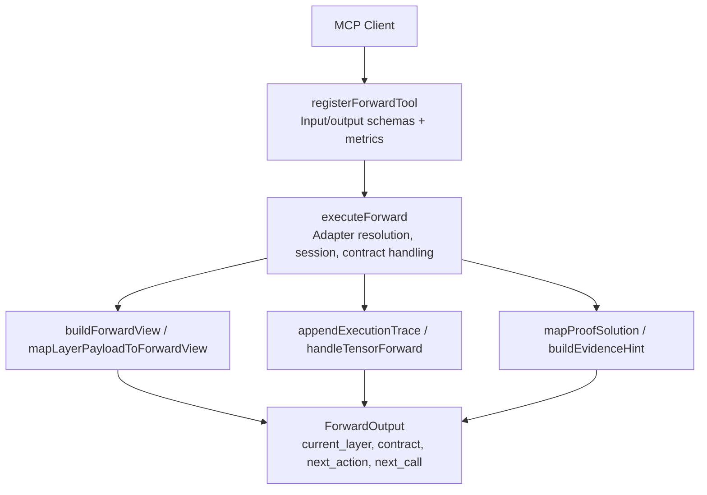
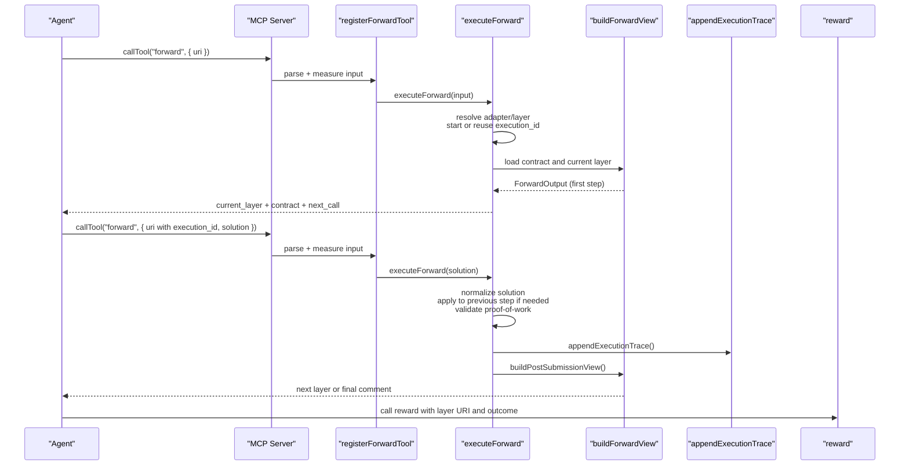
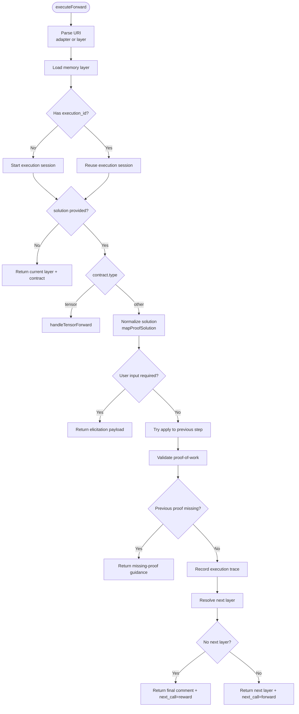
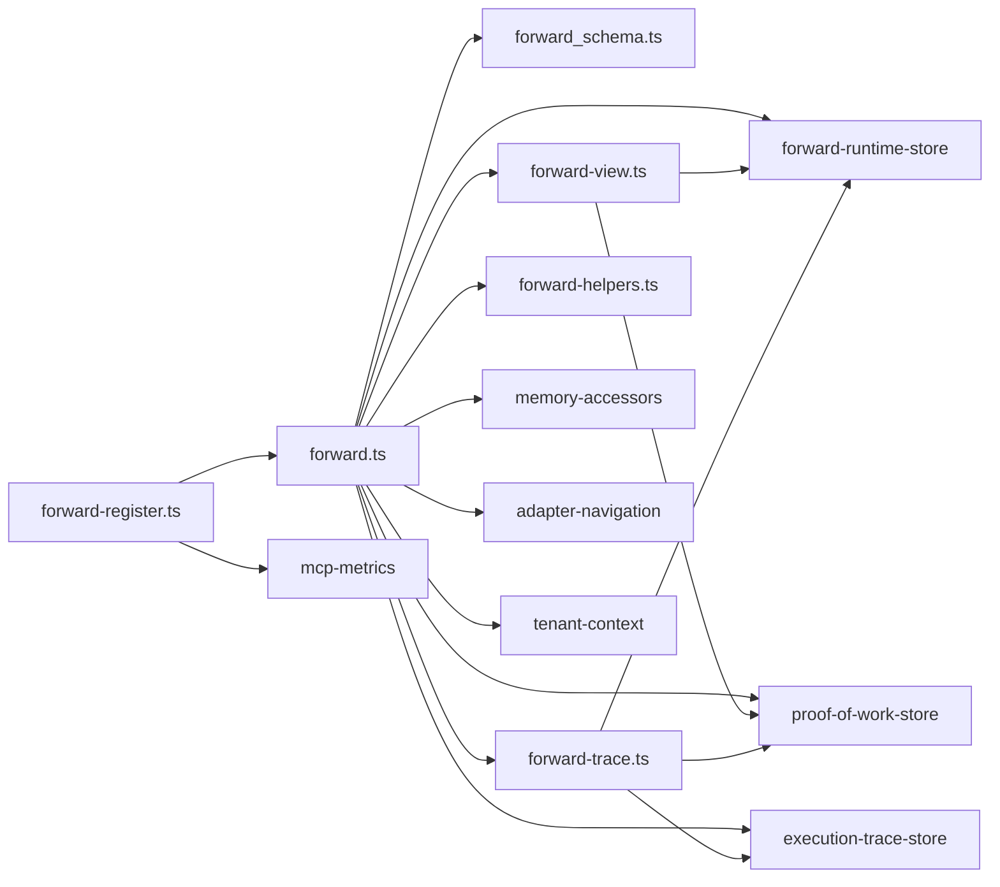

# Forward Tool

<cite>
**Referenced Files in This Document**
- [forward.ts](file://src/tools/forward.ts)
- [forward_schema.ts](file://src/tools/forward_schema.ts)
- [forward-register.ts](file://src/tools/forward-register.ts)
- [forward-view.ts](file://src/tools/forward-view.ts)
- [forward-trace.ts](file://src/tools/forward-trace.ts)
- [forward-helpers.ts](file://src/tools/forward-helpers.ts)
- [forward-tool-error.ts](file://src/tools/forward-tool-error.ts)
- [activate.ts](file://src/tools/activate.ts)
- [reward.ts](file://src/tools/reward.ts)
- [next.ts](file://src/tools/next.ts)
- [http-mcp-cors.ts](file://src/http/http-mcp-cors.ts)
- [mcp-client-utils.ts](file://tests/utils/mcp-client-utils.ts)
</cite>

## Table of Contents
1. [Introduction](#introduction)
2. [Project Structure](#project-structure)
3. [Core Components](#core-components)
4. [Architecture Overview](#architecture-overview)
5. [Detailed Component Analysis](#detailed-component-analysis)
6. [Dependency Analysis](#dependency-analysis)
7. [Performance Considerations](#performance-considerations)
8. [Troubleshooting Guide](#troubleshooting-guide)
9. [Conclusion](#conclusion)

## Introduction
The forward MCP tool runs the first or next step of a SquadRules adapter workflow. It is the execution engine for adapter layers: it loads the current layer, returns its contract, accepts a typed solution, validates proof-of-work and previous-layer requirements, records execution traces, and guides the caller to the next action.

In the canonical agent flow, `activate` selects an adapter, `forward` executes one or more adapter steps, and `reward` finalizes the run with outcome and feedback. The forward tool supports multiple continuation patterns:
- Linear workflows where each layer has a contract.
- Proof-based workflows where nonce and proof hash must be echoed.
- Tensor workflows that validate typed tensor inputs and outputs.
- Conditional branching through tensor conditions.
- Recovery paths when a previous layer’s proof is missing.
- Integration with user input, shell commands, MCP tools, and verification comments.

## Project Structure
The forward tool is implemented as a registered MCP tool whose lifecycle spans schema validation, execution logic, view construction, tracing, and error formatting.



**Diagram sources**
- [forward-register.ts:18-65](file://src/tools/forward-register.ts#L18-L65)
- [forward.ts:93-317](file://src/tools/forward.ts#L93-L317)
- [forward-view.ts:242-290](file://src/tools/forward-view.ts#L242-L290)
- [forward-trace.ts:94-117](file://src/tools/forward-trace.ts#L94-L117)
- [forward-helpers.ts:3-28](file://src/tools/forward-helpers.ts#L3-L28)

**Section sources**
- [forward-register.ts:18-65](file://src/tools/forward-register.ts#L18-L65)
- [forward.ts:93-317](file://src/tools/forward.ts#L93-L317)
- [forward-schema.ts:244-343](file://src/tools/forward_schema.ts#L244-L343)

## Core Components
- **Registration and transport**: Registers the `forward` tool, validates input against the MCP wire schema, measures duration/input/output size, and returns structured content.
- **Execution engine**: Resolves adapter or layer URIs, starts or continues an execution session, handles tensor vs non-tensor contracts, applies solutions to previous steps when appropriate, enforces proof-of-work, and navigates to the next layer.
- **View builder**: Produces the human-readable current layer, contract summary, UI metadata, and the recommended `next_call`.
- **Tracing**: Records raw solutions, tensor inputs/outputs, activation query context, and optional reasoning traces.
- **Helpers**: Normalizes legacy and v2 solution formats, builds evidence hints, and maps proof submissions into internal submission shapes.

**Section sources**
- [forward-register.ts:18-65](file://src/tools/forward-register.ts#L18-L65)
- [forward.ts:93-317](file://src/tools/forward.ts#L93-L317)
- [forward-view.ts:242-290](file://src/tools/forward-view.ts#L242-L290)
- [forward-trace.ts:38-117](file://src/tools/forward-trace.ts#L38-L117)
- [forward-helpers.ts:3-28](file://src/tools/forward-helpers.ts#L3-L28)

## Architecture Overview
The forward tool participates in the activate → forward → reward chain. It can also bridge older HTTP-style payloads into the same output shape used by the MCP tool.



**Diagram sources**
- [forward-register.ts:31-63](file://src/tools/forward-register.ts#L31-L63)
- [forward.ts:93-317](file://src/tools/forward.ts#L93-L317)
- [forward-view.ts:242-290](file://src/tools/forward-view.ts#L242-L290)
- [forward-trace.ts:94-117](file://src/tools/forward-trace.ts#L94-L117)
- [reward.ts:27-109](file://src/tools/reward.ts#L27-L109)

## Detailed Component Analysis

### Input Schema
The forward tool accepts two related schemas:
- **MCP wire input**: Used by the MCP server wrapper. Both `uri` and `solution` are optional at the wire level; validation rules enforce whether `solution` is allowed.
- **Strict input schema**: Enforces start vs continuation behavior.

Key input rules:
- Start a run with:
  - `squadrules://adapter/{slug}`
  - `squadrules://layer/{uuid}` without `?execution_id=...`
- Continue a run with:
  - `squadrules://layer/{uuid}?execution_id={uuid}` plus a valid `solution`.
- On start calls, `solution` must be omitted.
- On continuation calls, `solution` must include `type`, matching the contract, plus the appropriate payload under `evidence` or legacy fields.

Recommended v2 solution envelope:
- `type`: matches the contract type.
- `outcome`: `success`, `failure`, or `skipped`.
- `evidence`: type-specific proof payload.
- Optional `nonce` and `proof_hash` when required by the contract.
- Optional `trace` for reasoning stored with execution trace.

Legacy compatibility:
- Legacy top-level fields like `tensor`, `shell`, `mcp`, `user_input`, and `comment` are still accepted but normalized into the v2 envelope.
- For MCP solutions, a top-level `result` is moved into `evidence.response`.

**Section sources**
- [forward_schema.ts:4-12](file://src/tools/forward_schema.ts#L4-L12)
- [forward_schema.ts:54-95](file://src/tools/forward_schema.ts#L54-L95)
- [forward_schema.ts:121-186](file://src/tools/forward_schema.ts#L121-L186)
- [forward_schema.ts:188-226](file://src/tools/forward_schema.ts#L188-L226)
- [forward_schema.ts:228-267](file://src/tools/forward_schema.ts#L228-L267)
- [forward_schema.ts:269-318](file://src/tools/forward_schema.ts#L269-L318)

### Execution Flow
The execution function performs these major responsibilities:
1. Parse and validate the URI.
2. Resolve the memory layer from adapter slug, adapter UUID, or layer UUID.
3. Start or continue an execution session using `execution_id`.
4. Return the initial contract when no solution is provided.
5. Handle tensor contracts separately with typed validation and conditional branching.
6. Normalize and elicit user input when required.
7. Apply submitted solutions to previous pending steps when appropriate.
8. Validate proof-of-work and previous-layer completion.
9. Record execution traces.
10. Navigate to the next layer or mark the run as complete.



**Diagram sources**
- [forward.ts:93-317](file://src/tools/forward.ts#L93-L317)
- [forward-trace.ts:133-229](file://src/tools/forward-trace.ts#L133-L229)
- [forward-view.ts:242-290](file://src/tools/forward-view.ts#L242-L290)

**Section sources**
- [forward.ts:93-317](file://src/tools/forward.ts#L93-L317)

### Output Structure
The forward tool returns a strict `ForwardOutput` object. Important fields:

| Field | Meaning |
|---|---|
| `must_obey` | Indicates whether the caller should follow the returned guidance. |
| `current_layer` | Markdown content of the current adapter layer, including its layer URI. |
| `contract` | Required contract describing what the caller must provide next. |
| `tensor_in` | Available tensor inputs for tensor workflows. |
| `next_action` | Human-readable instruction describing the next MCP call. |
| `proof_hash` | Echoed or computed proof hash when applicable. |
| `execution_id` | Stable identifier for the current adapter run. |
| `message` | Optional status or recovery message. |
| `error_code` | Optional error code for recovery flows. |
| `retry_count` | Optional retry guidance for missing-proof scenarios. |
| `slug_disambiguation_note` | Explains which adapter was chosen when slug resolution matched multiple adapters. |
| `next_call` | Structured guidance: either `forward` with a layer URI and solution template, or `reward` with a layer URI and success outcome template. |
| `activation_space_name` | Display name of the activation space when available. |
| `context_adapter_name` | Adapter label shown in UI summaries. |
| `current_layer_label` | Layer label when present. |
| `adapter_layer_index` | Current layer index within the adapter. |
| `adapter_layer_count` | Total number of layers in the adapter. |
| `squadrules_local_artifact_dir` | Local artifact directory configuration fields. |

When the adapter completes, `next_call.kind` becomes `reward`, and `next_action` instructs calling `reward` with the layer URI and outcome.

**Section sources**
- [forward_schema.ts:320-343](file://src/tools/forward_schema.ts#L320-L343)
- [forward-view.ts:242-290](file://src/tools/forward-view.ts#L242-L290)

### Multi-Step Workflow Example
A typical multi-step linear workflow looks like this:

1. Call `forward` with an adapter URI to start.
2. Read `contract.type` and `current_layer.uri`.
3. Call `forward` again with the layer URI including `execution_id` and a solution matching the contract.
4. Repeat until `next_call.kind` is `reward`.
5. Call `reward` with the final layer URI and outcome.

Example progression:
- First call: `{ uri: "squadrules://adapter/refine-search" }`
- Second call: `{ uri: "<current_layer.uri>", solution: { type: "shell", outcome: "success", evidence: { exit_code: 0, stdout: "..." }, nonce, proof_hash } }`
- Third call: `{ uri: "<next_layer.uri>", solution: { type: "mcp", outcome: "success", evidence: { tool_name, arguments, response } } }`
- Final call: `reward` with `{ uri: "<final_layer.uri>", outcome: "success", feedback: "..." }`

**Section sources**
- [forward.ts:112-139](file://src/tools/forward.ts#L112-L139)
- [forward-view.ts:256-272](file://src/tools/forward-view.ts#L256-L272)
- [reward.ts:27-109](file://src/tools/reward.ts#L27-L109)

### Conditional Branching
Tensor contracts support a `condition` field. When the condition evaluates to false, forward does not store the tensor and instead moves to the next eligible layer. When there is no next layer, the run ends with a final message.

This enables workflows such as:
- If a search result contains a specific keyword, process it directly.
- Otherwise, skip to a fallback branch.

**Section sources**
- [forward-trace.ts:119-174](file://src/tools/forward-trace.ts#L119-L174)

### Error Recovery Patterns
Forward includes several recovery mechanisms:

- **Missing previous proof**: If a previous layer’s proof is incomplete, forward returns a payload with `error_code`, `retry_count`, `current_step`, `challenge`, and `next_action`. The caller should follow the guidance and retry up to the indicated limit.
- **Blocked payload**: Some validations produce a blocked payload rather than throwing immediately, allowing the caller to display actionable guidance.
- **Quality updates**: Successful or failed steps update Qdrant quality metrics when the service is available; failures are logged but do not break normal request flow.
- **Trace persistence failures**: Tracing uses fire-and-forget persistence so transient storage errors do not fail the forward call.

**Section sources**
- [forward.ts:152-221](file://src/tools/forward.ts#L152-L221)
- [forward.ts:266-294](file://src/tools/forward.ts#L266-L294)
- [forward.ts:37-43](file://src/tools/forward.ts#L37-L43)
- [next.ts:85-129](file://src/tools/next.ts#L85-L129)

### Authentication Requirements
Authentication is handled at the transport layer, not inside the forward tool itself. Tests show that MCP clients attach a Bearer token when the server requires authentication. CORS routes expose `WWW-Authenticate` headers for browser-based MCP usage.

Operational implications:
- Include `Authorization: Bearer <token>` when calling MCP over HTTP.
- Refresh tokens when the server responds with authentication errors.
- Use the configured MCP URL and base URL from environment variables in tests.

**Section sources**
- [mcp-client-utils.ts:35-48](file://tests/utils/mcp-client-utils.ts#L35-L48)
- [http-mcp-cors.ts:3-28](file://src/http/http-mcp-cors.ts#L3-L28)

### Session Management
Sessions are represented by `execution_id`:
- A new execution ID is generated when starting from an adapter URI or a layer URI without `execution_id`.
- Continuation calls must include the same `execution_id` in the layer URI.
- The runtime store tracks adapter ID, adapter URI, merge depth, creation time, and optional slug disambiguation notes.
- Tensor workflows use the runtime store to require and set named tensor values across steps.

Best practices:
- Always use the `current_layer.uri` returned by forward for continuation calls.
- Do not fabricate `execution_id`; reuse the value returned by the first call.
- Treat `execution_id` as the boundary of one logical adapter run.

**Section sources**
- [forward.ts:112-130](file://src/tools/forward.ts#L112-L130)
- [forward-view.ts:198-211](file://src/tools/forward-view.ts#L198-L211)

### Integration with Activate and Reward Tools
- `activate` returns ranked adapter choices and often includes a `next_action` that tells the agent to call `forward` with the selected adapter URI and no solution.
- `forward` returns `next_call.kind === "reward"` when the adapter is complete.
- `reward` records outcome, score, feedback, and evaluation metadata, and writes reward information to the execution trace store.

```mermaid
sequenceDiagram
participant Agent as "Agent"
participant Activate as "activate"
participant Forward as "forward"
participant Reward as "reward"
Agent->>Activate : search query
Activate-->>Agent : choices + next_action
Agent->>Forward : start adapter
Forward-->>Agent : contract + next_call.forward
Agent->>Forward : submit solution(s)
Forward-->>Agent : next layer or final comment
Agent->>Reward : finalize with outcome
Reward-->>Agent : results + total_rated
```

**Diagram sources**
- [activate.ts:209-235](file://src/tools/activate.ts#L209-L235)
- [forward-view.ts:256-272](file://src/tools/forward-view.ts#L256-L272)
- [reward.ts:27-109](file://src/tools/reward.ts#L27-L109)

**Section sources**
- [activate.ts:209-235](file://src/tools/activate.ts#L209-L235)
- [reward.ts:27-109](file://src/tools/reward.ts#L27-L109)

### Debugging Techniques
Use these techniques when debugging complex workflows:

1. **Inspect `current_layer.uri`**: Ensure continuation calls use the exact URI returned by the previous forward call.
2. **Echo `nonce` and `proof_hash`**: Many contracts require echoing these values in the solution.
3. **Use v2 solution format**: Prefer `type`, `outcome`, and `evidence` over legacy top-level fields.
4. **Read `next_action`**: It describes the expected next MCP call.
5. **Check `next_call.kind`**: When it is `reward`, stop calling forward and call reward instead.
6. **Review `error_code` and `retry_count`**: Missing-proof responses include retry guidance.
7. **Enable execution traces**: The forward tool records raw solutions, tensor inputs/outputs, and optional reasoning traces.
8. **Validate tensor contracts**: For tensor workflows, ensure the tensor name and value match the contract’s output specification.
9. **Monitor metrics**: The registration wrapper measures tool calls, durations, input sizes, and output sizes.

**Section sources**
- [forward_schema.ts:244-267](file://src/tools/forward_schema.ts#L244-L267)
- [forward.ts:202-211](file://src/tools/forward.ts#L202-L211)
- [forward-trace.ts:94-117](file://src/tools/forward-trace.ts#L94-L117)
- [forward-register.ts:31-53](file://src/tools/forward-register.ts#L31-L53)

## Dependency Analysis
The forward tool depends on several subsystems:



**Diagram sources**
- [forward.ts:1-35](file://src/tools/forward.ts#L1-L35)
- [forward-register.ts:1-11](file://src/tools/forward-register.ts#L1-L11)
- [forward-view.ts:1-15](file://src/tools/forward-view.ts#L1-L15)
- [forward-trace.ts:1-14](file://src/tools/forward-trace.ts#L1-L14)

**Section sources**
- [forward.ts:1-35](file://src/tools/forward.ts#L1-L35)
- [forward-register.ts:1-11](file://src/tools/forward-register.ts#L1-L11)
- [forward-view.ts:1-15](file://src/tools/forward-view.ts#L1-L15)
- [forward-trace.ts:1-14](file://src/tools/forward-trace.ts#L1-L14)

## Performance Considerations
- **Input/output metrics**: Each MCP tool call records call count, duration, input size, and output size.
- **Fire-and-forget tracing**: Execution trace persistence failures are logged but do not fail the forward call.
- **Qdrant quality updates**: Quality metric updates are wrapped in try/catch and logged on failure.
- **Caching in related components**: The `next` tool uses Redis-backed memory caching; while forward does not directly use that cache, it shares similar infrastructure patterns.
- **Avoid unnecessary re-resolution**: Reuse `execution_id` and the exact `current_layer.uri` to prevent repeated adapter resolution.

Recommendations:
- Keep solutions compact and avoid large evidence payloads unless required.
- Batch reasoning traces only when useful for debugging.
- Monitor MCP tool metrics to detect slow or oversized forward calls.
- Ensure Qdrant and storage services are healthy to avoid degraded quality updates and trace persistence.

**Section sources**
- [forward-register.ts:31-53](file://src/tools/forward-register.ts#L31-L53)
- [forward.ts:37-43](file://src/tools/forward.ts#L37-L43)
- [next.ts:24-34](file://src/tools/next.ts#L24-L34)
- [next.ts:85-129](file://src/tools/next.ts#L85-L129)

## Troubleshooting Guide

### Common Errors and Fixes
| Symptom | Likely Cause | Fix |
|---|---|---|
| Validation error about `solution` on start call | Sent `solution` when starting with adapter URI or layer URI without `execution_id` | Omit `solution` on the first call. |
| Validation error requiring `solution` on continuation call | Called forward with layer URI containing `execution_id` but no `solution` | Include a valid `solution` matching the contract. |
| `MISSING_PROOF` or missing previous step guidance | Previous layer proof not completed | Follow `next_action`, supply missing proof, and retry up to `retry_count`. |
| Tensor name mismatch | Submitted tensor name differs from contract output name | Use the exact tensor name defined in the contract. |
| Tensor type or length validation error | Tensor value does not match contract constraints | Adjust value type, string length, or array item count. |
| `next_call.kind` remains `forward` after completing work | Did not reach final layer or did not satisfy final contract | Continue submitting solutions until the adapter reports completion. |
| Authentication error over HTTP | Missing or expired Bearer token | Attach `Authorization: Bearer <token>` and refresh when needed. |

**Section sources**
- [forward_schema.ts:244-267](file://src/tools/forward_schema.ts#L244-L267)
- [forward.ts:152-221](file://src/tools/forward.ts#L152-L221)
- [forward.ts:266-294](file://src/tools/forward.ts#L266-L294)
- [forward-trace.ts:176-196](file://src/tools/forward-trace.ts#L176-L196)
- [mcp-client-utils.ts:35-48](file://tests/utils/mcp-client-utils.ts#L35-L48)

### Error Formatting
Structured errors from the forward tool are formatted into a consistent record containing `error`, `error_code`, `message`, and optional details. This makes it easier for agents and callers to distinguish recoverable guidance from fatal failures.

**Section sources**
- [forward-tool-error.ts:3-10](file://src/tools/forward-tool-error.ts#L3-L10)

## Conclusion
The forward tool is the central execution point for SquadRules adapter workflows. It transforms adapter definitions into interactive, auditable, and provable step-by-step runs. By following the contract, echoing proof values, reusing `execution_id`, and honoring `next_call`, agents can reliably navigate linear, conditional, and multi-step workflows. Integration with `activate` and `reward` completes the lifecycle, while tracing, metrics, and error guidance make complex workflows debuggable and production-ready.