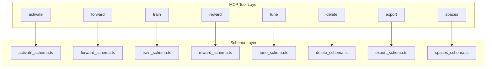
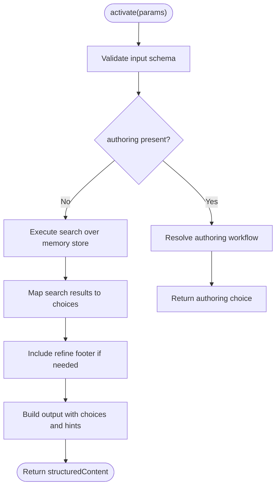
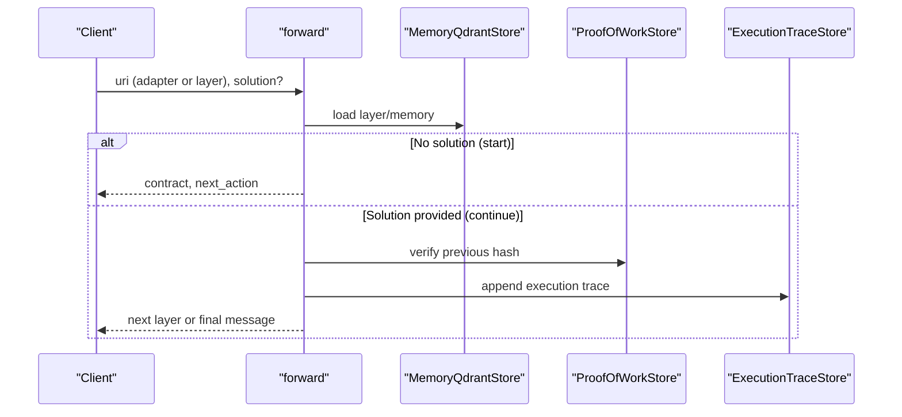
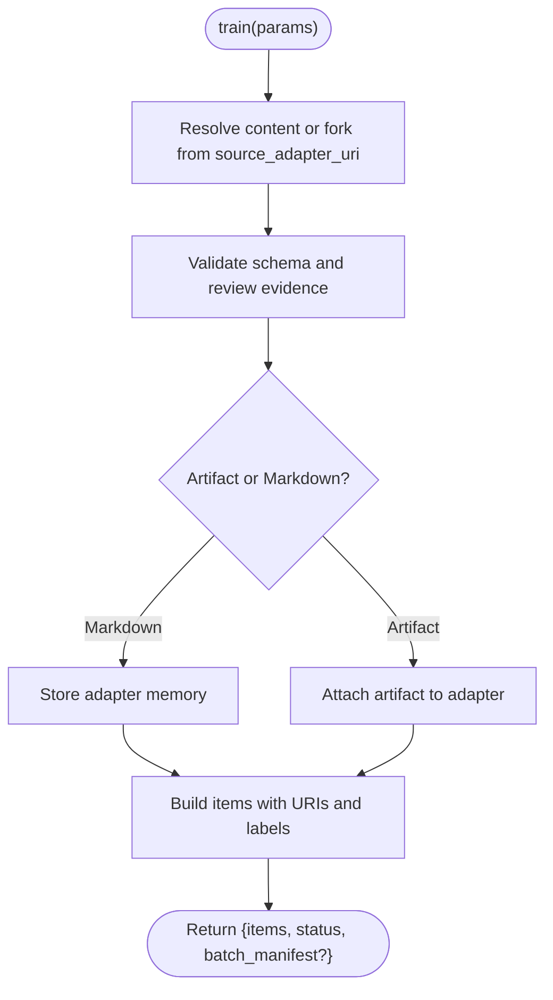
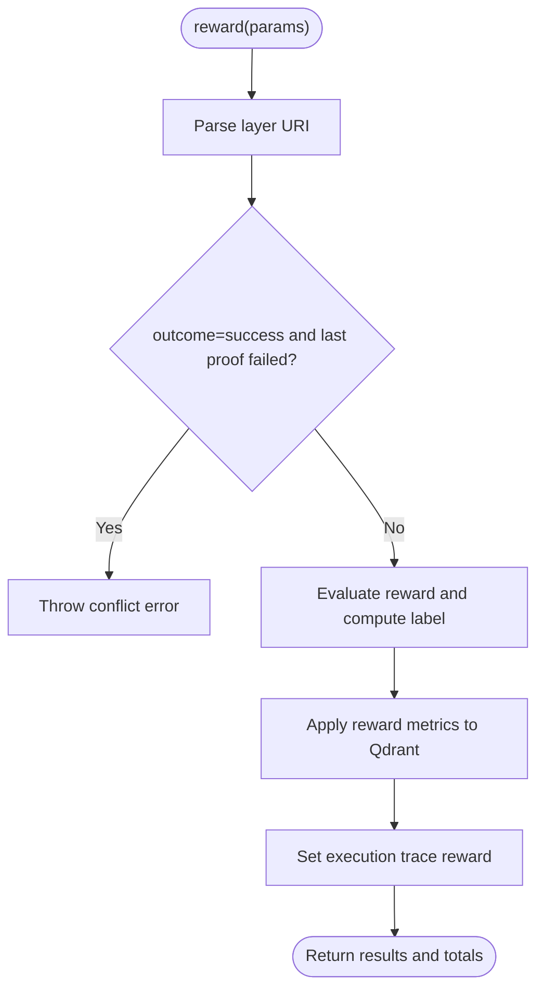
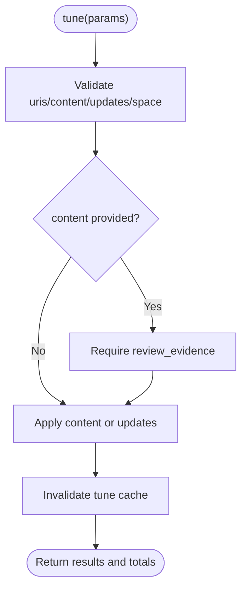
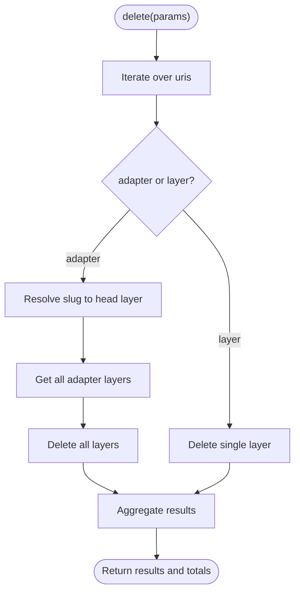
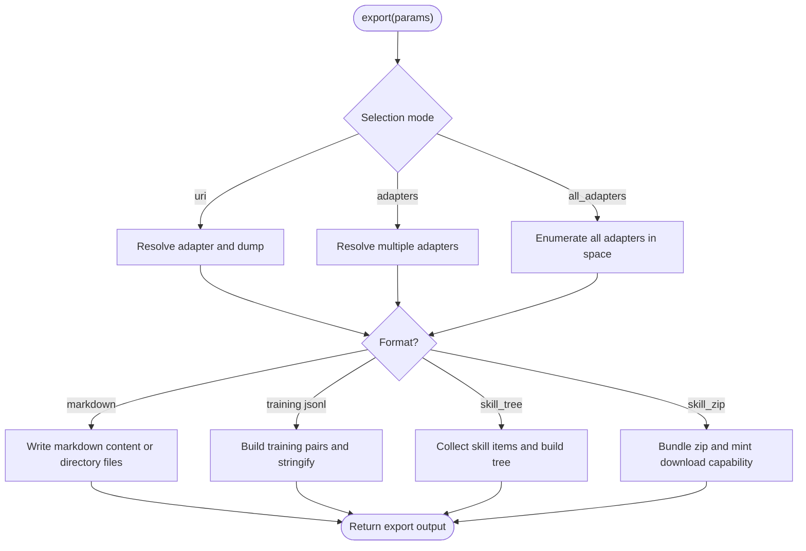
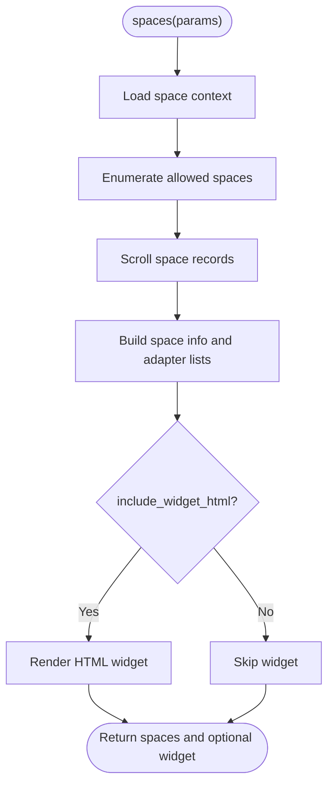
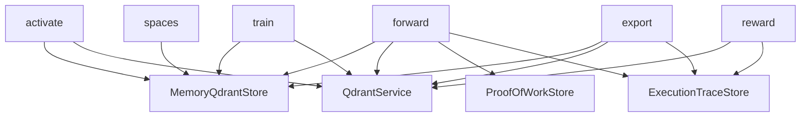

# MCP Tools Reference

<cite>
**Referenced Files in This Document**
- [activate.ts](file://src/tools/activate.ts)
- [activate_schema.ts](file://src/tools/activate_schema.ts)
- [forward.ts](file://src/tools/forward.ts)
- [forward_schema.ts](file://src/tools/forward_schema.ts)
- [train.ts](file://src/tools/train.ts)
- [train_schema.ts](file://src/tools/train_schema.ts)
- [reward.ts](file://src/tools/reward.ts)
- [reward_schema.ts](file://src/tools/reward_schema.ts)
- [tune.ts](file://src/tools/tune.ts)
- [tune_schema.ts](file://src/tools/tune_schema.ts)
- [delete.ts](file://src/tools/delete.ts)
- [delete_schema.ts](file://src/tools/delete_schema.ts)
- [export.ts](file://src/tools/export.ts)
- [export_schema.ts](file://src/tools/export_schema.ts)
- [spaces.ts](file://src/tools/spaces.ts)
- [spaces_schema.ts](file://src/tools/spaces_schema.ts)
</cite>

## Table of Contents
1. [Introduction](#introduction)
2. [Project Structure](#project-structure)
3. [Core Components](#core-components)
4. [Architecture Overview](#architecture-overview)
5. [Detailed Component Analysis](#detailed-component-analysis)
6. [Dependency Analysis](#dependency-analysis)
7. [Performance Considerations](#performance-considerations)
8. [Troubleshooting Guide](#troubleshooting-guide)
9. [Conclusion](#conclusion)

## Introduction
This document provides comprehensive API documentation for the SquadRules MCP tools: activate, forward, train, reward, tune, delete, export, and spaces. It explains each tool’s purpose, parameters, return values, error handling, authentication context, rate limiting behavior, and typical usage patterns. The core workflow is an agent-driven chain: activate selects the best adapter, forward executes workflow steps, and reward records performance feedback. Adapters are deterministic, auditable workflows that agents must create or repair when requirements change.

Key operational notes:
- Agents are primary users; humans configure preferences through agents.
- Vector stores include Qdrant (primary) and LanceDB (secondary).
- Storage includes Redis for sessions and rate limiting, vector DBs for embeddings, and filesystem for configuration and adapters.
- Authentication uses Keycloak + Google IdP with OAuth2/JWT tokens validating both human and agent requests.
- Skills under `.agents/skills` are hand-authored routing logic; `squadrules` is the canonical action router.

## Project Structure
The MCP tools are implemented as server-registered functions with Zod input/output schemas. Each tool file contains:
- A registration function that binds the tool to the MCP server.
- An execution function that performs business logic.
- A schema file defining validated request/response shapes.



**Diagram sources**
- [activate.ts:231-280](file://src/tools/activate.ts#L231-L280)
- [activate_schema.ts:86-139](file://src/tools/activate_schema.ts#L86-L139)
- [forward.ts:91-339](file://src/tools/forward.ts#L91-L339)
- [forward_schema.ts:234-318](file://src/tools/forward_schema.ts#L234-L318)
- [train.ts:246-381](file://src/tools/train.ts#L246-L381)
- [train_schema.ts:54-199](file://src/tools/train_schema.ts#L54-L199)
- [reward.ts:132-175](file://src/tools/reward.ts#L132-L175)
- [reward_schema.ts:10-51](file://src/tools/reward_schema.ts#L10-L51)
- [tune.ts:19-69](file://src/tools/tune.ts#L19-L69)
- [tune_schema.ts:14-70](file://src/tools/tune_schema.ts#L14-L70)
- [delete.ts:73-115](file://src/tools/delete.ts#L73-L115)
- [delete_schema.ts:14-32](file://src/tools/delete_schema.ts#L14-L32)
- [export.ts:347-390](file://src/tools/export.ts#L347-L390)
- [export_schema.ts:44-162](file://src/tools/export_schema.ts#L44-L162)
- [spaces.ts:195-254](file://src/tools/spaces.ts#L195-L254)
- [spaces_schema.ts:3-52](file://src/tools/spaces_schema.ts#L3-L52)

**Section sources**
- [activate.ts:231-280](file://src/tools/activate.ts#L231-L280)
- [forward.ts:91-339](file://src/tools/forward.ts#L91-L339)
- [train.ts:246-381](file://src/tools/train.ts#L246-L381)
- [reward.ts:132-175](file://src/tools/reward.ts#L132-L175)
- [tune.ts:19-69](file://src/tools/tune.ts#L19-L69)
- [delete.ts:73-115](file://src/tools/delete.ts#L73-L115)
- [export.ts:347-390](file://src/tools/export.ts#L347-L390)
- [spaces.ts:195-254](file://src/tools/spaces.ts#L195-L254)

## Core Components
Each tool follows a consistent pattern:
- Input validation via Zod schema.
- Metrics instrumentation for call counts, duration, input/output sizes, and errors.
- Tenant and space context resolution.
- Structured response with JSON text and structured content.
- Error handling including rate-limit detection where applicable.

Common fields across tools:
- `tenant_id`: extracted from authenticated context.
- `space`: target workspace scope for write operations.
- `authoring`: special context for adapter authoring workflows.
- `execution_id`: run identifier used by activation and forward flows.

**Section sources**
- [activate.ts:247-278](file://src/tools/activate.ts#L247-L278)
- [forward.ts:91-152](file://src/tools/forward.ts#L91-L152)
- [train.ts:258-381](file://src/tools/train.ts#L258-L381)
- [reward.ts:142-175](file://src/tools/reward.ts#L142-L175)
- [tune.ts:30-69](file://src/tools/tune.ts#L30-L69)
- [delete.ts:83-115](file://src/tools/delete.ts#L83-L115)
- [export.ts:359-390](file://src/tools/export.ts#L359-L390)
- [spaces.ts:207-254](file://src/tools/spaces.ts#L207-L254)

## Architecture Overview
The MCP tools integrate with memory stores, Qdrant services, proof-of-work stores, and execution trace stores. The activate→forward→reward chain coordinates selection, step execution, and feedback.

```mermaid
sequenceDiagram
participant Client as "Client"
participant MCP as "MCP Server"
participant Activate as "activate"
participant Forward as "forward"
participant Reward as "reward"
participant Memory as "MemoryQdrantStore"
participant Qdrant as "QdrantService"
participant Trace as "ExecutionTraceStore"
participant POW as "ProofOfWorkStore"
Client->>MCP : Call activate(query, space?)
MCP->>Activate : executeActivate()
Activate->>Memory : search adapters
Activate-->>Client : choices, execution_id, next_action
Client->>MCP : Call forward(uri, solution?)
MCP->>Forward : executeForward()
Forward->>Memory : load layer/memory
Forward->>POW : verify previous hash
Forward->>Trace : append execution trace
Forward-->>Client : contract, next_action, proof_hash?
Client->>MCP : Call reward(uri, outcome, score?, rater?, rubric_version?, llm_model_id?)
MCP->>Reward : executeReward()
Reward->>Qdrant : apply reward metrics
Reward->>Trace : set reward record
Reward-->>Client : results, total_rated, total_failed
```

**Diagram sources**
- [activate.ts:168-229](file://src/tools/activate.ts#L168-L229)
- [forward.ts:91-339](file://src/tools/forward.ts#L91-L339)
- [reward.ts:28-130](file://src/tools/reward.ts#L28-L130)
- [memory-store.ts](file://src/services/memory/store.ts)
- [qdrant-service.ts](file://src/services/qdrant/service.ts)
- [execution-trace-store.ts](file://src/services/execution-trace-store.ts)
- [proof-of-work-store.ts](file://src/services/proof-of-work-store.ts)

## Detailed Component Analysis

### activate
Purpose:
- Select the best adapter for a query and return ranked activation choices.
- Supports authoring workflows for adapter creation/review/update.
- Returns guidance on artifact materialization and transport hints.

Request schema highlights:
- `query`: required string.
- `execution_id`: optional UUID for refinement sequences.
- `space` or `space_id`: scope selection.
- `max_choices`: bounded integer.
- `authoring`: optional authoring context object.

Response schema highlights:
- `must_obey`, `message`, `next_action`.
- `execution_id`, `query`.
- `choices`: discriminated union of match/refine/create roles.
- `linked_artifacts`: optional artifact metadata with materialize instructions.
- `squadrules_local_artifact_dir`: client-resolved artifact directory hints.
- `transport`: stdio or http.

Usage patterns:
- Start with `activate(query)` to get choices.
- For refinement, echo `execution_id` and refine the query.
- For authoring, supply `authoring.operation` and optionally `target_adapter_uri`.

Error handling:
- Input validation returns structured teaching result.
- Rate limit detection wraps runtime errors.

Authentication and rate limiting:
- Uses tenant context; rate limiting handled via shared runtime error helper.



**Diagram sources**
- [activate.ts:168-229](file://src/tools/activate.ts#L168-L229)
- [activate_schema.ts:86-139](file://src/tools/activate_schema.ts#L86-L139)

**Section sources**
- [activate.ts:168-280](file://src/tools/activate.ts#L168-L280)
- [activate_schema.ts:86-139](file://src/tools/activate_schema.ts#L86-L139)

### forward
Purpose:
- Execute workflow steps defined by adapters.
- Supports layered contracts: shell, forward, user_input, comment, subagent.
- Manages execution state, proof hashes, and missing proof challenges.

Request schema highlights:
- `uri`: adapter or layer URI.
- `solution`: optional; required only for continuation calls with `execution_id`.
- `authoring`: optional authoring context.

Response schema highlights:
- `current_layer`, `contract`, `next_action`.
- `proof_hash`, `execution_id`, `message`, `error_code`, `retry_count`.
- `next_call`: discriminated union of forward/reward calls.
- Space and adapter metadata fields.

Usage patterns:
- First call: omit `solution`; use adapter URI or layer without `execution_id`.
- Continuation: provide `solution.type`, `outcome`, and type-specific evidence; echo nonce/proof_hash when present.
- Follow `next_call` to proceed to next layer or finalize with reward.

Error handling:
- Not found layers/adapters raise structured errors.
- Missing proof challenges guide retries.
- Authoring context mismatches are rejected.



**Diagram sources**
- [forward.ts:91-339](file://src/tools/forward.ts#L91-L339)
- [forward_schema.ts:234-318](file://src/tools/forward_schema.ts#L234-L318)

**Section sources**
- [forward.ts:91-339](file://src/tools/forward.ts#L91-L339)
- [forward_schema.ts:234-318](file://src/tools/forward_schema.ts#L234-L318)

### train
Purpose:
- Register new adapters or artifacts.
- Supports markdown adapters, artifact attachments, and batch training from directories.
- Enforces critic-loop review evidence for adapter content.

Request schema highlights:
- `content`: markdown or artifact source.
- `llm_model_id`: required.
- `force_update`: overwrite existing adapter.
- `protocol_version`: version tag.
- `space`: target space.
- `source_adapter_uri`: fork from existing adapter.
- `mime`, `artifact_name`, `adapter_uri`: artifact mode fields.
- `relative_path`: skill-root-relative path for artifacts.
- `review_evidence`: critic-loop verdict proof.
- `directory`, `recursive`: batch train options.

Response schema highlights:
- `items`: stored URIs and metadata.
- `status`: always `stored`.
- `batch_manifest`: per-file status for directory-based trains.

Usage patterns:
- Single adapter: provide markdown content and review evidence.
- Artifact attachment: provide non-markdown mime and adapter URI.
- Fork: provide source adapter URI; optionally override content.
- Batch: provide directory path; each .md becomes an adapter.

Error handling:
- Normalizes duplicate and similar adapter errors into actionable payloads.
- Requires review evidence for adapter content.



**Diagram sources**
- [train.ts:88-180](file://src/tools/train.ts#L88-L180)
- [train_schema.ts:54-199](file://src/tools/train_schema.ts#L54-L199)

**Section sources**
- [train.ts:88-381](file://src/tools/train.ts#L88-L381)
- [train_schema.ts:54-199](file://src/tools/train_schema.ts#L54-L199)

### reward
Purpose:
- Record performance feedback after adapter execution completes.
- Validates success against failed proofs and computes evaluation labels.

Request schema highlights:
- `uri`: layer URI.
- `outcome`: success or failure.
- `score`: optional normalized score.
- `feedback`: optional evaluator feedback.
- `rater`: optional human evaluator ID.
- `rubric_version`: optional policy version.
- `llm_model_id`: optional model identifier.

Response schema highlights:
- `results`: array of rated entries with eligibility flags.
- `total_rated`, `total_failed`.
- `next_call`: null.

Usage patterns:
- Call reward with final layer URI and outcome.
- Provide rater and rubric_version for SFT/preference export eligibility.

Error handling:
- Rejects success rewards for layers whose last proof failed.
- Wraps persistence failures with retryable error messages.



**Diagram sources**
- [reward.ts:28-130](file://src/tools/reward.ts#L28-L130)
- [reward_schema.ts:10-51](file://src/tools/reward_schema.ts#L10-L51)

**Section sources**
- [reward.ts:28-175](file://src/tools/reward.ts#L28-L175)
- [reward_schema.ts:10-51](file://src/tools/reward_schema.ts#L10-L51)

### tune
Purpose:
- Update adapter layer content or advanced field updates.
- Optionally move adapters between spaces.
- Requires critic-loop review evidence when content changes.

Request schema highlights:
- `uris`: non-empty array of adapter or layer URIs.
- `content`: updated bodies matching uris length.
- `updates`: advanced field updates.
- `space`: move target space.
- `review_evidence`: required when content provided.

Response schema highlights:
- `results`: per-URI update status.
- `total_updated`, `total_failed`.

Usage patterns:
- Bulk update multiple URIs with corresponding content.
- Move adapters to a different space without changing content.

Error handling:
- Validates content length matches URIs.
- Requires review evidence for content edits.



**Diagram sources**
- [tune.ts:19-69](file://src/tools/tune.ts#L19-L69)
- [tune_schema.ts:14-70](file://src/tools/tune_schema.ts#L14-L70)

**Section sources**
- [tune.ts:19-69](file://src/tools/tune.ts#L19-L69)
- [tune_schema.ts:14-70](file://src/tools/tune_schema.ts#L14-L70)

### delete
Purpose:
- Delete adapter resources by URIs.
- Supports deleting entire adapters or individual layers.

Request schema highlights:
- `uris`: non-empty array of adapter or layer URIs.

Response schema highlights:
- `results`: per-URI deletion status.
- `total_deleted`, `total_failed`.

Usage patterns:
- Delete a single layer or an entire adapter by its slug URI.

Error handling:
- Per-URI error aggregation; does not fail the whole operation on one error.



**Diagram sources**
- [delete.ts:12-71](file://src/tools/delete.ts#L12-L71)
- [delete_schema.ts:14-32](file://src/tools/delete_schema.ts#L14-L32)

**Section sources**
- [delete.ts:12-115](file://src/tools/delete.ts#L12-L115)
- [delete_schema.ts:14-32](file://src/tools/delete_schema.ts#L14-L32)

### export
Purpose:
- Export adapter markdown, training datasets, or skill bundles.
- Supports multiple formats: markdown, trace_jsonl, reward_jsonl, sft_jsonl, preference_jsonl, source, skill_tree, skill_zip.
- Provides directory-based bulk export and download references for large bundles.

Request schema highlights:
- Selection modes: `uri`, `adapters`, or `all_adapters` with `space_name`.
- `format`: export format.
- `delivery`: download_ref or inline_base64 for skill_zip.
- `include_reward`: include reward data for training formats.
- `directory`: absolute path for bulk markdown exports.

Response schema highlights:
- `content`: inline content or empty when using download_ref.
- `item_count`, `export_adapter_count`.
- `skill_bundle_manifest`, `download_ref`, `bundle_sha256`.
- `directory_manifest`: per-file write results when using directory mode.

Usage patterns:
- Flat markdown export for a single adapter.
- Training JSONL export for a single adapter.
- Skill bundle export with download reference or base64 payload.
- Directory-based bulk export for many adapters.

Error handling:
- Validates selection modes and format constraints.
- Enforces maximum adapter count and delivery restrictions.



**Diagram sources**
- [export.ts:67-345](file://src/tools/export.ts#L67-L345)
- [export_schema.ts:44-162](file://src/tools/export_schema.ts#L44-L162)

**Section sources**
- [export.ts:67-390](file://src/tools/export.ts#L67-L390)
- [export_schema.ts:44-162](file://src/tools/export_schema.ts#L44-L162)

### spaces
Purpose:
- List available spaces with adapter counts and optional adapter titles/artifacts.
- Integrates with UI widgets and displays space types.

Request schema highlights:
- `include_adapter_titles`: include adapter lists per space.
- `include_widget_html`: append HTML widget content.
- `include_artifacts`: include artifact metadata per adapter.

Response schema highlights:
- `spaces`: array of space info with name, id, type, adapter_count, and optional adapters list.

Usage patterns:
- Query spaces to discover available workspaces and adapter inventories.
- Use returned adapter URIs for subsequent export or forward calls.

Error handling:
- Logs internal errors and returns structured error content.



**Diagram sources**
- [spaces.ts:172-254](file://src/tools/spaces.ts#L172-L254)
- [spaces_schema.ts:3-52](file://src/tools/spaces_schema.ts#L3-L52)

**Section sources**
- [spaces.ts:172-254](file://src/tools/spaces.ts#L172-L254)
- [spaces_schema.ts:3-52](file://src/tools/spaces_schema.ts#L3-L52)

## Dependency Analysis
Tools depend on shared services and utilities:
- Memory store for adapter storage and retrieval.
- Qdrant service for vector operations and adapter layer management.
- Proof-of-work store for verifying previous layer hashes.
- Execution trace store for recording runs and rewards.
- Metrics for observability.



**Diagram sources**
- [activate.ts:168-229](file://src/tools/activate.ts#L168-L229)
- [forward.ts:91-339](file://src/tools/forward.ts#L91-L339)
- [reward.ts:28-130](file://src/tools/reward.ts#L28-L130)
- [train.ts:137-180](file://src/tools/train.ts#L137-L180)
- [export.ts:67-345](file://src/tools/export.ts#L67-L345)
- [spaces.ts:172-189](file://src/tools/spaces.ts#L172-L189)

**Section sources**
- [activate.ts:168-229](file://src/tools/activate.ts#L168-L229)
- [forward.ts:91-339](file://src/tools/forward.ts#L91-L339)
- [reward.ts:28-130](file://src/tools/reward.ts#L28-L130)
- [train.ts:137-180](file://src/tools/train.ts#L137-L180)
- [export.ts:67-345](file://src/tools/export.ts#L67-L345)
- [spaces.ts:172-189](file://src/tools/spaces.ts#L172-L189)

## Performance Considerations
- All tools instrument call counts, durations, input/output sizes, and errors via shared metrics.
- Activation supports refinement sequences to reduce repeated searches.
- Forward traces execution steps for later analysis and training export.
- Export supports directory-based bulk writes to avoid large inline payloads.
- Tune invalidates caches after updates to ensure consistency.

[No sources needed since this section provides general guidance]

## Troubleshooting Guide
Common issues and resolutions:
- Input validation errors: clients should inspect structured validation messages and adjust payloads accordingly.
- Rate limiting: some tools wrap rate-limit errors; retry with backoff.
- Missing proof challenges: follow `next_action` and retry with required proof or evidence.
- Duplicate or similar adapters: use `force_update` or correct adapter IDs; inspect similarity details.
- Reward conflicts: cannot mark success for layers with failed proofs; fix step and rerun.
- Export format constraints: ensure selection mode matches format requirements; use directory mode for bulk markdown.

**Section sources**
- [activate.ts:247-278](file://src/tools/activate.ts#L247-L278)
- [train.ts:343-381](file://src/tools/train.ts#L343-L381)
- [reward.ts:19-54](file://src/tools/reward.ts#L19-L54)
- [export.ts:359-390](file://src/tools/export.ts#L359-L390)

## Conclusion
The SquadRules MCP tools provide a robust, agent-first framework for selecting, executing, and evaluating adapters. The activate→forward→reward chain ensures deterministic, auditable workflows with strong validation, observability, and multi-tenancy support. Clients should adhere to the documented schemas, handle structured errors, and follow recommended usage patterns for reliable integration.

[No sources needed since this section summarizes without analyzing specific files]