# MCP Tools Reference

<cite>
**Referenced Files in This Document**
- [activate_schema.ts](file://src/tools/activate_schema.ts)
- [activate.ts](file://src/tools/activate.ts)
- [forward_schema.ts](file://src/tools/forward_schema.ts)
- [forward.ts](file://src/tools/forward.ts)
- [reward_schema.ts](file://src/tools/reward_schema.ts)
- [reward.ts](file://src/tools/reward.ts)
- [train_schema.ts](file://src/tools/train_schema.ts)
- [train.ts](file://src/tools/train.ts)
- [tune_schema.ts](file://src/tools/tune_schema.ts)
- [tune.ts](file://src/tools/tune.ts)
- [delete_schema.ts](file://src/tools/delete_schema.ts)
- [delete.ts](file://src/tools/delete.ts)
- [export_schema.ts](file://src/tools/export_schema.ts)
- [export.ts](file://src/tools/export.ts)
- [spaces_schema.ts](file://src/tools/spaces_schema.ts)
- [spaces.ts](file://src/tools/spaces.ts)
</cite>

## Table of Contents
1. [Introduction](#introduction)
2. [Project Structure](#project-structure)
3. [Core Components](#core-components)
4. [Architecture Overview](#architecture-overview)
5. [Detailed Component Analysis](#detailed-component-analysis)
6. [Dependency Analysis](#dependency-analysis)
7. [Performance Considerations](#performance-considerations)
8. [Troubleshooting Guide](#troubleshooting-guide)
9. [Conclusion](#conclusion)
10. [Appendices](#appendices)

## Introduction
This document is the authoritative API reference for SquadRules MCP tools. It covers the complete tool lifecycle: activate, forward, reward, train, tune, delete, export, and spaces. Each tool documents its purpose, input/output schemas, validation rules, authentication and space context behavior, error handling patterns, request/response shapes, integration guidance, rate limiting behavior, security considerations, debugging approaches, and best practices for chaining and state management.

SquadRules is an agent-first MCP framework where AI agents are primary users. The canonical workflow is activate → forward → reward. Adapters define deterministic, auditable task execution. Vector stores (Qdrant and LanceDB), Redis sessions/rate limiting, and filesystem storage support search, runtime state, and configuration. Authentication uses Keycloak + Google IdP with JWT tokens validating both human and agent requests.

## Project Structure
The MCP tools live under `src/tools`. Each tool typically has:
- A schema file defining Zod-based input/output types.
- An implementation file exporting `execute*` logic and a `register*Tool` registration function.
- Shared utilities for URIs, metrics, tenant/space context, and MCP error formatting.

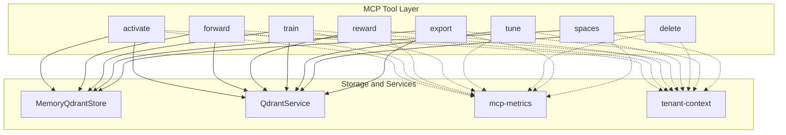

**Diagram sources**
- [activate.ts:209-286](file://src/tools/activate.ts#L209-L286)
- [forward.ts:93-317](file://src/tools/forward.ts#L93-L317)
- [reward.ts:27-155](file://src/tools/reward.ts#L27-L155)
- [train.ts:135-349](file://src/tools/train.ts#L135-L349)
- [tune.ts:19-69](file://src/tools/tune.ts#L19-L69)
- [delete.ts:12-115](file://src/tools/delete.ts#L12-L115)
- [export.ts:40-316](file://src/tools/export.ts#L40-L316)
- [spaces.ts:172-254](file://src/tools/spaces.ts#L172-L254)

**Section sources**
- [activate.ts:209-286](file://src/tools/activate.ts#L209-L286)
- [forward.ts:93-317](file://src/tools/forward.ts#L93-L317)
- [reward.ts:27-155](file://src/tools/reward.ts#L27-L155)
- [train.ts:135-349](file://src/tools/train.ts#L135-L349)
- [tune.ts:19-69](file://src/tools/tune.ts#L19-L69)
- [delete.ts:12-115](file://src/tools/delete.ts#L12-L115)
- [export.ts:40-316](file://src/tools/export.ts#L40-L316)
- [spaces.ts:172-254](file://src/tools/spaces.ts#L172-L254)

## Core Components
This section summarizes each tool’s purpose, parameters, outputs, and key behaviors.

### activate
Purpose: Find the best adapter(s) for a query and return ranked choices with instructions to start a forward run.

Input schema highlights:
- query: required string.
- execution_id: optional UUID used to refine activation across multiple calls.
- space / space_id: optional scoping to a named or ID-scoped space.
- max_choices: integer within configured limits.

Output schema highlights:
- must_obey: always true; pick one choice and follow next_action.
- message: human-readable guidance.
- next_action: directive to call forward with the chosen adapter URI.
- execution_id: server-generated or echoed refinement ID.
- choices: discriminated union of match/refine/create roles with labels, scores, tags, and next_action.
- squadrules_local_artifact_dir: client-resolved artifact directory hints.

Authentication and scope:
- Uses tenant context and optional space scoping when searching.

Error handling:
- Input validation errors are returned via MCP input validation result.
- Rate limiting is detected and converted to a rate-limit response when applicable.

Integration notes:
- Use execution_id to refine results by re-running activate with a more specific query.
- Choices may include linked artifacts; materialize them before calling forward as instructed.

**Section sources**
- [activate_schema.ts:1-120](file://src/tools/activate_schema.ts#L1-L120)
- [activate.ts:209-286](file://src/tools/activate.ts#L209-L286)

### forward
Purpose: Start or continue an adapter execution step. First call loads contract; continuation calls submit solutions matching the contract.

Input schema highlights:
- uri: adapter or layer URI.
- solution: required only on continuation calls (layer URI with execution_id). Must include type, outcome, evidence payload; older type-specific fields are still accepted.

Output schema highlights:
- must_obey: boolean directive.
- current_layer: markdown content for the active layer.
- contract: expected inputs/outputs for tensor/shell/mcp/user_input/comment steps.
- next_action: instruction for the next call.
- proof_hash / execution_id: proof-of-work and execution tracking identifiers.
- next_call: structured hint for subsequent forward or reward calls.

Authentication and scope:
- Reads from memory store and optionally updates step quality metrics using Qdrant service.

Error handling:
- Not found returns a typed error.
- Missing proof or blocked payloads produce guided retry messages.

State management:
- Starts a new execution if no execution_id is present.
- Tracks execution traces and applies solutions to previous steps when needed.

**Section sources**
- [forward_schema.ts:1-343](file://src/tools/forward_schema.ts#L1-L343)
- [forward.ts:93-317](file://src/tools/forward.ts#L93-L317)

### reward
Purpose: Record evaluation feedback after adapter execution completes.

Input schema highlights:
- uri: final layer URI.
- outcome: success or failure.
- score: optional normalized score.
- feedback: optional evaluator text.
- rater / llm_model_id: evaluator identity fields.
- rubric_version: policy version tag.

Output schema highlights:
- results: per-layer evaluation details including grader_kind, evaluation_label, eligibility flags, blockers, and rated_at timestamp.
- total_rated / total_failed: counters.
- next_call: null.

Authentication and scope:
- Persists reward metrics and trace data tied to execution_id when present.

Error handling:
- Invalid URI returns a typed error.
- Persistence failures return a retryable service error.

**Section sources**
- [reward_schema.ts:1-53](file://src/tools/reward_schema.ts#L1-L53)
- [reward.ts:27-155](file://src/tools/reward.ts#L27-L155)

### train
Purpose: Store adapters or artifacts into the memory store, with fork support and review evidence requirements.

Input schema highlights:
- content: adapter markdown or artifact source.
- llm_model_id: required model identifier.
- force_update: overwrite existing adapter with same label.
- protocol_version: optional version tag.
- space: target space ("personal" or group name).
- source_adapter_uri: optional fork source.
- mime / artifact_name / adapter_uri: artifact mode fields.
- relative_path: skill-root-relative path for artifacts.
- review_evidence: required for adapter markdown trains.

Output schema highlights:
- items: stored URIs and metadata.
- status: "stored".

Authentication and scope:
- Resolves space context and writes into the resolved space.

Error handling:
- Normalizes store errors into user-friendly payloads with guidance to use guided creation flow.
- Detects duplicate adapters and similar memory matches.

**Section sources**
- [train_schema.ts:1-237](file://src/tools/train_schema.ts#L1-L237)
- [train.ts:135-349](file://src/tools/train.ts#L135-L349)

### tune
Purpose: Update adapter content or move layers between spaces.

Input schema highlights:
- uris: non-empty array of adapter or layer URIs.
- content: updated bodies (one per URI).
- updates: advanced field updates.
- space: move all layers of targets to this space.
- review_evidence: required when content is provided.

Output schema highlights:
- results: per-URI update status and message.
- total_updated / total_failed: counters.

Authentication and scope:
- Lazily resolves Qdrant service and invalidates caches after successful updates.

Error handling:
- Input validation errors are returned via MCP input validation result.

**Section sources**
- [tune_schema.ts:1-72](file://src/tools/tune_schema.ts#L1-L72)
- [tune.ts:19-69](file://src/tools/tune.ts#L19-L69)

### delete
Purpose: Delete adapters or individual layers.

Input schema highlights:
- uris: non-empty array of adapter or layer URIs.

Output schema highlights:
- results: per-URI deletion status and message.
- total_deleted / total_failed: counters.

Authentication and scope:
- Deletes adapter layers by resolving slug to head layer and iterating layers.

Error handling:
- Per-URI errors are captured without aborting the batch.

**Section sources**
- [delete_schema.ts:1-33](file://src/tools/delete_schema.ts#L1-L33)
- [delete.ts:12-115](file://src/tools/delete.ts#L12-L115)

### export
Purpose: Export adapters, training datasets, or skill bundles.

Input schema highlights:
- uri / adapters / all_adapters: mutually exclusive selection modes.
- format: markdown, trace_jsonl, reward_jsonl, sft_jsonl, preference_jsonl, source, skill_tree, skill_zip.
- delivery: download_ref or inline_base64 (only valid for skill_zip).
- include_reward: include rewards in training exports.

Output schema highlights:
- uri, format, content_type, content.
- item_count, adapter_name/version, space fields.
- content_encoding and bundle_sha256 for base64 ZIPs.
- skill_bundle_manifest and download_ref for large ZIPs.

Authentication and scope:
- Uses space context for display names and kinds.

Error handling:
- Validates selection modes and format compatibility.

**Section sources**
- [export_schema.ts:1-150](file://src/tools/export_schema.ts#L1-L150)
- [export.ts:40-316](file://src/tools/export.ts#L40-L316)

### spaces
Purpose: List available spaces with adapter counts and optional adapter titles/artifacts.

Input schema highlights:
- include_adapter_titles: include adapter title and layer count per space.
- include_widget_html: append HTML table widget (implies adapter titles).
- include_artifacts: include artifact metadata per adapter.

Output schema highlights:
- spaces: list of space info objects with adapter lists and artifacts when requested.

Authentication and scope:
- Uses current request space context and appends application space.

Error handling:
- Internal errors are wrapped into MCP error responses.

**Section sources**
- [spaces_schema.ts:1-53](file://src/tools/spaces_schema.ts#L1-L53)
- [spaces.ts:172-254](file://src/tools/spaces.ts#L172-L254)

## Architecture Overview
The MCP tools form a layered architecture:
- Tool layer: register*Tool functions expose MCP endpoints with validated schemas.
- Execution layer: execute* functions implement business logic.
- Storage layer: MemoryQdrantStore and QdrantService provide persistence and vector operations.
- Context layer: tenant-context provides tenant and space scoping.
- Metrics layer: mcp-metrics records calls, durations, sizes, and errors.

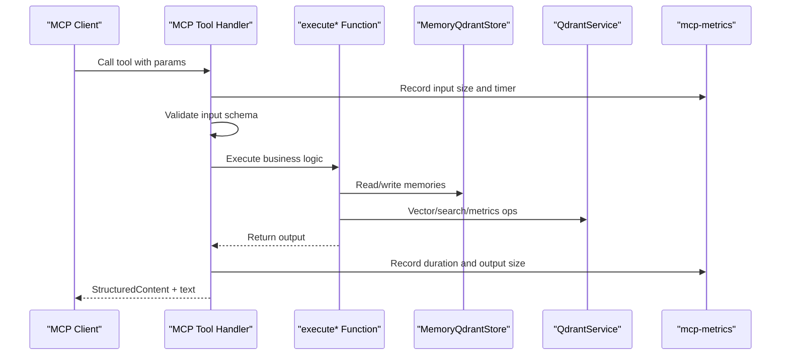

**Diagram sources**
- [activate.ts:209-286](file://src/tools/activate.ts#L209-L286)
- [forward.ts:93-317](file://src/tools/forward.ts#L93-L317)
- [reward.ts:27-155](file://src/tools/reward.ts#L27-L155)
- [train.ts:135-349](file://src/tools/train.ts#L135-L349)
- [tune.ts:19-69](file://src/tools/tune.ts#L19-L69)
- [delete.ts:12-115](file://src/tools/delete.ts#L12-L115)
- [export.ts:40-316](file://src/tools/export.ts#L40-L316)
- [spaces.ts:172-254](file://src/tools/spaces.ts#L172-L254)

## Detailed Component Analysis

### activate Lifecycle and Chaining
Activate initiates the workflow by selecting adapters and instructing the client to call forward.

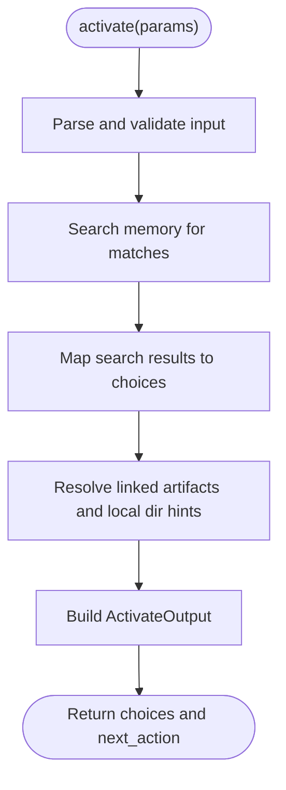

**Diagram sources**
- [activate.ts:44-207](file://src/tools/activate.ts#L44-L207)
- [activate_schema.ts:69-116](file://src/tools/activate_schema.ts#L69-L116)

Key behaviors:
- Refinement loop: echo execution_id to refine results.
- Choice roles: match/refine/create guide different forward strategies.
- Artifact materialization: generate shell commands to download and verify artifacts before forward.

Best practices:
- Always follow next_action exactly.
- Materialize linked artifacts when present.
- Use execution_id to improve matching accuracy.

**Section sources**
- [activate.ts:44-207](file://src/tools/activate.ts#L44-L207)
- [activate_schema.ts:69-116](file://src/tools/activate_schema.ts#L69-L116)

### forward Step Execution Flow
Forward manages step-by-step execution, contract enforcement, proof-of-work, and tracing.

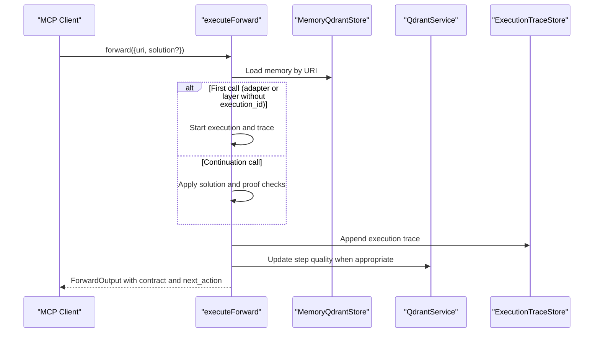

**Diagram sources**
- [forward.ts:93-317](file://src/tools/forward.ts#L93-L317)
- [forward_schema.ts:244-339](file://src/tools/forward_schema.ts#L244-L339)

Validation rules:
- Do not send solution on first call.
- On continuation, include solution.type, outcome, evidence, and echo nonce/proof_hash when present.
- Contract type determines allowed solution shape.

Error recovery:
- Missing proof triggers guided retry with challenge and retry_count.
- Blocked payloads indicate failed steps; adjust strategy and retry.

**Section sources**
- [forward.ts:93-317](file://src/tools/forward.ts#L93-L317)
- [forward_schema.ts:244-339](file://src/tools/forward_schema.ts#L244-L339)

### Reward Evaluation and Eligibility
Reward evaluates outcomes and marks eligibility for SFT and preference exports.

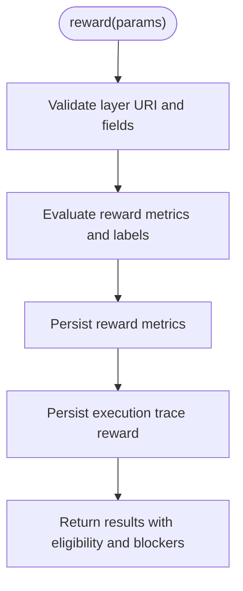

**Diagram sources**
- [reward.ts:27-155](file://src/tools/reward.ts#L27-L155)
- [reward_schema.ts:10-48](file://src/tools/reward_schema.ts#L10-L48)

Eligibility blockers:
- missing_rubric_version
- missing_evaluator_identity
- outcome_not_success
- score_below_sft_threshold
- score_below_preference_threshold

Best practices:
- Provide rubric_version and evaluator identity to enable exportability.
- Include feedback for richer evaluation signals.

**Section sources**
- [reward.ts:27-155](file://src/tools/reward.ts#L27-L155)
- [reward_schema.ts:10-48](file://src/tools/reward_schema.ts#L10-L48)

### Train Validation and Storage
Train validates complex combinations of content, MIME, artifacts, and review evidence.

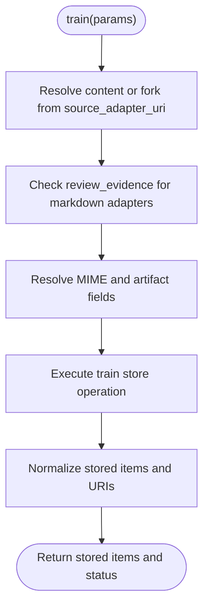

**Diagram sources**
- [train.ts:86-241](file://src/tools/train.ts#L86-L241)
- [train_schema.ts:54-187](file://src/tools/train_schema.ts#L54-L187)

Validation rules:
- For markdown adapters, review_evidence is required.
- Non-markdown MIME requires artifact_name and adapter_uri.
- relative_path allowed only for artifact rows and must be skill-root-relative.

Error handling:
- Duplicate adapter and similar memory errors are normalized with actionable messages.

**Section sources**
- [train.ts:86-241](file://src/tools/train.ts#L86-L241)
- [train_schema.ts:54-187](file://src/tools/train_schema.ts#L54-L187)

### Tune Updates and Cache Invalidation
Tune updates adapter content or moves layers between spaces.

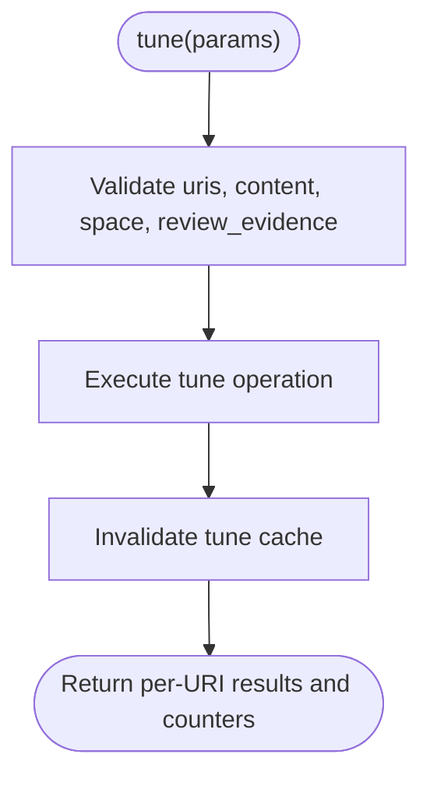

**Diagram sources**
- [tune.ts:19-69](file://src/tools/tune.ts#L19-L69)
- [tune_schema.ts:14-67](file://src/tools/tune_schema.ts#L14-L67)

Best practices:
- Prefer content updates over low-level updates.
- Provide review_evidence when editing adapter bodies.

**Section sources**
- [tune.ts:19-69](file://src/tools/tune.ts#L19-L69)
- [tune_schema.ts:14-67](file://src/tools/tune_schema.ts#L14-L67)

### Delete Batch Semantics
Delete processes multiple URIs and reports per-item status.

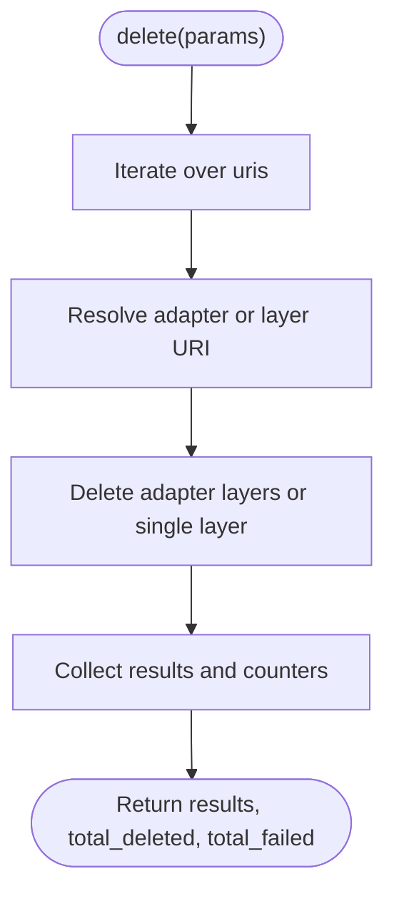

**Diagram sources**
- [delete.ts:12-70](file://src/tools/delete.ts#L12-L70)
- [delete_schema.ts:14-29](file://src/tools/delete_schema.ts#L14-L29)

Best practices:
- Expect partial failures; inspect results for per-URI messages.

**Section sources**
- [delete.ts:12-70](file://src/tools/delete.ts#L12-L70)
- [delete_schema.ts:14-29](file://src/tools/delete_schema.ts#L14-L29)

### Export Formats and Delivery Modes
Export supports multiple formats and delivery modes.

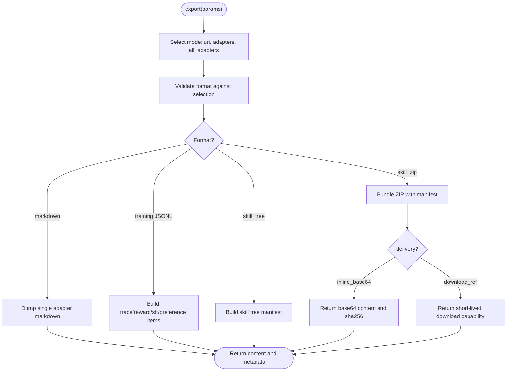

**Diagram sources**
- [export.ts:62-270](file://src/tools/export.ts#L62-L270)
- [export_schema.ts:22-146](file://src/tools/export_schema.ts#L22-L146)

Constraints:
- Exactly one selection mode.
- Training formats require a single URI.
- delivery only valid for skill_zip.

Best practices:
- Use skill_zip with download_ref for large bundles.
- Verify bundle_sha256 when using inline_base64.

**Section sources**
- [export.ts:62-270](file://src/tools/export.ts#L62-L270)
- [export_schema.ts:22-146](file://src/tools/export_schema.ts#L22-L146)

### Spaces Listing and Widget Support
Spaces lists available spaces and optionally includes adapter titles and artifacts.

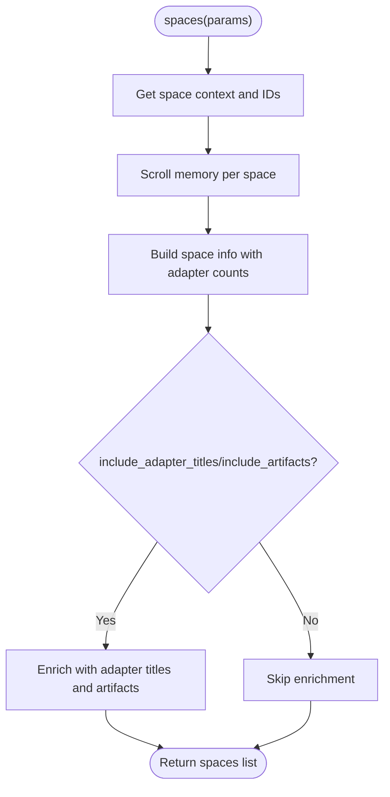

**Diagram sources**
- [spaces.ts:172-188](file://src/tools/spaces.ts#L172-L188)
- [spaces_schema.ts:3-52](file://src/tools/spaces_schema.ts#L3-L52)

Best practices:
- Use include_widget_html for UI rendering.
- Use include_artifacts to surface downloadable assets.

**Section sources**
- [spaces.ts:172-188](file://src/tools/spaces.ts#L172-L188)
- [spaces_schema.ts:3-52](file://src/tools/spaces_schema.ts#L3-L52)

## Dependency Analysis
Tools depend on shared services and utilities:
- MemoryQdrantStore: read/write memories and scroll spaces.
- QdrantService: vector search, adapter navigation, metrics, and persistence.
- Tenant context: tenant_id and space scoping.
- Metrics: call counts, durations, input/output sizes, and error rates.

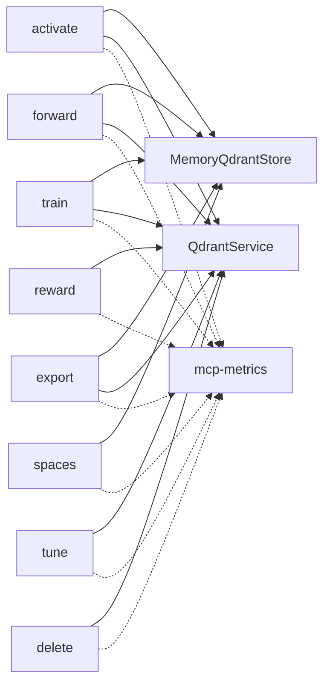

**Diagram sources**
- [activate.ts:209-286](file://src/tools/activate.ts#L209-L286)
- [forward.ts:93-317](file://src/tools/forward.ts#L93-L317)
- [reward.ts:27-155](file://src/tools/reward.ts#L27-L155)
- [train.ts:135-349](file://src/tools/train.ts#L135-L349)
- [tune.ts:19-69](file://src/tools/tune.ts#L19-L69)
- [delete.ts:12-115](file://src/tools/delete.ts#L12-L115)
- [export.ts:40-316](file://src/tools/export.ts#L40-L316)
- [spaces.ts:172-254](file://src/tools/spaces.ts#L172-L254)

**Section sources**
- [activate.ts:209-286](file://src/tools/activate.ts#L209-L286)
- [forward.ts:93-317](file://src/tools/forward.ts#L93-L317)
- [reward.ts:27-155](file://src/tools/reward.ts#L27-L155)
- [train.ts:135-349](file://src/tools/train.ts#L135-L349)
- [tune.ts:19-69](file://src/tools/tune.ts#L19-L69)
- [delete.ts:12-115](file://src/tools/delete.ts#L12-L115)
- [export.ts:40-316](file://src/tools/export.ts#L40-L316)
- [spaces.ts:172-254](file://src/tools/spaces.ts#L172-L254)

## Performance Considerations
- Activation: Limit max_choices to reduce search overhead; reuse execution_id for refinement loops.
- Forward: Avoid unnecessary continuation calls; ensure solution.type matches contract to prevent retries.
- Reward: Provide rubric_version and evaluator identity to avoid repeated eligibility checks.
- Train: Use force_update judiciously; prefer forks for safe duplication.
- Export: Prefer download_ref for large skill_zip bundles to avoid large payloads.
- Metrics: Monitor mcpToolDuration and mcpToolErrors to detect bottlenecks and regressions.

[No sources needed since this section provides general guidance]

## Troubleshooting Guide
Common issues and recovery strategies:

- Input validation errors:
  - All tools wrap validation failures in MCP input validation results. Inspect error details and correct parameters accordingly.

- Rate limiting:
  - Some tools detect rate limit conditions and return a rate-limit response. Back off and retry with exponential backoff.

- Forward missing proof:
  - When proof is missing, forward returns a challenge and retry_count. Follow next_action to supply the required prior proof.

- Reward persistence failures:
  - Service errors during reward persistence return a retryable error. Retry once when storage is healthy.

- Train duplicate or similar adapter:
  - Duplicate adapter errors suggest using force_update or choosing a distinct label. Similar memory errors suggest inspecting existing adapters.

- Export format mismatch:
  - Ensure selection mode matches format constraints (single URI for training formats; skill_zip for delivery options).

Debugging tips:
- Enable structured logging and monitor mcp-metrics counters.
- Use spaces to enumerate available resources and verify space context.
- For forward, inspect current_layer and contract to understand expected solution shape.
- For export, verify bundle_sha256 and content_type when receiving base64 ZIPs.

**Section sources**
- [activate.ts:253-286](file://src/tools/activate.ts#L253-L286)
- [forward.ts:132-317](file://src/tools/forward.ts#L132-L317)
- [reward.ts:18-86](file://src/tools/reward.ts#L18-L86)
- [train.ts:310-349](file://src/tools/train.ts#L310-L349)
- [export.ts:285-316](file://src/tools/export.ts#L285-L316)

## Conclusion
SquadRules MCP tools provide a robust, auditable workflow for agent-driven task execution. The activate→forward→reward chain ensures deterministic steps with proof-of-work and evaluation. Train, tune, delete, export, and spaces support lifecycle management, optimization, cleanup, portability, and organization. By following validation rules, error handling patterns, and best practices outlined here, integrators can build reliable agent workflows with strong security, performance, and observability.

[No sources needed since this section summarizes without analyzing specific files]

## Appendices

### Request/Response Examples
Note: These examples describe structure rather than code snippets. Replace placeholders with actual values.

- activate
  - Request: { query: "...", execution_id?: "uuid", space?: "personal|group", space_id?: "id", max_choices?: number }
  - Response: { must_obey: true, message: "...", next_action: "...", execution_id: "uuid", query: "...", choices: [...], squadrules_local_artifact_dir?: [...] }

- forward
  - Request: { uri: "squadrules://adapter/{slug}", solution?: { type: "tensor|shell|mcp|user_input|comment", outcome: "success|failure|skipped", evidence: {...}, nonce?: "string", proof_hash?: "string" } }
  - Response: { must_obey: boolean, current_layer?: { uri: "layer uuid", content: "markdown", mimeType: "text/markdown" }, contract: {...}, next_action: "...", proof_hash?: "string", execution_id?: "uuid", next_call: { kind: "forward|reward", args: {...} } }

- reward
  - Request: { uri: "squadrules://layer/{uuid}?execution_id={uuid}", outcome: "success|failure", score?: number, feedback?: "string", rater?: "string", rubric_version?: "string", llm_model_id?: "string" }
  - Response: { results: [{ uri, outcome, score, feedback, rater, rubric_version, llm_model_id, grader_kind, evaluation_label, exportable_for_sft, exportable_for_preference, sft_blockers, preference_blockers, rated_at }], total_rated: number, total_failed: number, next_call: null }

- train
  - Request: { content?: "markdown|artifact source", llm_model_id: "string", force_update?: boolean, protocol_version?: "string", space?: "personal|group", source_adapter_uri?: "squadrules://adapter/{slug}", mime?: "text/markdown|...", artifact_name?: "string", adapter_uri?: "squadrules://adapter/{slug}", relative_path?: "string", review_evidence?: { verdict_file: "path", exit_code: 0, stdout: "PASS..." } }
  - Response: { items: [{ uri, layer_uuid?, artifact_uuid?, adapter_uri?, label, tags, content_type? }], status: "stored" }

- tune
  - Request: { uris: ["squadrules://adapter/{slug}|layer uuid"], content?: ["string..."], updates?: Record<string, any>, space?: "personal|group", review_evidence?: { verdict_file: "path", exit_code: 0, stdout: "PASS..." } }
  - Response: { results: [{ uri, status: "updated|error", message }], total_updated: number, total_failed: number }

- delete
  - Request: { uris: ["squadrules://adapter/{slug}|layer uuid"] }
  - Response: { results: [{ uri, status: "deleted|error", message }], total_deleted: number, total_failed: number }

- export
  - Request: { uri?: "adapter|layer|artifact", adapters?: ["slug"], all_adapters?: boolean, space_name?: "string", format: "markdown|trace_jsonl|reward_jsonl|sft_jsonl|preference_jsonl|source|skill_tree|skill_zip", delivery?: "download_ref|inline_base64", include_reward?: boolean }
  - Response: { uri, format, content_type, content, item_count?, adapter_name?, adapter_version?, space_id?, space_name?, space_type?, content_encoding?, bundle_sha256?, export_adapter_count?, skill_bundle_manifest?, download_ref? }

- spaces
  - Request: { include_adapter_titles?: boolean, include_widget_html?: boolean, include_artifacts?: boolean }
  - Response: { spaces: [{ name, space_id, type: "personal|group|app|other", adapter_count, adapters? }] }

[No sources needed since this section provides conceptual examples]

### Tool Selection Best Practices
- Choose activate when you need to discover adapters based on natural language queries.
- Use forward to execute steps deterministically; respect contract and proof requirements.
- Submit reward after completion to capture evaluation signals and eligibility for training.
- Use train to onboard new adapters or artifacts; leverage forks for safe duplication.
- Use tune to update content or relocate adapters across spaces.
- Use delete to remove adapters or layers; expect per-URI results.
- Use export to package skills or training datasets; choose delivery mode based on size.
- Use spaces to enumerate resources and prepare downstream operations.

[No sources needed since this section provides general guidance]

### Security Considerations
- Authentication: JWT tokens validate both human and agent requests via Keycloak + Google IdP.
- Authorization: Space context restricts reads/writes; enforce write permissions through space resolution.
- Artifacts: Materialization commands include SHA-256 verification; resolve paths safely on the client.
- Inputs: All tools validate inputs strictly; reject malformed URIs and disallowed combinations.
- Outputs: Avoid leaking sensitive data; sanitize logs and telemetry.

[No sources needed since this section provides general guidance]