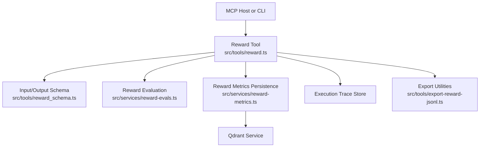
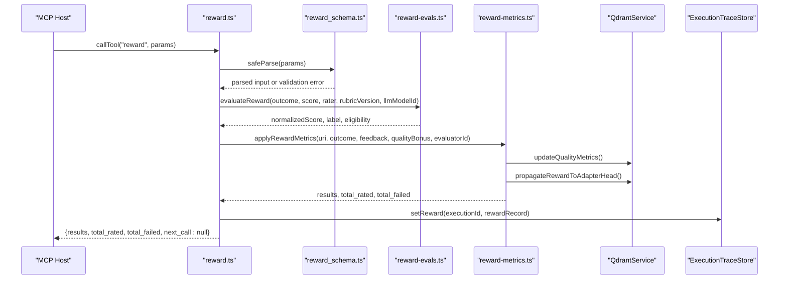
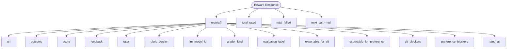
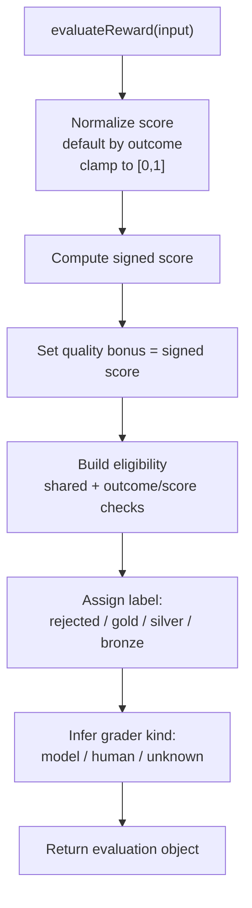
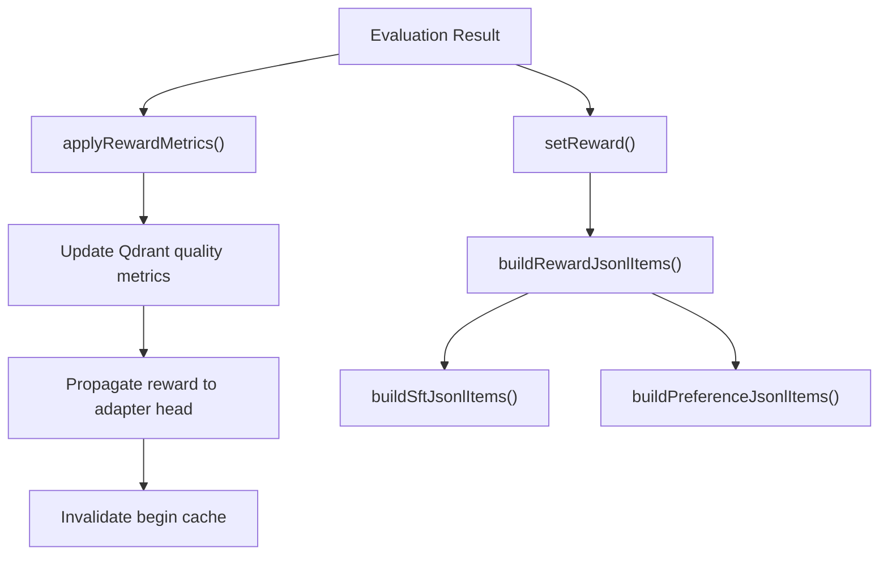
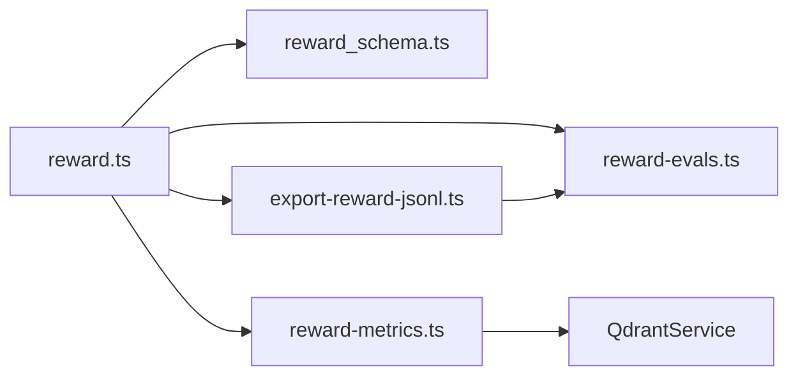

# Reward Tool

<cite>
**Referenced Files in This Document**   
- [reward.ts](file://src/tools/reward.ts)
- [reward_schema.ts](file://src/tools/reward_schema.ts)
- [reward-evals.ts](file://src/services/reward-evals.ts)
- [reward-metrics.ts](file://src/services/reward-metrics.ts)
- [export-reward-jsonl.ts](file://src/tools/export-reward-jsonl.ts)
- [embedded-mcp-resources.ts](file://src/resources/embedded-mcp-resources.ts)
- [CLI.md](file://docs/CLI.md)
- [adapter-example-all-types.md](file://docs/examples/adapter-example-all-types.md)
- [v4-squadrules-reward.test.ts](file://tests/integration/write/v4-squadrules-reward.test.ts)
</cite>

## Table of Contents
1. [Introduction](#introduction)
2. [Project Structure](#project-structure)
3. [Core Components](#core-components)
4. [Architecture Overview](#architecture-overview)
5. [Detailed Component Analysis](#detailed-component-analysis)
6. [Dependency Analysis](#dependency-analysis)
7. [Performance Considerations](#performance-considerations)
8. [Troubleshooting Guide](#troubleshooting-guide)
9. [Conclusion](#conclusion)
10. [Appendices](#appendices)

## Introduction
The reward tool is the terminal step in the SquadRules adapter execution chain: `activate` → `forward` → `reward`. Its purpose is to record a deterministic, auditable reward signal after an adapter run completes. It accepts a layer URI and an outcome, optionally enriched with a normalized score, feedback, rater identity, rubric version, and LLM model identifier. The tool evaluates eligibility for supervised fine-tuning (SFT) and preference training, persists metrics and trace data, and returns structured confirmation including evaluation labels, exporter flags, and blocker reasons.

This documentation explains how rewards are validated, scored, attributed, persisted, and exported into downstream training pipelines.

## Project Structure
The reward tool is implemented as an MCP tool with a dedicated schema, evaluation service, persistence helpers, and export utilities.



**Diagram sources**
- [reward.ts:27-110](file://src/tools/reward.ts#L27-L110)
- [reward_schema.ts:10-48](file://src/tools/reward_schema.ts#L10-L48)
- [reward-evals.ts:105-147](file://src/services/reward-evals.ts#L105-L147)
- [reward-metrics.ts:20-118](file://src/services/reward-metrics.ts#L20-L118)
- [export-reward-jsonl.ts:52-100](file://src/tools/export-reward-jsonl.ts#L52-L100)

**Section sources**
- [reward.ts:1-156](file://src/tools/reward.ts#L1-L156)
- [reward_schema.ts:1-53](file://src/tools/reward_schema.ts#L1-L53)
- [embedded-mcp-resources.ts:19-20](file://src/resources/embedded-mcp-resources.ts#L19-L20)

## Core Components
- **Tool registration and handler**: Registers the `reward` MCP tool, validates input, measures telemetry, executes reward logic, and returns structured content.
- **Schema validation**: Defines required and optional fields, URI constraints, enum values, and output shape.
- **Evaluation engine**: Normalizes scores, assigns grader kind, computes quality bonus, derives evaluation label, and determines SFT/preference eligibility.
- **Metrics persistence**: Updates Qdrant quality metrics, propagates rewards to adapter heads, invalidates caches, and records usage context.
- **Export pipeline**: Converts rewarded execution traces into JSONL formats for SFT and preference training.

**Section sources**
- [reward.ts:112-155](file://src/tools/reward.ts#L112-L155)
- [reward_schema.ts:10-48](file://src/tools/reward_schema.ts#L10-L48)
- [reward-evals.ts:29-49](file://src/services/reward-evals.ts#L29-L49)
- [reward-metrics.ts:20-118](file://src/services/reward-metrics.ts#L20-L118)
- [export-reward-jsonl.ts:96-181](file://src/tools/export-reward-jsonl.ts#L96-L181)

## Architecture Overview
The reward tool integrates with the broader SquadRules runtime through well-defined services.



**Diagram sources**
- [reward.ts:27-110](file://src/tools/reward.ts#L27-L110)
- [reward_schema.ts:10-48](file://src/tools/reward_schema.ts#L10-L48)
- [reward-evals.ts:105-147](file://src/services/reward-evals.ts#L105-L147)
- [reward-metrics.ts:20-118](file://src/services/reward-metrics.ts#L20-L118)

## Detailed Component Analysis

### Input Schema
The reward tool enforces strict validation on all inputs.

| Field | Type | Required | Description | Validation Rules |
|---|---|---:|---|---|
| `uri` | string | Yes | Final layer URI of the adapter execution | Must match `squadrules://layer/{uuid}`; optional `?execution_id={uuid}` query parameter |
| `outcome` | enum | Yes | Execution result | Values: `success`, `failure` |
| `score` | number | No | Optional normalized reward score | Clamped to `[0, 1]`; defaults based on outcome if omitted |
| `feedback` | string | No | Optional evaluator feedback text | Minimum length 1 when provided |
| `rater` | string | No | Human evaluator identifier | Used for evaluator identity and grader kind inference |
| `rubric_version` | string | No | Rubric or policy version tag | Required for SFT/preference export eligibility |
| `llm_model_id` | string | No | LLM model identifier for evaluator attribution | Used for evaluator identity and grader kind inference |

The schema also defines the output structure, including per-result metadata such as `grader_kind`, `evaluation_label`, `exportable_for_sft`, `exportable_for_preference`, and blocker arrays.

**Section sources**
- [reward_schema.ts:3-18](file://src/tools/reward_schema.ts#L3-L18)
- [reward_schema.ts:28-48](file://src/tools/reward_schema.ts#L28-L48)

### Output Structure
The tool returns a structured response containing:

- `results`: Array of per-layer reward records with normalized score, feedback, rater, rubric version, LLM model ID, grader kind, evaluation label, export flags, blockers, and rated timestamp.
- `total_rated`: Number of successfully processed reward entries.
- `total_failed`: Number of failed reward operations.
- `next_call`: Always `null`, marking the reward tool as terminal.



**Diagram sources**
- [reward.ts:89-109](file://src/tools/reward.ts#L89-L109)
- [reward_schema.ts:28-48](file://src/tools/reward_schema.ts#L28-L48)

**Section sources**
- [reward.ts:89-109](file://src/tools/reward.ts#L89-L109)
- [reward_schema.ts:28-48](file://src/tools/reward_schema.ts#L28-L48)

### Scoring and Evaluation Logic
The evaluation engine normalizes and interprets reward signals.

Key behaviors:
- If `score` is omitted, success defaults to `1` and failure defaults to `0`.
- Scores are clamped to `[0, 1]`.
- Signed score equals normalized score for success and negative normalized score for failure.
- Quality bonus equals signed score.
- Grader kind is inferred from `llm_model_id` (`model`) or `rater` (`human`); otherwise `unknown`.
- Evaluation label:
  - `rejected` for failure outcomes.
  - `gold` for success with normalized score ≥ 0.85.
  - `silver` for success with normalized score ≥ 0.65.
  - `bronze` otherwise.
- Eligibility blockers:
  - Shared: `missing_rubric_version`, `missing_evaluator_identity`.
  - SFT-specific: `outcome_not_success`, `score_below_sft_threshold` (below 0.65).
  - Preference-specific: `score_below_preference_threshold` (below 0.7).



**Diagram sources**
- [reward-evals.ts:29-49](file://src/services/reward-evals.ts#L29-L49)
- [reward-evals.ts:55-93](file://src/services/reward-evals.ts#L55-L93)
- [reward-evals.ts:105-147](file://src/services/reward-evals.ts#L105-L147)

**Section sources**
- [reward-evals.ts:29-49](file://src/services/reward-evals.ts#L29-L49)
- [reward-evals.ts:55-93](file://src/services/reward-evals.ts#L55-L93)
- [reward-evals.ts:105-147](file://src/services/reward-evals.ts#L105-L147)

### Persistence and Training Pipeline Integration
After evaluation, the tool persists two kinds of data:

1. **Qdrant quality metrics**:
   - Basic quality bonus depends on outcome.
   - Implementation bonus is computed via model stats.
   - Usage context stores feedback when present.
   - Cache invalidation is triggered for begin cache.
   - Step quality metadata is updated using label, domain, task, type, and tags.

2. **Execution trace store**:
   - Stores reward record keyed by execution ID.
   - Includes normalized score, signed score, quality bonus, feedback, rater, rubric version, LLM model ID, grader kind, evaluation label, export flags, and blockers.

Export utilities convert rewarded traces into:
- `reward_jsonl`: Full reward payload with instruction/response/reward/metadata.
- `sft_jsonl`: Instruction/response pairs filtered by SFT eligibility.
- `preference_jsonl`: Chosen vs rejected pairs grouped by canonical layer URI and layer index.



**Diagram sources**
- [reward-metrics.ts:20-118](file://src/services/reward-metrics.ts#L20-L118)
- [export-reward-jsonl.ts:52-100](file://src/tools/export-reward-jsonl.ts#L52-L100)
- [export-reward-jsonl.ts:102-181](file://src/tools/export-reward-jsonl.ts#L102-L181)

**Section sources**
- [reward-metrics.ts:20-118](file://src/services/reward-metrics.ts#L20-L118)
- [export-reward-jsonl.ts:52-100](file://src/tools/export-reward-jsonl.ts#L52-L100)
- [export-reward-jsonl.ts:102-181](file://src/tools/export-reward-jsonl.ts#L102-L181)

### Authentication Requirements
Authentication behavior depends on transport mode:

- **Local mode**: No authentication is required; commands run in-process against embedded storage.
- **HTTP targets**: Authentication uses OAuth/JWT via Keycloak and Google IdP. Commands like `login`, `token`, and `logout` manage bearer tokens. When authenticated, data commands use the HTTP backend automatically.

The reward tool itself does not implement custom auth logic; it relies on the surrounding server and transport configuration.

**Section sources**
- [CLI.md:29-44](file://docs/CLI.md#L29-L44)
- [CLI.md:186-201](file://docs/CLI.md#L186-L201)

### Data Validation Rules
Validation rules enforced by the reward tool:

- `uri` must be a valid layer URI matching the regex pattern.
- `outcome` must be exactly `success` or `failure`.
- `score` must be a finite number within `[0, 1]`; omitted scores default based on outcome.
- `feedback` must be a non-empty string when provided.
- `rater`, `rubric_version`, and `llm_model_id` are optional strings but affect eligibility and exporter flags.

Invalid input produces a structured validation error response rather than throwing directly from the handler.

**Section sources**
- [reward_schema.ts:3-18](file://src/tools/reward_schema.ts#L3-L18)
- [reward.ts:129-135](file://src/tools/reward.ts#L129-L135)

### Examples of Reward Types and Scoring Mechanisms
Common patterns include:

- **Success without explicit score**: Outcome `success` yields normalized score `1`, label `gold`, and full eligibility when rubric and evaluator identity are provided.
- **Partial success with score**: Outcome `success` with score between 0.65 and 0.84 yields label `silver`; below 0.65 yields `bronze`.
- **Failure**: Outcome `failure` yields normalized score `0`, signed score `0`, label `rejected`, and SFT/preference blockers due to non-success outcome.
- **Human-rated reward**: Provide `rater` to mark grader kind as `human`.
- **LLM-rated reward**: Provide `llm_model_id` to mark grader kind as `model`.
- **Rubric-versioned reward**: Provide `rubric_version` to enable SFT/preference export eligibility.

Integration examples can be found in integration tests that walk forward through layers and then call reward with the final layer URI.

**Section sources**
- [reward-evals.ts:29-49](file://src/services/reward-evals.ts#L29-L49)
- [reward-evals.ts:105-147](file://src/services/reward-evals.ts#L105-L147)
- [v4-squadrules-reward.test.ts:87-104](file://tests/integration/write/v4-squadrules-reward.test.ts#L87-L104)

### Feedback Collection Patterns
Feedback is optional and stored in both:
- Qdrant quality metrics under `usageContext`.
- Execution trace reward record under `feedback`.

When no feedback is provided, the tool still records a default feedback string derived from the outcome during metrics construction, ensuring consistent auditability.

**Section sources**
- [reward.ts:44-53](file://src/tools/reward.ts#L44-L53)
- [reward-metrics.ts:66-68](file://src/services/reward-metrics.ts#L66-L68)

### Best Practices for Reward Formulation
- Always provide `rubric_version` when you intend to export rewards for SFT or preference training.
- Provide either `rater` or `llm_model_id` to establish evaluator identity.
- Use explicit `score` only when you need nuanced grading; otherwise rely on outcome-based defaults.
- Include concise, actionable `feedback` to improve downstream analysis and model improvement loops.
- Ensure the `uri` points to the final layer returned by `forward`; do not substitute adapter URIs unless explicitly supported.
- Treat `next_call: null` as the terminal marker indicating the adapter run is complete.

**Section sources**
- [embedded-mcp-resources.ts:19-20](file://src/resources/embedded-mcp-resources.ts#L19-L20)
- [reward-evals.ts:55-93](file://src/services/reward-evals.ts#L55-L93)
- [reward_schema.ts:10-18](file://src/tools/reward_schema.ts#L10-L18)

## Dependency Analysis
The reward tool has clear dependencies on schema validation, evaluation logic, metrics persistence, and export utilities.



**Diagram sources**
- [reward.ts:1-10](file://src/tools/reward.ts#L1-L10)
- [reward-metrics.ts:1-6](file://src/services/reward-metrics.ts#L1-L6)
- [export-reward-jsonl.ts:1-4](file://src/tools/export-reward-jsonl.ts#L1-L4)

**Section sources**
- [reward.ts:1-10](file://src/tools/reward.ts#L1-L10)
- [reward-metrics.ts:1-6](file://src/services/reward-metrics.ts#L1-L6)
- [export-reward-jsonl.ts:1-4](file://src/tools/export-reward-jsonl.ts#L1-L4)

## Performance Considerations
- Input/output size and duration are observed via MCP metrics, enabling monitoring of reward tool latency and payload sizes.
- Qdrant updates are performed per URI, with cache invalidation triggered after reward propagation.
- Evaluation logic is lightweight and deterministic, minimizing CPU overhead.
- Export utilities filter eligible pairs before building SFT/preference datasets, reducing unnecessary processing.

[No sources needed since this section provides general guidance]

## Troubleshooting Guide
Common issues and resolutions:

- **Invalid layer URI**: Ensure the `uri` matches the layer URI format returned by `forward`. Adapter URIs are not accepted by the reward tool.
- **Missing evaluator identity**: Without `rater` or `llm_model_id`, the response will include `missing_evaluator_identity` in eligibility blockers.
- **Missing rubric version**: Without `rubric_version`, the response will include `missing_rubric_version` in eligibility blockers.
- **Persistence failures**: If Qdrant or trace storage is unhealthy, the tool throws a `REWARD_FAILED` error with status 503. Retry once storage is healthy.
- **Non-exportable rewards**: Check `sft_blockers` and `preference_blockers` to understand why a reward cannot be included in training datasets.
- **Unexpected label**: Verify the normalized score thresholds: `gold` ≥ 0.85, `silver` ≥ 0.65, `bronze` otherwise; failure always yields `rejected`.

**Section sources**
- [reward.ts:18-25](file://src/tools/reward.ts#L18-L25)
- [reward.ts:55-62](file://src/tools/reward.ts#L55-L62)
- [reward-evals.ts:55-93](file://src/services/reward-evals.ts#L55-L93)
- [reward-evals.ts:125-147](file://src/services/reward-evals.ts#L125-L147)

## Conclusion
The reward tool closes the adapter execution loop by recording auditable reward signals, evaluating their quality and eligibility, and persisting them for downstream training. By providing structured inputs, explicit evaluator identity, and rubric versions, users ensure that rewards contribute effectively to SFT and preference training pipelines. The tool’s strict validation, clear output structure, and integration with Qdrant and trace storage make it a reliable component in the SquadRules agent-first workflow.

[No sources needed since this section summarizes without analyzing specific files]

## Appendices

### CLI Usage Reference
The CLI exposes a `reward` command for recording rewards outside the MCP host flow.

```bash
squadrules reward <uri> <outcome> <feedback> \
  [--score <number>] [--rater <rater>] [--rubric-version <version>] [--model <model>]
```

**Section sources**
- [CLI.md:95-103](file://docs/CLI.md#L95-L103)

### Adapter Example Context
Adapter examples demonstrate where the reward signal appears at the end of multi-step workflows.

**Section sources**
- [adapter-example-all-types.md:78-81](file://docs/examples/adapter-example-all-types.md#L78-L81)