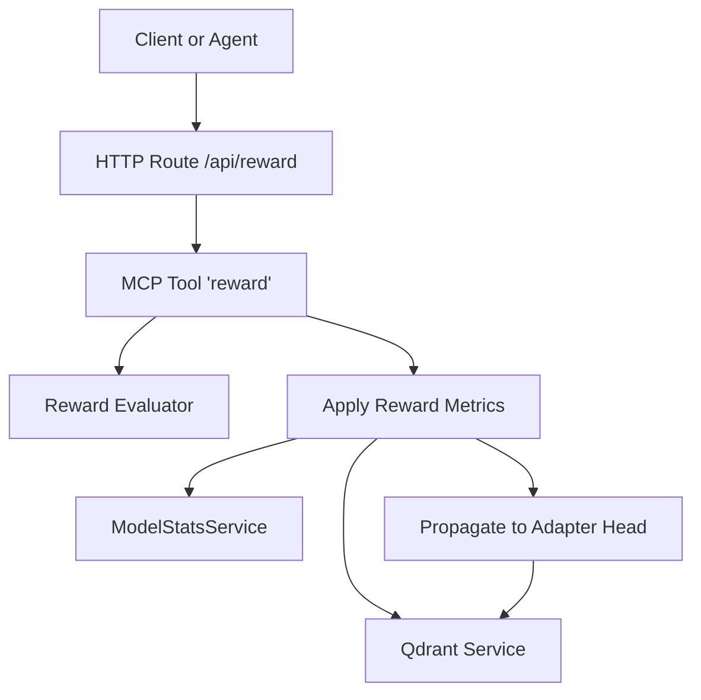
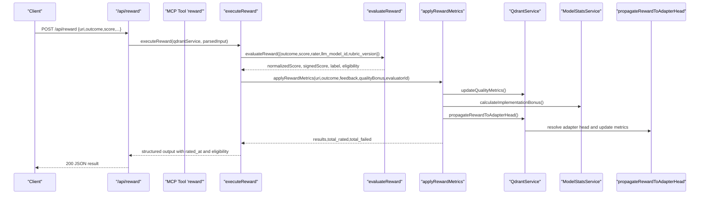
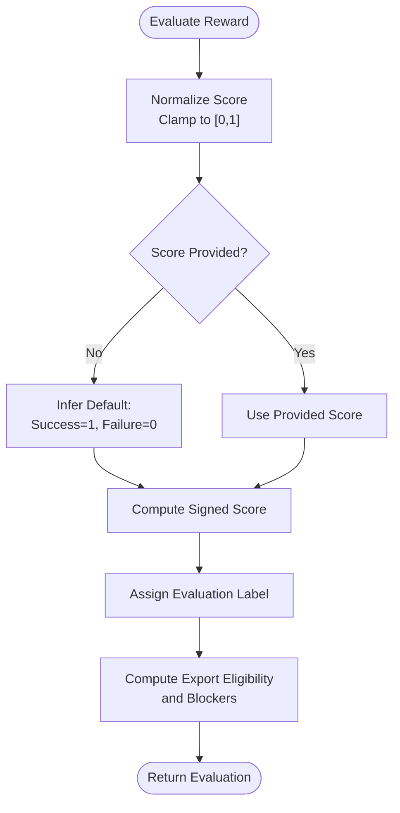
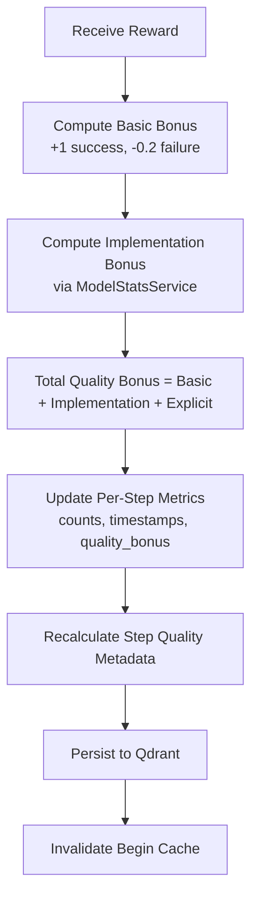
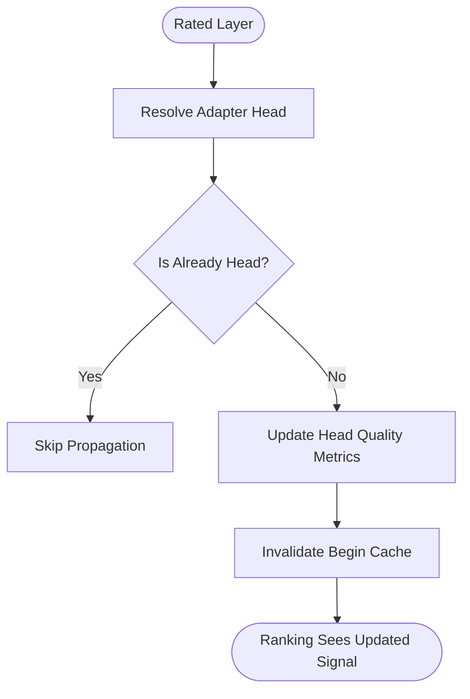
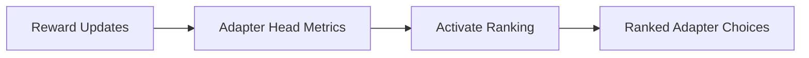
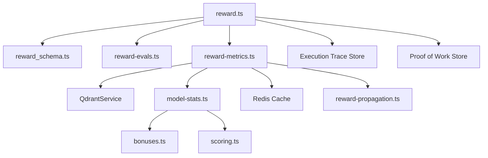

# Reward Tool

<cite>
**Referenced Files in This Document**
- [reward.ts](file://src/tools/reward.ts)
- [reward_schema.ts](file://src/tools/reward_schema.ts)
- [http-api-attest.ts](file://src/http/http-api-attest.ts)
- [http-api-routes.ts](file://src/http/http-api-routes.ts)
- [reward-evals.ts](file://src/services/reward-evals.ts)
- [reward-metrics.ts](file://src/services/reward-metrics.ts)
- [reward-propagation.ts](file://src/services/qdrant/reward-propagation.ts)
- [model-stats.ts](file://src/services/stats/model-stats.ts)
- [scoring.ts](file://src/services/stats/scoring.ts)
- [bonuses.ts](file://src/services/stats/bonuses.ts)
- [activate.ts](file://src/tools/activate.ts)
- [reward.md](file://src/embed-docs/tools/reward.md)
</cite>

## Table of Contents
1. [Introduction](#introduction)
2. [Project Structure](#project-structure)
3. [Core Components](#core-components)
4. [Architecture Overview](#architecture-overview)
5. [Detailed Component Analysis](#detailed-component-analysis)
6. [Dependency Analysis](#dependency-analysis)
7. [Performance Considerations](#performance-considerations)
8. [Troubleshooting Guide](#troubleshooting-guide)
9. [Conclusion](#conclusion)
10. [Appendices](#appendices)

## Introduction
The SquadRules reward tool finalizes an adapter execution by recording performance feedback and quality signals. It is the last step in the activate → forward → reward chain: after `forward` completes the final layer, clients call `reward` to attach outcome-based grading, optional numeric scores, evaluator identity, rubric versioning, and free-text feedback. The system normalizes rewards, computes eligibility for downstream training exports, updates per-step and per-adapter quality metrics, and propagates the signal so activation ranking can observe improved adapters.

This document explains the API contract, scoring algorithms, normalization, aggregation, audit trail fields, and how rewards influence adapter rankings through the activate flow.

## Project Structure
The reward feature spans HTTP routing, MCP tool registration, input/output schemas, evaluation logic, metric persistence, and propagation to adapter heads.

**Diagram sources**
- [http-api-attest.ts:12-35](file://src/http/http-api-attest.ts#L12-L35)
- [reward.ts:28-175](file://src/tools/reward.ts#L28-L175)
- [reward-evals.ts:105-147](file://src/services/reward-evals.ts#L105-L147)
- [reward-metrics.ts:20-119](file://src/services/reward-metrics.ts#L20-L119)
- [reward-propagation.ts:13-74](file://src/services/qdrant/reward-propagation.ts#L13-L74)
- [model-stats.ts:153-190](file://src/services/stats/model-stats.ts#L153-L190)

**Section sources**
- [http-api-routes.ts:22-36](file://src/http/http-api-routes.ts#L22-L36)
- [http-api-attest.ts:12-35](file://src/http/http-api-attest.ts#L12-L35)
- [reward.ts:28-175](file://src/tools/reward.ts#L28-L175)

## Core Components
- HTTP route `/api/reward`: validates input, calls the core executor, and returns structured results.
- MCP tool `reward`: registers schema, measures telemetry, parses inputs, and delegates to the executor.
- Reward evaluator: normalizes scores, assigns labels, determines grader kind, and computes export eligibility.
- Reward metrics service: persists per-step metrics, updates quality metadata, and triggers propagation.
- Reward propagation: updates the adapter head’s quality metrics so activation ranking sees the latest signal.
- Model stats: calculates implementation bonuses and aggregates model performance statistics.

**Section sources**
- [http-api-attest.ts:12-35](file://src/http/http-api-attest.ts#L12-L35)
- [reward.ts:28-175](file://src/tools/reward.ts#L28-L175)
- [reward-evals.ts:105-147](file://src/services/reward-evals.ts#L105-L147)
- [reward-metrics.ts:20-119](file://src/services/reward-metrics.ts#L20-L119)
- [reward-propagation.ts:13-74](file://src/services/qdrant/reward-propagation.ts#L13-L74)
- [model-stats.ts:153-190](file://src/services/stats/model-stats.ts#L153-L190)

## Architecture Overview
The reward pipeline integrates validation, evaluation, persistence, and ranking impact.

**Diagram sources**
- [http-api-attest.ts:12-35](file://src/http/http-api-attest.ts#L12-L35)
- [reward.ts:28-175](file://src/tools/reward.ts#L28-L175)
- [reward-evals.ts:105-147](file://src/services/reward-evals.ts#L105-L147)
- [reward-metrics.ts:20-119](file://src/services/reward-metrics.ts#L20-L119)
- [reward-propagation.ts:13-74](file://src/services/qdrant/reward-propagation.ts#L13-L74)
- [model-stats.ts:153-190](file://src/services/stats/model-stats.ts#L153-L190)

## Detailed Component Analysis

### HTTP Endpoint: POST /api/reward
- Validates request body against the reward input schema.
- Logs request details and forwards to the executor under tenant/space context.
- Returns structured JSON on success; otherwise returns a standardized error payload.

Key behaviors:
- Input validation failure returns 400 with field-level errors.
- Successful execution returns 200 with the same structure as the MCP tool response.

**Section sources**
- [http-api-attest.ts:12-35](file://src/http/http-api-attest.ts#L12-L35)
- [http-api-routes.ts:22-36](file://src/http/http-api-routes.ts#L22-L36)

### MCP Tool: reward
Responsibilities:
- Registers the tool with title, description, input/output schemas.
- Observes telemetry (call counts, duration, input/output sizes).
- Parses and validates inputs using Zod.
- Delegates to `executeReward`.
- Wraps errors and emits metrics.

Important notes:
- Uses loose input wrapper to accept flexible client payloads while enforcing strict schema semantics.
- Returns both text content and structured content for MCP clients.

**Section sources**
- [reward.ts:132-175](file://src/tools/reward.ts#L132-L175)
- [reward_schema.ts:10-18](file://src/tools/reward_schema.ts#L10-L18)

### Input Schema and Parameters
Required parameters:
- `uri`: Layer URI in the form `squadrules://layer/{uuid}`; optionally include `?execution_id={uuid}` to link the reward to an execution trace.
- `outcome`: Either `success` or `failure`.

Optional parameters:
- `score`: Number between 0 and 1; if omitted, defaults are inferred from outcome.
- `feedback`: Free-text evaluator feedback; stored in usage context when provided.
- `rater`: Human evaluator identifier.
- `rubric_version`: Rubric/policy version tag required for export eligibility.
- `llm_model_id`: LLM model identifier used as evaluator attribution.

Validation rules:
- `uri` must match the layer URI pattern.
- `outcome` must be one of the allowed enum values.
- Optional fields are validated for type and range where applicable.

Export eligibility requirements:
- Provide `rubric_version` and either `rater` or `llm_model_id` to mark rows exportable for SFT and preference datasets.

**Section sources**
- [reward_schema.ts:3-18](file://src/tools/reward_schema.ts#L3-L18)
- [reward.md:1-24](file://src/embed-docs/tools/reward.md#L1-L24)

### Output Schema and Response Fields
Top-level fields:
- `results`: Array of per-layer result objects.
- `total_rated`: Count of successfully processed layers.
- `total_failed`: Count of failures during processing.
- `next_call`: Always null; indicates terminal step.

Per-result fields:
- `uri`: Layer URI that was rated.
- `outcome`: Outcome recorded.
- `score`: Normalized score (nullable if not provided).
- `feedback`: Feedback string or null.
- `rater`: Rater identifier or null.
- `rubric_version`: Rubric version or null.
- `llm_model_id`: LLM model id or null.
- `grader_kind`: One of `human`, `model`, `unknown`.
- `evaluation_label`: One of `gold`, `silver`, `bronze`, `rejected`.
- `exportable_for_sft`: Boolean indicating SFT export eligibility.
- `exportable_for_preference`: Boolean indicating preference dataset eligibility.
- `sft_blockers`: List of blockers preventing SFT export.
- `preference_blockers`: List of blockers preventing preference export.
- `rated_at`: ISO timestamp of rating.

**Section sources**
- [reward_schema.ts:28-48](file://src/tools/reward_schema.ts#L28-L48)
- [reward.ts:109-129](file://src/tools/reward.ts#L109-L129)

### Scoring Algorithms and Normalization
Normalization:
- If `score` is provided, it is clamped to [0, 1].
- If omitted, default success score is 1 and default failure score is 0.

Signed score:
- Success yields positive normalized score.
- Failure yields negative normalized score.

Quality bonus:
- Quality bonus equals the signed score at this stage; additional bonuses may be added later by implementation bonus calculations.

Label assignment:
- Failure maps to `rejected`.
- Success maps to:
  - `gold` if normalized score ≥ 0.85.
  - `silver` if normalized score ≥ 0.65.
  - `bronze` otherwise.

Grader kind inference:
- `llm_model_id` present → `model`.
- `rater` present → `human`.
- Neither present → `unknown`.

Eligibility blockers:
- Shared blockers: missing rubric version, missing evaluator identity.
- SFT-specific blockers: outcome not success, score below SFT threshold (0.65).
- Preference-specific blockers: score below preference threshold (0.7).

**Diagram sources**
- [reward-evals.ts:29-49](file://src/services/reward-evals.ts#L29-L49)
- [reward-evals.ts:55-93](file://src/services/reward-evals.ts#L55-L93)
- [reward-evals.ts:105-147](file://src/services/reward-evals.ts#L105-L147)

**Section sources**
- [reward-evals.ts:29-49](file://src/services/reward-evals.ts#L29-L49)
- [reward-evals.ts:55-93](file://src/services/reward-evals.ts#L55-L93)
- [reward-evals.ts:105-147](file://src/services/reward-evals.ts#L105-L147)

### Metric Aggregation and Persistence
When a reward is applied:
- Basic quality bonus: +1 for success, -0.2 for failure.
- Implementation bonus: computed via model stats based on historical success rates and comparative performance.
- Total quality bonus: basic + implementation + explicit quality bonus from evaluation.
- Per-step metrics updated: retrieval count, success/failure counts, last rated timestamp, last rater, and quality bonus.
- Usage context: optional feedback stored as usage context.
- Step quality metadata: recalculated using description, domain, task, type, tags, and execution outcome.
- Redis cache invalidation: triggered to refresh dependent queries.

**Diagram sources**
- [reward-metrics.ts:46-95](file://src/services/reward-metrics.ts#L46-L95)
- [model-stats.ts:153-190](file://src/services/stats/model-stats.ts#L153-L190)

**Section sources**
- [reward-metrics.ts:20-119](file://src/services/reward-metrics.ts#L20-L119)
- [model-stats.ts:153-190](file://src/services/stats/model-stats.ts#L153-L190)

### Impact on Adapter Rankings
Rewards propagate to the adapter head so activation ranking reflects recent outcomes:
- The system resolves the adapter head associated with the rated layer.
- If the layer is not already the head, it updates the head’s quality metrics with the same metrics update object.
- This ensures activation ranking considers the latest reward signals when selecting adapters.

**Diagram sources**
- [reward-propagation.ts:13-74](file://src/services/qdrant/reward-propagation.ts#L13-L74)

**Section sources**
- [reward-propagation.ts:13-74](file://src/services/qdrant/reward-propagation.ts#L13-L74)

### Relationship Between Rewards and Activate Ranking
Activation selects adapters based on search and ranking signals. Reward-driven quality updates affect these signals because:
- Activation reads adapter metadata and quality-related information when mapping search results to choices.
- Reward propagation updates the adapter head’s quality metrics, which activation can observe when computing activation scores and presenting choices.
- Therefore, consistent rewarding improves the visibility and ranking of high-quality adapters over time.

**Diagram sources**
- [reward-propagation.ts:13-74](file://src/services/qdrant/reward-propagation.ts#L13-L74)
- [activate.ts:44-166](file://src/tools/activate.ts#L44-L166)

**Section sources**
- [activate.ts:44-166](file://src/tools/activate.ts#L44-L166)
- [reward-propagation.ts:13-74](file://src/services/qdrant/reward-propagation.ts#L13-L74)

### Audit Trail and Execution Trace Integration
If the reward includes an execution ID, the executor records an audit-friendly trace entry containing:
- Outcome, normalized score, signed score, quality bonus.
- Feedback, rater, rubric version, LLM model ID.
- Grader kind, evaluation label, export eligibility flags, and blocker lists.
- Rated timestamp.

This enables downstream auditing, debugging, and export pipelines to reconstruct why a particular reward was assigned.

**Section sources**
- [reward.ts:84-107](file://src/tools/reward.ts#L84-L107)

### Examples

#### Positive Reward Example
- Use a successful outcome with a high score to obtain gold labeling and strong positive quality bonus.
- Include rubric version and evaluator identity to enable export eligibility.

Expected effects:
- Evaluation label becomes gold.
- SFT and preference eligibility enabled (assuming thresholds met).
- Adapter head metrics improve, aiding activation ranking.

#### Negative Reward Example
- Use a failed outcome to record rejection and negative signed score.
- Omitting score still infers zero base score, resulting in negative signed score.

Expected effects:
- Evaluation label becomes rejected.
- SFT and preference eligibility blocked due to outcome not success.
- Adapter head metrics degrade slightly unless compensated by future successes.

#### Bulk Reward Submission Guidance
- The current implementation processes a single layer URI per call.
- To submit bulk rewards, iterate over multiple layer URIs and call the endpoint once per layer.
- Ensure each call includes appropriate evaluator identity and rubric version for export eligibility.

[No sources needed since this section provides general guidance]

## Dependency Analysis
The reward tool depends on several services and utilities:

**Diagram sources**
- [reward.ts:1-13](file://src/tools/reward.ts#L1-L13)
- [reward_schema.ts:1-18](file://src/tools/reward_schema.ts#L1-L18)
- [reward-evals.ts:1-27](file://src/services/reward-evals.ts#L1-L27)
- [reward-metrics.ts:1-6](file://src/services/reward-metrics.ts#L1-L6)
- [model-stats.ts:1-18](file://src/services/stats/model-stats.ts#L1-L18)
- [bonuses.ts:1-8](file://src/services/stats/bonuses.ts#L1-L8)
- [scoring.ts:1-6](file://src/services/stats/scoring.ts#L1-L6)
- [reward-propagation.ts:1-7](file://src/services/qdrant/reward-propagation.ts#L1-L7)

**Section sources**
- [reward.ts:1-13](file://src/tools/reward.ts#L1-L13)
- [reward_schema.ts:1-18](file://src/tools/reward_schema.ts#L1-L18)
- [reward-evals.ts:1-27](file://src/services/reward-evals.ts#L1-L27)
- [reward-metrics.ts:1-6](file://src/services/reward-metrics.ts#L1-L6)
- [model-stats.ts:1-18](file://src/services/stats/model-stats.ts#L1-L18)
- [bonuses.ts:1-8](file://src/services/stats/bonuses.ts#L1-L8)
- [scoring.ts:1-6](file://src/services/stats/scoring.ts#L1-L6)
- [reward-propagation.ts:1-7](file://src/services/qdrant/reward-propagation.ts#L1-L7)

## Performance Considerations
- Single-layer processing: Each reward call updates one layer and its adapter head; batch by iterating calls rather than expecting multi-URI support.
- Database writes: Each reward triggers updates to Qdrant and potentially Redis cache invalidation; ensure storage backends are healthy to avoid retries.
- Telemetry overhead: Tool instrumentation adds minimal overhead but should be considered in high-throughput environments.
- Model stats computation: Implementation bonus calculation involves statistical adjustments; keep history reasonable to avoid heavy computations.

[No sources needed since this section provides general guidance]

## Troubleshooting Guide
Common issues and resolutions:
- Invalid URI: Ensure the URI matches the layer pattern and includes an optional execution ID when linking traces.
- Success conflict with failed proof: Recording success for a layer whose last proof failed is rejected; fix the step and rerun, or record failure with reason.
- Missing evaluator identity or rubric version: Without these, export eligibility is blocked; add `rater` or `llm_model_id` and set `rubric_version`.
- Storage failures: If reward persistence fails, retry the same call once storage is healthy; the tool surfaces a clear error indicating no reward was stored.

Operational checks:
- Validate input schema before calling the endpoint.
- Confirm Qdrant and Redis availability.
- Inspect structured error responses for field-level validation messages.

**Section sources**
- [reward.ts:19-54](file://src/tools/reward.ts#L19-L54)
- [reward.ts:75-82](file://src/tools/reward.ts#L75-L82)
- [http-api-attest.ts:15-24](file://src/http/http-api-attest.ts#L15-L24)

## Conclusion
The SquadRules reward tool provides a robust mechanism for capturing performance feedback and quality signals after adapter execution. It normalizes scores, assigns meaningful labels, tracks export eligibility, updates per-step and per-adapter metrics, and propagates rewards to influence activation ranking. By consistently providing outcome, optional score, evaluator identity, and rubric version, teams can build reliable training datasets and improve adapter selection over time.

[No sources needed since this section summarizes without analyzing specific files]

## Appendices

### API Reference Summary

Endpoint:
- Method: POST
- Path: /api/reward
- Content-Type: application/json

Request body:
- uri: Required layer URI string.
- outcome: Required enum value.
- score: Optional number in [0,1].
- feedback: Optional string.
- rater: Optional string.
- rubric_version: Optional string.
- llm_model_id: Optional string.

Response body:
- results: Array of per-layer result objects.
- total_rated: Integer.
- total_failed: Integer.
- next_call: Null.

Status codes:
- 200: Success with structured result.
- 400: Invalid input.
- 409: Conflict when marking success despite failed proof.
- 5xx: Storage or internal errors.

**Section sources**
- [http-api-attest.ts:12-35](file://src/http/http-api-attest.ts#L12-L35)
- [reward_schema.ts:10-48](file://src/tools/reward_schema.ts#L10-L48)
- [reward.ts:19-54](file://src/tools/reward.ts#L19-L54)