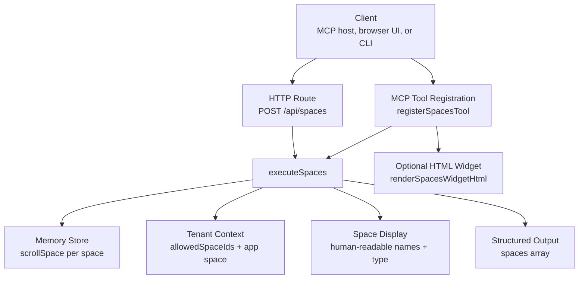
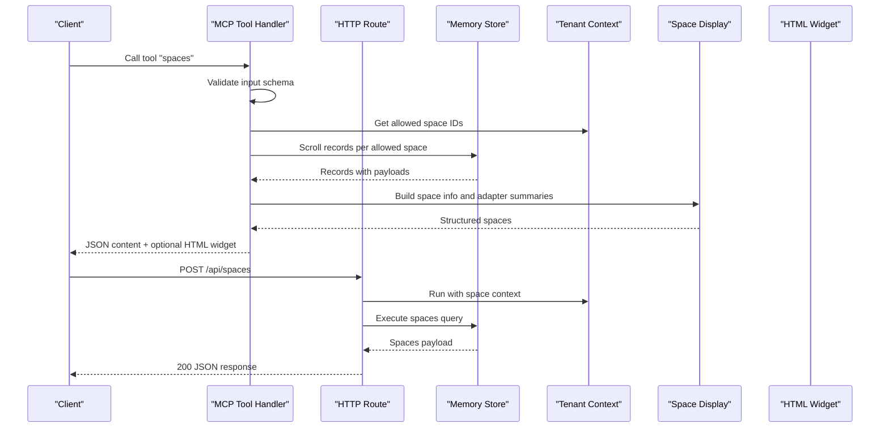
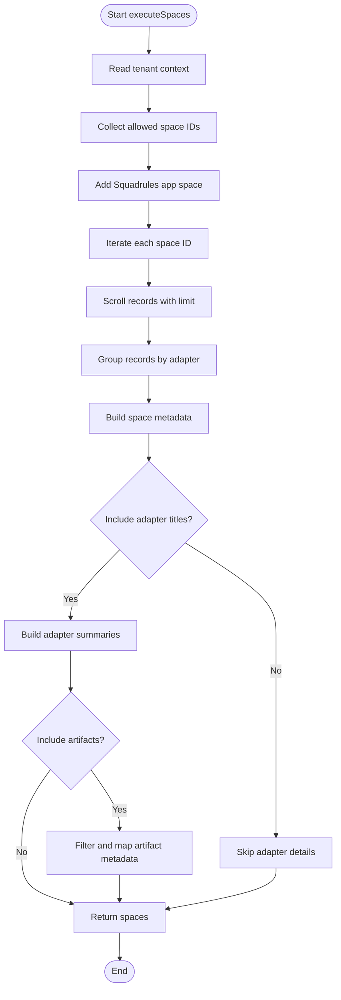
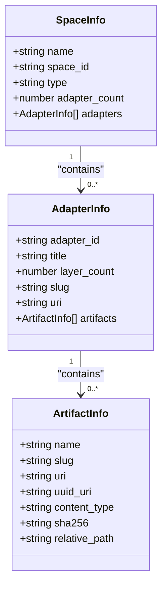
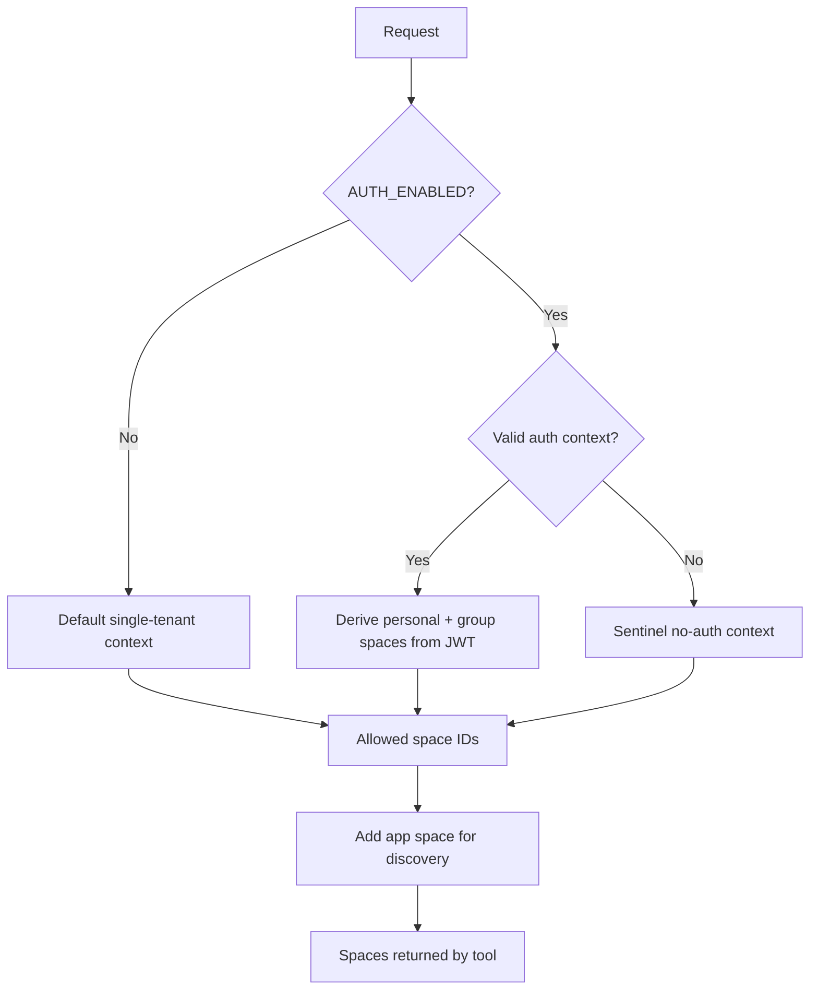
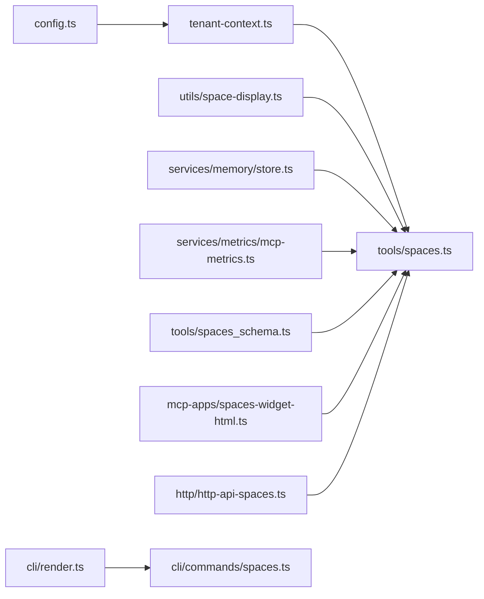

# Spaces Tool

<cite>
**Referenced Files in This Document**
- [src/tools/spaces.ts](file://src/tools/spaces.ts)
- [src/tools/spaces_schema.ts](file://src/tools/spaces_schema.ts)
- [src/http/http-api-spaces.ts](file://src/http/http-api-spaces.ts)
- [src/utils/space-display.ts](file://src/utils/space-display.ts)
- [src/utils/tenant-context.ts](file://src/utils/tenant-context.ts)
- [src/config.ts](file://src/config.ts)
- [src/mcp-apps/spaces-widget-html.ts](file://src/mcp-apps/spaces-widget-html.ts)
- [src/cli/render.ts](file://src/cli/render.ts)
- [src/cli/commands/spaces.ts](file://src/cli/commands/spaces.ts)
- [tests/integration/contracts/spaces-tool.contract.ts](file://tests/integration/contracts/spaces-tool.contract.ts)
</cite>

## Table of Contents
1. [Introduction](#introduction)
2. [Project Structure](#project-structure)
3. [Core Components](#core-components)
4. [Architecture Overview](#architecture-overview)
5. [Detailed Component Analysis](#detailed-component-analysis)
6. [Dependency Analysis](#dependency-analysis)
7. [Performance Considerations](#performance-considerations)
8. [Troubleshooting Guide](#troubleshooting-guide)
9. [Conclusion](#conclusion)
10. [Appendices](#appendices)

## Introduction
The spaces MCP tool is the agent-facing entry point for discovering which adapter collections are available to the current user or tenant. It returns a list of spaces with human-readable names, space identifiers, space types, and adapter counts. When requested, it can also include per-space adapter summaries, layer counts, optional artifact metadata, and an HTML widget for hosts that render tool content as HTML.

This tool does not perform writes. Its primary role is discovery: agents use it to choose a space before calling `activate`, `train`, `tune`, `forward`, or other tools that operate on adapters.

Key characteristics:
- Lists only spaces allowed by the current authentication and tenant context.
- Adds the embedded Squadrules application space to readable results when appropriate.
- Returns stable machine identifiers alongside human-friendly labels.
- Supports optional detail levels: adapter titles, artifacts, and an HTML widget.
- Is exposed through MCP, HTTP, and CLI interfaces.

## Project Structure
The spaces feature spans several layers:

| Layer | Responsibility | Relevant files |
|---|---|---|
| MCP tool registration | Registers the `spaces` tool, validates input, emits metrics, and returns structured JSON plus optional HTML | [src/tools/spaces.ts](file://src/tools/spaces.ts), [src/tools/spaces_schema.ts](file://src/tools/spaces_schema.ts) |
| HTTP API | Exposes `POST /api/spaces` for UI and external clients | [src/http/http-api-spaces.ts](file://src/http/http-api-spaces.ts) |
| Context and identity | Derives allowed spaces, personal/group/app classification, and display names from auth or local defaults | [src/utils/tenant-context.ts](file://src/utils/tenant-context.ts), [src/utils/space-display.ts](file://src/utils/space-display.ts), [src/config.ts](file://src/config.ts) |
| Presentation | Renders CLI tables/text and optional HTML widget output | [src/cli/render.ts](file://src/cli/render.ts), [src/mcp-apps/spaces-widget-html.ts](file://src/mcp-apps/spaces-widget-html.ts) |
| CLI command | Provides `squadrules spaces` with an option to include adapter titles | [src/cli/commands/spaces.ts](file://src/cli/commands/spaces.ts) |
| Contract tests | Validate transport-neutral behavior and schema validation | [tests/integration/contracts/spaces-tool.contract.ts](file://tests/integration/contracts/spaces-tool.contract.ts) |

**Diagram sources**
- [src/tools/spaces.ts:195-254](file://src/tools/spaces.ts#L195-L254)
- [src/http/http-api-spaces.ts:11-31](file://src/http/http-api-spaces.ts#L11-L31)
- [src/tools/spaces.ts:172-189](file://src/tools/spaces.ts#L172-L189)
- [src/utils/tenant-context.ts:120-149](file://src/utils/tenant-context.ts#L120-L149)
- [src/utils/space-display.ts:14-37](file://src/utils/space-display.ts#L14-L37)
- [src/mcp-apps/spaces-widget-html.ts:34-82](file://src/mcp-apps/spaces-widget-html.ts#L34-L82)

**Section sources**
- [src/tools/spaces.ts:1-255](file://src/tools/spaces.ts#L1-L255)
- [src/http/http-api-spaces.ts:1-32](file://src/http/http-api-spaces.ts#L1-L32)
- [src/utils/tenant-context.ts:1-312](file://src/utils/tenant-context.ts#L1-L312)
- [src/utils/space-display.ts:1-38](file://src/utils/space-display.ts#L1-L38)
- [src/config.ts:344-350](file://src/config.ts#L344-L350)
- [src/mcp-apps/spaces-widget-html.ts:1-83](file://src/mcp-apps/spaces-widget-html.ts#L1-L83)
- [src/cli/render.ts:194-213](file://src/cli/render.ts#L194-L213)
- [src/cli/commands/spaces.ts:12-34](file://src/cli/commands/spaces.ts#L12-L34)
- [tests/integration/contracts/spaces-tool.contract.ts:24-43](file://tests/integration/contracts/spaces-tool.contract.ts#L24-L43)

## Core Components

### MCP Tool Entry Point
The `spaces` tool is registered with a title, description, validated input schema, output schema, and optional UI metadata. The handler:
- Parses and validates input using Zod.
- Tracks input size, duration, call count, and error count via MCP metrics.
- Computes whether adapter titles and artifacts should be included.
- Calls `executeSpaces`.
- Returns structured JSON content and optionally an HTML widget.
- Converts errors into MCP-compatible error responses.

Important implementation details:
- Input validation failures return a teaching-oriented invalid-input result rather than a raw exception.
- `include_widget_html` implies adapter titles because the widget needs adapter summaries.
- `include_artifacts` implies adapter titles because artifacts are nested under adapters.
- The tool name defaults to `spaces` but can be overridden during registration.

**Section sources**
- [src/tools/spaces.ts:22-21](file://src/tools/spaces.ts#L22-L21)
- [src/tools/spaces.ts:195-254](file://src/tools/spaces.ts#L195-L254)

### Input Schema
The input schema defines three optional boolean flags:

| Field | Type | Default | Behavior |
|---|---:|---:|---|
| `include_adapter_titles` | boolean | false | Includes each space’s adapters with title, layer count, slug, URI, and adapter ID. |
| `include_widget_html` | boolean | false | Appends a second text content part containing an HTML table summarizing spaces and expandable adapter rows. Implies adapter titles. |
| `include_artifacts` | boolean | false | Includes artifact metadata per adapter. Implies adapter titles. |

There is no explicit filtering by space name, sorting, pagination, or detail-level enumeration beyond these flags. Filtering and navigation are expected to happen at the client or agent level after receiving the full allowed-space list.

**Section sources**
- [src/tools/spaces_schema.ts:3-21](file://src/tools/spaces_schema.ts#L3-L21)
- [src/tools/spaces.ts:213-229](file://src/tools/spaces.ts#L213-L229)

### Output Schema
The output is a strict object with one field:

| Field | Type | Description |
|---|---|---|
| `spaces` | array | List of space objects visible to the current request context. |

Each space object contains:

| Field | Type | Description |
|---|---|---|
| `name` | string | Human-readable space label. |
| `space_id` | string | Stable identifier used internally and for scoping operations. |
| `type` | enum | One of `personal`, `group`, `app`, or `other`. |
| `adapter_count` | number | Number of unique adapters found in the space. |
| `adapters` | array (optional) | Adapter summaries when adapter titles are requested. |

Each adapter summary contains:

| Field | Type | Description |
|---|---|---|
| `adapter_id` | string | Adapter identifier. |
| `title` | string | Human-readable adapter label. |
| `layer_count` | number | Number of adapter layers; may fall back to stored layer count or record count. |
| `slug` | string or null | Derived or stored slug used to build the adapter URI. |
| `uri` | string | Ready-to-use `squadrules://adapter/{slug}` URI. |
| `artifacts` | array (optional) | Artifact metadata when `include_artifacts` is true. |

Artifact metadata includes fields such as name, slug, URI, UUID-based URI, content type, SHA-256, and optional relative path.

**Section sources**
- [src/tools/spaces_schema.ts:23-52](file://src/tools/spaces_schema.ts#L23-L52)
- [src/tools/spaces.ts:25-48](file://src/tools/spaces.ts#L25-L48)
- [src/tools/spaces.ts:87-165](file://src/tools/spaces.ts#L87-L165)

### Space Metadata and Organizational Hierarchy
Spaces are classified by prefix:

| Prefix Pattern | Type | Display Name Behavior |
|---|---|---|
| `user:*:*` | personal | Displays as `Personal` unless a mapped name exists. |
| `group:*:*` | group | Displays as `Group` or `Group: <path>` when a mapped name exists. |
| `space:squadrules-app` | app | Displays as `Squadrules app`. |
| Other patterns | other | Falls back to derived path or raw ID. |

The app space is added to readable results so agents can discover built-in documentation and capabilities even when the authenticated context does not explicitly include it.

**Section sources**
- [src/utils/space-display.ts:14-37](file://src/utils/space-display.ts#L14-L37)
- [src/tools/spaces.ts:59-63](file://src/tools/spaces.ts#L59-L63)
- [src/config.ts:344-350](file://src/config.ts#L344-L350)

## Architecture Overview
The spaces flow connects authentication-derived context, memory storage, and presentation layers.

**Diagram sources**
- [src/tools/spaces.ts:195-254](file://src/tools/spaces.ts#L195-L254)
- [src/http/http-api-spaces.ts:11-31](file://src/http/http-api-spaces.ts#L11-L31)
- [src/utils/tenant-context.ts:120-149](file://src/utils/tenant-context.ts#L120-L149)
- [src/utils/space-display.ts:24-37](file://src/utils/space-display.ts#L24-L37)
- [src/mcp-apps/spaces-widget-html.ts:34-82](file://src/mcp-apps/spaces-widget-html.ts#L34-L82)

## Detailed Component Analysis

### Spaces Execution Logic
`executeSpaces` performs the core work:
1. Reads the current space context.
2. Collects allowed space IDs and adds the app space.
3. Iterates over each space.
4. Scrolls all records for the space up to a fixed limit.
5. Groups records by adapter.
6. Builds a space object with name, ID, type, adapter count, and optional adapters.
7. Optionally includes artifact metadata per adapter.

**Diagram sources**
- [src/tools/spaces.ts:172-189](file://src/tools/spaces.ts#L172-L189)
- [src/tools/spaces.ts:65-166](file://src/tools/spaces.ts#L65-L166)

**Section sources**
- [src/tools/spaces.ts:59-63](file://src/tools/spaces.ts#L59-L63)
- [src/tools/spaces.ts:172-189](file://src/tools/spaces.ts#L172-L189)
- [src/tools/spaces.ts:65-166](file://src/tools/spaces.ts#L65-L166)

### Adapter Summary Construction
Adapter summaries are constructed from stored payload data:
- Title comes from adapter name, label, or a fallback.
- Slug uses stored slug when present, otherwise derives a normalized slug from title or adapter ID.
- Layer count prefers stored `layer_count`; otherwise falls back to the number of records associated with the adapter.
- URI is built from the slug.
- Artifacts are filtered by allowed MIME types and required slug presence.

**Diagram sources**
- [src/tools/spaces.ts:25-48](file://src/tools/spaces.ts#L25-L48)
- [src/tools/spaces_schema.ts:23-48](file://src/tools/spaces_schema.ts#L23-L48)

**Section sources**
- [src/tools/spaces.ts:87-165](file://src/tools/spaces.ts#L87-L165)
- [src/tools/spaces_schema.ts:23-48](file://src/tools/spaces_schema.ts#L23-L48)

### Authentication and Access Control
Spaces visibility is controlled by the tenant context:
- When authentication is enabled, allowed spaces come from JWT claims: user subject, groups, realm, and issuer.
- Personal spaces use a deterministic ID derived from issuer and subject.
- Group spaces use deterministic IDs derived from issuer and normalized group paths.
- When authentication is disabled, a default single-tenant context provides a personal write space and read access to the app space.
- If there is no valid auth context while authentication is enabled, the system uses a sentinel space with no shared data access.

The spaces tool reads `allowedSpaceIds` from the current context and adds the app space for discovery.

**Diagram sources**
- [src/utils/tenant-context.ts:57-87](file://src/utils/tenant-context.ts#L57-L87)
- [src/utils/tenant-context.ts:120-149](file://src/utils/tenant-context.ts#L120-L149)
- [src/utils/tenant-context.ts:217-248](file://src/utils/tenant-context.ts#L217-L248)
- [src/config.ts:247-265](file://src/config.ts#L247-L265)

**Section sources**
- [src/utils/tenant-context.ts:1-312](file://src/utils/tenant-context.ts#L1-L312)
- [src/config.ts:247-265](file://src/config.ts#L247-L265)
- [src/tools/spaces.ts:59-63](file://src/tools/spaces.ts#L59-L63)

### HTTP API Surface
The HTTP route exposes:
- Method: `POST`
- Path: `/api/spaces`
- Body fields: `include_adapter_titles`, `include_artifacts`
- Success response: JSON object with `spaces` array
- Error response: 500 with `SPACES_FAILED` and message

The route wraps execution in `runHttpApiWithSpaceContext` so async handlers retain the authenticated space context.

**Section sources**
- [src/http/http-api-spaces.ts:11-31](file://src/http/http-api-spaces.ts#L11-L31)
- [src/utils/tenant-context.ts:298-303](file://src/utils/tenant-context.ts#L298-L303)

### CLI Interface
The CLI command:
- Describes itself as listing available spaces and adapter counts.
- Accepts `--include-adapter-titles`.
- Delegates to the backend and renders either pretty or text output.

Pretty output shows a table with name, type, and adapter count, followed by adapter details when included. Text output produces tab-separated lines suitable for scripts.

**Section sources**
- [src/cli/commands/spaces.ts:12-34](file://src/cli/commands/spaces.ts#L12-L34)
- [src/cli/render.ts:194-213](file://src/cli/render.ts#L194-L213)

### Optional HTML Widget
When `include_widget_html` is true, the MCP tool appends a second content item containing an HTML table. The widget:
- Escapes dynamic values to prevent injection.
- Shows space name, ID, type badge, adapter count, and expandable adapter details.
- Highlights personal spaces visually.
- Encourages using `activate`, `train`, or `tune` with matching space names or IDs.

This feature targets MCP hosts that render HTML content from tool results.

**Section sources**
- [src/mcp-apps/spaces-widget-html.ts:1-83](file://src/mcp-apps/spaces-widget-html.ts#L1-L83)
- [src/tools/spaces.ts:223-237](file://src/tools/spaces.ts#L223-L237)

## Dependency Analysis
The spaces tool depends on configuration, context, display utilities, memory store, metrics, and presentation helpers.

**Diagram sources**
- [src/config.ts:344-350](file://src/config.ts#L344-L350)
- [src/utils/tenant-context.ts:1-312](file://src/utils/tenant-context.ts#L1-L312)
- [src/utils/space-display.ts:1-38](file://src/utils/space-display.ts#L1-L38)
- [src/tools/spaces.ts:1-255](file://src/tools/spaces.ts#L1-L255)
- [src/http/http-api-spaces.ts:1-32](file://src/http/http-api-spaces.ts#L1-L32)
- [src/cli/render.ts:194-213](file://src/cli/render.ts#L194-L213)
- [src/cli/commands/spaces.ts:12-34](file://src/cli/commands/spaces.ts#L12-L34)

**Section sources**
- [src/tools/spaces.ts:1-255](file://src/tools/spaces.ts#L1-L255)
- [src/http/http-api-spaces.ts:1-32](file://src/http/http-api-spaces.ts#L1-L32)
- [src/utils/tenant-context.ts:1-312](file://src/utils/tenant-context.ts#L1-L312)
- [src/utils/space-display.ts:1-38](file://src/utils/space-display.ts#L1-L38)
- [src/config.ts:344-350](file://src/config.ts#L344-L350)
- [src/cli/render.ts:194-213](file://src/cli/render.ts#L194-L213)
- [src/cli/commands/spaces.ts:12-34](file://src/cli/commands/spaces.ts#L12-L34)

## Performance Considerations
- **Fixed scroll limit:** Each space scrolls up to 2000 records. Large spaces can produce substantial payloads, especially when adapter titles or artifacts are included.
- **Per-space iteration:** The tool iterates over every allowed space and performs a separate scroll operation per space.
- **Detail inflation:** Enabling adapter titles increases payload size; enabling artifacts adds nested metadata per adapter.
- **Metrics:** Input size, output size, duration, call count, and error count are tracked per tool and tenant.
- **Recommendations:**
  - Prefer basic calls without `include_adapter_titles` or `include_artifacts` for quick inventory.
  - Use `include_widget_html` only when the host supports HTML rendering.
  - Avoid repeatedly requesting large detail sets in tight loops.
  - Filter spaces at the client side after receiving the full list.

[No sources needed since this section provides general guidance]

## Troubleshooting Guide

### Common Issues
| Symptom | Likely Cause | Resolution |
|---|---|---|
| Empty or missing spaces | No allowed spaces due to authentication or tenant isolation | Verify OIDC configuration, groups, and token claims. |
| Only app space appears | User has no personal or group spaces configured | Configure Keycloak groups and ensure they map to group spaces. |
| Validation error on boolean fields | Non-boolean value passed to optional fields | Pass `true` or `false`, not strings. |
| Internal error response | Unexpected failure during space listing | Check server logs and underlying memory store health. |
| Missing adapter titles | Did not enable adapter title inclusion | Set `include_adapter_titles` or `include_widget_html`. |
| Missing artifacts | Did not enable artifact inclusion | Set `include_artifacts`. |

### Validation Errors
The contract test verifies that non-boolean optional fields cause an invalid tool input error. Clients should treat this as a schema validation failure and correct the input shape.

**Section sources**
- [tests/integration/contracts/spaces-tool.contract.ts:24-43](file://tests/integration/contracts/spaces-tool.contract.ts#L24-L43)
- [src/tools/spaces.ts:213-219](file://src/tools/spaces.ts#L213-L219)
- [src/http/http-api-spaces.ts:25-29](file://src/http/http-api-spaces.ts#L25-L29)

## Conclusion
The spaces tool is the canonical discovery surface for agent-available adapter collections. It balances simplicity with flexibility: basic calls return lightweight space metadata, while optional flags expose adapter summaries, artifacts, and HTML widgets. Access control is driven by authentication and tenant context, ensuring agents see only permitted personal, group, and application spaces. For best results, use the tool early in workflows to select a space, then proceed with `activate`, `train`, `tune`, or `forward` using the returned identifiers and URIs.

[No sources needed since this section summarizes without analyzing specific files]

## Appendices

### Example Workflows

#### Basic Space Listing
Call the tool with empty input to receive the current user’s allowed spaces and adapter counts.

Example MCP-style call:
- Tool: `spaces`
- Parameters: `{}`

Expected result:
- `spaces` array with `name`, `space_id`, `type`, and `adapter_count`.

**Section sources**
- [tests/integration/contracts/spaces-tool.contract.ts:24-37](file://tests/integration/contracts/spaces-tool.contract.ts#L24-L37)
- [src/tools/spaces_schema.ts:50-52](file://src/tools/spaces_schema.ts#L50-L52)

#### Listing Spaces with Adapter Titles
Enable adapter titles to inspect adapter labels, layer counts, slugs, and URIs.

Example MCP-style call:
- Tool: `spaces`
- Parameters: `{ include_adapter_titles: true }`

Use cases:
- Choosing between multiple adapters with similar labels.
- Building `squadrules://adapter/{slug}` URIs for downstream tools.

**Section sources**
- [src/tools/spaces_schema.ts:3-8](file://src/tools/spaces_schema.ts#L3-L8)
- [src/tools/spaces_schema.ts:33-40](file://src/tools/spaces_schema.ts#L33-L40)

#### Including Artifact Metadata
Enable artifacts to inspect attached resources such as prompts, examples, or exported bundles.

Example MCP-style call:
- Tool: `spaces`
- Parameters: `{ include_artifacts: true }`

Notes:
- Artifacts are filtered by allowed MIME types.
- Required fields include slug and content type.
- Artifacts appear inside each adapter’s `artifacts` array.

**Section sources**
- [src/tools/spaces_schema.ts:16-21](file://src/tools/spaces_schema.ts#L16-L21)
- [src/tools/spaces_schema.ts:23-31](file://src/tools/spaces_schema.ts#L23-L31)
- [src/tools/spaces.ts:112-153](file://src/tools/spaces.ts#L112-L153)

#### Generating an HTML Widget
Enable the widget for hosts that render HTML content.

Example MCP-style call:
- Tool: `spaces`
- Parameters: `{ include_widget_html: true }`

Result:
- First content item: JSON text.
- Second content item: HTML table with space badges and expandable adapter lists.

**Section sources**
- [src/tools/spaces_schema.ts:9-15](file://src/tools/spaces_schema.ts#L9-L15)
- [src/mcp-apps/spaces-widget-html.ts:34-82](file://src/mcp-apps/spaces-widget-html.ts#L34-L82)
- [src/tools/spaces.ts:223-237](file://src/tools/spaces.ts#L223-L237)

#### Navigating Hierarchically
Although the tool does not accept hierarchical filters, agents can simulate exploration:
1. Call `spaces` to get all allowed spaces.
2. Identify personal, group, and app spaces by `type`.
3. Narrow focus by selecting a specific `space_id` for subsequent operations.
4. Use `include_adapter_titles` to explore adapters within a chosen space.

Governance pattern:
- Treat `personal` as user-owned workspace.
- Treat `group` as team or domain workspace.
- Treat `app` as system-provided documentation or capability space.
- Treat `other` as custom or legacy space requiring careful handling.

**Section sources**
- [src/utils/space-display.ts:14-37](file://src/utils/space-display.ts#L14-L37)
- [src/utils/tenant-context.ts:217-248](file://src/utils/tenant-context.ts#L217-L248)

### Best Practices

#### Space Organization
- Use personal spaces for individual experiments and drafts.
- Use group spaces for shared protocols, team knowledge, and reusable adapters.
- Reserve the app space for embedded documentation and system capabilities.
- Avoid mixing unrelated domains in a single group space.

#### Naming Conventions
- Prefer clear, stable adapter titles.
- Provide meaningful slugs when possible; otherwise rely on normalized derivation.
- Keep space names consistent with organizational hierarchy.
- Use group paths that reflect team structure.

#### Governance Patterns
- Restrict group membership through identity provider configuration.
- Audit adapter changes through downstream tools rather than relying solely on `spaces`.
- Use explicit adapter URIs when multiple adapters share similar labels.
- Monitor MCP metrics for unusual input sizes or error rates.

[No sources needed since this section provides general guidance]