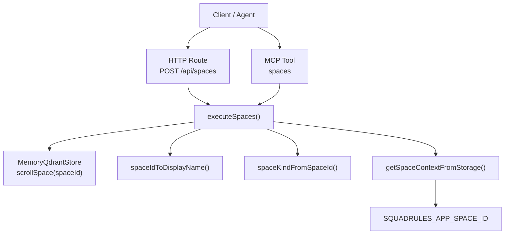
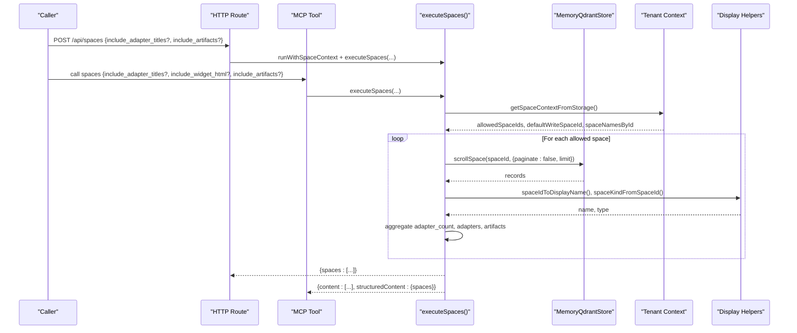
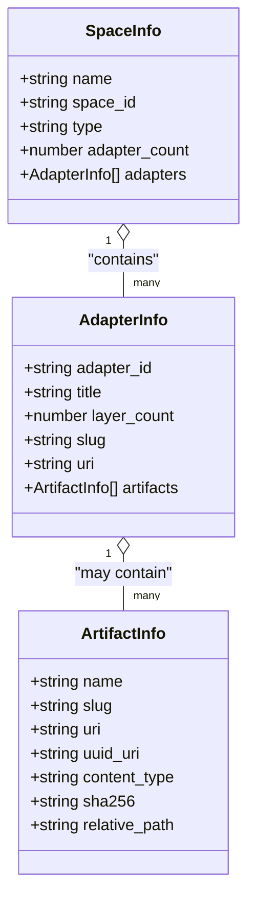
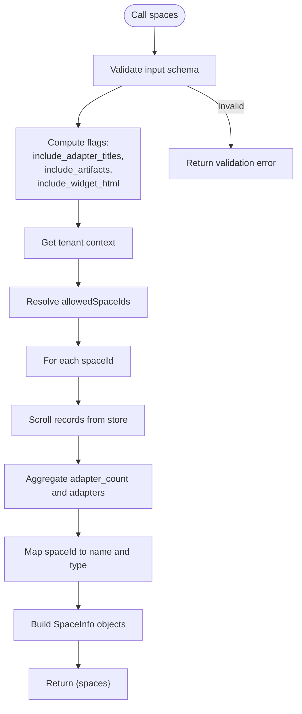
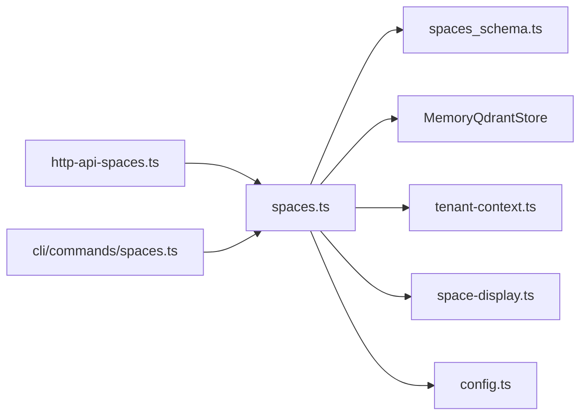

# Spaces Tool

<cite>
**Referenced Files in This Document**
- [spaces.ts](file://src/tools/spaces.ts)
- [http-api-spaces.ts](file://src/http/http-api-spaces.ts)
- [spaces.md](file://src/embed-docs/tools/spaces.md)
- [spaces.ts (CLI)](file://src/cli/commands/spaces.ts)
- [spaces_schema.ts](file://src/tools/spaces_schema.ts)
- [tenant-context.ts](file://src/utils/tenant-context.ts)
- [space-display.ts](file://src/utils/space-display.ts)
- [config.ts](file://src/config.ts)
</cite>

## Table of Contents
1. [Introduction](#introduction)
2. [Project Structure](#project-structure)
3. [Core Components](#core-components)
4. [Architecture Overview](#architecture-overview)
5. [Detailed Component Analysis](#detailed-component-analysis)
6. [Dependency Analysis](#dependency-analysis)
7. [Performance Considerations](#performance-considerations)
8. [Troubleshooting Guide](#troubleshooting-guide)
9. [Conclusion](#conclusion)

## Introduction
The Spaces tool lists the spaces available to the current caller and reports how many adapters each space contains. It is designed for multi-tenancy and workspace isolation, surfacing personal, group, application, and other spaces with human-readable names. The tool supports optional adapter titles, layer counts, and artifact metadata, and it integrates with authentication-driven tenant context so that only allowed spaces are visible.

Key goals:
- Discover which spaces a user or agent can see.
- Provide safe defaults for simple mode and strict isolation under authentication.
- Support cross-space workflows such as scoping searches, forking adapters, and moving layers between spaces.

## Project Structure
The Spaces feature spans several modules:
- MCP tool implementation and registration
- HTTP API route
- CLI command
- Input/output schemas
- Tenant and space context utilities
- Space display helpers
- Configuration constants

**Diagram sources**
- [http-api-spaces.ts:11-30](file://src/http/http-api-spaces.ts#L11-L30)
- [spaces.ts:172-189](file://src/tools/spaces.ts#L172-L189)
- [spaces.ts:65-166](file://src/tools/spaces.ts#L65-L166)
- [tenant-context.ts:120-129](file://src/utils/tenant-context.ts#L120-L129)
- [space-display.ts:14-37](file://src/utils/space-display.ts#L14-L37)
- [config.ts:345-350](file://src/config.ts#L345-L350)

**Section sources**
- [spaces.ts:1-255](file://src/tools/spaces.ts#L1-L255)
- [http-api-spaces.ts:1-32](file://src/http/http-api-spaces.ts#L1-L32)
- [spaces.ts (CLI):1-35](file://src/cli/commands/spaces.ts#L1-L35)
- [spaces_schema.ts:1-53](file://src/tools/spaces_schema.ts#L1-L53)
- [tenant-context.ts:1-312](file://src/utils/tenant-context.ts#L1-L312)
- [space-display.ts:1-38](file://src/utils/space-display.ts#L1-L38)
- [config.ts:345-350](file://src/config.ts#L345-L350)

## Core Components
- MCP tool entry point: registers the `spaces` tool, validates input, calls execution logic, and returns structured content plus optional HTML widget.
- HTTP endpoint: exposes `POST /api/spaces` with the same behavior as the MCP tool.
- Execution logic: enumerates allowed spaces, scrolls their records, aggregates adapter counts, and builds space info objects.
- Schemas: define input parameters and output structure using Zod.
- Tenant context: derives allowed spaces from authentication or simple mode.
- Display helpers: convert space IDs into human-friendly names and types.

**Section sources**
- [spaces.ts:195-254](file://src/tools/spaces.ts#L195-L254)
- [http-api-spaces.ts:11-30](file://src/http/http-api-spaces.ts#L11-L30)
- [spaces.ts:172-189](file://src/tools/spaces.ts#L172-L189)
- [spaces_schema.ts:1-53](file://src/tools/spaces_schema.ts#L1-L53)
- [tenant-context.ts:120-179](file://src/utils/tenant-context.ts#L120-L179)
- [space-display.ts:14-37](file://src/utils/space-display.ts#L14-L37)

## Architecture Overview
The Spaces tool sits at the intersection of MCP tools, HTTP APIs, and tenant-aware storage access.

**Diagram sources**
- [http-api-spaces.ts:11-30](file://src/http/http-api-spaces.ts#L11-L30)
- [spaces.ts:195-254](file://src/tools/spaces.ts#L195-L254)
- [spaces.ts:172-189](file://src/tools/spaces.ts#L172-L189)
- [tenant-context.ts:120-129](file://src/utils/tenant-context.ts#L120-L129)
- [space-display.ts:14-37](file://src/utils/space-display.ts#L14-L37)

## Detailed Component Analysis

### MCP Tool: `spaces`
Responsibilities:
- Register the tool with title, description, input schema, output schema, and UI metadata.
- Validate inputs via Zod.
- Compute whether to include adapter titles and artifacts based on flags.
- Execute listing logic and return both text content and structured JSON.
- Optionally append an HTML widget when requested.

Input parameters:
- `include_adapter_titles` (boolean, optional): Include per-space adapter titles and layer counts.
- `include_widget_html` (boolean, optional): Append a second content part with an HTML table; implies loading adapter titles.
- `include_artifacts` (boolean, optional): Include artifact metadata per adapter; implies adapter titles.

Output structure:
- `content`: Array of text parts. First part is JSON stringified result; second part may be HTML widget if requested.
- `structuredContent`: Object containing `spaces`.

Each space object includes:
- `name`: Human-readable space name.
- `space_id`: Stable identifier.
- `type`: One of `personal`, `group`, `app`, `other`.
- `adapter_count`: Number of unique adapters in the space.
- `adapters` (optional): List of adapters with `adapter_id`, `title`, `layer_count`, `slug`, `uri`, and optionally `artifacts`.

Artifact fields (when included):
- `name`, `slug`, `uri`, `uuid_uri`, `content_type`, `sha256`, `relative_path`.

Error handling:
- Input validation errors return a standardized teaching response.
- Internal errors return a JSON error payload and mark the tool call as failed.

**Section sources**
- [spaces.ts:195-254](file://src/tools/spaces.ts#L195-L254)
- [spaces_schema.ts:1-53](file://src/tools/spaces_schema.ts#L1-L53)
- [spaces.md:1-25](file://src/embed-docs/tools/spaces.md#L1-L25)

#### Class Diagram: Spaces Tool Types

**Diagram sources**
- [spaces_schema.ts:23-48](file://src/tools/spaces_schema.ts#L23-L48)

### HTTP API: `POST /api/spaces`
Responsibilities:
- Accept request body with `include_adapter_titles` and `include_artifacts`.
- Wrap execution in tenant context.
- Return JSON payload or a server error.

Request body:
- `include_adapter_titles` (boolean, optional)
- `include_artifacts` (boolean, optional)

Response:
- Success: `{ spaces: [...] }`
- Error: `{ error: "SPACES_FAILED", message: string }`

**Section sources**
- [http-api-spaces.ts:11-30](file://src/http/http-api-spaces.ts#L11-L30)

### CLI Command: `squadrules spaces`
Responsibilities:
- Parse options including `--include-adapter-titles`.
- Call backend spaces method.
- Emit results in configured format with pretty/text renderers.

Options:
- `--include-adapter-titles`: Include per-space adapter titles and layer counts.

**Section sources**
- [spaces.ts (CLI):12-33](file://src/cli/commands/spaces.ts#L12-L33)

### Tenant Isolation Model
The Spaces tool respects the current tenant context:
- In simple mode (`AUTH_ENABLED=false`), the caller sees a writable Personal space and the read-only Squadrules app space.
- Under authentication, allowed spaces are derived from JWT claims (`sub`, `groups`, `realm`, `iss`).
- When no auth context exists in authenticated mode, a sentinel space is used to ensure strict isolation.
- Search scope can be narrowed by explicit space parameters without changing write permissions.

Key behaviors:
- Allowed spaces come from `allowedSpaceIds`.
- Default write space is typically the personal space.
- App space is read-only for writes but may be included in search visibility.
- Space names are mapped from token-derived labels where available.

**Section sources**
- [tenant-context.ts:20-87](file://src/utils/tenant-context.ts#L20-L87)
- [tenant-context.ts:120-179](file://src/utils/tenant-context.ts#L120-L179)
- [tenant-context.ts:250-303](file://src/utils/tenant-context.ts#L250-L303)
- [config.ts:345-350](file://src/config.ts#L345-L350)

### Space Display and Types
- `spaceKindFromSpaceId` maps IDs to types: `personal`, `group`, `app`, `other`.
- `spaceIdToDisplayName` converts IDs to readable names, using token-derived labels when present.

Examples:
- `user:*:*` → Personal
- `group:*:*` → Group: /full/path
- `space:squadrules-app` → Squadrules app

**Section sources**
- [space-display.ts:14-37](file://src/utils/space-display.ts#L14-L37)

### Data Flow and Processing Logic

**Diagram sources**
- [spaces.ts:207-251](file://src/tools/spaces.ts#L207-L251)
- [spaces.ts:172-189](file://src/tools/spaces.ts#L172-L189)
- [spaces.ts:65-166](file://src/tools/spaces.ts#L65-L166)
- [tenant-context.ts:120-129](file://src/utils/tenant-context.ts#L120-L129)

## Dependency Analysis
The Spaces tool depends on:
- Memory store for reading adapter records per space.
- Tenant context for determining allowed spaces and display names.
- Display helpers for converting IDs to names and types.
- Configuration constants for app space ID and simple-mode personal space.
- Schemas for input validation and output typing.

**Diagram sources**
- [spaces.ts:1-255](file://src/tools/spaces.ts#L1-L255)
- [http-api-spaces.ts:1-32](file://src/http/http-api-spaces.ts#L1-L32)
- [spaces.ts (CLI):1-35](file://src/cli/commands/spaces.ts#L1-L35)
- [spaces_schema.ts:1-53](file://src/tools/spaces_schema.ts#L1-L53)
- [tenant-context.ts:1-312](file://src/utils/tenant-context.ts#L1-L312)
- [space-display.ts:1-38](file://src/utils/space-display.ts#L1-L38)
- [config.ts:345-350](file://src/config.ts#L345-L350)

**Section sources**
- [spaces.ts:1-255](file://src/tools/spaces.ts#L1-L255)
- [http-api-spaces.ts:1-32](file://src/http/http-api-spaces.ts#L1-L32)
- [spaces.ts (CLI):1-35](file://src/cli/commands/spaces.ts#L1-L35)
- [spaces_schema.ts:1-53](file://src/tools/spaces_schema.ts#L1-L53)
- [tenant-context.ts:1-312](file://src/utils/tenant-context.ts#L1-L312)
- [space-display.ts:1-38](file://src/utils/space-display.ts#L1-L38)
- [config.ts:345-350](file://src/config.ts#L345-L350)

## Performance Considerations
- Scrolling all records per space uses a fixed limit to avoid unbounded memory usage.
- Including adapter titles and artifacts increases payload size and processing time.
- Widget HTML generation adds rendering overhead; enable only when needed.
- Metrics capture tool duration, input/output sizes, and error rates per tenant.

Recommendations:
- Use `include_adapter_titles` and `include_artifacts` selectively.
- Prefer structured JSON responses unless HTML presentation is required.
- Monitor metrics to detect slow spaces or large payloads.

[No sources needed since this section provides general guidance]

## Troubleshooting Guide
Common issues and resolutions:
- Empty spaces list under authentication:
  - Ensure the caller has valid JWT claims mapping to allowed spaces.
  - Verify group membership and realm configuration.
- Unexpected Personal vs Group naming:
  - Check token-derived `spaceNamesById` mapping.
- Artifacts not appearing:
  - Confirm `include_artifacts=true` and that artifact metadata is present and allowed by MIME checks.
- Validation errors:
  - Inspect input schema compliance for boolean flags.

Operational tips:
- Use the CLI `squadrules spaces --include-adapter-titles` to inspect available spaces and adapter details.
- Review HTTP endpoint responses for error messages when debugging client integrations.

**Section sources**
- [spaces.ts:207-251](file://src/tools/spaces.ts#L207-L251)
- [http-api-spaces.ts:25-29](file://src/http/http-api-spaces.ts#L25-L29)
- [spaces_schema.ts:1-21](file://src/tools/spaces_schema.ts#L1-L21)

## Conclusion
The Spaces tool provides a secure, tenant-aware view of available spaces and adapter inventories. It supports flexible inclusion of adapter details and artifacts, integrates cleanly with authentication-driven isolation, and offers consistent interfaces across MCP tools, HTTP APIs, and the CLI. Use it to discover spaces, validate access boundaries, and prepare for cross-space operations like scoping activation searches, forking adapters, and moving layers between spaces.

[No sources needed since this section summarizes without analyzing specific files]