# Train Tool

<cite>
**Referenced Files in This Document**
- [train.ts](file://src/tools/train.ts)
- [train_schema.ts](file://src/tools/train_schema.ts)
- [train-store.ts](file://src/tools/train-store.ts)
- [train-mime.ts](file://src/tools/train-mime.ts)
- [train-artifact-adapter-uri.ts](file://src/tools/train-artifact-adapter-uri.ts)
- [train-output-adapter-uri.ts](file://src/tools/train-output-adapter-uri.ts)
- [cli-train.ts](file://src/cli/commands/cli-train.ts)
- [http-api-train-json.ts](file://src/http/http-api-train-json.ts)
- [http-api-train-raw.ts](file://src/http/http-api-train-raw.ts)
- [validate-protocol-structure.ts](file://src/services/memory/validate-protocol-structure.ts)
- [validate-adapter-markdown-size.ts](file://src/services/memory/validate-adapter-markdown-size.ts)
- [adapter-markdown-size-limits.ts](file://src/config/adapter-markdown-size-limits.ts)
- [artifact-mime.ts](file://src/tools/artifact-mime.ts)
- [adapter-example-all-types.md](file://docs/examples/adapter-example-all-types.md)
- [adapter-example-shell.md](file://docs/examples/adapter-example-shell.md)
- [adapter-example-mcp.md](file://docs/examples/adapter-example-mcp.md)
- [adapter-example-user-input.md](file://docs/examples/adapter-example-user-input.md)
- [adapter-example-comment.md](file://docs/examples/adapter-example-comment.md)
- [challenge-types.md](file://docs/examples/challenge-types.md)
- [train.md](file://src/embed-docs/tools/train.md)
</cite>

## Table of Contents
1. [Introduction](#introduction)
2. [Project Structure](#project-structure)
3. [Core Components](#core-components)
4. [Architecture Overview](#architecture-overview)
5. [Detailed Component Analysis](#detailed-component-analysis)
6. [Dependency Analysis](#dependency-analysis)
7. [Performance Considerations](#performance-considerations)
8. [Troubleshooting Guide](#troubleshooting-guide)
9. [Conclusion](#conclusion)
10. [Appendices](#appendices)

## Introduction
The train tool is the entry point for registering new adapters and ingesting knowledge into the SquadRules memory store. It accepts markdown-based adapter definitions, optional artifact payloads, and metadata such as model attribution, versioning, target space, and review evidence. The tool validates input, enforces safety limits, resolves storage URIs, and returns structured registration confirmations with layer or artifact references.

Train supports:
- Markdown adapter registration through MCP, HTTP JSON, and HTTP raw endpoints.
- Forking an existing adapter by exporting its markdown and training a new adapter.
- Attaching non-markdown artifacts to an adapter.
- Batch processing via the CLI directory mode.
- Space scoping for personal and group targets.
- Review-evidence gating for human-approved adapter changes.

## Project Structure
The train feature spans tool logic, schemas, validation, HTTP routes, CLI commands, and example adapters.

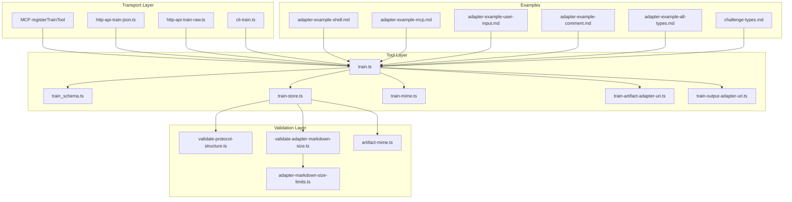

**Diagram sources**
- [train.ts:244-349](file://src/tools/train.ts#L244-L349)
- [train_schema.ts:54-187](file://src/tools/train_schema.ts#L54-L187)
- [train-store.ts:47-130](file://src/tools/train-store.ts#L47-L130)
- [train-mime.ts:4-20](file://src/tools/train-mime.ts#L4-L20)
- [train-artifact-adapter-uri.ts:5-35](file://src/tools/train-artifact-adapter-uri.ts#L5-L35)
- [train-output-adapter-uri.ts:4-32](file://src/tools/train-output-adapter-uri.ts#L4-L32)
- [validate-protocol-structure.ts:113-186](file://src/services/memory/validate-protocol-structure.ts#L113-L186)
- [validate-adapter-markdown-size.ts:31-124](file://src/services/memory/validate-adapter-markdown-size.ts#L31-L124)
- [adapter-markdown-size-limits.ts:32-42](file://src/config/adapter-markdown-size-limits.ts#L32-L42)
- [artifact-mime.ts:34-48](file://src/tools/artifact-mime.ts#L34-L48)
- [cli-train.ts:40-211](file://src/cli/commands/cli-train.ts#L40-L211)
- [http-api-train-json.ts:46-172](file://src/http/http-api-train-json.ts#L46-L172)
- [http-api-train-raw.ts:48-214](file://src/http/http-api-train-raw.ts#L48-L214)

**Section sources**
- [train.ts:1-349](file://src/tools/train.ts#L1-L349)
- [train_schema.ts:1-237](file://src/tools/train_schema.ts#L1-L237)
- [train-store.ts:1-131](file://src/tools/train-store.ts#L1-L131)
- [cli-train.ts:1-212](file://src/cli/commands/cli-train.ts#L1-L212)
- [http-api-train-json.ts:1-173](file://src/http/http-api-train-json.ts#L1-L173)
- [http-api-train-raw.ts:1-215](file://src/http/http-api-train-raw.ts#L1-L215)

## Core Components
- `registerTrainTool` registers the MCP `train` tool with validated input/output schemas, space resolution, metrics, and error formatting.
- `executeTrain` orchestrates content resolution (inline markdown, forked adapter export, or artifact), MIME inference, canonical adapter URI resolution, and persistence.
- `executeTrainStore` performs low-level validation and storage for either artifacts or markdown adapters.
- Schema layer defines strict input/output contracts, including review evidence, artifact fields, relative paths, and versioning.
- Validation layer enforces protocol structure, size limits, and allowed MIME types.
- Transport layers expose MCP, JSON API, raw API, and CLI interfaces.

**Section sources**
- [train.ts:135-242](file://src/tools/train.ts#L135-L242)
- [train-store.ts:47-130](file://src/tools/train-store.ts#L47-L130)
- [train_schema.ts:54-187](file://src/tools/train_schema.ts#L54-L187)
- [validate-protocol-structure.ts:113-186](file://src/services/memory/validate-protocol-structure.ts#L113-L186)
- [validate-adapter-markdown-size.ts:31-124](file://src/services/memory/validate-adapter-markdown-size.ts#L31-L124)

## Architecture Overview
The train pipeline normalizes inputs, validates content, resolves storage URIs, persists data, and returns structured results.

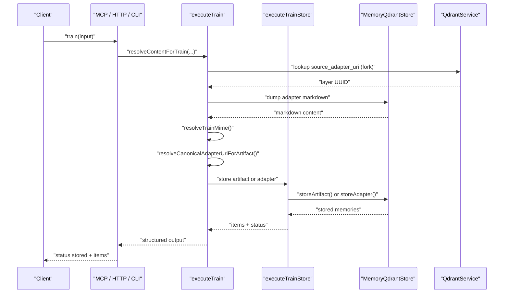

**Diagram sources**
- [train.ts:86-133](file://src/tools/train.ts#L86-L133)
- [train.ts:135-242](file://src/tools/train.ts#L135-L242)
- [train-store.ts:47-130](file://src/tools/train-store.ts#L47-L130)
- [train-artifact-adapter-uri.ts:5-35](file://src/tools/train-artifact-adapter-uri.ts#L5-L35)
- [train-mime.ts:4-20](file://src/tools/train-mime.ts#L4-L20)

## Detailed Component Analysis

### Train Input Schema
The train input schema governs all transport modes. Key rules include:
- `content` is required unless `source_adapter_uri` supplies markdown.
- `llm_model_id` is required for attribution.
- `force_update` allows overwriting adapters with the same label.
- `protocol_version` stores an explicit version string on adapters.
- `space` scopes writes to personal or group spaces.
- `source_adapter_uri` forks an existing adapter; optional `content` overrides exported body.
- Artifact mode requires non-markdown `mime`, `artifact_name`, and `adapter_uri`.
- `relative_path` is only valid for artifact mode and must be skill-root-relative without `..`.
- `review_evidence` is required for markdown adapter trains but not for artifacts or forks.

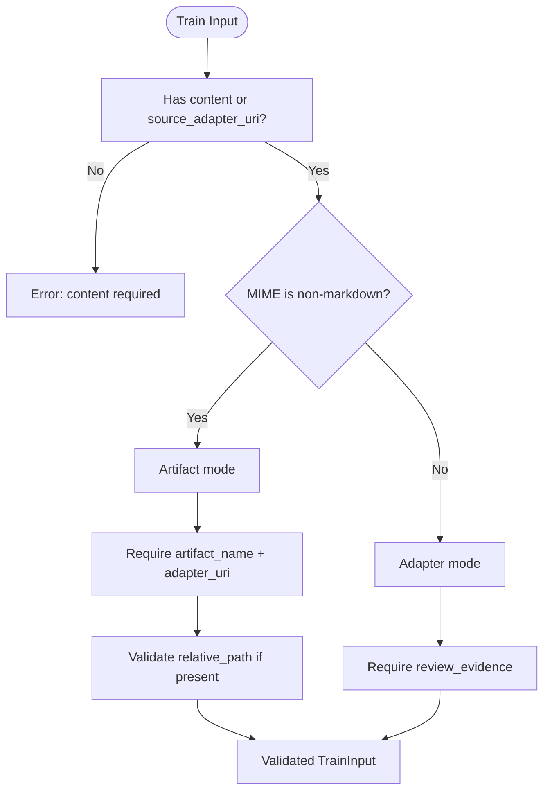

**Diagram sources**
- [train_schema.ts:54-174](file://src/tools/train_schema.ts#L54-L174)

**Section sources**
- [train_schema.ts:54-187](file://src/tools/train_schema.ts#L54-L187)

### Train Output Schema
The train output schema provides:
- `items`: array of stored entries with URIs, UUIDs, labels, tags, and content types.
- `status`: always `stored` on success.
- For markdown adapters, items include layer URIs and optional adapter URIs.
- For artifacts, items include artifact URIs and attached adapter URIs.

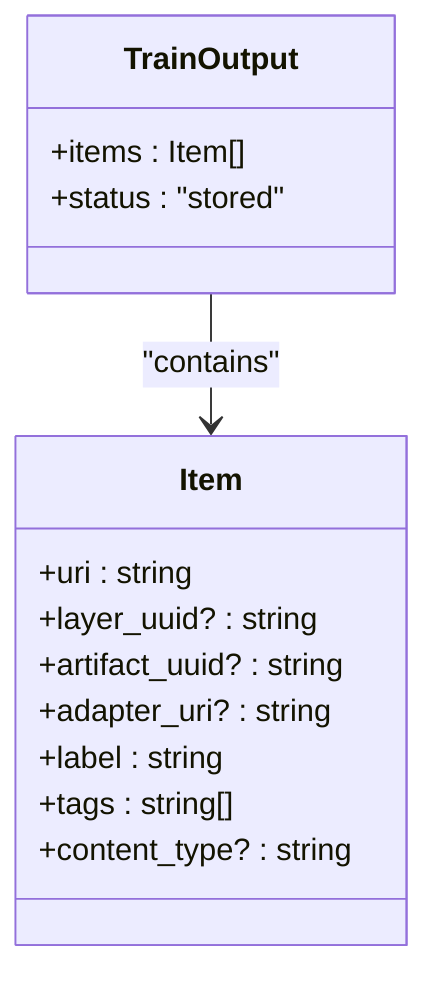

**Diagram sources**
- [train_schema.ts:176-187](file://src/tools/train_schema.ts#L176-L187)

**Section sources**
- [train_schema.ts:176-187](file://src/tools/train_schema.ts#L176-L187)

### Content Resolution and Forking
Forking exports markdown from an existing adapter and trains a new adapter. If inline `content` is provided, it overrides the exported body.

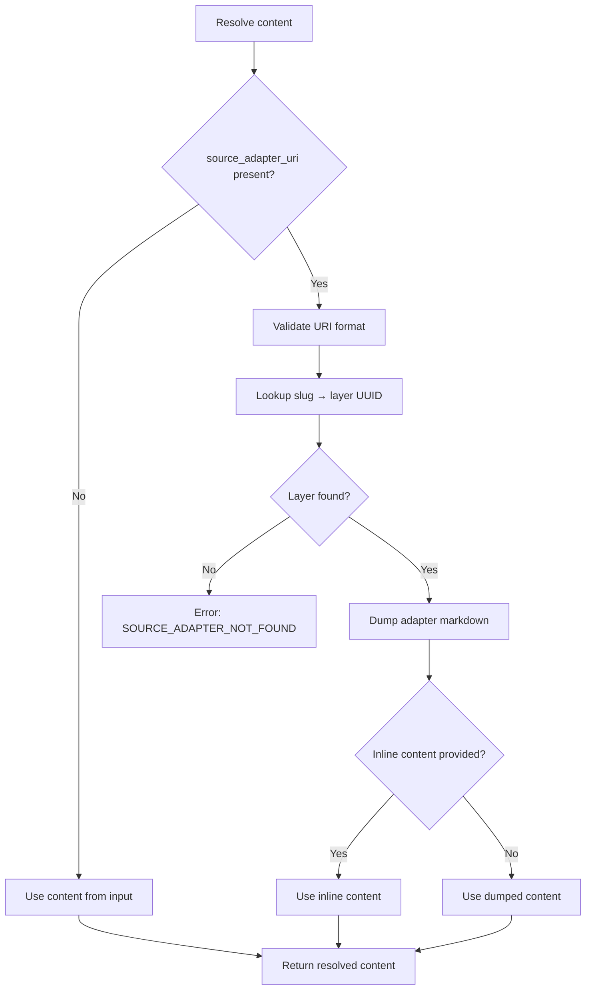

**Diagram sources**
- [train.ts:86-133](file://src/tools/train.ts#L86-L133)

**Section sources**
- [train.ts:86-133](file://src/tools/train.ts#L86-L133)

### Artifact Attachment Flow
When `mime` is non-markdown or inferred from `artifact_name`, train attaches artifacts to an adapter instead of storing markdown layers.

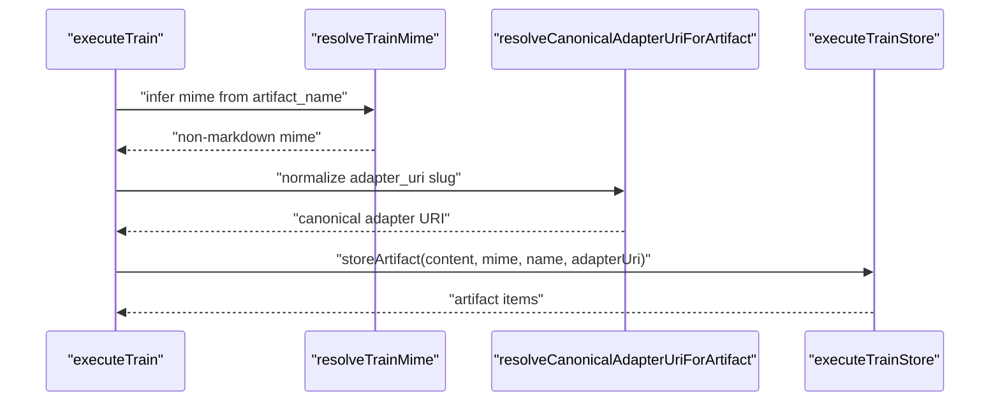

**Diagram sources**
- [train-mime.ts:4-20](file://src/tools/train-mime.ts#L4-L20)
- [train-artifact-adapter-uri.ts:5-35](file://src/tools/train-artifact-adapter-uri.ts#L5-L35)
- [train-store.ts:64-97](file://src/tools/train-store.ts#L64-L97)

**Section sources**
- [train-mime.ts:1-22](file://src/tools/train-mime.ts#L1-L22)
- [train-artifact-adapter-uri.ts:1-37](file://src/tools/train-artifact-adapter-uri.ts#L1-L37)
- [train-store.ts:64-97](file://src/tools/train-store.ts#L64-L97)

### Markdown Adapter Storage Flow
Markdown adapters are validated structurally and by size before being persisted as memory layers.

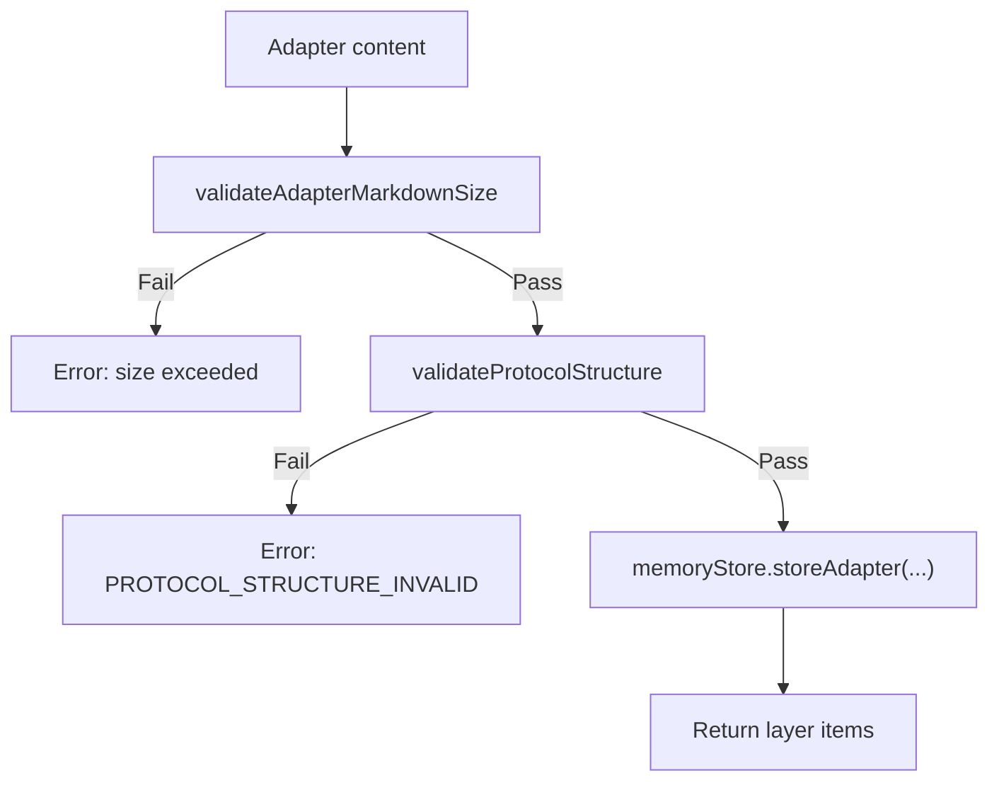

**Diagram sources**
- [train-store.ts:100-129](file://src/tools/train-store.ts#L100-L129)
- [validate-adapter-markdown-size.ts:31-106](file://src/services/memory/validate-adapter-markdown-size.ts#L31-L106)
- [validate-protocol-structure.ts:113-186](file://src/services/memory/validate-protocol-structure.ts#L113-L186)

**Section sources**
- [train-store.ts:100-129](file://src/tools/train-store.ts#L100-L129)
- [validate-adapter-markdown-size.ts:31-106](file://src/services/memory/validate-adapter-markdown-size.ts#L31-L106)
- [validate-protocol-structure.ts:113-186](file://src/services/memory/validate-protocol-structure.ts#L113-L186)

### MCP Tool Registration
The MCP registration wires input validation, space context, metrics, and error handling.

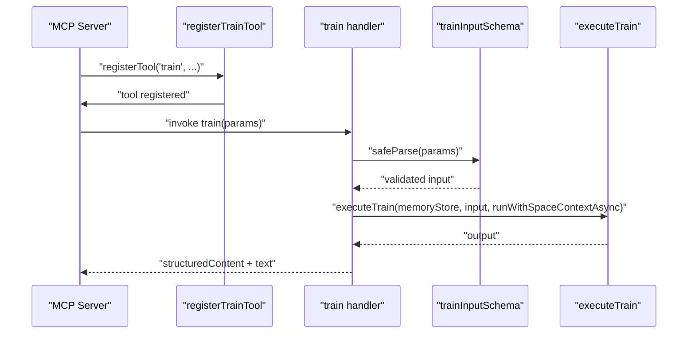

**Diagram sources**
- [train.ts:244-349](file://src/tools/train.ts#L244-L349)

**Section sources**
- [train.ts:244-349](file://src/tools/train.ts#L244-L349)

### HTTP JSON and Raw Endpoints
Both JSON and raw endpoints validate input, resolve space context, call `executeTrain`, and normalize errors.

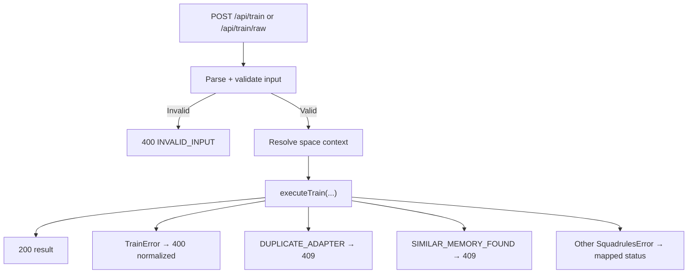

**Diagram sources**
- [http-api-train-json.ts:46-172](file://src/http/http-api-train-json.ts#L46-L172)
- [http-api-train-raw.ts:48-214](file://src/http/http-api-train-raw.ts#L48-L214)

**Section sources**
- [http-api-train-json.ts:46-172](file://src/http/http-api-train-json.ts#L46-L172)
- [http-api-train-raw.ts:48-214](file://src/http/http-api-train-raw.ts#L48-L214)

### CLI Train Command
The CLI supports single files, directories, artifact mode, and fork mode. Directory mode runs batch processing and emits compact summaries.

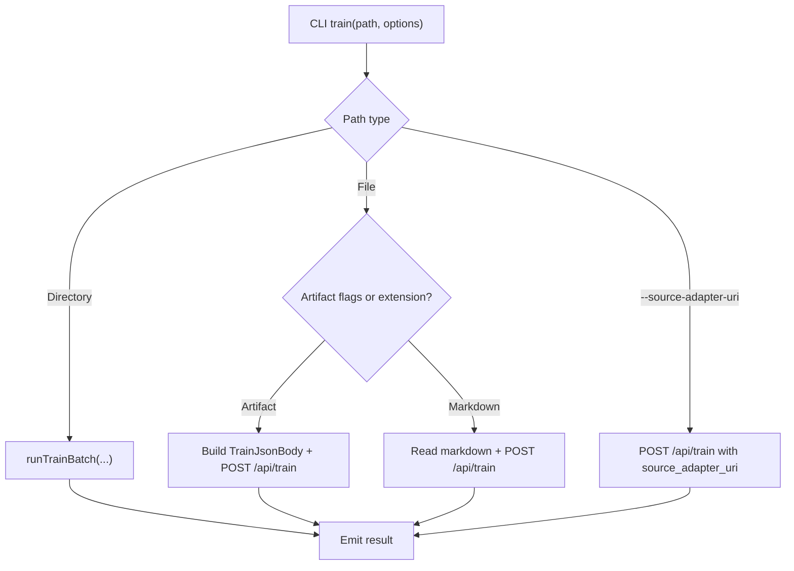

**Diagram sources**
- [cli-train.ts:40-211](file://src/cli/commands/cli-train.ts#L40-L211)

**Section sources**
- [cli-train.ts:40-211](file://src/cli/commands/cli-train.ts#L40-L211)

### Example Adapters and Challenge Types
Example adapters demonstrate shell, MCP, user input, comment, and multi-step workflows. They are ready to train after copying their full markdown content.

- Shell challenge: execute a command and verify exit code.
- MCP challenge: invoke an MCP tool and report success.
- User input challenge: obtain human confirmation.
- Comment challenge: require a minimum-length summary.
- All types: combine multiple challenges in one adapter.

**Section sources**
- [adapter-example-shell.md:1-33](file://docs/examples/adapter-example-shell.md#L1-L33)
- [adapter-example-mcp.md:1-53](file://docs/examples/adapter-example-mcp.md#L1-L53)
- [adapter-example-user-input.md:1-32](file://docs/examples/adapter-example-user-input.md#L1-L32)
- [adapter-example-comment.md:1-32](file://docs/examples/adapter-example-comment.md#L1-L32)
- [adapter-example-all-types.md:1-81](file://docs/examples/adapter-example-all-types.md#L1-L81)
- [challenge-types.md:1-41](file://docs/examples/challenge-types.md#L1-L41)

## Dependency Analysis
Train depends on schemas, validation utilities, MIME inference, URI helpers, and storage services.

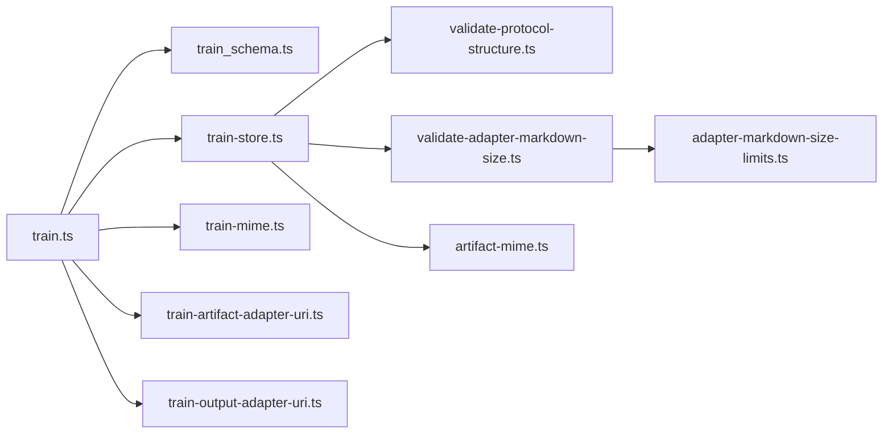

**Diagram sources**
- [train.ts:1-26](file://src/tools/train.ts#L1-L26)
- [train-store.ts:1-17](file://src/tools/train-store.ts#L1-L17)
- [train-mime.ts:1-3](file://src/tools/train-mime.ts#L1-L3)
- [train-artifact-adapter-uri.ts:1-3](file://src/tools/train-artifact-adapter-uri.ts#L1-L3)
- [train-output-adapter-uri.ts:1-2](file://src/tools/train-output-adapter-uri.ts#L1-L2)
- [validate-adapter-markdown-size.ts:1-6](file://src/services/memory/validate-adapter-markdown-size.ts#L1-L6)
- [adapter-markdown-size-limits.ts:1-6](file://src/config/adapter-markdown-size-limits.ts#L1-L6)

**Section sources**
- [train.ts:1-26](file://src/tools/train.ts#L1-L26)
- [train-store.ts:1-17](file://src/tools/train-store.ts#L1-L17)

## Performance Considerations
- Size limits protect against pathological markdown and large artifacts. Defaults derive from environment variables and compute a total-byte ceiling based on line count, per-line byte cap, and safety factor.
- Raw HTTP endpoint enforces a configurable request body limit.
- Metrics track tool calls, durations, input/output sizes, and similar adapter detections.
- Forking avoids unnecessary duplication by reusing existing adapter layers and allocating fresh IDs when needed.

Recommendations:
- Keep adapters concise and modular.
- Use artifact mode for large binary or script payloads.
- Prefer `force_update` only when intentionally replacing an adapter.
- Monitor metrics for repeated duplicate or similar adapter submissions.

**Section sources**
- [adapter-markdown-size-limits.ts:32-42](file://src/config/adapter-markdown-size-limits.ts#L32-L42)
- [validate-adapter-markdown-size.ts:31-124](file://src/services/memory/validate-adapter-markdown-size.ts#L31-L124)
- [http-api-train-raw.ts:53-60](file://src/http/http-api-train-raw.ts#L53-L60)
- [train.ts:286-305](file://src/tools/train.ts#L286-L305)

## Troubleshooting Guide
Common errors and resolutions:
- Missing content: provide `content` or `source_adapter_uri`.
- Invalid source adapter URI: use `squadrules://adapter/{slug}`.
- Source adapter not found: ensure the slug exists and is accessible.
- Unsupported MIME: choose an allowed artifact MIME or provide a recognized file extension.
- Protocol structure invalid: ensure H1 title, Activation Patterns as first H2, Reward Signal as last H2, and fenced `json` contract blocks with allowed types.
- Duplicate adapter: use `force_update: true` to overwrite or choose a different label.
- Similar memory found: inspect similarity score and existing memory; replace explicitly with matching adapter ID if intended.
- Space not found or read-only: select a writable space or personal scope.

Operational tips:
- Run critic-loop before markdown adapter trains and supply `review_evidence`.
- Use guided creation flow when structure validation fails.
- Inspect output `items` URIs to locate stored layers or artifacts.

**Section sources**
- [train.ts:36-84](file://src/tools/train.ts#L36-L84)
- [train.ts:96-133](file://src/tools/train.ts#L96-L133)
- [train-store.ts:64-112](file://src/tools/train-store.ts#L64-L112)
- [validate-protocol-structure.ts:113-186](file://src/services/memory/validate-protocol-structure.ts#L113-L186)
- [http-api-train-json.ts:117-163](file://src/http/http-api-train-json.ts#L117-L163)
- [http-api-train-raw.ts:154-205](file://src/http/http-api-train-raw.ts#L154-L205)

## Conclusion
The train tool centralizes adapter registration and knowledge ingestion across transports. It enforces strong input contracts, structural validation, size safety, and artifact handling while returning clear, structured outputs. Teams should design adapters following the documented structure, use review evidence for markdown changes, prefer artifact mode for non-text payloads, and leverage fork and batch capabilities for scalable workflows.

## Appendices

### Authentication and Authorization
- MCP and HTTP transports rely on tenant context and space authorization.
- Space resolution supports personal and group targets; unauthorized or read-only spaces return explicit errors.
- JWT-based authentication is used at the platform level; train itself focuses on payload validation and storage scoping.

**Section sources**
- [train.ts:257-284](file://src/tools/train.ts#L257-L284)
- [http-api-train-json.ts:68-103](file://src/http/http-api-train-json.ts#L68-L103)
- [http-api-train-raw.ts:116-149](file://src/http/http-api-train-raw.ts#L116-L149)

### Best Practices for Adapter Design
- Use clear activation patterns and reward signals.
- Keep steps focused and verifiable.
- Prefer small, composable adapters.
- Include meaningful labels and tags.
- Version adapters explicitly when necessary.

**Section sources**
- [validate-protocol-structure.ts:113-186](file://src/services/memory/validate-protocol-structure.ts#L113-L186)
- [train.md:17-29](file://src/embed-docs/tools/train.md#L17-L29)

### Testing Strategies
- Validate markdown structure using the examples.
- Test artifact MIME inference and allowlist behavior.
- Simulate duplicate and similar adapter scenarios.
- Verify space scoping and fork behavior.
- Use CLI batch mode to exercise directory processing.

**Section sources**
- [adapter-example-all-types.md:1-81](file://docs/examples/adapter-example-all-types.md#L1-L81)
- [cli-train.ts:127-129](file://src/cli/commands/cli-train.ts#L127-L129)

### Migration Patterns
- Fork existing adapters to create variants.
- Use `force_update` to replace adapters with identical labels.
- Migrate artifacts by attaching them to canonical adapter URIs.
- Preserve `relative_path` for consistent skill bundle layouts.

**Section sources**
- [train-store.ts:19-29](file://src/tools/train-store.ts#L19-L29)
- [train-schema.ts:200-213](file://src/tools/train_schema.ts#L200-L213)