# Train Tool

<cite>
**Referenced Files in This Document**
- [train.ts](file://src/tools/train.ts)
- [train_schema.ts](file://src/tools/train_schema.ts)
- [train-store.ts](file://src/tools/train-store.ts)
- [train-mime.ts](file://src/tools/train-mime.ts)
- [train-output-adapter-uri.ts](file://src/tools/train-output-adapter-uri.ts)
- [train-artifact-adapter-uri.ts](file://src/tools/train-artifact-adapter-uri.ts)
- [http-api-train-json.ts](file://src/http/http-api-train-json.ts)
- [http-api-train-raw.ts](file://src/http/http-api-train-raw.ts)
- [cli-train.ts](file://src/cli/commands/cli-train.ts)
- [train-batch.ts](file://src/cli/train-batch.ts)
- [artifact-mime.ts](file://src/tools/artifact-mime.ts)
- [validate-adapter-markdown-size.ts](file://src/services/memory/validate-adapter-markdown-size.ts)
- [upload-guards.ts](file://src/cli/upload-guards.ts)
- [config.ts](file://src/config.ts)
- [train.md](file://src/embed-docs/tools/train.md)
- [adapter-example-all-types.md](file://docs/examples/adapter-example-all-types.md)
</cite>

## Table of Contents
1. [Introduction](#introduction)
2. [Project Structure](#project-structure)
3. [Core Components](#core-components)
4. [Architecture Overview](#architecture-overview)
5. [Detailed Component Analysis](#detailed-component-analysis)
6. [Dependency Analysis](#dependency-analysis)
7. [Performance Considerations](#performance-considerations)
8. [Security Considerations](#security-considerations)
9. [Troubleshooting Guide](#troubleshooting-guide)
10. [Conclusion](#conclusion)

## Introduction
The SquadRules `train` tool registers new adapters and updates existing ones. It supports three primary workflows:

- **Adapter training**: Store protocol markdown that defines an adapter, including activation patterns, contract steps, and reward signals.
- **Artifact attachment**: Attach executable or configuration artifacts to an existing adapter with MIME-aware validation and storage.
- **Forking and batch operations**: Fork an existing adapter into a new one, or train multiple `.md` files from a directory.

The tool validates input, enforces size limits, checks adapter structure, stores content in the memory store, and returns structured results containing URIs for layers, artifacts, and adapters. HTTP endpoints expose JSON and raw Markdown interfaces, while the CLI provides single-file, artifact, fork, and directory-based batch modes.

## Project Structure
The `train` capability spans several layers:

- **Tool registration and orchestration**: MCP tool entry point and HTTP route handlers.
- **Input schema and validation**: Zod schemas defining required fields, MIME behavior, and cross-field rules.
- **Store execution**: Low-level adapter and artifact persistence, size checks, and protocol validation.
- **MIME handling**: Allowed artifact MIME types, inference from filenames, and normalization.
- **CLI integration**: Command-line interface for local training, artifact uploads, and directory batches.
- **Documentation and examples**: Embedded tool documentation and example adapters.

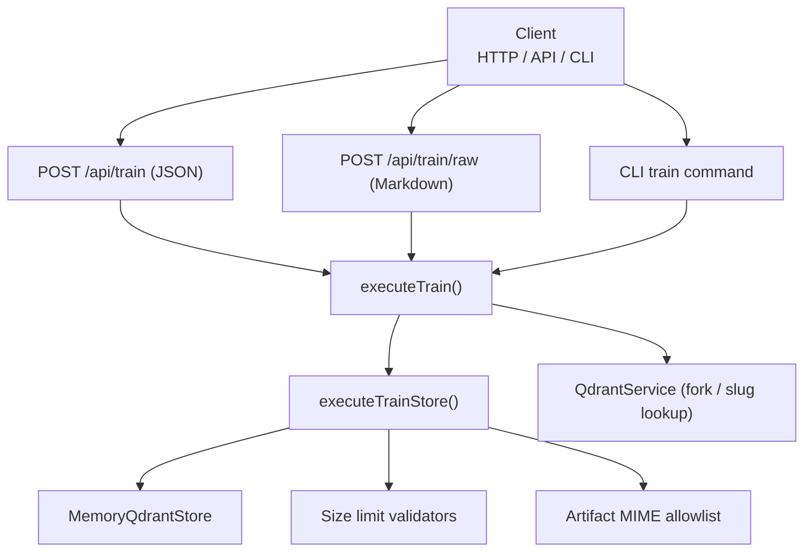

**Diagram sources**
- [http-api-train-json.ts:46-107](file://src/http/http-api-train-json.ts#L46-L107)
- [http-api-train-raw.ts:48-153](file://src/http/http-api-train-raw.ts#L48-L153)
- [cli-train.ts:40-210](file://src/cli/commands/cli-train.ts#L40-L210)
- [train.ts:137-244](file://src/tools/train.ts#L137-L244)
- [train-store.ts:47-130](file://src/tools/train-store.ts#L47-L130)

**Section sources**
- [train.ts:1-382](file://src/tools/train.ts#L1-L382)
- [http-api-train-json.ts:1-173](file://src/http/http-api-train-json.ts#L1-L173)
- [http-api-train-raw.ts:1-215](file://src/http/http-api-train-raw.ts#L1-L215)
- [cli-train.ts:1-212](file://src/cli/commands/cli-train.ts#L1-L212)

## Core Components
- **`executeTrain`**: Orchestrates content resolution, MIME detection, fork handling, and store submission. Returns structured items with URIs and metadata.
- **`registerTrainTool`**: Registers the MCP `train` tool, handles space resolution, batch directory scanning, metrics, and error formatting.
- **`executeTrainStore`**: Performs low-level validation and persistence for adapters and artifacts.
- **Schema layer**: Defines `TrainInput`, `TrainOutput`, and internal store schemas with strict cross-field validation.
- **MIME utilities**: Normalize, infer, and validate artifact MIME types against an allowlist.
- **URI helpers**: Resolve canonical adapter URIs, output adapter URIs, and layer/artifact URIs.

Key responsibilities:
- Accept markdown or artifact content.
- Validate review evidence for adapter training.
- Enforce size limits and protocol structure.
- Store adapters or artifacts.
- Return stable URIs and status.

**Section sources**
- [train.ts:88-244](file://src/tools/train.ts#L88-L244)
- [train.ts:246-382](file://src/tools/train.ts#L246-L382)
- [train-store.ts:47-130](file://src/tools/train-store.ts#L47-L130)
- [train_schema.ts:54-196](file://src/tools/train_schema.ts#L54-L196)
- [train-mime.ts:1-22](file://src/tools/train-mime.ts#L1-L22)
- [train-output-adapter-uri.ts:1-33](file://src/tools/train-output-adapter-uri.ts#L1-L33)
- [train-artifact-adapter-uri.ts:1-37](file://src/tools/train-artifact-adapter-uri.ts#L1-L37)

## Architecture Overview
The `train` workflow integrates HTTP routes, MCP tool registration, CLI commands, and the core store logic.

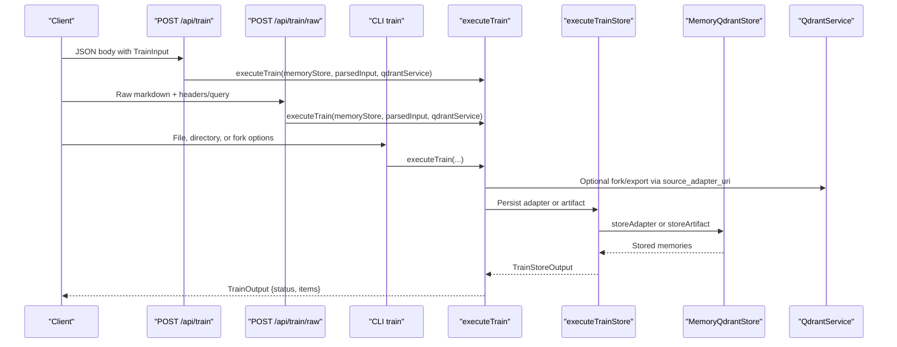

**Diagram sources**
- [http-api-train-json.ts:46-107](file://src/http/http-api-train-json.ts#L46-L107)
- [http-api-train-raw.ts:48-153](file://src/http/http-api-train-raw.ts#L48-L153)
- [cli-train.ts:40-210](file://src/cli/commands/cli-train.ts#L40-L210)
- [train.ts:137-244](file://src/tools/train.ts#L137-L244)
- [train-store.ts:47-130](file://src/tools/train-store.ts#L47-L130)

## Detailed Component Analysis

### Input Schema and Validation Rules
The `train` input schema enforces:

- Required `llm_model_id`.
- Optional `content`, `source_adapter_uri`, `directory`, `recursive`.
- Adapter mode requires `review_evidence` unless using artifact mode or forking.
- Artifact mode requires `mime` (non-markdown), `artifact_name`, and `adapter_uri`; MIME can be inferred from filename when both are present.
- `relative_path` is only allowed for artifact rows and must be skill-root-relative without `..` segments.
- Cross-field validation ensures consistent combinations of MIME, artifact fields, and adapter URI.

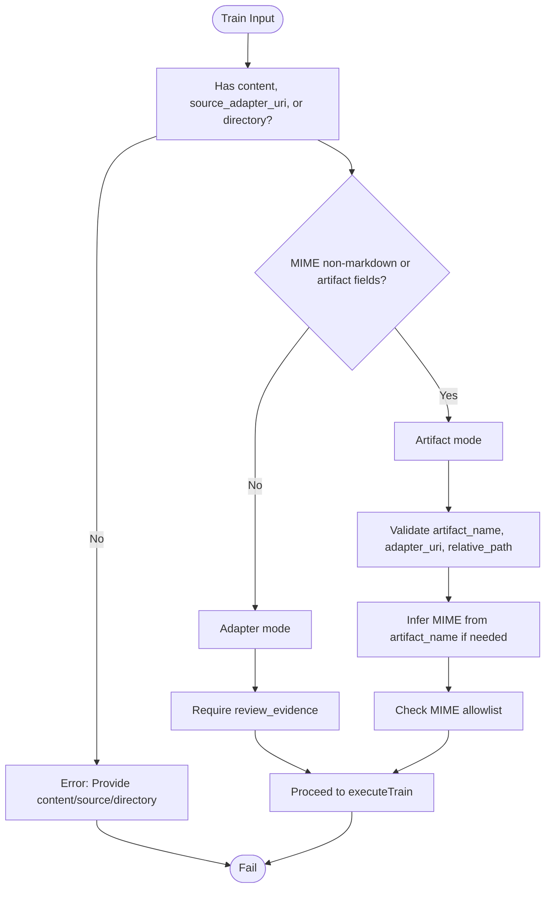

**Diagram sources**
- [train_schema.ts:54-196](file://src/tools/train_schema.ts#L54-L196)
- [train-schema.ts:198-246](file://src/tools/train_schema.ts#L198-L246)

**Section sources**
- [train_schema.ts:54-196](file://src/tools/train_schema.ts#L54-L196)
- [train_schema.ts:198-246](file://src/tools/train_schema.ts#L198-L246)

### Content Resolution and Forking
When `source_adapter_uri` is provided:

- The adapter slug is validated and resolved through `QdrantService`.
- The head layer is exported via dump, producing markdown content.
- If explicit `content` is also provided, it overrides the exported content.
- Missing or invalid source URIs produce specific errors with guidance.

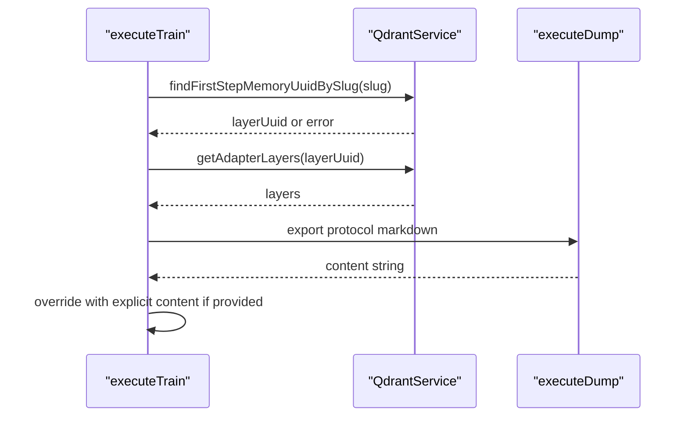

**Diagram sources**
- [train.ts:88-135](file://src/tools/train.ts#L88-L135)

**Section sources**
- [train.ts:88-135](file://src/tools/train.ts#L88-L135)

### Adapter Storage Pipeline
For adapter markdown:

- Forked adapters remove author slug to avoid collisions.
- Size limits are enforced (total bytes, per-line bytes, line count).
- Protocol structure is validated (H1 title, Activation Patterns, Reward Signal, fenced JSON contracts).
- The memory store persists the adapter and returns layer URIs.

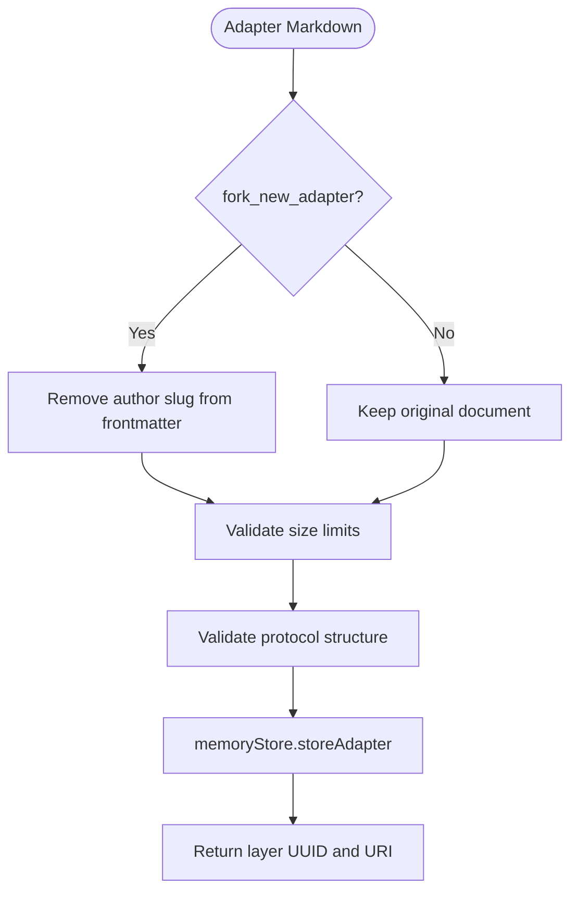

**Diagram sources**
- [train-store.ts:19-29](file://src/tools/train-store.ts#L19-L29)
- [train-store.ts:100-129](file://src/tools/train-store.ts#L100-L129)
- [validate-adapter-markdown-size.ts:31-106](file://src/services/memory/validate-adapter-markdown-size.ts#L31-L106)

**Section sources**
- [train-store.ts:19-29](file://src/tools/train-store.ts#L19-L29)
- [train-store.ts:100-129](file://src/tools/train-store.ts#L100-L129)
- [validate-adapter-markdown-size.ts:31-106](file://src/services/memory/validate-adapter-markdown-size.ts#L31-L106)

### Artifact Processing Pipeline
For artifact attachments:

- MIME type is normalized and checked against an allowlist.
- Artifact content size is validated against total-byte limits.
- Artifacts are stored with metadata including name, MIME, adapter URI, optional relative path, and LLM model attribution.
- Response includes artifact URIs and tags.

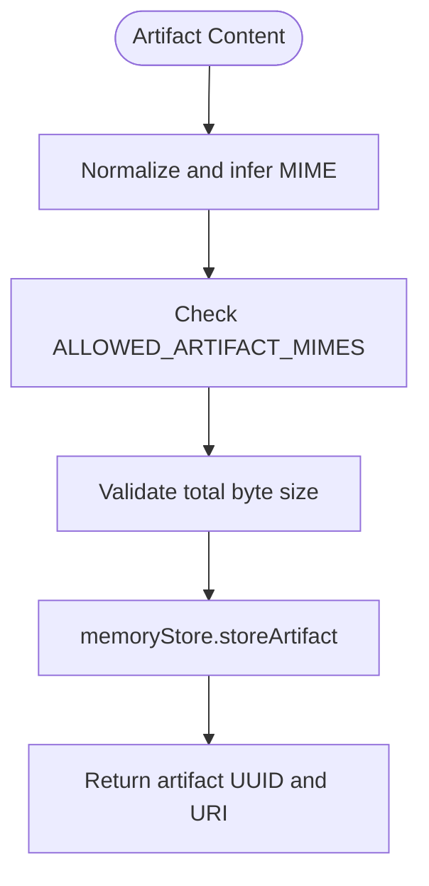

**Diagram sources**
- [train-store.ts:52-97](file://src/tools/train-store.ts#L52-L97)
- [artifact-mime.ts:1-50](file://src/tools/artifact-mime.ts#L1-L50)
- [validate-adapter-markdown-size.ts:108-124](file://src/services/memory/validate-adapter-markdown-size.ts#L108-L124)

**Section sources**
- [train-store.ts:52-97](file://src/tools/train-store.ts#L52-L97)
- [artifact-mime.ts:1-50](file://src/tools/artifact-mime.ts#L1-L50)
- [validate-adapter-markdown-size.ts:108-124](file://src/services/memory/validate-adapter-markdown-size.ts#L108-L124)

### MIME Type Handling
MIME handling is centralized:

- Explicit MIME is preferred.
- MIME can be inferred from `artifact_name` extension when both `artifact_name` and `adapter_uri` are present.
- Only allowed MIME types are accepted; unknown extensions require explicit MIME.
- Normalization lowercases and trims MIME values.

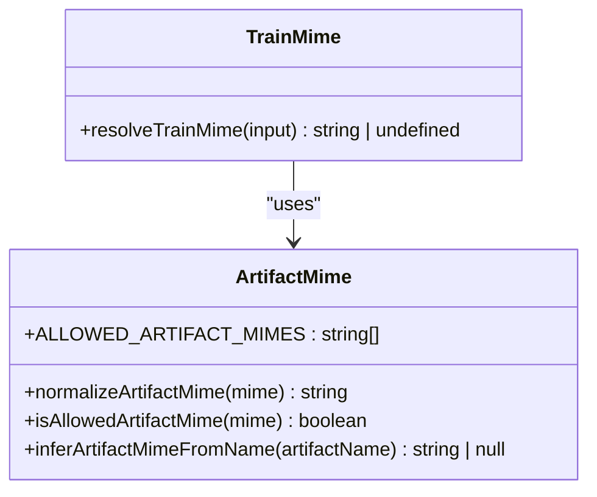

**Diagram sources**
- [train-mime.ts:1-22](file://src/tools/train-mime.ts#L1-L22)
- [artifact-mime.ts:1-50](file://src/tools/artifact-mime.ts#L1-L50)

**Section sources**
- [train-mime.ts:1-22](file://src/tools/train-mime.ts#L1-L22)
- [artifact-mime.ts:1-50](file://src/tools/artifact-mime.ts#L1-L50)

### Output Model and URIs
The response contains:

- `status`: Always `stored` on success.
- `items`: Array of stored entries with:
  - `uri`: Layer or artifact URI.
  - `layer_uuid` or `artifact_uuid`: Internal identifiers.
  - `adapter_uri`: Canonical adapter reference when available.
  - `label`, `tags`, `content_type`: Metadata.
- `batch_manifest`: Present for directory batch training, listing per-file outcomes.

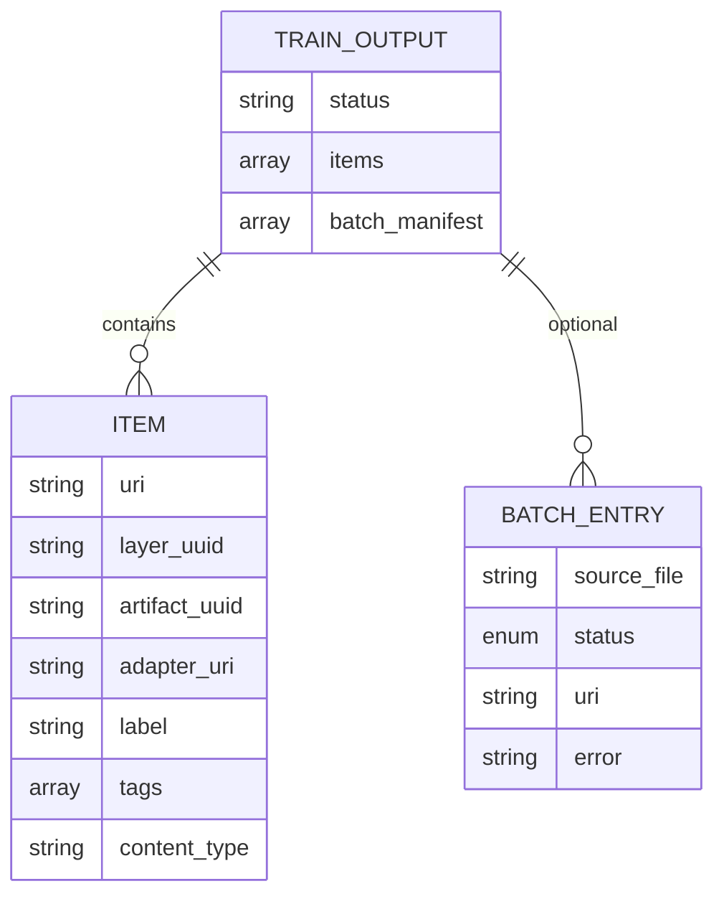

**Diagram sources**
- [train_schema.ts:179-196](file://src/tools/train_schema.ts#L179-L196)
- [train.ts:181-243](file://src/tools/train.ts#L181-L243)

**Section sources**
- [train_schema.ts:179-196](file://src/tools/train_schema.ts#L179-L196)
- [train.ts:181-243](file://src/tools/train.ts#L181-L243)

### HTTP API Interfaces
Two HTTP endpoints support training:

- **POST `/api/train`**: JSON body with full `TrainInput`.
- **POST `/api/train/raw`**: Raw markdown body with query/header parameters for model, force update, protocol version, space, and review evidence.

Both endpoints:
- Validate input using the same schema.
- Resolve target space from context.
- Call `executeTrain`.
- Sanitize error details before returning responses.
- Handle duplicate and similar adapter conflicts with structured errors.

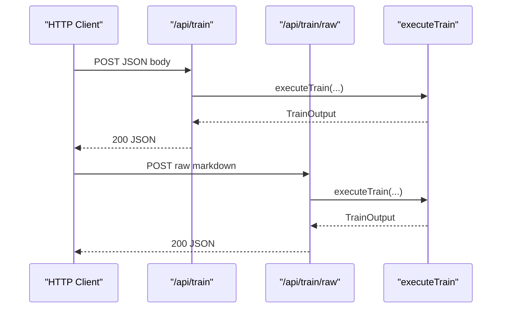

**Diagram sources**
- [http-api-train-json.ts:46-107](file://src/http/http-api-train-json.ts#L46-L107)
- [http-api-train-raw.ts:48-153](file://src/http/http-api-train-raw.ts#L48-L153)

**Section sources**
- [http-api-train-json.ts:1-173](file://src/http/http-api-train-json.ts#L1-L173)
- [http-api-train-raw.ts:1-215](file://src/http/http-api-train-raw.ts#L1-L215)

### CLI Training Modes
The CLI supports:

- **Single file**: Markdown or artifact upload.
- **Fork**: Use `--source-adapter-uri` with `--model`.
- **Artifact mode**: Requires `--adapter`, `--artifact-name`, and optionally `--mime` and `--relative-path`.
- **Directory batch**: Scans `.md` files, trains each adapter, and attaches sibling artifacts when possible.

Batch mode emits a manifest summarizing successes and failures without dumping large content to stdout.

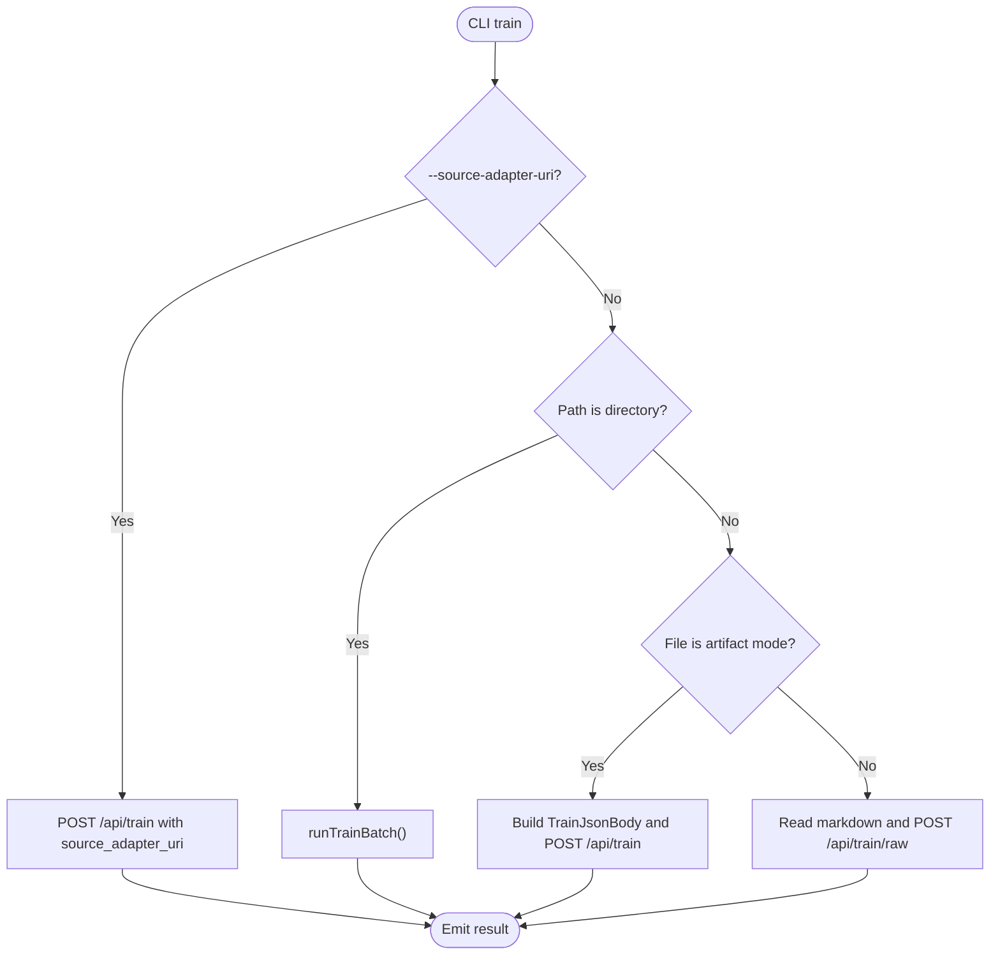

**Diagram sources**
- [cli-train.ts:40-210](file://src/cli/commands/cli-train.ts#L40-L210)
- [train-batch.ts:135-227](file://src/cli/train-batch.ts#L135-L227)

**Section sources**
- [cli-train.ts:40-210](file://src/cli/commands/cli-train.ts#L40-L210)
- [train-batch.ts:135-227](file://src/cli/train-batch.ts#L135-L227)

### Vector Database Integration
The vector database is used primarily for:

- **Adapter slug resolution**: When forking or attaching artifacts by slug, the system resolves the canonical adapter UUID via `QdrantService`.
- **Semantic indexing**: While not directly invoked inside `executeTrain`, the broader system uses Qdrant/LanceDB for semantic search of adapters and artifacts.

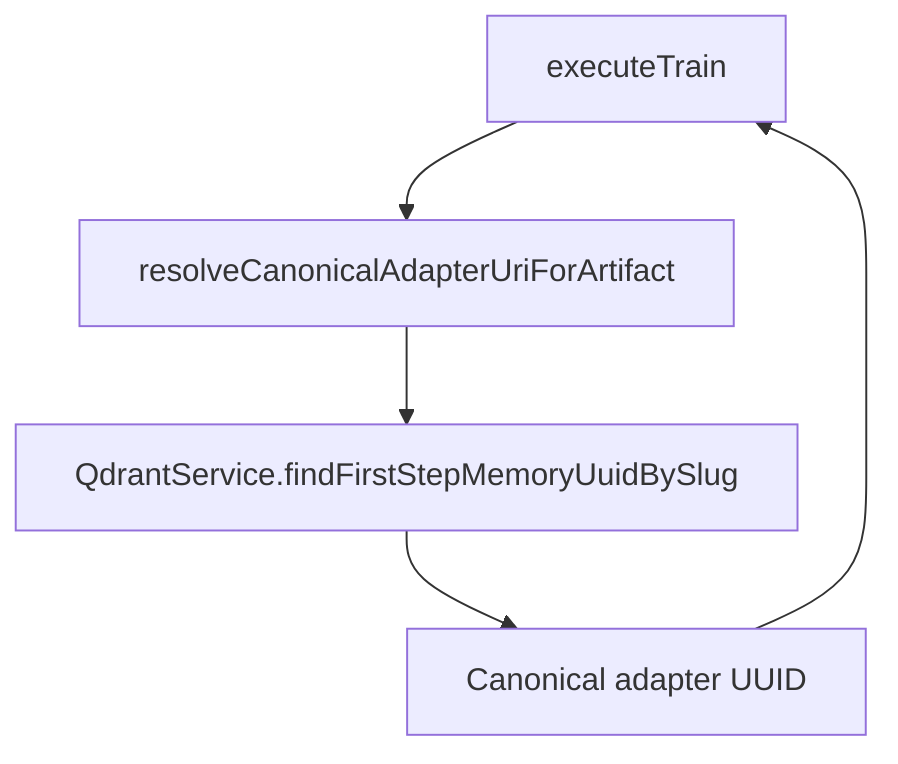

**Diagram sources**
- [train-artifact-adapter-uri.ts:5-36](file://src/tools/train-artifact-adapter-uri.ts#L5-L36)
- [train.ts:154-156](file://src/tools/train.ts#L154-L156)

**Section sources**
- [train-artifact-adapter-uri.ts:5-36](file://src/tools/train-artifact-adapter-uri.ts#L5-L36)
- [train.ts:154-156](file://src/tools/train.ts#L154-L156)

## Dependency Analysis
The `train` tool depends on:

- **Schema validation**: Zod schemas enforce input correctness and cross-field constraints.
- **Store persistence**: Memory store for adapters and artifacts.
- **Vector service**: Qdrant service for slug resolution during fork and artifact attachment.
- **MIME utilities**: Allowlist and inference for artifact types.
- **Size validators**: Limits for markdown and artifact bodies.
- **CLI guards**: Upload safety checks for sensitive content and binary detection.

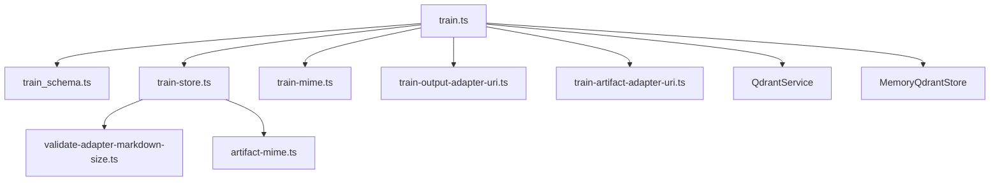

**Diagram sources**
- [train.ts:1-382](file://src/tools/train.ts#L1-L382)
- [train-store.ts:1-131](file://src/tools/train-store.ts#L1-L131)
- [train-mime.ts:1-22](file://src/tools/train-mime.ts#L1-L22)
- [train-output-adapter-uri.ts:1-33](file://src/tools/train-output-adapter-uri.ts#L1-L33)
- [train-artifact-adapter-uri.ts:1-37](file://src/tools/train-artifact-adapter-uri.ts#L1-L37)
- [artifact-mime.ts:1-50](file://src/tools/artifact-mime.ts#L1-L50)
- [validate-adapter-markdown-size.ts:1-125](file://src/services/memory/validate-adapter-markdown-size.ts#L1-L125)

**Section sources**
- [train.ts:1-382](file://src/tools/train.ts#L1-L382)
- [train-store.ts:1-131](file://src/tools/train-store.ts#L1-L131)

## Performance Considerations
- **Single-pass size validation**: Markdown size checks scan content once, avoiding repeated allocations.
- **Batch efficiency**: Directory batch training processes `.md` files sequentially but avoids printing large content to stdout.
- **MIME inference**: Inference is O(1) based on filename extension mapping.
- **Vector lookups**: Slug resolution calls are bounded to a single adapter lookup per fork or artifact attachment.
- **HTTP body limits**: Raw markdown endpoint enforces configurable body size limits to prevent resource exhaustion.

[No sources needed since this section provides general guidance]

## Security Considerations
The `train` tool implements multiple security controls:

- **Untrusted content processing**:
  - Binary detection rejects uploads containing null bytes.
  - Sensitive content detection blocks private keys, bearer tokens, bot/service tokens, and GitHub tokens unless explicitly allowed.
  - Protocol structure validation ensures adapters conform to expected shapes before storage.
- **Size limits**:
  - Markdown total bytes, per-line bytes, and line count are enforced.
  - Artifact total byte size is capped.
  - HTTP raw body limit prevents oversized requests.
- **Sanitization rules**:
  - Error detail keys are whitelisted to prevent leaking internal data.
  - Relative paths are normalized and disallow `..` traversal.
  - MIME types are restricted to an allowlist.
- **Authentication and authorization**:
  - Space resolution respects user context and writable spaces.
  - Review evidence is required for adapter training to ensure human-in-the-loop verification.

**Section sources**
- [upload-guards.ts:1-113](file://src/cli/upload-guards.ts#L1-L113)
- [validate-adapter-markdown-size.ts:31-124](file://src/services/memory/validate-adapter-markdown-size.ts#L31-L124)
- [train_schema.ts:100-177](file://src/tools/train_schema.ts#L100-L177)
- [train-store.ts:64-73](file://src/tools/train-store.ts#L64-L73)
- [http-api-train-json.ts:15-37](file://src/http/http-api-train-json.ts#L15-L37)
- [http-api-train-raw.ts:17-39](file://src/http/http-api-train-raw.ts#L17-L39)
- [config.ts:117-119](file://src/config.ts#L117-L119)

## Troubleshooting Guide
Common issues and resolutions:

- **Empty content**: Provide `content`, `source_adapter_uri`, or a `directory` for batch training.
- **Missing review evidence**: For adapter markdown, include critic-loop verdict proof (`verdict_file`, `exit_code`, `stdout`).
- **Invalid MIME**: Use a recognized extension or explicitly set `mime`; unknown extensions require explicit MIME.
- **Duplicate adapter**: Use `force_update: true` to overwrite an existing adapter with the same label.
- **Similar adapter found**: Inspect the match; use `force_update: true` with the same adapter ID to replace.
- **Payload too large**: Reduce request body size or adjust `HTTP_TRAIN_RAW_BODY_LIMIT`.
- **Space not found or read-only**: Verify space permissions and use a writable space.

**Section sources**
- [train_schema.ts:100-177](file://src/tools/train_schema.ts#L100-L177)
- [train-store.ts:106-112](file://src/tools/train-store.ts#L106-L112)
- [http-api-train-json.ts:137-163](file://src/http/http-api-train-json.ts#L137-L163)
- [http-api-train-raw.ts:156-205](file://src/http/http-api-train-raw.ts#L156-L205)

## Conclusion
The SquadRules `train` tool provides a robust, secure, and flexible interface for registering adapters and attaching artifacts. It enforces strict validation, size limits, and MIME allowlists, integrates with vector services for slug resolution, and exposes clear HTTP and CLI interfaces. By following the documented input formats, validation rules, and security considerations, users can reliably create, update, and manage adapters and their associated artifacts.

[No sources needed since this section summarizes without analyzing specific files]