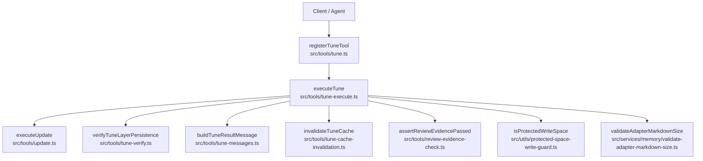
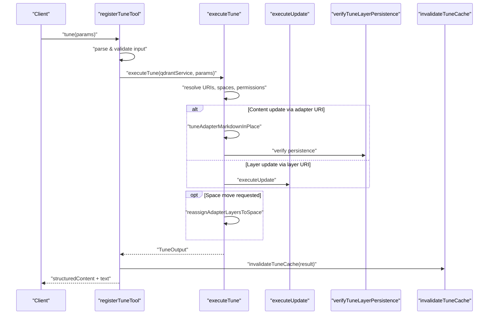
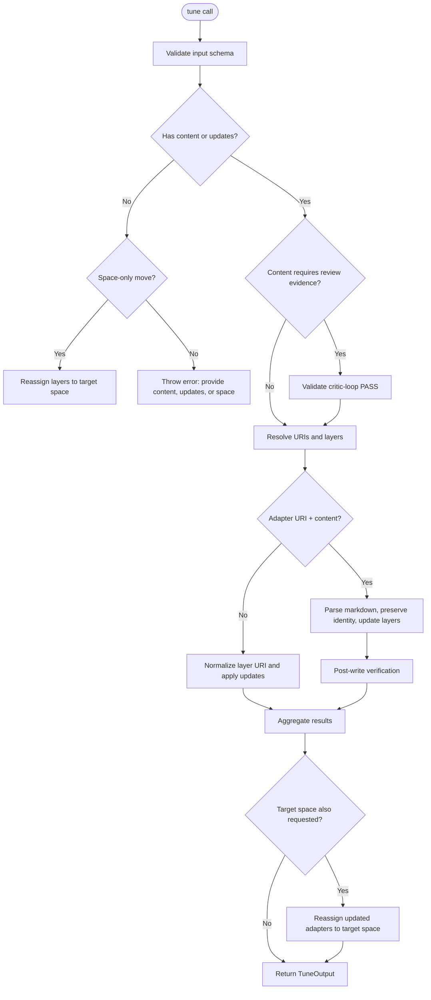
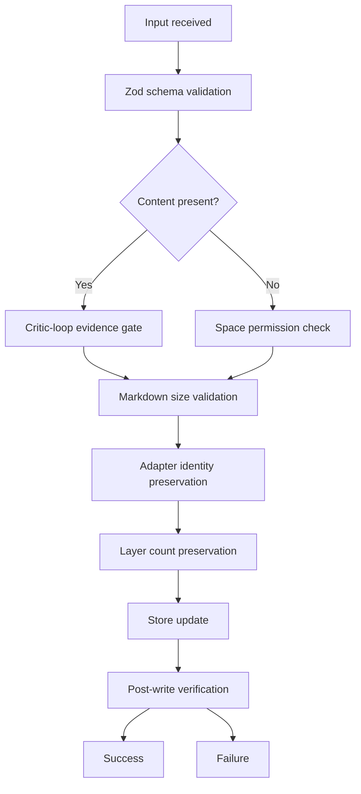
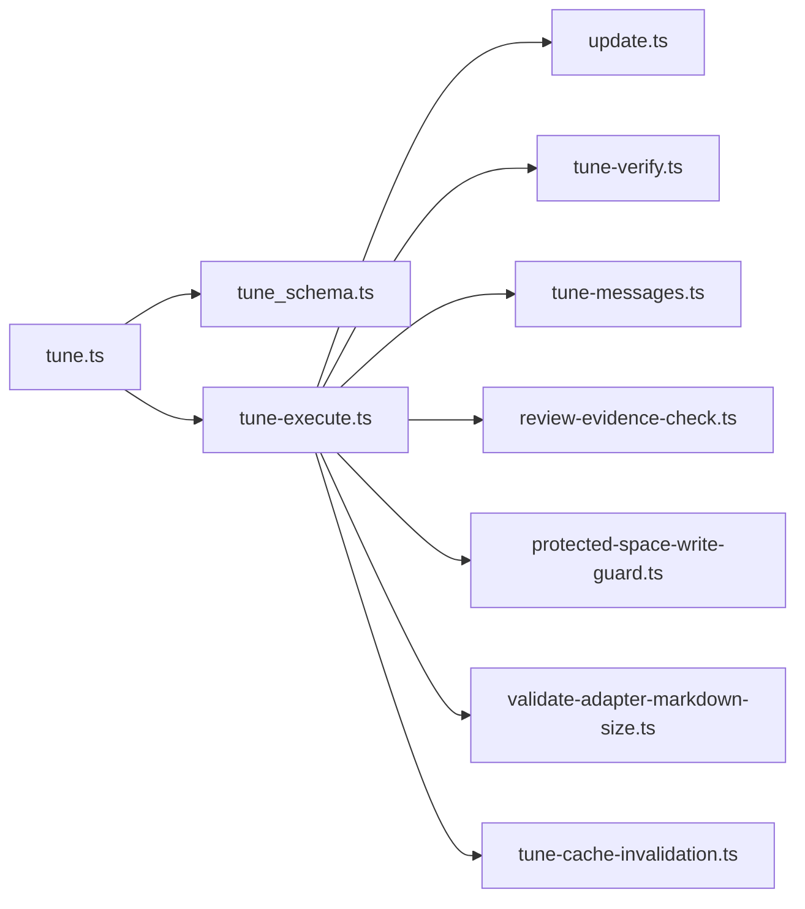
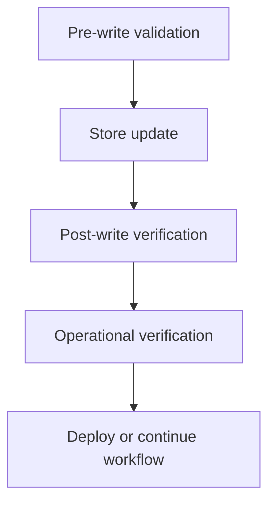

# Tune Tool

<cite>
**Referenced Files in This Document**
- [tune.ts](file://src/tools/tune.ts)
- [tune_schema.ts](file://src/tools/tune_schema.ts)
- [tune-execute.ts](file://src/tools/tune-execute.ts)
- [tune-verify.ts](file://src/tools/tune-verify.ts)
- [tune-messages.ts](file://src/tools/tune-messages.ts)
- [tune-cache-invalidation.ts](file://src/tools/tune-cache-invalidation.ts)
- [update.ts](file://src/tools/update.ts)
- [review-evidence-check.ts](file://src/tools/review-evidence-check.ts)
- [protected-space-write-guard.ts](file://src/utils/protected-space-write-guard.ts)
- [validate-adapter-markdown-size.ts](file://src/services/memory/validate-adapter-markdown-size.ts)
- [embedded-mcp-resources.ts](file://src/resources/embedded-mcp-resources.ts)
</cite>

## Table of Contents
1. [Introduction](#introduction)
2. [Project Structure](#project-structure)
3. [Core Components](#core-components)
4. [Architecture Overview](#architecture-overview)
5. [Detailed Component Analysis](#detailed-component-analysis)
6. [Dependency Analysis](#dependency-analysis)
7. [Performance Considerations](#performance-considerations)
8. [Troubleshooting Guide](#troubleshooting-guide)
9. [Conclusion](#conclusion)

## Introduction
The SquadRules `tune` tool updates existing adapter content and configuration without replacing the adapter identity. It is designed for agent-first workflows: an AI agent performs or delegates a critic-loop review, then calls `tune` to persist approved changes. The tool supports three primary mutation modes:

- **In-place adapter content update**: pass an adapter URI and full markdown body; the server re-parses it and updates each stored layer while preserving adapter identity and layer count.
- **Layer-level field update**: pass one or more layer URIs with either a new text body or an advanced field map.
- **Space move**: pass only `space` to reassign all layers of targeted adapters (or a single layer when using a layer URI).

The response includes per-target status, human-readable messages, and aggregate counts. After successful writes, the tool invalidates caches so subsequent reads see fresh data.

This documentation focuses on the API surface, validation rules, safety mechanisms, versioning behavior, verification, and deployment strategies.

## Project Structure
The tune tool is implemented as an MCP tool registration plus a focused execution pipeline:

**Diagram sources**
- [tune.ts:19-69](file://src/tools/tune.ts#L19-L69)
- [tune-execute.ts:219-349](file://src/tools/tune-execute.ts#L219-L349)
- [update.ts:8-72](file://src/tools/update.ts#L8-L72)
- [tune-verify.ts:11-24](file://src/tools/tune-verify.ts#L11-L24)
- [tune-messages.ts:13-22](file://src/tools/tune-messages.ts#L13-L22)
- [tune-cache-invalidation.ts:9-12](file://src/tools/tune-cache-invalidation.ts#L9-L12)
- [review-evidence-check.ts:20-43](file://src/tools/review-evidence-check.ts#L20-L43)
- [protected-space-write-guard.ts:5-16](file://src/utils/protected-space-write-guard.ts#L5-L16)
- [validate-adapter-markdown-size.ts:31-106](file://src/services/memory/validate-adapter-markdown-size.ts#L31-L106)

**Section sources**
- [tune.ts:19-69](file://src/tools/tune.ts#L19-L69)
- [tune-execute.ts:219-349](file://src/tools/tune-execute.ts#L219-L349)

## Core Components
The tune tool is composed of several cooperating modules:

| Component | Responsibility | Key Behavior |
|---|---|---|
| `registerTuneTool` | Registers the MCP tool, parses input, measures metrics, invokes execution, invalidates cache | Uses loose input schema wrapper, returns both text and structured content |
| `tuneInputSchema` / `tuneOutputSchema` | Validates inputs and defines output shape | Enforces URI formats, content length parity, space options, and review evidence requirements |
| `executeTune` | Main tuning workflow | Resolves targets, validates permissions, applies content or field updates, optionally moves layers to a target space |
| `executeUpdate` | Shared layer update logic | Updates layer text or arbitrary fields through Qdrant |
| `verifyTuneLayerPersistence` | Post-write verification | Re-reads updated layers and compares persisted text |
| `buildTuneResultMessage` | Canonicalizes result messages | Rewrites generic messages into adapter-layer-aware messages |
| `invalidateTuneCache` | Cache invalidation | Invalidates Redis-backed caches after successful updates |
| `assertReviewEvidencePassed` | Critic-loop proof gate | Requires PASS verdict evidence for content updates |
| `isProtectedWriteSpace` | Write protection | Blocks writes to system/app spaces |
| `validateAdapterMarkdownSize` | Markdown safety | Rejects oversized, too-long-line, or too-many-lines documents |

**Section sources**
- [tune.ts:19-69](file://src/tools/tune.ts#L19-L69)
- [tune_schema.ts:14-70](file://src/tools/tune_schema.ts#L14-L70)
- [tune-execute.ts:18-349](file://src/tools/tune-execute.ts#L18-L349)
- [update.ts:8-72](file://src/tools/update.ts#L8-L72)
- [tune-verify.ts:11-24](file://src/tools/tune-verify.ts#L11-L24)
- [tune-messages.ts:1-22](file://src/tools/tune-messages.ts#L1-L22)
- [tune-cache-invalidation.ts:9-12](file://src/tools/tune-cache-invalidation.ts#L9-L12)
- [review-evidence-check.ts:20-43](file://src/tools/review-evidence-check.ts#L20-L43)
- [protected-space-write-guard.ts:5-16](file://src/utils/protected-space-write-guard.ts#L5-L16)
- [validate-adapter-markdown-size.ts:31-106](file://src/services/memory/validate-adapter-markdown-size.ts#L31-L106)

## Architecture Overview
The tune tool follows a layered request-to-store flow with explicit validation, safety checks, and post-write verification.

**Diagram sources**
- [tune.ts:30-69](file://src/tools/tune.ts#L30-L69)
- [tune-execute.ts:219-349](file://src/tools/tune-execute.ts#L219-L349)
- [update.ts:8-72](file://src/tools/update.ts#L8-L72)
- [tune-verify.ts:11-24](file://src/tools/tune-verify.ts#L11-L24)
- [tune-cache-invalidation.ts:9-12](file://src/tools/tune-cache-invalidation.ts#L9-L12)

## Detailed Component Analysis

### Input Schema and Parameters
The tune tool accepts a structured object validated by Zod.

| Parameter | Type | Required | Description |
|---|---|---:|---|
| `uris` | Array of strings | Yes | Non-empty list of `squadrules://adapter/{uuid}` and/or `squadrules://layer/{uuid}` targets |
| `content` | Array of strings | No | Parallel array of full markdown bodies; must match `uris` length when provided |
| `updates` | Record<string, any> | No | Advanced field map applied to layer memory; prefer `content` for ordinary edits |
| `space` | String | No | Target space name or ID; `"personal"` or a group path; moves all layers for adapter URIs or the single layer for layer URIs |
| `review_evidence` | Object | Conditional | Required when `content` contains non-empty markdown; proves critic-loop PASS |

#### Review Evidence Shape
| Field | Type | Requirement |
|---|---|---|
| `verdict_file` | String | Absolute path to critic-loop verdict file |
| `exit_code` | Number | Must be `0` |
| `stdout` | String | First line must be `PASS` |

#### Validation Rules
- `content.length` must equal `uris.length` when `content` is provided.
- At least one of `content`, `updates`, or `space` must be present.
- When any non-empty content entry exists, `review_evidence` is required.
- Adapter URIs resolve to head layers; layer URIs are normalized to stored layer rows.
- Space resolution validates allowed spaces before writing.

**Section sources**
- [tune_schema.ts:14-70](file://src/tools/tune_schema.ts#L14-L70)
- [review-evidence-check.ts:20-43](file://src/tools/review-evidence-check.ts#L20-L43)

### Tuning Workflow
The tuning workflow branches based on input:

**Diagram sources**
- [tune-execute.ts:219-349](file://src/tools/tune-execute.ts#L219-L349)

**Section sources**
- [tune-execute.ts:219-349](file://src/tools/tune-execute.ts#L219-L349)

### Version Control and Identity Preservation
The tune tool does not create new adapter UUIDs when updating adapter content. Instead, it preserves adapter identity and layer structure:

- Adapter title determines expected adapter ID; changing the H1 title to a different value fails because the resolved adapter ID would no longer match the tune target.
- Layer count must remain unchanged; structural changes require `train` with `force_update: true`.
- Frontmatter `version` is propagated to `adapter.protocol_version` when present.
- Layer indices and counts are preserved during in-place updates.

This means `tune` is for content and configuration refinement, not for structural replacement.

**Section sources**
- [tune-execute.ts:127-217](file://src/tools/tune-execute.ts#L127-L217)

### Change Validation and Safety Mechanisms
The tune tool enforces multiple safety gates:

| Gate | Purpose | Failure Behavior |
|---|---|---|
| Input schema validation | Ensures URIs, arrays, and optional fields are well-formed | Returns structured validation error |
| Review evidence check | Prevents unreviewed content mutations | Throws train-style error requiring delegated critic-loop |
| Protected space guard | Blocks writes to system/app spaces | Throws protected-space write error |
| Markdown size validation | Rejects pathological documents | Throws size-limit error with code and details |
| Adapter identity check | Preserves adapter slug/UUID mapping | Throws mismatch error when H1-derived ID differs |
| Layer count check | Prevents structural changes via tune | Throws mismatch error directing to `train(force_update=true)` |
| Post-write verification | Confirms persistence after update | Throws verification failure if read-back mismatches |

**Diagram sources**
- [tune_schema.ts:14-70](file://src/tools/tune_schema.ts#L14-L70)
- [review-evidence-check.ts:20-43](file://src/tools/review-evidence-check.ts#L20-L43)
- [protected-space-write-guard.ts:5-16](file://src/utils/protected-space-write-guard.ts#L5-L16)
- [validate-adapter-markdown-size.ts:31-106](file://src/services/memory/validate-adapter-markdown-size.ts#L31-L106)
- [tune-execute.ts:127-217](file://src/tools/tune-execute.ts#L127-L217)
- [tune-verify.ts:11-24](file://src/tools/tune-verify.ts#L11-L24)

**Section sources**
- [tune_schema.ts:14-70](file://src/tools/tune_schema.ts#L14-L70)
- [review-evidence-check.ts:20-43](file://src/tools/review-evidence-check.ts#L20-L43)
- [protected-space-write-guard.ts:5-16](file://src/utils/protected-space-write-guard.ts#L5-L16)
- [validate-adapter-markdown-size.ts:31-106](file://src/services/memory/validate-adapter-markdown-size.ts#L31-L106)
- [tune-execute.ts:127-217](file://src/tools/tune-execute.ts#L127-L217)
- [tune-verify.ts:11-24](file://src/tools/tune-verify.ts#L11-L24)

### Dry-Run and Preview Capabilities
The current implementation does not expose a dedicated dry-run mode. However, preview can be achieved through the surrounding workflow:

- Use `export` to retrieve flat markdown before editing.
- Run critic-loop against the edited draft.
- If the critic passes, call `tune` to persist.
- After `tune`, call `export` again to verify the stored state.

This pattern provides a safe edit-review-verify cycle without requiring a server-side dry-run flag.

**Section sources**
- [embedded-mcp-resources.ts:18-23](file://src/resources/embedded-mcp-resources.ts#L18-L23)

### Response Structure
The tune tool returns a structured result:

| Field | Type | Description |
|---|---|---|
| `results` | Array | Per-target result with `uri`, `status`, and `message` |
| `total_updated` | Number | Count of successfully updated targets |
| `total_failed` | Number | Count of failed targets |

Each result entry uses:

| Field | Values | Meaning |
|---|---|---|
| `uri` | Layer URI string | Normalized layer URI associated with the update |
| `status` | `updated` or `error` | Whether the operation succeeded |
| `message` | String | Human-readable message; rewritten to reference adapter layers |

After successful tuning, the tool invalidates caches so subsequent operations such as export, forward, or activate see fresh data.

**Section sources**
- [tune_schema.ts:59-70](file://src/tools/tune_schema.ts#L59-L70)
- [tune-messages.ts:13-22](file://src/tools/tune-messages.ts#L13-L22)
- [tune-cache-invalidation.ts:9-12](file://src/tools/tune-cache-invalidation.ts#L9-L12)

### Deployment Strategies for Tuned Adapters
Recommended deployment patterns:

1. **Single-adapter tuning**: Export the adapter, edit flat markdown, run critic-loop, call `tune` with the adapter URI and content, then re-export to verify.
2. **Multi-adapter tuning**: Batch export adapters, apply conservative transformations, delegate critic-loop over the transformed set, then call `tune` per adapter.
3. **Space migration**: Call `tune` with only `space` to move adapters between personal and group spaces without changing content.
4. **Field-only tuning**: Use `updates` to adjust metadata or contract fields without rewriting full markdown.
5. **Verification loop**: After tuning, always re-export or re-activate the adapter to confirm runtime behavior.

**Section sources**
- [embedded-mcp-resources.ts:18-23](file://src/resources/embedded-mcp-resources.ts#L18-L23)
- [tune-execute.ts:219-349](file://src/tools/tune-execute.ts#L219-L349)

## Dependency Analysis
The tune tool depends on several internal services and utilities:

**Diagram sources**
- [tune.ts:1-12](file://src/tools/tune.ts#L1-L12)
- [tune-execute.ts:1-15](file://src/tools/tune-execute.ts#L1-L15)

Key dependency characteristics:

- **Low coupling within tools**: Each module has a focused responsibility.
- **Shared update logic**: `executeUpdate` is reused by tune and HTTP routes.
- **External storage dependency**: All writes go through `QdrantService`.
- **Cache invalidation boundary**: Redis cache invalidation is triggered only after successful updates.
- **Safety boundaries**: Protected spaces and markdown size limits are enforced before store writes.

**Section sources**
- [tune.ts:1-12](file://src/tools/tune.ts#L1-L12)
- [tune-execute.ts:1-15](file://src/tools/tune-execute.ts#L1-L15)
- [update.ts:1-5](file://src/tools/update.ts#L1-L5)
- [tune-cache-invalidation.ts:1-12](file://src/tools/tune-cache-invalidation.ts#L1-L12)

## Performance Considerations
- **Single-pass markdown validation**: Markdown size validation scans content once, checking total bytes, line length, and line count efficiently.
- **Per-target iteration**: Tune processes URIs sequentially; large batches may take time proportional to the number of targets.
- **Post-write verification cost**: Verification re-reads each updated layer from Qdrant, adding latency but preventing silent failures.
- **Cache invalidation**: A single Redis invalidation call is performed after tuning completes successfully.
- **Avoid unnecessary full-document rewrites**: Prefer `updates` for small field changes when possible.

[No sources needed since this section provides general guidance]

## Troubleshooting Guide

### Common Errors and Remediation

| Symptom | Likely Cause | Recommended Action |
|---|---|---|
| `REVIEW_EVIDENCE_REQUIRED` | Content update without critic-loop proof | Delegate critic-loop, capture verdict file, retry with `review_evidence` |
| `REVIEW_GATE_FAILED` | Critic-loop exit code non-zero or first line not `PASS` | Fix findings, rerun critic-loop, supply valid evidence |
| `Adapter not found` | Invalid adapter URI or slug | Verify adapter exists; use `spaces` or `export` to inspect |
| `Adapter title resolves to different ID` | H1 title changed to a different adapter identity | Keep H1 unchanged when tuning by adapter URI, or use `train(force_update=true)` |
| `Layer count mismatch` | Structural change attempted via tune | Use `train` with `force_update: true` instead of `tune` |
| `Cannot overwrite adapters in protected app/system spaces` | Writing to system/app space | Fork to personal or group space |
| `Adapter markdown exceeds maximum size` | Too many lines, too long line, or too many bytes | Split adapter, shorten lines, or reduce document size |
| `Post-write verification failed` | Store did not persist expected text | Investigate store/backend; retry after confirming persistence |
| `Content array length must match uris array length` | Mismatched `content` and `uris` arrays | Ensure one content entry per URI |

**Section sources**
- [review-evidence-check.ts:20-43](file://src/tools/review-evidence-check.ts#L20-L43)
- [tune-execute.ts:72-99](file://src/tools/tune-execute.ts#L72-L99)
- [tune-execute.ts:127-217](file://src/tools/tune-execute.ts#L127-L217)
- [protected-space-write-guard.ts:5-16](file://src/utils/protected-space-write-guard.ts#L5-L16)
- [validate-adapter-markdown-size.ts:31-106](file://src/services/memory/validate-adapter-markdown-size.ts#L31-L106)
- [tune-verify.ts:11-24](file://src/tools/tune-verify.ts#L11-L24)
- [update.ts:8-72](file://src/tools/update.ts#L8-L72)

### Verification System
The verification system combines pre-write and post-write checks:

- **Pre-write**: schema validation, review evidence, protected space guard, markdown size validation, adapter identity and layer count checks.
- **Post-write**: persistence verification re-reads updated layers and compares text.
- **Operational verification**: re-export or re-activate tuned adapters to confirm runtime behavior.

**Diagram sources**
- [tune-schema.ts:14-70](file://src/tools/tune_schema.ts#L14-L70)
- [tune-execute.ts:127-217](file://src/tools/tune-execute.ts#L127-L217)
- [tune-verify.ts:11-24](file://src/tools/tune-verify.ts#L11-L24)

**Section sources**
- [tune_schema.ts:14-70](file://src/tools/tune_schema.ts#L14-L70)
- [tune-execute.ts:127-217](file://src/tools/tune-execute.ts#L127-L217)
- [tune-verify.ts:11-24](file://src/tools/tune-verify.ts#L11-L24)

### Testing Integration
Testing tuned adapters should follow the same lifecycle used by agents:

1. Export the adapter before and after tuning.
2. Compare exported markdown or skill tree to confirm intended changes.
3. Activate the adapter and run representative flows.
4. Reward runs to record outcomes.
5. For batch tuning, generate a per-adapter change report and verify that only expected adapters were modified.

**Section sources**
- [embedded-mcp-resources.ts:18-23](file://src/resources/embedded-mcp-resources.ts#L18-L23)

## Conclusion
The SquadRules `tune` tool provides a controlled, verifiable mechanism for updating adapter content and configuration. It emphasizes safety through critic-loop evidence, protected-space guards, markdown size limits, identity preservation, and post-write verification. While it does not include a dry-run mode, the surrounding `export` → `critic-loop` → `tune` → `export` workflow offers a robust preview-and-verify process suitable for both single-adapter and mass-tuning operations. For structural changes, `train` with `force_update: true` remains the correct path; `tune` is best reserved for content refinement, field updates, and space migrations.