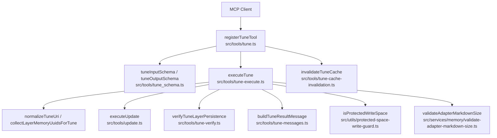
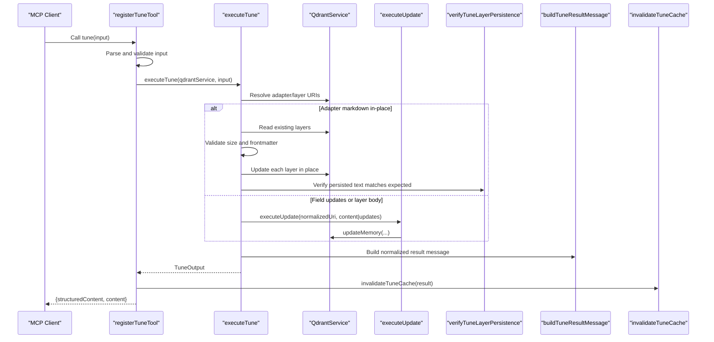
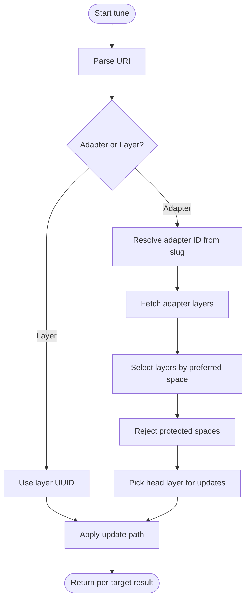
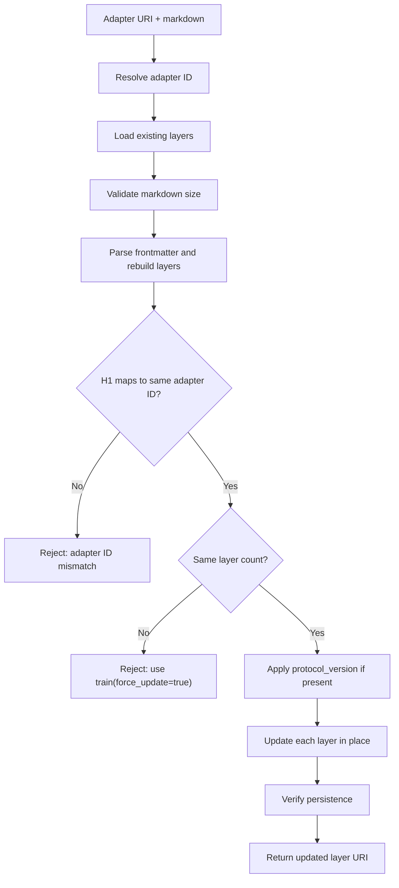
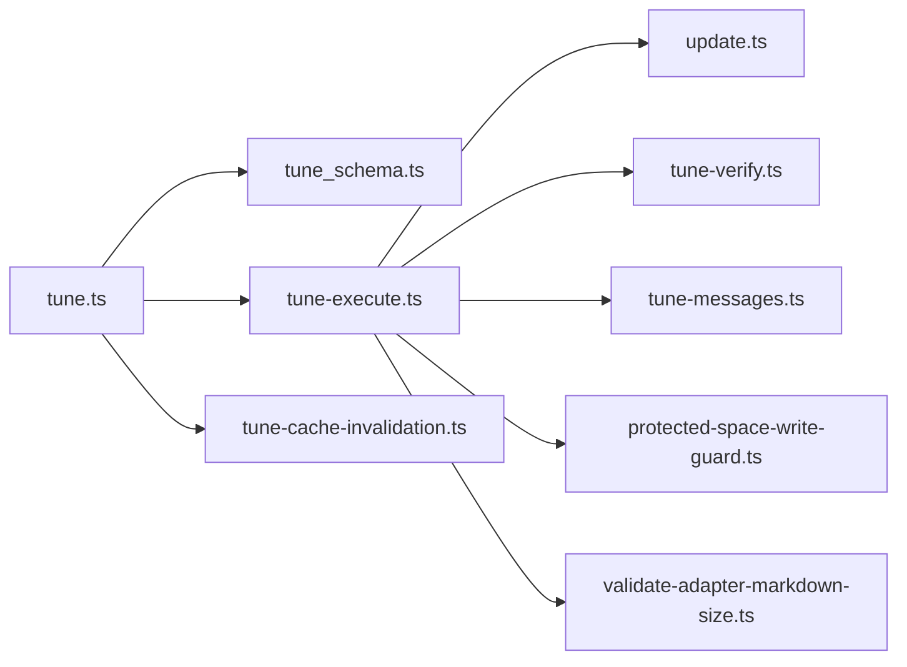

# Tune Tool

<cite>
**Referenced Files in This Document**
- [tune.ts](file://src/tools/tune.ts)
- [tune_schema.ts](file://src/tools/tune_schema.ts)
- [tune-execute.ts](file://src/tools/tune-execute.ts)
- [tune-messages.ts](file://src/tools/tune-messages.ts)
- [tune-verify.ts](file://src/tools/tune-verify.ts)
- [tune-cache-invalidation.ts](file://src/tools/tune-cache-invalidation.ts)
- [update.ts](file://src/tools/update.ts)
- [review-evidence-check.ts](file://src/tools/review-evidence-check.ts)
- [protected-space-write-guard.ts](file://src/utils/protected-space-write-guard.ts)
- [validate-adapter-markdown-size.ts](file://src/services/memory/validate-adapter-markdown-size.ts)
</cite>

## Table of Contents
1. [Introduction](#introduction)
2. [Project Structure](#project-structure)
3. [Core Components](#core-components)
4. [Architecture Overview](#architecture-overview)
5. [Detailed Component Analysis](#detailed-component-analysis)
6. [Dependency Analysis](#dependency-analysis)
7. [Performance Considerations](#performance-considerations)
8. [Troubleshooting Guide](#troubleshooting-guide)
9. [Conclusion](#conclusion)
10. [Appendices](#appendices)

## Introduction
The tune MCP tool updates adapter layer content and model optimization metadata without rebuilding entire adapters. It is designed for incremental, auditable changes to the adapter layer stored in Qdrant, with optional space reassignment and cache invalidation so subsequent reads see fresh data.

Key responsibilities:
- Accept one or more adapter or layer URIs.
- Update adapter markdown in place when an adapter URI and full markdown are provided.
- Apply field-level updates through a shared update path.
- Optionally move all layers of each target adapter to a permitted space.
- Validate input size, structure, review evidence, and write persistence.
- Return per-target results, totals, and human-readable messages.

This tool complements the activate → forward → reward chain by allowing agents to repair or refine adapters after training or review.

## Project Structure
The tune feature is implemented as a registered MCP tool that delegates to a focused execution pipeline:

**Diagram sources**
- [tune.ts:19-68](file://src/tools/tune.ts#L19-L68)
- [tune_schema.ts:14-67](file://src/tools/tune_schema.ts#L14-L67)
- [tune-execute.ts:88-349](file://src/tools/tune-execute.ts#L88-L349)
- [update.ts:8-72](file://src/tools/update.ts#L8-L72)
- [tune-verify.ts:11-24](file://src/tools/tune-verify.ts#L11-L24)
- [tune-messages.ts:7-22](file://src/tools/tune-messages.ts#L7-L22)
- [protected-space-write-guard.ts:5-16](file://src/utils/protected-space-write-guard.ts#L5-L16)
- [validate-adapter-markdown-size.ts:31-106](file://src/services/memory/validate-adapter-markdown-size.ts#L31-L106)
- [tune-cache-invalidation.ts:9-12](file://src/tools/tune-cache-invalidation.ts#L9-L12)

**Section sources**
- [tune.ts:19-68](file://src/tools/tune.ts#L19-L68)
- [tune_schema.ts:14-67](file://src/tools/tune_schema.ts#L14-L67)

## Core Components
- Tool registration and lifecycle: registers the `tune` tool, parses and validates input, measures metrics, executes tuning, invalidates caches, and returns structured output.
- Input schema: defines URIs, content, updates, space, and critic-loop review evidence requirements.
- Execution engine: resolves targets, selects writable layers, applies in-place markdown updates or field updates, moves layers to a target space, and verifies persistence.
- Message formatting: normalizes result messages and canonicalizes layer URIs.
- Persistence verification: re-reads updated layers to detect stale-cache or silent no-op writes.
- Cache invalidation: clears Redis-backed caches after successful updates.

**Section sources**
- [tune.ts:19-68](file://src/tools/tune.ts#L19-L68)
- [tune_schema.ts:14-67](file://src/tools/tune_schema.ts#L14-L67)
- [tune-execute.ts:116-349](file://src/tools/tune-execute.ts#L116-L349)
- [tune-messages.ts:7-22](file://src/tools/tune-messages.ts#L7-L22)
- [tune-verify.ts:11-24](file://src/tools/tune-verify.ts#L11-L24)
- [tune-cache-invalidation.ts:9-12](file://src/tools/tune-cache-invalidation.ts#L9-L12)

## Architecture Overview
The tune flow integrates validation, storage, and caching:

**Diagram sources**
- [tune.ts:30-66](file://src/tools/tune.ts#L30-L66)
- [tune-execute.ts:127-349](file://src/tools/tune-execute.ts#L127-L349)
- [update.ts:8-72](file://src/tools/update.ts#L8-L72)
- [tune-verify.ts:11-24](file://src/tools/tune-verify.ts#L11-L24)
- [tune-messages.ts:13-22](file://src/tools/tune-messages.ts#L13-L22)
- [tune-cache-invalidation.ts:9-12](file://src/tools/tune-cache-invalidation.ts#L9-L12)

## Detailed Component Analysis

### Input Schema
The tune input supports:
- `uris`: non-empty array of adapter URIs (`squadrules://adapter/{slug}`) or layer URIs (`squadrules://layer/{uuid}[?execution_id={uuid}]`).
- `content`: optional array of strings, one per URI, used for full adapter markdown updates or layer body updates.
- `updates`: optional record of field updates applied via the shared update path.
- `space`: optional target space identifier; moves all layers of each target adapter to this space after updates.
- `review_evidence`: required when any content update is provided; proves a passing critic-loop review.

Validation rules include:
- Content length must match URIs length.
- At least one of `content`, `updates`, or `space` must be present.
- When content is provided, `review_evidence` must exist and pass checks.

**Section sources**
- [tune_schema.ts:4-57](file://src/tools/tune_schema.ts#L4-L57)

### Output Schema
The tune output includes:
- `results`: per-URI entries with `uri`, `status`, and `message`.
- `total_updated`: count of successfully updated targets.
- `total_failed`: count of failed targets.

Status values:
- `updated`: target was modified successfully.
- `error`: target failed; message explains the failure.

**Section sources**
- [tune_schema.ts:59-67](file://src/tools/tune_schema.ts#L59-L67)

### Target Resolution and Layer Selection
- Adapter URIs are resolved to a canonical adapter ID using slug lookup.
- For adapter targets, the tool selects the appropriate layer set based on preferred space context and sorts by layer index.
- Protected spaces (system/app) are rejected for writes.
- Layer URIs are accepted directly.

**Diagram sources**
- [tune-execute.ts:72-114](file://src/tools/tune-execute.ts#L72-L114)
- [protected-space-write-guard.ts:5-16](file://src/utils/protected-space-write-guard.ts#L5-L16)

**Section sources**
- [tune-execute.ts:72-114](file://src/tools/tune-execute.ts#L72-L114)
- [protected-space-write-guard.ts:5-16](file://src/utils/protected-space-write-guard.ts#L5-L16)

### In-Place Adapter Markdown Updates
When an adapter URI and full markdown are provided:
- The tool resolves the adapter ID and loads existing layers.
- Validates total size, line length, and line count limits.
- Parses frontmatter and reconstructs layers via the header memory adapter builder.
- Enforces that the H1 title maps to the same adapter ID.
- Requires the same number of layers; structural changes require `train(force_update=true)`.
- Applies protocol version if present in frontmatter.
- Updates label, text, tags, adapter metadata, and inference contract fields.
- Verifies persistence by re-reading each layer and comparing text.

**Diagram sources**
- [tune-execute.ts:127-217](file://src/tools/tune-execute.ts#L127-L217)
- [validate-adapter-markdown-size.ts:31-106](file://src/services/memory/validate-adapter-markdown-size.ts#L31-L106)
- [tune-verify.ts:11-24](file://src/tools/tune-verify.ts#L11-L24)

**Section sources**
- [tune-execute.ts:127-217](file://src/tools/tune-execute.ts#L127-L217)
- [validate-adapter-markdown-size.ts:31-106](file://src/services/memory/validate-adapter-markdown-size.ts#L31-L106)
- [tune-verify.ts:11-24](file://src/tools/tune-verify.ts#L11-L24)

### Field Updates and Layer Body Updates
For layer URIs or adapter URIs where only partial updates are needed:
- The tool normalizes the URI to a concrete layer URI.
- Delegates to the shared update executor.
- Supports direct content updates or arbitrary field updates.
- Validates markdown bodies when present.
- Returns per-URI results with normalized messages.

**Section sources**
- [tune-execute.ts:277-321](file://src/tools/tune-execute.ts#L277-L321)
- [update.ts:8-72](file://src/tools/update.ts#L8-L72)
- [tune-messages.ts:13-22](file://src/tools/tune-messages.ts#L13-L22)

### Space Reassignment
If a target space is provided:
- The tool resolves and validates the space against allowed spaces.
- Moves all layers of each target adapter to the target space.
- If content updates succeed but space reassignment fails, the row is marked as error and counts adjusted accordingly.

**Section sources**
- [tune-execute.ts:219-239](file://src/tools/tune-execute.ts#L219-L239)
- [tune-execute.ts:323-342](file://src/tools/tune-execute.ts#L323-L342)

### Review Evidence Gate
When content updates are provided:
- The tool requires `review_evidence` with a zero exit code and a first-line verdict of PASS.
- Failures raise a structured error indicating the review gate did not pass.

**Section sources**
- [tune_schema.ts:23-30](file://src/tools/tune_schema.ts#L23-L30)
- [review-evidence-check.ts:18-41](file://src/tools/review-evidence-check.ts#L18-L41)

### Cache Invalidation
After successful tuning:
- The tool invalidates Redis-backed caches so subsequent reads reflect fresh writes.
- No-op when no updates were applied.

**Section sources**
- [tune.ts:51-52](file://src/tools/tune.ts#L51-L52)
- [tune-cache-invalidation.ts:9-12](file://src/tools/tune-cache-invalidation.ts#L9-L12)

## Dependency Analysis
The tune tool depends on several subsystems:

**Diagram sources**
- [tune.ts:1-12](file://src/tools/tune.ts#L1-L12)
- [tune-execute.ts:1-15](file://src/tools/tune-execute.ts#L1-L15)
- [update.ts:1-6](file://src/tools/update.ts#L1-L6)
- [tune-verify.ts:1-4](file://src/tools/tune-verify.ts#L1-L4)
- [tune-messages.ts:1-5](file://src/tools/tune-messages.ts#L1-L5)
- [protected-space-write-guard.ts:1-3](file://src/utils/protected-space-write-guard.ts#L1-L3)
- [validate-adapter-markdown-size.ts:1-7](file://src/services/memory/validate-adapter-markdown-size.ts#L1-L7)
- [tune-cache-invalidation.ts:1-3](file://src/tools/tune-cache-invalidation.ts#L1-L3)

**Section sources**
- [tune.ts:1-12](file://src/tools/tune.ts#L1-L12)
- [tune-execute.ts:1-15](file://src/tools/tune-execute.ts#L1-L15)

## Performance Considerations
- Input/output metrics: the tool records call duration, input size, output size, and error counts per tenant.
- Validation cost: markdown size checks scan content once and enforce byte/line limits to prevent pathological payloads.
- Storage operations: tune performs multiple read/write calls per target; batch URIs to reduce round-trips.
- Cache invalidation: triggered only when updates occur, avoiding unnecessary cache churn.
- Space moves: performed after successful updates; failures revert counts to maintain accurate totals.

Best practices:
- Prefer layer URIs for targeted edits to minimize work.
- Avoid changing adapter titles during tune; structural changes should use `train(force_update=true)`.
- Keep markdown within configured size limits to avoid validation failures.
- Group related updates into a single tune call to reduce overhead.

[No sources needed since this section provides general guidance]

## Troubleshooting Guide
Common issues and resolutions:

- Missing or invalid review evidence:
  - Symptom: error indicating review evidence is required or review gate failed.
  - Cause: content updates provided without passing critic-loop evidence.
  - Resolution: run the critic-loop review and provide a valid `review_evidence` object.

- Adapter title mismatch:
  - Symptom: error stating the H1 title resolves to a different adapter ID.
  - Cause: changing the adapter title while tuning by adapter URI.
  - Resolution: keep the H1 unchanged or use `train(force_update=true)` for structural changes.

- Layer count mismatch:
  - Symptom: error stating layer count differs between existing and new markdown.
  - Cause: adding/removing layers via tune instead of train.
  - Resolution: use `train(force_update=true)` for structural changes.

- Protected space write:
  - Symptom: error indicating protected app/system spaces cannot be overwritten.
  - Cause: attempting to modify adapters in system or application spaces.
  - Resolution: fork to a personal or group space before tuning.

- Stale cache or silent write:
  - Symptom: post-write verification fails due to text mismatch.
  - Cause: underlying store did not persist the change.
  - Resolution: retry the operation and ensure cache invalidation occurs; inspect storage backend health.

- Space move failure:
  - Symptom: content updated but space reassignment failed.
  - Cause: target space not allowed or permission issue.
  - Resolution: verify the target space is allowed and accessible; adjust permissions.

**Section sources**
- [review-evidence-check.ts:18-41](file://src/tools/review-evidence-check.ts#L18-L41)
- [tune-execute.ts:156-171](file://src/tools/tune-execute.ts#L156-L171)
- [protected-space-write-guard.ts:5-16](file://src/utils/protected-space-write-guard.ts#L5-L16)
- [tune-verify.ts:11-24](file://src/tools/tune-verify.ts#L11-L24)
- [tune-execute.ts:323-342](file://src/tools/tune-execute.ts#L323-L342)

## Conclusion
The tune tool provides a safe, validated pathway for updating adapter layer content and metadata. It enforces review gates, protects system spaces, validates markdown sizes, and verifies persistence. Use it for incremental improvements and field tweaks; reserve structural changes for `train(force_update=true)`. Always pair content updates with passing critic-loop evidence and consider space reassignment for organizational clarity.

[No sources needed since this section summarizes without analyzing specific files]

## Appendices

### Authentication and Authorization
- Authentication: JWT tokens validate both human and agent requests.
- Authorization: tune respects space context and allowed spaces; protected spaces are blocked for writes.
- Tenant isolation: metrics and operations are scoped by tenant ID.

**Section sources**
- [tune.ts:31-33](file://src/tools/tune.ts#L31-L33)
- [tune-execute.ts:219-239](file://src/tools/tune-execute.ts#L219-L239)
- [protected-space-write-guard.ts:5-16](file://src/utils/protected-space-write-guard.ts#L5-L16)

### Conflict Resolution
- Adapter title conflicts: tune rejects changes that alter the adapter ID derived from the H1 title.
- Structural conflicts: tune rejects layer count mismatches; use `train(force_update=true)` for structural changes.
- Space conflicts: tune rejects writes to protected spaces and requires target space membership.

**Section sources**
- [tune-execute.ts:156-171](file://src/tools/tune-execute.ts#L156-L171)
- [protected-space-write-guard.ts:5-16](file://src/utils/protected-space-write-guard.ts#L5-L16)

### Examples

- Incremental update of a single layer:
  - Provide a layer URI and either `content` for the layer body or `updates` for field changes.
  - The tool normalizes the URI, applies the update, and returns a success result.

- Bulk modifications across multiple adapters:
  - Provide multiple adapter URIs with corresponding content arrays or shared `updates`.
  - Each target is processed independently; results include per-target status and messages.

- Rollback scenario:
  - If content updates succeed but space reassignment fails, the row is marked as error and counts adjusted.
  - To fully rollback, re-run tune with original layer URIs and restore previous content or fields.

[No sources needed since these examples describe usage patterns rather than specific code lines]

### Best Practices
- Run critic-loop review before providing content updates.
- Keep adapter titles stable when tuning by adapter URI.
- Use layer URIs for precise edits; prefer `updates` for small metadata changes.
- Batch related updates to reduce API calls.
- Monitor `total_updated` and `total_failed` to detect partial failures.
- Ensure target spaces are allowed and not protected.

[No sources needed since this section provides general guidance]