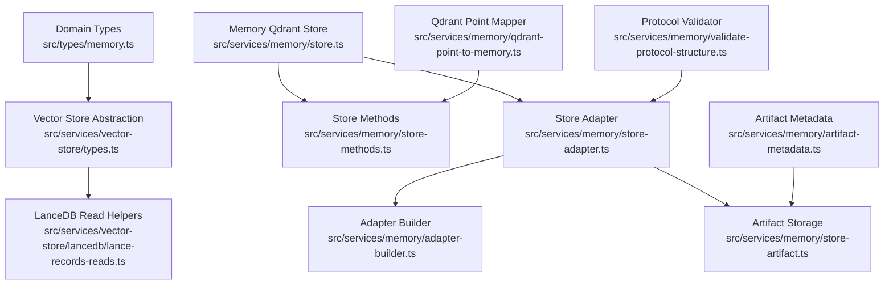
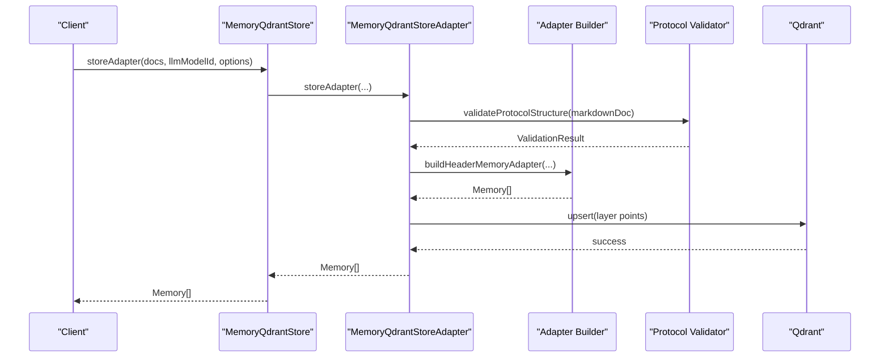
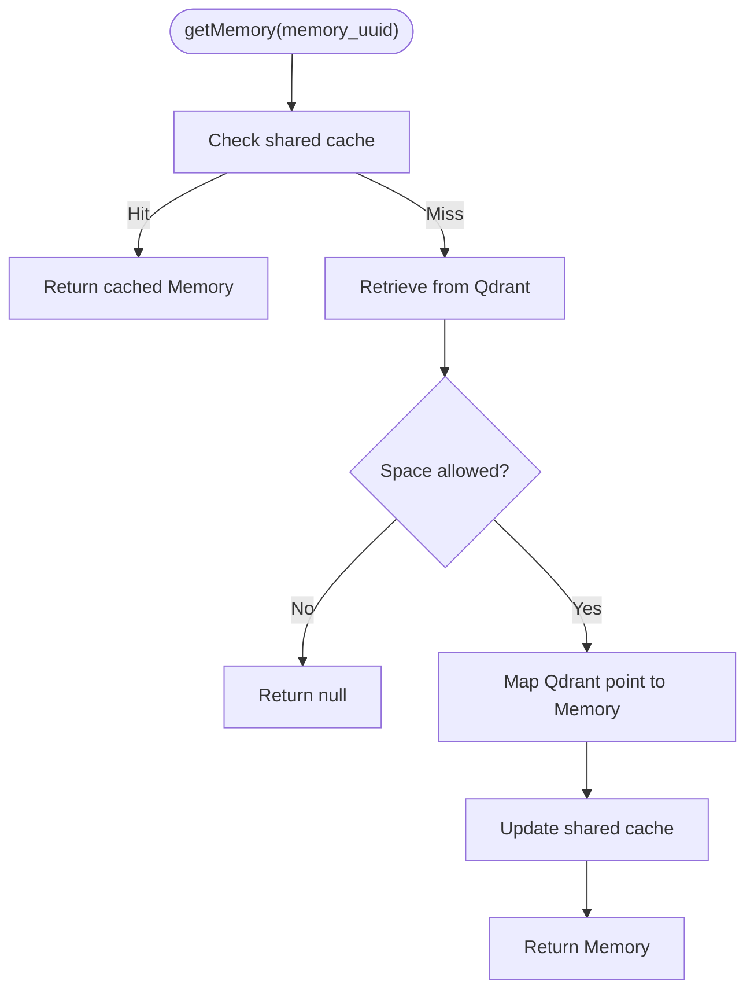
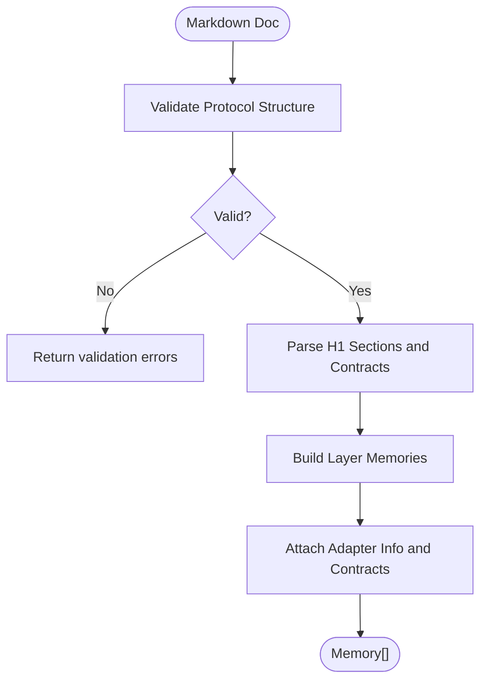
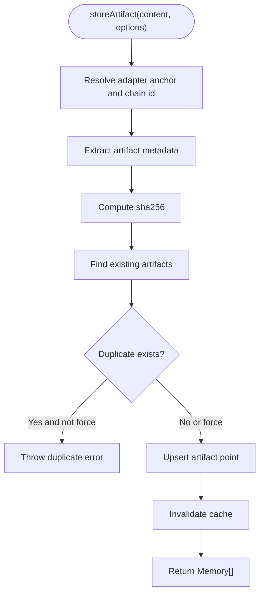
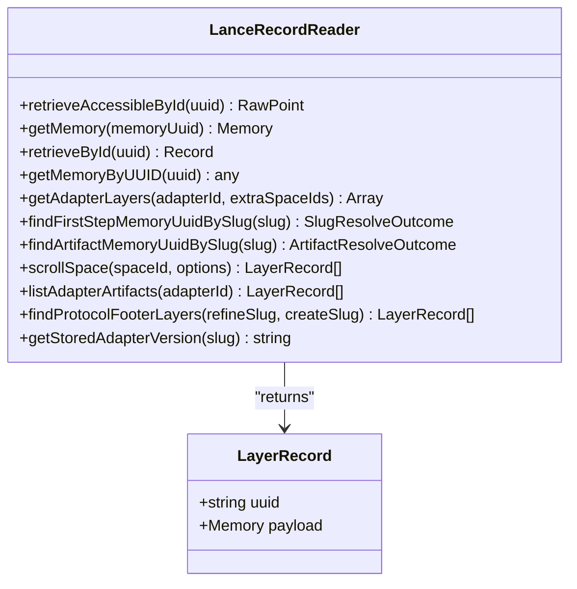
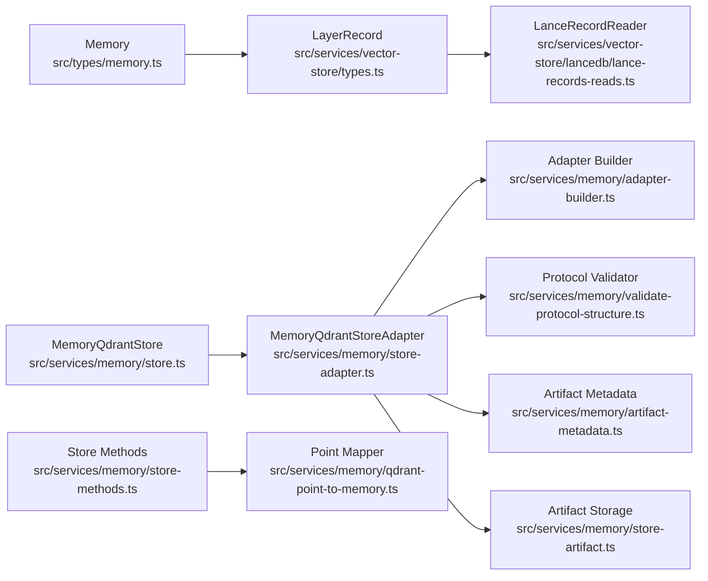

# Data Models & Schemas

<cite>
**Referenced Files in This Document**
- [memory.ts](file://src/types/memory.ts)
- [types.ts](file://src/services/vector-store/types.ts)
- [store.ts](file://src/services/memory/store.ts)
- [store-methods.ts](file://src/services/memory/store-methods.ts)
- [qdrant-point-to-memory.ts](file://src/services/memory/qdrant-point-to-memory.ts)
- [validate-protocol-structure.ts](file://src/services/memory/validate-protocol-structure.ts)
- [artifact-metadata.ts](file://src/services/memory/artifact-metadata.ts)
- [store-adapter.ts](file://src/services/memory/store-adapter.ts)
- [adapter-builder.ts](file://src/services/memory/adapter-builder.ts)
- [store-artifact.ts](file://src/services/memory/store-artifact.ts)
- [lance-records-reads.ts](file://src/services/vector-store/lancedb/lance-records-reads.ts)
</cite>

## Table of Contents
1. [Introduction](#introduction)
2. [Project Structure](#project-structure)
3. [Core Components](#core-components)
4. [Architecture Overview](#architecture-overview)
5. [Detailed Component Analysis](#detailed-component-analysis)
6. [Dependency Analysis](#dependency-analysis)
7. [Performance Considerations](#performance-considerations)
8. [Troubleshooting Guide](#troubleshooting-guide)
9. [Conclusion](#conclusion)

## Introduction
This document explains the SquadRules data models and schemas used by the memory and vector storage system. It focuses on:
- The core Memory domain model and its adapter, artifact, and inference contract fields.
- The LayerRecord abstraction used for vector database operations.
- Validation rules for protocol structures, adapter definitions, and artifact content.
- Schema evolution strategies, versioning approaches, and migration procedures.
- Examples of data transformations between representations and validation error handling patterns.

The documentation is designed to be accessible to both developers and non-technical readers while remaining precise about code-level behavior.

## Project Structure
The relevant code is organized into three main areas:
- Domain types under `src/types/memory.ts`.
- Vector-store abstractions and backend-neutral types under `src/services/vector-store/types.ts` and LanceDB read helpers.
- Memory persistence and transformation logic under `src/services/memory/*`.

**Diagram sources**
- [memory.ts:1-125](file://src/types/memory.ts#L1-L125)
- [types.ts:10-40](file://src/services/vector-store/types.ts#L10-L40)
- [lance-records-reads.ts:35-37](file://src/services/vector-store/lancedb/lance-records-reads.ts#L35-L37)
- [store.ts:15-15](file://src/services/memory/store.ts#L15-L15)
- [store-methods.ts:17-17](file://src/services/memory/store-methods.ts#L17-L17)
- [store-adapter.ts:13-16](file://src/services/memory/store-adapter.ts#L13-L16)
- [adapter-builder.ts:8-8](file://src/services/memory/adapter-builder.ts#L8-L8)
- [store-artifact.ts:17-17](file://src/services/memory/store-artifact.ts#L17-L17)
- [qdrant-point-to-memory.ts:2-2](file://src/services/memory/qdrant-point-to-memory.ts#L2-L2)
- [validate-protocol-structure.ts:8-8](file://src/services/memory/validate-protocol-structure.ts#L8-L8)

**Section sources**
- [memory.ts:1-125](file://src/types/memory.ts#L1-L125)
- [types.ts:1-95](file://src/services/vector-store/types.ts#L1-L95)
- [store.ts:1-272](file://src/services/memory/store.ts#L1-L272)
- [store-methods.ts:1-270](file://src/services/memory/store-methods.ts#L1-L270)
- [store-adapter.ts:1-154](file://src/services/memory/store-adapter.ts#L1-L154)
- [adapter-builder.ts:1-258](file://src/services/memory/adapter-builder.ts#L1-L258)
- [store-artifact.ts:1-301](file://src/services/memory/store-artifact.ts#L1-L301)
- [qdrant-point-to-memory.ts:1-101](file://src/services/memory/qdrant-point-to-memory.ts#L1-L101)
- [validate-protocol-structure.ts:1-187](file://src/services/memory/validate-protocol-structure.ts#L1-L187)
- [artifact-metadata.ts:1-78](file://src/services/memory/artifact-metadata.ts#L1-L78)
- [lance-records-reads.ts:1-257](file://src/services/vector-store/lancedb/lance-records-reads.ts#L1-L257)

## Core Components
This section documents the primary data models and their roles.

### Memory Model
The central domain type represents a stored memory record. Key fields include:
- Identifier and scoping:
  - `memory_uuid`: Stable identifier for the memory point.
  - `space_id`: Optional Qdrant payload space for export or adapter scroll scoping.
- Content and metadata:
  - `label`, `slug`, `tags`, `text`, `llm_model_id`, `created_at`, `content_type`.
- Artifact reference:
  - `artifact.slug`, `artifact.version`, `artifact.name`, `artifact.sha256`, optional `artifact.relative_path`.
- Adapter context:
  - `adapter.id`, `adapter.name`, `adapter.layer_index`, `adapter.layer_count`, optional `adapter.protocol_version`, `adapter.activation_patterns`, `adapter.reward_signal`, `adapter.chain_root`.
- Inference contract:
  - `inference_contract` describes execution contracts such as tensor, shell, MCP, user input, or comment.

Additional related types:
- `AdapterInfo`: Adapter identity and chain metadata.
- `InferenceContractDefinition` and `TensorOutputSpec`: Contract shape for deterministic execution.
- `RewardRecord` and `ExecutionTrace`: Execution and evaluation records.

**Section sources**
- [memory.ts:1-125](file://src/types/memory.ts#L1-L125)

### LayerRecord Abstraction
`LayerRecord` is a backend-neutral representation of one adapter layer:
- `uuid`: The point identifier.
- `payload`: The full `Memory` object.

It allows both Qdrant points and LanceDB rows to be treated uniformly across the application.

**Section sources**
- [types.ts:32-40](file://src/services/vector-store/types.ts#L32-L40)

### Vector Store Search Result
`MemorySearchResult` exposes search results as parallel arrays of memories and scores, matching existing tool interfaces.

**Section sources**
- [types.ts:14-18](file://src/services/vector-store/types.ts#L14-L18)

## Architecture Overview
The memory system stores adapters and artifacts as layered points with rich payloads. Reads are normalized through a shared mapper so that consumers always see `Memory` objects. Writes go through an adapter pipeline that validates structure, builds layers, and persists them to Qdrant (primary) or LanceDB (embedded).

**Diagram sources**
- [store.ts:132-142](file://src/services/memory/store.ts#L132-L142)
- [store-adapter.ts:43-147](file://src/services/memory/store-adapter.ts#L43-L147)
- [validate-protocol-structure.ts:113-185](file://src/services/memory/validate-protocol-structure.ts#L113-L185)
- [adapter-builder.ts:212-257](file://src/services/memory/adapter-builder.ts#L212-L257)

## Detailed Component Analysis

### Memory Persistence and Retrieval
- `MemoryQdrantStore` manages client initialization, health checks, and high-level operations like storing adapters, artifacts, searching, scrolling spaces, and managing app-space points.
- `MemoryQdrantStoreMethods` implements retrieval, caching, hybrid search, and title similarity search. It maps raw Qdrant points to `Memory` via `pointToMemory`.

Key behaviors:
- Cache-aware reads: Redis-backed cache for memory and search results.
- Hybrid search: Dense vectors plus BM25 with fusion and field boosts.
- Space filtering: Enforces tenant and space access controls.

**Diagram sources**
- [store-methods.ts:38-72](file://src/services/memory/store-methods.ts#L38-L72)
- [qdrant-point-to-memory.ts:10-99](file://src/services/memory/qdrant-point-to-memory.ts#L10-L99)

**Section sources**
- [store.ts:29-66](file://src/services/memory/store.ts#L29-L66)
- [store-methods.ts:38-114](file://src/services/memory/store-methods.ts#L38-L114)
- [qdrant-point-to-memory.ts:10-99](file://src/services/memory/qdrant-point-to-memory.ts#L10-L99)

### Adapter Construction and Validation
- `validateProtocolStructure` enforces required markdown sections and contract block rules before training.
- `buildHeaderMemoryAdapter` parses markdown into layered `Memory` objects, extracting activation patterns, reward signals, and inference contracts.

Validation rules:
- Must have an H1 title.
- First H2 must be Activation Patterns; last H2 must be Reward Signal.
- At least one fenced JSON contract block.
- No mixed plain fences containing contract JSON.
- Contract `type` must be one of the allowed values.

Construction rules:
- Layers are split by fenced contract blocks.
- Labels derive from H2 headings when present.
- Tags combine base tags and code identifiers.
- Reward signal is attached to all adapter layers.

**Diagram sources**
- [validate-protocol-structure.ts:113-185](file://src/services/memory/validate-protocol-structure.ts#L113-L185)
- [adapter-builder.ts:75-209](file://src/services/memory/adapter-builder.ts#L75-L209)

**Section sources**
- [validate-protocol-structure.ts:1-187](file://src/services/memory/validate-protocol-structure.ts#L1-187)
- [adapter-builder.ts:1-258](file://src/services/memory/adapter-builder.ts#L1-L258)

### Artifact Storage and Metadata
- `extractArtifactMetadata` derives slug and version from top headers or artifact name, enforcing slug format.
- `storeArtifact` attaches artifacts to an adapter chain, computes SHA-256, creates sparse BM25 tokens, and persists points. It handles duplicate detection and optional force updates.

Important details:
- Artifacts are identified by `artifact.slug` and optionally by `name`.
- Existing artifacts can be updated only with `forceUpdate`.
- Vectors may fall back to dense-only if sparse indexing fails.

**Diagram sources**
- [artifact-metadata.ts:64-77](file://src/services/memory/artifact-metadata.ts#L64-L77)
- [store-artifact.ts:168-300](file://src/services/memory/store-artifact.ts#L168-L300)

**Section sources**
- [artifact-metadata.ts:1-78](file://src/services/memory/artifact-metadata.ts#L1-L78)
- [store-artifact.ts:1-301](file://src/services/memory/store-artifact.ts#L1-L301)

### Backend-Neutral Reads and LayerRecord Mapping
- `LanceRecordReader` mirrors Qdrant read semantics and returns `LayerRecord` objects.
- `toLayerRecord` converts LanceDB rows to `{ uuid, payload }`, where `payload` is cast to `Memory`.

Behavior highlights:
- Space-based access control.
- Deterministic slug disambiguation with precedence rules.
- Exact artifact slug resolution with ambiguity notes.

**Diagram sources**
- [lance-records-reads.ts:35-37](file://src/services/vector-store/lancedb/lance-records-reads.ts#L35-L37)
- [lance-records-reads.ts:46-255](file://src/services/vector-store/lancedb/lance-records-reads.ts#L46-L255)
- [types.ts:32-40](file://src/services/vector-store/types.ts#L32-L40)

**Section sources**
- [lance-records-reads.ts:1-257](file://src/services/vector-store/lancedb/lance-records-reads.ts#L1-L257)
- [types.ts:1-95](file://src/services/vector-store/types.ts#L1-L95)

## Dependency Analysis
The following diagram shows how domain types flow through the system and how adapters and artifacts are persisted.

**Diagram sources**
- [memory.ts:1-125](file://src/types/memory.ts#L1-L125)
- [types.ts:10-40](file://src/services/vector-store/types.ts#L10-L40)
- [lance-records-reads.ts:35-37](file://src/services/vector-store/lancedb/lance-records-reads.ts#L35-L37)
- [store.ts:1-272](file://src/services/memory/store.ts#L1-L272)
- [store-adapter.ts:1-154](file://src/services/memory/store-adapter.ts#L1-L154)
- [adapter-builder.ts:1-258](file://src/services/memory/adapter-builder.ts#L1-L258)
- [validate-protocol-structure.ts:1-187](file://src/services/memory/validate-protocol-structure.ts#L1-L187)
- [artifact-metadata.ts:1-78](file://src/services/memory/artifact-metadata.ts#L1-L78)
- [store-artifact.ts:1-301](file://src/services/memory/store-artifact.ts#L1-L301)
- [store-methods.ts:1-270](file://src/services/memory/store-methods.ts#L1-L270)
- [qdrant-point-to-memory.ts:1-101](file://src/services/memory/qdrant-point-to-memory.ts#L1-L101)

**Section sources**
- [store.ts:1-272](file://src/services/memory/store.ts#L1-L272)
- [store-adapter.ts:1-154](file://src/services/memory/store-adapter.ts#L1-L154)
- [adapter-builder.ts:1-258](file://src/services/memory/adapter-builder.ts#L1-L258)
- [validate-protocol-structure.ts:1-187](file://src/services/memory/validate-protocol-structure.ts#L1-L187)
- [artifact-metadata.ts:1-78](file://src/services/memory/artifact-metadata.ts#L1-L78)
- [store-artifact.ts:1-301](file://src/services/memory/store-artifact.ts#L1-L301)
- [store-methods.ts:1-270](file://src/services/memory/store-methods.ts#L1-L270)
- [qdrant-point-to-memory.ts:1-101](file://src/services/memory/qdrant-point-to-memory.ts#L1-L101)
- [lance-records-reads.ts:1-257](file://src/services/vector-store/lancedb/lance-records-reads.ts#L1-L257)

## Performance Considerations
- Hybrid search uses multiple prefetch legs and fusion to improve recall and precision.
- Caching reduces repeated Qdrant calls for reads and search results.
- Sparse BM25 tokens enable efficient text matching alongside dense vectors.
- Scroll pagination avoids loading entire collections into memory.

[No sources needed since this section provides general guidance]

## Troubleshooting Guide
Common issues and patterns:
- Protocol structure validation failures:
  - Missing H1 title, missing Activation Patterns or Reward Signal, invalid contract type, or mixed fences.
  - Resolution: Ensure markdown follows the required structure and use only fenced JSON blocks for contracts.
- Duplicate artifacts:
  - Attempting to store an artifact already attached to an adapter without `forceUpdate`.
  - Resolution: Use `forceUpdate` to replace the existing artifact or choose a different artifact name/slug.
- Sparse vector fallback:
  - Upsert may retry without BM25 if sparse indexing fails.
  - Resolution: Inspect logs for warnings and ensure vector schema compatibility.
- Slug ambiguity:
  - Resolving slugs across spaces may produce disambiguation notes.
  - Resolution: Prefer explicit adapter URIs to avoid ambiguity.

**Section sources**
- [validate-protocol-structure.ts:113-185](file://src/services/memory/validate-protocol-structure.ts#L113-L185)
- [store-artifact.ts:205-207](file://src/services/memory/store-artifact.ts#L205-L207)
- [store-artifact.ts:260-272](file://src/services/memory/store-artifact.ts#L260-L272)
- [lance-records-reads.ts:130-172](file://src/services/vector-store/lancedb/lance-records-reads.ts#L130-L172)

## Conclusion
SquadRules’ memory and vector storage system centers on a robust `Memory` domain model and a backend-neutral `LayerRecord` abstraction. Adapters are validated and transformed into layered memories, while artifacts are attached with strict metadata and deduplication. The system supports schema evolution through optional fields, protocol versions, and careful mapping between storage formats. These patterns provide a clear path for maintaining consistency, performance, and clarity across Qdrant and LanceDB backends.

[No sources needed since this section summarizes without analyzing specific files]