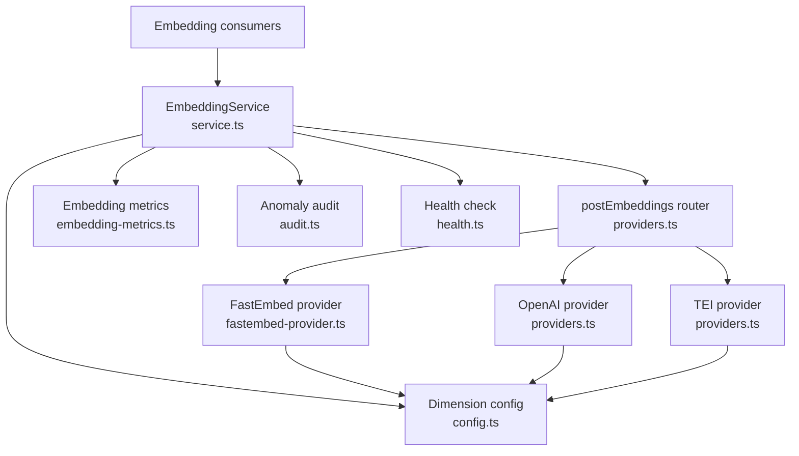
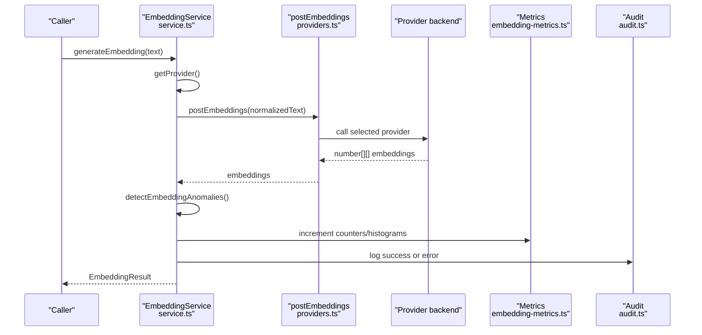
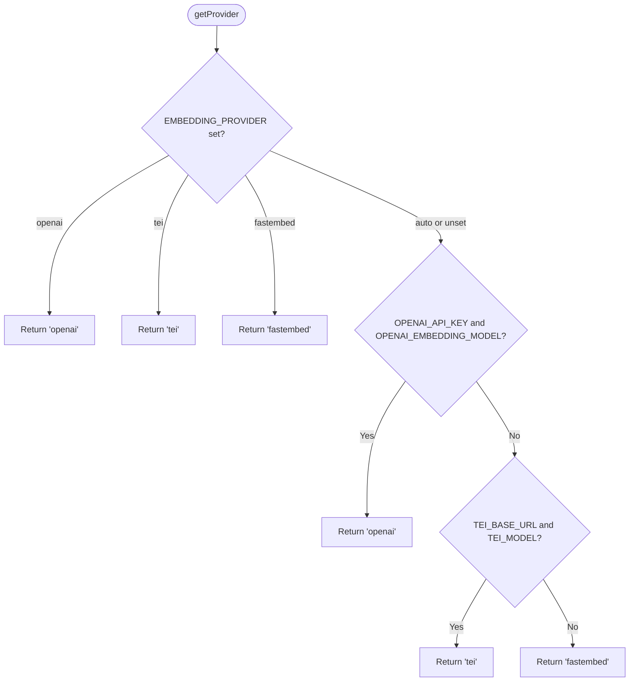
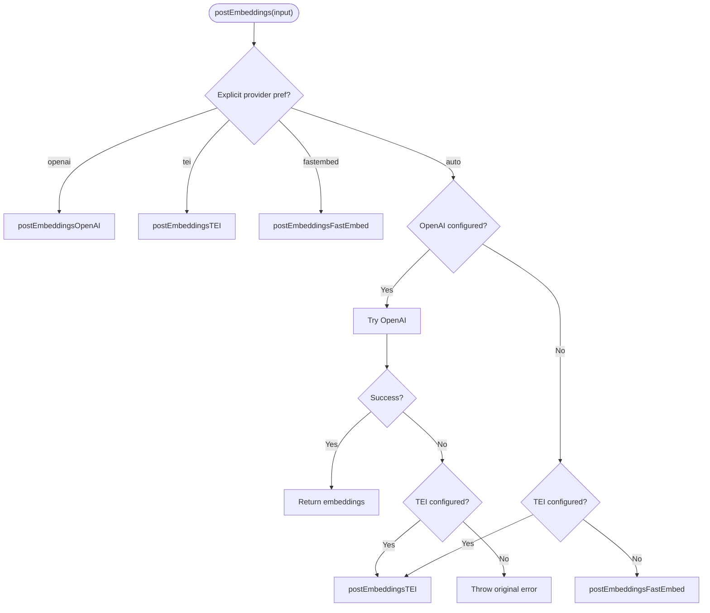
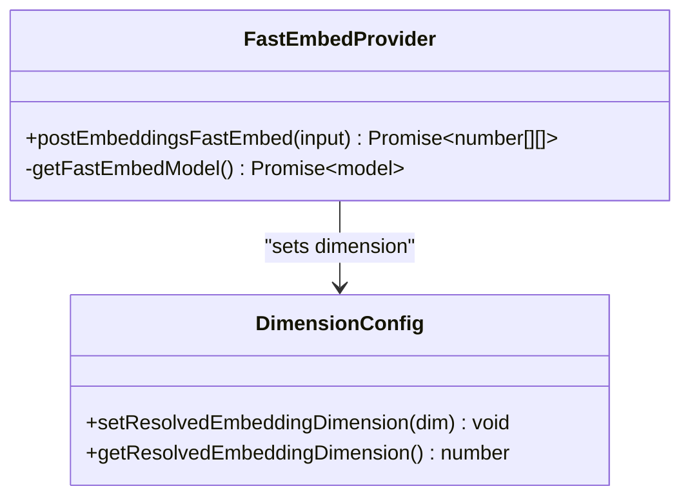
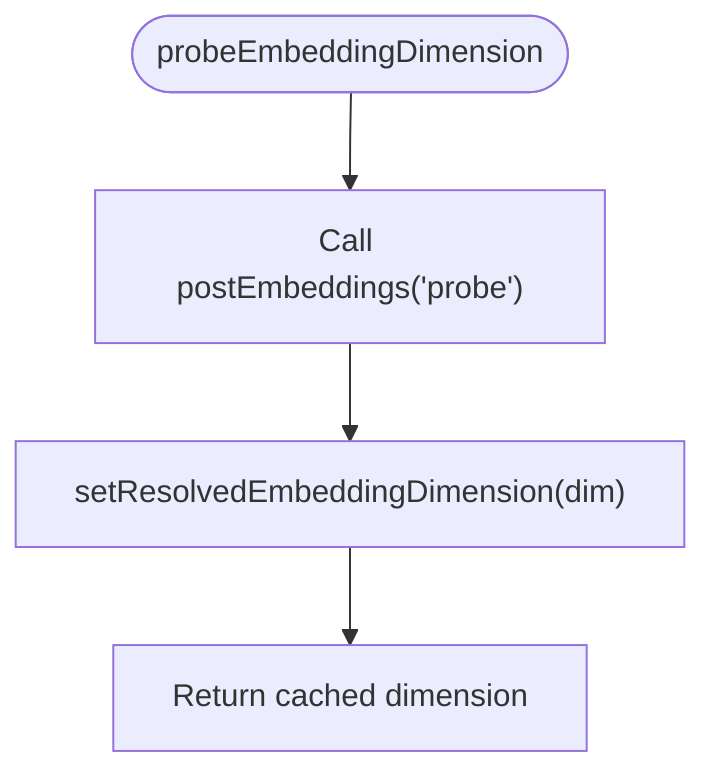
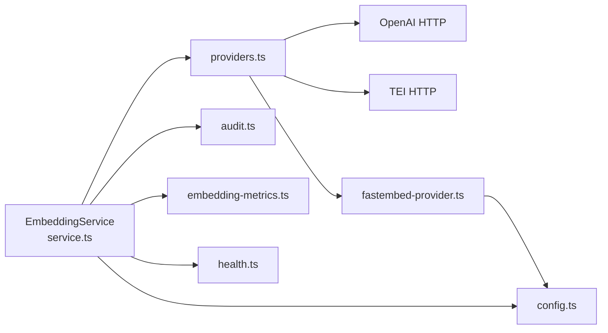

# Embedding Providers

<cite>
**Referenced Files in This Document**
- [service.ts](file://src/services/embedding/service.ts)
- [providers.ts](file://src/services/embedding/providers.ts)
- [fastembed-provider.ts](file://src/services/embedding/fastembed-provider.ts)
- [config.ts](file://src/services/embedding/config.ts)
- [embedding-fastembed.ts](file://src/config/embedding-fastembed.ts)
- [audit.ts](file://src/services/embedding/audit.ts)
- [health.ts](file://src/services/embedding/health.ts)
- [lazy-probe.ts](file://src/services/embedding/lazy-probe.ts)
- [provider-audit.ts](file://src/services/embedding/provider-audit.ts)
- [embedding-metrics.ts](file://src/services/metrics/embedding-metrics.ts)
- [types.ts](file://src/services/embedding/types.ts)
- [config.ts](file://src/config.ts)
</cite>

## Table of Contents
1. [Introduction](#introduction)
2. [Project Structure](#project-structure)
3. [Core Components](#core-components)
4. [Architecture Overview](#architecture-overview)
5. [Detailed Component Analysis](#detailed-component-analysis)
6. [Dependency Analysis](#dependency-analysis)
7. [Performance Considerations](#performance-considerations)
8. [Troubleshooting Guide](#troubleshooting-guide)
9. [Conclusion](#conclusion)
10. [Appendices](#appendices)

## Introduction
This document explains the SquadRules embedding provider system. It is a pluggable embedding layer that can use:
- OpenAI embeddings via HTTP API
- TEI (Text Embeddings Inference) via HTTP API
- FastEmbed, a local ONNX-based embedding implementation with no external API key

The system exposes an embedding service interface that abstracts different model implementations behind a single API for generating single and batch embeddings, computing cosine similarity, and providing health checks. Provider selection supports explicit configuration, environment-driven auto-discovery, and a local fastembed default.

Key goals:
- Stable vector dimension detection at startup
- Resilient network calls with retries and rate-limit handling
- Structured audit logging and Prometheus metrics
- Clear configuration options for each provider
- Practical guidance for monitoring embedding quality

## Project Structure
The embedding subsystem lives under `src/services/embedding`. The most important files are:
- `service.ts`: Public embedding service class, provider selection, metrics, audit integration, and dimension probing
- `providers.ts`: Provider routing, retry logic, rate-limit error type, and OpenAI/TEI HTTP implementations
- `fastembed-provider.ts`: Local fastembed implementation with lazy model loading
- `config.ts`: Runtime embedding dimension cache and validation
- `embedding-fastembed.ts`: FastEmbed model name and cache directory defaults
- `audit.ts`: Anomaly detection, latency/norm checks, and structured audit logging helpers
- `health.ts`: Health checks per provider
- `lazy-probe.ts`: Memoized dimension probe used by server boot and CLI
- `provider-audit.ts`: Shared structured audit logger for all providers
- `embedding-metrics.ts`: Prometheus counters and histograms for embedding performance
- `types.ts`: Core embedding result types
- `src/config.ts`: Environment-backed configuration constants

**Diagram sources**
- [service.ts:38-284](file://src/services/embedding/service.ts#L38-L284)
- [providers.ts:75-317](file://src/services/embedding/providers.ts#L75-L317)
- [fastembed-provider.ts:25-80](file://src/services/embedding/fastembed-provider.ts#L25-L80)
- [config.ts:12-36](file://src/services/embedding/config.ts#L12-L36)
- [embedding-metrics.ts:11-47](file://src/services/metrics/embedding-metrics.ts#L11-L47)
- [audit.ts:94-157](file://src/services/embedding/audit.ts#L94-L157)
- [health.ts:88-117](file://src/services/embedding/health.ts#L88-L117)

**Section sources**
- [service.ts:1-291](file://src/services/embedding/service.ts#L1-L291)
- [providers.ts:1-327](file://src/services/embedding/providers.ts#L1-L327)
- [fastembed-provider.ts:1-81](file://src/services/embedding/fastembed-provider.ts#L1-L81)
- [config.ts:1-40](file://src/services/embedding/config.ts#L1-L40)
- [embedding-fastembed.ts:1-23](file://src/config/embedding-fastembed.ts#L1-L23)
- [audit.ts:1-197](file://src/services/embedding/audit.ts#L1-L197)
- [health.ts:1-119](file://src/services/embedding/health.ts#L1-L119)
- [lazy-probe.ts:1-28](file://src/services/embedding/lazy-probe.ts#L1-L28)
- [provider-audit.ts:1-43](file://src/services/embedding/provider-audit.ts#L1-L43)
- [embedding-metrics.ts:1-51](file://src/services/metrics/embedding-metrics.ts#L1-L51)
- [types.ts:1-17](file://src/services/embedding/types.ts#L1-L17)
- [config.ts:73-95](file://src/config.ts#L73-L95)

## Core Components
- EmbeddingService: Public API for embedding generation, batch processing, cosine similarity, health checks, provider selection, and configuration inspection.
- Provider router: Chooses between OpenAI, TEI, and FastEmbed based on explicit preference or environment discovery.
- OpenAI provider: HTTP client to OpenAI embeddings endpoint with retries, rate-limit handling, and dimension caching.
- TEI provider: HTTP client to TEI embeddings endpoint with retries and flexible response shape parsing.
- FastEmbed provider: Local ONNX embedding engine with lazy initialization and shared cache directory.
- Dimension config: Caches and validates embedding vector dimensions after first successful call.
- Audit and anomaly detection: Logs structured events and detects high latency, unusual vector norms, and dimension mismatches.
- Health checks: Validates provider reachability and basic functionality.
- Metrics: Prometheus counters and histograms for request counts, duration, errors, vector sizes, and batch sizes.

**Section sources**
- [service.ts:38-284](file://src/services/embedding/service.ts#L38-L284)
- [providers.ts:92-317](file://src/services/embedding/providers.ts#L92-L317)
- [fastembed-provider.ts:25-80](file://src/services/embedding/fastembed-provider.ts#L25-L80)
- [config.ts:12-36](file://src/services/embedding/config.ts#L12-L36)
- [audit.ts:94-157](file://src/services/embedding/audit.ts#L94-L157)
- [health.ts:16-117](file://src/services/embedding/health.ts#L16-L117)
- [embedding-metrics.ts:11-47](file://src/services/metrics/embedding-metrics.ts#L11-L47)

## Architecture Overview
The embedding system follows a layered architecture:
- Consumer layer calls EmbeddingService methods
- Service layer selects provider, measures latency, validates dimensions, and emits metrics and audit logs
- Provider layer implements concrete embedding backends
- Configuration layer resolves endpoints, models, and runtime dimension cache
- Health and audit layers provide operational visibility

**Diagram sources**
- [service.ts:49-129](file://src/services/embedding/service.ts#L49-L129)
- [providers.ts:283-317](file://src/services/embedding/providers.ts#L283-L317)
- [embedding-metrics.ts:11-47](file://src/services/metrics/embedding-metrics.ts#L11-L47)
- [audit.ts:60-92](file://src/services/embedding/audit.ts#L60-L92)

## Detailed Component Analysis

### EmbeddingService
Responsibilities:
- Expose `generateEmbedding`, `generateBatchEmbeddings`, `calculateCosineSimilarity`, `generateMemoryEmbedding`, `estimateCost`, `healthCheck`
- Select provider using `getProvider()`
- Resolve model name per provider
- Validate output dimension against cached expected dimension
- Track metrics and emit audit logs
- Provide `getConfig()` for diagnostics

Provider selection logic:
- Explicit preference via `EMBEDDING_PROVIDER`
- Fallback to OpenAI if both API key and model configured
- Fallback to TEI if base URL and model configured
- Default to FastEmbed when neither external provider is configured

**Diagram sources**
- [service.ts:260-268](file://src/services/embedding/service.ts#L260-L268)

**Section sources**
- [service.ts:38-284](file://src/services/embedding/service.ts#L38-L284)

### Provider Router and HTTP Backends
Responsibilities:
- Route to OpenAI, TEI, or FastEmbed
- Implement retry with exponential backoff and jitter
- Honor `Retry-After` headers and cap delays
- Distinguish transient vs non-transient rate limits
- Parse provider-specific response shapes
- Cache resolved embedding dimension from first successful response

Rate limiting:
- Throws `EmbeddingRateLimitError` for 429 responses
- OpenAI distinguishes billing-related quota failures (`insufficient_quota`) as non-retriable
- Supports `retry-after-ms` and `retry-after` headers

Retries:
- Network-level retries for transient errors
- HTTP-level retries for 429, 502, 503, 504
- Wall-clock budget prevents runaway retries

**Diagram sources**
- [providers.ts:283-317](file://src/services/embedding/providers.ts#L283-L317)

**Section sources**
- [providers.ts:7-73](file://src/services/embedding/providers.ts#L7-L73)
- [providers.ts:92-190](file://src/services/embedding/providers.ts#L92-L190)
- [providers.ts:191-282](file://src/services/embedding/providers.ts#L191-L282)
- [providers.ts:283-317](file://src/services/embedding/providers.ts#L283-L317)

### FastEmbed Provider
Responsibilities:
- Lazy load fastembed SDK and initialize model once per process
- Download model weights into a shared cache directory
- Stream embeddings through async iterator
- Set resolved embedding dimension from first successful run
- Emit structured audit logs

Configuration:
- Model name via `FASTEMBED_MODEL`
- Cache directory via `FASTEMBED_CACHE_DIR`

**Diagram sources**
- [fastembed-provider.ts:25-80](file://src/services/embedding/fastembed-provider.ts#L25-L80)
- [config.ts:16-31](file://src/services/embedding/config.ts#L16-L31)

**Section sources**
- [fastembed-provider.ts:1-81](file://src/services/embedding/fastembed-provider.ts#L1-L81)
- [embedding-fastembed.ts:1-23](file://src/config/embedding-fastembed.ts#L1-L23)

### Dimension Resolution and Probing
Responsibilities:
- Cache embedding dimension after first successful provider call
- Enforce consistent dimension across requests
- Provide public APIs to read dimension
- Probe dimension at startup or lazily before memory store usage

Startup behavior:
- `probeEmbeddingDimension()` performs a minimal embedding round-trip to resolve and cache dimension
- `ensureEmbeddingDimension()` memoizes concurrent probes so only one model load occurs per process

**Diagram sources**
- [service.ts:287-290](file://src/services/embedding/service.ts#L287-L290)
- [config.ts:16-31](file://src/services/embedding/config.ts#L16-L31)

**Section sources**
- [config.ts:1-40](file://src/services/embedding/config.ts#L1-L40)
- [service.ts:287-290](file://src/services/embedding/service.ts#L287-L290)
- [lazy-probe.ts:1-28](file://src/services/embedding/lazy-probe.ts#L1-L28)

### Audit and Anomaly Detection
Responsibilities:
- Log structured success and error events for embedding requests
- Detect anomalies:
  - High latency beyond threshold
  - Unusual vector norm outside expected range
  - Dimension mismatch between expected and actual
- Emit anomaly metrics and structured logs

Operational signals:
- `embedding_high_latency`
- `embedding_unusual_norm`
- `embedding_dimension_mismatch`

**Section sources**
- [audit.ts:1-197](file://src/services/embedding/audit.ts#L1-L197)
- [provider-audit.ts:1-43](file://src/services/embedding/provider-audit.ts#L1-L43)

### Health Checks
Responsibilities:
- Validate provider configuration presence
- Perform lightweight embedding request to verify endpoint reachability
- Interpret 401 and 429 responses appropriately
- Update dimension cache when successful

Behavior:
- Mirrors provider selection logic
- Reports rate-limited but reachable providers as healthy with a warning message

**Section sources**
- [health.ts:1-119](file://src/services/embedding/health.ts#L1-L119)

### Metrics
Prometheus metrics exposed:
- `squadrules_embedding_requests_total`: Counters by provider, status, tenant
- `squadrules_embedding_duration_seconds`: Histogram of embedding latency
- `squadrules_embedding_errors_total`: Error counters by provider, status, tenant
- `squadrules_embedding_vector_size_bytes`: Vector size distribution
- `squadrules_embedding_batch_size`: Batch size distribution

These metrics enable monitoring throughput, latency, error rates, and resource usage.

**Section sources**
- [embedding-metrics.ts:1-51](file://src/services/metrics/embedding-metrics.ts#L1-L51)

## Dependency Analysis
High-level dependencies:
- `EmbeddingService` depends on:
  - Provider router and backends
  - Dimension config
  - Audit and anomaly detection
  - Metrics registry
  - Health check utilities
- Provider router depends on:
  - OpenAI and TEI HTTP clients
  - FastEmbed provider
  - Retry and rate-limit utilities
- FastEmbed provider depends on:
  - FastEmbed SDK (lazily imported)
  - Dimension config
  - Audit logger

**Diagram sources**
- [service.ts:38-284](file://src/services/embedding/service.ts#L38-L284)
- [providers.ts:75-317](file://src/services/embedding/providers.ts#L75-L317)
- [fastembed-provider.ts:25-80](file://src/services/embedding/fastembed-provider.ts#L25-L80)
- [config.ts:12-36](file://src/services/embedding/config.ts#L12-L36)

**Section sources**
- [service.ts:38-284](file://src/services/embedding/service.ts#L38-L284)
- [providers.ts:75-317](file://src/services/embedding/providers.ts#L75-L317)
- [fastembed-provider.ts:25-80](file://src/services/embedding/fastembed-provider.ts#L25-L80)
- [config.ts:12-36](file://src/services/embedding/config.ts#L12-L36)

## Performance Considerations
- Latency monitoring: Duration histogram tracks embedding latency; anomaly detection warns on high latency.
- Batch processing: Batch endpoints reduce overhead compared to per-item calls; batch size is tracked.
- Vector size tracking: Histogram observes vector byte size to monitor storage and memory impact.
- Retries and budgets: Exponential backoff with jitter and wall-clock budget prevent cascading failures.
- Local fastembed: No network latency; model weights cached locally; lazy initialization avoids cold start cost unless needed.
- Dimension caching: Avoids repeated dimension resolution; enforces consistency.

Recommendations:
- Tune `EMBEDDING_MAX_RETRIES`, `EMBEDDING_RETRY_BASE_DELAY_MS`, `EMBEDDING_RETRY_MAX_DELAY_MS`, and `EMBEDDING_RETRY_BUDGET_MS` according to provider SLAs.
- Monitor `embedding_duration_seconds` and `embedding_errors_total` to detect degradation.
- Watch `embedding_unusual_norm` and `embedding_dimension_mismatch` anomalies to catch model drift or misconfiguration.

[No sources needed since this section provides general guidance]

## Troubleshooting Guide
Common issues and resolutions:
- Missing provider configuration:
  - OpenAI requires API key and model; TEI requires base URL and model.
  - If not configured, system falls back to FastEmbed.
- Authentication failures:
  - 401 responses indicate invalid credentials; verify API keys.
- Rate limiting:
  - 429 responses trigger `EmbeddingRateLimitError`; honor `Retry-After` headers.
  - OpenAI `insufficient_quota` is non-transient; add billing/quota.
- Unexpected response shapes:
  - Providers may return embeddings in different JSON structures; ensure correct endpoint and model.
- Dimension mismatch:
  - Ensure consistent model across deployments; dimension must be resolved at startup.
- Health check failures:
  - Use health endpoints to validate provider reachability and configuration.

Operational checks:
- Inspect structured audit logs for provider stage details.
- Review Prometheus metrics for request counts, durations, errors, and vector sizes.
- Use health checks to confirm provider state.

**Section sources**
- [providers.ts:92-190](file://src/services/embedding/providers.ts#L92-L190)
- [providers.ts:191-282](file://src/services/embedding/providers.ts#L191-L282)
- [audit.ts:94-157](file://src/services/embedding/audit.ts#L94-L157)
- [health.ts:16-117](file://src/services/embedding/health.ts#L16-L117)

## Conclusion
The SquadRules embedding provider system offers a robust, pluggable architecture supporting OpenAI, TEI, and FastEmbed. It centralizes provider selection, retry and rate-limit handling, dimension validation, audit logging, and metrics. Operators can configure providers via environment variables, monitor embedding quality and performance, and rely on health checks to maintain reliability. For custom needs, the provider abstraction makes it straightforward to extend or replace backends while preserving consistent service behavior.

[No sources needed since this section summarizes without analyzing specific files]

## Appendices

### Configuration Options
Environment variables controlling embedding behavior:
- `EMBEDDING_PROVIDER`: Explicit provider choice (`openai`, `tei`, `fastembed`, or `auto`)
- `OPENAI_API_KEY`: OpenAI authentication key
- `OPENAI_EMBEDDING_MODEL`: OpenAI embedding model identifier
- `OPENAI_API_URL`: Base URL for OpenAI embeddings endpoint
- `TEI_BASE_URL`: TEI inference service base URL
- `TEI_MODEL`: TEI embedding model identifier
- `TEI_API_KEY`: Optional TEI API key header
- `FASTEMBED_MODEL`: FastEmbed model identifier
- `FASTEMBED_CACHE_DIR`: Directory for FastEmbed model weights cache
- `EMBEDDING_MAX_RETRIES`: Maximum retry attempts
- `EMBEDDING_RETRY_BASE_DELAY_MS`: Base delay for exponential backoff
- `EMBEDDING_RETRY_MAX_DELAY_MS`: Maximum backoff delay
- `EMBEDDING_RETRY_AFTER_CAP_MS`: Cap for `Retry-After` header value
- `EMBEDDING_RETRY_BUDGET_MS`: Wall-clock budget for retries
- `EMBEDDING_LATENCY_WARN_MS`: Latency threshold for anomaly warnings
- `EMBEDDING_NORM_MIN` / `EMBEDDING_NORM_MAX`: Expected vector norm range
- `SEARCH_SCORE_WARN_THRESHOLD`: Threshold for search score anomaly warnings

**Section sources**
- [config.ts:73-95](file://src/config.ts#L73-L95)
- [embedding-fastembed.ts:1-23](file://src/config/embedding-fastembed.ts#L1-L23)

### Embedding Result Types
- `EmbeddingResult`: Single embedding result including vector, model name, and token usage metadata
- `BatchEmbeddingResult`: Batch result including array of vectors, model name, and token usage metadata

**Section sources**
- [types.ts:1-17](file://src/services/embedding/types.ts#L1-L17)

### Practical Examples

#### Configuring OpenAI
- Set `EMBEDDING_PROVIDER=openai`
- Provide `OPENAI_API_KEY` and `OPENAI_EMBEDDING_MODEL`
- Optionally adjust `OPENAI_API_URL` for compatible endpoints

Expected behavior:
- Requests go to OpenAI embeddings endpoint
- Retries and rate-limit handling apply
- Dimension is resolved from first successful response

**Section sources**
- [service.ts:260-268](file://src/services/embedding/service.ts#L260-L268)
- [providers.ts:92-190](file://src/services/embedding/providers.ts#L92-L190)

#### Configuring TEI
- Set `EMBEDDING_PROVIDER=tei`
- Provide `TEI_BASE_URL` and `TEI_MODEL`
- Optionally provide `TEI_API_KEY`

Expected behavior:
- Requests go to TEI embeddings endpoint
- Flexible response shape parsing supports multiple TEI servers
- Deprecation warning is emitted once per process

**Section sources**
- [service.ts:260-268](file://src/services/embedding/service.ts#L260-L268)
- [providers.ts:191-282](file://src/services/embedding/providers.ts#L191-L282)

#### Using FastEmbed Locally
- Leave `EMBEDDING_PROVIDER=auto` or set `EMBEDDING_PROVIDER=fastembed`
- Optionally set `FASTEMBED_MODEL` and `FASTEMBED_CACHE_DIR`

Expected behavior:
- Local ONNX-based embeddings with no API key
- Model downloaded lazily into cache directory
- Dimension resolved from first successful run

**Section sources**
- [fastembed-provider.ts:1-81](file://src/services/embedding/fastembed-provider.ts#L1-L81)
- [embedding-fastembed.ts:1-23](file://src/config/embedding-fastembed.ts#L1-L23)

#### Custom Embedding Implementation
To implement a custom provider:
- Add a new provider function similar to `postEmbeddingsOpenAI` or `postEmbeddingsTEI`
- Integrate it into the provider router in `providers.ts`
- Ensure it sets resolved embedding dimension and emits structured audit logs
- Update `EmbeddingService.getProvider()` to support the new provider preference

Best practices:
- Handle retries and rate limits consistently
- Parse provider-specific response shapes safely
- Emit audit logs with input/output dimensions and latency
- Validate dimension consistency

**Section sources**
- [providers.ts:75-317](file://src/services/embedding/providers.ts#L75-L317)
- [service.ts:260-268](file://src/services/embedding/service.ts#L260-L268)
- [provider-audit.ts:1-43](file://src/services/embedding/provider-audit.ts#L1-L43)

### Monitoring Embedding Quality Metrics
Use these signals to assess embedding quality:
- `embedding_duration_seconds`: Latency distribution
- `embedding_errors_total`: Error frequency by provider
- `embedding_vector_size_bytes`: Vector size distribution
- `embedding_batch_size`: Batch efficiency
- Anomaly events:
  - `embedding_high_latency`
  - `embedding_unusual_norm`
  - `embedding_dimension_mismatch`

Operational tips:
- Alert on sustained increases in error rates or latency
- Investigate norm anomalies as potential model drift or data issues
- Treat dimension mismatches as critical configuration problems

**Section sources**
- [embedding-metrics.ts:11-47](file://src/services/metrics/embedding-metrics.ts#L11-L47)
- [audit.ts:94-157](file://src/services/embedding/audit.ts#L94-L157)