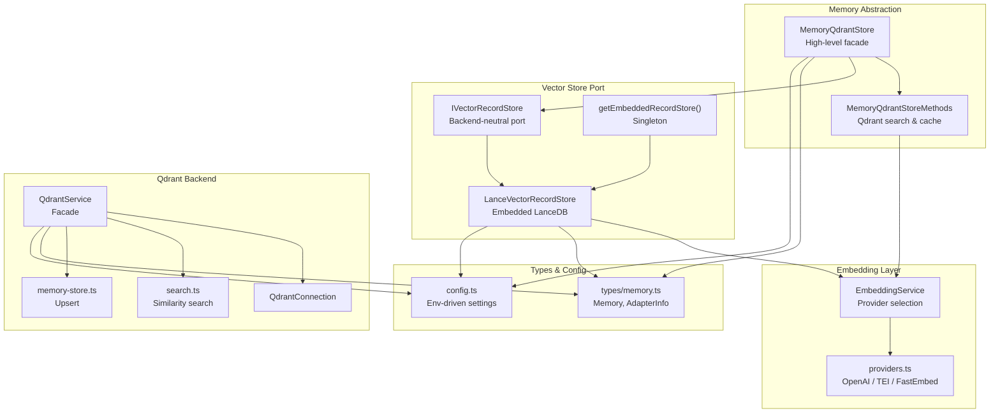
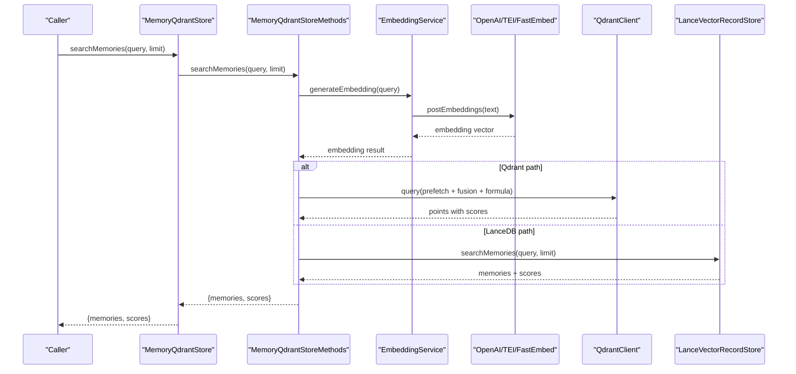
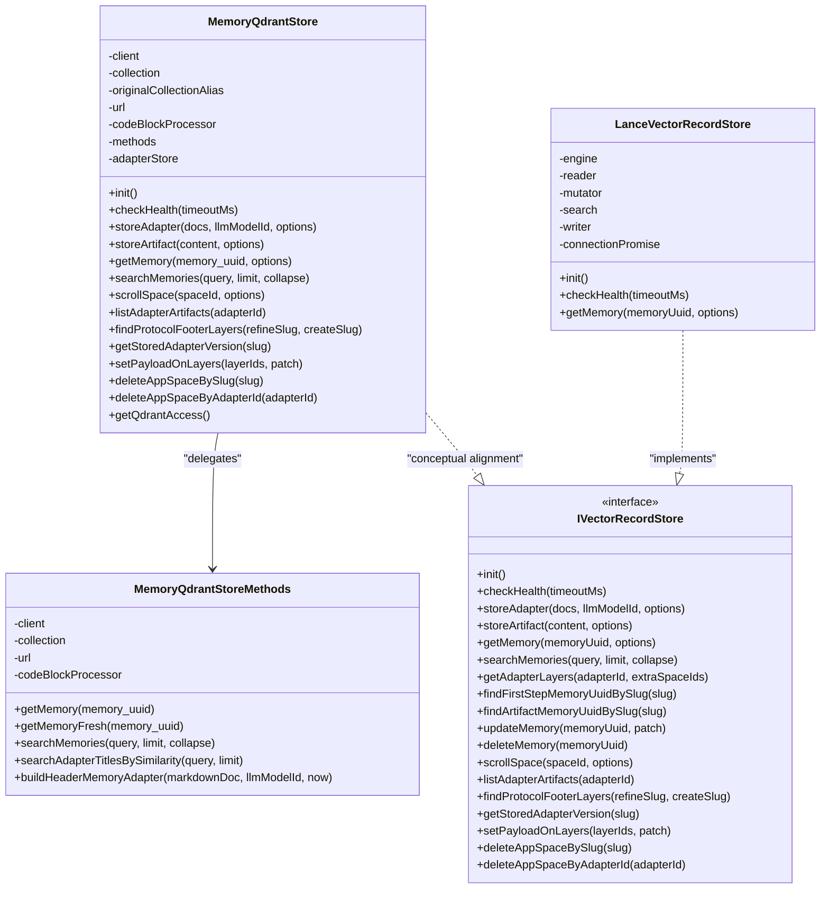
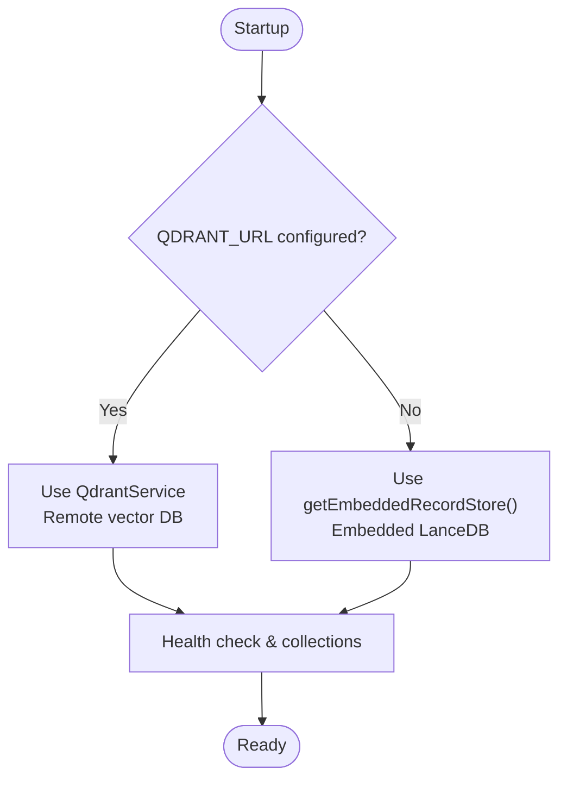
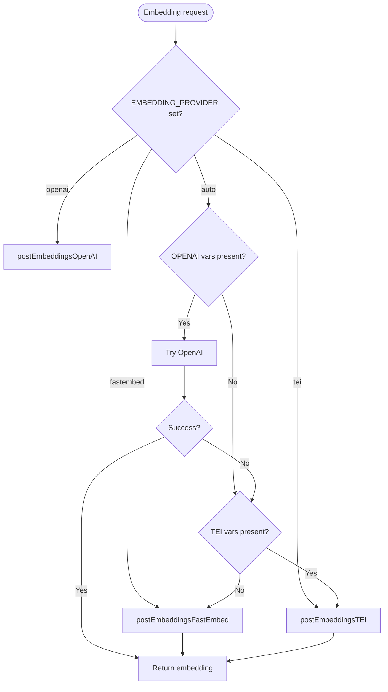
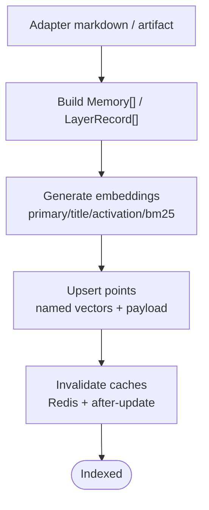
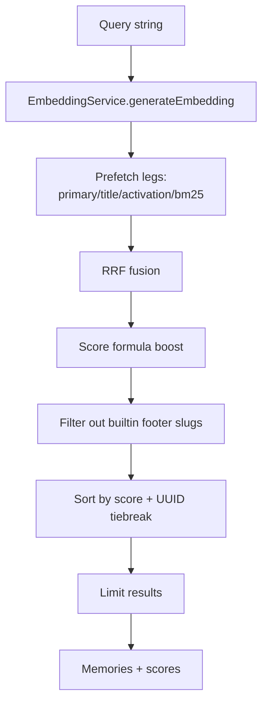
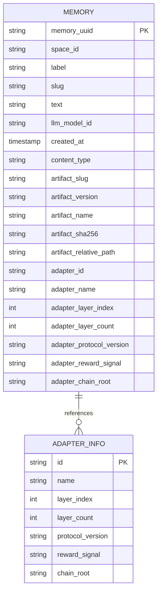
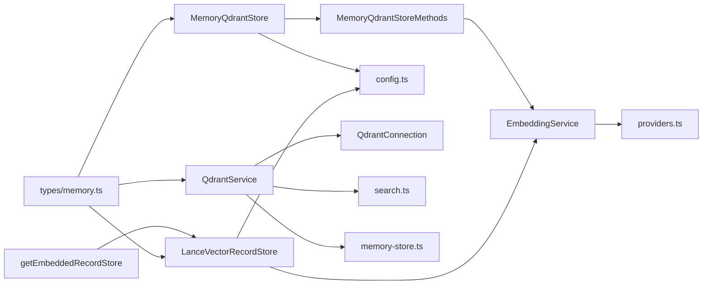

# Memory & Vector Storage

<cite>
**Referenced Files in This Document**
- [store.ts](file://src/services/memory/store.ts)
- [store-methods.ts](file://src/services/memory/store-methods.ts)
- [IVectorRecordStore.ts](file://src/services/vector-store/IVectorRecordStore.ts)
- [types.ts](file://src/services/vector-store/types.ts)
- [LanceVectorRecordStore.ts](file://src/services/vector-store/lancedb/LanceVectorRecordStore.ts)
- [embedded-store-singleton.ts](file://src/services/vector-store/embedded-store-singleton.ts)
- [lancedb-connection.ts](file://src/services/vector-store/lancedb-connection.ts)
- [service.ts](file://src/services/qdrant/service.ts)
- [memory-store.ts](file://src/services/qdrant/memory-store.ts)
- [search.ts](file://src/services/qdrant/search.ts)
- [service.ts](file://src/services/embedding/service.ts)
- [providers.ts](file://src/services/embedding/providers.js)
- [health.ts](file://src/services/embedding/health.ts)
- [memory.ts](file://src/types/memory.ts)
- [config.ts](file://src/config.ts)
- [http-api-snapshot.ts](file://src/http/http-api-snapshot.ts)
- [boot-local-runtime.ts](file://src/runtime/boot-local-runtime.ts)
</cite>

## Table of Contents
1. [Introduction](#introduction)
2. [Project Structure](#project-structure)
3. [Core Components](#core-components)
4. [Architecture Overview](#architecture-overview)
5. [Detailed Component Analysis](#detailed-component-analysis)
6. [Dependency Analysis](#dependency-analysis)
7. [Performance Considerations](#performance-considerations)
8. [Troubleshooting Guide](#troubleshooting-guide)
9. [Conclusion](#conclusion)
10. [Appendices](#appendices)

## Introduction
This document explains the SquadRules memory and vector storage system. It covers the dual storage architecture using Qdrant as the primary, remote-capable backend and LanceDB as the secondary, embedded backend for semantic search. It documents the memory store abstraction layer that provides unified access to different backends, the pluggable embedding provider model supporting OpenAI, TEI, and FastEmbed, vector database operations such as indexing, similarity search, and metadata filtering, data models for memories and adapters, configuration options for deployment scenarios, performance tuning parameters, scaling considerations, migration strategies between storage backends, and backup/recovery procedures.

The system is designed around an agent-first workflow: agents create, activate, forward, and reward adapters; memories are stored with embeddings so agents can retrieve relevant rules and workflows through semantic and hybrid search.

## Project Structure
The memory and vector storage logic spans several service directories:

- `src/services/memory`: high-level memory store facade and Qdrant-specific methods.
- `src/services/vector-store`: backend-neutral port and LanceDB implementation.
- `src/services/qdrant`: Qdrant connection, initialization, search, retrieval, updates, metrics, snapshots, and a service facade.
- `src/services/embedding`: embedding service, provider selection, health checks, and audit/metrics.
- `src/types/memory.ts`: shared domain types for memories, adapters, contracts, and traces.
- `src/config.ts`: environment-driven configuration for Redis, Qdrant, embeddings, search behavior, and runtime mode.
- `src/http/http-api-snapshot.ts`: snapshot API endpoint backed by Qdrant.
- `src/runtime/boot-local-runtime.ts`: local runtime booting, embedded store seeding detection, and Qdrant readiness waiting.

**Diagram sources**
- [store.ts:29-62](file://src/services/memory/store.ts#L29-L62)
- [store-methods.ts:25-36](file://src/services/memory/store-methods.ts#L25-L36)
- [IVectorRecordStore.ts:27-73](file://src/services/vector-store/IVectorRecordStore.ts#L27-L73)
- [LanceVectorRecordStore.ts:35-46](file://src/services/vector-store/lancedb/LanceVectorRecordStore.ts#L35-L46)
- [embedded-store-singleton.ts:14-17](file://src/services/vector-store/embedded-store-singleton.ts#L14-L17)
- [service.ts:17-28](file://src/services/qdrant/service.ts#L17-L28)
- [search.ts:11-36](file://src/services/qdrant/search.ts#L11-L36)
- [memory-store.ts:14-25](file://src/services/qdrant/memory-store.ts#L14-L25)
- [service.ts:38-47](file://src/services/embedding/service.ts#L38-L47)
- [providers.ts:283-317](file://src/services/embedding/providers.js#L283-L317)
- [memory.ts:99-120](file://src/types/memory.ts#L99-L120)
- [config.ts:70-92](file://src/config.ts#L70-L92)

**Section sources**
- [store.ts:1-62](file://src/services/memory/store.ts#L1-L62)
- [IVectorRecordStore.ts:1-74](file://src/services/vector-store/IVectorRecordStore.ts#L1-L74)
- [LanceVectorRecordStore.ts:1-67](file://src/services/vector-store/lancedb/LanceVectorRecordStore.ts#L1-L67)
- [service.ts:17-161](file://src/services/qdrant/service.ts#L17-L161)
- [service.ts:38-291](file://src/services/embedding/service.ts#L38-L291)
- [memory.ts:1-125](file://src/types/memory.ts#L1-L125)
- [config.ts:1-136](file://src/config.ts#L1-L136)

## Core Components
The core components form a layered architecture:

- **Memory facade**: `MemoryQdrantStore` exposes adapter storage, artifact storage, memory retrieval, hybrid search, and administrative operations. It delegates most Qdrant-specific logic to `MemoryQdrantStoreMethods`.
- **Vector store port**: `IVectorRecordStore` defines a backend-neutral interface for lifecycle, writes, reads, search, adapter structure resolution, enumeration, and payload operations.
- **LanceDB implementation**: `LanceVectorRecordStore` implements the port for embedded use, sharing one process-scoped connection via `getEmbeddedRecordStore()`.
- **Qdrant service**: `QdrantService` wraps connection, initialization, upsert, retrieval, search, quality metrics, protocol steps, alias management, listing, and snapshots. In non-Qdrant deployments, it is replaced by the embedded store double-cast to the same shape.
- **Embedding service**: `EmbeddingService` selects OpenAI, TEI, or FastEmbed based on explicit preference or auto-discovery, validates dimensions, emits metrics and audit events, and exposes health checks.
- **Domain types**: `Memory`, `AdapterInfo`, inference contracts, execution traces, and reward records define the persisted schema.
- **Configuration**: Centralized environment variables control Redis, Qdrant URL/collection, embedding provider/model/dimensions, retry/backoff, search limits, scoring thresholds, snapshots, and runtime mode.

Key responsibilities:
- Unified read/write surface across Qdrant and LanceDB.
- Embedding provider pluggability with fallback and health validation.
- Hybrid dense + sparse search with metadata filtering and space scoping.
- Operational controls for collection aliases, snapshots, and health checks.

**Section sources**
- [store.ts:29-153](file://src/services/memory/store.ts#L29-L153)
- [IVectorRecordStore.ts:27-73](file://src/services/vector-store/IVectorRecordStore.ts#L27-L73)
- [LanceVectorRecordStore.ts:35-67](file://src/services/vector-store/lancedb/LanceVectorRecordStore.ts#L35-L67)
- [service.ts:17-161](file://src/services/qdrant/service.ts#L17-L161)
- [service.ts:38-291](file://src/services/embedding/service.ts#L38-L291)
- [memory.ts:99-120](file://src/types/memory.ts#L99-L120)
- [config.ts:70-136](file://src/config.ts#L70-L136)

## Architecture Overview
The system uses two storage backends behind a common abstraction:

- **Primary backend (Qdrant)**: Remote-capable vector database used in clustered HTTP deployments. It supports named vectors, quantization rescore, BM25 sparse vectors, filters, aliases, and server-side snapshots.
- **Secondary backend (LanceDB)**: Embedded file-based vector store used in local stdio mode. It shares one process-scoped connection and is injected into both the memory store and the Qdrant service facade when Qdrant is not configured.

**Diagram sources**
- [store.ts:151-153](file://src/services/memory/store.ts#L151-L153)
- [store-methods.ts:94-104](file://src/services/memory/store-methods.ts#L94-L104)
- [service.ts:49-103](file://src/services/embedding/service.ts#L49-L103)
- [providers.ts:283-317](file://src/services/embedding/providers.js#L283-L317)
- [search.ts:11-36](file://src/services/qdrant/search.ts#L11-L36)
- [LanceVectorRecordStore.ts:64-67](file://src/services/vector-store/lancedb/LanceVectorRecordStore.ts#L64-L67)

## Detailed Component Analysis

### Memory Store Abstraction Layer
The memory store abstraction provides a unified interface over Qdrant and LanceDB:

- `MemoryQdrantStore` constructs a Qdrant client, resolves the collection alias, initializes the store, and delegates adapter/artifact storage and search to internal helpers.
- `MemoryQdrantStoreMethods` implements caching, hybrid search, title/activation/BM25 prefetching, RRF fusion, score boosting, and point-to-memory mapping.
- `IVectorRecordStore` defines the backend-neutral contract for lifecycle, writes, reads, search, adapter structure, enumeration, and payload operations.
- `LanceVectorRecordStore` implements the contract for embedded use, delegating reads/writes/search to specialized record engine modules and sharing one connection via the singleton.

**Diagram sources**
- [store.ts:29-272](file://src/services/memory/store.ts#L29-L272)
- [store-methods.ts:25-269](file://src/services/memory/store-methods.ts#L25-L269)
- [IVectorRecordStore.ts:27-73](file://src/services/vector-store/IVectorRecordStore.ts#L27-L73)
- [LanceVectorRecordStore.ts:35-67](file://src/services/vector-store/lancedb/LanceVectorRecordStore.ts#L35-L67)

**Section sources**
- [store.ts:29-272](file://src/services/memory/store.ts#L29-L272)
- [store-methods.ts:25-269](file://src/services/memory/store-methods.ts#L25-L269)
- [IVectorRecordStore.ts:1-74](file://src/services/vector-store/IVectorRecordStore.ts#L1-L74)
- [LanceVectorRecordStore.ts:1-67](file://src/services/vector-store/lancedb/LanceVectorRecordStore.ts#L1-L67)

### Dual Storage Architecture: Qdrant and LanceDB
The application chooses the backend at runtime:

- When `QDRANT_URL` is set, `isQdrantConfigured` is true and `QdrantService` connects to a remote Qdrant instance.
- When Qdrant is not configured, `qdrantService` is replaced by the shared `LanceVectorRecordStore` instance from `getEmbeddedRecordStore()`.
- The embedded store opens a strong-consistency connection to a per-user directory, ensuring cross-process visibility without a daemon.

**Diagram sources**
- [service.ts:153-161](file://src/services/qdrant/service.ts#L153-L161)
- [embedded-store-singleton.ts:1-17](file://src/services/vector-store/embedded-store-singleton.ts#L1-L17)
- [lancedb-connection.ts:21-33](file://src/services/vector-store/lancedb-connection.ts#L21-L33)
- [config.ts:131-136](file://src/config.ts#L131-L136)

**Section sources**
- [service.ts:153-161](file://src/services/qdrant/service.ts#L153-L161)
- [embedded-store-singleton.ts:1-17](file://src/services/vector-store/embedded-store-singleton.ts#L1-L17)
- [lancedb-connection.ts:1-33](file://src/services/vector-store/lancedb-connection.ts#L1-L33)
- [config.ts:131-136](file://src/config.ts#L131-L136)

### Embedding Provider Pluggability
The embedding service supports three providers:

- **OpenAI**: Requires `OPENAI_API_KEY` and `OPENAI_EMBEDDING_MODEL`; supports configurable base URL and retries/backoff.
- **TEI**: Deprecated but still supported; requires `TEI_BASE_URL` and `TEI_MODEL`; emits deprecation warnings.
- **FastEmbed**: Local default when no external provider is configured; uses `FASTEMBED_MODEL` and cache directory.

Provider selection follows explicit preference first, then auto-detection with OpenAI preferred if configured, otherwise TEI, otherwise FastEmbed. Health checks validate reachability and response shape.

**Diagram sources**
- [service.ts:260-281](file://src/services/embedding/service.ts#L260-L281)
- [providers.ts:283-317](file://src/services/embedding/providers.js#L283-L317)
- [health.ts:16-95](file://src/services/embedding/health.ts#L16-L95)
- [config.ts:70-92](file://src/config.ts#L70-L92)

**Section sources**
- [service.ts:38-291](file://src/services/embedding/service.ts#L38-L291)
- [providers.ts:170-327](file://src/services/embedding/providers.js#L170-L327)
- [health.ts:1-95](file://src/services/embedding/health.ts#L1-L95)
- [config.ts:70-92](file://src/config.ts#L70-L92)

### Vector Database Operations
#### Indexing and Writes
- Qdrant upserts include labeled payloads, quality metrics, timestamps, and named vectors sized by embedding dimension.
- Adapter chains are stored as linked layers with adapter metadata, activation patterns, and BM25 sparse vectors.
- Artifacts are attached to adapters with content type, slug, version, and hash.

**Diagram sources**
- [memory-store.ts:14-126](file://src/services/qdrant/memory-store.ts#L14-L126)
- [store-methods.ts:266-268](file://src/services/memory/store-methods.ts#L266-L268)
- [store.ts:132-142](file://src/services/memory/store.ts#L132-L142)

**Section sources**
- [memory-store.ts:14-126](file://src/services/qdrant/memory-store.ts#L14-L126)
- [store.ts:132-142](file://src/services/memory/store.ts#L132-L142)
- [store-methods.ts:266-268](file://src/services/memory/store-methods.ts#L266-L268)

#### Similarity Search
- Qdrant search generates a query embedding and performs hybrid search with multiple prefetch legs: primary dense, title dense, activation dense, and BM25 sparse.
- Results are fused using reciprocal rank fusion (RRF), then re-ranked with a formula boosting title matches, activation pattern matches, label matches, tag matches, and attest confidence.
- Space scoping and layer-one filtering ensure only top-level adapter entries are returned.

**Diagram sources**
- [store-methods.ts:121-259](file://src/services/memory/store-methods.ts#L121-L259)
- [search.ts:11-45](file://src/services/qdrant/search.ts#L11-L45)

**Section sources**
- [store-methods.ts:94-259](file://src/services/memory/store-methods.ts#L94-L259)
- [search.ts:1-45](file://src/services/qdrant/search.ts#L1-L45)

#### Metadata Filtering
- Space context restricts reads and searches to allowed spaces, including the app space.
- Filters exclude builtin refinement/creation protocol slugs from search results.
- Payload fields like `adapter.layer_index`, `slug`, `space_id`, `label_text`, `activation_patterns_text`, `tags_text`, and `attest_boost` participate in filtering and ranking.

**Section sources**
- [store-methods.ts:130-137](file://src/services/memory/store-methods.ts#L130-L137)
- [store-methods.ts:181-213](file://src/services/memory/store-methods.ts#L181-L213)
- [store.ts:162-188](file://src/services/memory/store.ts#L162-L188)

### Data Models
The primary data model is `Memory`, which includes:

- Identifier and optional space ID.
- Label, slug, tags, text, and LLM model identifier.
- Timestamps and optional artifact metadata.
- Optional adapter info describing chain membership, activation patterns, reward signals, and chain root.
- Optional inference contract definition for tensor/shell/MCP/user input/comment execution.

**Diagram sources**
- [memory.ts:1-120](file://src/types/memory.ts#L1-L120)

**Section sources**
- [memory.ts:1-125](file://src/types/memory.ts#L1-L125)

### Configuration Options and Deployment Scenarios
Configuration is centralized and environment-driven:

- **Embedding providers**: `EMBEDDING_PROVIDER`, `OPENAI_API_KEY`, `OPENAI_EMBEDDING_MODEL`, `OPENAI_API_URL`, `TEI_BASE_URL`, `TEI_MODEL`, `FASTEMBED_MODEL`, `FASTEMBED_CACHE_DIR`.
- **Embedding resilience**: `EMBEDDING_MAX_RETRIES`, `EMBEDDING_RETRY_BASE_DELAY_MS`, `EMBEDDING_RETRY_MAX_DELAY_MS`, `EMBEDDING_RETRY_AFTER_CAP_MS`, `EMBEDDING_RETRY_BUDGET_MS`, `EMBEDDING_LATENCY_WARN_MS`, `EMBEDDING_NORM_MIN`, `EMBEDDING_NORM_MAX`.
- **Qdrant**: `QDRANT_URL`, `QDRANT_API_KEY`, `QDRANT_COLLECTION`, `QDRANT_RESCORE`, `QDRANT_SNAPSHOT_DIR`, `QDRANT_SNAPSHOT_ON_START`.
- **Search behavior**: `SQUADRULES_SEARCH_OVERFETCH_FACTOR`, `SQUADRULES_SEARCH_MAX_FETCH`, `SQUADRULES_SEARCH_MAX_CHOICES`, `SQUADRULES_SEARCH_LIMIT_CAP`, `SQUADRULES_SEARCH_LIMIT_MIN`, `SQUADRULES_ENABLE_GROUP_COLLAPSE`, `SCORE_THRESHOLD`, `SIMILAR_MEMORY_THRESHOLD`.
- **Runtime mode**: `TRANSPORT_TYPE`, `AUTH_ENABLED`, `SERVER_PORT`, `METRICS_PORT`, `KEY_VALUE_STORE_URL`/`REDIS_URL`.

Deployment scenarios:

- **Clustered HTTP with Qdrant**: Set `QDRANT_URL`, optionally `QDRANT_API_KEY`, configure OIDC/auth, enable snapshots via `QDRANT_SNAPSHOT_DIR`.
- **Local stdio with LanceDB**: Leave `QDRANT_URL` unset; the embedded store is used automatically. Backups require stopping the server and copying the LanceDB data directory.
- **Embedding provider selection**: Prefer OpenAI when keys are present; fall back to TEI if configured; otherwise use FastEmbed locally.

**Section sources**
- [config.ts:70-136](file://src/config.ts#L70-L136)
- [config.ts:267-276](file://src/config.ts#L267-L276)
- [config.ts:283-293](file://src/config.ts#L283-L293)
- [config.ts:296-302](file://src/config.ts#L296-L302)
- [config.ts:344-350](file://src/config.ts#L344-L350)

### Migration Strategies Between Storage Backends
Migration between Qdrant and LanceDB is primarily operational rather than automatic:

- **Qdrant to LanceDB**: Stop the server, disable `QDRANT_URL`, start in embedded mode, and seed the LanceDB store using existing tools or scripts. The embedded store is detected as seeded once the records table exists.
- **LanceDB to Qdrant**: Export memories and adapters from the embedded store, then import them into Qdrant using the adapter storage and artifact storage APIs. Collection aliasing (`current`) allows switching active collections during migrations.
- **Validation**: Integration suites validate search-ranking parity between backends; maintain consistency by exercising the same adapter write paths through both facades.

Operational notes:
- The embedded store singleton ensures both `memoryStore` and `qdrantService` share the same LanceDB connection when Qdrant is not configured.
- Snapshot endpoints return unsupported for embedded mode; manual directory backup is required.

**Section sources**
- [embedded-store-singleton.ts:1-17](file://src/services/vector-store/embedded-store-singleton.ts#L1-L17)
- [boot-local-runtime.ts:51-64](file://src/runtime/boot-local-runtime.ts#L51-L64)
- [http-api-snapshot.ts:14-27](file://src/http/http-api-snapshot.ts#L14-L27)
- [service.ts:153-161](file://src/services/qdrant/service.ts#L153-L161)

### Backup and Recovery Procedures
- **Qdrant snapshots**: Enabled via `QDRANT_SNAPSHOT_DIR`; the `/api/snapshot` endpoint triggers server-side snapshots. If the directory is not configured, the endpoint returns an error indicating snapshots are unsupported.
- **Embedded LanceDB backups**: Since there is no server-side snapshot mechanism, stop the server and copy the LanceDB data directory located under the Squadrules config directory.
- **Recovery**: Restore Qdrant snapshots via Qdrant’s restore mechanisms; for LanceDB, replace the data directory and restart the server.

**Section sources**
- [config.ts:267-276](file://src/config.ts#L267-L276)
- [http-api-snapshot.ts:14-27](file://src/http/http-api-snapshot.ts#L14-L27)
- [lancedb-connection.ts:21-33](file://src/services/vector-store/lancedb-connection.ts#L21-L33)

## Dependency Analysis
The following diagram shows key dependencies among memory, vector store, embedding, and configuration components:

**Diagram sources**
- [store.ts:29-62](file://src/services/memory/store.ts#L29-L62)
- [store-methods.ts:25-36](file://src/services/memory/store-methods.ts#L25-L36)
- [service.ts:38-47](file://src/services/embedding/service.ts#L38-L47)
- [providers.ts:283-317](file://src/services/embedding/providers.js#L283-L317)
- [service.ts:17-28](file://src/services/qdrant/service.ts#L17-L28)
- [search.ts:11-36](file://src/services/qdrant/search.ts#L11-L36)
- [memory-store.ts:14-25](file://src/services/qdrant/memory-store.ts#L14-L25)
- [LanceVectorRecordStore.ts:35-46](file://src/services/vector-store/lancedb/LanceVectorRecordStore.ts#L35-L46)
- [embedded-store-singleton.ts:14-17](file://src/services/vector-store/embedded-store-singleton.ts#L14-L17)
- [memory.ts:99-120](file://src/types/memory.ts#L99-L120)

**Section sources**
- [store.ts:29-62](file://src/services/memory/store.ts#L29-L62)
- [store-methods.ts:25-36](file://src/services/memory/store-methods.ts#L25-L36)
- [service.ts:17-28](file://src/services/qdrant/service.ts#L17-L28)
- [LanceVectorRecordStore.ts:35-46](file://src/services/vector-store/lancedb/LanceVectorRecordStore.ts#L35-L46)
- [embedded-store-singleton.ts:14-17](file://src/services/vector-store/embedded-store-singleton.ts#L14-L17)
- [memory.ts:99-120](file://src/types/memory.ts#L99-L120)

## Performance Considerations
- **Embedding latency and retries**: Tune `EMBEDDING_MAX_RETRIES`, delay caps, and budget to balance responsiveness and resilience against rate limits and transient failures.
- **Vector dimension validation**: The embedding service enforces expected dimensionality and logs anomalies; mismatches fail fast to prevent downstream index corruption.
- **Hybrid search cost**: Multiple prefetch legs and RRF fusion increase query complexity; adjust `limit`, `SQUADRULES_SEARCH_MAX_FETCH`, and `SQUADRULES_SEARCH_OVERFETCH_FACTOR` to balance recall and latency.
- **Quantization rescore**: Qdrant rescore improves accuracy at additional CPU cost; controlled via `QDRANT_RESCORE`.
- **Cache usage**: Shared Redis-backed cache reduces repeated retrievals and search computations; ensure cache invalidation after updates.
- **Embedded vs remote**: LanceDB avoids network latency but is bound to local disk throughput; Qdrant scales horizontally and supports server-side optimizations.

[No sources needed since this section provides general guidance]

## Troubleshooting Guide
Common issues and diagnostics:

- **Embedding provider errors**:
  - Missing keys or URLs cause immediate errors; verify `OPENAI_API_KEY`, `OPENAI_EMBEDDING_MODEL`, `TEI_BASE_URL`, `TEI_MODEL`, or rely on FastEmbed defaults.
  - Rate limits (429) are treated as reachable but throttled; adjust retry budgets and delays.
  - Dimension mismatches throw errors; confirm model consistency across deployments.

- **Qdrant connectivity**:
  - Health checks timeout or fail; verify `QDRANT_URL`, `QDRANT_API_KEY`, and network reachability.
  - Collections must be initialized; use initialization routines before first writes.

- **Search anomalies**:
  - Low scores or unexpected results may indicate missing vectors, incorrect space filters, or mismatched vector names; inspect payload and vector naming.
  - Builtin footer slugs are excluded from search; ensure queries target valid adapter layers.

- **Backup and recovery**:
  - Snapshot endpoint returns unsupported on embedded mode; perform manual directory backups.
  - Ensure snapshot directory is absolute and writable when configuring Qdrant snapshots.

**Section sources**
- [service.ts:49-128](file://src/services/embedding/service.ts#L49-L128)
- [providers.ts:170-327](file://src/services/embedding/providers.js#L170-L327)
- [health.ts:16-95](file://src/services/embedding/health.ts#L16-L95)
- [store.ts:68-130](file://src/services/memory/store.ts#L68-L130)
- [http-api-snapshot.ts:14-27](file://src/http/http-api-snapshot.ts#L14-L27)

## Conclusion
The SquadRules memory and vector storage system provides a robust, pluggable architecture for semantic search over adapters and artifacts. The dual-backend design supports remote scalability with Qdrant and local convenience with LanceDB, while the embedding service abstracts provider differences and enforces dimensional consistency. Unified interfaces, rich hybrid search, metadata filtering, and comprehensive configuration options enable flexible deployment across environments. Operational controls for snapshots, health checks, and cache invalidation support reliable operation and maintenance.

[No sources needed since this section summarizes without analyzing specific files]

## Appendices

### Key Environment Variables Summary
- **Embedding**: `EMBEDDING_PROVIDER`, `OPENAI_API_KEY`, `OPENAI_EMBEDDING_MODEL`, `OPENAI_API_URL`, `TEI_BASE_URL`, `TEI_MODEL`, `FASTEMBED_MODEL`, `FASTEMBED_CACHE_DIR`.
- **Resilience**: `EMBEDDING_MAX_RETRIES`, `EMBEDDING_RETRY_BASE_DELAY_MS`, `EMBEDDING_RETRY_MAX_DELAY_MS`, `EMBEDDING_RETRY_AFTER_CAP_MS`, `EMBEDDING_RETRY_BUDGET_MS`, `EMBEDDING_LATENCY_WARN_MS`, `EMBEDDING_NORM_MIN`, `EMBEDDING_NORM_MAX`.
- **Qdrant**: `QDRANT_URL`, `QDRANT_API_KEY`, `QDRANT_COLLECTION`, `QDRANT_RESCORE`, `QDRANT_SNAPSHOT_DIR`, `QDRANT_SNAPSHOT_ON_START`.
- **Search**: `SQUADRULES_SEARCH_OVERFETCH_FACTOR`, `SQUADRULES_SEARCH_MAX_FETCH`, `SQUADRULES_SEARCH_MAX_CHOICES`, `SQUADRULES_SEARCH_LIMIT_CAP`, `SQUADRULES_SEARCH_LIMIT_MIN`, `SQUADRULES_ENABLE_GROUP_COLLAPSE`, `SCORE_THRESHOLD`, `SIMILAR_MEMORY_THRESHOLD`.
- **Runtime**: `TRANSPORT_TYPE`, `AUTH_ENABLED`, `SERVER_PORT`, `METRICS_PORT`, `KEY_VALUE_STORE_URL`/`REDIS_URL`.

**Section sources**
- [config.ts:70-136](file://src/config.ts#L70-L136)
- [config.ts:267-276](file://src/config.ts#L267-L276)
- [config.ts:283-293](file://src/config.ts#L283-L293)
- [config.ts:296-302](file://src/config.ts#L296-L302)
- [config.ts:344-350](file://src/config.ts#L344-L350)