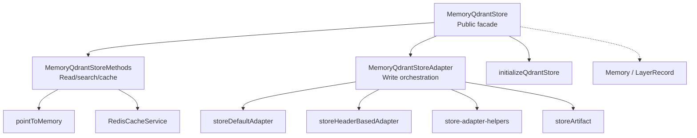
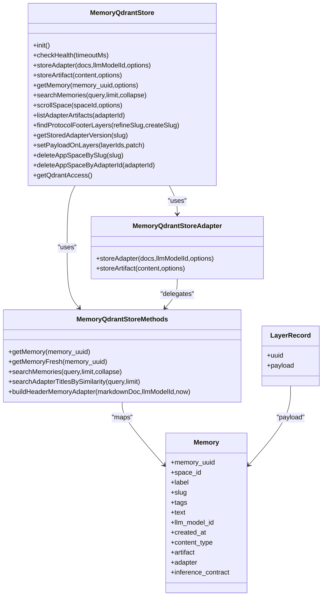
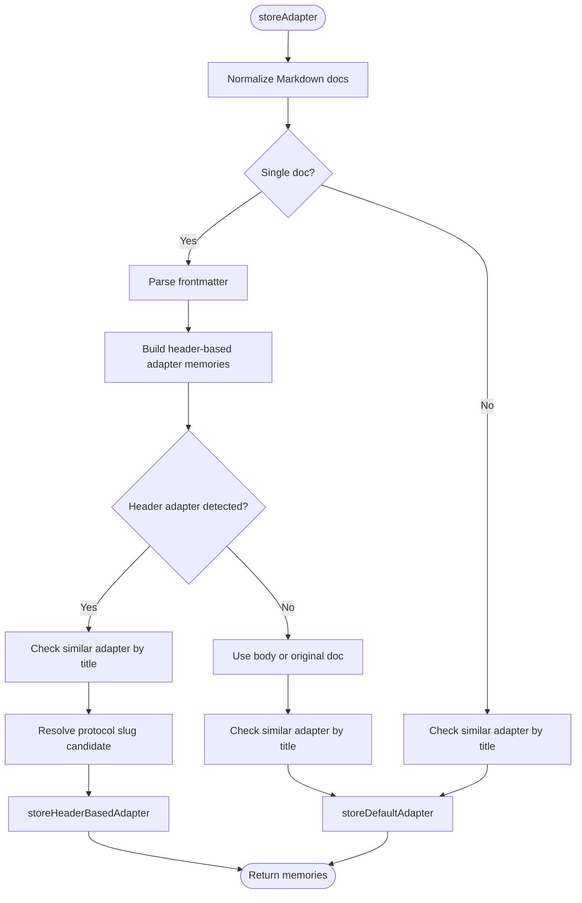
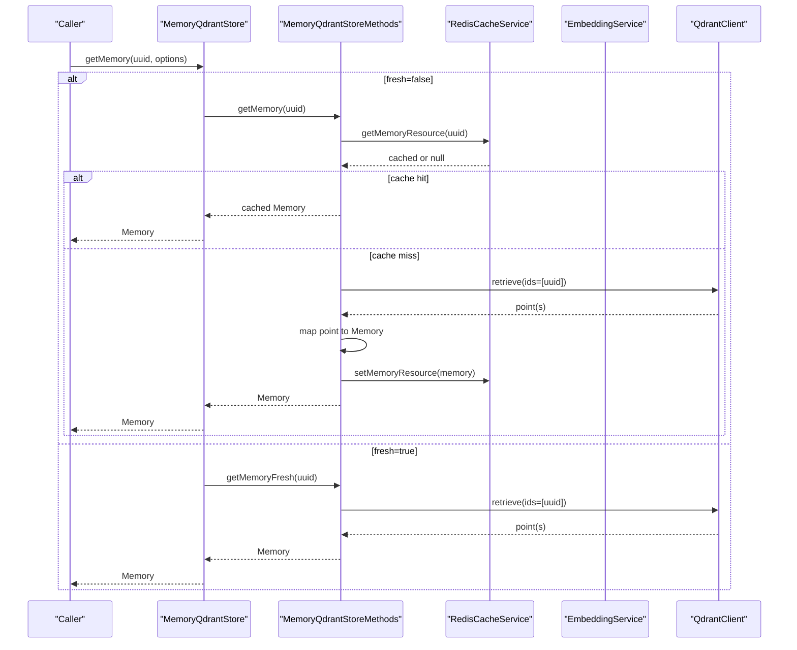
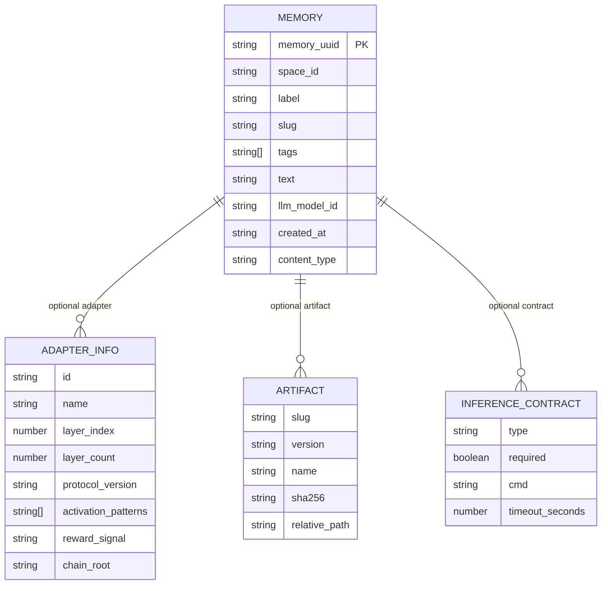
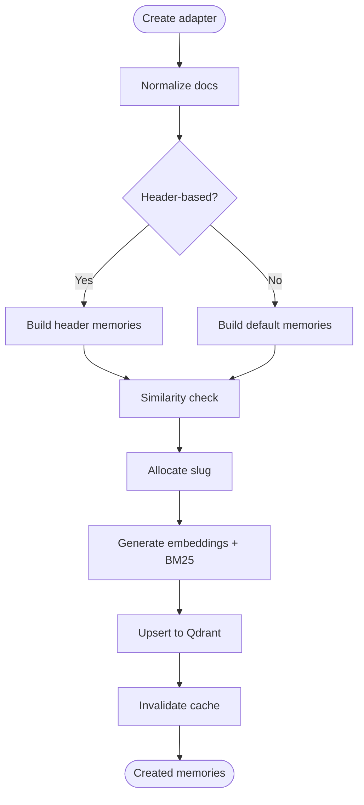
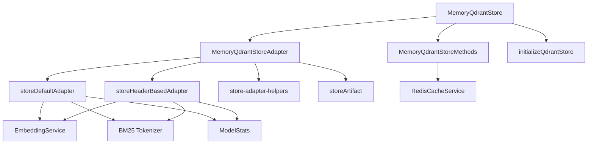

# Memory Abstraction Layer

<cite>
**Referenced Files in This Document**   
- [store.ts](file://src/services/memory/store.ts)
- [store-adapter.ts](file://src/services/memory/store-adapter.ts)
- [store-methods.ts](file://src/services/memory/store-methods.ts)
- [qdrant-point-to-memory.ts](file://src/services/memory/qdrant-point-to-memory.ts)
- [store-adapter-default-handler.ts](file://src/services/memory/store-adapter-default-handler.ts)
- [store-adapter-header-handler.ts](file://src/services/memory/store-adapter-header-handler.ts)
- [store-adapter-helpers.ts](file://src/services/memory/store-adapter-helpers.ts)
- [store-artifact.ts](file://src/services/memory/store-artifact.ts)
- [memory.ts](file://src/types/memory.ts)
- [types.ts](file://src/services/vector-store/types.ts)
- [redis-cache.ts](file://src/services/redis-cache.ts)
- [store-init.ts](file://src/services/memory/store-init.ts)
</cite>

## Table of Contents
1. [Introduction](#introduction)
2. [Project Structure](#project-structure)
3. [Core Components](#core-components)
4. [Architecture Overview](#architecture-overview)
5. [Detailed Component Analysis](#detailed-component-analysis)
6. [Dependency Analysis](#dependency-analysis)
7. [Performance Considerations](#performance-considerations)
8. [Troubleshooting Guide](#troubleshooting-guide)
9. [Conclusion](#conclusion)
10. [Appendices](#appendices)

## Introduction
This document explains the memory abstraction layer that provides unified access to vector database storage for SquadRules adapters, memories, and artifacts. The primary implementation is `MemoryQdrantStore`, which wraps Qdrant while exposing a domain-oriented interface for creating, retrieving, updating, searching, and deleting memory records.

The design separates:
- Domain logic: adapter parsing, slug allocation, duplicate detection, similarity checks, artifact attachment, and quality metrics.
- Storage specifics: Qdrant client usage, collection management, vector names, sparse BM25 fields, payload indexing, and scroll/upsert operations.
- Caching and consistency: Redis-backed search and memory resource caching with invalidation after writes.
- Backend-neutral types: `Memory` and `LayerRecord` are used across the system so future backends can be added without changing callers.

SquadRules stores semantic knowledge as layered adapter records plus optional artifacts. Adapters may be header-based (H1/H2 sections) or default (one memory per document). Artifacts are attached to an adapter chain by adapter id or slug.

## Project Structure
The memory abstraction lives under `src/services/memory`. Its responsibilities include:
- Public store facade (`store.ts`)
- Adapter write pipeline (`store-adapter.ts`, default/header handlers, helpers)
- Read/search methods (`store-methods.ts`)
- Point-to-domain mapping (`qdrant-point-to-memory.ts`)
- Artifact attachment (`store-artifact.ts`)
- Collection initialization and indexes (`store-init.ts`)
- Shared domain type definitions (`src/types/memory.ts`)
- Backend-neutral vector-store types (`src/services/vector-store/types.ts`)
- Cross-process cache invalidation (`src/services/redis-cache.ts`)

**Diagram sources**
- [store.ts:29-62](file://src/services/memory/store.ts#L29-L62)
- [store-adapter.ts:35-41](file://src/services/memory/store-adapter.ts#L35-L41)
- [store-methods.ts:25-36](file://src/services/memory/store-methods.ts#L25-L36)
- [qdrant-point-to-memory.ts:10-99](file://src/services/memory/qdrant-point-to-memory.ts#L10-L99)
- [store-init.ts:171-208](file://src/services/memory/store-init.ts#L171-L208)
- [redis-cache.ts:21-31](file://src/services/redis-cache.ts#L21-L31)

**Section sources**
- [store.ts:1-272](file://src/services/memory/store.ts#L1-L272)
- [store-adapter.ts:1-154](file://src/services/memory/store-adapter.ts#L1-L154)
- [store-methods.ts:1-270](file://src/services/memory/store-methods.ts#L1-L270)
- [qdrant-point-to-memory.ts:1-101](file://src/services/memory/qdrant-point-to-memory.ts#L1-L101)
- [store-adapter-default-handler.ts:1-256](file://src/services/memory/store-adapter-default-handler.ts#L1-L256)
- [store-adapter-header-handler.ts:1-203](file://src/services/memory/store-adapter-header-handler.ts#L1-L203)
- [store-adapter-helpers.ts:1-255](file://src/services/memory/store-adapter-helpers.ts#L1-L255)
- [store-artifact.ts:1-301](file://src/services/memory/store-artifact.ts#L1-L301)
- [memory.ts:1-125](file://src/types/memory.ts#L1-L125)
- [types.ts:1-95](file://src/services/vector-store/types.ts#L1-L95)
- [redis-cache.ts:1-260](file://src/services/redis-cache.ts#L1-L260)
- [store-init.ts:150-208](file://src/services/memory/store-init.ts#L150-L208)

## Core Components
- `MemoryQdrantStore`: Primary public class. Owns the Qdrant client, resolved collection name, code block processing, read/search methods, and the adapter writer. It exposes lifecycle, health checking, adapter/artifact storage, memory retrieval, search, and backend-owned utility operations such as scrolling space layers, listing adapter artifacts, finding protocol footer layers, reading stored adapter versions, patching payloads, and deleting app-space points.
- `MemoryQdrantStoreAdapter`: Orchestrates adapter writing. It normalizes Markdown, parses frontmatter, detects header-based adapters, performs similarity checks, allocates slugs, delegates to default or header handlers, and stores artifacts.
- `MemoryQdrantStoreMethods`: Encapsulates reads and searches. It uses Redis cache for single-memory reads and search results, maps Qdrant points to `Memory`, performs hybrid dense/sparse/fusion search, and builds header-based adapter memories.
- `pointToMemory`: Converts a Qdrant point into a domain `Memory`, filling defaults and validating nested adapter/inference contract fields.
- Default and header handlers: Build vectors, BM25 tokens, payload metadata, handle duplicates and slug allocation, upsert points, invalidate cache, and record model contribution metrics.
- Artifact storage: Resolves adapter anchors, validates MIMEs, computes SHA-256, deduplicates by name/slug, attaches artifacts to adapter chains, and retries without BM25 when needed.
- Cache service: Provides search result caching, memory resource caching, global invalidation, and pub/sub invalidation events.

**Section sources**
- [store.ts:29-272](file://src/services/memory/store.ts#L29-L272)
- [store-adapter.ts:18-154](file://src/services/memory/store-adapter.ts#L18-L154)
- [store-methods.ts:25-269](file://src/services/memory/store-methods.ts#L25-L269)
- [qdrant-point-to-memory.ts:10-99](file://src/services/memory/qdrant-point-to-memory.ts#L10-L99)
- [store-adapter-default-handler.ts:31-256](file://src/services/memory/store-adapter-default-handler.ts#L31-L256)
- [store-adapter-header-handler.ts:27-203](file://src/services/memory/store-adapter-header-handler.ts#L27-L203)
- [store-artifact.ts:87-301](file://src/services/memory/store-artifact.ts#L87-L301)
- [redis-cache.ts:21-260](file://src/services/redis-cache.ts#L21-L260)

## Architecture Overview
The memory abstraction follows an adapter pattern:
- The public store facade hides Qdrant details.
- The adapter orchestrator separates write strategies (header vs default).
- Methods encapsulate read/search behavior and caching.
- Point mapping isolates payload structure from domain models.
- Vector-store types define backend-neutral contracts.

**Diagram sources**
- [store.ts:29-272](file://src/services/memory/store.ts#L29-L272)
- [store-adapter.ts:35-154](file://src/services/memory/store-adapter.ts#L35-L154)
- [store-methods.ts:25-269](file://src/services/memory/store-methods.ts#L25-L269)
- [memory.ts:99-120](file://src/types/memory.ts#L99-L120)
- [types.ts:37-40](file://src/services/vector-store/types.ts#L37-L40)

## Detailed Component Analysis

### MemoryQdrantStore: Primary Implementation
`MemoryQdrantStore` is the main entry point for memory operations. It:
- Creates a Qdrant client using environment-driven URL and optional API key.
- Resolves collection aliases so callers can pass logical names like `current`.
- Initializes the collection and full-text indexes through `initializeQdrantStore`.
- Exposes health checking with timeout handling.
- Delegates adapter and artifact writes to `MemoryQdrantStoreAdapter`.
- Exposes memory retrieval and search via `MemoryQdrantStoreMethods`.
- Provides backend-owned utilities for scrolling layers, listing artifacts, querying protocol footers, reading adapter versions, patching payloads, and deleting app-space points.

Key behaviors:
- Lazy resolution of Qdrant URL avoids import-time failures when LanceDB is selected elsewhere.
- Health check races network calls against a timeout and suppresses unhandled rejections from the losing promise.
- Scroll utilities paginate through Qdrant and return `LayerRecord[]`, enabling backend-neutral iteration over adapter layers.

**Section sources**
- [store.ts:17-62](file://src/services/memory/store.ts#L17-L62)
- [store.ts:64-130](file://src/services/memory/store.ts#L64-L130)
- [store.ts:132-153](file://src/services/memory/store.ts#L132-L153)
- [store.ts:155-264](file://src/services/memory/store.ts#L155-L264)
- [store-init.ts:171-208](file://src/services/memory/store-init.ts#L171-L208)

### Store Adapter Pattern: Write Orchestration
`MemoryQdrantStoreAdapter` organizes memory writes by separating concerns:
- Normalization and frontmatter parsing.
- Detection of header-based adapters versus default adapters.
- Similarity guard to prevent accidental duplicate adapters.
- Slug allocation and duplicate handling.
- Delegation to specialized handlers.

**Diagram sources**
- [store-adapter.ts:43-148](file://src/services/memory/store-adapter.ts#L43-L148)
- [store-adapter-header-handler.ts:30-203](file://src/services/memory/store-adapter-header-handler.ts#L30-L203)
- [store-adapter-default-handler.ts:34-256](file://src/services/memory/store-adapter-default-handler.ts#L34-L256)

**Section sources**
- [store-adapter.ts:18-154](file://src/services/memory/store-adapter.ts#L18-L154)

### Read/Search Methods and Caching
`MemoryQdrantStoreMethods` centralizes reads and searches:
- `getMemory` checks Redis cache first, then retrieves from Qdrant, enforces space access control, maps to `Memory`, and caches the result.
- `getMemoryFresh` bypasses cache for fresh reads.
- `searchMemories` generates embeddings, runs hybrid search with prefetch legs and fusion, applies text match boosts, filters builtin protocol footers, sorts by score, and caches results.
- Search fallback falls back to dense-only query if hybrid query fails.

**Diagram sources**
- [store.ts:144-149](file://src/services/memory/store.ts#L144-L149)
- [store-methods.ts:38-92](file://src/services/memory/store-methods.ts#L38-L92)
- [redis-cache.ts:176-201](file://src/services/redis-cache.ts#L176-L201)

**Section sources**
- [store-methods.ts:38-114](file://src/services/memory/store-methods.ts#L38-L114)
- [store-methods.ts:121-260](file://src/services/memory/store-methods.ts#L121-L260)
- [redis-cache.ts:33-72](file://src/services/redis-cache.ts#L33-L72)
- [redis-cache.ts:176-201](file://src/services/redis-cache.ts#L176-L201)

### Memory Type Definition and Relationship to Vector Records
`Memory` is the domain record representing a layer or artifact stored in the vector database. It includes identifiers, labels, tags, text, model attribution, timestamps, content type, optional artifact metadata, adapter information, and inference contract definition.

`LayerRecord` is a backend-neutral representation used for scrolling and enumeration: it contains a UUID and a `Memory` payload. This allows consumers to iterate over adapter layers without depending on Qdrant-specific point structures.

**Diagram sources**
- [memory.ts:1-120](file://src/types/memory.ts#L1-L120)
- [types.ts:37-40](file://src/services/vector-store/types.ts#L37-L40)

**Section sources**
- [memory.ts:99-120](file://src/types/memory.ts#L99-L120)
- [types.ts:37-40](file://src/services/vector-store/types.ts#L37-L40)

### Memory Lifecycle Operations

#### Creation
Creation flows through `storeAdapter`:
- Normalize input documents.
- Detect header-based adapters; otherwise use default path.
- Check for similar adapters by title unless forced update.
- Allocate unique protocol slug.
- Generate embeddings and BM25 tokens.
- Upsert points to Qdrant.
- Invalidate cache and record metrics.

**Diagram sources**
- [store-adapter.ts:43-148](file://src/services/memory/store-adapter.ts#L43-L148)
- [store-adapter-default-handler.ts:34-256](file://src/services/memory/store-adapter-default-handler.ts#L34-L256)
- [store-adapter-header-handler.ts:30-203](file://src/services/memory/store-adapter-header-handler.ts#L30-L203)

**Section sources**
- [store-adapter.ts:43-148](file://src/services/memory/store-adapter.ts#L43-L148)
- [store-adapter-default-handler.ts:34-256](file://src/services/memory/store-adapter-default-handler.ts#L34-L256)
- [store-adapter-header-handler.ts:30-203](file://src/services/memory/store-adapter-header-handler.ts#L30-L203)

#### Retrieval
Retrieval supports two modes:
- Cached read: `getMemory` checks Redis, fetches from Qdrant if missing, maps to `Memory`, and caches the result.
- Fresh read: `getMemoryFresh` bypasses cache and returns the latest Qdrant record.

Space access control ensures only allowed spaces or app space are readable.

**Section sources**
- [store-methods.ts:38-92](file://src/services/memory/store-methods.ts#L38-L92)
- [qdrant-point-to-memory.ts:10-99](file://src/services/memory/qdrant-point-to-memory.ts#L10-L99)

#### Updating
Updates are handled by:
- Duplicate adapter handling: throws `DUPLICATE_ADAPTER` unless `forceUpdate` is true.
- Protected space guard: prevents writes to protected spaces.
- Slug allocation: author-supplied slugs must not collide; auto slugs append suffixes until unique.
- Artifact updates: existing artifacts can be replaced with `forceUpdate`; otherwise duplicates throw.

After successful writes, cache invalidation clears search and begin/activate caches.

**Section sources**
- [store-adapter-helpers.ts:52-93](file://src/services/memory/store-adapter-helpers.ts#L52-L93)
- [store-adapter-helpers.ts:201-254](file://src/services/memory/store-adapter-helpers.ts#L201-L254)
- [store-artifact.ts:168-301](file://src/services/memory/store-artifact.ts#L168-L301)
- [redis-cache.ts:232-238](file://src/services/redis-cache.ts#L232-L238)

#### Deletion
Deletion is exposed through backend-owned utilities:
- Delete app-space points by slug.
- Delete app-space points by adapter id.
- These operations target the resolved collection and apply space filters.

**Section sources**
- [store.ts:216-238](file://src/services/memory/store.ts#L216-L238)

### Caching Strategies and Consistency Model
Caching strategy:
- Search results are cached by query, limit, and collapse mode with a TTL.
- Individual memory resources are cached by UUID with a bounded TTL.
- Writes call `invalidateAfterUpdate`, which clears search and begin/activate caches.
- Invalidations publish events for cross-process awareness.

Consistency model:
- Reads prefer cache but support fresh bypass.
- Writes are eventually consistent due to cache invalidation; bounded TTL protects against stale data if invalidation fails.
- Space context enforces read/write boundaries.

**Section sources**
- [redis-cache.ts:33-72](file://src/services/redis-cache.ts#L33-L72)
- [redis-cache.ts:99-129](file://src/services/redis-cache.ts#L99-L129)
- [redis-cache.ts:176-201](file://src/services/redis-cache.ts#L176-L201)
- [redis-cache.ts:232-238](file://src/services/redis-cache.ts#L232-L238)
- [store-methods.ts:38-104](file://src/services/memory/store-methods.ts#L38-L104)

### Transaction Handling Across Backends
There is no explicit multi-operation transaction wrapper around Qdrant upserts in these files. Instead:
- Each handler performs a single upsert call per batch of points.
- Errors are caught and retried without BM25 when sparse configuration is unavailable.
- Cache invalidation occurs after successful upsert.
- For new backends, transactions should be modeled at the adapter layer if atomicity across multiple writes is required.

**Section sources**
- [store-adapter-default-handler.ts:216-234](file://src/services/memory/store-adapter-default-handler.ts#L216-L234)
- [store-adapter-header-handler.ts:166-184](file://src/services/memory/store-adapter-header-handler.ts#L166-L184)
- [store-artifact.ts:260-273](file://src/services/memory/store-artifact.ts#L260-L273)

### Extending the Abstraction for New Storage Implementations
To add a new backend:
1. Define backend-neutral interfaces matching `IVectorRecordStore` and related ports in `src/services/vector-store/types.ts`.
2. Implement a concrete adapter that maps backend records to/from `Memory` and `LayerRecord`.
3. Provide a store facade similar to `MemoryQdrantStore` that resolves collection/database, initializes schema/indexes, and exposes lifecycle, health, and domain operations.
4. Reuse adapter orchestration patterns: normalization, similarity checks, slug allocation, duplicate handling, and artifact attachment.
5. Integrate caching consistently: cache reads, invalidate on writes, and publish invalidation events.

Best practices:
- Keep domain logic free of backend client imports.
- Use vector-store types as the contract between domain and storage.
- Preserve space filtering and tenant context throughout reads/writes.
- Handle embedding dimension mismatches gracefully with zero-vector fallbacks.
- Validate slugs and adapter ids before writes to avoid collisions.
- Log and measure performance with metrics and structured logging.

**Section sources**
- [types.ts:1-95](file://src/services/vector-store/types.ts#L1-L95)
- [store-adapter-default-handler.ts:112-142](file://src/services/memory/store-adapter-default-handler.ts#L112-L142)
- [store-adapter-header-handler.ts:61-89](file://src/services/memory/store-adapter-header-handler.ts#L61-L89)
- [store-adapter-helpers.ts:112-172](file://src/services/memory/store-adapter-helpers.ts#L112-L172)

## Dependency Analysis
The memory abstraction depends on:
- Qdrant client for persistence and search.
- Embedding service for dense vectors and BM25 tokenization.
- Redis cache service for search and memory resource caching.
- Tenant context and space filter utilities for multi-tenant scoping.
- Protocol slug utilities for unique adapter identification.
- Metrics and model stats for quality scoring and contribution tracking.

**Diagram sources**
- [store.ts:29-62](file://src/services/memory/store.ts#L29-L62)
- [store-adapter.ts:43-148](file://src/services/memory/store-adapter.ts#L43-L148)
- [store-methods.ts:121-260](file://src/services/memory/store-methods.ts#L121-L260)
- [store-adapter-default-handler.ts:112-142](file://src/services/memory/store-adapter-default-handler.ts#L112-L142)
- [store-adapter-header-handler.ts:61-89](file://src/services/memory/store-adapter-header-handler.ts#L61-L89)
- [store-adapter-helpers.ts:112-172](file://src/services/memory/store-adapter-helpers.ts#L112-L172)
- [store-artifact.ts:168-301](file://src/services/memory/store-artifact.ts#L168-L301)
- [redis-cache.ts:21-31](file://src/services/redis-cache.ts#L21-L31)
- [store-init.ts:171-208](file://src/services/memory/store-init.ts#L171-L208)

**Section sources**
- [store.ts:29-272](file://src/services/memory/store.ts#L29-L272)
- [store-adapter.ts:43-154](file://src/services/memory/store-adapter.ts#L43-L154)
- [store-methods.ts:121-260](file://src/services/memory/store-methods.ts#L121-L260)
- [store-adapter-default-handler.ts:112-256](file://src/services/memory/store-adapter-default-handler.ts#L112-L256)
- [store-adapter-header-handler.ts:61-203](file://src/services/memory/store-adapter-header-handler.ts#L61-L203)
- [store-adapter-helpers.ts:112-254](file://src/services/memory/store-adapter-helpers.ts#L112-L254)
- [store-artifact.ts:168-301](file://src/services/memory/store-artifact.ts#L168-L301)
- [redis-cache.ts:21-260](file://src/services/redis-cache.ts#L21-L260)
- [store-init.ts:171-208](file://src/services/memory/store-init.ts#L171-L208)

## Performance Considerations
- Hybrid search uses multiple prefetch legs and fusion to improve recall and precision.
- Embedding batches reduce overhead for adapter creation.
- Zero-vector fallbacks ensure resilience when embedding generation fails.
- BM25 sparse vectors enable lexical search; collections without sparse config trigger a retry without BM25.
- Cache invalidation is broad after writes to maintain consistency in a read-heavy system.
- Health checks race network calls against timeouts to avoid blocking startup.

[No sources needed since this section provides general guidance]

## Troubleshooting Guide
Common issues and resolutions:
- Duplicate adapter: Occurs when an adapter id already exists. Resolve by using `forceUpdate` to replace or choosing a distinct adapter title/id.
- Protected space write forbidden: Writes to protected spaces are blocked. Adjust space context or permissions.
- Slug collision: Author-supplied slugs must be unique; auto slugs append suffixes. If allocation exhausts attempts, change base slug.
- Similar adapter found: Title similarity triggers a guard. Inspect existing adapter and either rename or force update with same adapter id.
- Embedding shape mismatch: Batch embedding count or dimension mismatch falls back to zero vectors; verify embedding service configuration.
- Sparse/BM25 errors: Upsert retries without BM25 when collection lacks sparse config; ensure collection schema matches expected vector dimensions.
- Cache staleness: After writes, cache invalidation clears search and begin/activate caches; bounded TTL prevents permanent stale data.

**Section sources**
- [store-adapter-helpers.ts:52-93](file://src/services/memory/store-adapter-helpers.ts#L52-L93)
- [store-adapter-helpers.ts:112-172](file://src/services/memory/store-adapter-helpers.ts#L112-L172)
- [store-adapter-helpers.ts:201-254](file://src/services/memory/store-adapter-helpers.ts#L201-L254)
- [store-adapter-default-handler.ts:112-142](file://src/services/memory/store-adapter-default-handler.ts#L112-L142)
- [store-adapter-default-handler.ts:216-234](file://src/services/memory/store-adapter-default-handler.ts#L216-L234)
- [store-adapter-header-handler.ts:61-89](file://src/services/memory/store-adapter-header-handler.ts#L61-L89)
- [store-adapter-header-handler.ts:166-184](file://src/services/memory/store-adapter-header-handler.ts#L166-L184)
- [store-artifact.ts:260-273](file://src/services/memory/store-artifact.ts#L260-L273)
- [redis-cache.ts:232-238](file://src/services/redis-cache.ts#L232-L238)

## Conclusion
The memory abstraction layer cleanly separates domain logic from storage specifics while providing a unified interface for managing adapters, memories, and artifacts. `MemoryQdrantStore` serves as the primary implementation, delegating writes to adapter handlers and reads/search to method utilities backed by Redis caching. The design supports extension to new backends through backend-neutral types and adapter patterns, while enforcing tenant scoping, slug uniqueness, duplicate protection, and resilient embedding workflows.

[No sources needed since this section summarizes without analyzing specific files]

## Appendices

### Best Practices for Memory Operation Patterns
- Prefer header-based adapters when Markdown contains clear H1/H2 sections; otherwise use default path.
- Always validate slugs and adapter ids before writes to avoid collisions.
- Use `forceUpdate` judiciously; it replaces existing adapters or artifacts.
- Leverage `fresh` reads when immediate consistency is required after writes.
- Monitor embedding service health and dimension configuration to avoid zero-vector fallbacks.
- Use space context and filters to enforce multi-tenant isolation.
- Record quality metrics and model contributions to track adapter effectiveness.

[No sources needed since this section provides general guidance]