# LanceDB Implementation

<cite>
**Referenced Files in This Document**
- [IVectorRecordStore.ts](file://src/services/vector-store/IVectorRecordStore.ts)
- [LanceVectorRecordStore.ts](file://src/services/vector-store/lancedb/LanceVectorRecordStore.ts)
- [lance-records-engine.ts](file://src/services/vector-store/lancedb/lance-records-engine.ts)
- [lance-records-reads.ts](file://src/services/vector-store/lancedb/lance-records-reads.ts)
- [lance-records-mutations.ts](file://src/services/vector-store/lancedb/lance-records-mutations.ts)
- [lance-records-search.ts](file://src/services/vector-store/lancedb/lance-records-search.ts)
- [lance-records-writes.ts](file://src/services/vector-store/lancedb/lance-records-writes.ts)
- [lance-records-write-helpers.ts](file://src/services/vector-store/lancedb/lance-records-write-helpers.ts)
- [lance-records-write-artifact.ts](file://src/services/vector-store/lancedb/lance-records-write-artifact.ts)
- [lance-records-schema.ts](file://src/services/vector-store/lancedb/lance-records-schema.ts)
- [lancedb-connection.ts](file://src/services/vector-store/lancedb-connection.ts)
- [embedded-store-singleton.ts](file://src/services/vector-store/embedded-store-singleton.ts)
- [boot-local-runtime.ts](file://src/runtime/boot-local-runtime.ts)
- [server.ts](file://src/server.ts)
- [runtime-mode.ts](file://src/config/runtime-mode.ts)
- [0003-no-lancedb-store-snapshot.md](file://docs/adr/0003-no-lancedb-store-snapshot.md)
- [0013-embedded-store-multiprocess-safety.md](file://docs/adr/0013-embedded-store-multiprocess-safety.md)
</cite>

## Table of Contents
1. [Introduction](#introduction)
2. [Project Structure](#project-structure)
3. [Core Components](#core-components)
4. [Architecture Overview](#architecture-overview)
5. [Detailed Component Analysis](#detailed-component-analysis)
6. [Dependency Analysis](#dependency-analysis)
7. [Performance Considerations](#performance-considerations)
8. [Troubleshooting Guide](#troubleshooting-guide)
9. [Conclusion](#conclusion)
10. [Appendices](#appendices)

## Introduction
This document explains the embedded LanceDB implementation used as an alternative backend to Qdrant for SquadRules vector storage. It focuses on the `LanceVectorRecordStore` class, its layered architecture, file-based storage layout, initialization flow, record operations, search behavior, and operational characteristics. The goal is to help developers understand when and how to use LanceDB for development and testing, and how it compares to Qdrant for production deployments.

SquadRules supports two vector backends:
- Qdrant: primary backend with remote-capable server semantics.
- LanceDB: secondary embedded backend designed for local single-user workflows.

The embedded store mirrors the Qdrant read/admin surface so that the same tools and boot injection paths can operate against either backend without changing caller code.

## Project Structure
The LanceDB implementation lives under `src/services/vector-store/lancedb`. It implements the `IVectorRecordStore` interface and integrates with the runtime bootstrap and server configuration.

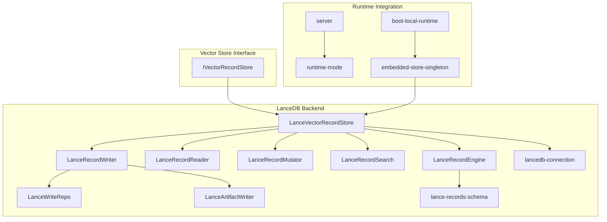

**Diagram sources**
- [IVectorRecordStore.ts:27-73](file://src/services/vector-store/IVectorRecordStore.ts#L27-L73)
- [LanceVectorRecordStore.ts:35-191](file://src/services/vector-store/lancedb/LanceVectorRecordStore.ts#L35-L191)
- [lance-records-engine.ts:20-128](file://src/services/vector-store/lancedb/lance-records-engine.ts#L20-L128)
- [lance-records-reads.ts:46-256](file://src/services/vector-store/lancedb/lance-records-reads.ts#L46-L256)
- [lance-records-mutations.ts:58-223](file://src/services/vector-store/lancedb/lance-records-mutations.ts#L58-L223)
- [lance-records-search.ts:96-137](file://src/services/vector-store/lancedb/lance-records-search.ts#L96-L137)
- [lance-records-writes.ts:42-348](file://src/services/vector-store/lancedb/lance-records-writes.ts#L42-L348)
- [lance-records-write-helpers.ts:36-249](file://src/services/vector-store/lancedb/lance-records-write-helpers.ts#L36-L249)
- [lance-records-write-artifact.ts:30-133](file://src/services/vector-store/lancedb/lance-records-write-artifact.ts#L30-L133)
- [lance-records-schema.ts:15-189](file://src/services/vector-store/lancedb/lance-records-schema.ts#L15-L189)
- [lancedb-connection.ts:21-33](file://src/services/vector-store/lancedb-connection.ts#L21-L33)
- [embedded-store-singleton.ts:14-17](file://src/services/vector-store/embedded-store-singleton.ts#L14-L17)
- [boot-local-runtime.ts:101-163](file://src/runtime/boot-local-runtime.ts#L101-L163)
- [server.ts:92-99](file://src/server.ts#L92-L99)
- [runtime-mode.ts:148-149](file://src/config/runtime-mode.ts#L148-L149)

**Section sources**
- [IVectorRecordStore.ts:27-73](file://src/services/vector-store/IVectorRecordStore.ts#L27-L73)
- [LanceVectorRecordStore.ts:35-191](file://src/services/vector-store/lancedb/LanceVectorRecordStore.ts#L35-L191)
- [boot-local-runtime.ts:101-163](file://src/runtime/boot-local-runtime.ts#L101-L163)
- [server.ts:92-99](file://src/server.ts#L92-L99)
- [runtime-mode.ts:148-149](file://src/config/runtime-mode.ts#L148-L149)

## Core Components
- `LanceVectorRecordStore`: Public facade implementing `IVectorRecordStore`, delegating lifecycle, reads, mutations, search, and writes to internal components.
- `LanceRecordEngine`: Low-level table operations over a single `memory_records` table, including open-or-create, upsert, scan, retrieve-by-id, delete, and atomic commit retries.
- `LanceRecordReader`: Read layer mirroring Qdrant retrieval semantics, slug resolution, protocol steps, adapter layers, and artifact listing.
- `LanceRecordMutator`: Mutation layer for updates, quality metrics propagation, payload patches, and app-space deletions.
- `LanceRecordSearch`: In-process cosine similarity scoring over stored vectors plus text boosts.
- `LanceRecordWriter`: Adapter and artifact write pipeline reusing backend-neutral helpers and embedding services.
- `LanceWriteRepo`: Write-path primitives for duplicate checks, slug allocation, similarity guards, and artifact anchor resolution.
- `LanceArtifactWriter`: Artifact persistence path producing zero-vector points with BM25 sparse fields.
- `lance-records-schema`: Row schema mapping Qdrant-shaped points to Lance columns, filter translation, and vector coercion utilities.
- `lancedb-connection`: Lazy-loaded connection to the per-user LanceDB directory with strong consistency reads.
- `embedded-store-singleton`: Shared instance ensuring both memory and qdrant service slots point to the same embedded store.

**Section sources**
- [LanceVectorRecordStore.ts:35-191](file://src/services/vector-store/lancedb/LanceVectorRecordStore.ts#L35-L191)
- [lance-records-engine.ts:20-128](file://src/services/vector-store/lancedb/lance-records-engine.ts#L20-L128)
- [lance-records-reads.ts:46-256](file://src/services/vector-store/lancedb/lance-records-reads.ts#L46-L256)
- [lance-records-mutations.ts:58-223](file://src/services/vector-store/lancedb/lance-records-mutations.ts#L58-L223)
- [lance-records-search.ts:96-137](file://src/services/vector-store/lancedb/lance-records-search.ts#L96-L137)
- [lance-records-writes.ts:42-348](file://src/services/vector-store/lancedb/lance-records-writes.ts#L42-L348)
- [lance-records-write-helpers.ts:36-249](file://src/services/vector-store/lancedb/lance-records-write-helpers.ts#L36-L249)
- [lance-records-write-artifact.ts:30-133](file://src/services/vector-store/lancedb/lance-records-write-artifact.ts#L30-L133)
- [lance-records-schema.ts:15-189](file://src/services/vector-store/lancedb/lance-records-schema.ts#L15-L189)
- [lancedb-connection.ts:21-33](file://src/services/vector-store/lancedb-connection.ts#L21-L33)
- [embedded-store-singleton.ts:14-17](file://src/services/vector-store/embedded-store-singleton.ts#L14-L17)

## Architecture Overview
The embedded store is selected automatically when no external Qdrant URL is configured. At runtime, the same `LanceVectorRecordStore` instance is injected into both the memory store and the qdrant service slot, ensuring consistent state across all tool calls.

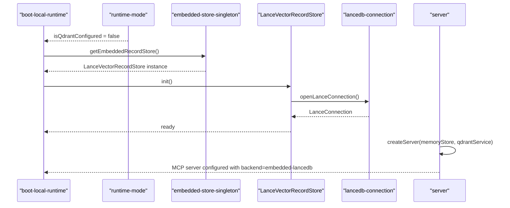

**Diagram sources**
- [runtime-mode.ts:148-149](file://src/config/runtime-mode.ts#L148-L149)
- [boot-local-runtime.ts:101-127](file://src/runtime/boot-local-runtime.ts#L101-L127)
- [embedded-store-singleton.ts:14-17](file://src/services/vector-store/embedded-store-singleton.ts#L14-L17)
- [LanceVectorRecordStore.ts:49-52](file://src/services/vector-store/lancedb/LanceVectorRecordStore.ts#L49-L52)
- [lancedb-connection.ts:30-33](file://src/services/vector-store/lancedb-connection.ts#L30-L33)
- [server.ts:92-99](file://src/server.ts#L92-L99)

## Detailed Component Analysis

### LanceVectorRecordStore Facade
`LanceVectorRecordStore` implements the full `IVectorRecordStore` contract and exposes additional admin methods required by the Qdrant integration surface. It delegates:
- Lifecycle: `init`, `checkHealth`.
- Reads: `getMemory`, `getAdapterLayers`, slug lookups, protocol steps, space scroll, artifact listing.
- Mutations: `updateMemory`, `deleteMemory`, `setPayloadOnLayers`, reward propagation, bulk deletes.
- Search: `searchMemories`, `searchAdapterTitlesBySimilarity`.
- Writes: `storeAdapter`, `storeArtifact`.

It also provides Qdrant-compatible properties such as `collectionName`, `qdrantUrl`, and `apiKey`, where the embedded path returns stable values indicating embedded operation.

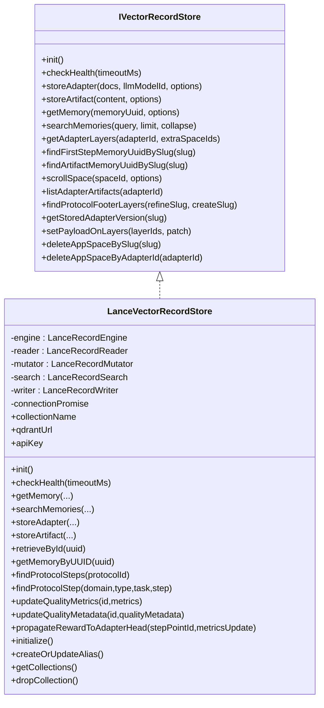

**Diagram sources**
- [IVectorRecordStore.ts:27-73](file://src/services/vector-store/IVectorRecordStore.ts#L27-L73)
- [LanceVectorRecordStore.ts:35-191](file://src/services/vector-store/lancedb/LanceVectorRecordStore.ts#L35-L191)

**Section sources**
- [LanceVectorRecordStore.ts:35-191](file://src/services/vector-store/lancedb/LanceVectorRecordStore.ts#L35-L191)
- [IVectorRecordStore.ts:27-73](file://src/services/vector-store/IVectorRecordStore.ts#L27-L73)

### Embedded Database Setup and File-Based Storage
- Directory: The embedded store uses a per-user directory derived from the shared config directory.
- Connection: The SDK is imported lazily to avoid loading native bindings unless the embedded path is used.
- Consistency: Connections are opened with strong consistency reads so one process sees another process’s committed writes.
- Table: A single table named `memory_records` is created on first write; cold reads do not create the table.

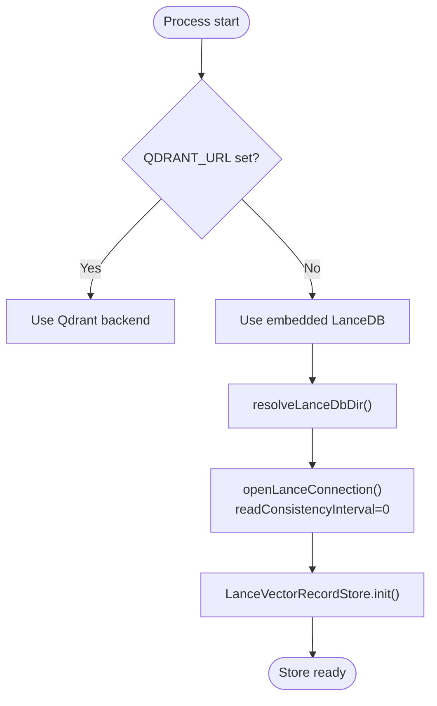

**Diagram sources**
- [runtime-mode.ts:148-149](file://src/config/runtime-mode.ts#L148-L149)
- [lancedb-connection.ts:21-33](file://src/services/vector-store/lancedb-connection.ts#L21-L33)
- [LanceVectorRecordStore.ts:49-52](file://src/services/vector-store/lancedb/LanceVectorRecordStore.ts#L49-L52)

**Section sources**
- [lancedb-connection.ts:21-33](file://src/services/vector-store/lancedb-connection.ts#L21-L33)
- [lance-records-engine.ts:30-46](file://src/services/vector-store/lancedb/lance-records-engine.ts#L30-L46)
- [boot-local-runtime.ts:101-127](file://src/runtime/boot-local-runtime.ts#L101-L127)

### Initialization Procedures
- Runtime selection: If `isQdrantConfigured` is false, the embedded singleton is used.
- Embedding dimension probe: Optional eager probe ensures model dimensions are known before seeding.
- Store initialization: `memoryStore.init()` opens the connection and logs readiness.
- Seeding: App-space adapters may be injected at boot depending on seed mode and whether the store is already seeded.

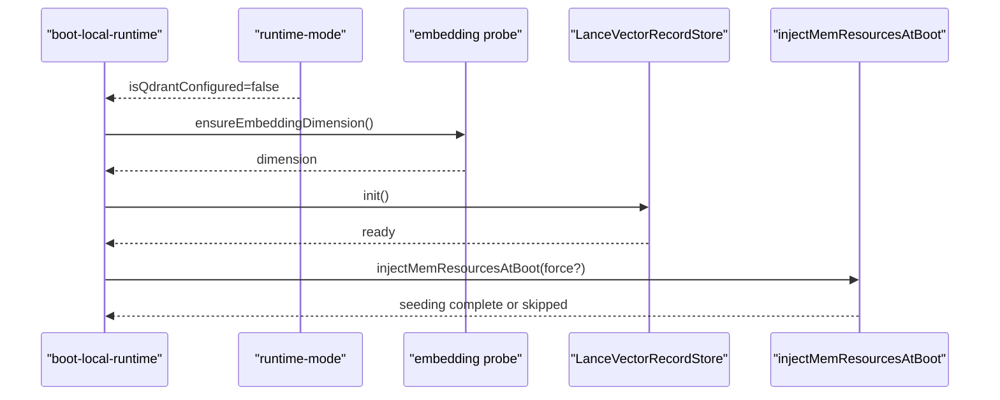

**Diagram sources**
- [runtime-mode.ts:148-149](file://src/config/runtime-mode.ts#L148-L149)
- [boot-local-runtime.ts:119-158](file://src/runtime/boot-local-runtime.ts#L119-L158)
- [LanceVectorRecordStore.ts:49-52](file://src/services/vector-store/lancedb/LanceVectorRecordStore.ts#L49-L52)

**Section sources**
- [boot-local-runtime.ts:101-163](file://src/runtime/boot-local-runtime.ts#L101-L163)
- [LanceVectorRecordStore.ts:49-52](file://src/services/vector-store/lancedb/LanceVectorRecordStore.ts#L49-L52)

### Record Operations

#### Vector Insertion
Adapter insertion parses markdown, builds header or default memories, computes embeddings, derives domain/task/type, constructs Qdrant-shaped points, and persists them through the engine. Artifacts are persisted separately with zero dense vectors and BM25 sparse fields.

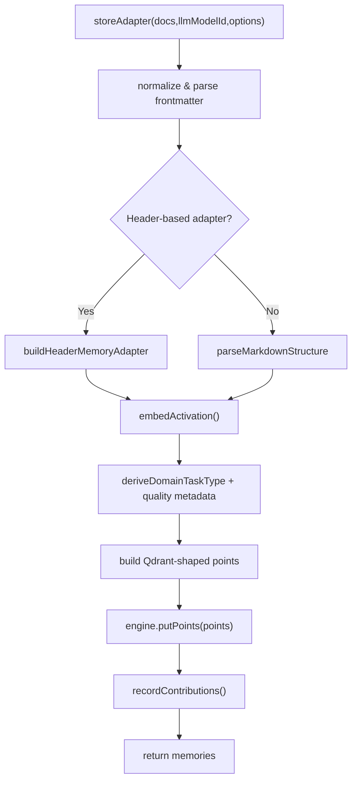

**Diagram sources**
- [lance-records-writes.ts:59-115](file://src/services/vector-store/lancedb/lance-records-writes.ts#L59-L115)
- [lance-records-writes.ts:155-225](file://src/services/vector-store/lancedb/lance-records-writes.ts#L155-L225)
- [lance-records-writes.ts:227-326](file://src/services/vector-store/lancedb/lance-records-writes.ts#L227-L326)
- [lance-records-engine.ts:48-63](file://src/services/vector-store/lancedb/lance-records-engine.ts#L48-L63)

**Section sources**
- [lance-records-writes.ts:59-348](file://src/services/vector-store/lancedb/lance-records-writes.ts#L59-L348)
- [lance-records-write-artifact.ts:33-133](file://src/services/vector-store/lancedb/lance-records-write-artifact.ts#L33-L133)
- [lance-records-engine.ts:48-63](file://src/services/vector-store/lancedb/lance-records-engine.ts#L48-L63)

#### Retrieval
Reads reconstruct `Memory` objects from stored payloads, enforce space access control, and mirror Qdrant retrieval shapes. Slug disambiguation follows personal > group > app precedence rules.

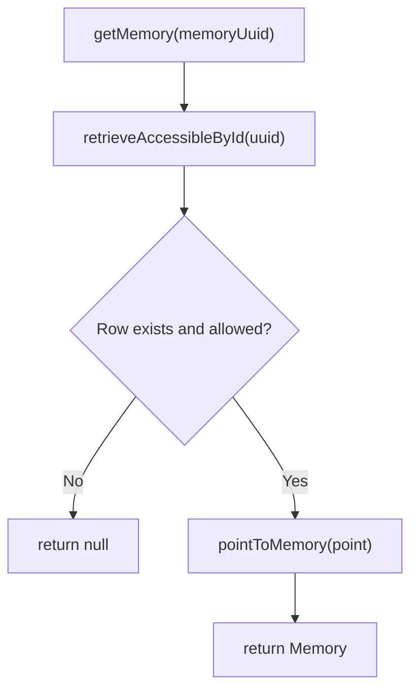

**Diagram sources**
- [lance-records-reads.ts:49-65](file://src/services/vector-store/lancedb/lance-records-reads.ts#L49-L65)
- [lance-records-reads.ts:39-44](file://src/services/vector-store/lancedb/lance-records-reads.ts#L39-L44)

**Section sources**
- [lance-records-reads.ts:49-111](file://src/services/vector-store/lancedb/lance-records-reads.ts#L49-L111)

#### Deletion
Deletions validate IDs, enforce space access, remove rows by id or filter, and invalidate caches. Bulk app-space deletions target slugs or adapter ids within the app space.

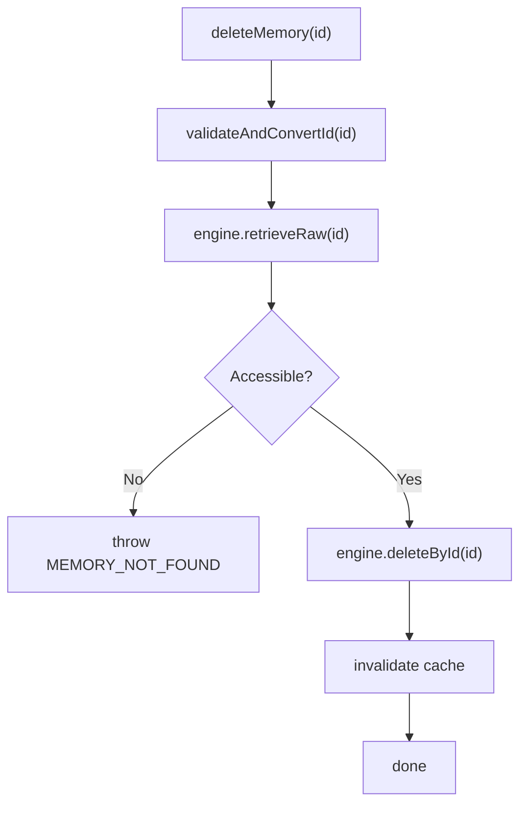

**Diagram sources**
- [lance-records-mutations.ts:119-128](file://src/services/vector-store/lancedb/lance-records-mutations.ts#L119-L128)
- [lance-records-engine.ts:117-122](file://src/services/vector-store/lancedb/lance-records-engine.ts#L117-L122)

**Section sources**
- [lance-records-mutations.ts:119-128](file://src/services/vector-store/lancedb/lance-records-mutations.ts#L119-L128)
- [lance-records-engine.ts:106-122](file://src/services/vector-store/lancedb/lance-records-engine.ts#L106-L122)

### Search Capabilities
LanceDB search performs in-process cosine similarity over three dense vector columns (primary, title, activation), adds text match boosts for label and tags, applies an attest boost, filters out built-in footer protocols, sorts by score then uuid, and slices to the requested limit. A fallback score is applied when no positive matches exist.

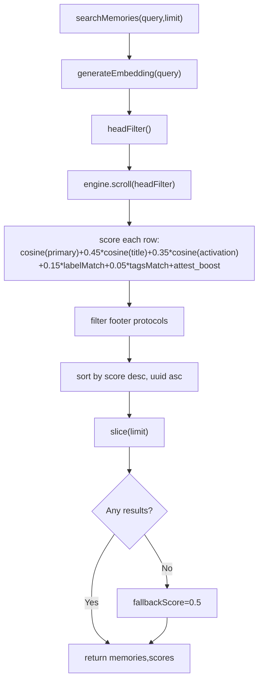

**Diagram sources**
- [lance-records-search.ts:99-122](file://src/services/vector-store/lancedb/lance-records-search.ts#L99-L122)
- [lance-records-search.ts:32-35](file://src/services/vector-store/lancedb/lance-records-search.ts#L32-L35)
- [lance-records-search.ts:72-80](file://src/services/vector-store/lancedb/lance-records-search.ts#L72-L80)

**Section sources**
- [lance-records-search.ts:96-137](file://src/services/vector-store/lancedb/lance-records-search.ts#L96-L137)

### Filtering Mechanisms
Filters are expressed as Qdrant-style `must`/`must_not` conditions and translated into LanceQL WHERE clauses. Promoted scalar columns include space, slug, adapter identifiers, layer indices, content type, protocol fields, domain/task/type, and artifact slug.

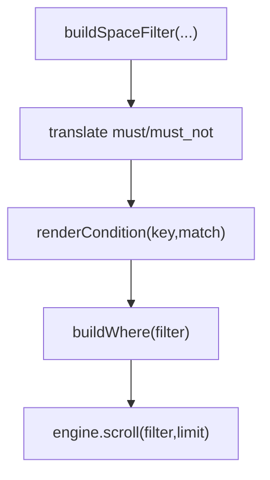

**Diagram sources**
- [lance-records-schema.ts:132-143](file://src/services/vector-store/lancedb/lance-records-schema.ts#L132-L143)
- [lance-records-schema.ts:88-126](file://src/services/vector-store/lancedb/lance-records-schema.ts#L88-L126)

**Section sources**
- [lance-records-schema.ts:44-60](file://src/services/vector-store/lancedb/lance-records-schema.ts#L44-L60)
- [lance-records-schema.ts:132-143](file://src/services/vector-store/lancedb/lance-records-schema.ts#L132-L143)

### Result Processing
Results are reconstructed into `Memory` objects using `pointToMemory`. For Qdrant compatibility, some readers return `{uuid,payload}` or ad-hoc memory objects with fields like `relevance_score`, `access_count`, and `certainty` populated from stored metadata.

**Section sources**
- [lance-records-reads.ts:67-111](file://src/services/vector-store/lancedb/lance-records-reads.ts#L67-L111)

## Dependency Analysis
The embedded store depends on:
- Configuration: `isQdrantConfigured` selects backend.
- Runtime: `bootLocalRuntime` wires the embedded singleton and seeds adapters.
- Server: `createServer` registers tools with both memory store and qdrant service, which share the same embedded instance.
- Embedding service: Used for query vectors and adapter embeddings.
- Space context and filters: Enforce tenant/space isolation.
- Redis cache: Invalidated after writes and updates.

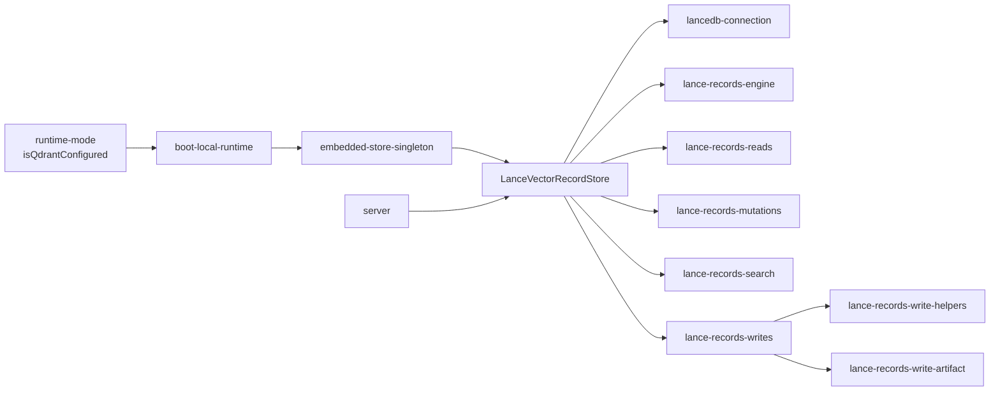

**Diagram sources**
- [runtime-mode.ts:148-149](file://src/config/runtime-mode.ts#L148-L149)
- [boot-local-runtime.ts:101-163](file://src/runtime/boot-local-runtime.ts#L101-L163)
- [embedded-store-singleton.ts:14-17](file://src/services/vector-store/embedded-store-singleton.ts#L14-L17)
- [LanceVectorRecordStore.ts:35-191](file://src/services/vector-store/lancedb/LanceVectorRecordStore.ts#L35-L191)
- [lance-records-engine.ts:20-128](file://src/services/vector-store/lancedb/lance-records-engine.ts#L20-L128)
- [lance-records-reads.ts:46-256](file://src/services/vector-store/lancedb/lance-records-reads.ts#L46-L256)
- [lance-records-mutations.ts:58-223](file://src/services/vector-store/lancedb/lance-records-mutations.ts#L58-L223)
- [lance-records-search.ts:96-137](file://src/services/vector-store/lancedb/lance-records-search.ts#L96-L137)
- [lance-records-writes.ts:42-348](file://src/services/vector-store/lancedb/lance-records-writes.ts#L42-L348)
- [lance-records-write-helpers.ts:36-249](file://src/services/vector-store/lancedb/lance-records-write-helpers.ts#L36-L249)
- [lance-records-write-artifact.ts:30-133](file://src/services/vector-store/lancedb/lance-records-write-artifact.ts#L30-L133)
- [server.ts:92-99](file://src/server.ts#L92-L99)

**Section sources**
- [runtime-mode.ts:148-149](file://src/config/runtime-mode.ts#L148-L149)
- [boot-local-runtime.ts:101-163](file://src/runtime/boot-local-runtime.ts#L101-L163)
- [server.ts:92-99](file://src/server.ts#L92-L99)

## Performance Considerations
- Embedded vs Qdrant:
  - LanceDB runs in-process with a local directory, avoiding network latency and external service setup.
  - Qdrant provides distributed server semantics, collection aliases, and snapshotting features not present in the embedded path.
- Search performance:
  - LanceDB search uses JS cosine scoring over adapter heads rather than ANN index scans because data-inferred embedding columns are variable-length lists.
  - Title and activation vectors add boosting terms but increase CPU cost during ranking.
- Write performance:
  - Writes batch upserts via `mergeInsert('id')` with commit retry for optimistic concurrency.
  - Embeddings are generated once per adapter chain; artifacts carry zero dense vectors.
- Concurrency:
  - Multiple local processes can share the directory safely through Lance MVCC and strong-consistency reads.
  - Per-process application caches may briefly serve stale values; HTTP transport is preferred for always-fresh shared writers.

[No sources needed since this section provides general guidance]

## Troubleshooting Guide
- Health check failures:
  - `checkHealth` attempts to open the connection and logs warnings if it fails.
- Duplicate adapters:
  - Duplicate detection throws `DUPLICATE_ADAPTER`; force update replaces existing rows after validation.
- Protected spaces:
  - Writes to protected spaces throw `PROTECTED_SPACE_WRITE_FORBIDDEN`.
- Slug collisions:
  - Author-supplied slugs reject conflicts; auto-generated slugs append numeric suffixes until unique.
- Similar adapter titles:
  - Title similarity guard throws `SIMILAR_MEMORY_FOUND` above threshold unless forced.
- Cache invalidation:
  - Writes and updates call cache invalidation helpers; failures are logged but do not abort the write.

**Section sources**
- [LanceVectorRecordStore.ts:54-61](file://src/services/vector-store/lancedb/LanceVectorRecordStore.ts#L54-L61)
- [lance-records-write-helpers.ts:53-84](file://src/services/vector-store/lancedb/lance-records-write-helpers.ts#L53-L84)
- [lance-records-write-helpers.ts:93-133](file://src/services/vector-store/lancedb/lance-records-write-helpers.ts#L93-L133)
- [lance-records-write-helpers.ts:135-179](file://src/services/vector-store/lancedb/lance-records-write-helpers.ts#L135-L179)
- [lance-records-mutations.ts:113-117](file://src/services/vector-store/lancedb/lance-records-mutations.ts#L113-L117)

## Conclusion
The LanceDB embedded backend provides a zero-config, file-based vector store suitable for local development and testing. It mirrors the Qdrant read/admin surface, enabling the same tools and boot injection logic to work across backends. For production deployments requiring distributed semantics, snapshots, and explicit collection management, Qdrant remains the recommended backend. When choosing between backends, consider deployment complexity, concurrency needs, and operational requirements.

[No sources needed since this section summarizes without analyzing specific files]

## Appendices

### When to Use LanceDB Over Qdrant
- Local single-user development workflows.
- Fast iteration without managing an external vector database.
- CLI-driven automation where simplicity outweighs distributed features.

**Section sources**
- [runtime-mode.ts:110-118](file://src/config/runtime-mode.ts#L110-L118)
- [0013-embedded-store-multiprocess-safety.md:27-51](file://docs/adr/0013-embedded-store-multiprocess-safety.md#L27-L51)

### Migration Considerations Between Backends
- Data shape: Both backends store Qdrant-shaped points; reads reconstruct identical `Memory` objects.
- Admin operations: Alias/collection management is a no-op on embedded; migration scripts should account for missing server-side features.
- Snapshots: No LanceDB snapshot support in CI; warm boots rely on reuse skips rather than restored directories.

**Section sources**
- [LanceVectorRecordStore.ts:146-161](file://src/services/vector-store/lancedb/LanceVectorRecordStore.ts#L146-L161)
- [0003-no-lancedb-store-snapshot.md:22-49](file://docs/adr/0003-no-lancedb-store-snapshot.md#L22-L49)