# Qdrant Integration

<cite>
**Referenced Files in This Document**
- [service.ts](file://src/services/qdrant/service.ts)
- [connection.ts](file://src/services/qdrant/connection.ts)
- [initialization.ts](file://src/services/qdrant/initialization.ts)
- [memory-store.ts](file://src/services/qdrant/memory-store.ts)
- [memory-updates.ts](file://src/services/qdrant/memory-updates.ts)
- [memory-retrieval.ts](file://src/services/qdrant/memory-retrieval.ts)
- [search.ts](file://src/services/qdrant/search.ts)
- [resources.ts](file://src/services/qdrant/resources.ts)
- [types.ts](file://src/services/qdrant/types.ts)
- [utils.ts](file://src/services/qdrant/utils.ts)
- [listing.ts](file://src/services/qdrant/listing.ts)
- [protocol.ts](file://src/services/qdrant/protocol.ts)
- [reward-propagation.ts](file://src/services/qdrant/reward-propagation.ts)
- [snapshots.ts](file://src/services/qdrant/snapshots.ts)
- [index.ts](file://src/services/qdrant/index.ts)
</cite>

## Table of Contents
1. [Introduction](#introduction)
2. [Project Structure](#project-structure)
3. [Core Components](#core-components)
4. [Architecture Overview](#architecture-overview)
5. [Detailed Component Analysis](#detailed-component-analysis)
6. [Dependency Analysis](#dependency-analysis)
7. [Performance Considerations](#performance-considerations)
8. [Troubleshooting Guide](#troubleshooting-guide)
9. [Conclusion](#conclusion)

## Introduction
This document explains the Qdrant vector database integration used by SquadRules for semantic search and memory storage. It covers the QdrantService facade, connection management, health checks, collection initialization, schema and index configuration, point CRUD operations, search queries with similarity scoring and metadata filtering, batch upserts, pagination, retry logic, error handling, performance tuning, deployment examples, and troubleshooting guidance.

SquadRules uses Qdrant as the primary vector store for embeddings of rules, workflows, and memories. The implementation is designed to be resilient, tenant-scoped, and observable through structured logging and metrics.

## Project Structure
The Qdrant integration lives under src/services/qdrant and exposes a service facade plus focused modules for connection, initialization, reads, writes, search, listing, protocol helpers, reward propagation, snapshots, and shared utilities.

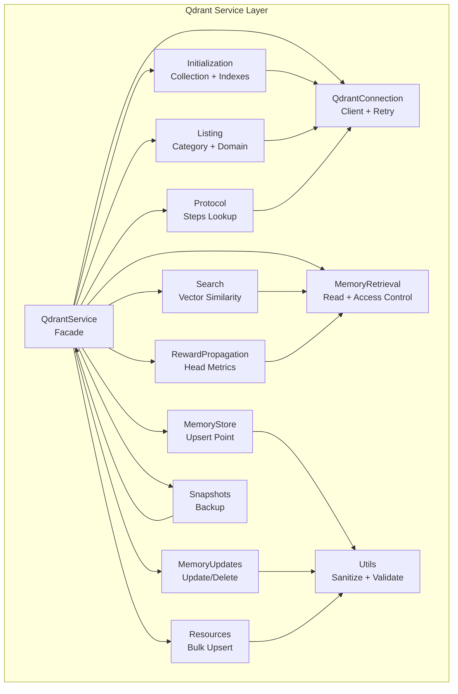

**Diagram sources**
- [service.ts:17-150](file://src/services/qdrant/service.ts#L17-L150)
- [connection.ts:11-131](file://src/services/qdrant/connection.ts#L11-L131)
- [initialization.ts:12-92](file://src/services/qdrant/initialization.ts#L12-L92)
- [memory-store.ts:14-126](file://src/services/qdrant/memory-store.ts#L14-L126)
- [memory-updates.ts:15-235](file://src/services/qdrant/memory-updates.ts#L15-L235)
- [memory-retrieval.ts:25-340](file://src/services/qdrant/memory-retrieval.ts#L25-L340)
- [search.ts:11-83](file://src/services/qdrant/search.ts#L11-L83)
- [resources.ts:18-139](file://src/services/qdrant/resources.ts#L18-L139)
- [listing.ts:10-96](file://src/services/qdrant/listing.ts#L10-L96)
- [protocol.ts:9-49](file://src/services/qdrant/protocol.ts#L9-L49)
- [reward-propagation.ts:13-76](file://src/services/qdrant/reward-propagation.ts#L13-L76)
- [snapshots.ts:68-168](file://src/services/qdrant/snapshots.ts#L68-L168)
- [utils.ts:90-128](file://src/services/qdrant/utils.ts#L90-L128)

**Section sources**
- [service.ts:17-150](file://src/services/qdrant/service.ts#L17-L150)
- [index.ts:1-4](file://src/services/qdrant/index.ts#L1-L4)

## Core Components
- QdrantService: Facade that composes connection, initialization, storage, retrieval, search, resources, listing, protocol helpers, reward propagation, and snapshots. It also exposes safe getters for client, collection name, URL, and API key. A module-level singleton selects either the real QdrantService or an embedded store double-cast when Qdrant is not configured.
- QdrantConnection: Encapsulates Qdrant client initialization (including TLS and CA certificate), health checking, exponential backoff reconnection, and a generic executeWithReconnect wrapper that logs errors and retries once on failure.
- Initialization: Ensures the collection exists, validates vector dimension configuration, recreates if mismatched, creates payload indexes, backfills missing space_id, and optionally creates an alias.
- MemoryStore: Creates a single memory point with deterministic ID from URI, sets payload fields including quality metrics, sanitizes vectors, upserts, and invalidates caches.
- MemoryUpdates: Update by UUID or ID, optional embedding regeneration when text changes, strict cache invalidation, and delete with access control.
- MemoryRetrieval: Access-controlled retrieval, adapter layers listing, slug resolution with disambiguation notes, and artifact slug resolution.
- Search: Embeds query via embedding service, builds space filter, performs vector similarity search with rescore option, maps results to domain objects.
- Resources: Bulk upsert with duplicate detection, versioning, embedding generation, validation, and result mapping.
- Listing: Category listing and domain overview aggregation.
- Protocol: Query steps by protocol id or by domain/type/task/step.
- RewardPropagation: Propagate reward metrics from completion layer to adapter head and invalidate caches.
- Snapshots: Trigger Qdrant snapshot creation and download to local directory.
- Utils: ID validation/conversion, payload validation, boolean env parsing, vector sanitization, and upsert helper.

**Section sources**
- [service.ts:17-161](file://src/services/qdrant/service.ts#L17-L161)
- [connection.ts:11-131](file://src/services/qdrant/connection.ts#L11-L131)
- [initialization.ts:12-183](file://src/services/qdrant/initialization.ts#L12-L183)
- [memory-store.ts:14-126](file://src/services/qdrant/memory-store.ts#L14-L126)
- [memory-updates.ts:15-235](file://src/services/qdrant/memory-updates.ts#L15-L235)
- [memory-retrieval.ts:25-340](file://src/services/qdrant/memory-retrieval.ts#L25-L340)
- [search.ts:11-83](file://src/services/qdrant/search.ts#L11-L83)
- [resources.ts:18-139](file://src/services/qdrant/resources.ts#L18-L139)
- [listing.ts:10-96](file://src/services/qdrant/listing.ts#L10-L96)
- [protocol.ts:9-49](file://src/services/qdrant/protocol.ts#L9-L49)
- [reward-propagation.ts:13-76](file://src/services/qdrant/reward-propagation.ts#L13-L76)
- [snapshots.ts:68-168](file://src/services/qdrant/snapshots.ts#L68-L168)
- [utils.ts:10-128](file://src/services/qdrant/utils.ts#L10-L128)

## Architecture Overview
The Qdrant integration follows a layered architecture:
- Service facade: QdrantService provides a stable API surface for callers.
- Connection layer: QdrantConnection manages client lifecycle, TLS, health, and resilience.
- Domain modules: Each file encapsulates a specific responsibility (store, updates, retrieval, search, resources, listing, protocol, reward propagation, snapshots).
- Utilities: Shared helpers for validation, sanitization, and environment parsing.

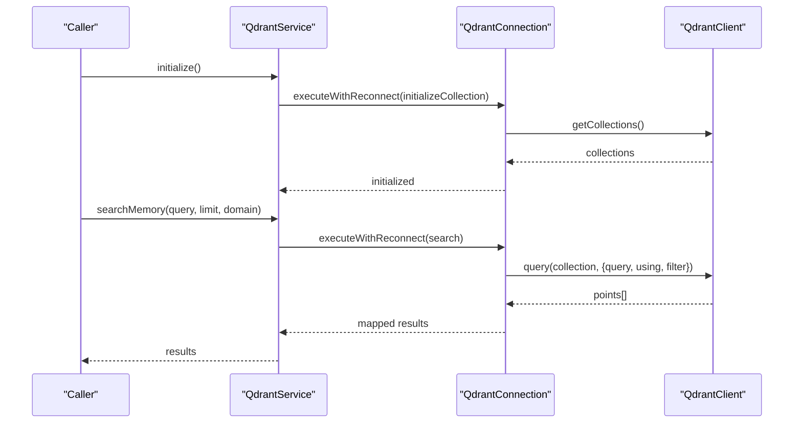

**Diagram sources**
- [service.ts:48-122](file://src/services/qdrant/service.ts#L48-L122)
- [connection.ts:98-131](file://src/services/qdrant/connection.ts#L98-L131)
- [initialization.ts:12-92](file://src/services/qdrant/initialization.ts#L12-L92)
- [search.ts:11-83](file://src/services/qdrant/search.ts#L11-L83)

## Detailed Component Analysis

### QdrantService and Singleton Selection
- Constructor accepts qdrantUrl, apiKey, collectionName, and optional caCertPath; composes QdrantConnection.
- Exposes safe getters for client, collectionName, qdrantUrl, apiKey.
- Delegates to initialization, store, retrieval, updates, search, resources, listing, protocol, reward propagation, and snapshots.
- Module-level singleton resolves at import time: if Qdrant is configured, constructs QdrantService; otherwise returns an embedded store double-cast to this shape.

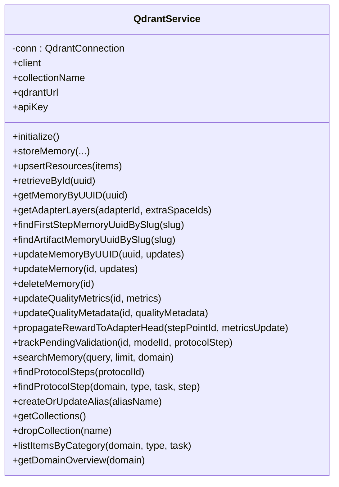

**Diagram sources**
- [service.ts:17-150](file://src/services/qdrant/service.ts#L17-L150)

**Section sources**
- [service.ts:17-161](file://src/services/qdrant/service.ts#L17-L161)

### Connection Management, Health Monitoring, and Resilience
- Client initialization supports:
  - Basic URL and optional API key.
  - TLS with system CA or custom CA certificate path.
- Health check calls getCollections and tracks internal health flag.
- Reconnection strategy:
  - Exponential backoff with configurable max attempts.
  - attemptReconnect resets client and rechecks health.
- executeWithReconnect:
  - Wraps operations, logs detailed errors, retries once after successful reconnect, throws SquadrulesError with codes like QDRANT_OPERATION_ERROR or QDRANT_UNAVAILABLE.

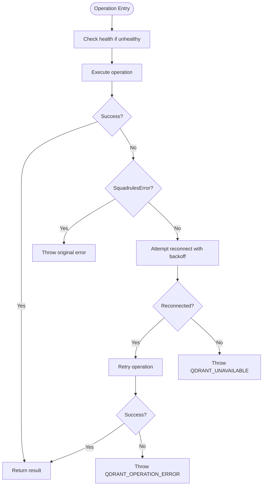

**Diagram sources**
- [connection.ts:39-131](file://src/services/qdrant/connection.ts#L39-L131)

**Section sources**
- [connection.ts:11-131](file://src/services/qdrant/connection.ts#L11-L131)

### Collection Initialization, Schema, and Index Configuration
- initializeCollection:
  - Checks health, lists collections, determines vector descriptors and size.
  - Creates collection if missing; recreates if vector size mismatches.
  - Creates payload indexes for multitenancy and search fields (space_id, domain, type, task, protocol.step, quality_metadata fields, ai.memory_uuid, adapter fields, slug, content_type, text fields).
  - Backfills missing space_id across all points.
  - Optionally creates 'current' alias based on environment flags.
- createOrUpdateAlias tries multiple REST endpoints for compatibility.
- getCollections and dropCollection are exposed for admin operations.

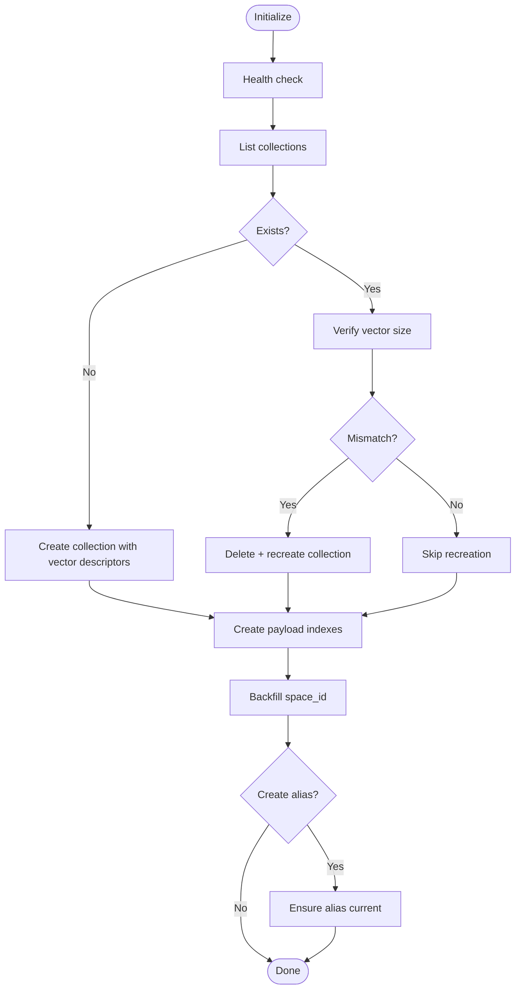

**Diagram sources**
- [initialization.ts:12-125](file://src/services/qdrant/initialization.ts#L12-L125)

**Section sources**
- [initialization.ts:12-183](file://src/services/qdrant/initialization.ts#L12-L183)

### Point Operations: CRUD and Upsert Patterns
- Upsert patterns:
  - storeMemory generates deterministic qdrantId from URI, sets payload including quality_metrics and timestamps, sanitizes vector, upserts, then invalidates caches.
  - sanitizePoints converts root arrays to named vectors vs{dimension}, removes empty vectors, and preserves existing named vectors.
  - sanitizeAndUpsert delegates to client.upsert.
- Update operations:
  - updateMemoryByUUID merges existing payload, regenerates embedding if text changed, preserves vector naming, and performs strict cache invalidation.
  - updateMemory recalculates quality metadata when relevant fields change, handles legacy aliases, regenerates embedding if text changed, and performs strict cache invalidation.
- Delete operation:
  - deleteMemory validates ID, retrieves point, deletes by ID, and performs strict cache invalidation.

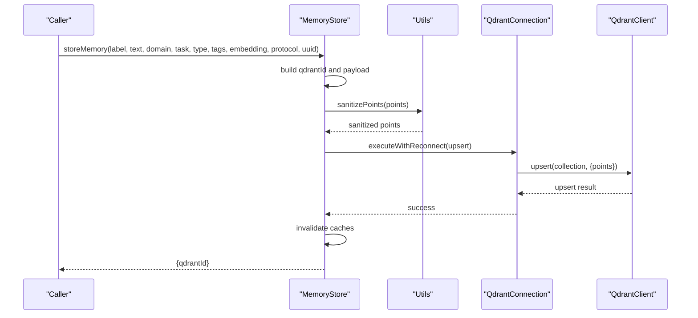

**Diagram sources**
- [memory-store.ts:14-126](file://src/services/qdrant/memory-store.ts#L14-L126)
- [utils.ts:90-128](file://src/services/qdrant/utils.ts#L90-L128)
- [connection.ts:98-131](file://src/services/qdrant/connection.ts#L98-L131)

**Section sources**
- [memory-store.ts:14-126](file://src/services/qdrant/memory-store.ts#L14-L126)
- [memory-updates.ts:15-235](file://src/services/qdrant/memory-updates.ts#L15-L235)
- [utils.ts:10-128](file://src/services/qdrant/utils.ts#L10-L128)

### Batch Upserts and Duplicate Handling
- upsertResources:
  - Iterates items, generates UUID or validates provided UUID, detects duplicates via scroll within allowed spaces, builds URI and qdrantId, generates embedding (fallback to zero vector if empty), checks access, computes version, constructs payload, validates, upserts, invalidates caches, and returns results with status and metadata.

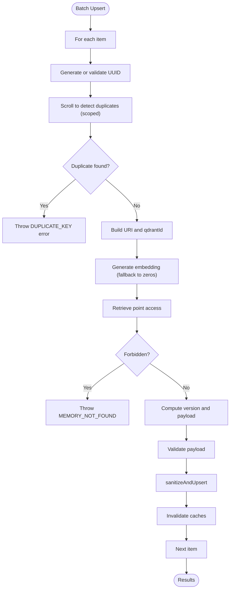

**Diagram sources**
- [resources.ts:18-139](file://src/services/qdrant/resources.ts#L18-L139)

**Section sources**
- [resources.ts:18-139](file://src/services/qdrant/resources.ts#L18-L139)

### Search Queries: Similarity Scoring, Metadata Filtering, Pagination
- searchMemory:
  - Generates embedding via embedding service.
  - Builds space filter from allowed spaces and optional domain filter.
  - Executes query with using vector name vs{dimension}, limit, filter, and quantization rescore enabled/disabled via connection config.
  - Maps results to domain objects including confidence/relevance scores and payload fields.
- Pagination:
  - Scroll-based pagination is used in listing, retrieval, and initialization backfill.
  - Typical page sizes: 64–256 depending on operation.

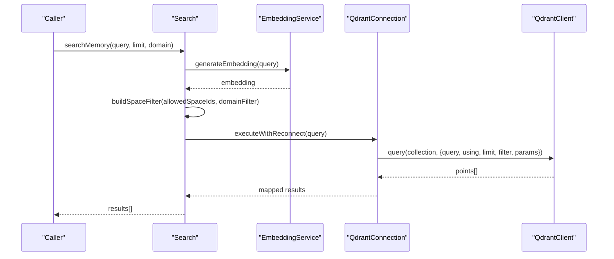

**Diagram sources**
- [search.ts:11-83](file://src/services/qdrant/search.ts#L11-L83)

**Section sources**
- [search.ts:11-83](file://src/services/qdrant/search.ts#L11-L83)

### Access Control and Tenant Scoping
- Space context:
  - getSpaceContext provides defaultWriteSpaceId, userId, and allowedSpaceIds.
  - buildSpaceFilter composes must clauses for allowed spaces.
- Access control:
  - retrievePointAccessById checks point.space_id against allowedSpaceIds or app space id.
  - Returns not_found, forbidden, or allowed with point data.
- Slug resolution:
  - findFirstStepMemoryUuidBySlug resolves first adapter layer UUID for a slug with precedence personal > group > app/system and stable id ordering; returns disambiguation note when ambiguous.
  - findArtifactMemoryUuidBySlug resolves artifact slug with ambiguity handling.

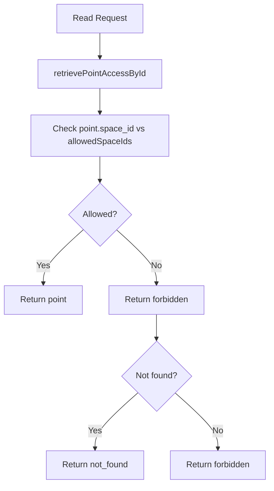

**Diagram sources**
- [memory-retrieval.ts:25-70](file://src/services/qdrant/memory-retrieval.ts#L25-L70)

**Section sources**
- [memory-retrieval.ts:25-340](file://src/services/qdrant/memory-retrieval.ts#L25-L340)

### Protocol Helpers and Reward Propagation
- Protocol helpers:
  - findProtocolSteps scrolls by protocol_id and filters out entries without protocol payload.
  - findProtocolStep finds a single step by domain/type/task/step.
- Reward propagation:
  - propagateRewardToAdapterHead resolves adapter head by adapter.id and layer_index=1, updates quality metrics on head, and invalidates cache.

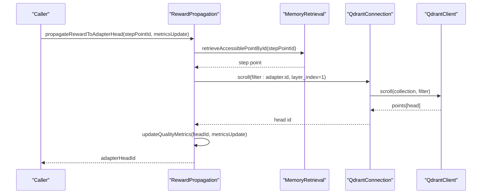

**Diagram sources**
- [reward-propagation.ts:13-76](file://src/services/qdrant/reward-propagation.ts#L13-L76)

**Section sources**
- [protocol.ts:9-49](file://src/services/qdrant/protocol.ts#L9-L49)
- [reward-propagation.ts:13-76](file://src/services/qdrant/reward-propagation.ts#L13-L76)

### Listing and Domain Overview
- listItemsByCategory:
  - Filters by domain/type/task within allowed spaces and returns paginated items.
- getDomainOverview:
  - Aggregates tag counts and recent memories for a domain, returning top categories and recent items.

**Section sources**
- [listing.ts:10-96](file://src/services/qdrant/listing.ts#L10-L96)

### Snapshots
- triggerQdrantSnapshot:
  - Validates options, ensures backup directory, creates snapshot via REST, downloads snapshot file, streams to disk, and reports bytes written and duration.
  - Handles partial files and logs errors gracefully.

**Section sources**
- [snapshots.ts:68-168](file://src/services/qdrant/snapshots.ts#L68-L168)

## Dependency Analysis
Key dependencies and relationships:
- QdrantService depends on QdrantConnection and all domain modules.
- QdrantConnection depends on @qdrant/js-client-rest and Node fs for CA certs.
- MemoryStore, MemoryUpdates, and Resources depend on utils for sanitization/validation and on Redis cache for invalidation.
- Search depends on embedding service for query embeddings.
- Listing, Protocol, and RewardPropagation depend on space-filter and tenant-context for scoping.
- Snapshots depend on QdrantService for URL, collection, and API key.

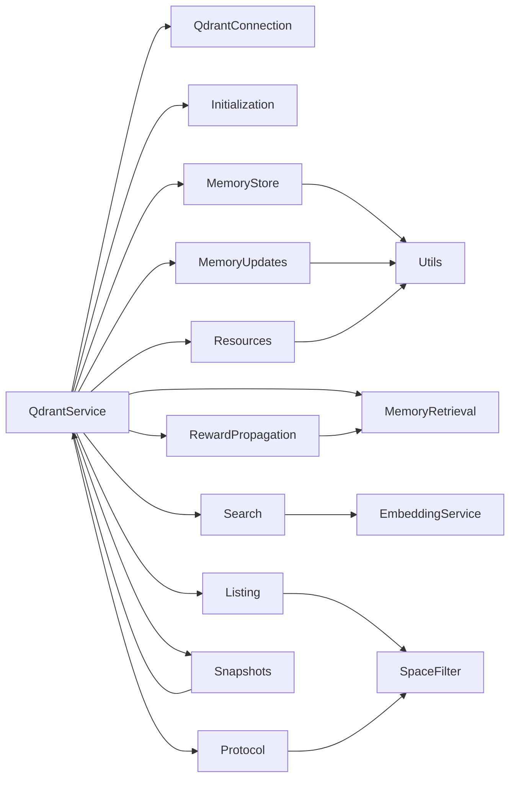

**Diagram sources**
- [service.ts:17-150](file://src/services/qdrant/service.ts#L17-L150)
- [connection.ts:1-6](file://src/services/qdrant/connection.ts#L1-L6)
- [memory-store.ts:1-9](file://src/services/qdrant/memory-store.ts#L1-L9)
- [memory-updates.ts:1-10](file://src/services/qdrant/memory-updates.ts#L1-L10)
- [resources.ts:1-14](file://src/services/qdrant/resources.ts#L1-L14)
- [search.ts:1-7](file://src/services/qdrant/search.ts#L1-L7)
- [listing.ts:1-5](file://src/services/qdrant/listing.ts#L1-L5)
- [protocol.ts:1-4](file://src/services/qdrant/protocol.ts#L1-L4)
- [reward-propagation.ts:1-8](file://src/services/qdrant/reward-propagation.ts#L1-L8)
- [snapshots.ts:1-8](file://src/services/qdrant/snapshots.ts#L1-L8)

**Section sources**
- [service.ts:17-150](file://src/services/qdrant/service.ts#L17-L150)
- [connection.ts:1-6](file://src/services/qdrant/connection.ts#L1-L6)

## Performance Considerations
- Vector dimensions:
  - Vector names use dynamic dimension suffix vs{dimension}. Initialization verifies and recreates collection if vector size mismatches expected descriptors.
  - When embedding generation fails or returns empty, fallback to zero vector sized to configured embedding dimension.
- Distance metrics:
  - Distance metric selection is delegated to Qdrant collection configuration; ensure consistency between embedding model and collection vector config.
- Query tuning:
  - Rescore can be enabled/disabled via QDRANT_RESCORE; enables quantization rescore in search parameters.
  - Use appropriate limit values and filters to reduce payload scanning.
- Indexing:
  - Payload indexes for frequently filtered fields improve query performance (space_id, domain, type, task, protocol.step, quality_metadata fields, adapter fields, slug, content_type, text fields).
- Pagination:
  - Use scroll with reasonable limits (64–256) to avoid large payloads and excessive memory usage.
- Caching:
  - After writes, invalidate memory and general caches to prevent stale reads.
- Observability:
  - Structured logging and metrics track operations and durations per tenant.

[No sources needed since this section provides general guidance]

## Troubleshooting Guide
Common issues and resolutions:
- Connectivity failures:
  - Symptoms: QDRANT_UNAVAILABLE or QDRANT_OPERATION_ERROR.
  - Actions: Verify QDRANT_URL, QDRANT_API_KEY, TLS settings, and CA cert path; check network reachability and firewall rules.
- TLS and certificates:
  - If using HTTPS, ensure CA certificate path is correct and readable; otherwise system CA is used.
- Collection mismatch:
  - If vector size differs from expected, collection is recreated; verify embedding model dimension matches collection configuration.
- Duplicate keys:
  - Bulk upsert throws DUPLICATE_KEY when composite key already exists; resolve conflicts by updating existing records or adjusting business keys.
- Access denied:
  - Forbidden responses indicate point.space_id not in allowedSpaceIds; adjust tenant context or request scope.
- Cache staleness:
  - After updates/deletes, caches are invalidated; if inconsistencies persist, verify cache invalidation paths and Redis connectivity.
- Snapshot failures:
  - Ensure backup directory exists and is writable; verify Qdrant snapshot API availability and permissions.

**Section sources**
- [connection.ts:39-131](file://src/services/qdrant/connection.ts#L39-L131)
- [initialization.ts:12-92](file://src/services/qdrant/initialization.ts#L12-L92)
- [resources.ts:18-139](file://src/services/qdrant/resources.ts#L18-L139)
- [memory-retrieval.ts:25-70](file://src/services/qdrant/memory-retrieval.ts#L25-L70)
- [snapshots.ts:68-168](file://src/services/qdrant/snapshots.ts#L68-L168)

## Conclusion
The Qdrant integration in SquadRules provides a robust, tenant-aware, and observable vector store layer. QdrantService offers a clean facade over connection management, collection initialization, CRUD operations, search, listing, protocol helpers, reward propagation, and snapshots. The design emphasizes resilience through health checks and retry logic, correctness through validation and sanitization, and performance through indexing, pagination, and query tuning. Deployment should configure QDRANT_URL, QDRANT_API_KEY, QDRANT_COLLECTION, and optional TLS CA settings, ensuring embedding dimensions match collection configuration. Operational monitoring and structured logging facilitate troubleshooting and performance optimization.

[No sources needed since this section summarizes without analyzing specific files]