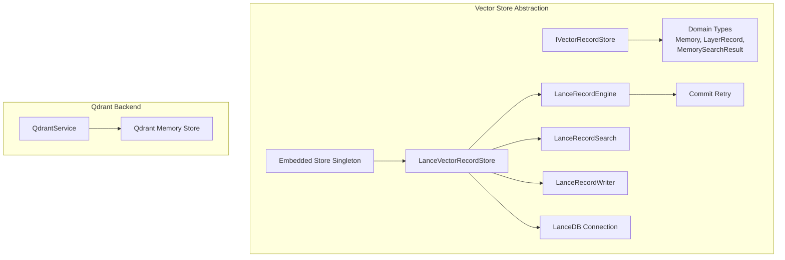
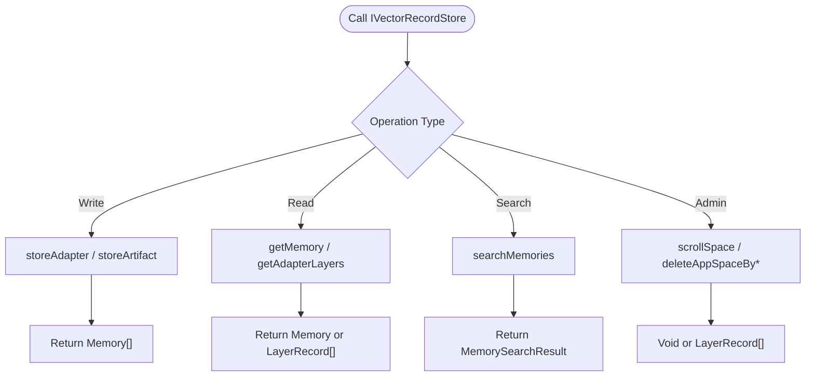
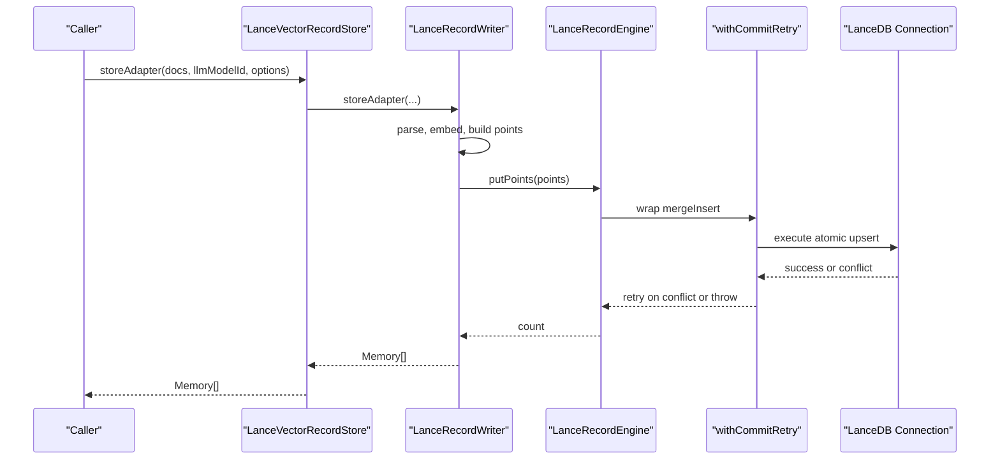
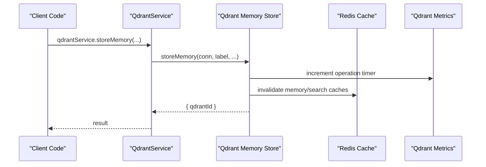
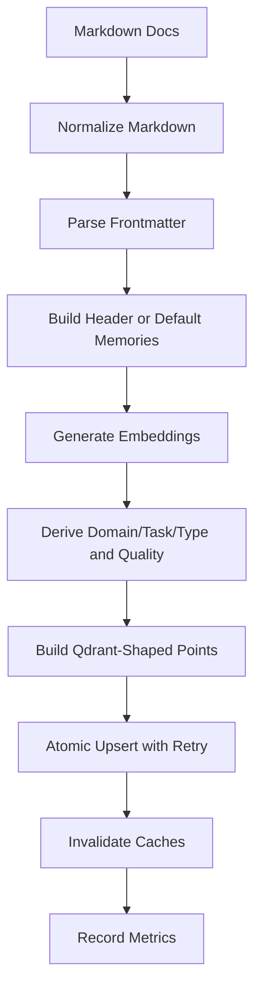
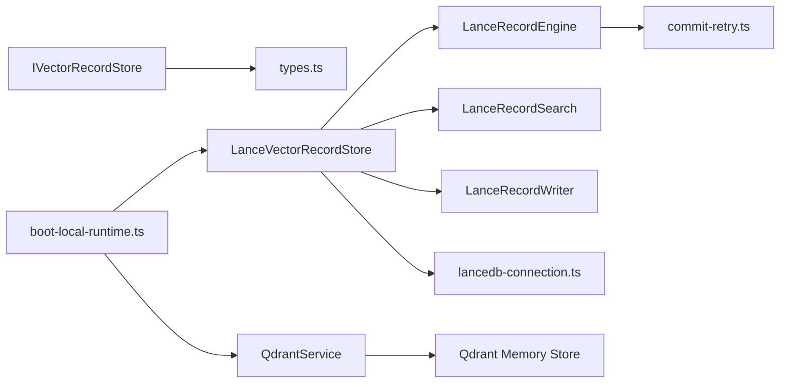

# Storage Abstraction Layer

<cite>
**Referenced Files in This Document**
- [IVectorRecordStore.ts](file://src/services/vector-store/IVectorRecordStore.ts)
- [types.ts](file://src/services/vector-store/types.ts)
- [embedded-store-singleton.ts](file://src/services/vector-store/embedded-store-singleton.ts)
- [commit-retry.ts](file://src/services/vector-store/commit-retry.ts)
- [lancedb-connection.ts](file://src/services/vector-store/lancedb-connection.ts)
- [LanceVectorRecordStore.ts](file://src/services/vector-store/lancedb/LanceVectorRecordStore.ts)
- [lance-records-engine.ts](file://src/services/vector-store/lancedb/lance-records-engine.ts)
- [lance-records-search.ts](file://src/services/vector-store/lancedb/lance-records-search.ts)
- [lance-records-writes.ts](file://src/services/vector-store/lancedb/lance-records-writes.ts)
- [memory-store.ts](file://src/services/qdrant/memory-store.ts)
- [service.ts](file://src/services/qdrant/service.ts)
- [memory.ts](file://src/types/memory.ts)
- [boot-local-runtime.ts](file://src/runtime/boot-local-runtime.ts)
- [vector-backend.ts](file://tests/utils/vector-backend.ts)
</cite>

## Table of Contents
1. [Introduction](#introduction)
2. [Project Structure](#project-structure)
3. [Core Components](#core-components)
4. [Architecture Overview](#architecture-overview)
5. [Detailed Component Analysis](#detailed-component-analysis)
6. [Dependency Analysis](#dependency-analysis)
7. [Performance Considerations](#performance-considerations)
8. [Troubleshooting Guide](#troubleshooting-guide)
9. [Conclusion](#conclusion)
10. [Appendices](#appendices)

## Introduction
This document explains the vector storage abstraction layer that provides unified access to different vector database backends. The system supports Qdrant as the primary remote-capable backend and LanceDB as the embedded secondary backend. The abstraction is centered on a backend-neutral interface, shared domain types, an embedded store singleton for process-wide consistency, and a commit retry mechanism for handling transient MVCC conflicts.

The design goal is to let application code call into `IVectorRecordStore` without knowing whether data is stored in Qdrant or LanceDB. Configuration selects the backend at runtime, while tests can gate Qdrant-specific behavior behind environment-driven detection.

## Project Structure
The vector storage abstraction lives under `src/services/vector-store`. It defines:
- A backend-neutral port (`IVectorRecordStore`).
- Shared domain types (`Memory`, `LayerRecord`, `MemorySearchResult`, etc.).
- An embedded LanceDB implementation with connection management.
- A commit retry helper for optimistic concurrency control.
- A singleton factory for sharing one embedded store instance across components.

Qdrant integration remains in `src/services/qdrant`, but callers should prefer the abstraction where possible.



**Diagram sources**
- [IVectorRecordStore.ts:27-73](file://src/services/vector-store/IVectorRecordStore.ts#L27-L73)
- [types.ts:14-52](file://src/services/vector-store/types.ts#L14-L52)
- [embedded-store-singleton.ts:12-17](file://src/services/vector-store/embedded-store-singleton.ts#L12-L17)
- [commit-retry.ts:13-80](file://src/services/vector-store/commit-retry.ts#L13-L80)
- [lancedb-connection.ts:21-33](file://src/services/vector-store/lancedb-connection.ts#L21-L33)
- [LanceVectorRecordStore.ts:35-46](file://src/services/vector-store/lancedb/LanceVectorRecordStore.ts#L35-L46)
- [lance-records-engine.ts:20-63](file://src/services/vector-store/lancedb/lance-records-engine.ts#L20-L63)
- [lance-records-search.ts:96-137](file://src/services/vector-store/lancedb/lance-records-search.ts#L96-L137)
- [lance-records-writes.ts:42-57](file://src/services/vector-store/lancedb/lance-records-writes.ts#L42-L57)
- [service.ts:153-161](file://src/services/qdrant/service.ts#L153-L161)
- [memory-store.ts:14-25](file://src/services/qdrant/memory-store.ts#L14-L25)

**Section sources**
- [IVectorRecordStore.ts:1-74](file://src/services/vector-store/IVectorRecordStore.ts#L1-L74)
- [types.ts:1-95](file://src/services/vector-store/types.ts#L1-L95)
- [LanceVectorRecordStore.ts:1-193](file://src/services/vector-store/lancedb/LanceVectorRecordStore.ts#L1-L193)
- [service.ts:153-161](file://src/services/qdrant/service.ts#L153-L161)

## Core Components
This section documents the key abstractions and contracts that make the vector store backend-independent.

### IVectorRecordStore Interface Design Principles
`IVectorRecordStore` is the central contract for vector-bearing record operations. Its design emphasizes:
- **Backend independence**: Callers use neutral methods such as `storeAdapter`, `storeArtifact`, `getMemory`, `searchMemories`, and adapter-layer utilities.
- **Delegation vs neutralization**: Methods marked `[delegated]` map onto existing `MemoryQdrantStore` signatures; methods marked `[neutralize]` mirror what raw `getQdrantAccess()` or `QdrantService` consumers expect today, preserving behavior during migration.
- **Focused capability split**: The interface was separated from execution trace storage so each backend implements only the vector record surface it needs.
- **Lifecycle and health**: `init` and `checkHealth` allow stores to prepare connections and report readiness.
- **Enumeration and bulk operations**: Methods like `scrollSpace`, `listAdapterArtifacts`, and slug-based deletion provide administrative capabilities required by tools and maintenance flows.

Key method groups include:
- Lifecycle: `init`, `checkHealth`.
- Writes: `storeAdapter`, `storeArtifact`.
- Reads: `getMemory`.
- Search: `searchMemories`.
- Adapter structure: `getAdapterLayers`, `findFirstStepMemoryUuidBySlug`, `findArtifactMemoryUuidBySlug`, `updateMemory`, `deleteMemory`.
- Enumeration/admin: `scrollSpace`, `listAdapterArtifacts`, `findProtocolFooterLayers`, `getStoredAdapterVersion`, `setPayloadOnLayers`, `deleteAppSpaceBySlug`, `deleteAppSpaceByAdapterId`.

**Section sources**
- [IVectorRecordStore.ts:1-74](file://src/services/vector-store/IVectorRecordStore.ts#L1-L74)

### Type System: Memory, LayerRecord, and MemorySearchResult
The type system separates backend-specific payloads from the contract used by callers.

- `Memory`: The core domain object representing a memory point. It includes identifiers, labels, slugs, tags, text, model metadata, timestamps, optional artifact information, adapter metadata, and inference contract definitions.
- `LayerRecord`: A backend-neutral representation of one adapter layer, containing a UUID and a `Memory` payload. This mirrors how tune tools consume layers and allows LanceDB rows to be shaped identically to Qdrant points.
- `MemorySearchResult`: The search result shape containing memories and corresponding scores, matching the existing `{ memories, scores }` contract.

Additional types support configuration and outcomes:
- `StoreAdapterOptions`: Controls force updates, protocol versioning, and fork behavior when storing adapters.
- `GetMemoryOptions`: Allows bypassing read caches via `fresh`.
- `SlugResolveOutcome` and `ArtifactResolveOutcome`: Return resolved IDs plus optional disambiguation notes.
- Execution-related types (`StoredExecutionTrace`, `TrainingPair`) are also defined here to keep trace ports backend-neutral.

**Section sources**
- [types.ts:14-52](file://src/services/vector-store/types.ts#L14-L52)
- [memory.ts:99-120](file://src/types/memory.ts#L99-L120)

### Embedded Store Singleton and Lifecycle Management
The embedded path uses a module-level singleton to ensure that both the dependency-injected `memoryStore` and the module-level `qdrantService` share the same `LanceVectorRecordStore` instance. This guarantees internal consistency: a write through one facade is visible through the other.

Singleton behavior:
- A single `LanceVectorRecordStore` is created lazily.
- Both DI and legacy service slots receive the same instance.
- Import order does not matter because the selector memoizes the instance.

Lifecycle responsibilities:
- `LanceVectorRecordStore.init` opens the LanceDB connection and logs readiness.
- `checkHealth` attempts to open the connection and returns false if it fails.
- The embedded store exposes compatibility properties and no-op admin methods (e.g., alias creation, collection dropping) so it can stand in for Qdrant service expectations.

**Section sources**
- [embedded-store-singleton.ts:1-18](file://src/services/vector-store/embedded-store-singleton.ts#L1-L18)
- [LanceVectorRecordStore.ts:48-62](file://src/services/vector-store/lancedb/LanceVectorRecordStore.ts#L48-L62)
- [LanceVectorRecordStore.ts:146-173](file://src/services/vector-store/lancedb/LanceVectorRecordStore.ts#L146-L173)

### Commit Retry Mechanism for Transient Failures
Lance/LanceDB use MVCC semantics: concurrent writers to the same table version may conflict, requiring the loser to re-read the latest manifest and retry the write. The retry helper provides bounded optimistic concurrency control.

Key behaviors:
- Conflict detection: Errors whose messages match known conflict patterns are treated as retryable.
- Exponential backoff with jitter: Delay grows per attempt, capped before adding random jitter.
- Non-conflict errors: Immediate propagation; commits must never be silently dropped or rerouted.
- Logging: Debug logs identify the operation label, attempt number, and delay.

Configuration options include maximum attempts, base delay, and maximum delay cap.

**Section sources**
- [commit-retry.ts:1-81](file://src/services/vector-store/commit-retry.ts#L1-L81)

### Backend Selection: Qdrant vs LanceDB Through Configuration
Backend selection is driven by configuration:
- When Qdrant is configured, the system constructs a real `QdrantService`.
- When Qdrant is not configured, the system injects the shared embedded `LanceVectorRecordStore` cast to the expected service shape.
- The embedded store satisfies the subset of methods actually called by consumers, validated by the integration suite.

Runtime boot logic also checks whether the embedded store has been seeded and waits for Qdrant availability when needed. Tests detect the active backend using the same environment variable convention.

**Section sources**
- [service.ts:153-161](file://src/services/qdrant/service.ts#L153-L161)
- [boot-local-runtime.ts:56-84](file://src/runtime/boot-local-runtime.ts#L56-L84)
- [vector-backend.ts:1-24](file://tests/utils/vector-backend.ts#L1-L24)

## Architecture Overview
The architecture separates concerns between the abstraction layer, concrete backends, and shared infrastructure.

```mermaid
classDiagram
class IVectorRecordStore {
+init() Promise~void~
+checkHealth(timeoutMs?) Promise~boolean~
+storeAdapter(docs, llmModelId, options?) Promise~Memory[]~
+storeArtifact(content, options) Promise~Memory[]~
+getMemory(memoryUuid, options?) Promise~Memory|null~
+searchMemories(query, limit, collapse?) Promise~MemorySearchResult~
+getAdapterLayers(adapterId, extraSpaceIds?) Promise~LayerRecord[]~
+findFirstStepMemoryUuidBySlug(slug) Promise~SlugResolveOutcome~
+findArtifactMemoryUuidBySlug(slug) Promise~ArtifactResolveOutcome~
+updateMemory(memoryUuid, patch) Promise~void~
+deleteMemory(memoryUuid) Promise~void~
+scrollSpace(spaceId, options?) Promise~LayerRecord[]~
+listAdapterArtifacts(adapterId) Promise~LayerRecord[]~
+findProtocolFooterLayers(refineSlug, createSlug) Promise~LayerRecord[]~
+getStoredAdapterVersion(slug) Promise~string|undefined~
+setPayloadOnLayers(layerIds, patch) Promise~void~
+deleteAppSpaceBySlug(slug) Promise~void~
+deleteAppSpaceByAdapterId(adapterId) Promise~void~
}
class LanceVectorRecordStore {
-engine : LanceRecordEngine
-reader : LanceRecordReader
-mutator : LanceRecordMutator
-search : LanceRecordSearch
-writer : LanceRecordWriter
-connectionPromise : Promise~LanceConnection~
+init() Promise~void~
+checkHealth(timeoutMs?) Promise~boolean~
+searchMemories(query, limit, collapse?) Promise~MemorySearchResult~
+storeAdapter(docs, llmModelId, options?) Promise~Memory[]~
+storeArtifact(content, options) Promise~Memory[]~
}
class LanceRecordEngine {
+openTableIfPresent() Promise~LanceTable|null~
+ensureTableForWrite(firstRow) Promise~LanceTable~
+putPoints(points) Promise~number~
+putRows(rows) Promise~void~
+scroll(filter, limit) Promise~LanceRecordRow[]~
+retrieveRaw(id) Promise~LanceRecordRow|null~
+deleteByFilter(filter) Promise~void~
+deleteById(id) Promise~void~
+upsertPoint(point) Promise~void~
}
class LanceRecordSearch {
+searchMemories(query, limit) Promise~{memories,scores}~
+searchAdapterTitlesBySimilarity(query, limit) Promise~{memories,scores}~
}
class LanceRecordWriter {
+storeAdapter(docs, llmModelId, options) Promise~Memory[]~
+storeArtifact(content, options) Promise~Memory[]~
}
class QdrantService
class QdrantMemoryStore
IVectorRecordStore <|.. LanceVectorRecordStore
LanceVectorRecordStore --> LanceRecordEngine
LanceVectorRecordStore --> LanceRecordSearch
LanceVectorRecordStore --> LanceRecordWriter
QdrantService --> QdrantMemoryStore
```

**Diagram sources**
- [IVectorRecordStore.ts:27-73](file://src/services/vector-store/IVectorRecordStore.ts#L27-L73)
- [LanceVectorRecordStore.ts:35-46](file://src/services/vector-store/lancedb/LanceVectorRecordStore.ts#L35-L46)
- [lance-records-engine.ts:20-128](file://src/services/vector-store/lancedb/lance-records-engine.ts#L20-L128)
- [lance-records-search.ts:96-137](file://src/services/vector-store/lancedb/lance-records-search.ts#L96-L137)
- [lance-records-writes.ts:42-57](file://src/services/vector-store/lancedb/lance-records-writes.ts#L42-L57)
- [service.ts:153-161](file://src/services/qdrant/service.ts#L153-L161)
- [memory-store.ts:14-25](file://src/services/qdrant/memory-store.ts#L14-L25)

## Detailed Component Analysis

### IVectorRecordStore Contract and Method Semantics
The interface defines a stable contract for vector-backed memory operations. Important semantics include:
- Writes return arrays of `Memory` objects, enabling callers to inspect persisted records after adapter or artifact writes.
- Searches return paired results with scores, preserving compatibility with existing consumers.
- Adapter-layer queries return `LayerRecord` objects, allowing tools to work with id-plus-payload structures regardless of backend.
- Administrative methods support space-scoped enumeration and cleanup, which are essential for multi-space workflows and tenant isolation.



**Section sources**
- [IVectorRecordStore.ts:27-73](file://src/services/vector-store/IVectorRecordStore.ts#L27-L73)

### LanceVectorRecordStore Implementation
`LanceVectorRecordStore` is the embedded backend implementation. It delegates to specialized components:
- `LanceRecordEngine`: Owns the connection and table primitives, including upserts, scans, and deletes.
- `LanceRecordReader`: Provides read-side operations such as retrieving memories and adapter layers.
- `LanceRecordMutator`: Handles mutations like updating payloads and deleting records.
- `LanceRecordSearch`: Implements JS cosine similarity search over stored vectors and text boosts.
- `LanceRecordWriter`: Reuses backend-neutral parsing and embedding helpers to build Qdrant-shaped points for LanceDB.

The store also exposes compatibility methods for legacy consumers expecting a Qdrant-like service surface.



**Diagram sources**
- [LanceVectorRecordStore.ts:184-191](file://src/services/vector-store/lancedb/LanceVectorRecordStore.ts#L184-L191)
- [lance-records-writes.ts:59-115](file://src/services/vector-store/lancedb/lance-records-writes.ts#L59-L115)
- [lance-records-engine.ts:48-63](file://src/services/vector-store/lancedb/lance-records-engine.ts#L48-L63)
- [commit-retry.ts:48-80](file://src/services/vector-store/commit-retry.ts#L48-L80)

**Section sources**
- [LanceVectorRecordStore.ts:1-193](file://src/services/vector-store/lancedb/LanceVectorRecordStore.ts#L1-L193)
- [lance-records-engine.ts:1-129](file://src/services/vector-store/lancedb/lance-records-engine.ts#L1-L129)
- [lance-records-search.ts:1-138](file://src/services/vector-store/lancedb/lance-records-search.ts#L1-L138)
- [lance-records-writes.ts:1-349](file://src/services/vector-store/lancedb/lance-records-writes.ts#L1-L349)

### LanceDB Connection and Strong Consistency
The embedded LanceDB connection is configured for strong consistency:
- Each server process opens the shared per-user directory directly.
- Reads explicitly request the latest committed version using `readConsistencyInterval: 0`.
- Writes are consistent under MVCC.
- The SDK is imported lazily to avoid loading native bindings when the Qdrant path is active.

This ensures that multiple processes sharing the embedded store see each other’s commits consistently.

**Section sources**
- [lancedb-connection.ts:1-35](file://src/services/vector-store/lancedb-connection.ts#L1-L35)

### Qdrant Backend Integration
The Qdrant backend remains implemented separately. The `QdrantService` is constructed when Qdrant is configured; otherwise, the embedded store is cast to the expected service shape. The low-level `storeMemory` function demonstrates how Qdrant points are built, upserted, and instrumented with metrics and cache invalidation.



**Diagram sources**
- [service.ts:153-161](file://src/services/qdrant/service.ts#L153-L161)
- [memory-store.ts:14-126](file://src/services/qdrant/memory-store.ts#L14-L126)

**Section sources**
- [service.ts:153-161](file://src/services/qdrant/service.ts#L153-L161)
- [memory-store.ts:1-126](file://src/services/qdrant/memory-store.ts#L1-L126)

### Data Flow and Processing Logic
The LanceDB write path follows a clear pipeline:
1. Normalize markdown input.
2. Parse frontmatter and structure.
3. Build header-based or default adapter memories.
4. Generate embeddings for primary, title, and activation fields.
5. Derive domain/task/type and quality metadata.
6. Construct Qdrant-shaped points with vectors and payloads.
7. Upsert points atomically with commit retry.
8. Invalidate caches and record metrics.



**Diagram sources**
- [lance-records-writes.ts:59-115](file://src/services/vector-store/lancedb/lance-records-writes.ts#L59-L115)
- [lance-records-writes.ts:155-225](file://src/services/vector-store/lancedb/lance-records-writes.ts#L155-L225)
- [lance-records-writes.ts:227-326](file://src/services/vector-store/lancedb/lance-records-writes.ts#L227-L326)
- [lance-records-engine.ts:48-63](file://src/services/vector-store/lancedb/lance-records-engine.ts#L48-L63)

**Section sources**
- [lance-records-writes.ts:1-349](file://src/services/vector-store/lancedb/lance-records-writes.ts#L1-L349)

### Extending the Abstraction with New Backends
To add a new backend:
1. Implement `IVectorRecordStore` with the full set of lifecycle, write, read, search, and admin methods.
2. Ensure `storeAdapter` and `storeArtifact` produce `Memory[]` results compatible with existing callers.
3. Map backend-specific payloads to `LayerRecord` for adapter-layer queries.
4. Provide `searchMemories` returning `MemorySearchResult` with consistent scoring semantics.
5. If the backend supports MVCC or optimistic concurrency, integrate `withCommitRetry` around atomic writes.
6. Wire the new backend into the configuration selector alongside Qdrant and LanceDB.
7. Add integration tests validating parity with the Qdrant path for search ranking and train-related behavior.

Best practices:
- Keep backend-specific client libraries out of the abstraction layer.
- Use neutral types (`Memory`, `LayerRecord`, `MemorySearchResult`) at the interface boundary.
- Preserve method contracts to avoid breaking callers migrating from raw Qdrant access.
- Log and instrument operations similarly to existing backends.

**Section sources**
- [IVectorRecordStore.ts:27-73](file://src/services/vector-store/IVectorRecordStore.ts#L27-L73)
- [types.ts:14-52](file://src/services/vector-store/types.ts#L14-L52)
- [commit-retry.ts:48-80](file://src/services/vector-store/commit-retry.ts#L48-L80)

### Testing Strategies for Backend-Agnostic Code
Testing guidance:
- Use environment-driven backend detection to run Qdrant-specific suites only when Qdrant is configured.
- Validate product behavior through API-level tests that run on both backends.
- Gate fixtures that rely on Qdrant substrate (e.g., raw REST endpoints or direct store clients) behind backend detection.
- Ensure the embedded store singleton is exercised end-to-end so both DI and legacy service paths are covered.

**Section sources**
- [vector-backend.ts:1-24](file://tests/utils/vector-backend.ts#L1-L24)
- [embedded-store-singleton.ts:1-18](file://src/services/vector-store/embedded-store-singleton.ts#L1-L18)

## Dependency Analysis
The abstraction layer has clear dependencies:
- `IVectorRecordStore` depends on shared domain types.
- `LanceVectorRecordStore` depends on LanceDB connection, engine, reader, mutator, search, and writer components.
- The engine depends on commit retry for safe MVCC writes.
- Qdrant service depends on its own connection and memory store implementations.
- Runtime boot logic coordinates backend selection and health checks.



**Diagram sources**
- [IVectorRecordStore.ts:27-73](file://src/services/vector-store/IVectorRecordStore.ts#L27-L73)
- [types.ts:14-52](file://src/services/vector-store/types.ts#L14-L52)
- [LanceVectorRecordStore.ts:35-46](file://src/services/vector-store/lancedb/LanceVectorRecordStore.ts#L35-L46)
- [lance-records-engine.ts:20-63](file://src/services/vector-store/lancedb/lance-records-engine.ts#L20-L63)
- [commit-retry.ts:48-80](file://src/services/vector-store/commit-retry.ts#L48-L80)
- [lancedb-connection.ts:21-33](file://src/services/vector-store/lancedb-connection.ts#L21-L33)
- [service.ts:153-161](file://src/services/qdrant/service.ts#L153-L161)
- [memory-store.ts:14-25](file://src/services/qdrant/memory-store.ts#L14-L25)
- [boot-local-runtime.ts:56-84](file://src/runtime/boot-local-runtime.ts#L56-L84)

**Section sources**
- [IVectorRecordStore.ts:27-73](file://src/services/vector-store/IVectorRecordStore.ts#L27-L73)
- [LanceVectorRecordStore.ts:35-46](file://src/services/vector-store/lancedb/LanceVectorRecordStore.ts#L35-L46)
- [lance-records-engine.ts:20-63](file://src/services/vector-store/lancedb/lance-records-engine.ts#L20-L63)
- [commit-retry.ts:48-80](file://src/services/vector-store/commit-retry.ts#L48-L80)
- [lancedb-connection.ts:21-33](file://src/services/vector-store/lancedb-connection.ts#L21-L33)
- [service.ts:153-161](file://src/services/qdrant/service.ts#L153-L161)
- [memory-store.ts:14-25](file://src/services/qdrant/memory-store.ts#L14-L25)
- [boot-local-runtime.ts:56-84](file://src/runtime/boot-local-runtime.ts#L56-L84)

## Performance Considerations
- **Embedding generation**: The LanceDB write path calls the embedding service to generate primary, title, and activation vectors. Failures fall back to zero vectors with warnings, preventing write failures but degrading search quality.
- **JS cosine search**: Because LanceDB inferred embedding columns are variable-length lists, the implementation scans head records and computes cosine similarity in JavaScript. This matches Qdrant’s hybrid ranking contract but may be slower than native vector indexes.
- **MVCC retries**: Commit retries protect against conflicts but add latency under high contention. At the target scale (a few local processes), conflicts are rare.
- **Lazy SDK import**: LanceDB SDK is imported lazily to avoid startup overhead when Qdrant is active.
- **Strong consistency reads**: Setting `readConsistencyInterval: 0` ensures readers see the latest committed version, trading some read performance for correctness in multi-process scenarios.
- **Metrics and caching**: Writes invalidate caches and record metrics, helping monitor throughput and error rates.

[No sources needed since this section provides general guidance]

## Troubleshooting Guide
Common issues and resolutions:
- **Commit conflicts**: If LanceDB reports version or CAS conflicts, the retry wrapper will automatically retry with exponential backoff. Check logs for conflict messages and consider reducing concurrent writers if conflicts become frequent.
- **Embedding failures**: If embedding generation fails, the system falls back to zero vectors. Verify the embedding service configuration and dimension settings.
- **Health check failures**: `checkHealth` returns false when the underlying connection cannot be opened. Inspect LanceDB directory permissions or Qdrant connectivity depending on the active backend.
- **Backend selection confusion**: Confirm whether `QDRANT_URL` is set. A non-empty value selects Qdrant; otherwise, the embedded LanceDB store is used.
- **Test gating**: Qdrant-specific tests are skipped when running against the embedded backend. Adjust test expectations accordingly.

**Section sources**
- [commit-retry.ts:26-36](file://src/services/vector-store/commit-retry.ts#L26-L36)
- [commit-retry.ts:48-80](file://src/services/vector-store/commit-retry.ts#L48-L80)
- [lance-records-writes.ts:124-148](file://src/services/vector-store/lancedb/lance-records-writes.ts#L124-L148)
- [LanceVectorRecordStore.ts:54-62](file://src/services/vector-store/lancedb/LanceVectorRecordStore.ts#L54-L62)
- [vector-backend.ts:15-24](file://tests/utils/vector-backend.ts#L15-L24)

## Conclusion
The vector storage abstraction layer provides a clean, backend-neutral contract for vector-backed memory operations. `IVectorRecordStore` unifies access to Qdrant and LanceDB through well-defined method contracts and shared domain types. The embedded store singleton ensures process-wide consistency, while the commit retry mechanism handles transient MVCC conflicts safely. Configuration-driven backend selection enables seamless switching, and the design supports extending the abstraction with new backends following the established contract. Testing strategies and performance considerations help maintain reliability and efficiency across backends.

[No sources needed since this section summarizes without analyzing specific files]

## Appendices

### Appendix A: Key Type Definitions Summary
- `Memory`: Core domain object for a memory point, including identifiers, labels, slugs, tags, text, model metadata, timestamps, optional artifact and adapter info, and inference contract definition.
- `LayerRecord`: Backend-neutral adapter layer with UUID and payload.
- `MemorySearchResult`: Search result with memories and scores.
- `StoreAdapterOptions`: Options controlling adapter storage behavior.
- `GetMemoryOptions`: Options for reading a memory, including cache bypass.
- `SlugResolveOutcome` and `ArtifactResolveOutcome`: Resolved IDs with optional disambiguation notes.

**Section sources**
- [types.ts:14-52](file://src/services/vector-store/types.ts#L14-L52)
- [memory.ts:99-120](file://src/types/memory.ts#L99-L120)

### Appendix B: Example Workflow for Custom Backend
Steps to implement a custom backend:
1. Create a class implementing `IVectorRecordStore`.
2. Implement lifecycle methods (`init`, `checkHealth`).
3. Implement writes (`storeAdapter`, `storeArtifact`) returning `Memory[]`.
4. Implement reads (`getMemory`, `getAdapterLayers`) returning neutral shapes.
5. Implement search (`searchMemories`) returning `MemorySearchResult`.
6. Implement admin methods (`scrollSpace`, `deleteAppSpaceBySlug`, etc.).
7. Integrate commit retry for atomic writes if applicable.
8. Wire the backend into the configuration selector.
9. Add integration tests validating parity with Qdrant behavior.

**Section sources**
- [IVectorRecordStore.ts:27-73](file://src/services/vector-store/IVectorRecordStore.ts#L27-L73)
- [commit-retry.ts:48-80](file://src/services/vector-store/commit-retry.ts#L48-L80)