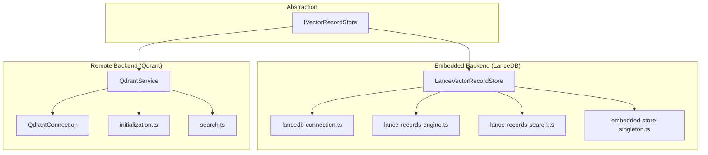
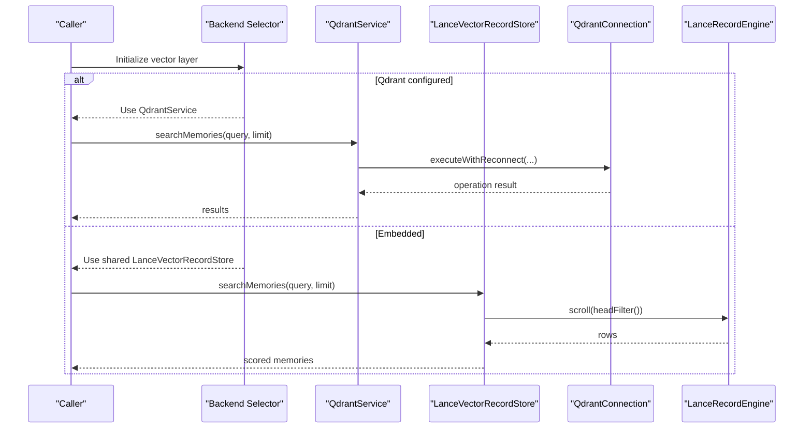
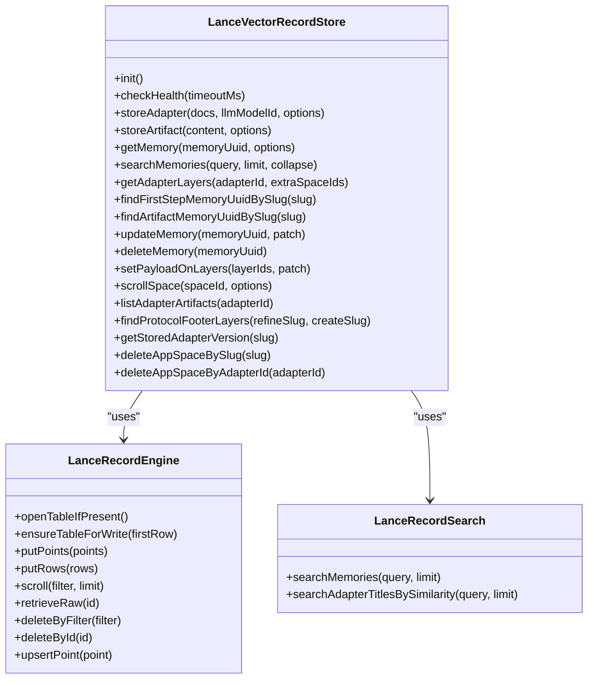
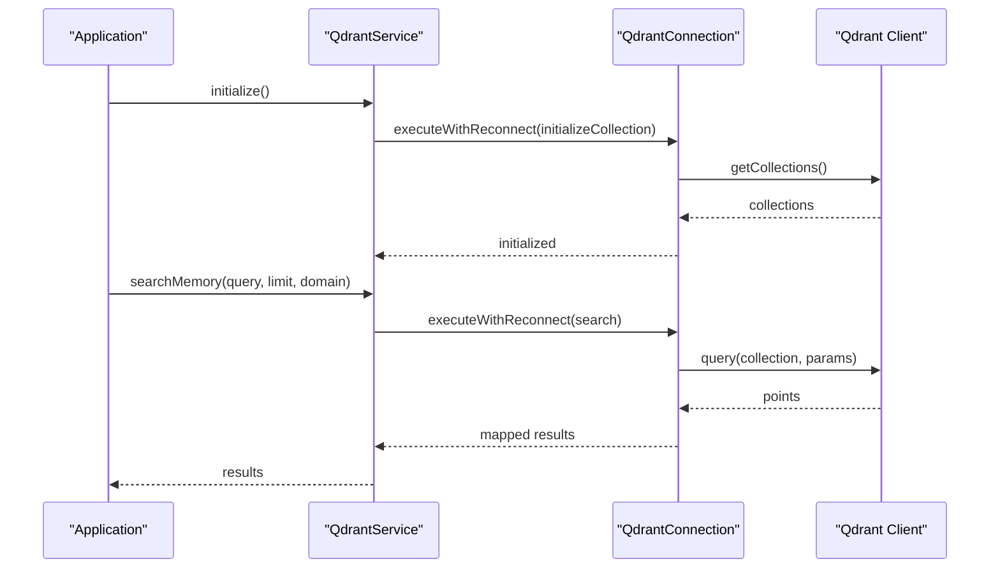
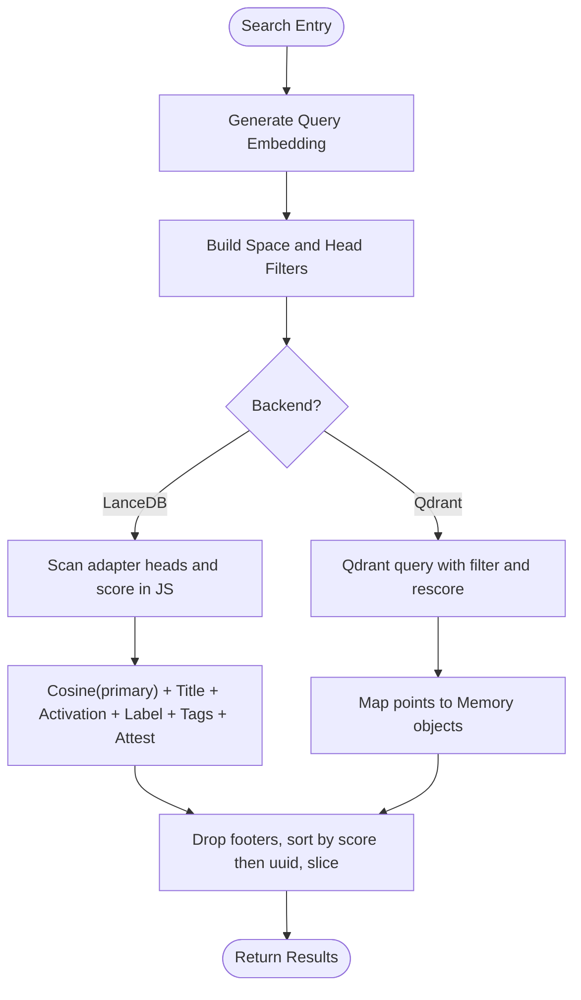
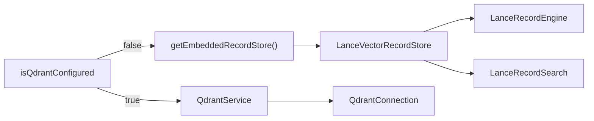

# Vector Databases

<cite>
**Referenced Files in This Document**
- [IVectorRecordStore.ts](file://src/services/vector-store/IVectorRecordStore.ts)
- [LanceVectorRecordStore.ts](file://src/services/vector-store/lancedb/LanceVectorRecordStore.ts)
- [lancedb-connection.ts](file://src/services/vector-store/lancedb-connection.ts)
- [lance-records-engine.ts](file://src/services/vector-store/lancedb/lance-records-engine.ts)
- [lance-records-search.ts](file://src/services/vector-store/lancedb/lance-records-search.ts)
- [embedded-store-singleton.ts](file://src/services/vector-store/embedded-store-singleton.ts)
- [service.ts](file://src/services/qdrant/service.ts)
- [connection.ts](file://src/services/qdrant/connection.ts)
- [initialization.ts](file://src/services/qdrant/initialization.ts)
- [search.ts](file://src/services/qdrant/search.ts)
- [0003-no-lancedb-store-snapshot.md](file://docs/adr/0003-no-lancedb-store-snapshot.md)
- [0013-embedded-store-multiprocess-safety.md](file://docs/adr/0013-embedded-store-multiprocess-safety.md)
</cite>

## Table of Contents
1. [Introduction](#introduction)
2. [Project Structure](#project-structure)
3. [Core Components](#core-components)
4. [Architecture Overview](#architecture-overview)
5. [Detailed Component Analysis](#detailed-component-analysis)
6. [Dependency Analysis](#dependency-analysis)
7. [Performance Considerations](#performance-considerations)
8. [Troubleshooting Guide](#troubleshooting-guide)
9. [Conclusion](#conclusion)

## Introduction
This document explains the SquadRules vector database layer, which provides unified semantic search over adapters, artifacts, and protocol steps using two backends:
- Qdrant as the primary remote-capable vector database.
- LanceDB as the secondary embedded/local backend for local or single-process scenarios.

The system exposes a stable abstraction through `IVectorRecordStore`, while older code paths can still use `QdrantService`. On the embedded path, the same `LanceVectorRecordStore` instance is injected into both the memory store and the legacy `qdrantService` slot so callers see consistent behavior regardless of backend.

Key design goals include:
- Unified read/write/search API across backends.
- Strong consistency for multi-process local access with LanceDB.
- Remote resilience and collection management for Qdrant.
- Search parity between backends where possible.

## Project Structure
The vector database implementation is split into three main areas:
- Abstraction: `IVectorRecordStore` defines lifecycle, writes, reads, search, adapter structure operations, enumeration, and bulk helpers.
- Embedded backend: LanceDB implementation under `src/services/vector-store/lancedb/`.
- Remote backend: Qdrant integration under `src/services/qdrant/`.

**Diagram sources**
- [IVectorRecordStore.ts:27-73](file://src/services/vector-store/IVectorRecordStore.ts#L27-L73)
- [LanceVectorRecordStore.ts:35-40](file://src/services/vector-store/lancedb/LanceVectorRecordStore.ts#L35-L40)
- [lancedb-connection.ts:21-33](file://src/services/vector-store/lancedb-connection.ts#L21-L33)
- [lance-records-engine.ts:20-28](file://src/services/vector-store/lancedb/lance-records-engine.ts#L20-L28)
- [lance-records-search.ts:96-121](file://src/services/vector-store/lancedb/lance-records-search.ts#L96-L121)
- [embedded-store-singleton.ts:12-16](file://src/services/vector-store/embedded-store-singleton.ts#L12-L16)
- [service.ts:17-28](file://src/services/qdrant/service.ts#L17-L28)
- [connection.ts:11-37](file://src/services/qdrant/connection.ts#L11-L37)
- [initialization.ts:12-91](file://src/services/qdrant/initialization.ts#L12-L91)
- [search.ts:11-36](file://src/services/qdrant/search.ts#L11-L36)

**Section sources**
- [IVectorRecordStore.ts:1-74](file://src/services/vector-store/IVectorRecordStore.ts#L1-L74)
- [LanceVectorRecordStore.ts:1-193](file://src/services/vector-store/lancedb/LanceVectorRecordStore.ts#L1-L193)
- [service.ts:1-161](file://src/services/qdrant/service.ts#L1-L161)

## Core Components
- `IVectorRecordStore`: The backend-neutral interface for lifecycle, writes (`storeAdapter`, `storeArtifact`), reads (`getMemory`), semantic search (`searchMemories`), adapter structure queries, payload patching, deletion, and enumeration helpers.
- `LanceVectorRecordStore`: Embedded implementation that satisfies `IVectorRecordStore` and also exposes a subset of the legacy `QdrantService` surface so it can be used interchangeably on the embedded path. It delegates to engine, reader, mutator, search, and writer components.
- `QdrantService`: Remote facade that composes connection, initialization, storage, retrieval, updates, quality tracking, reward propagation, listing, and search. It is constructed when Qdrant is configured; otherwise, the embedded store is cast into this shape for compatibility.
- `QdrantConnection`: Client configuration, TLS support, health checks, and resilient retry/reconnect logic around operations.
- LanceDB connection and engine: Provide strong-consistency connections, table open-or-create, atomic upserts via merge-insert, filtered scans, and delete-by-filter.
- LanceDB search: Implements JS cosine similarity scoring over stored vectors plus text boosts to mirror Qdrant ranking behavior.

**Section sources**
- [IVectorRecordStore.ts:27-73](file://src/services/vector-store/IVectorRecordStore.ts#L27-L73)
- [LanceVectorRecordStore.ts:35-191](file://src/services/vector-store/lancedb/LanceVectorRecordStore.ts#L35-L191)
- [service.ts:17-161](file://src/services/qdrant/service.ts#L17-L161)
- [connection.ts:11-131](file://src/services/qdrant/connection.ts#L11-L131)
- [lancedb-connection.ts:21-33](file://src/services/vector-store/lancedb-connection.ts#L21-L33)
- [lance-records-engine.ts:20-127](file://src/services/vector-store/lancedb/lance-records-engine.ts#L20-L127)
- [lance-records-search.ts:96-136](file://src/services/vector-store/lancedb/lance-records-search.ts#L96-L136)

## Architecture Overview
SquadRules selects the backend at runtime:
- If Qdrant is configured, `QdrantService` is instantiated and used directly.
- If Qdrant is not configured, the shared embedded `LanceVectorRecordStore` is injected into both the memory store and the legacy `qdrantService` slot.

**Diagram sources**
- [service.ts:153-161](file://src/services/qdrant/service.ts#L153-L161)
- [embedded-store-singleton.ts:12-16](file://src/services/vector-store/embedded-store-singleton.ts#L12-L16)
- [LanceVectorRecordStore.ts:175-177](file://src/services/vector-store/lancedb/LanceVectorRecordStore.ts#L175-L177)
- [lance-records-engine.ts:80-92](file://src/services/vector-store/lancedb/lance-records-engine.ts#L80-L92)
- [connection.ts:98-130](file://src/services/qdrant/connection.ts#L98-L130)

## Detailed Component Analysis

### IVectorRecordStore Interface
The interface centralizes all vector-backed operations needed by tools and services:
- Lifecycle: `init`, `checkHealth`.
- Writes: `storeAdapter`, `storeArtifact`.
- Reads: `getMemory`.
- Search: `searchMemories`.
- Adapter structure: `getAdapterLayers`, `findFirstStepMemoryUuidBySlug`, `findArtifactMemoryUuidBySlug`.
- Mutations: `updateMemory`, `deleteMemory`, `setPayloadOnLayers`.
- Enumeration/bulk: `scrollSpace`, `listAdapterArtifacts`, `findProtocolFooterLayers`, `getStoredAdapterVersion`, `deleteAppSpaceBySlug`, `deleteAppSpaceByAdapterId`.

This contract allows callers to remain backend-agnostic.

**Section sources**
- [IVectorRecordStore.ts:27-73](file://src/services/vector-store/IVectorRecordStore.ts#L27-L73)

### LanceDB Embedded Implementation
`LanceVectorRecordStore` implements `IVectorRecordStore` and mirrors the legacy `QdrantService` read/admin surface required by existing callers. It composes:
- Engine: table management, atomic upserts, scans, deletes.
- Reader: retrieval and adapter-layer queries.
- Mutator: payload patches and deletions.
- Search: JS cosine similarity over stored vectors plus text boosts.
- Writer: markdown-to-points writers for adapters and artifacts.

It uses a lazy connection to avoid loading native bindings unless the embedded path is active.

**Diagram sources**
- [LanceVectorRecordStore.ts:35-191](file://src/services/vector-store/lancedb/LanceVectorRecordStore.ts#L35-L191)
- [lance-records-engine.ts:20-127](file://src/services/vector-store/lancedb/lance-records-engine.ts#L20-L127)
- [lance-records-search.ts:96-136](file://src/services/vector-store/lancedb/lance-records-search.ts#L96-L136)

**Section sources**
- [LanceVectorRecordStore.ts:1-193](file://src/services/vector-store/lancedb/LanceVectorRecordStore.ts#L1-L193)
- [lancedb-connection.ts:1-35](file://src/services/vector-store/lancedb-connection.ts#L1-L35)
- [lance-records-engine.ts:1-129](file://src/services/vector-store/lancedb/lance-records-engine.ts#L1-L129)
- [lance-records-search.ts:1-138](file://src/services/vector-store/lancedb/lance-records-search.ts#L1-L138)

### Qdrant Remote Integration
`QdrantService` composes:
- Connection: URL, API key, collection alias, CA certificate, rescore flag.
- Initialization: collection creation, vector size validation, payload indexes, alias management, space_id backfill.
- Storage and retrieval: point upserts, reads by UUID, adapter layers, slug resolution.
- Updates and quality: payload patches, quality metrics/metadata, pending validation tracking.
- Reward propagation: from completion layer to adapter head.
- Listing and domain overview.
- Search: embedding generation, tenant/space filtering, quantization rescore toggle.

**Diagram sources**
- [service.ts:48-50](file://src/services/qdrant/service.ts#L48-L50)
- [service.ts:120-122](file://src/services/qdrant/service.ts#L120-L122)
- [connection.ts:98-130](file://src/services/qdrant/connection.ts#L98-L130)
- [initialization.ts:12-91](file://src/services/qdrant/initialization.ts#L12-L91)
- [search.ts:11-36](file://src/services/qdrant/search.ts#L11-L36)

**Section sources**
- [service.ts:1-161](file://src/services/qdrant/service.ts#L1-L161)
- [connection.ts:1-131](file://src/services/qdrant/connection.ts#L1-L131)
- [initialization.ts:1-183](file://src/services/qdrant/initialization.ts#L1-L183)
- [search.ts:1-83](file://src/services/qdrant/search.ts#L1-L83)

### Vector Indexing Strategies and Similarity Search
- Qdrant:
  - Dense vectors are created per dimensionality using descriptors; collection recreation occurs if vector sizes mismatch.
  - Payload indexes are created for filtering and text search fields including space, domain, type, task, protocol step, quality metadata, adapter identifiers, slugs, content types, and tokenized text fields.
  - Search uses quantization rescore controlled by environment flags.
- LanceDB:
  - No server-side index; search is implemented in JavaScript using cosine similarity over stored dense vectors.
  - Ranking combines multiple legs: primary relevance, adapter title match, activation pattern match, label/text match, tags/text match, and an attest boost.
  - Built-in footer protocol entries are excluded from final results.

**Diagram sources**
- [search.ts:11-36](file://src/services/qdrant/search.ts#L11-L36)
- [lance-records-search.ts:99-121](file://src/services/vector-store/lancedb/lance-records-search.ts#L99-L121)

**Section sources**
- [initialization.ts:23-68](file://src/services/qdrant/initialization.ts#L23-L68)
- [search.ts:11-36](file://src/services/qdrant/search.ts#L11-L36)
- [lance-records-search.ts:32-35](file://src/services/vector-store/lancedb/lance-records-search.ts#L32-L35)
- [lance-records-search.ts:72-94](file://src/services/vector-store/lancedb/lance-records-search.ts#L72-L94)

### Metadata Filtering Capabilities
- Qdrant:
  - Payload indexes enable efficient filtering by space, domain, type, task, protocol step, quality metadata, adapter identifiers, slugs, content types, and tokenized text fields.
  - Search filters combine tenant context and allowed spaces.
- LanceDB:
  - Uses a filter builder to constrain scans to allowed spaces and adapter head layer index, excluding built-in protocol footers.

**Section sources**
- [initialization.ts:49-68](file://src/services/qdrant/initialization.ts#L49-L68)
- [search.ts:23-25](file://src/services/qdrant/search.ts#L23-L25)
- [lance-records-search.ts:72-79](file://src/services/vector-store/lancedb/lance-records-search.ts#L72-L79)

### Configuration Examples and Deployment Scenarios
- Qdrant remote:
  - Set `QDRANT_URL`, optional `QDRANT_API_KEY`, optional `QDRANT_COLLECTION`, optional `QDRANT_CA_CERT_PATH`, and optional `QDRANT_RESCORE`.
  - Collection initialization creates payload indexes and optionally an alias named `current`.
- LanceDB embedded:
  - Data directory is resolved under the user config directory as `<configDir>/lancedb`.
  - Connection opens with strong consistency (`readConsistencyInterval: 0`) so readers see other processes’ committed writes.
  - No snapshot export/import is provided by design.

**Section sources**
- [connection.ts:24-37](file://src/services/qdrant/connection.ts#L24-L37)
- [initialization.ts:82-90](file://src/services/qdrant/initialization.ts#L82-L90)
- [lancedb-connection.ts:21-33](file://src/services/vector-store/lancedb-connection.ts#L21-L33)
- [0003-no-lancedb-store-snapshot.md:15-25](file://docs/adr/0003-no-lancedb-store-snapshot.md#L15-L25)

### Migration Strategies Between Backends
- Code-level migration:
  - Callers should prefer `IVectorRecordStore` for new integrations.
  - Existing code using `qdrantService` continues to work because the embedded path injects the shared `LanceVectorRecordStore` into that slot.
- Data-level migration:
  - Qdrant stores dense vectors and rich payloads; LanceDB stores equivalent records in a single table with JSON payload and variable-length embedding columns.
  - When moving from Qdrant to LanceDB, ensure embeddings and payloads conform to the record schema used by the Lance writer.
  - When moving from LanceDB to Qdrant, generate embeddings and upsert points with matching vector dimensions and payload fields.

**Section sources**
- [service.ts:153-161](file://src/services/qdrant/service.ts#L153-L161)
- [embedded-store-singleton.ts:1-18](file://src/services/vector-store/embedded-store-singleton.ts#L1-L18)
- [lance-records-engine.ts:48-63](file://src/services/vector-store/lancedb/lance-records-engine.ts#L48-L63)

## Dependency Analysis
The backend selection depends on whether Qdrant is configured. The embedded singleton ensures both the memory store and the legacy service slot share one LanceDB instance.

**Diagram sources**
- [service.ts:153-161](file://src/services/qdrant/service.ts#L153-L161)
- [embedded-store-singleton.ts:12-16](file://src/services/vector-store/embedded-store-singleton.ts#L12-L16)
- [LanceVectorRecordStore.ts:35-40](file://src/services/vector-store/lancedb/LanceVectorRecordStore.ts#L35-L40)
- [lance-records-engine.ts:20-28](file://src/services/vector-store/lancedb/lance-records-engine.ts#L20-L28)
- [lance-records-search.ts:96-121](file://src/services/vector-store/lancedb/lance-records-search.ts#L96-L121)
- [connection.ts:11-37](file://src/services/qdrant/connection.ts#L11-L37)

**Section sources**
- [service.ts:153-161](file://src/services/qdrant/service.ts#L153-L161)
- [embedded-store-singleton.ts:1-18](file://src/services/vector-store/embedded-store-singleton.ts#L1-L18)

## Performance Considerations
- Qdrant:
  - Use quantization rescore based on environment configuration.
  - Ensure payload indexes exist for frequently filtered fields to reduce scan cost.
  - Health checks and reconnect logic mitigate transient network issues.
- LanceDB:
  - Strong consistency reads incur overhead but guarantee cross-process visibility.
  - JS cosine scoring avoids native dependencies but may be slower than server-side vector search.
  - Atomic upserts via merge-insert provide idempotent writes under MVCC.
  - Compaction is deferred; heavy churn may retain tombstones until compaction is added.

Operational notes:
- CI does not build LanceDB store snapshots; cold boot injection remains part of the embedded lane.
- Multi-process safety relies on Lance MVCC and bounded commit retries rather than a centralized daemon.

**Section sources**
- [search.ts:27-33](file://src/services/qdrant/search.ts#L27-L33)
- [initialization.ts:49-68](file://src/services/qdrant/initialization.ts#L49-L68)
- [lancedb-connection.ts:1-13](file://src/services/vector-store/lancedb-connection.ts#L1-L13)
- [lance-records-engine.ts:48-63](file://src/services/vector-store/lancedb/lance-records-engine.ts#L48-L63)
- [0003-no-lancedb-store-snapshot.md:23-47](file://docs/adr/0003-no-lancedb-store-snapshot.md#L23-L47)
- [0013-embedded-store-multiprocess-safety.md:27-51](file://docs/adr/0013-embedded-store-multiprocess-safety.md#L27-L51)

## Troubleshooting Guide
Common issues and resolutions:
- Qdrant unavailable:
  - Health check failures trigger reconnect attempts with exponential backoff.
  - After max attempts, operations throw a structured error indicating unavailability.
- TLS and CA certificate errors:
  - Custom CA certificate loading failures raise explicit errors; verify file path and permissions.
- Collection mismatch:
  - If vector size differs from expected, the collection is recreated during initialization.
- Alias creation failures:
  - Multiple REST endpoints are tried; if all fail, a warning suggests manual alias creation.
- Embedded store conflicts:
  - Commit conflicts are retried with exponential backoff and jitter; only conflict-classified errors are retried.
- Staleness window in embedded mode:
  - Per-process caches may briefly serve stale values; use HTTP transport for always-fresh shared writer semantics.

**Section sources**
- [connection.ts:63-130](file://src/services/qdrant/connection.ts#L63-L130)
- [initialization.ts:39-46](file://src/services/qdrant/initialization.ts#L39-L46)
- [initialization.ts:98-125](file://src/services/qdrant/initialization.ts#L98-L125)
- [0013-embedded-store-multiprocess-safety.md:27-51](file://docs/adr/0013-embedded-store-multiprocess-safety.md#L27-L51)

## Conclusion
SquadRules provides a robust dual-backend vector database layer:
- Qdrant offers scalable remote vector search with rich indexing and resilient client behavior.
- LanceDB provides a zero-config embedded option with strong consistency and JS-based search parity.
- `IVectorRecordStore` abstracts backend differences, enabling consistent tooling and services.
- Careful attention to indexing, filtering, and performance characteristics ensures reliable semantic search across deployment scenarios.