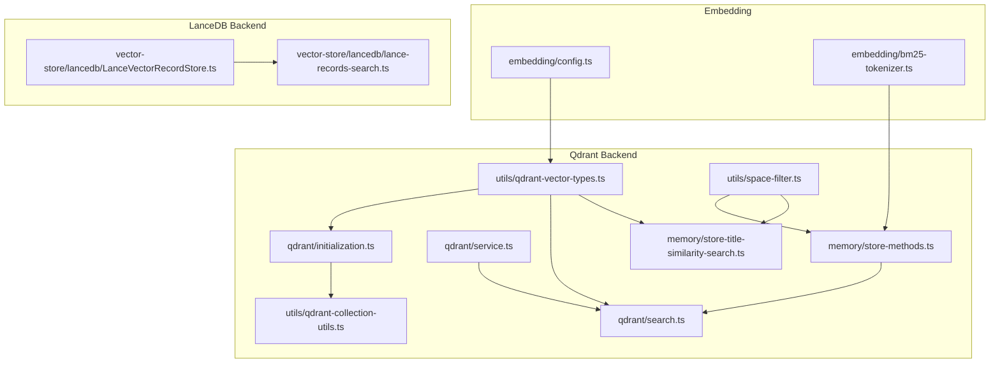
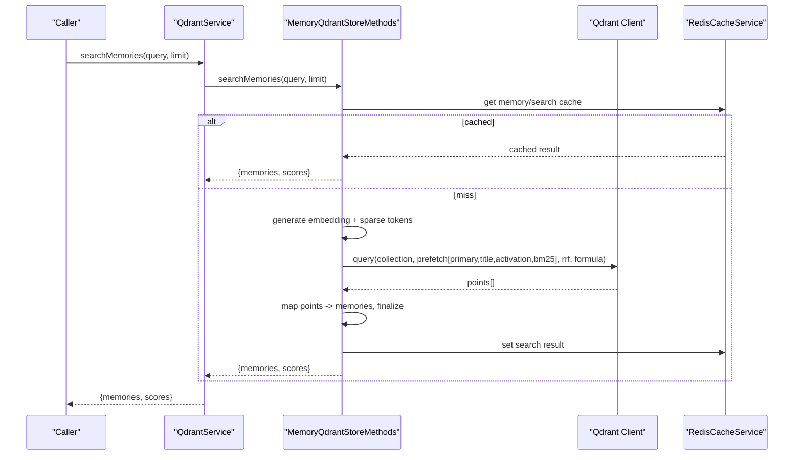
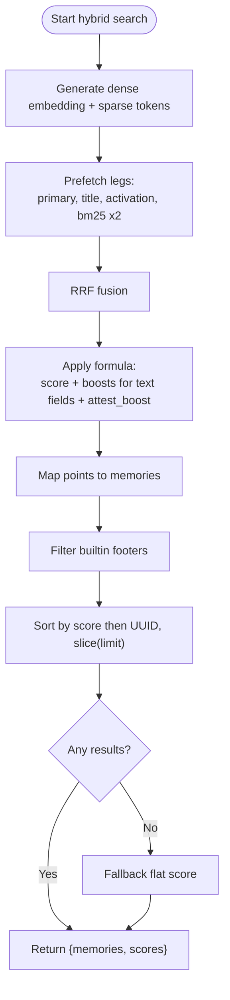
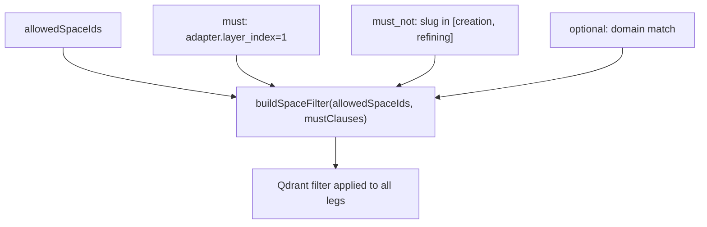
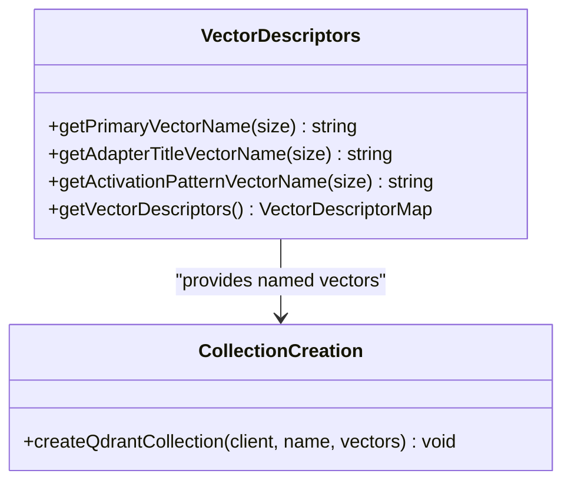
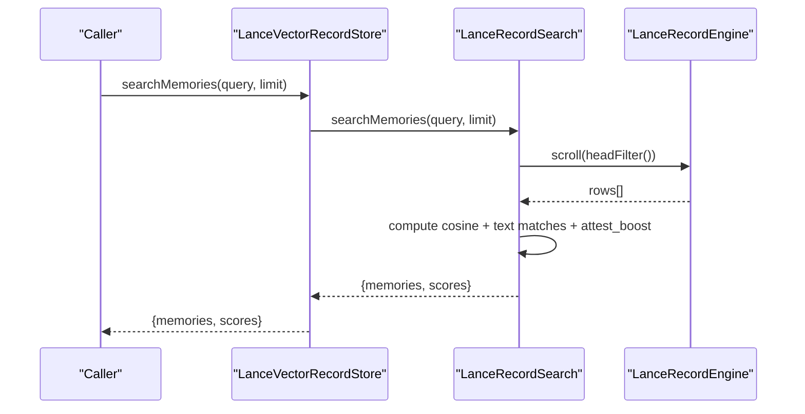
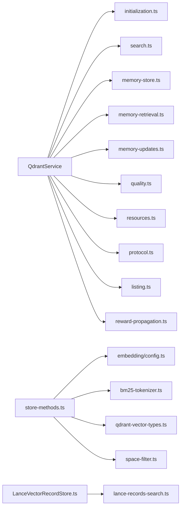

# Vector Operations & Optimization

<cite>
**Referenced Files in This Document**
- [src/services/memory/store-methods.ts](file://src/services/memory/store-methods.ts)
- [src/utils/qdrant-vector-types.ts](file://src/utils/qdrant-vector-types.ts)
- [src/utils/qdrant-collection-utils.ts](file://src/utils/qdrant-collection-utils.ts)
- [src/services/embedding/bm25-tokenizer.ts](file://src/services/embedding/bm25-tokenizer.ts)
- [src/services/qdrant/search.ts](file://src/services/qdrant/search.ts)
- [src/services/qdrant/service.ts](file://src/services/qdrant/service.ts)
- [src/services/qdrant/initialization.ts](file://src/services/qdrant/initialization.ts)
- [src/services/memory/store-title-similarity-search.ts](file://src/services/memory/store-title-similarity-search.ts)
- [src/utils/space-filter.ts](file://src/utils/space-filter.ts)
- [src/services/vector-store/lancedb/lance-records-search.ts](file://src/services/vector-store/lancedb/lance-records-search.ts)
- [src/services/vector-store/lancedb/LanceVectorRecordStore.ts](file://src/services/vector-store/lancedb/LanceVectorRecordStore.ts)
- [src/services/embedding/config.ts](file://src/services/embedding/config.ts)
</cite>

## Table of Contents
1. Introduction
2. Project Structure
3. Core Components
4. Architecture Overview
5. Detailed Component Analysis
6. Dependency Analysis
7. Performance Considerations
8. Troubleshooting Guide
9. Conclusion

## Introduction
This document explains how SquadRules performs vector database operations and optimizes search across its two backends: Qdrant (primary, remote-capable) and LanceDB (secondary, embedded). It covers semantic similarity searches, hybrid ranking combining dense vectors with sparse BM25 and text boosts, metadata filtering for space isolation and adapter layer selection, result ranking algorithms, indexing strategies, performance tuning, advanced features such as hybrid search and pagination-friendly limits, benchmarking and monitoring hooks, and scaling considerations for growing collections.

## Project Structure
The vector search stack is split into:
- Embedding configuration and tokenizer utilities
- Qdrant service and collection initialization
- Memory store methods implementing hybrid search and caching
- LanceDB embedded implementation mirroring Qdrant behavior
- Shared filter helpers and vector type definitions

**Diagram sources**
- [src/services/embedding/config.ts:1-40](file://src/services/embedding/config.ts#L1-L40)
- [src/services/embedding/bm25-tokenizer.ts:1-57](file://src/services/embedding/bm25-tokenizer.ts#L1-L57)
- [src/services/qdrant/initialization.ts:1-183](file://src/services/qdrant/initialization.ts#L1-L183)
- [src/services/qdrant/service.ts:1-161](file://src/services/qdrant/service.ts#L1-L161)
- [src/services/qdrant/search.ts:1-83](file://src/services/qdrant/search.ts#L1-L83)
- [src/utils/qdrant-vector-types.ts:1-57](file://src/utils/qdrant-vector-types.ts#L1-L57)
- [src/utils/qdrant-collection-utils.ts:1-65](file://src/utils/qdrant-collection-utils.ts#L1-L65)
- [src/services/memory/store-methods.ts:1-270](file://src/services/memory/store-methods.ts#L1-L270)
- [src/services/memory/store-title-similarity-search.ts:1-62](file://src/services/memory/store-title-similarity-search.ts#L1-L62)
- [src/utils/space-filter.ts:1-48](file://src/utils/space-filter.ts#L1-L48)
- [src/services/vector-store/lancedb/LanceVectorRecordStore.ts:1-193](file://src/services/vector-store/lancedb/LanceVectorRecordStore.ts#L1-L193)
- [src/services/vector-store/lancedb/lance-records-search.ts:1-138](file://src/services/vector-store/lancedb/lance-records-search.ts#L1-L138)

**Section sources**
- [src/services/qdrant/service.ts:17-161](file://src/services/qdrant/service.ts#L17-L161)
- [src/services/memory/store-methods.ts:25-269](file://src/services/memory/store-methods.ts#L25-L269)
- [src/services/vector-store/lancedb/LanceVectorRecordStore.ts:35-193](file://src/services/vector-store/lancedb/LanceVectorRecordStore.ts#L35-L193)

## Core Components
- QdrantService: Composes connection, initialization, storage, retrieval, updates, quality metrics, listing, protocol lookup, alias management, and search. It exposes a unified API and selects either the real Qdrant backend or an embedded LanceDB double-cast at runtime.
- MemoryQdrantStoreMethods: Implements hybrid search using Qdrant Query API with multiple prefetch legs (dense primary, title, activation pattern, and BM25), RRF fusion, and a server-side formula boosting adapter name, activation patterns, label, tags, and attest_boost. Includes fallback to dense-only search on failure and Redis-backed caching for reads and search results.
- LanceVectorRecordStore and LanceRecordSearch: Embedded path that mirrors Qdrant’s hybrid ranking by computing cosine similarities over three named vectors plus token-based text matches and attest boost, then applying the same filtering and finalization logic.
- Vector descriptors and collection utils: Define named vectors (primary, adapter title, activation pattern) with Cosine distance and on-disk storage; create collections with scalar int8 quantization and BM25 sparse vectors; support dimension migration via naming convention vs{dimension}.
- BM25 tokenizer: Lightweight client-side tokenizer producing sparse indices/values for Qdrant sparse vector search.
- Space filter helper: Enforces multi-tenant space isolation and merges additional must clauses.

**Section sources**
- [src/services/qdrant/service.ts:17-161](file://src/services/qdrant/service.ts#L17-L161)
- [src/services/memory/store-methods.ts:94-260](file://src/services/memory/store-methods.ts#L94-L260)
- [src/services/vector-store/lancedb/lance-records-search.ts:32-138](file://src/services/vector-store/lancedb/lance-records-search.ts#L32-L138)
- [src/utils/qdrant-vector-types.ts:1-57](file://src/utils/qdrant-vector-types.ts#L1-L57)
- [src/utils/qdrant-collection-utils.ts:1-65](file://src/utils/qdrant-collection-utils.ts#L1-L65)
- [src/services/embedding/bm25-tokenizer.ts:1-57](file://src/services/embedding/bm25-tokenizer.ts#L1-L57)
- [src/utils/space-filter.ts:1-48](file://src/utils/space-filter.ts#L1-L48)

## Architecture Overview
The system supports two execution paths:
- Remote Qdrant path: QdrantService delegates to searchMemory and MemoryQdrantStoreMethods for hybrid search.
- Embedded LanceDB path: qdrantService resolves to LanceVectorRecordStore, which uses LanceRecordSearch to compute hybrid scores locally.

**Diagram sources**
- [src/services/qdrant/service.ts:120-122](file://src/services/qdrant/service.ts#L120-L122)
- [src/services/memory/store-methods.ts:94-104](file://src/services/memory/store-methods.ts#L94-L104)
- [src/services/memory/store-methods.ts:121-260](file://src/services/memory/store-methods.ts#L121-L260)

**Section sources**
- [src/services/qdrant/service.ts:17-161](file://src/services/qdrant/service.ts#L17-L161)
- [src/services/memory/store-methods.ts:94-260](file://src/services/memory/store-methods.ts#L94-L260)
- [src/services/vector-store/lancedb/LanceVectorRecordStore.ts:175-182](file://src/services/vector-store/lancedb/LanceVectorRecordStore.ts#L175-L182)

## Detailed Component Analysis

### Hybrid Search Construction and Ranking
- Dense legs: Primary vector, adapter title vector, activation pattern vector. Each leg queries a named vector with rescore enabled.
- Sparse leg: BM25 sparse vector constructed by bm25Tokenizer.tokenize.
- Fusion: RRF across all legs.
- Server-side ranking formula: base score plus weighted text matches against adapter_name_text, activation_patterns_text, label_text, tags_text, plus optional attest_boost.
- Fallback: If hybrid query fails, falls back to dense primary vector search.
- Post-processing: Filters out builtin footer protocols, sorts by score then UUID, slices to requested limit, and applies fallback scoring when needed.

**Diagram sources**
- [src/services/memory/store-methods.ts:121-260](file://src/services/memory/store-methods.ts#L121-L260)
- [src/services/embedding/bm25-tokenizer.ts:32-57](file://src/services/embedding/bm25-tokenizer.ts#L32-L57)

**Section sources**
- [src/services/memory/store-methods.ts:121-260](file://src/services/memory/store-methods.ts#L121-L260)
- [src/services/embedding/bm25-tokenizer.ts:1-57](file://src/services/embedding/bm25-tokenizer.ts#L1-L57)

### Metadata Filtering and Space Isolation
- Space isolation: buildSpaceFilter enforces allowed space IDs and merges additional must clauses.
- Adapter layer gating: Queries restrict to adapter.layer_index = 1 to target adapter heads.
- Protocol exclusion: Excludes creation/refining protocol slugs from search results.
- Domain scoping: Optional domain filter can be added to narrow results.

**Diagram sources**
- [src/utils/space-filter.ts:14-26](file://src/utils/space-filter.ts#L14-L26)
- [src/services/memory/store-methods.ts:130-137](file://src/services/memory/store-methods.ts#L130-L137)
- [src/services/memory/store-title-similarity-search.ts:25-32](file://src/services/memory/store-title-similarity-search.ts#L25-L32)

**Section sources**
- [src/utils/space-filter.ts:1-48](file://src/utils/space-filter.ts#L1-L48)
- [src/services/memory/store-methods.ts:130-137](file://src/services/memory/store-methods.ts#L130-L137)
- [src/services/memory/store-title-similarity-search.ts:25-32](file://src/services/memory/store-title-similarity-search.ts#L25-L32)

### Vector Indexing Strategy
- Named vectors:
  - Primary: vs{dimension}
  - Adapter title: adapter_title_vs{dimension}
  - Activation pattern: activation_pattern_vs{dimension}
- Distance metric: Cosine for all named vectors.
- Storage: on_disk enabled for vectors; scalar int8 quantization always_ram.
- Sparse vectors: bm25 configured for sparse vector search.
- Dimension resolution: Derived from embedding probe; mismatch triggers collection recreation.

**Diagram sources**
- [src/utils/qdrant-vector-types.ts:8-35](file://src/utils/qdrant-vector-types.ts#L8-L35)
- [src/utils/qdrant-collection-utils.ts:7-39](file://src/utils/qdrant-collection-utils.ts#L7-L39)

**Section sources**
- [src/utils/qdrant-vector-types.ts:1-57](file://src/utils/qdrant-vector-types.ts#L1-L57)
- [src/utils/qdrant-collection-utils.ts:1-65](file://src/utils/qdrant-collection-utils.ts#L1-L65)
- [src/services/qdrant/initialization.ts:23-47](file://src/services/qdrant/initialization.ts#L23-L47)

### LanceDB Embedded Path Parity
- LanceRecordSearch computes hybrid-style ranking in-process:
  - Dense cosine over primary, title, activation vectors
  - Token overlap for label/tags text
  - Additive attest_boost
  - Same footer filtering, sorting, slicing, and fallback behavior
- LanceVectorRecordStore implements IVectorRecordStore and exposes searchMemories and searchAdapterTitlesBySimilarity to mirror Qdrant behavior.

**Diagram sources**
- [src/services/vector-store/lancedb/LanceVectorRecordStore.ts:175-182](file://src/services/vector-store/lancedb/LanceVectorRecordStore.ts#L175-L182)
- [src/services/vector-store/lancedb/lance-records-search.ts:99-122](file://src/services/vector-store/lancedb/lance-records-search.ts#L99-L122)

**Section sources**
- [src/services/vector-store/lancedb/lance-records-search.ts:1-138](file://src/services/vector-store/lancedb/lance-records-search.ts#L1-L138)
- [src/services/vector-store/lancedb/LanceVectorRecordStore.ts:35-193](file://src/services/vector-store/lancedb/LanceVectorRecordStore.ts#L35-L193)

### Title Similarity Search
- Dedicated endpoint to rank by adapter title vector only, useful for narrowing candidate sets before full hybrid search.
- Applies the same space and layer filters and excludes builtin footers.

**Section sources**
- [src/services/memory/store-title-similarity-search.ts:1-62](file://src/services/memory/store-title-similarity-search.ts#L1-L62)

### Simple Qdrant Search Wrapper
- searchMemory generates embeddings, builds space/domain filters, executes a single dense query with rescore, maps points to a normalized response shape, and emits metrics.

**Section sources**
- [src/services/qdrant/search.ts:1-83](file://src/services/qdrant/search.ts#L1-L83)

## Dependency Analysis
Key relationships:
- QdrantService composes initialization, store, retrieval, updates, quality, resources, search, protocol, listing, reward propagation, and aliases.
- MemoryQdrantStoreMethods depends on embeddingService, bm25Tokenizer, space filter, and vector type helpers.
- LanceVectorRecordStore depends on LanceRecordEngine, reader, mutator, writer, and LanceRecordSearch.
- Vector descriptors and collection utils are shared between initialization and search code.

**Diagram sources**
- [src/services/qdrant/service.ts:1-161](file://src/services/qdrant/service.ts#L1-L161)
- [src/services/memory/store-methods.ts:1-270](file://src/services/memory/store-methods.ts#L1-L270)
- [src/services/vector-store/lancedb/LanceVectorRecordStore.ts:1-193](file://src/services/vector-store/lancedb/LanceVectorRecordStore.ts#L1-L193)

**Section sources**
- [src/services/qdrant/service.ts:1-161](file://src/services/qdrant/service.ts#L1-L161)
- [src/services/memory/store-methods.ts:1-270](file://src/services/memory/store-methods.ts#L1-L270)
- [src/services/vector-store/lancedb/LanceVectorRecordStore.ts:1-193](file://src/services/vector-store/lancedb/LanceVectorRecordStore.ts#L1-L193)

## Performance Considerations
- Query batching:
  - Use prefetch with multiple legs to parallelize dense and sparse retrievals.
  - Tune per-leg limits (e.g., 60/40/40/60/30) and RRF fusion limit to balance recall and latency.
- Result caching:
  - Read-through cache for individual memories via redisCacheService.getMemoryResource/setMemoryResource.
  - Search result cache via redisCacheService.setSearchResult keyed by query and limit, with collapse option.
- Memory management:
  - Vectors stored on disk with scalar int8 quantization to reduce RAM usage while maintaining accuracy.
  - Rescore enabled during query to improve precision without large memory overhead.
- Workload-specific tuning:
  - For high-throughput scenarios, prefer title similarity search as a prefilter to reduce downstream hybrid cost.
  - For low-latency needs, consider disabling hybrid legs and relying on dense primary vector search.
- Pagination strategy:
  - The current APIs return top-k results; implement client-side pagination by limiting k and using stable sort keys (score then UUID).
  - For very large result sets, combine title similarity search with subsequent hybrid refinement.

[No sources needed since this section provides general guidance]

## Troubleshooting Guide
- Hybrid query failures:
  - Symptom: Hybrid query throws; system logs a warning and falls back to dense search.
  - Action: Inspect Qdrant Query API compatibility and ensure sparse vectors are configured; verify payload indexes exist.
- Dimension mismatch:
  - Symptom: Initialization recreates collection due to vector size mismatch.
  - Action: Ensure embedding dimension probe runs at startup and matches configured vectors; check embedding provider output dimensions.
- Missing space isolation:
  - Symptom: Results include data outside allowed spaces.
  - Action: Verify buildSpaceFilter is applied and allowedSpaceIds are correctly populated from tenant context.
- Empty results:
  - Symptom: No results returned after filtering.
  - Action: Check layer_index filter, protocol slug exclusions, and whether records have required payloads (adapter_name_text, activation_patterns_text, label_text, tags_text).
- Monitoring and metrics:
  - Use qdrantOperations and qdrantQueryDuration to track search success/error rates and latencies.
  - Log query parameters and result counts for debugging.

**Section sources**
- [src/services/memory/store-methods.ts:218-232](file://src/services/memory/store-methods.ts#L218-L232)
- [src/services/qdrant/initialization.ts:23-47](file://src/services/qdrant/initialization.ts#L23-L47)
- [src/services/qdrant/search.ts:39-45](file://src/services/qdrant/search.ts#L39-L45)
- [src/utils/space-filter.ts:14-26](file://src/utils/space-filter.ts#L14-L26)

## Conclusion
SquadRules implements robust hybrid search over Qdrant and a parity implementation in LanceDB. The design emphasizes consistent ranking across backends, strong metadata filtering for multi-tenant safety, and practical performance optimizations including prefetch fusion, quantization, and caching. Tuning should focus on embedding dimension stability, appropriate distance metrics (Cosine), selective use of dense vs hybrid legs, and leveraging title similarity as a prefilter. Monitoring via Qdrant metrics and careful logging will help identify bottlenecks and guide capacity planning as collections grow.