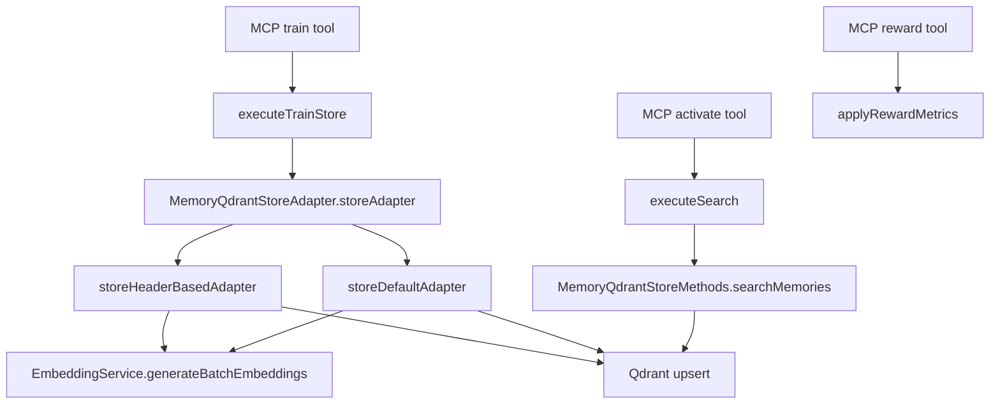
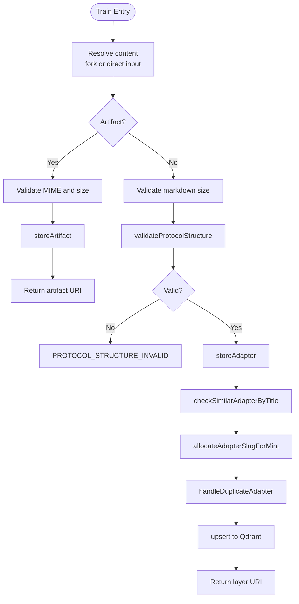
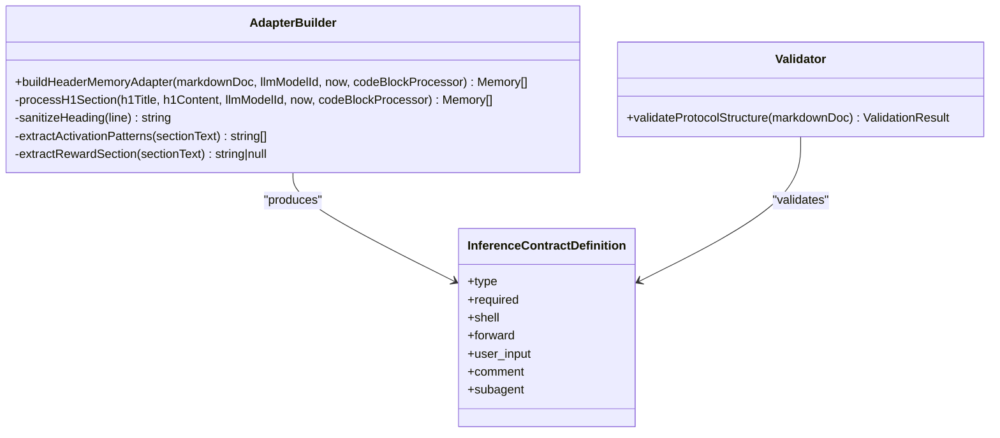
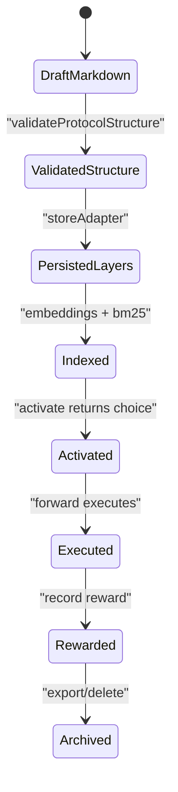
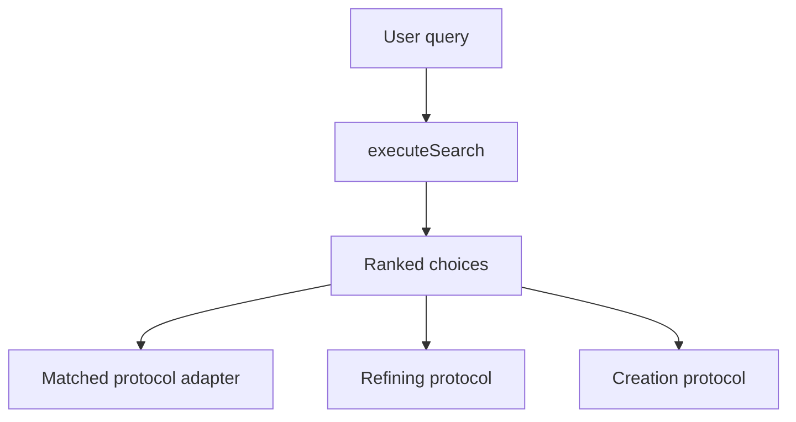
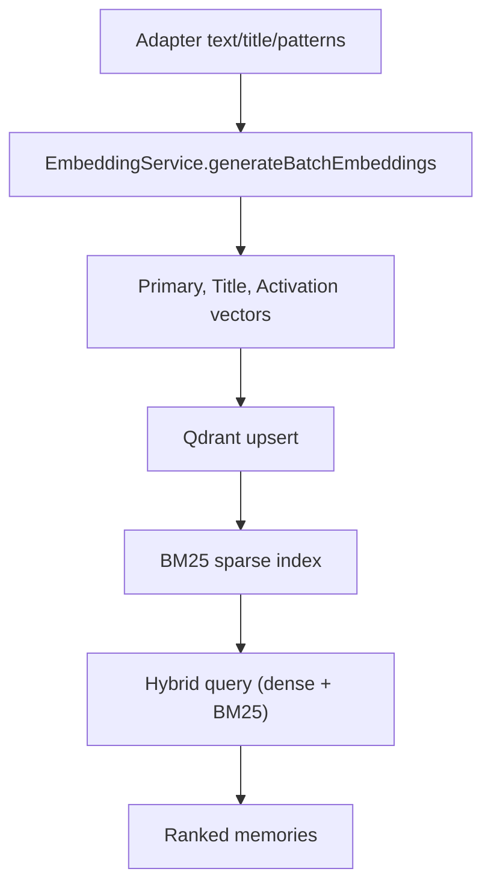
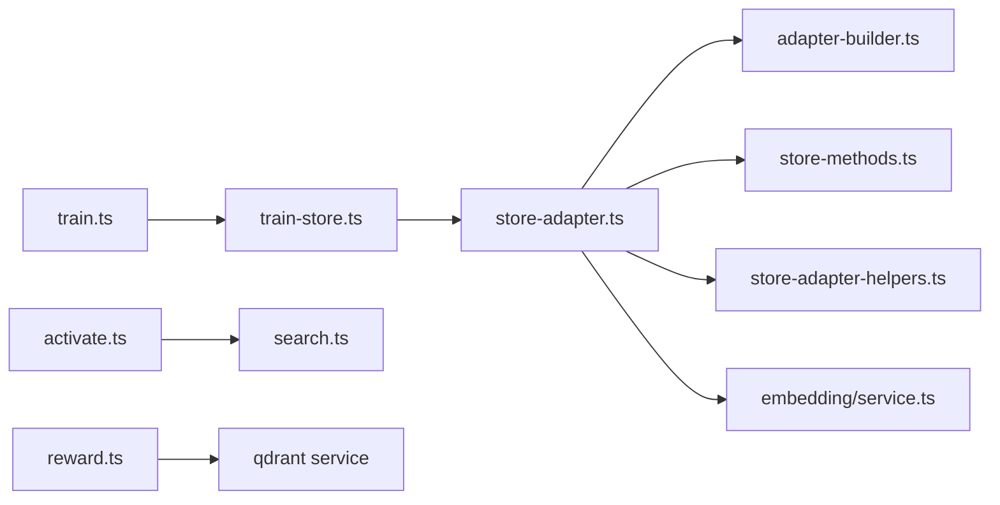

# Adapter Lifecycle

<cite>
**Referenced Files in This Document**
- [adapter-authoring-guide.md](file://docs/adapter-authoring-guide.md)
- [train.ts](file://src/tools/train.ts)
- [activate.ts](file://src/tools/activate.ts)
- [reward.ts](file://src/tools/reward.ts)
- [search.ts](file://src/tools/search.ts)
- [train-store.ts](file://src/tools/train-store.ts)
- [store-adapter.ts](file://src/services/memory/store-adapter.ts)
- [adapter-builder.ts](file://src/services/memory/adapter-builder.ts)
- [store-methods.ts](file://src/services/memory/store-methods.ts)
- [store-adapter-header-handler.ts](file://src/services/memory/store-adapter-header-handler.ts)
- [store-adapter-default-handler.ts](file://src/services/memory/store-adapter-default-handler.ts)
- [store-adapter-helpers.ts](file://src/services/memory/store-adapter-helpers.ts)
- [store-artifact.ts](file://src/services/memory/store-artifact.ts)
- [validate-protocol-structure.ts](file://src/services/memory/validate-protocol-structure.ts)
- [service.ts](file://src/services/embedding/service.ts)
- [memory.ts](file://src/types/memory.ts)
</cite>

## Table of Contents
1. [Introduction](#introduction)
2. [Project Structure](#project-structure)
3. [Core Components](#core-components)
4. [Architecture Overview](#architecture-overview)
5. [Detailed Component Analysis](#detailed-component-analysis)
6. [Dependency Analysis](#dependency-analysis)
7. [Performance Considerations](#performance-considerations)
8. [Troubleshooting Guide](#troubleshooting-guide)
9. [Conclusion](#conclusion)

## Introduction
This document explains the complete adapter lifecycle in SquadRules: creation, training, validation, activation, execution, reward, and archival. It focuses on how markdown adapters are parsed into structured memories, how they are stored and indexed for semantic search, and how the activate→forward→reward chain governs agent-driven workflows. It also documents the adapter builder pattern, schema validation, protocol versioning, metadata extraction, the store adapter abstraction, state transitions, version control mechanisms, and integration with the embedding pipeline and vector database indexing.

## Project Structure
The adapter lifecycle spans MCP tools, memory storage, embedding services, and vector search:

- Tools: `train`, `activate`, `reward`, and `search` expose the user-facing workflow.
- Memory layer: `MemoryQdrantStoreAdapter` orchestrates parsing, validation, slug allocation, duplicate handling, embedding generation, and Qdrant persistence.
- Builder and validators: Markdown is parsed into layered memories; contracts are extracted and validated.
- Embedding service: Generates dense vectors and integrates with provider selection and dimension probing.
- Vector index: Qdrant stores primary, title, activation-pattern vectors, plus BM25 sparse indices.



**Diagram sources**
- [train.ts:137-244](file://src/tools/train.ts#L137-L244)
- [train-store.ts:47-130](file://src/tools/train-store.ts#L47-L130)
- [store-adapter.ts:43-147](file://src/services/memory/store-adapter.ts#L43-L147)
- [store-adapter-header-handler.ts:30-201](file://src/services/memory/store-adapter-header-handler.ts#L30-L201)
- [store-adapter-default-handler.ts:34-255](file://src/services/memory/store-adapter-default-handler.ts#L34-L255)
- [service.ts:130-222](file://src/services/embedding/service.ts#L130-L222)
- [activate.ts:168-229](file://src/tools/activate.ts#L168-L229)
- [search.ts:192-253](file://src/tools/search.ts#L192-L253)
- [store-methods.ts:94-260](file://src/services/memory/store-methods.ts#L94-L260)
- [reward.ts:28-130](file://src/tools/reward.ts#L28-L130)

**Section sources**
- [train.ts:137-244](file://src/tools/train.ts#L137-L244)
- [store-adapter.ts:43-147](file://src/services/memory/store-adapter.ts#L43-L147)
- [service.ts:130-222](file://src/services/embedding/service.ts#L130-L222)
- [activate.ts:168-229](file://src/tools/activate.ts#L168-L229)
- [search.ts:192-253](file://src/tools/search.ts#L192-L253)
- [reward.ts:28-130](file://src/tools/reward.ts#L28-L130)

## Core Components
- Train tool: Validates input, resolves content (including fork from an existing adapter), dispatches to store, and returns stable URIs for layers and artifacts.
- Train store: Enforces artifact MIME allowlist, size limits, adapter markdown size limits, and structural contract validation before persisting.
- Store adapter: Normalizes markdown, parses frontmatter, chooses header-based or default storage path, checks similarity, allocates slugs, handles duplicates, and persists points.
- Adapter builder: Parses H1/H2 sections, extracts activation patterns and reward signals, builds layered memories, and attaches inference contracts.
- Store methods: Provides retrieval, hybrid search (dense + BM25), and mapping between Qdrant points and internal memory models.
- Embedding service: Provider-agnostic embedding generation with dimension validation, audit logging, and health checks.
- Types: Defines adapter info, inference contracts, memory records, and reward traces.

**Section sources**
- [train.ts:137-244](file://src/tools/train.ts#L137-L244)
- [train-store.ts:47-130](file://src/tools/train-store.ts#L47-L130)
- [store-adapter.ts:43-147](file://src/services/memory/store-adapter.ts#L43-L147)
- [adapter-builder.ts:75-257](file://src/services/memory/adapter-builder.ts#L75-L257)
- [store-methods.ts:38-268](file://src/services/memory/store-methods.ts#L38-L268)
- [service.ts:48-222](file://src/services/embedding/service.ts#L48-L222)
- [memory.ts:3-108](file://src/types/memory.ts#L3-L108)

## Architecture Overview
The lifecycle follows a clear flow:

1. Creation and Training
   - Author writes markdown with required sections and at least one JSON contract block.
   - `train` validates input, optionally forks from an existing adapter, and delegates to `executeTrainStore`.
   - `executeTrainStore` enforces artifact rules or adapter structure, then calls `storeAdapter`.
   - `storeAdapter` parses markdown, checks similarity, allocates slug, handles duplicates, generates embeddings, and persists to Qdrant.

2. Activation
   - `activate` searches for best matching adapters using hybrid search and returns ranked choices with next actions.
   - Choices include match, refine, and create roles, with linked artifacts resolved when present.

3. Execution and Reward
   - Agents execute adapters via forward flows; after completion, `reward` records outcome, score, and evaluation metadata.
   - Reward persistence includes metrics updates and optional execution trace recording.

```mermaid
sequenceDiagram
participant Author as "Author"
participant Train as "MCP train"
participant Store as "MemoryQdrantStoreAdapter"
participant Embed as "EmbeddingService"
participant Qdrant as "Qdrant"
participant Activate as "MCP activate"
participant Search as "executeSearch"
participant Reward as "MCP reward"
Author->>Train : Submit markdown or artifact
Train->>Train : Validate input / resolve fork
Train->>Store : storeAdapter(...)
Store->>Store : Parse markdown, build memories
Store->>Embed : generateBatchEmbeddings(...)
Embed-->>Store : Dense vectors
Store->>Qdrant : upsert points
Note over Store,Qdrant : Slug allocated, duplicates handled
Author->>Activate : Query intent
Activate->>Search : executeSearch(query)
Search->>Qdrant : Hybrid query (dense + BM25)
Qdrant-->>Search : Ranked memories
Search-->>Activate : Choices with next_action
Agent->>Reward : Record outcome/score
Reward->>Qdrant : Update metrics/traces
```

**Diagram sources**
- [train.ts:137-244](file://src/tools/train.ts#L137-L244)
- [train-store.ts:47-130](file://src/tools/train-store.ts#L47-L130)
- [store-adapter.ts:43-147](file://src/services/memory/store-adapter.ts#L43-L147)
- [service.ts:130-222](file://src/services/embedding/service.ts#L130-L222)
- [activate.ts:168-229](file://src/tools/activate.ts#L168-L229)
- [search.ts:192-253](file://src/tools/search.ts#L192-L253)
- [reward.ts:28-130](file://src/tools/reward.ts#L28-L130)

## Detailed Component Analysis

### Adapter Creation and Training Flow
Training supports both markdown adapters and binary/text artifacts. For markdown:
- Structural validation ensures required sections and valid contracts.
- Size limits protect against oversized inputs.
- Similarity guard warns about near-duplicate titles unless force update is used.
- Slug allocation guarantees uniqueness per space; author-supplied slugs collide strictly.
- Duplicate handling either throws or deletes existing adapter points when allowed.

For artifacts:
- MIME type must be allowed; size is validated.
- Artifacts are attached to an adapter anchor point by slug or UUID.
- Existing artifacts can be updated only with explicit force update.



**Diagram sources**
- [train.ts:137-244](file://src/tools/train.ts#L137-L244)
- [train-store.ts:47-130](file://src/tools/train-store.ts#L47-L130)
- [store-adapter.ts:43-147](file://src/services/memory/store-adapter.ts#L43-L147)
- [store-adapter-helpers.ts:52-93](file://src/services/memory/store-adapter-helpers.ts#L52-L93)
- [store-adapter-helpers.ts:112-172](file://src/services/memory/store-adapter-helpers.ts#L112-L172)
- [store-adapter-helpers.ts:201-254](file://src/services/memory/store-adapter-helpers.ts#L201-L254)
- [store-artifact.ts:168-300](file://src/services/memory/store-artifact.ts#L168-L300)
- [validate-protocol-structure.ts:207-297](file://src/services/memory/validate-protocol-structure.ts#L207-L297)

**Section sources**
- [train.ts:137-244](file://src/tools/train.ts#L137-L244)
- [train-store.ts:47-130](file://src/tools/train-store.ts#L47-L130)
- [store-adapter.ts:43-147](file://src/services/memory/store-adapter.ts#L43-L147)
- [store-adapter-helpers.ts:52-93](file://src/services/memory/store-adapter-helpers.ts#L52-L93)
- [store-adapter-helpers.ts:112-172](file://src/services/memory/store-adapter-helpers.ts#L112-L172)
- [store-adapter-helpers.ts:201-254](file://src/services/memory/store-adapter-helpers.ts#L201-L254)
- [store-artifact.ts:168-300](file://src/services/memory/store-artifact.ts#L168-L300)
- [validate-protocol-structure.ts:207-297](file://src/services/memory/validate-protocol-structure.ts#L207-L297)

### Adapter Builder Pattern and Schema Validation
The builder transforms markdown into layered memories:
- Sanitizes headings to stabilize layer ordering.
- Extracts activation patterns and reward signal sections.
- Splits content by fenced contract blocks; each block becomes a layer with an inference contract.
- If no contract blocks exist, treats the entire section as a single-layer adapter with optional inference contract.
- Produces tags from text and code identifiers, and assigns layer indices and counts.

Schema validation enforces:
- Required H1 title, Activation Patterns as first H2, Reward Signal as last H2.
- At least one JSON contract block.
- Allowed contract types: shell, forward, user_input, comment, subagent.
- Type-specific policies: shell interpreter must be allowed; forward target must be an adapter URI; subagent.mcp entries must have tool_name and optional arguments object.



**Diagram sources**
- [adapter-builder.ts:75-257](file://src/services/memory/adapter-builder.ts#L75-L257)
- [validate-protocol-structure.ts:207-297](file://src/services/memory/validate-protocol-structure.ts#L207-L297)
- [memory.ts:17-46](file://src/types/memory.ts#L17-L46)

**Section sources**
- [adapter-builder.ts:75-257](file://src/services/memory/adapter-builder.ts#L75-L257)
- [validate-protocol-structure.ts:207-297](file://src/services/memory/validate-protocol-structure.ts#L207-L297)
- [memory.ts:17-46](file://src/types/memory.ts#L17-L46)

### Store Adapter Abstraction and Storage Backends
`MemoryQdrantStoreAdapter` provides unified CRUD-like operations for adapters and artifacts:
- `storeAdapter`: Normalizes docs, parses frontmatter, selects header-based or default storage path, performs similarity check, allocates slug, handles duplicates, and persists.
- `storeArtifact`: Resolves adapter anchor, extracts artifact metadata, computes SHA-256, deduplicates by name/slug, and persists with zero dense vectors and BM25 sparse index.

Storage backends:
- Primary backend: Qdrant, with dense vectors (primary, title, activation-pattern) and BM25 sparse index.
- Fallback behavior: When embedding generation fails or dimensions mismatch, zero vectors are used; when sparse config is missing, upsert retries without BM25.

```mermaid
classDiagram
class MemoryQdrantStoreAdapter {
+storeAdapter(docs, llmModelId, options) Memory[]
+storeArtifact(content, options) Memory[]
}
class MemoryQdrantStoreMethods {
+getMemory(id) Memory|null
+searchMemories(query, limit, collapse) {memories,scores}
+buildHeaderMemoryAdapter(doc,llmModelId,now) Memory[]
}
class StoreHeaderHandler {
+storeHeaderBasedAdapter(client,collection,methods,memories,llmModelId,forceUpdate,slugInput,forkNewAdapter) Memory[]
}
class StoreDefaultHandler {
+storeDefaultAdapter(client,collection,methods,codeBlockProcessor,docs,llmModelId,now,forceUpdate,protocolVersion,parsedFrontmatter,forkNewAdapter) Memory[]
}
MemoryQdrantStoreAdapter --> StoreHeaderHandler : "delegates"
MemoryQdrantStoreAdapter --> StoreDefaultHandler : "delegates"
MemoryQdrantStoreAdapter --> MemoryQdrantStoreMethods : "uses"
```

**Diagram sources**
- [store-adapter.ts:35-153](file://src/services/memory/store-adapter.ts#L35-L153)
- [store-methods.ts:25-268](file://src/services/memory/store-methods.ts#L25-L268)
- [store-adapter-header-handler.ts:30-201](file://src/services/memory/store-adapter-header-handler.ts#L30-L201)
- [store-adapter-default-handler.ts:34-255](file://src/services/memory/store-adapter-default-handler.ts#L34-L255)

**Section sources**
- [store-adapter.ts:35-153](file://src/services/memory/store-adapter.ts#L35-L153)
- [store-methods.ts:25-268](file://src/services/memory/store-methods.ts#L25-L268)
- [store-adapter-header-handler.ts:30-201](file://src/services/memory/store-adapter-header-handler.ts#L30-L201)
- [store-adapter-default-handler.ts:34-255](file://src/services/memory/store-adapter-default-handler.ts#L34-L255)

### Adapter State Transitions and Version Control
State transitions:
- Draft markdown → validated structure → persisted layer(s) with slug and adapter id.
- Forked adapters receive new adapter ids and preserve version metadata while removing author-supplied slug to avoid collisions.
- Artifacts are attached to adapter chains and can be updated with force update.

Version control mechanisms:
- Frontmatter `version` is carried into adapter metadata when provided.
- Protocol footer versions are resolved during search to inform UI and next actions.
- Slugs are unique per space; auto-suffixed candidates are generated if needed.



**Diagram sources**
- [train-store.ts:100-118](file://src/tools/train-store.ts#L100-L118)
- [store-adapter.ts:62-147](file://src/services/memory/store-adapter.ts#L62-L147)
- [search.ts:114-141](file://src/tools/search.ts#L114-L141)
- [store-adapter-helpers.ts:201-254](file://src/services/memory/store-adapter-helpers.ts#L201-L254)

**Section sources**
- [train-store.ts:100-118](file://src/tools/train-store.ts#L100-L118)
- [store-adapter.ts:62-147](file://src/services/memory/store-adapter.ts#L62-L147)
- [search.ts:114-141](file://src/tools/search.ts#L114-L141)
- [store-adapter-helpers.ts:201-254](file://src/services/memory/store-adapter-helpers.ts#L201-L254)

### Relationship Between Adapters and Protocols
- Adapters implement protocols; activation maps queries to protocol-backed adapters.
- Built-in protocols (creation and refining) are excluded from normal search results but surfaced as next actions.
- Protocol footer layers carry protocol versions that inform activation output.



**Diagram sources**
- [search.ts:192-253](file://src/tools/search.ts#L192-L253)
- [activate.ts:44-166](file://src/tools/activate.ts#L44-L166)

**Section sources**
- [search.ts:192-253](file://src/tools/search.ts#L192-L253)
- [activate.ts:44-166](file://src/tools/activate.ts#L44-L166)

### Integration with Embedding Pipeline and Vector Database Indexing
Embedding pipeline:
- Provider resolution selects OpenAI, TEI, or fastembed based on configuration.
- Dimension probing ensures expected vector size; anomalies are logged and errors thrown.
- Batch embeddings are generated for primary, title, and activation-pattern vectors.

Vector indexing:
- Qdrant stores three dense vector fields plus BM25 sparse index.
- Hybrid search uses prefetch legs and RRF fusion, with formula boosts for title, activation patterns, label, and tags.
- Fallback paths handle embedding failures and missing sparse configs.



**Diagram sources**
- [service.ts:130-222](file://src/services/embedding/service.ts#L130-L222)
- [store-adapter-header-handler.ts:53-89](file://src/services/memory/store-adapter-header-handler.ts#L53-L89)
- [store-adapter-default-handler.ts:108-142](file://src/services/memory/store-adapter-default-handler.ts#L108-L142)
- [store-methods.ts:121-260](file://src/services/memory/store-methods.ts#L121-L260)

**Section sources**
- [service.ts:130-222](file://src/services/embedding/service.ts#L130-L222)
- [store-adapter-header-handler.ts:53-89](file://src/services/memory/store-adapter-header-handler.ts#L53-L89)
- [store-adapter-default-handler.ts:108-142](file://src/services/memory/store-adapter-default-handler.ts#L108-L142)
- [store-methods.ts:121-260](file://src/services/memory/store-methods.ts#L121-L260)

### Examples of Adapter Creation Workflows
- Create: Write markdown with Activation Patterns and Reward Signal, include at least one JSON contract block, run train, verify stored result, and test activation.
- Update: Export target, identify gap, re-run critic on changes, prove verdict, save with tune, read back stored adapter as completion criterion.
- Review: Read-only export and audit against checklist; do not mutate.
- Delete: Confirm no chain dependencies, delete, verify removal.

Best practices:
- Prefer empirical shell checks; use subagent hops for judgment or MCP tool work; reserve comment for read-only acknowledgments.
- Keep contracts minimal and purposeful; avoid fake proofs.
- Materialize linked artifacts before running shell contracts.

**Section sources**
- [adapter-authoring-guide.md:202-234](file://docs/adapter-authoring-guide.md#L202-L234)
- [adapter-authoring-guide.md:85-190](file://docs/adapter-authoring-guide.md#L85-L190)

### Error Handling During Training
Common error categories:
- Missing content or invalid source URI.
- Unsupported artifact MIME or oversized artifact.
- Oversized markdown or invalid protocol structure.
- Similar adapter title conflict or duplicate adapter id.
- Protected space write forbidden.

Error payloads include guidance such as next actions and content previews where applicable.

**Section sources**
- [train.ts:38-86](file://src/tools/train.ts#L38-L86)
- [train-store.ts:31-41](file://src/tools/train-store.ts#L31-L41)
- [train-store.ts:64-112](file://src/tools/train-store.ts#L64-L112)
- [store-adapter-helpers.ts:52-93](file://src/services/memory/store-adapter-helpers.ts#L52-L93)
- [store-adapter-helpers.ts:112-172](file://src/services/memory/store-adapter-helpers.ts#L112-L172)

### Best Practices for Adapter Authoring
- Define flow first: trigger, inputs, authority, outcome, evidence.
- Use the verification ladder: shell (empirical), subagent (judgment/tool work), comment (acknowledgment).
- Ensure shell contracts specify interpreter and commands explicitly.
- Forward contracts link to other adapters; never bare tool calls.
- Subagent MCP entries must name tool_name and optional arguments; keep proof as report.
- Limit comments to one per adapter; combine only when justified by ADR exemptions.

**Section sources**
- [adapter-authoring-guide.md:11-21](file://docs/adapter-authoring-guide.md#L11-L21)
- [adapter-authoring-guide.md:23-58](file://docs/adapter-authoring-guide.md#L23-L58)
- [adapter-authoring-guide.md:85-190](file://docs/adapter-authoring-guide.md#L85-L190)

## Dependency Analysis
Key dependencies:
- Train depends on validate-protocol-structure, store-adapter, and store-artifact.
- Store adapter depends on adapter-builder, store-methods, embedding-service, and helpers for slug/duplicate handling.
- Activate depends on search and load-linked-artifacts.
- Reward depends on qdrant service for metrics and execution trace store.



**Diagram sources**
- [train.ts:137-244](file://src/tools/train.ts#L137-L244)
- [train-store.ts:47-130](file://src/tools/train-store.ts#L47-L130)
- [store-adapter.ts:43-147](file://src/services/memory/store-adapter.ts#L43-L147)
- [adapter-builder.ts:75-257](file://src/services/memory/adapter-builder.ts#L75-L257)
- [store-methods.ts:94-268](file://src/services/memory/store-methods.ts#L94-L268)
- [store-adapter-helpers.ts:112-172](file://src/services/memory/store-adapter-helpers.ts#L112-L172)
- [service.ts:130-222](file://src/services/embedding/service.ts#L130-L222)
- [activate.ts:168-229](file://src/tools/activate.ts#L168-L229)
- [search.ts:192-253](file://src/tools/search.ts#L192-L253)
- [reward.ts:28-130](file://src/tools/reward.ts#L28-L130)

**Section sources**
- [train.ts:137-244](file://src/tools/train.ts#L137-L244)
- [store-adapter.ts:43-147](file://src/services/memory/store-adapter.ts#L43-L147)
- [activate.ts:168-229](file://src/tools/activate.ts#L168-L229)
- [reward.ts:28-130](file://src/tools/reward.ts#L28-L130)

## Performance Considerations
- Batch embeddings reduce API calls and latency; fallback to zero vectors prevents blocking on provider errors.
- Hybrid search with prefetch legs and RRF fusion improves ranking quality while staying within Qdrant’s compute budget.
- Redis cache accelerates repeated activations and search results; TTL balances freshness and throughput.
- Sparse BM25 index enables efficient keyword matching; fallback without BM25 maintains availability when collection lacks sparse config.
- Quality scoring and model stats contribute to analytics without impacting core persistence.

[No sources needed since this section provides general guidance]

## Troubleshooting Guide
- PROTOCOL_STRUCTURE_INVALID: Ensure H1 title, Activation Patterns as first H2, Reward Signal as last H2, and at least one JSON contract block with allowed types.
- DUPLICATE_ADAPTER: Use force_update with same adapter id to replace, or choose a distinct adapter title.
- SIMILAR_MEMORY_FOUND: Inspect similar adapter via export; adjust title or use force_update with same id.
- UNSUPPORTED_MIME: Choose an allowed artifact MIME type.
- REWARD_SUCCESS_CONFLICTS_FAILED_PROOF: Cannot record success for a layer whose last proof failed; fix step and rerun.

Operational tips:
- Verify linked artifacts materialization before running shell contracts.
- Use authoring context to guide creation/update flows.
- Monitor embedding dimension mismatches and provider health.

**Section sources**
- [validate-protocol-structure.ts:207-297](file://src/services/memory/validate-protocol-structure.ts#L207-L297)
- [store-adapter-helpers.ts:112-172](file://src/services/memory/store-adapter-helpers.ts#L112-L172)
- [train-store.ts:64-112](file://src/tools/train-store.ts#L64-L112)
- [reward.ts:19-54](file://src/tools/reward.ts#L19-L54)
- [activate.ts:84-96](file://src/tools/activate.ts#L84-L96)

## Conclusion
SquadRules’ adapter lifecycle combines robust markdown parsing, strict structural validation, flexible artifact support, and high-quality semantic search. The store adapter abstraction unifies persistence across adapters and artifacts, while the embedding pipeline and Qdrant indexing enable precise activation. The activate→forward→reward chain ensures deterministic, auditable execution with continuous feedback. Following the authoring guide and validation rules yields reliable, maintainable adapters that integrate seamlessly with the system’s versioning, slug management, and vector search infrastructure.