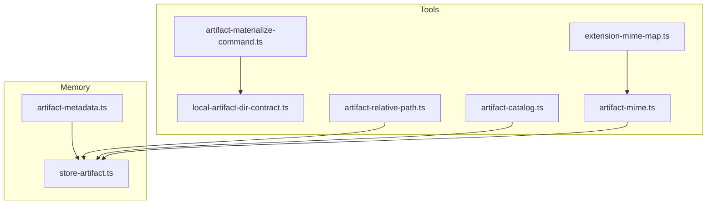
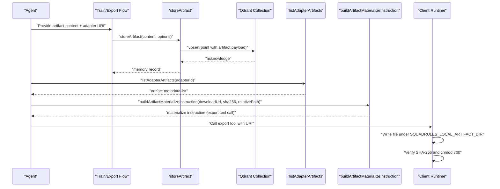
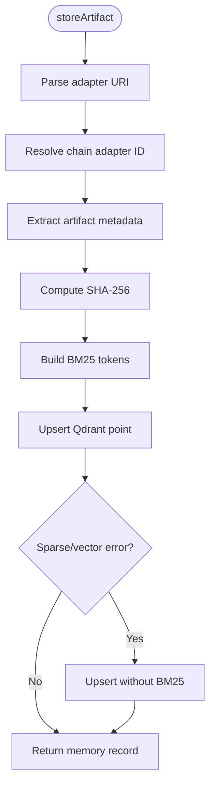
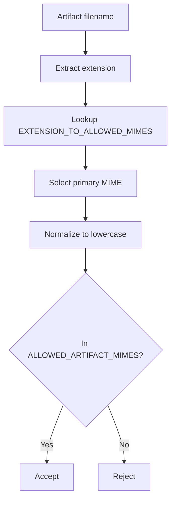
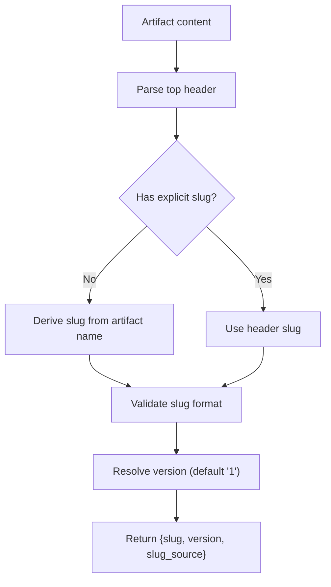
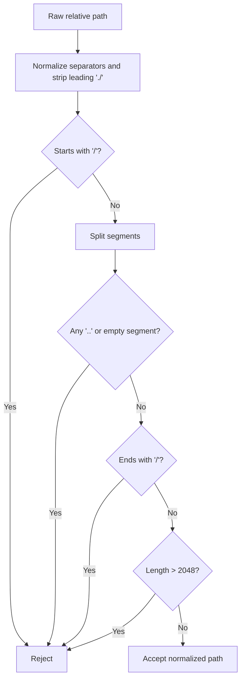
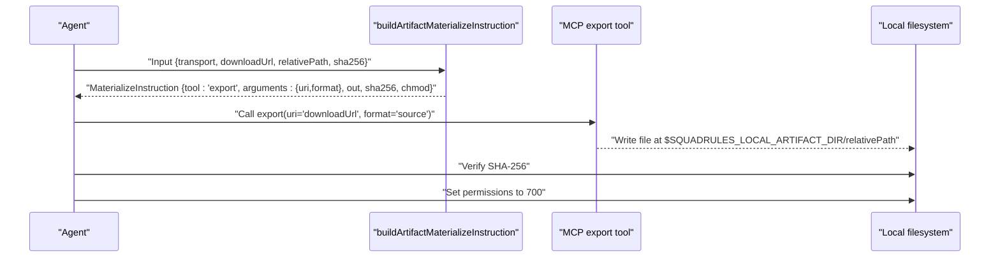
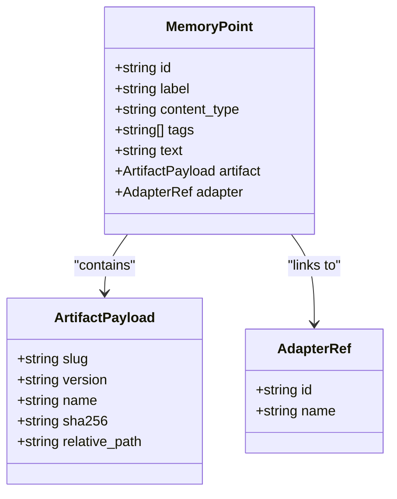
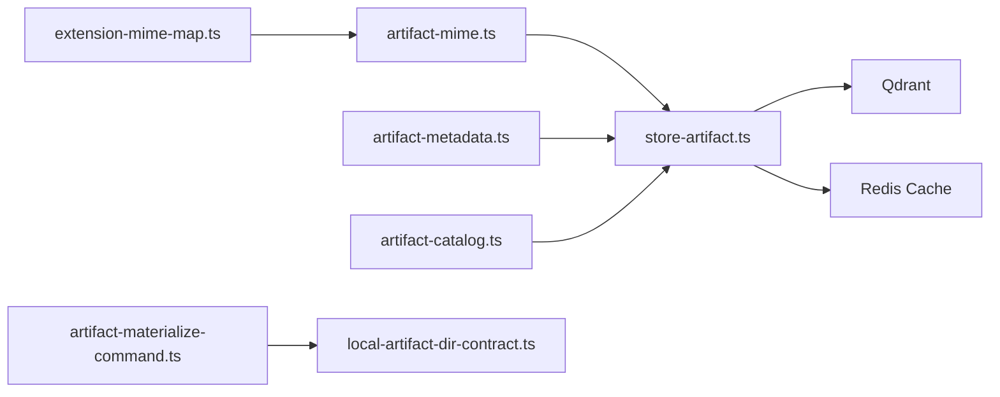

# Artifact Storage

<cite>
**Referenced Files in This Document**
- [store-artifact.ts](file://src/services/memory/store-artifact.ts)
- [artifact-mime.ts](file://src/tools/artifact-mime.ts)
- [extension-mime-map.ts](file://src/tools/skill-export/artifact-sanitization/extension-mime-map.ts)
- [artifact-metadata.ts](file://src/services/memory/artifact-metadata.ts)
- [artifact-catalog.ts](file://src/tools/artifact-catalog.ts)
- [artifact-materialize-command.ts](file://src/tools/artifact-materialize-command.ts)
- [local-artifact-dir-contract.ts](file://src/tools/local-artifact-dir-contract.ts)
- [artifact-relative-path.ts](file://src/tools/artifact-relative-path.ts)
</cite>

## Table of Contents
1. [Introduction](#introduction)
2. [Project Structure](#project-structure)
3. [Core Components](#core-components)
4. [Architecture Overview](#architecture-overview)
5. [Detailed Component Analysis](#detailed-component-analysis)
6. [Dependency Analysis](#dependency-analysis)
7. [Performance Considerations](#performance-considerations)
8. [Troubleshooting Guide](#troubleshooting-guide)
9. [Conclusion](#conclusion)

## Introduction
This document explains how SquadRules stores and retrieves artifacts alongside adapters, including binary and text content. It covers MIME type detection and validation, size and path safety rules, artifact materialization into executable files or accessible URLs, the local artifact directory contract for development and testing, security measures such as path traversal protection and access controls, and the relationship between artifacts and adapter execution contexts.

SquadRules is an agent-first MCP framework where agents create and repair adapters deterministically. Artifacts are stored as memory points in Qdrant with rich metadata, allowing agents to retrieve them through export flows and materialize them locally when needed.

## Project Structure
Artifact storage spans several modules:
- Memory layer: persists artifacts as Qdrant points with payload fields describing the artifact, its adapter, and search indices.
- Tools layer: provides MIME handling, relative path normalization, catalog listing, and materialization instructions.
- Sanitization map: defines allowed extensions and their corresponding MIME types.

**Diagram sources**
- [artifact-mime.ts:1-50](file://src/tools/artifact-mime.ts#L1-L50)
- [extension-mime-map.ts:1-27](file://src/tools/skill-export/artifact-sanitization/extension-mime-map.ts#L1-L27)
- [artifact-metadata.ts:1-78](file://src/services/memory/artifact-metadata.ts#L1-L78)
- [store-artifact.ts:1-301](file://src/services/memory/store-artifact.ts#L1-L301)
- [artifact-catalog.ts:1-88](file://src/tools/artifact-catalog.ts#L1-L88)
- [artifact-materialize-command.ts:1-49](file://src/tools/artifact-materialize-command.ts#L1-L49)
- [local-artifact-dir-contract.ts:1-20](file://src/tools/local-artifact-dir-contract.ts#L1-L20)
- [artifact-relative-path.ts:1-28](file://src/tools/artifact-relative-path.ts#L1-L28)

**Section sources**
- [store-artifact.ts:1-301](file://src/services/memory/store-artifact.ts#L1-L301)
- [artifact-mime.ts:1-50](file://src/tools/artifact-mime.ts#L1-L50)
- [extension-mime-map.ts:1-27](file://src/tools/skill-export/artifact-sanitization/extension-mime-map.ts#L1-L27)
- [artifact-metadata.ts:1-78](file://src/services/memory/artifact-metadata.ts#L1-L78)
- [artifact-catalog.ts:1-88](file://src/tools/artifact-catalog.ts#L1-L88)
- [artifact-materialize-command.ts:1-49](file://src/tools/artifact-materialize-command.ts#L1-L49)
- [local-artifact-dir-contract.ts:1-20](file://src/tools/local-artifact-dir-contract.ts#L1-L20)
- [artifact-relative-path.ts:1-28](file://src/tools/artifact-relative-path.ts#L1-L28)

## Core Components
- Artifact storage (Qdrant): `storeArtifact` persists artifacts as memory points with payload fields for artifact identity, adapter linkage, content type, SHA-256 digest, timestamps, and sparse/dense vectors for search.
- MIME allowlist and inference: `ALLOWED_ARTIFACT_MIMES`, `isAllowedArtifactMime`, and `inferArtifactMimeFromName` derive and validate MIME types from filenames and extension mappings.
- Metadata extraction: `extractArtifactMetadata` parses top-of-file headers to determine slug and version, with strict slug validation.
- Relative path safety: `normalizeArtifactRelativePath` enforces skill-root-relative paths without traversal.
- Catalog listing: `listAdapterArtifacts` returns normalized artifact metadata for a given adapter.
- Materialization instruction: `buildArtifactMaterializeInstruction` produces an MCP tool call that instructs agents to download, verify, and make artifacts executable.
- Local artifact directory contract: exposes JSON hints and environment variable conventions for client-side handoff directories.

**Section sources**
- [store-artifact.ts:168-300](file://src/services/memory/store-artifact.ts#L168-L300)
- [artifact-mime.ts:1-50](file://src/tools/artifact-mime.ts#L1-L50)
- [artifact-metadata.ts:1-78](file://src/services/memory/artifact-metadata.ts#L1-L78)
- [artifact-relative-path.ts:1-28](file://src/tools/artifact-relative-path.ts#L1-L28)
- [artifact-catalog.ts:1-88](file://src/tools/artifact-catalog.ts#L1-L88)
- [artifact-materialize-command.ts:1-49](file://src/tools/artifact-materialize-command.ts#L1-L49)
- [local-artifact-dir-contract.ts:1-20](file://src/tools/local-artifact-dir-contract.ts#L1-L20)

## Architecture Overview
The artifact lifecycle integrates training/export flows with Qdrant persistence and agent-driven materialization.

**Diagram sources**
- [store-artifact.ts:168-300](file://src/services/memory/store-artifact.ts#L168-L300)
- [artifact-catalog.ts:68-86](file://src/tools/artifact-catalog.ts#L68-L86)
- [artifact-materialize-command.ts:36-48](file://src/tools/artifact-materialize-command.ts#L36-L48)

## Detailed Component Analysis

### Artifact Storage and Retrieval
- Storage entry point: `storeArtifact` validates the adapter URI, resolves the chain adapter ID, extracts artifact metadata, computes SHA-256, builds BM25 sparse tokens, and upserts a Qdrant point with artifact payload and zero dense vectors.
- Duplicate handling: existing artifacts are matched by slug/name; duplicates throw unless `forceUpdate` is set.
- Search indexing: BM25 index is built over name, slug, and truncated content; fallback removes BM25 on sparse/vector errors.
- Retrieval: `listAdapterArtifacts` maps Qdrant payloads to a typed artifact catalog view sorted by name and UUID.

**Diagram sources**
- [store-artifact.ts:168-300](file://src/services/memory/store-artifact.ts#L168-L300)

**Section sources**
- [store-artifact.ts:20-126](file://src/services/memory/store-artifact.ts#L20-L126)
- [store-artifact.ts:133-166](file://src/services/memory/store-artifact.ts#L133-L166)
- [store-artifact.ts:168-300](file://src/services/memory/store-artifact.ts#L168-L300)
- [artifact-catalog.ts:18-66](file://src/tools/artifact-catalog.ts#L18-L66)
- [artifact-catalog.ts:68-86](file://src/tools/artifact-catalog.ts#L68-L86)

### MIME Type Detection and Validation
- Allowed MIME set: derived from extension-to-MIME mapping and no-extension defaults.
- Inference: primary MIME inferred from filename extension via `inferArtifactMimeFromName`.
- Validation: `isAllowedArtifactMime` checks against the canonical allowlist.
- Storage filter: artifact queries restrict to allowed MIME types.

**Diagram sources**
- [artifact-mime.ts:1-50](file://src/tools/artifact-mime.ts#L1-L50)
- [extension-mime-map.ts:10-26](file://src/tools/skill-export/artifact-sanitization/extension-mime-map.ts#L10-L26)
- [store-artifact.ts:133-166](file://src/services/memory/store-artifact.ts#L133-L166)

**Section sources**
- [artifact-mime.ts:1-50](file://src/tools/artifact-mime.ts#L1-L50)
- [extension-mime-map.ts:1-27](file://src/tools/skill-export/artifact-sanitization/extension-mime-map.ts#L1-L27)
- [store-artifact.ts:133-166](file://src/services/memory/store-artifact.ts#L133-L166)

### Artifact Metadata and Slug Rules
- Header parsing: optional top-of-file header lines define slug and version.
- Slug derivation: if not provided, slug is derived from artifact name with strict normalization and regex validation.
- Versioning: defaults to "1" when absent.

**Diagram sources**
- [artifact-metadata.ts:1-78](file://src/services/memory/artifact-metadata.ts#L1-L78)

**Section sources**
- [artifact-metadata.ts:1-78](file://src/services/memory/artifact-metadata.ts#L1-L78)

### Relative Path Safety and Size Limits
- Relative path normalization: rejects absolute paths, parent traversal (`..`), empty segments, trailing slashes, and overly long paths (>2048 characters).
- Usage: ensures exported layout preservation and prevents path traversal attacks.

**Diagram sources**
- [artifact-relative-path.ts:1-28](file://src/tools/artifact-relative-path.ts#L1-L28)

**Section sources**
- [artifact-relative-path.ts:1-28](file://src/tools/artifact-relative-path.ts#L1-L28)

### Artifact Materialization Workflow
- Instruction generation: `buildArtifactMaterializeInstruction` creates an MCP tool call to the `export` tool with a download URL and format hint.
- Handoff directory: uses `SQUADRULES_LOCAL_ARTIFACT_DIR` environment variable for output location.
- Security posture: agents must verify SHA-256 and set restrictive permissions (`chmod 700`).

**Diagram sources**
- [artifact-materialize-command.ts:10-48](file://src/tools/artifact-materialize-command.ts#L10-L48)

**Section sources**
- [artifact-materialize-command.ts:1-49](file://src/tools/artifact-materialize-command.ts#L1-L49)

### Local Artifact Directory Contract
- JSON field: responses may include `squadrules_local_artifact_dir` containing ordered URI hints.
- Environment variable: clients resolve these hints to absolute paths and expose them as `SQUADRULES_LOCAL_ARTIFACT_DIR` for shell challenges.
- Purpose: decouples server-side storage from client-side filesystem layout.

**Section sources**
- [local-artifact-dir-contract.ts:1-20](file://src/tools/local-artifact-dir-contract.ts#L1-L20)

### Relationship Between Artifacts and Adapter Execution Contexts
- Adapter linkage: artifacts are attached to a specific adapter chain ID and store the adapter’s name for display.
- Space context: artifacts inherit space scoping and actor metadata from the runtime context.
- Catalog view: lists artifacts per adapter, enabling agents to discover and select artifacts during workflow execution.

**Diagram sources**
- [store-artifact.ts:227-257](file://src/services/memory/store-artifact.ts#L227-L257)
- [artifact-catalog.ts:18-66](file://src/tools/artifact-catalog.ts#L18-L66)

**Section sources**
- [store-artifact.ts:227-257](file://src/services/memory/store-artifact.ts#L227-L257)
- [artifact-catalog.ts:1-88](file://src/tools/artifact-catalog.ts#L1-L88)

## Dependency Analysis
- `store-artifact.ts` depends on:
  - `artifact-mime.ts` for allowed MIME types.
  - `artifact-metadata.ts` for slug/version extraction.
  - Qdrant client for persistence and search.
  - Redis cache service for invalidation after updates.
- `artifact-mime.ts` depends on `extension-mime-map.ts` for extension-to-MIME mapping.
- `artifact-catalog.ts` depends on the memory store interface to list artifacts.
- `artifact-materialize-command.ts` and `local-artifact-dir-contract.ts` coordinate agent-driven materialization and client-side handoff.

**Diagram sources**
- [extension-mime-map.ts:1-27](file://src/tools/skill-export/artifact-sanitization/extension-mime-map.ts#L1-L27)
- [artifact-mime.ts:1-50](file://src/tools/artifact-mime.ts#L1-L50)
- [artifact-metadata.ts:1-78](file://src/services/memory/artifact-metadata.ts#L1-L78)
- [store-artifact.ts:1-301](file://src/services/memory/store-artifact.ts#L1-L301)
- [artifact-catalog.ts:1-88](file://src/tools/artifact-catalog.ts#L1-L88)
- [artifact-materialize-command.ts:1-49](file://src/tools/artifact-materialize-command.ts#L1-L49)
- [local-artifact-dir-contract.ts:1-20](file://src/tools/local-artifact-dir-contract.ts#L1-L20)

**Section sources**
- [store-artifact.ts:1-301](file://src/services/memory/store-artifact.ts#L1-L301)
- [artifact-mime.ts:1-50](file://src/tools/artifact-mime.ts#L1-L50)
- [extension-mime-map.ts:1-27](file://src/tools/skill-export/artifact-sanitization/extension-mime-map.ts#L1-L27)
- [artifact-metadata.ts:1-78](file://src/services/memory/artifact-metadata.ts#L1-L78)
- [artifact-catalog.ts:1-88](file://src/tools/artifact-catalog.ts#L1-L88)
- [artifact-materialize-command.ts:1-49](file://src/tools/artifact-materialize-command.ts#L1-L49)
- [local-artifact-dir-contract.ts:1-20](file://src/tools/local-artifact-dir-contract.ts#L1-L20)

## Performance Considerations
- Sparse vector fallback: when Qdrant reports sparse/vector errors, the system retries without BM25 to ensure durability.
- Zero dense vectors: artifacts use placeholder dense vectors to satisfy schema requirements while keeping storage lean.
- Pagination: artifact listing uses paginated scroll operations to handle large collections efficiently.
- Caching: Redis cache invalidation occurs after artifact updates to keep downstream reads consistent.

[No sources needed since this section provides general guidance]

## Troubleshooting Guide
- Duplicate artifact errors:
  - Cause: attempting to add an artifact with the same slug/name to an adapter without `forceUpdate`.
  - Resolution: update the existing artifact using `forceUpdate` or choose a distinct slug/name.
- Invalid artifact slug:
  - Cause: slug does not match allowed pattern or cannot be derived from artifact name.
  - Resolution: provide a valid header slug or adjust artifact name to produce a valid slug.
- MIME rejection:
  - Cause: artifact MIME not in the allowed set or extension mismatch.
  - Resolution: ensure the filename extension maps to an allowed MIME type or adjust content type accordingly.
- Relative path errors:
  - Cause: path contains traversal (`..`), is absolute, has empty segments, ends with `/`, or exceeds length limit.
  - Resolution: normalize to a clean, relative path within the skill root.
- Materialization failures:
  - Cause: missing `SQUADRULES_LOCAL_ARTIFACT_DIR`, incorrect download URL, or SHA-256 mismatch.
  - Resolution: configure the environment variable, verify the download URL, and confirm the expected digest.

**Section sources**
- [store-artifact.ts:192-207](file://src/services/memory/store-artifact.ts#L192-L207)
- [artifact-metadata.ts:64-76](file://src/services/memory/artifact-metadata.ts#L64-L76)
- [artifact-mime.ts:34-48](file://src/tools/artifact-mime.ts#L34-L48)
- [artifact-relative-path.ts:7-26](file://src/tools/artifact-relative-path.ts#L7-L26)
- [artifact-materialize-command.ts:36-48](file://src/tools/artifact-materialize-command.ts#L36-L48)

## Conclusion
SquadRules’ artifact system combines strict validation, safe path handling, and robust persistence to support both binary and text artifacts linked to adapters. Agents can discover artifacts via catalog listings and materialize them safely through MCP tool calls, with clear contracts for local handoff directories. The design emphasizes security (path traversal protection, MIME allowlists, permission hardening), performance (sparse vector fallback, pagination), and clarity (typed metadata and explicit adapter linkage).

[No sources needed since this section summarizes without analyzing specific files]