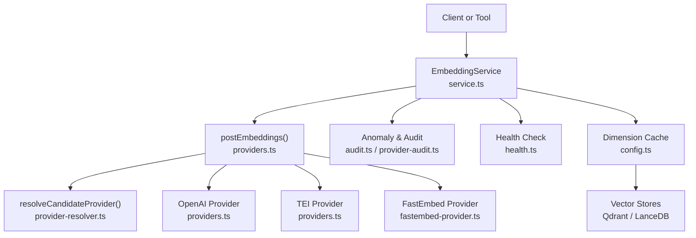
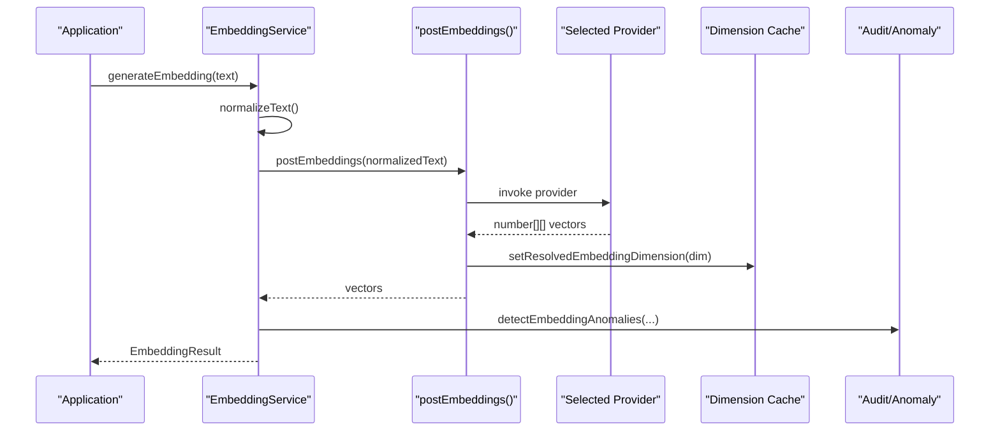
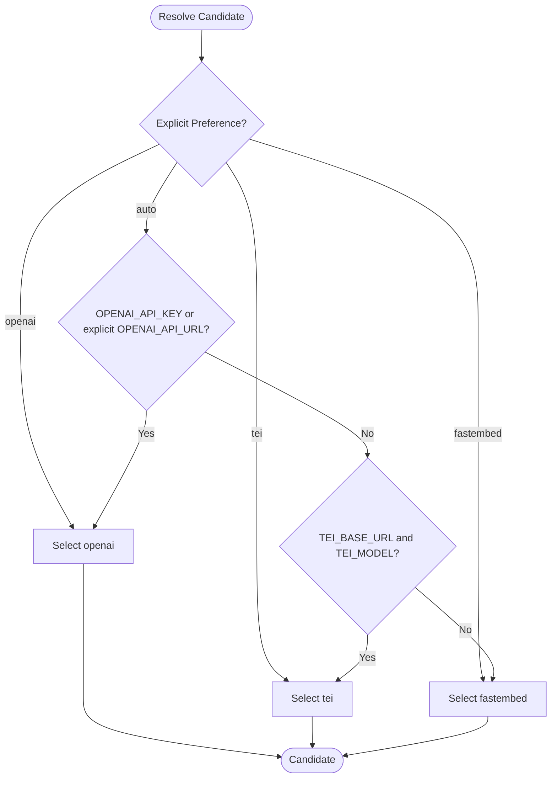
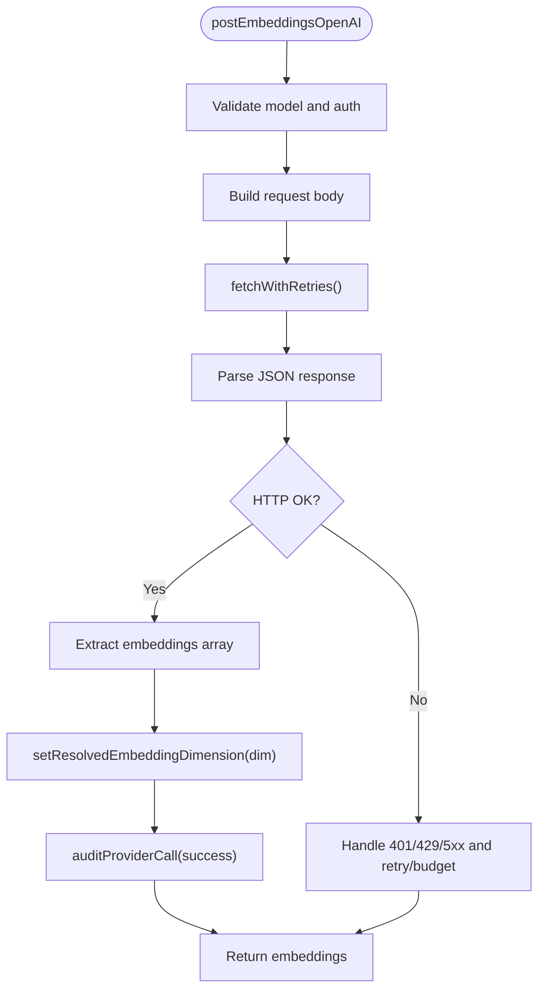
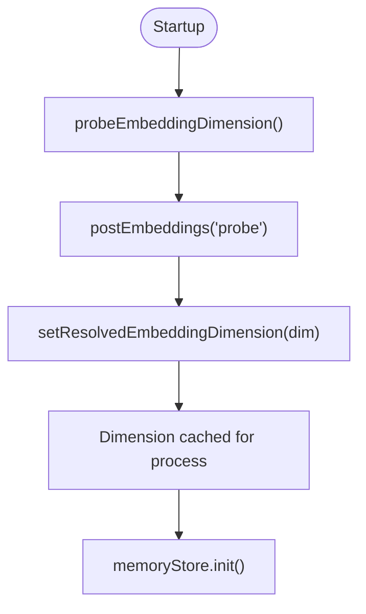
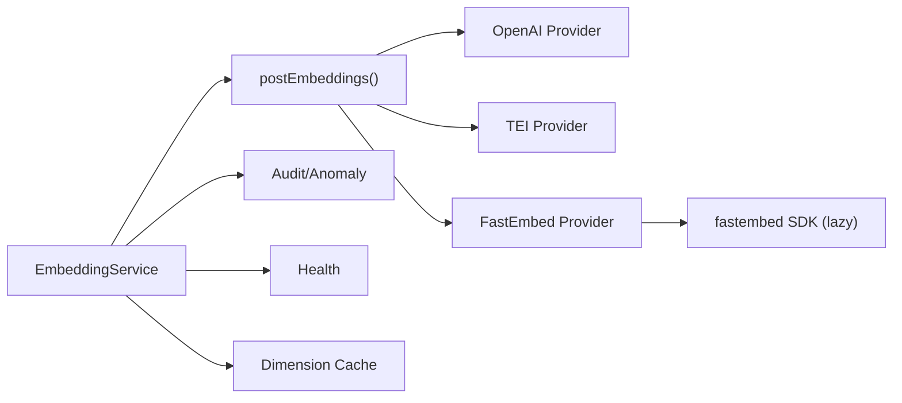
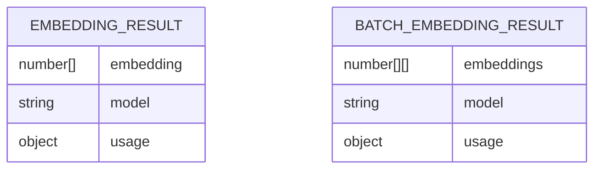

# Embedding Pipeline

<cite>
**Referenced Files in This Document**
- [src/services/embedding/service.ts](file://src/services/embedding/service.ts)
- [src/services/embedding/providers.ts](file://src/services/embedding/providers.ts)
- [src/services/embedding/provider-resolver.ts](file://src/services/embedding/provider-resolver.ts)
- [src/services/embedding/fastembed-provider.ts](file://src/services/embedding/fastembed-provider.ts)
- [src/services/embedding/config.ts](file://src/services/embedding/config.ts)
- [src/services/embedding/health.ts](file://src/services/embedding/health.ts)
- [src/services/embedding/audit.ts](file://src/services/embedding/audit.ts)
- [src/services/embedding/provider-audit.ts](file://src/services/embedding/provider-audit.ts)
- [src/services/embedding/types.ts](file://src/services/embedding/types.ts)
- [src/config.ts](file://src/config.ts)
- [docs/adr/0021-embedding-provider-auto-resolution-and-store-width-binding.md](file://docs/adr/0021-embedding-provider-auto-resolution-and-store-width-binding.md)
</cite>

## Table of Contents
1. [Introduction](#introduction)
2. [Project Structure](#project-structure)
3. [Core Components](#core-components)
4. [Architecture Overview](#architecture-overview)
5. [Detailed Component Analysis](#detailed-component-analysis)
6. [Dependency Analysis](#dependency-analysis)
7. [Performance Considerations](#performance-considerations)
8. [Troubleshooting Guide](#troubleshooting-guide)
9. [Conclusion](#conclusion)
10. [Appendices](#appendices)

## Introduction
This document explains the SquadRules embedding pipeline: how raw text is converted into vector representations, how providers are selected and probed, how vector dimensions are managed, and how quality, retries, and auditability are enforced. It covers FastEmbed (local), OpenAI-compatible endpoints, and the deprecated TEI provider, plus guidance for custom providers, batch processing, migration strategies, and troubleshooting embedding quality issues.

SquadRules uses embeddings for semantic search over rules and workflows. The default local path is FastEmbed; when an OpenAI-compatible endpoint is explicitly configured, that path is preferred. A process-wide embedding dimension is resolved at startup and bound to downstream stores so writes and reads use consistent vector widths.

## Project Structure
The embedding pipeline lives under `src/services/embedding` and integrates with configuration, metrics, audit logging, and runtime boot logic.



**Diagram sources**
- [src/services/embedding/service.ts:39-278](file://src/services/embedding/service.ts#L39-L278)
- [src/services/embedding/providers.ts:296-333](file://src/services/embedding/providers.ts#L296-L333)
- [src/services/embedding/provider-resolver.ts:28-46](file://src/services/embedding/provider-resolver.ts#L28-L46)
- [src/services/embedding/fastembed-provider.ts:41-82](file://src/services/embedding/fastembed-provider.ts#L41-L82)
- [src/services/embedding/config.ts:12-36](file://src/services/embedding/config.ts#L12-L36)

**Section sources**
- [src/services/embedding/service.ts:39-278](file://src/services/embedding/service.ts#L39-L278)
- [src/services/embedding/providers.ts:296-333](file://src/services/embedding/providers.ts#L296-L333)
- [src/services/embedding/provider-resolver.ts:28-46](file://src/services/embedding/provider-resolver.ts#L28-L46)
- [src/services/embedding/fastembed-provider.ts:41-82](file://src/services/embedding/fastembed-provider.ts#L41-L82)
- [src/services/embedding/config.ts:12-36](file://src/services/embedding/config.ts#L12-L36)

## Core Components
- EmbeddingService: Public API for single and batch embedding generation, cosine similarity, health checks, and provider/model/dimension reporting.
- Provider selection: `postEmbeddings()` routes to OpenAI, TEI, or FastEmbed based on explicit preference or auto-detection.
- Provider implementations:
  - OpenAI-compatible HTTP client with retry/backoff, quota handling, and structured audit.
  - TEI HTTP client (deprecated) with flexible response parsing.
  - FastEmbed local ONNX provider with lazy initialization and model caching.
- Dimension management: Process-wide dimension cache set by first successful provider call; subsequent calls assert consistency.
- Health and audit: Per-provider health probes, anomaly detection (latency, norm range, dimension mismatch), and structured audit logs.

Key responsibilities:
- Normalize input text and validate non-empty content.
- Track latency, token counts, output dimension, and vector size metrics.
- Enforce dimension consistency and fail fast on mismatches.
- Emit structured audit events for success and error paths.

**Section sources**
- [src/services/embedding/service.ts:48-278](file://src/services/embedding/service.ts#L48-L278)
- [src/services/embedding/providers.ts:93-333](file://src/services/embedding/providers.ts#L93-L333)
- [src/services/embedding/fastembed-provider.ts:41-82](file://src/services/embedding/fastembed-provider.ts#L41-L82)
- [src/services/embedding/config.ts:12-36](file://src/services/embedding/config.ts#L12-L36)
- [src/services/embedding/audit.ts:94-157](file://src/services/embedding/audit.ts#L94-L157)

## Architecture Overview
The embedding pipeline follows a layered design:
- Service layer: orchestrates normalization, provider selection, metrics, and anomaly detection.
- Provider layer: implements concrete backends (OpenAI, TEI, FastEmbed).
- Configuration layer: resolves environment-driven settings and process-wide dimension cache.
- Audit and health layers: provide diagnostics, anomaly detection, and readiness checks.



**Diagram sources**
- [src/services/embedding/service.ts:48-127](file://src/services/embedding/service.ts#L48-L127)
- [src/services/embedding/providers.ts:296-333](file://src/services/embedding/providers.ts#L296-L333)
- [src/services/embedding/config.ts:15-31](file://src/services/embedding/config.ts#L15-L31)
- [src/services/embedding/audit.ts:94-157](file://src/services/embedding/audit.ts#L94-L157)

## Detailed Component Analysis

### Provider Abstraction Layer
The abstraction separates candidate resolution from successful initialization:
- Candidate resolver determines which provider to try based on explicit preference or auto-detection.
- Successful provider descriptor records the actual provider, model, and dimension after a successful call.

Resolution rules:
- Explicit preference wins (`openai`, `tei`, `fastembed`).
- Auto-detection prefers OpenAI if key or explicitly overridden URL is present; otherwise falls back to TEI if configured; otherwise uses FastEmbed.
- TEI is deprecated but supported as a transitional fallback.



**Diagram sources**
- [src/services/embedding/provider-resolver.ts:28-46](file://src/services/embedding/provider-resolver.ts#L28-L46)
- [src/services/embedding/providers.ts:296-333](file://src/services/embedding/providers.ts#L296-L333)

**Section sources**
- [src/services/embedding/provider-resolver.ts:28-82](file://src/services/embedding/provider-resolver.ts#L28-L82)
- [src/services/embedding/providers.ts:296-333](file://src/services/embedding/providers.ts#L296-L333)

### OpenAI-Compatible Provider
Responsibilities:
- Validate required model and authentication conditions.
- Send batched requests to `/v1/embeddings`.
- Handle JSON parsing, HTTP status codes, rate limits, and non-retriable quota errors.
- Record successful provider descriptor and dimension.
- Emit structured audit events.

Retry behavior:
- Network errors and specific HTTP statuses trigger exponential backoff with jitter.
- Honors `Retry-After` headers up to a cap.
- Uses a wall-clock budget to stop retries after a threshold.



**Diagram sources**
- [src/services/embedding/providers.ts:93-202](file://src/services/embedding/providers.ts#L93-L202)

**Section sources**
- [src/services/embedding/providers.ts:93-202](file://src/services/embedding/providers.ts#L93-L202)

### TEI Provider (Deprecated)
Responsibilities:
- Validate base URL and model.
- Send requests to TEI endpoint with optional API key header.
- Support multiple response shapes (`embeddings`, `data`, `result`, or raw arrays).
- Record successful provider descriptor and dimension.
- Emit structured audit events.

Deprecation:
- Emits a one-time soft-deprecation warning per process.

**Section sources**
- [src/services/embedding/providers.ts:203-295](file://src/services/embedding/providers.ts#L203-L295)

### FastEmbed Local Provider
Responsibilities:
- Lazy initialization of the FastEmbed SDK and model instance.
- Download model weights once into a shared cache directory.
- Iterate over streaming batches to produce embeddings.
- Record successful provider descriptor and dimension.
- Emit structured audit events.

Initialization:
- Memoizes the initialization promise; transient failures clear the memo to allow retry.

**Section sources**
- [src/services/embedding/fastembed-provider.ts:17-82](file://src/services/embedding/fastembed-provider.ts#L17-L82)

### EmbeddingService
Responsibilities:
- Normalize input text and validate non-empty content.
- Select provider via `getProvider()` and resolve model name.
- Generate single or batch embeddings.
- Detect anomalies (latency, norm range, dimension mismatch).
- Track metrics (requests, duration, errors, vector size, batch size).
- Provide health check and configuration summary.

```mermaid
classDiagram
class EmbeddingService {
+generateEmbedding(text) EmbeddingResult
+generateBatchEmbeddings(texts) BatchEmbeddingResult
+calculateCosineSimilarity(a,b) number
+generateMemoryEmbedding(memory) number[]
+healthCheck() Promise~{healthy,message}~
+getProvider() string
+getConfig() object
-embeddingDimension number
-getModelName(provider) string
}
```

**Diagram sources**
- [src/services/embedding/service.ts:39-278](file://src/services/embedding/service.ts#L39-L278)

**Section sources**
- [src/services/embedding/service.ts:48-278](file://src/services/embedding/service.ts#L48-L278)

### Dimension Management and Probe
- First successful provider call sets the process-wide embedding dimension.
- Subsequent calls assert the same dimension; mismatches throw errors.
- A probe function runs a minimal embed at startup to ensure dimension is resolved before store initialization.



**Diagram sources**
- [src/services/embedding/service.ts:280-284](file://src/services/embedding/service.ts#L280-L284)
- [src/services/embedding/config.ts:15-31](file://src/services/embedding/config.ts#L15-L31)

**Section sources**
- [src/services/embedding/config.ts:12-36](file://src/services/embedding/config.ts#L12-L36)
- [src/services/embedding/service.ts:280-284](file://src/services/embedding/service.ts#L280-L284)

### Health Checks
Per-provider health probes validate configuration and connectivity:
- OpenAI: requires model and either key or explicitly overridden URL; treats 429 as reachable but throttled.
- TEI: requires base URL and model; supports flexible response parsing.
- FastEmbed: performs a local embed to verify operational state.

Auto mode health:
- Mirrors runtime selection: tries OpenAI first if configured, then TEI if configured, else FastEmbed.

**Section sources**
- [src/services/embedding/health.ts:17-123](file://src/services/embedding/health.ts#L17-L123)

### Audit and Anomaly Detection
- Structured audit logs capture provider, model, input/output sizes, latency, HTTP status, and error messages.
- Anomaly detection flags high latency, unusual vector norms, and dimension mismatches.
- Search-related anomalies can be logged separately for zero results or low top scores.

**Section sources**
- [src/services/embedding/provider-audit.ts:13-42](file://src/services/embedding/provider-audit.ts#L13-L42)
- [src/services/embedding/audit.ts:94-157](file://src/services/embedding/audit.ts#L94-L157)

## Dependency Analysis
High-level dependencies:
- EmbeddingService depends on provider routing, dimension cache, metrics, tenant context, and audit utilities.
- Providers depend on configuration constants and audit utilities.
- FastEmbed provider lazily imports the FastEmbed SDK.
- Health module reuses provider functions to validate connectivity.



**Diagram sources**
- [src/services/embedding/service.ts:39-278](file://src/services/embedding/service.ts#L39-L278)
- [src/services/embedding/providers.ts:296-333](file://src/services/embedding/providers.ts#L296-L333)
- [src/services/embedding/fastembed-provider.ts:17-39](file://src/services/embedding/fastembed-provider.ts#L17-L39)

**Section sources**
- [src/services/embedding/service.ts:39-278](file://src/services/embedding/service.ts#L39-L278)
- [src/services/embedding/providers.ts:296-333](file://src/services/embedding/providers.ts#L296-L333)
- [src/services/embedding/fastembed-provider.ts:17-39](file://src/services/embedding/fastembed-provider.ts#L17-L39)

## Performance Considerations
- Batch embeddings: Prefer `generateBatchEmbeddings()` to reduce overhead and improve throughput.
- Retry policy: Exponential backoff with jitter honors `Retry-After` headers and respects a wall-clock budget to avoid long stalls.
- Local inference: FastEmbed avoids network calls and external keys; model weights are downloaded once and cached.
- Dimension cache: Avoids repeated probing; ensures consistent vector width across the process.
- Metrics: Duration, request/error counters, vector size, and batch size help identify bottlenecks.

[No sources needed since this section provides general guidance]

## Troubleshooting Guide
Common issues and resolutions:
- Missing model or authentication:
  - OpenAI requires `OPENAI_EMBEDDING_MODEL`; also requires `OPENAI_API_KEY` or an explicitly overridden `OPENAI_API_URL`.
  - TEI requires `TEI_BASE_URL` and `TEI_MODEL`.
- Rate limiting:
  - 429 responses are retried according to policy; non-retriable quota errors fail fast with actionable messages.
- Dimension mismatch:
  - If the provider returns a different dimension than expected, the service throws an error; ensure the correct provider and model are used and that the dimension was probed at startup.
- Health check failures:
  - Use `healthCheck()` to diagnose provider-specific issues; 429 is treated as reachable but throttled for OpenAI and TEI.
- Migration between providers:
  - Vector DB stores bind to the provider’s dimension; changing providers may require migration or store rebuild. Qdrant supports automatic migration; LanceDB does not include automatic migration in this codebase.

Operational tips:
- Verify environment variables and provider selection using `EmbeddingService.getConfig()`.
- Inspect audit logs for provider, model, latency, HTTP status, and error messages.
- Monitor anomaly events for latency spikes, unusual norms, and dimension mismatches.

**Section sources**
- [src/services/embedding/providers.ts:93-202](file://src/services/embedding/providers.ts#L93-L202)
- [src/services/embedding/providers.ts:203-295](file://src/services/embedding/providers.ts#L203-L295)
- [src/services/embedding/health.ts:17-123](file://src/services/embedding/health.ts#L17-L123)
- [docs/adr/0021-embedding-provider-auto-resolution-and-store-width-binding.md:72-127](file://docs/adr/0021-embedding-provider-auto-resolution-and-store-width-binding.md#L72-L127)

## Conclusion
The SquadRules embedding pipeline provides a robust, configurable abstraction over multiple embedding providers. It emphasizes safe defaults (FastEmbed), explicit support for OpenAI-compatible endpoints, deprecation of TEI, strict dimension management, comprehensive retry and audit mechanisms, and clear health diagnostics. Operators should configure providers explicitly where possible, monitor anomalies and audit logs, and plan migrations carefully when switching providers due to vector width binding.

[No sources needed since this section summarizes without analyzing specific files]

## Appendices

### Configuration Options
- `EMBEDDING_PROVIDER`: `auto` (default), `openai`, `tei`, `fastembed`.
- `OPENAI_EMBEDDING_MODEL`: Model identifier for OpenAI-compatible endpoints.
- `OPENAI_API_KEY`: Optional bearer token for OpenAI-compatible endpoints.
- `OPENAI_API_URL`: Base URL for OpenAI-compatible endpoints; explicit override is tracked.
- `FASTEMBED_MODEL` / `FASTEMBED_CACHE_DIR`: Local model and cache directory.
- `TEI_BASE_URL` / `TEI_MODEL` / `TEI_API_KEY`: Deprecated TEI configuration.
- Retry tuning: `EMBEDDING_MAX_RETRIES`, `EMBEDDING_RETRY_BASE_DELAY_MS`, `EMBEDDING_RETRY_MAX_DELAY_MS`, `EMBEDDING_RETRY_AFTER_CAP_MS`, `EMBEDDING_RETRY_BUDGET_MS`.
- Anomaly thresholds: `EMBEDDING_LATENCY_WARN_MS`, `EMBEDDING_NORM_MIN`, `EMBEDDING_NORM_MAX`, `SEARCH_SCORE_WARN_THRESHOLD`.

**Section sources**
- [src/config.ts:70-96](file://src/config.ts#L70-L96)

### Custom Provider Implementation
To add a custom provider:
- Implement a function similar to `postEmbeddingsFastEmbed` that accepts `string | string[]`, returns `number[][]`, sets the resolved dimension, and records the successful provider descriptor.
- Integrate it into `postEmbeddings()` routing logic and optionally expose a health check.
- Ensure structured audit events are emitted for success and error paths.

Reference patterns:
- Local provider pattern: [fastembed-provider.ts:41-82](file://src/services/embedding/fastembed-provider.ts#L41-L82)
- HTTP provider pattern: [providers.ts OpenAI/TEI:93-295](file://src/services/embedding/providers.ts#L93-L295)
- Successful provider tracking: [provider-resolver.ts:68-82](file://src/services/embedding/provider-resolver.ts#L68-L82)

**Section sources**
- [src/services/embedding/fastembed-provider.ts:41-82](file://src/services/embedding/fastembed-provider.ts#L41-L82)
- [src/services/embedding/providers.ts:93-295](file://src/services/embedding/providers.ts#L93-L295)
- [src/services/embedding/provider-resolver.ts:68-82](file://src/services/embedding/provider-resolver.ts#L68-L82)

### Batch Embedding Processing
- Use `generateBatchEmbeddings()` to process multiple texts efficiently.
- Inputs are filtered for non-empty values; empty inputs are excluded.
- Output dimension consistency is validated; anomalies are detected and reported.

**Section sources**
- [src/services/embedding/service.ts:130-222](file://src/services/embedding/service.ts#L130-L222)

### Migration Strategies Between Providers
- Qdrant: Automatic migration at boot detects dimension differences and migrates vector spaces.
- LanceDB: No automatic migration; changing providers may require manual steps or store rebuild due to width-bound columns.
- Best practice: Resolve and probe the embedding dimension before store initialization; record provider/model/dimension metadata and warn on mismatches.

**Section sources**
- [docs/adr/0021-embedding-provider-auto-resolution-and-store-width-binding.md:72-127](file://docs/adr/0021-embedding-provider-auto-resolution-and-store-width-binding.md#L72-L127)

### Data Models


**Diagram sources**
- [src/services/embedding/types.ts:1-17](file://src/services/embedding/types.ts#L1-L17)