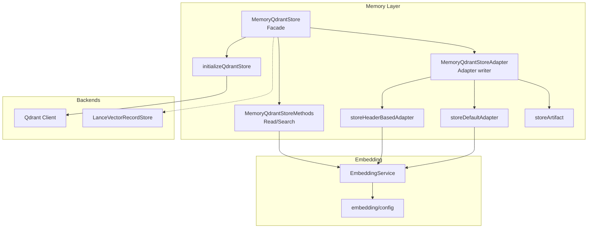
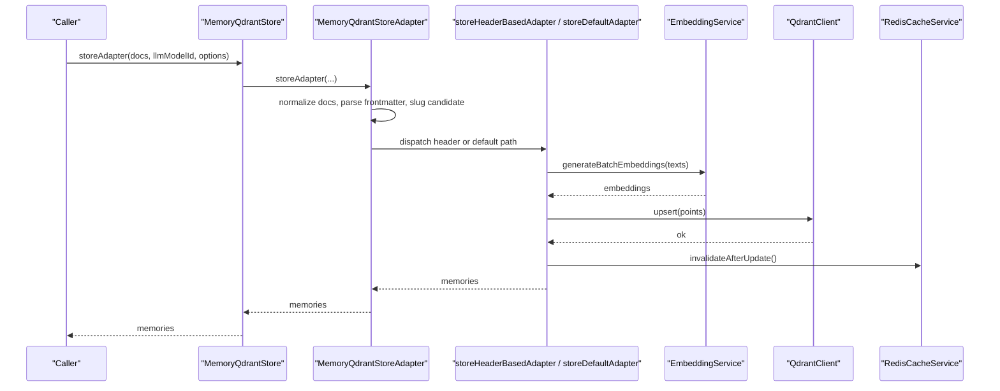
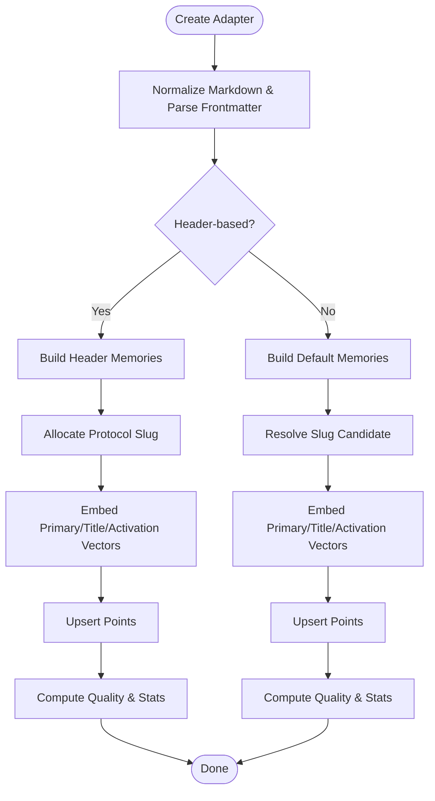
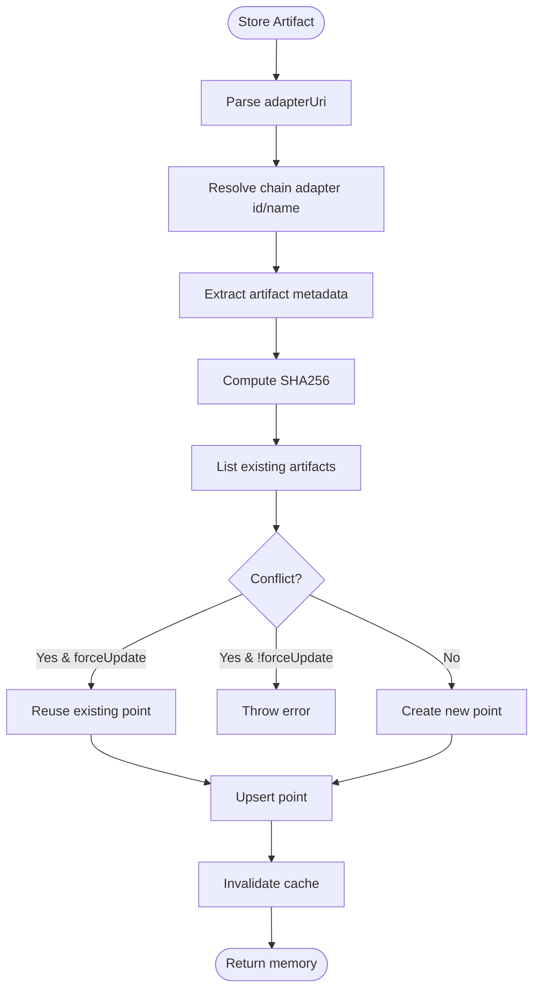
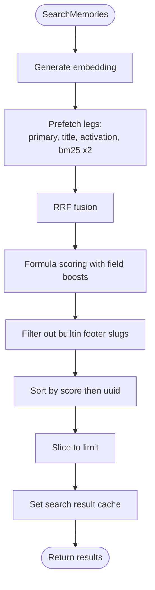
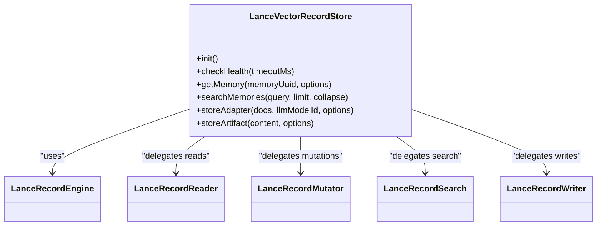
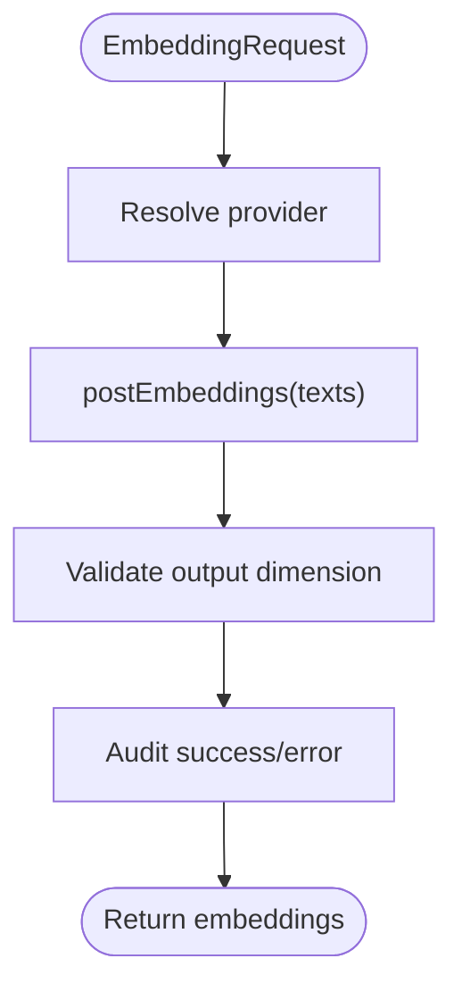
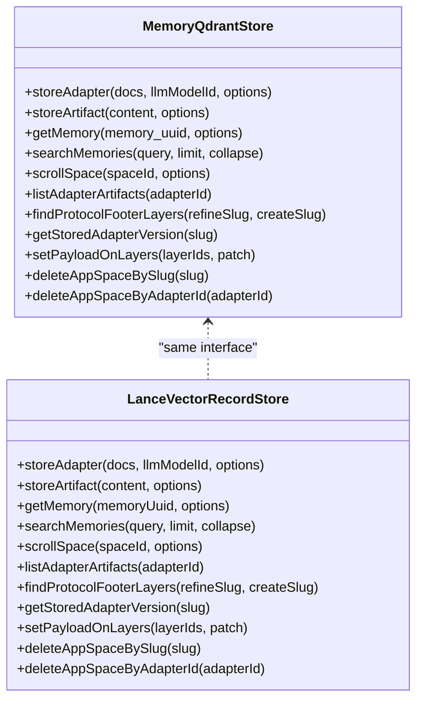
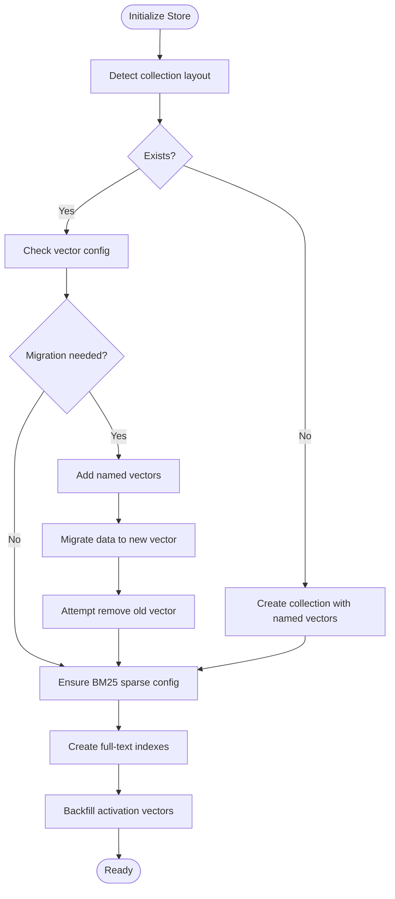
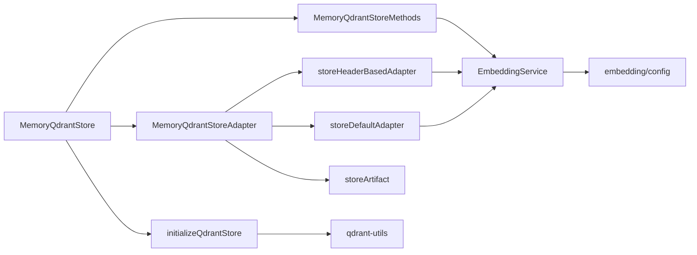

# Memory Management

<cite>
**Referenced Files in This Document**
- [store.ts](file://src/services/memory/store.ts)
- [store-adapter.ts](file://src/services/memory/store-adapter.ts)
- [store-methods.ts](file://src/services/memory/store-methods.ts)
- [store-init.ts](file://src/services/memory/store-init.ts)
- [adapter-builder.ts](file://src/services/memory/adapter-builder.ts)
- [store-adapter-header-handler.ts](file://src/services/memory/store-adapter-header-handler.ts)
- [store-adapter-default-handler.ts](file://src/services/memory/store-adapter-default-handler.ts)
- [store-artifact.ts](file://src/services/memory/store-artifact.ts)
- [activation-search-fields.ts](file://src/services/memory/activation-search-fields.ts)
- [qdrant-vector-types.ts](file://src/utils/qdrant-vector-types.ts)
- [LanceVectorRecordStore.ts](file://src/services/vector-store/lancedb/LanceVectorRecordStore.ts)
- [service.ts](file://src/services/embedding/service.ts)
- [config.ts](file://src/services/embedding/config.ts)
- [artifact-mime.ts](file://src/tools/artifact-mime.ts)
</cite>

## Table of Contents
1. [Introduction](#introduction)
2. [Project Structure](#project-structure)
3. [Core Components](#core-components)
4. [Architecture Overview](#architecture-overview)
5. [Detailed Component Analysis](#detailed-component-analysis)
6. [Dependency Analysis](#dependency-analysis)
7. [Performance Considerations](#performance-considerations)
8. [Troubleshooting Guide](#troubleshooting-guide)
9. [Conclusion](#conclusion)

## Introduction
This document explains the memory management system used by SquadRules to persist, search, and evolve adapters (rules and workflows). It covers:
- Adapter lifecycle from creation through training, activation, and archival
- Artifact storage and retrieval with MIME handling
- Vector database operations for Qdrant and LanceDB backends
- Embedding pipeline, provider abstraction, and dimension management
- Store adapter pattern for unified CRUD across backends
- Data migration strategies and version compatibility
- Caching, query optimization, and scalability patterns

## Project Structure
The memory subsystem is centered around a Qdrant-backed store with an embedded LanceDB alternative. The key modules are:
- Memory store facade and methods
- Adapter storage handlers (header-based and default)
- Artifact persistence
- Initialization and migration
- Embedding service and configuration
- Vector type utilities and LanceDB implementation

**Diagram sources**
- [store.ts:29-62](file://src/services/memory/store.ts#L29-L62)
- [store-adapter.ts:35-41](file://src/services/memory/store-adapter.ts#L35-L41)
- [store-methods.ts:25-36](file://src/services/memory/store-methods.ts#L25-L36)
- [store-adapter-header-handler.ts:30-39](file://src/services/memory/store-adapter-header-handler.ts#L30-L39)
- [store-adapter-default-handler.ts:34-46](file://src/services/memory/store-adapter-default-handler.ts#L34-L46)
- [store-artifact.ts:168-173](file://src/services/memory/store-artifact.ts#L168-L173)
- [store-init.ts:173-189](file://src/services/memory/store-init.ts#L173-L189)
- [LanceVectorRecordStore.ts:35-46](file://src/services/vector-store/lancedb/LanceVectorRecordStore.ts#L35-L46)
- [service.ts:39-46](file://src/services/embedding/service.ts#L39-L46)
- [config.ts:12-36](file://src/services/embedding/config.ts#L12-L36)

**Section sources**
- [store.ts:29-62](file://src/services/memory/store.ts#L29-L62)
- [LanceVectorRecordStore.ts:35-46](file://src/services/vector-store/lancedb/LanceVectorRecordStore.ts#L35-L46)

## Core Components
- MemoryQdrantStore: Entry point for memory operations; delegates to adapter writer and read/search methods; provides health checks and admin helpers.
- MemoryQdrantStoreAdapter: Orchestrates adapter creation paths (header-based vs default), slug allocation, duplicate handling, and artifact storage.
- MemoryQdrantStoreMethods: Implements caching, retrieval, hybrid search (dense + BM25), and title similarity search.
- store-init: Initializes collections, migrates vector dimensions, ensures BM25 sparse vectors and full-text indexes, and backfills activation vectors.
- EmbeddingService: Provider abstraction (OpenAI/TEI/fastembed), batch embeddings, dimension probing, and anomaly detection.
- LanceVectorRecordStore: Embedded backend implementing the same interface as Qdrant-backed store for local development and fallback.

**Section sources**
- [store.ts:29-153](file://src/services/memory/store.ts#L29-L153)
- [store-adapter.ts:35-152](file://src/services/memory/store-adapter.ts#L35-L152)
- [store-methods.ts:25-114](file://src/services/memory/store-methods.ts#L25-L114)
- [store-init.ts:173-342](file://src/services/memory/store-init.ts#L173-L342)
- [service.ts:39-285](file://src/services/embedding/service.ts#L39-L285)
- [LanceVectorRecordStore.ts:35-193](file://src/services/vector-store/lancedb/LanceVectorRecordStore.ts#L35-L193)

## Architecture Overview
The system uses a layered architecture:
- Facade layer exposes stable APIs for adapter and artifact operations.
- Handler layer implements domain-specific write logic for different adapter formats.
- Storage layer abstracts Qdrant and LanceDB via a common interface.
- Embedding layer provides provider-agnostic vector generation and dimension management.

**Diagram sources**
- [store.ts:132-142](file://src/services/memory/store.ts#L132-L142)
- [store-adapter.ts:43-147](file://src/services/memory/store-adapter.ts#L43-L147)
- [store-adapter-header-handler.ts:53-89](file://src/services/memory/store-adapter-header-handler.ts#L53-L89)
- [store-adapter-default-handler.ts:108-142](file://src/services/memory/store-adapter-default-handler.ts#L108-L142)
- [service.ts:130-222](file://src/services/embedding/service.ts#L130-L222)

## Detailed Component Analysis

### Adapter Lifecycle: Creation, Training, Activation, Archival
- Creation:
  - Normalize markdown, parse frontmatter, derive slug candidate, check similar adapters by title.
  - Header-based path: build structured memories per H1/H2 sections, allocate protocol slug, handle duplicates, embed primary/title/activation vectors, upsert points.
  - Default path: one memory per document, enhanced text for search, embed vectors, upsert points.
- Training:
  - Embedding batches are generated for multiple fields (primary, title, activation patterns).
  - Quality metrics and model stats are computed and recorded.
- Activation:
  - SearchMemories performs hybrid search (dense legs + BM25) with filters and ranking formula.
  - Results are cached and returned to callers.
- Archival:
  - Artifacts are attached to adapters with metadata, SHA256, and content type; stored as zero-vector points with BM25 sparse index.

**Diagram sources**
- [store-adapter.ts:43-147](file://src/services/memory/store-adapter.ts#L43-L147)
- [store-adapter-header-handler.ts:30-203](file://src/services/memory/store-adapter-header-handler.ts#L30-L203)
- [store-adapter-default-handler.ts:34-256](file://src/services/memory/store-adapter-default-handler.ts#L34-L256)

**Section sources**
- [store-adapter.ts:43-147](file://src/services/memory/store-adapter.ts#L43-L147)
- [store-adapter-header-handler.ts:30-203](file://src/services/memory/store-adapter-header-handler.ts#L30-L203)
- [store-adapter-default-handler.ts:34-256](file://src/services/memory/store-adapter-default-handler.ts#L34-L256)

### Artifact Storage and Retrieval
- MIME handling:
  - Canonical allowlist derived from extension mappings; normalization and validation functions ensure only allowed types are accepted.
- Storage:
  - Resolve adapter anchor by slug or UUID; extract artifact metadata; compute SHA256; create zero dense vectors and BM25 sparse vector; attach payload with artifact metadata and adapter reference.
  - On conflict, either error or force update existing artifact point.
- Retrieval:
  - List artifacts by adapter ID filtered by allowed MIME types; return layer records.

**Diagram sources**
- [store-artifact.ts:168-301](file://src/services/memory/store-artifact.ts#L168-L301)
- [artifact-mime.ts:18-48](file://src/tools/artifact-mime.ts#L18-L48)

**Section sources**
- [store-artifact.ts:168-301](file://src/services/memory/store-artifact.ts#L168-L301)
- [artifact-mime.ts:18-48](file://src/tools/artifact-mime.ts#L18-L48)

### Vector Database Operations: Qdrant
- Indexing:
  - Collection initialization detects layout, creates named vectors, migrates dimensions, ensures BM25 sparse config, and builds full-text indexes.
  - Backfill activation search vectors after initialization.
- Similarity search:
  - Hybrid search using prefetch legs for primary, title, activation pattern vectors plus BM25; fusion via RRF; post-fusion scoring boosts title/activation/label/tags matches.
  - Fallback to dense-only if hybrid query fails.
- Metadata filtering:
  - Space filters, adapter layer index filters, and slug exclusions applied during search.

**Diagram sources**
- [store-methods.ts:94-114](file://src/services/memory/store-methods.ts#L94-L114)
- [store-methods.ts:121-260](file://src/services/memory/store-methods.ts#L121-L260)

**Section sources**
- [store-init.ts:173-342](file://src/services/memory/store-init.ts#L173-L342)
- [store-methods.ts:121-260](file://src/services/memory/store-methods.ts#L121-L260)

### Vector Database Operations: LanceDB
- Interface parity:
  - LanceVectorRecordStore implements IVectorRecordStore and mirrors Qdrant-backed surface for reads, writes, search, and admin operations.
- Search:
  - Uses JS cosine similarity on embedded data; delegates to internal search engine components.
- Writers:
  - Delegates to Lance record writers that reuse backend-neutral parsing/build helpers to match Qdrant contract.

**Diagram sources**
- [LanceVectorRecordStore.ts:35-193](file://src/services/vector-store/lancedb/LanceVectorRecordStore.ts#L35-L193)

**Section sources**
- [LanceVectorRecordStore.ts:35-193](file://src/services/vector-store/lancedb/LanceVectorRecordStore.ts#L35-L193)

### Embedding Pipeline and Provider Abstraction
- Providers:
  - OpenAI and TEI supported; selection based on environment variables; fastembed available via resolver.
- Dimension management:
  - Probe at startup to resolve dimension; runtime asserts consistency; throws on mismatch.
- Batch processing:
  - Batch embeddings validated for count and dimension; anomalies logged and audited.

**Diagram sources**
- [service.ts:48-127](file://src/services/embedding/service.ts#L48-L127)
- [service.ts:130-222](file://src/services/embedding/service.ts#L130-L222)
- [config.ts:12-36](file://src/services/embedding/config.ts#L12-L36)

**Section sources**
- [service.ts:39-285](file://src/services/embedding/service.ts#L39-L285)
- [config.ts:12-36](file://src/services/embedding/config.ts#L12-L36)

### Store Adapter Pattern
- Purpose:
  - Abstracts different storage backends behind a unified interface for CRUD operations, enabling Qdrant and LanceDB to be swapped without changing callers.
- Implementation:
  - MemoryQdrantStore exposes storeAdapter/storeArtifact/getMemory/searchMemories and admin helpers.
  - LanceVectorRecordStore implements the same surface, delegating to internal readers/writers/searchers.

**Diagram sources**
- [store.ts:29-272](file://src/services/memory/store.ts#L29-L272)
- [LanceVectorRecordStore.ts:35-193](file://src/services/vector-store/lancedb/LanceVectorRecordStore.ts#L35-L193)

**Section sources**
- [store.ts:29-272](file://src/services/memory/store.ts#L29-L272)
- [LanceVectorRecordStore.ts:35-193](file://src/services/vector-store/lancedb/LanceVectorRecordStore.ts#L35-L193)

### Data Migration Strategies and Version Compatibility
- Vector dimension migration:
  - Detect older single-vector layouts; add named vectors; migrate data to new vector space; optionally remove old vectors when safe.
- BM25 sparse vector migration:
  - Try updateCollection(sparse_vectors); if unsupported, recreate collection with dense+BM25 schema, copy data, validate counts, and restore.
- Full-text indexes:
  - Ensure payload indexes for adapter_name_text, label_text, activation_patterns_text, tags_text.
- Activation search backfill:
  - After initialization, backfill activation vectors for existing points.

**Diagram sources**
- [store-init.ts:173-342](file://src/services/memory/store-init.ts#L173-L342)

**Section sources**
- [store-init.ts:173-342](file://src/services/memory/store-init.ts#L173-L342)

### Caching, Query Optimization, and Scalability
- Caching:
  - Redis-backed shared cache for memory retrieval and search results; invalidation triggered after updates.
- Query optimization:
  - Hybrid search with prefetch legs and RRF fusion; field-level boosts for title, activation patterns, labels, and tags; fallback to dense-only on failure.
- Scalability:
  - Named vectors with on-disk storage; quantization rescore; pagination for scroll operations; tenant-aware space filters; lazy client resolution to avoid import-time failures.

**Section sources**
- [store-methods.ts:38-104](file://src/services/memory/store-methods.ts#L38-L104)
- [store-methods.ts:121-260](file://src/services/memory/store-methods.ts#L121-L260)
- [store.ts:38-62](file://src/services/memory/store.ts#L38-L62)

## Dependency Analysis
Key dependencies and relationships:
- MemoryQdrantStore depends on QdrantClient, CodeBlockProcessor, and helper utilities for collection alias resolution and space filtering.
- MemoryQdrantStoreAdapter depends on embedding service, slug resolution, duplicate handling, and handler modules.
- store-init depends on qdrant-utils for vector descriptors, collection management, and migration helpers.
- EmbeddingService depends on providers and configuration; validates dimensions and emits audit metrics.

**Diagram sources**
- [store.ts:29-62](file://src/services/memory/store.ts#L29-L62)
- [store-adapter.ts:35-152](file://src/services/memory/store-adapter.ts#L35-L152)
- [store-methods.ts:25-114](file://src/services/memory/store-methods.ts#L25-L114)
- [store-init.ts:173-189](file://src/services/memory/store-init.ts#L173-L189)
- [service.ts:39-46](file://src/services/embedding/service.ts#L39-L46)

**Section sources**
- [store.ts:29-62](file://src/services/memory/store.ts#L29-L62)
- [store-adapter.ts:35-152](file://src/services/memory/store-adapter.ts#L35-L152)
- [store-methods.ts:25-114](file://src/services/memory/store-methods.ts#L25-L114)
- [store-init.ts:173-189](file://src/services/memory/store-init.ts#L173-L189)
- [service.ts:39-46](file://src/services/embedding/service.ts#L39-L46)

## Performance Considerations
- Use batch embeddings to reduce API calls and latency.
- Prefer hybrid search with prefetch legs and RRF fusion for better recall and precision.
- Enable quantization rescore for dense legs to improve throughput.
- Leverage BM25 sparse vectors for lexical matching alongside dense vectors.
- Avoid unnecessary payloads in scroll operations; paginate with appropriate limits.
- Monitor embedding dimension mismatches and provider errors; fall back gracefully to zero vectors where safe.

[No sources needed since this section provides general guidance]

## Troubleshooting Guide
- Health checks:
  - Qdrant health check includes timeout and race handling; logs warnings on failure.
- Embedding issues:
  - Dimension mismatch errors indicate provider misconfiguration; ensure probeEmbeddingDimension runs at startup.
- BM25 sparse vector errors:
  - Upsert retries without bm25 when server lacks sparse config; verify initialization migration.
- Duplicate adapters:
  - Slug conflicts resolved via duplicate handling; use forceUpdate to overwrite existing adapters.
- Artifact conflicts:
  - Duplicate artifact names throw unless forceUpdate is set; verify relativePath and slug uniqueness.

**Section sources**
- [store.ts:68-130](file://src/services/memory/store.ts#L68-L130)
- [service.ts:48-127](file://src/services/embedding/service.ts#L48-L127)
- [store-adapter-header-handler.ts:166-182](file://src/services/memory/store-adapter-header-handler.ts#L166-L182)
- [store-adapter-default-handler.ts:216-232](file://src/services/memory/store-adapter-default-handler.ts#L216-L232)
- [store-artifact.ts:205-207](file://src/services/memory/store-artifact.ts#L205-L207)

## Conclusion
SquadRules’ memory management system provides a robust, extensible foundation for storing and retrieving adapters and artifacts. It supports multi-backend vector stores, resilient initialization and migration, efficient hybrid search, and scalable caching. The store adapter pattern enables seamless switching between Qdrant and LanceDB, while the embedding pipeline ensures provider flexibility and dimension safety. Together, these components deliver reliable performance and maintainability for large-scale deployments.

[No sources needed since this section summarizes without analyzing specific files]