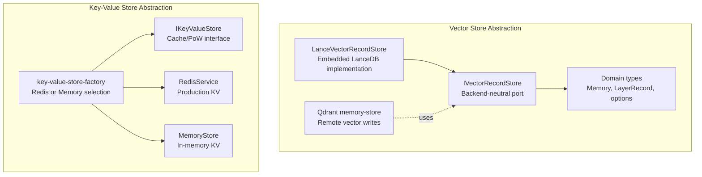
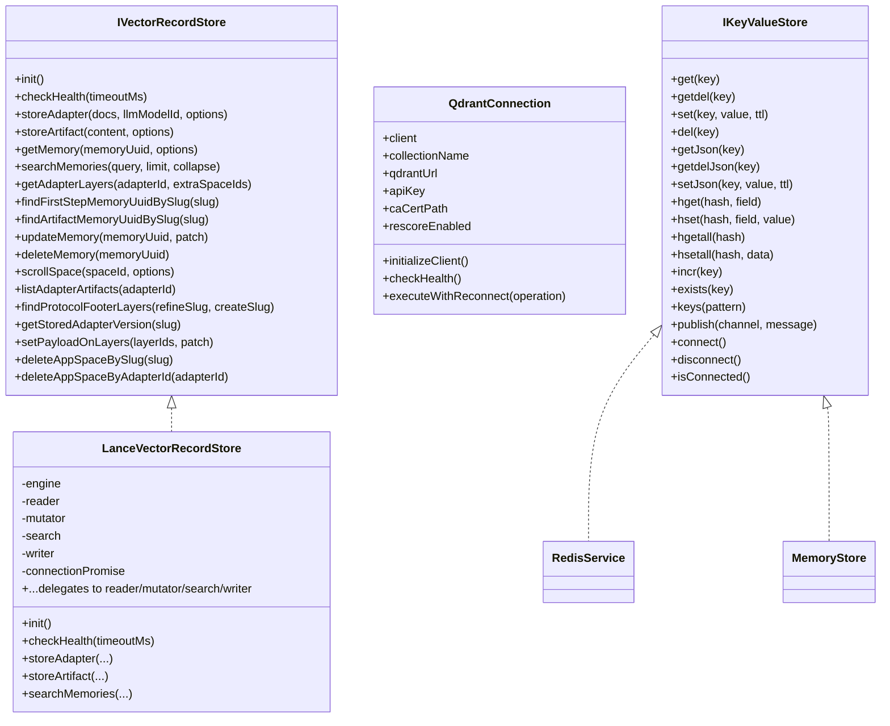
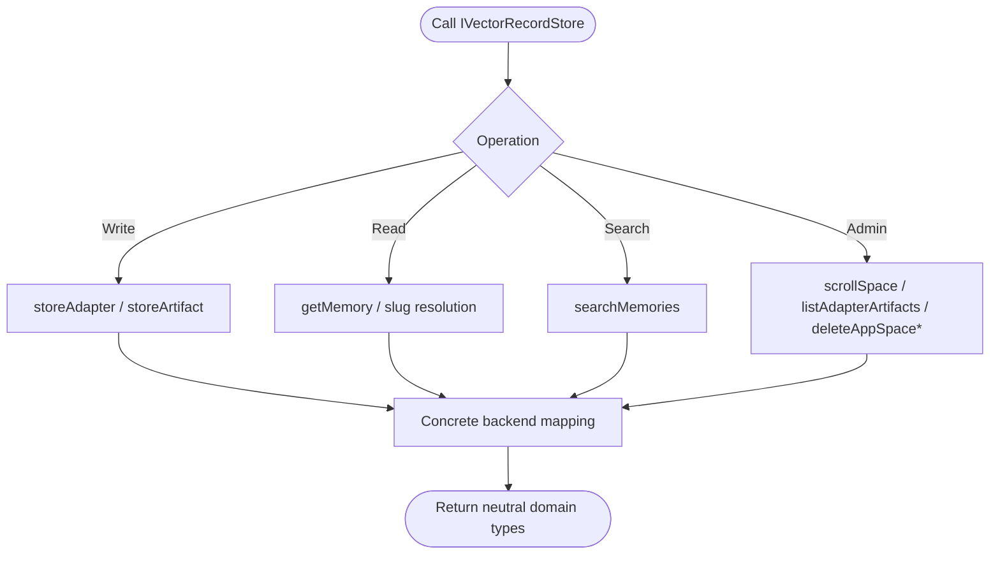
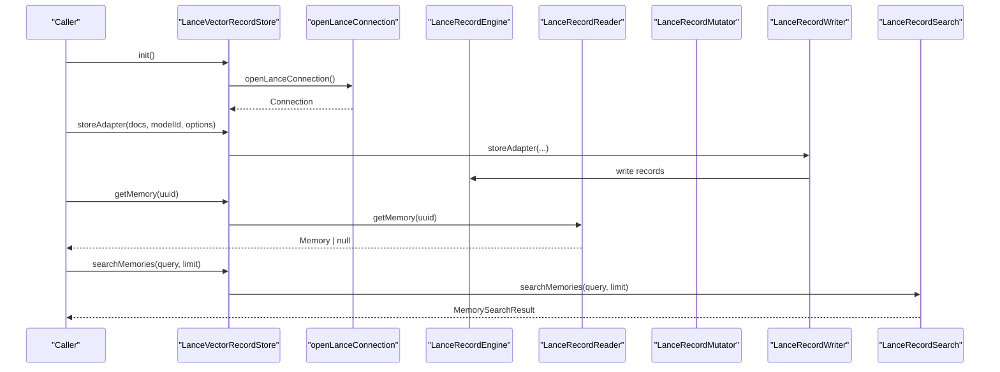
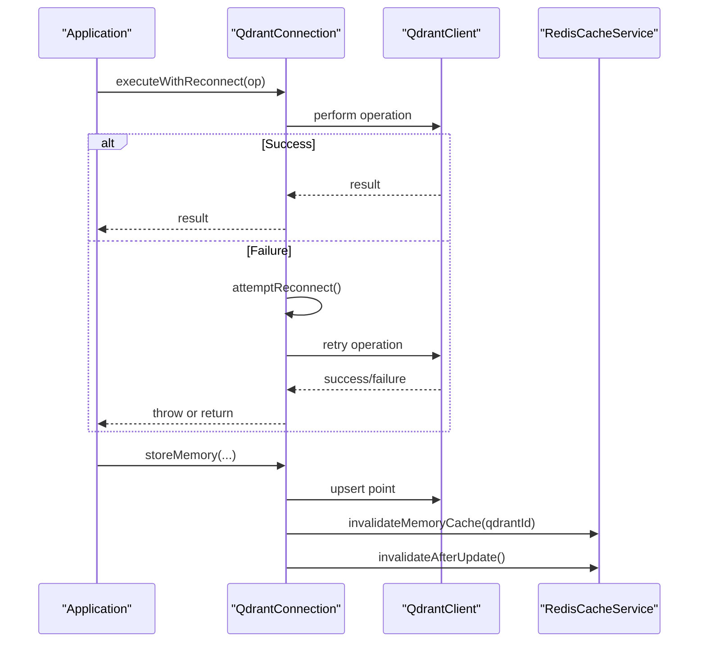
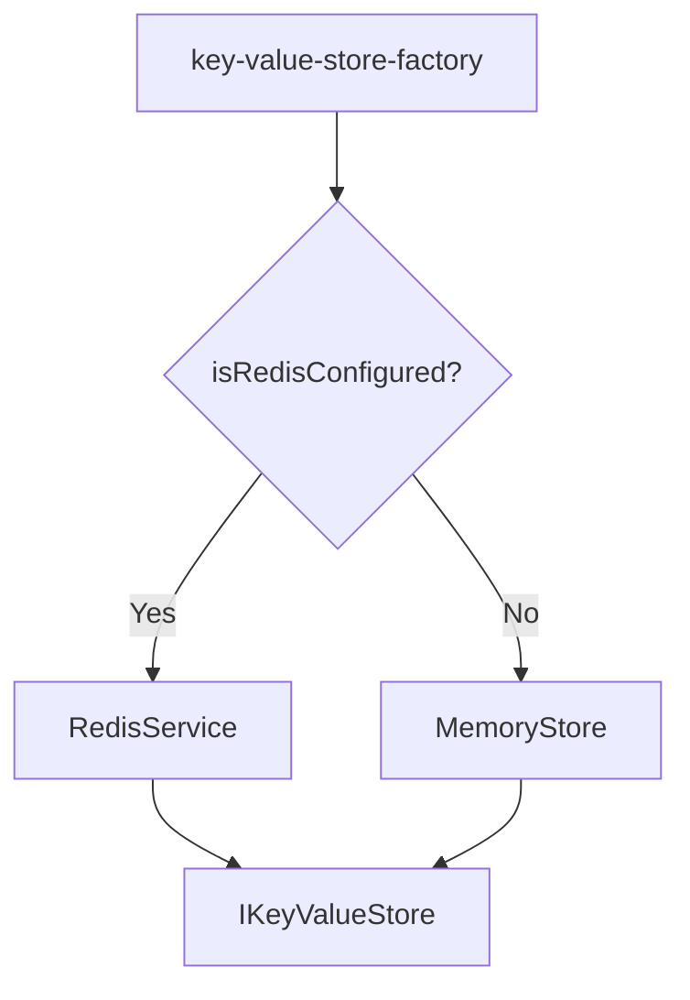
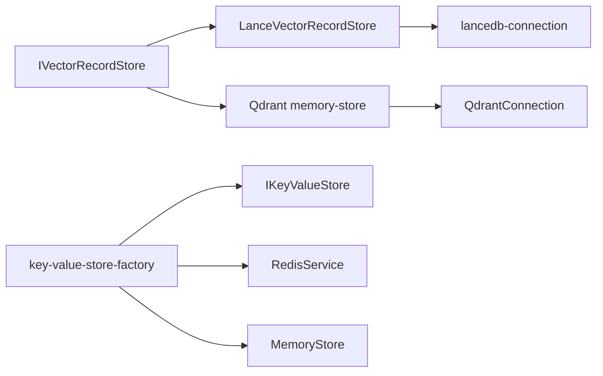

# Storage Backends

<cite>
**Referenced Files in This Document**
- [IVectorRecordStore.ts](file://src/services/vector-store/IVectorRecordStore.ts)
- [types.ts](file://src/services/vector-store/types.ts)
- [LanceVectorRecordStore.ts](file://src/services/vector-store/lancedb/LanceVectorRecordStore.ts)
- [lancedb-connection.ts](file://src/services/vector-store/lancedb-connection.ts)
- [memory-store.ts](file://src/services/qdrant/memory-store.ts)
- [connection.ts](file://src/services/qdrant/connection.ts)
- [key-value-store-factory.ts](file://src/services/key-value-store-factory.ts)
- [key-value-store.ts](file://src/services/key-value-store.ts)
- [memory-store.ts](file://src/services/memory-store.ts)
- [redis.ts](file://src/services/redis.ts)
- [0003-no-lancedb-store-snapshot.md](file://docs/adr/0003-no-lancedb-store-snapshot.md)
</cite>

## Table of Contents
1. [Introduction](#introduction)
2. [Project Structure](#project-structure)
3. [Core Components](#core-components)
4. [Architecture Overview](#architecture-overview)
5. [Detailed Component Analysis](#detailed-component-analysis)
6. [Dependency Analysis](#dependency-analysis)
7. [Performance Considerations](#performance-considerations)
8. [Troubleshooting Guide](#troubleshooting-guide)
9. [Conclusion](#conclusion)

## Introduction
This document explains the storage backend abstraction used by SquadRules for vector and key-value persistence. It focuses on:
- The pluggable vector store interface that supports Qdrant and LanceDB through a unified adapter contract.
- The store adapter pattern that exposes consistent operations across backends.
- Backend-specific configuration, connection management, and migration considerations.
- The key-value store abstraction for caching and transient state, with Redis and in-memory implementations.
- Practical guidance for implementing custom backends, switching between them, and handling data migrations.
- Performance characteristics and recommended use cases for each backend type.

SquadRules uses vector databases for semantic search over rules and workflows, and a key-value layer for sessions, rate limiting, and proof-of-work state. Qdrant is the primary remote-capable vector backend; LanceDB is the embedded secondary backend. Redis (or an in-memory fallback) provides the key-value store.

## Project Structure
The storage abstraction spans two layers:
- Vector record store: a backend-neutral port implemented by Qdrant and LanceDB adapters.
- Key-value store: a small interface implemented by Redis and an in-memory store.

**Diagram sources**
- [IVectorRecordStore.ts:27-73](file://src/services/vector-store/IVectorRecordStore.ts#L27-L73)
- [types.ts:14-40](file://src/services/vector-store/types.ts#L14-L40)
- [LanceVectorRecordStore.ts:35-41](file://src/services/vector-store/lancedb/LanceVectorRecordStore.ts#L35-L41)
- [memory-store.ts:14-25](file://src/services/qdrant/memory-store.ts#L14-L25)
- [key-value-store-factory.ts:13-22](file://src/services/key-value-store-factory.ts#L13-L22)
- [key-value-store.ts:7-28](file://src/services/key-value-store.ts#L7-L28)
- [redis.ts:26-45](file://src/services/redis.ts#L26-L45)
- [memory-store.ts:27-38](file://src/services/memory-store.ts#L27-L38)

**Section sources**
- [IVectorRecordStore.ts:1-74](file://src/services/vector-store/IVectorRecordStore.ts#L1-L74)
- [types.ts:1-95](file://src/services/vector-store/types.ts#L1-L95)
- [LanceVectorRecordStore.ts:1-193](file://src/services/vector-store/lancedb/LanceVectorRecordStore.ts#L1-L193)
- [memory-store.ts:1-126](file://src/services/qdrant/memory-store.ts#L1-L126)
- [key-value-store-factory.ts:1-23](file://src/services/key-value-store-factory.ts#L1-L23)
- [key-value-store.ts:1-29](file://src/services/key-value-store.ts#L1-L29)
- [memory-store.ts:1-202](file://src/services/memory-store.ts#L1-L202)
- [redis.ts:1-293](file://src/services/redis.ts#L1-L293)

## Core Components
- Vector record store port: Defines lifecycle, writes, reads, search, adapter structure operations, enumeration, and admin methods without leaking backend details.
- LanceDB adapter: Embedded vector store satisfying the same port as Qdrant, using JS cosine similarity for search and Arrow-backed records for storage.
- Qdrant integration: Remote vector service with resilient connections, TLS support, collection aliasing, and cache invalidation after writes.
- Key-value store port: A small API for strings, JSON, hashes, counters, pub/sub, and lifecycle methods.
- Redis and in-memory implementations: Production-grade distributed cache and a single-process fallback with TTLs and namespacing.

**Section sources**
- [IVectorRecordStore.ts:27-73](file://src/services/vector-store/IVectorRecordStore.ts#L27-L73)
- [LanceVectorRecordStore.ts:35-191](file://src/services/vector-store/lancedb/LanceVectorRecordStore.ts#L35-L191)
- [memory-store.ts:14-126](file://src/services/qdrant/memory-store.ts#L14-L126)
- [key-value-store.ts:7-28](file://src/services/key-value-store.ts#L7-L28)
- [redis.ts:26-293](file://src/services/redis.ts#L26-L293)
- [memory-store.ts:27-202](file://src/services/memory-store.ts#L27-L202)

## Architecture Overview
The system separates concerns into a backend-neutral vector store port and a small key-value store interface. Callers depend only on these contracts; concrete backends are selected at runtime or wired explicitly.

**Diagram sources**
- [IVectorRecordStore.ts:27-73](file://src/services/vector-store/IVectorRecordStore.ts#L27-L73)
- [LanceVectorRecordStore.ts:35-191](file://src/services/vector-store/lancedb/LanceVectorRecordStore.ts#L35-L191)
- [connection.ts:11-131](file://src/services/qdrant/connection.ts#L11-L131)
- [key-value-store.ts:7-28](file://src/services/key-value-store.ts#L7-L28)
- [redis.ts:26-293](file://src/services/redis.ts#L26-L293)
- [memory-store.ts:27-202](file://src/services/memory-store.ts#L27-L202)

## Detailed Component Analysis

### Vector Record Store Port and Adapter Pattern
The vector store port defines a stable surface for lifecycle, writes, reads, search, adapter structure queries, enumeration, and admin operations. Implementations must map their native records to the neutral `LayerRecord` shape so callers remain backend-agnostic.

Key responsibilities:
- Lifecycle: initialization and health checks.
- Writes: storing adapter chains and artifacts with optional protocol versioning and update strategies.
- Reads: retrieving memories by UUID and resolving slugs to layer IDs.
- Search: semantic search returning memories and scores.
- Admin: enumerating spaces, listing artifacts, updating payloads, and deleting app-space points.

**Diagram sources**
- [IVectorRecordStore.ts:27-73](file://src/services/vector-store/IVectorRecordStore.ts#L27-L73)
- [types.ts:14-40](file://src/services/vector-store/types.ts#L14-L40)

**Section sources**
- [IVectorRecordStore.ts:1-74](file://src/services/vector-store/IVectorRecordStore.ts#L1-L74)
- [types.ts:1-95](file://src/services/vector-store/types.ts#L1-L95)

### LanceDB Adapter: Embedded Vector Store
LanceDB provides an embedded vector store that satisfies the same port as Qdrant. It:
- Opens a strong-consistency connection to a per-user directory.
- Uses JS cosine similarity for search ranking.
- Delegates reads, mutations, writes, and search to focused engine components.
- Exposes no-op admin methods where server concepts like aliases do not apply.

**Diagram sources**
- [LanceVectorRecordStore.ts:35-191](file://src/services/vector-store/lancedb/LanceVectorRecordStore.ts#L35-L191)
- [lancedb-connection.ts:21-33](file://src/services/vector-store/lancedb-connection.ts#L21-L33)

**Section sources**
- [LanceVectorRecordStore.ts:1-193](file://src/services/vector-store/lancedb/LanceVectorRecordStore.ts#L1-L193)
- [lancedb-connection.ts:1-35](file://src/services/vector-store/lancedb-connection.ts#L1-L35)

### Qdrant Integration: Remote Vector Store
Qdrant is the primary remote-capable vector backend. Its integration includes:
- Resilient client initialization with TLS and CA certificate support.
- Health checks and automatic reconnection with exponential backoff.
- Upsert operations that generate IDs from URIs and invalidate caches afterward.
- Metrics instrumentation for upsert duration and operation counts.

**Diagram sources**
- [connection.ts:11-131](file://src/services/qdrant/connection.ts#L11-L131)
- [memory-store.ts:14-126](file://src/services/qdrant/memory-store.ts#L14-L126)

**Section sources**
- [connection.ts:1-131](file://src/services/qdrant/connection.ts#L1-L131)
- [memory-store.ts:1-126](file://src/services/qdrant/memory-store.ts#L1-L126)

### Key-Value Store Abstraction and Implementations
The key-value store abstracts simple persistence and caching needs. Selection is automatic:
- If Redis is configured, production Redis is used.
- Otherwise, an in-memory store is used for development and embedded scenarios.

**Diagram sources**
- [key-value-store-factory.ts:13-22](file://src/services/key-value-store-factory.ts#L13-L22)
- [key-value-store.ts:7-28](file://src/services/key-value-store.ts#L7-L28)
- [redis.ts:26-45](file://src/services/redis.ts#L26-L45)
- [memory-store.ts:27-38](file://src/services/memory-store.ts#L27-L38)

**Section sources**
- [key-value-store-factory.ts:1-23](file://src/services/key-value-store-factory.ts#L1-L23)
- [key-value-store.ts:1-29](file://src/services/key-value-store.ts#L1-L29)
- [redis.ts:1-293](file://src/services/redis.ts#L1-L293)
- [memory-store.ts:1-202](file://src/services/memory-store.ts#L1-L202)

### Backend-Specific Configuration and Connection Management
- Qdrant:
  - URL, API key, collection alias, and optional CA certificate path are configured via environment variables.
  - TLS is supported; custom CA certificates can be loaded from disk.
  - Health checks and reconnection logic protect against transient failures.
- LanceDB:
  - Embedded store lives under a per-user directory derived from the shared config directory.
  - Connection opens lazily and enforces strong consistency across processes.
- Key-Value Store:
  - Redis URL and prefix are configured; keys are namespaced by space except for global prefixes.
  - In-memory store mimics Redis behavior with TTLs and simple glob-based key matching.

**Section sources**
- [connection.ts:24-61](file://src/services/qdrant/connection.ts#L24-L61)
- [lancedb-connection.ts:21-33](file://src/services/vector-store/lancedb-connection.ts#L21-L33)
- [redis.ts:33-45](file://src/services/redis.ts#L33-L45)
- [memory-store.ts:40-46](file://src/services/memory-store.ts#L40-L46)

### Migration Strategies Between Storage Systems
- Vector stores:
  - The port design allows swapping backends while preserving caller contracts.
  - Data migration should convert existing records to the neutral `LayerRecord` shape and validate adapter slugs and protocol footers.
  - For LanceDB, there is no snapshot/export path in CI; boot injection remains the default mechanism.
- Key-value stores:
  - Switching between Redis and in-memory does not require data migration because they serve different scopes (distributed cache vs. process-local transient state).
  - When moving from in-memory to Redis, ensure TTLs and namespacing align with application expectations.

**Section sources**
- [types.ts:32-40](file://src/services/vector-store/types.ts#L32-L40)
- [0003-no-lancedb-store-snapshot.md:1-77](file://docs/adr/0003-no-lancedb-store-snapshot.md#L1-L77)
- [key-value-store-factory.ts:13-22](file://src/services/key-value-store-factory.ts#L13-L22)

### Implementing Custom Storage Backends
To implement a custom vector backend:
- Implement `IVectorRecordStore`, mapping your native records to `LayerRecord` and adhering to the documented method signatures.
- Provide lifecycle methods (`init`, `checkHealth`) and ensure search returns `MemorySearchResult`.
- Keep admin methods safe no-ops if your backend lacks equivalents.

To implement a custom key-value backend:
- Implement `IKeyValueStore`, including string, JSON, hash, counter, pub/sub, and lifecycle methods.
- Respect key namespacing and TTL semantics expected by callers.

**Section sources**
- [IVectorRecordStore.ts:27-73](file://src/services/vector-store/IVectorRecordStore.ts#L27-L73)
- [key-value-store.ts:7-28](file://src/services/key-value-store.ts#L7-L28)

### Switching Between Backends
- Vector store:
  - Wire the desired implementation (Qdrant or LanceDB) based on configuration or runtime flags.
  - Ensure all callers depend only on `IVectorRecordStore`.
- Key-value store:
  - Use the factory to select Redis when configured; otherwise, fall back to in-memory.

**Section sources**
- [LanceVectorRecordStore.ts:35-52](file://src/services/vector-store/lancedb/LanceVectorRecordStore.ts#L35-L52)
- [key-value-store-factory.ts:13-22](file://src/services/key-value-store-factory.ts#L13-L22)

### Handling Data Migrations
- Vector store:
  - Validate adapter slugs and protocol footer mappings before migration.
  - Preserve payload fields and quality metrics during conversion.
  - Test search parity between backends using the integration suite.
- Key-value store:
  - Align TTL policies and key patterns when migrating from in-memory to Redis.
  - Verify pub/sub channels if cross-process invalidation is required.

**Section sources**
- [IVectorRecordStore.ts:46-72](file://src/services/vector-store/IVectorRecordStore.ts#L46-L72)
- [redis.ts:219-235](file://src/services/redis.ts#L219-L235)

## Dependency Analysis
The following diagram shows how components depend on each other:

**Diagram sources**
- [IVectorRecordStore.ts:27-73](file://src/services/vector-store/IVectorRecordStore.ts#L27-L73)
- [LanceVectorRecordStore.ts:35-41](file://src/services/vector-store/lancedb/LanceVectorRecordStore.ts#L35-L41)
- [lancedb-connection.ts:21-33](file://src/services/vector-store/lancedb-connection.ts#L21-L33)
- [memory-store.ts:14-25](file://src/services/qdrant/memory-store.ts#L14-L25)
- [connection.ts:11-131](file://src/services/qdrant/connection.ts#L11-L131)
- [key-value-store-factory.ts:13-22](file://src/services/key-value-store-factory.ts#L13-L22)
- [key-value-store.ts:7-28](file://src/services/key-value-store.ts#L7-L28)
- [redis.ts:26-45](file://src/services/redis.ts#L26-L45)
- [memory-store.ts:27-38](file://src/services/memory-store.ts#L27-L38)

**Section sources**
- [IVectorRecordStore.ts:1-74](file://src/services/vector-store/IVectorRecordStore.ts#L1-L74)
- [LanceVectorRecordStore.ts:1-193](file://src/services/vector-store/lancedb/LanceVectorRecordStore.ts#L1-L193)
- [lancedb-connection.ts:1-35](file://src/services/vector-store/lancedb-connection.ts#L1-L35)
- [memory-store.ts:1-126](file://src/services/qdrant/memory-store.ts#L1-L126)
- [connection.ts:1-131](file://src/services/qdrant/connection.ts#L1-L131)
- [key-value-store-factory.ts:1-23](file://src/services/key-value-store-factory.ts#L1-L23)
- [key-value-store.ts:1-29](file://src/services/key-value-store.ts#L1-L29)
- [redis.ts:1-293](file://src/services/redis.ts#L1-L293)
- [memory-store.ts:1-202](file://src/services/memory-store.ts#L1-L202)

## Performance Considerations
- Qdrant:
  - Suitable for remote, scalable deployments with high-throughput semantic search.
  - Benefits from rescore settings and collection aliasing for zero-downtime updates.
  - Cache invalidation after writes helps maintain consistency with Redis-backed caches.
- LanceDB:
  - Embedded, file-backed store with strong consistency across processes.
  - Search ranking uses JS cosine similarity; validation ensures parity with Qdrant results.
  - No snapshot/export path in CI; boot injection remains the default mechanism.
- Key-Value Store:
  - Redis provides distributed caching, pub/sub, and atomic operations.
  - In-memory store offers low-latency local caching without cross-process invalidation.

**Section sources**
- [connection.ts:39-61](file://src/services/qdrant/connection.ts#L39-L61)
- [memory-store.ts:103-106](file://src/services/qdrant/memory-store.ts#L103-L106)
- [LanceVectorRecordStore.ts:175-182](file://src/services/vector-store/lancedb/LanceVectorRecordStore.ts#L175-L182)
- [lancedb-connection.ts:1-13](file://src/services/vector-store/lancedb-connection.ts#L1-L13)
- [0003-no-lancedb-store-snapshot.md:22-49](file://docs/adr/0003-no-lancedb-store-snapshot.md#L22-L49)
- [redis.ts:219-235](file://src/services/redis.ts#L219-L235)
- [memory-store.ts:186-188](file://src/services/memory-store.ts#L186-L188)

## Troubleshooting Guide
- Qdrant connectivity:
  - Verify URL, API key, and CA certificate path.
  - Check health endpoint and review reconnection logs for exponential backoff behavior.
- LanceDB embedded store:
  - Ensure the per-user directory exists and is writable.
  - Confirm strong consistency settings are applied for cross-process reads.
- Key-Value Store:
  - For Redis, check connection status, URL masking in logs, and error events.
  - For in-memory store, verify TTL expiration and key namespacing.

**Section sources**
- [connection.ts:63-96](file://src/services/qdrant/connection.ts#L63-L96)
- [lancedb-connection.ts:21-33](file://src/services/vector-store/lancedb-connection.ts#L21-L33)
- [redis.ts:47-84](file://src/services/redis.ts#L47-L84)
- [memory-store.ts:48-51](file://src/services/memory-store.ts#L48-L51)

## Conclusion
SquadRules’ storage abstraction cleanly separates backend concerns through well-defined ports:
- `IVectorRecordStore` enables pluggable vector backends (Qdrant, LanceDB) with consistent operations.
- `IKeyValueStore` provides a uniform interface for caching and transient state, selecting Redis or in-memory at runtime.
This design supports flexible deployment models, straightforward migrations, and clear performance trade-offs. Use Qdrant for remote, scalable vector workloads; LanceDB for embedded, self-contained environments; and Redis for distributed caching, falling back to in-memory when appropriate.