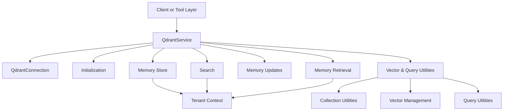
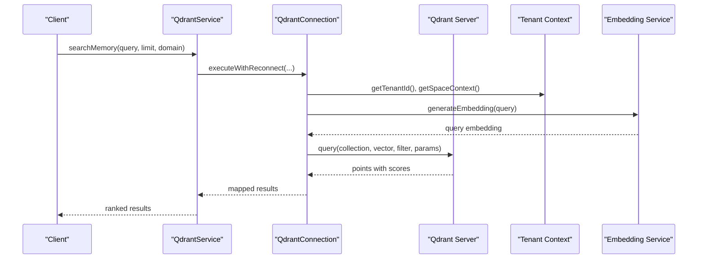
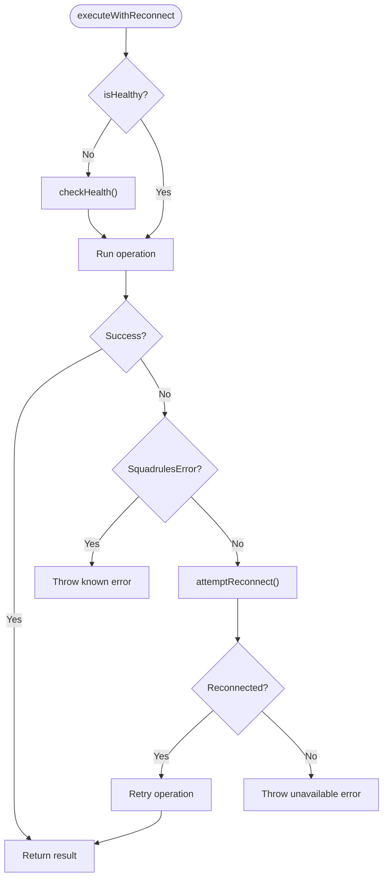
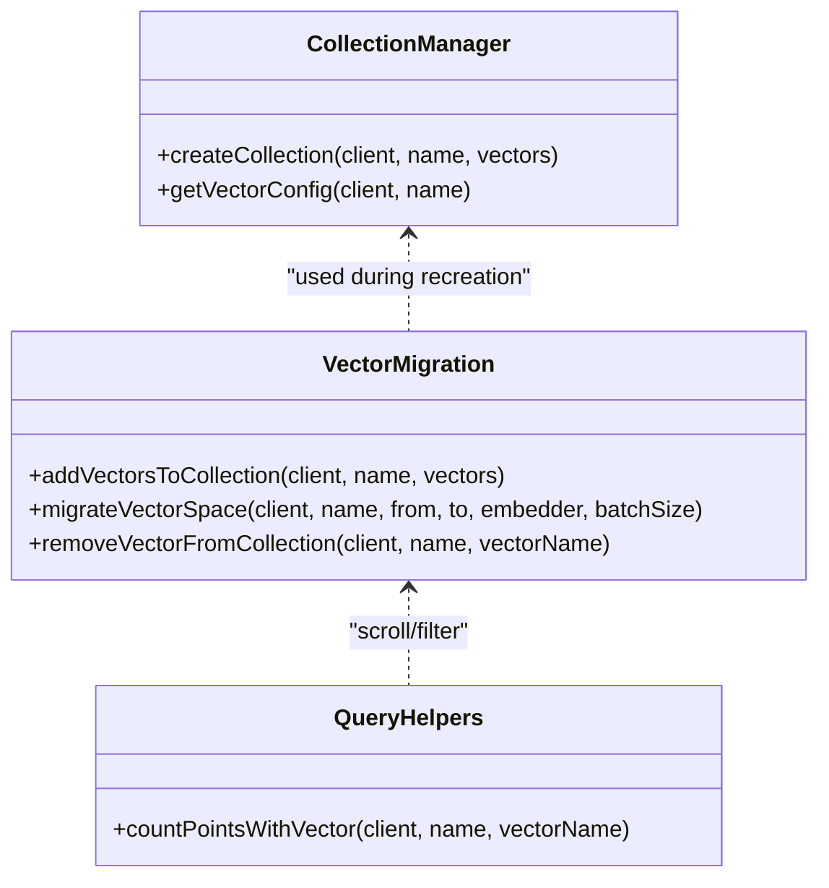
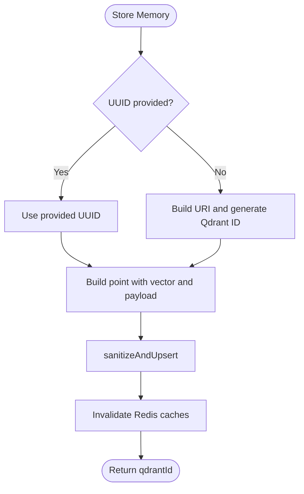
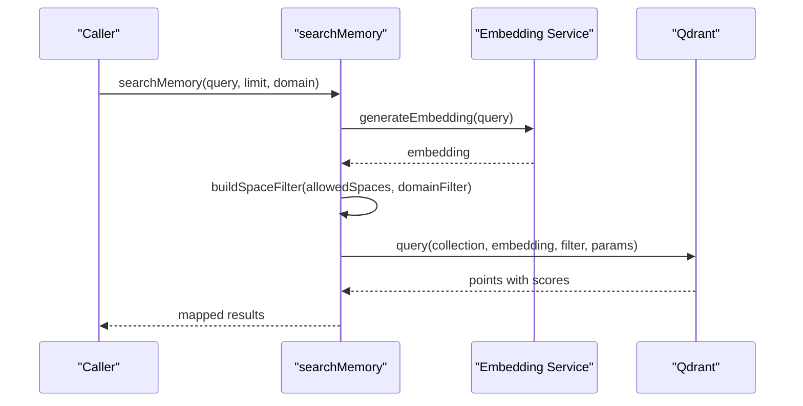
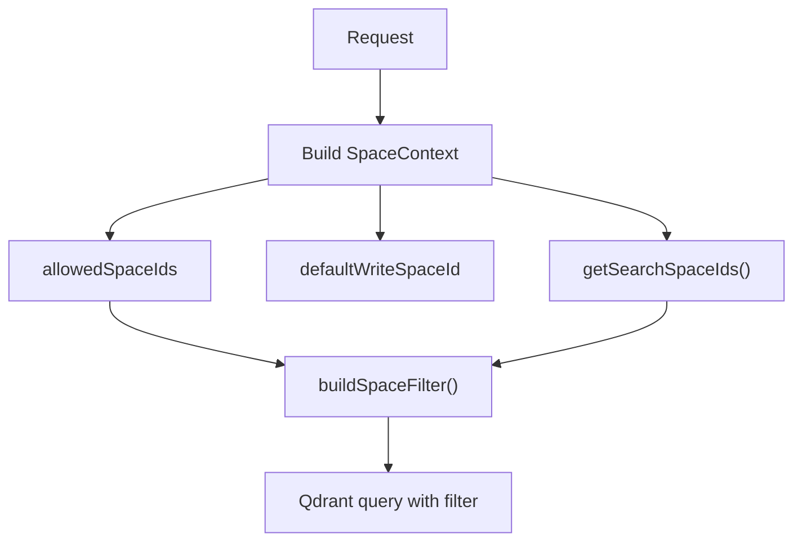
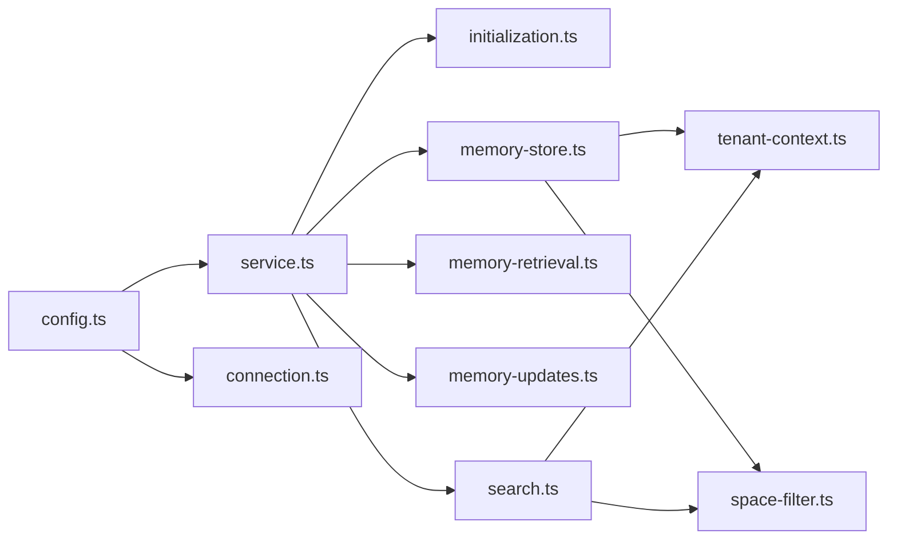

# Vector Database Operations

<cite>
**Referenced Files in This Document**
- [service.ts](file://src/services/qdrant/service.ts)
- [connection.ts](file://src/services/qdrant/connection.ts)
- [initialization.ts](file://src/services/qdrant/initialization.ts)
- [memory-store.ts](file://src/services/qdrant/memory-store.ts)
- [memory-retrieval.ts](file://src/services/qdrant/memory-retrieval.ts)
- [memory-updates.ts](file://src/services/qdrant/memory-updates.ts)
- [search.ts](file://src/services/qdrant/search.ts)
- [qdrant-collection-utils.ts](file://src/utils/qdrant-collection-utils.ts)
- [qdrant-query-utils.ts](file://src/utils/qdrant-query-utils.ts)
- [qdrant-vector-management.ts](file://src/utils/qdrant-vector-management.ts)
- [space-filter.ts](file://src/utils/space-filter.ts)
- [tenant-context.ts](file://src/utils/tenant-context.ts)
- [config.ts](file://src/config.ts)
</cite>

## Table of Contents
1. [Introduction](#introduction)
2. [Project Structure](#project-structure)
3. [Core Components](#core-components)
4. [Architecture Overview](#architecture-overview)
5. [Detailed Component Analysis](#detailed-component-analysis)
6. [Dependency Analysis](#dependency-analysis)
7. [Performance Considerations](#performance-considerations)
8. [Troubleshooting Guide](#troubleshooting-guide)
9. [Conclusion](#conclusion)

## Introduction
This document explains how SquadRules uses Qdrant as its primary vector database for semantic search over rules, adapters, and workflow memories. It covers collection management, point operations, similarity search, filtering, result ranking, space-based tenant isolation, performance tuning, index configuration, scalability considerations, batch operations, health monitoring, and the relationship between embeddings and semantic search.

SquadRules supports two vector backends:
- Qdrant: remote-capable, used when `QDRANT_URL` is configured.
- LanceDB: embedded fallback used when Qdrant is not configured.

The code analyzed here focuses on the Qdrant integration layer.

## Project Structure
The Qdrant integration is organized under `src/services/qdrant`, with shared utilities under `src/utils`. The main entry point for vector operations is `QdrantService`, which composes connection handling, initialization, storage, retrieval, updates, search, listing, protocol resolution, and reward propagation.

**Diagram sources**
- [service.ts:17-161](file://src/services/qdrant/service.ts#L17-L161)
- [connection.ts:11-131](file://src/services/qdrant/connection.ts#L11-L131)
- [initialization.ts:13-93](file://src/services/qdrant/initialization.ts#L13-L93)
- [memory-store.ts:14-126](file://src/services/qdrant/memory-store.ts#L14-L126)
- [memory-retrieval.ts:25-102](file://src/services/qdrant/memory-retrieval.ts#L25-L102)
- [memory-updates.ts:15-96](file://src/services/qdrant/memory-updates.ts#L15-L96)
- [search.ts:11-83](file://src/services/qdrant/search.ts#L11-L83)
- [qdrant-collection-utils.ts:7-39](file://src/utils/qdrant-collection-utils.ts#L7-L39)
- [qdrant-vector-management.ts:13-114](file://src/utils/qdrant-vector-management.ts#L13-L114)
- [qdrant-query-utils.ts:8-23](file://src/utils/qdrant-query-utils.ts#L8-L23)
- [tenant-context.ts:23-42](file://src/utils/tenant-context.ts#L23-L42)

**Section sources**
- [service.ts:17-161](file://src/services/qdrant/service.ts#L17-L161)
- [config.ts:297-303](file://src/config.ts#L297-L303)

## Core Components
- QdrantService: Public API surface for memory store, retrieval, updates, search, aliasing, collection listing/dropping, and protocol-related lookups.
- QdrantConnection: Encapsulates client initialization, TLS support, health checks, and resilient retry with exponential backoff.
- Initialization: Creates collections, validates vector dimensions, creates payload indexes, backfills missing `space_id`, and optionally creates aliases.
- Memory Store: Upserts points with vectors and rich payloads, including quality metrics and protocol metadata.
- Memory Retrieval: Reads points by UUID with access control, lists adapter layers, and resolves slugs deterministically.
- Memory Updates: Updates points by ID or UUID, recomputes embeddings when text changes, and invalidates caches.
- Search: Embeds queries, builds space-aware filters, performs vector similarity search, and maps results to a stable shape.
- Utilities: Collection creation, vector migration, counting points with named vectors, and space filter helpers.
- Tenant Context: Derives allowed spaces from authentication and request context; enforces space isolation across reads and writes.

**Section sources**
- [service.ts:17-161](file://src/services/qdrant/service.ts#L17-L161)
- [connection.ts:11-131](file://src/services/qdrant/connection.ts#L11-L131)
- [initialization.ts:13-93](file://src/services/qdrant/initialization.ts#L13-L93)
- [memory-store.ts:14-126](file://src/services/qdrant/memory-store.ts#L14-L126)
- [memory-retrieval.ts:25-102](file://src/services/qdrant/memory-retrieval.ts#L25-L102)
- [memory-updates.ts:15-96](file://src/services/qdrant/memory-updates.ts#L15-L96)
- [search.ts:11-83](file://src/services/qdrant/search.ts#L11-L83)
- [qdrant-collection-utils.ts:7-39](file://src/utils/qdrant-collection-utils.ts#L7-L39)
- [qdrant-vector-management.ts:13-114](file://src/utils/qdrant-vector-management.ts#L13-L114)
- [qdrant-query-utils.ts:8-23](file://src/utils/qdrant-query-utils.ts#L8-L23)
- [tenant-context.ts:23-42](file://src/utils/tenant-context.ts#L23-L42)

## Architecture Overview
At runtime, clients call into `QdrantService`, which delegates to domain-specific modules. All network calls go through `QdrantConnection.executeWithReconnect`, ensuring resilience and consistent error handling. Space isolation is enforced via `SpaceContext`, which derives allowed spaces from authentication and request parameters.

**Diagram sources**
- [service.ts:120-122](file://src/services/qdrant/service.ts#L120-L122)
- [search.ts:11-83](file://src/services/qdrant/search.ts#L11-L83)
- [connection.ts:98-130](file://src/services/qdrant/connection.ts#L98-L130)
- [tenant-context.ts:141-150](file://src/utils/tenant-context.ts#L141-L150)

## Detailed Component Analysis

### QdrantService
Responsibilities:
- Compose connection and expose safe getters.
- Initialize collection and alias.
- Provide CRUD-like methods for memory points.
- Expose search, listing, and protocol lookup helpers.
- Select backend at runtime: real Qdrant service or embedded store double-cast when Qdrant is not configured.

Key behaviors:
- Constructor accepts URL, API key, collection name, and optional CA certificate path.
- `initialize()` triggers collection setup and index creation.
- `storeMemory`, `updateMemory`, `deleteMemory`, `retrieveById`, `getMemoryByUUID`, `searchMemory`, and others delegate to specialized modules.
- `createOrUpdateAlias`, `getCollections`, `dropCollection` manage Qdrant collections and aliases.

Runtime selection:
- If Qdrant is configured, `qdrantService` is an instance of `QdrantService`.
- Otherwise, it falls back to the embedded record store shaped like `QdrantService`.

**Section sources**
- [service.ts:17-161](file://src/services/qdrant/service.ts#L17-L161)

### QdrantConnection
Responsibilities:
- Initialize `QdrantClient` with URL, optional API key, TLS settings, and custom CA certificate.
- Health check via `getCollections`.
- Resilient execution with exponential backoff reconnection attempts.
- Centralized logging and error wrapping.

Important details:
- TLS: If URL starts with HTTPS, system CA certificates are used unless a custom CA file is provided.
- Reconnection: Up to five attempts with doubling delay; final failure throws a structured error.
- Environment flags: `QDRANT_RESCORE` controls whether rescore is enabled for quantized searches.

**Diagram sources**
- [connection.ts:98-130](file://src/services/qdrant/connection.ts#L98-L130)

**Section sources**
- [connection.ts:11-131](file://src/services/qdrant/connection.ts#L11-L131)

### Collection Management
Capabilities:
- Create collection with vector descriptors and BM25 sparse vectors.
- Validate existing collection vector size against expected embedding dimension; recreate if mismatched.
- Create payload indexes for filtering and text search fields.
- Backfill missing `space_id` values for older points.
- Optionally create/update alias pointing to the active collection.

Configuration:
- Vector descriptors are derived from embedding configuration.
- Payload indexes include space isolation (`space_id` marked as tenant), domain/type/task categorization, protocol step, quality metadata, adapter metadata, slug/content type, and text tokenizers for label/tag content.

Migration helpers:
- Add named vectors to existing collections (with recreation fallback).
- Migrate points from one named vector to another by re-embedding.
- Remove named vectors by recreating the collection without them.

**Diagram sources**
- [qdrant-collection-utils.ts:7-39](file://src/utils/qdrant-collection-utils.ts#L7-L39)
- [qdrant-vector-management.ts:13-114](file://src/utils/qdrant-vector-management.ts#L13-L114)
- [qdrant-vector-management.ts:126-202](file://src/utils/qdrant-vector-management.ts#L126-L202)
- [qdrant-vector-management.ts:208-301](file://src/utils/qdrant-vector-management.ts#L208-L301)
- [qdrant-query-utils.ts:8-23](file://src/utils/qdrant-query-utils.ts#L8-L23)

**Section sources**
- [initialization.ts:13-93](file://src/services/qdrant/initialization.ts#L13-L93)
- [qdrant-collection-utils.ts:7-39](file://src/utils/qdrant-collection-utils.ts#L7-L39)
- [qdrant-vector-management.ts:13-114](file://src/utils/qdrant-vector-management.ts#L13-L114)
- [qdrant-vector-management.ts:126-202](file://src/utils/qdrant-vector-management.ts#L126-L202)
- [qdrant-vector-management.ts:208-301](file://src/utils/qdrant-vector-management.ts#L208-L301)
- [qdrant-query-utils.ts:8-23](file://src/utils/qdrant-query-utils.ts#L8-L23)

### Point Operations
Upsert:
- Generates deterministic IDs from URIs unless explicitly provided.
- Stores vector under a dynamic named vector key based on embedding length, e.g., `vs{dimension}`.
- Includes rich payload: label, text, domain, task, type, tags, AI context, protocol metadata, quality metrics, timestamps.
- Invalidates Redis caches after successful upsert.

Retrieve:
- Validates UUID and applies space access control.
- Returns structured memory objects with normalized fields.

Update:
- Supports update by UUID or raw ID.
- Recomputes embedding when text changes.
- Recalculates quality metadata when relevant fields change.
- Enforces strict cache invalidation.

Delete:
- Validates existence before deletion.
- Invalidates caches after deletion.

**Diagram sources**
- [memory-store.ts:14-126](file://src/services/qdrant/memory-store.ts#L14-L126)

**Section sources**
- [memory-store.ts:14-126](file://src/services/qdrant/memory-store.ts#L14-L126)
- [memory-retrieval.ts:72-102](file://src/services/qdrant/memory-retrieval.ts#L72-L102)
- [memory-updates.ts:15-96](file://src/services/qdrant/memory-updates.ts#L15-L96)
- [memory-updates.ts:98-197](file://src/services/qdrant/memory-updates.ts#L98-L197)
- [memory-updates.ts:199-233](file://src/services/qdrant/memory-updates.ts#L199-L233)

### Similarity Search Algorithms and Result Ranking
Similarity search flow:
- Generate embedding for the query using the configured embedding service.
- Build a space-aware filter combining allowed spaces and optional domain filter.
- Execute vector query with named vector key matching embedding length.
- Enable rescore for quantized vectors when enabled.
- Map returned points to a stable result shape including confidence/relevance scores.

Ranking:
- Results are ranked by Qdrant score; SquadRules exposes both `confidence` and `relevance` fields.
- Additional ranking signals such as quality metadata and attest boosts exist elsewhere in the application but are not applied inside this search wrapper.

Filtering strategies:
- Space isolation via `buildSpaceFilter`.
- Domain filter passed as a must condition.
- Named vector selection based on embedding dimension.

**Diagram sources**
- [search.ts:11-83](file://src/services/qdrant/search.ts#L11-L83)
- [space-filter.ts:14-26](file://src/utils/space-filter.ts#L14-L26)

**Section sources**
- [search.ts:11-83](file://src/services/qdrant/search.ts#L11-L83)
- [space-filter.ts:14-26](file://src/utils/space-filter.ts#L14-L26)

### Space-Based Tenant Isolation
How it works:
- `SpaceContext` holds user ID, group IDs, allowed space IDs, default write space, personal space, and optional narrow scope.
- Writes use `defaultWriteSpaceId`; reads may include app space depending on search scope.
- `buildSpaceFilter` ensures all vector queries restrict results to allowed spaces.
- `getSearchSpaceIds` merges app space into search scope unless explicitly narrowed.

Access control:
- Retrieval functions validate that the point’s `space_id` is in allowed spaces or equals the app sentinel space.
- Forbidden access returns a structured result rather than leaking data.

**Diagram sources**
- [tenant-context.ts:23-42](file://src/utils/tenant-context.ts#L23-L42)
- [tenant-context.ts:141-150](file://src/utils/tenant-context.ts#L141-L150)
- [space-filter.ts:14-26](file://src/utils/space-filter.ts#L14-L26)
- [memory-retrieval.ts:25-61](file://src/services/qdrant/memory-retrieval.ts#L25-L61)

**Section sources**
- [tenant-context.ts:23-42](file://src/utils/tenant-context.ts#L23-L42)
- [tenant-context.ts:141-150](file://src/utils/tenant-context.ts#L141-L150)
- [space-filter.ts:14-26](file://src/utils/space-filter.ts#L14-L26)
- [memory-retrieval.ts:25-61](file://src/services/qdrant/memory-retrieval.ts#L25-L61)

### Batch Operations
Batch upserts:
- Vector migration and recreation routines upsert points in batches to avoid memory pressure.
- Default batch sizes range from 64 to 256 depending on operation.

Scrolling and counting:
- Counting points with a named vector paginates via scroll.
- Adapter layer listing scrolls through pages and sorts by layer index.

Best practices:
- Use bounded batch sizes.
- Handle partial failures gracefully and log progress.
- Preserve `space_id` during recreation to maintain isolation.

**Section sources**
- [qdrant-vector-management.ts:90-110](file://src/utils/qdrant-vector-management.ts#L90-L110)
- [qdrant-vector-management.ts:187-196](file://src/utils/qdrant-vector-management.ts#L187-L196)
- [qdrant-query-utils.ts:8-23](file://src/utils/qdrant-query-utils.ts#L8-L23)
- [memory-retrieval.ts:152-199](file://src/services/qdrant/memory-retrieval.ts#L152-L199)

### Monitoring Vector Database Health
Health checks:
- `QdrantConnection.checkHealth` verifies server availability via `getCollections`.
- `QdrantService.initializeCollection` requires healthy service before proceeding.

Metrics:
- Upsert/query/delete operations increment counters and emit durations with tenant context.
- Errors are logged with structured details and wrapped in structured errors.

Operational tips:
- Monitor reconnection attempts and failures.
- Watch for “Qdrant is unavailable” errors indicating max retries exceeded.
- Track payload index creation logs to ensure indexing is complete.

**Section sources**
- [connection.ts:63-74](file://src/services/qdrant/connection.ts#L63-L74)
- [connection.ts:98-130](file://src/services/qdrant/connection.ts#L98-L130)
- [initialization.ts:13-29](file://src/services/qdrant/initialization.ts#L13-L29)
- [memory-store.ts:107-123](file://src/services/qdrant/memory-store.ts#L107-L123)
- [search.ts:39-80](file://src/services/qdrant/search.ts#L39-L80)
- [memory-updates.ts:79-94](file://src/services/qdrant/memory-updates.ts#L79-L94)

### Relationship Between Embeddings and Semantic Search
- Embeddings are generated by the embedding service and stored under a named vector key derived from their length.
- Queries are embedded and searched against the same named vector key.
- Changing embedding dimensions requires collection recreation or vector migration.
- Quality metadata and protocol metadata enrich search results but do not alter vector similarity directly.

Operational implications:
- Keep embedding model and dimension consistent across deployments.
- Use vector migration tools when upgrading embedding models.
- Ensure rescore is enabled for quantized vectors to improve accuracy.

**Section sources**
- [memory-store.ts:57-60](file://src/services/qdrant/memory-store.ts#L57-L60)
- [search.ts:19-33](file://src/services/qdrant/search.ts#L19-L33)
- [qdrant-vector-management.ts:126-202](file://src/utils/qdrant-vector-management.ts#L126-L202)

## Dependency Analysis
High-level dependencies:
- `QdrantService` depends on connection, initialization, store, retrieval, updates, search, protocol, listing, resources, and reward propagation modules.
- All modules depend on `QdrantConnection` for resilient operations.
- Space isolation relies on `tenant-context` and `space-filter`.
- Configuration drives Qdrant URL, collection name, rescore behavior, snapshot settings, and search limits.

**Diagram sources**
- [service.ts:1-161](file://src/services/qdrant/service.ts#L1-L161)
- [connection.ts:1-131](file://src/services/qdrant/connection.ts#L1-L131)
- [initialization.ts:1-93](file://src/services/qdrant/initialization.ts#L1-L93)
- [memory-store.ts:1-126](file://src/services/qdrant/memory-store.ts#L1-L126)
- [memory-retrieval.ts:1-102](file://src/services/qdrant/memory-retrieval.ts#L1-L102)
- [memory-updates.ts:1-96](file://src/services/qdrant/memory-updates.ts#L1-L96)
- [search.ts:1-83](file://src/services/qdrant/search.ts#L1-L83)
- [tenant-context.ts:1-42](file://src/utils/tenant-context.ts#L1-L42)
- [space-filter.ts:1-26](file://src/utils/space-filter.ts#L1-L26)
- [config.ts:297-303](file://src/config.ts#L297-L303)

**Section sources**
- [service.ts:1-161](file://src/services/qdrant/service.ts#L1-L161)
- [config.ts:297-303](file://src/config.ts#L297-L303)

## Performance Considerations
Index configuration:
- Payload indexes are created for space isolation, categorization fields, protocol steps, quality metadata, adapter metadata, slug/content type, and text tokenizers.
- These indexes accelerate filtering and text-based queries.

Quantization and rescore:
- Collections are created with scalar int8 quantization and `always_ram: true`.
- Rescore can be toggled via environment variable and connection flag.

Embedding latency:
- Embedding provider configuration includes retry policies, latency warnings, and budget caps.
- Tune these settings to balance accuracy and throughput.

Search limits:
- Global search limits and caps are configurable to prevent excessive processing.

Scalability:
- Use batched upserts and scrolls for large datasets.
- Prefer named vectors aligned with embedding dimensions to avoid mismatches.
- Monitor Qdrant health and reconnection metrics.

Tuning parameters:
- `QDRANT_RESCORE`: enable/disable rescore for quantized vectors.
- `QDRANT_SNAPSHOT_ON_START`, `QDRANT_SNAPSHOT_DIR`: backup/snapshot configuration.
- `EMBEDDING_*`: embedding provider retries, budgets, and thresholds.
- `SQUADRULES_SEARCH_*`: search overfetch factor, max fetch, max choices, limit cap/min.
- `SCORE_THRESHOLD`, `SIMILAR_MEMORY_THRESHOLD`: downstream scoring thresholds.

**Section sources**
- [initialization.ts:50-79](file://src/services/qdrant/initialization.ts#L50-L79)
- [qdrant-collection-utils.ts:27-38](file://src/utils/qdrant-collection-utils.ts#L27-L38)
- [connection.ts:35-36](file://src/services/qdrant/connection.ts#L35-L36)
- [config.ts:268-295](file://src/config.ts#L268-L295)
- [config.ts:106-116](file://src/config.ts#L106-L116)

## Troubleshooting Guide
Common issues and resolutions:
- Qdrant unavailable: Indicates repeated reconnection failures. Verify URL, API key, TLS settings, and CA certificate path.
- Collection vector size mismatch: Initialization recreates the collection when the configured embedding dimension differs from the existing collection.
- Alias creation fails: Multiple REST endpoints are tried; manual alias creation may be required.
- Space isolation returning forbidden: Ensure the requesting context has access to the point’s `space_id`.
- Stale cache after updates: Strict cache invalidation is invoked; verify Redis connectivity and cache invalidation logs.

Diagnostic steps:
- Check health endpoint and logs for reconnection attempts.
- Inspect payload index creation logs.
- Validate embedding model and dimension consistency.
- Review space context derivation and allowed spaces.

**Section sources**
- [connection.ts:63-130](file://src/services/qdrant/connection.ts#L63-L130)
- [initialization.ts:27-47](file://src/services/qdrant/initialization.ts#L27-L47)
- [initialization.ts:99-126](file://src/services/qdrant/initialization.ts#L99-L126)
- [memory-retrieval.ts:25-61](file://src/services/qdrant/memory-retrieval.ts#L25-L61)
- [memory-updates.ts:75-78](file://src/services/qdrant/memory-updates.ts#L75-L78)

## Conclusion
SquadRules’ Qdrant integration provides a robust, resilient, and space-isolated vector database layer for semantic search. It manages collections and indexes, handles point operations with rich metadata, performs similarity search with configurable rescore, and enforces tenant isolation through space filters. For large-scale deployments, leverage batch operations, tune embedding and search parameters, monitor health and metrics, and use vector migration tools when evolving embedding models.