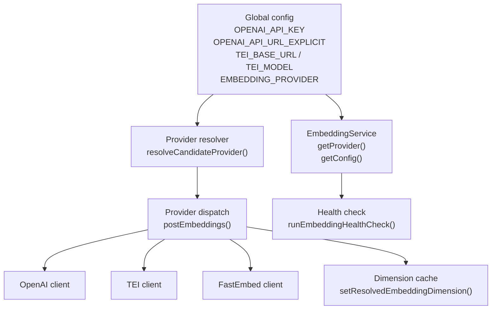
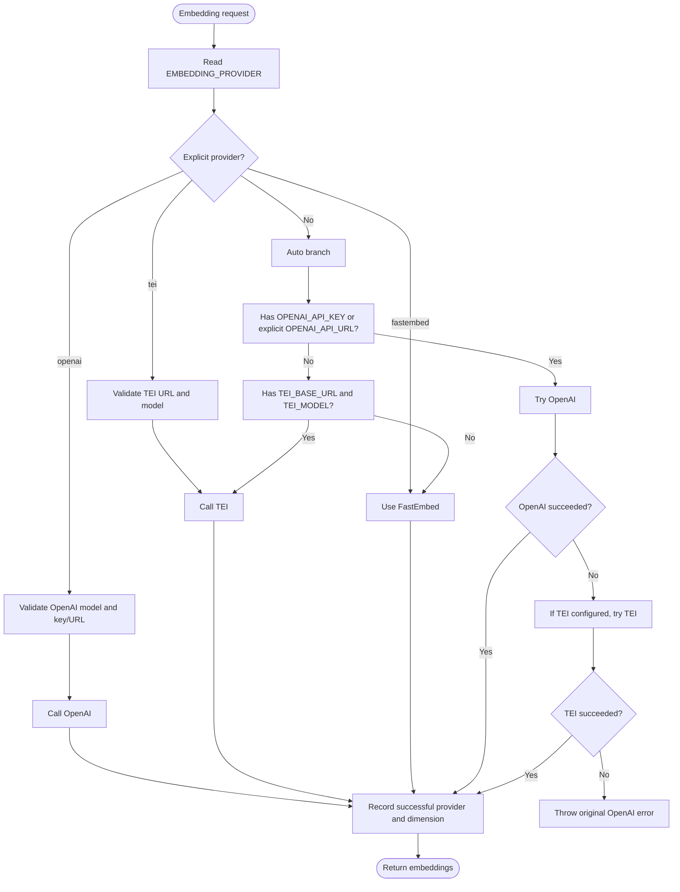
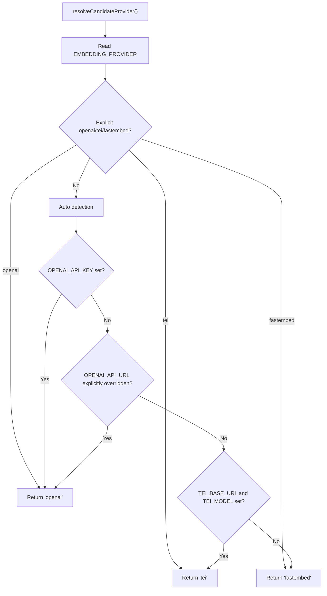
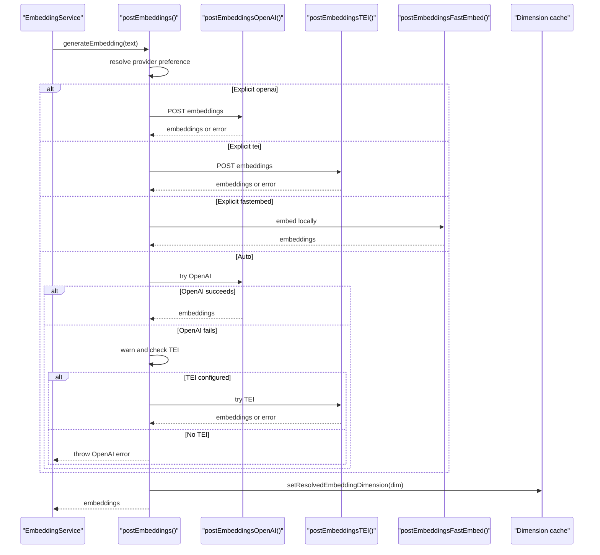
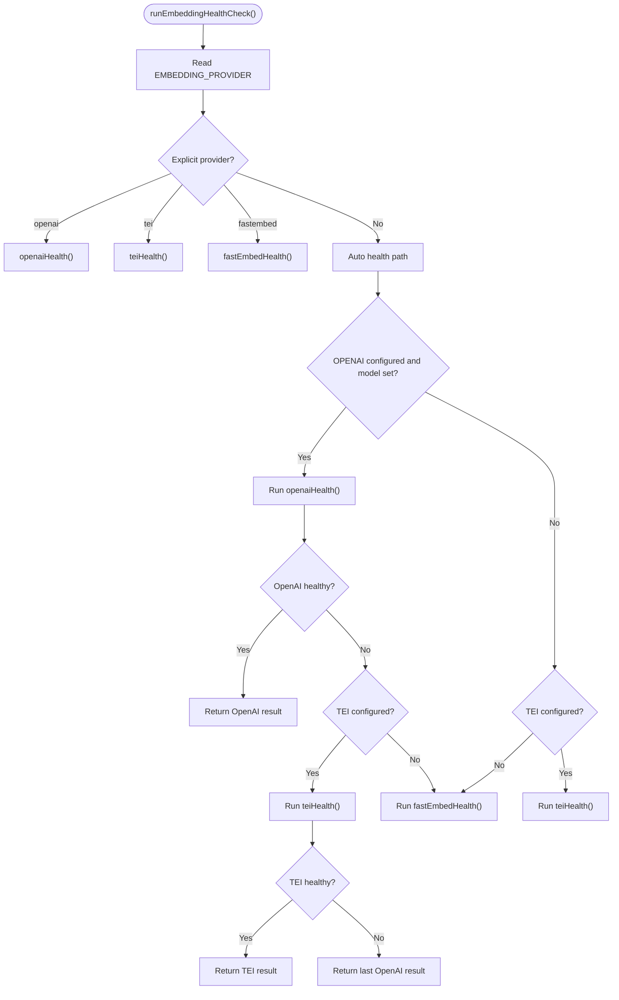
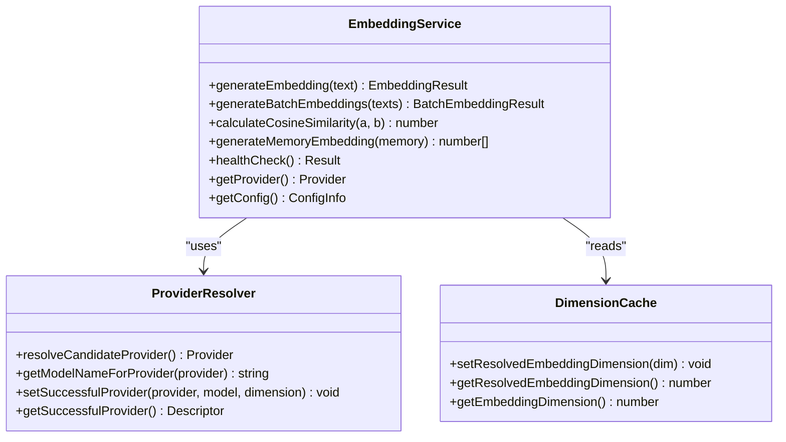
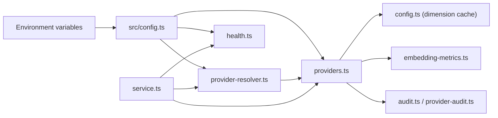

# Automatic Provider Resolution

<cite>
**Referenced Files in This Document**
- [provider-resolver.ts](file://src/services/embedding/provider-resolver.ts)
- [providers.ts](file://src/services/embedding/providers.ts)
- [config.ts](file://src/services/embedding/config.ts)
- [health.ts](file://src/services/embedding/health.ts)
- [service.ts](file://src/services/embedding/service.ts)
- [config.ts](file://src/config.ts)
- [0021-embedding-provider-auto-resolution-and-store-width-binding.md](file://docs/adr/0021-embedding-provider-auto-resolution-and-store-width-binding.md)
</cite>

## Table of Contents
1. [Introduction](#introduction)
2. [Project Structure](#project-structure)
3. [Core Components](#core-components)
4. [Architecture Overview](#architecture-overview)
5. [Detailed Component Analysis](#detailed-component-analysis)
6. [Dependency Analysis](#dependency-analysis)
7. [Performance Considerations](#performance-considerations)
8. [Troubleshooting Guide](#troubleshooting-guide)
9. [Conclusion](#conclusion)

## Introduction
This document explains how the embedding subsystem automatically selects between OpenAI, TEI, and FastEmbed providers at runtime. It covers:
- The priority logic for `EMBEDDING_PROVIDER=auto` versus explicit provider selection.
- Environment variable precedence and configuration validation.
- Fallback behavior when a configured provider fails.
- Health checking and startup probing.
- How the selected provider determines vector dimension and store compatibility.

The mechanism is designed so that a zero-configuration installation uses local FastEmbed by default, while any externally configured endpoint (OpenAI-compatible or TEI) is respected without requiring an explicit provider name.

## Project Structure
The automatic resolution spans several files in the embedding service layer and the global configuration module:

**Diagram sources**
- [config.ts:70-83](file://src/config.ts#L70-L83)
- [provider-resolver.ts:28-46](file://src/services/embedding/provider-resolver.ts#L28-L46)
- [providers.ts:296-333](file://src/services/embedding/providers.ts#L296-L333)
- [config.ts:12-36](file://src/services/embedding/config.ts#L12-L36)
- [service.ts:259-275](file://src/services/embedding/service.ts#L259-L275)
- [health.ts:92-121](file://src/services/embedding/health.ts#L92-L121)

**Section sources**
- [config.ts:70-83](file://src/config.ts#L70-L83)
- [provider-resolver.ts:1-82](file://src/services/embedding/provider-resolver.ts#L1-L82)
- [providers.ts:1-343](file://src/services/embedding/providers.ts#L1-L343)
- [config.ts:1-40](file://src/services/embedding/config.ts#L1-L40)
- [service.ts:39-285](file://src/services/embedding/service.ts#L39-L285)
- [health.ts:1-123](file://src/services/embedding/health.ts#L1-L123)

## Core Components
- **Global configuration**: Reads environment variables such as `EMBEDDING_PROVIDER`, `OPENAI_API_KEY`, `OPENAI_API_URL_EXPLICIT`, `TEI_BASE_URL`, `TEI_MODEL`, and FastEmbed defaults.
- **Provider resolver**: Computes the candidate provider based on preference and environment.
- **Provider dispatch**: Executes embeddings through OpenAI, TEI, or FastEmbed with retries and error handling.
- **Dimension cache**: Records the first successful embedding dimension and enforces consistency.
- **Embedding service**: Exposes a stable API, reports the candidate provider, and exposes health checks.
- **Health checker**: Mirrors the runtime selection to validate the intended provider.

Key responsibilities:
- Separate “candidate” provider selection from “successful” provider tracking.
- Keep `auto` as the default while honoring explicitly configured endpoints.
- Treat TEI as deprecated but still supported.
- Ensure the process resolves one consistent embedding dimension per run.

**Section sources**
- [config.ts:70-83](file://src/config.ts#L70-L83)
- [provider-resolver.ts:8-46](file://src/services/embedding/provider-resolver.ts#L8-L46)
- [providers.ts:93-201](file://src/services/embedding/providers.ts#L93-L201)
- [providers.ts:203-295](file://src/services/embedding/providers.ts#L203-L295)
- [providers.ts:296-333](file://src/services/embedding/providers.ts#L296-L333)
- [config.ts:12-36](file://src/services/embedding/config.ts#L12-L36)
- [service.ts:259-285](file://src/services/embedding/service.ts#L259-L285)
- [health.ts:92-121](file://src/services/embedding/health.ts#L92-L121)

## Architecture Overview
The resolution pipeline has two phases:
1. **Candidate selection**: Determines which provider will be attempted.
2. **Runtime execution**: Calls the selected provider, records success, and caches the resulting vector dimension.

**Diagram sources**
- [providers.ts:296-333](file://src/services/embedding/providers.ts#L296-L333)
- [providers.ts:93-201](file://src/services/embedding/providers.ts#L93-L201)
- [providers.ts:203-295](file://src/services/embedding/providers.ts#L203-L295)
- [provider-resolver.ts:28-46](file://src/services/embedding/provider-resolver.ts#L28-L46)

**Section sources**
- [providers.ts:296-333](file://src/services/embedding/providers.ts#L296-L333)
- [provider-resolver.ts:28-46](file://src/services/embedding/provider-resolver.ts#L28-L46)

## Detailed Component Analysis

### Configuration and Environment Precedence
The global configuration defines the inputs used by resolution:
- `EMBEDDING_PROVIDER`: Default is `auto`; can be explicitly set to `openai`, `tei`, or `fastembed`.
- `OPENAI_API_KEY`: Presence enables OpenAI selection in auto mode.
- `OPENAI_API_URL_EXPLICIT`: Indicates whether `OPENAI_API_URL` was explicitly overridden; this allows keyless OpenAI-compatible endpoints to select OpenAI mode.
- `TEI_BASE_URL` and `TEI_MODEL`: Both must be present to select TEI.
- FastEmbed is the zero-configuration fallback.

Important behaviors:
- `OPENAI_EMBEDDING_MODEL` defaults to a small embedding model.
- `OPENAI_API_URL` defaults to the official OpenAI base URL unless explicitly overridden.
- TEI is marked as deprecated in documentation and warnings, but remains functional.

**Section sources**
- [config.ts:70-83](file://src/config.ts#L70-L83)
- [0021-embedding-provider-auto-resolution-and-store-width-binding.md:40-52](file://docs/adr/0021-embedding-provider-auto-resolution-and-store-width-binding.md#L40-L52)

### Candidate Provider Resolution
The candidate resolver separates intent from outcome:
- If `EMBEDDING_PROVIDER` is explicitly set, that value wins.
- In `auto` mode:
  - `OPENAI_API_KEY` selects OpenAI.
  - An explicitly overridden `OPENAI_API_URL` also selects OpenAI.
  - If both OpenAI conditions are absent but `TEI_BASE_URL` and `TEI_MODEL` are present, TEI is selected.
  - Otherwise, FastEmbed is selected.

This function does not call network code; it only computes what will be tried.

**Diagram sources**
- [provider-resolver.ts:28-46](file://src/services/embedding/provider-resolver.ts#L28-L46)
- [provider-resolver.ts:48-53](file://src/services/embedding/provider-resolver.ts#L48-L53)

**Section sources**
- [provider-resolver.ts:20-53](file://src/services/embedding/provider-resolver.ts#L20-L53)

### Runtime Provider Dispatch and Fallback
At runtime, `postEmbeddings()` performs the actual selection and execution:
- Explicit provider paths validate required configuration before calling the provider.
- Auto mode tries OpenAI if configured, falls back to TEI if configured, otherwise uses FastEmbed.
- When OpenAI fails in auto mode, the code logs a warning and attempts TEI only if TEI is configured; otherwise, it throws the original OpenAI error.
- Successful calls record the resolved embedding dimension and mark the successful provider descriptor.

**Diagram sources**
- [providers.ts:296-333](file://src/services/embedding/providers.ts#L296-L333)
- [providers.ts:93-201](file://src/services/embedding/providers.ts#L93-L201)
- [providers.ts:203-295](file://src/services/embedding/providers.ts#L203-L295)
- [config.ts:12-36](file://src/services/embedding/config.ts#L12-L36)

**Section sources**
- [providers.ts:93-201](file://src/services/embedding/providers.ts#L93-L201)
- [providers.ts:203-295](file://src/services/embedding/providers.ts#L203-L295)
- [providers.ts:296-333](file://src/services/embedding/providers.ts#L296-L333)

### Health Checking Process
The health checker mirrors the runtime selection logic:
- For explicit provider preferences, it tests only that provider.
- For `auto`, it prefers OpenAI if configured, then TEI if configured, then FastEmbed.
- A configured-but-failing OpenAI is reported as-is rather than being masked by FastEmbed.
- Rate-limited responses are treated as reachable but throttled.

**Diagram sources**
- [health.ts:92-121](file://src/services/embedding/health.ts#L92-L121)
- [health.ts:17-33](file://src/services/embedding/health.ts#L17-L33)
- [health.ts:35-80](file://src/services/embedding/health.ts#L35-L80)
- [health.ts:82-90](file://src/services/embedding/health.ts#L82-L90)

**Section sources**
- [health.ts:17-33](file://src/services/embedding/health.ts#L17-L33)
- [health.ts:35-80](file://src/services/embedding/health.ts#L35-L80)
- [health.ts:82-90](file://src/services/embedding/health.ts#L82-L90)
- [health.ts:92-121](file://src/services/embedding/health.ts#L92-L121)

### Embedding Service Integration
The embedding service:
- Uses `resolveCandidateProvider()` to report the candidate provider.
- Uses `getModelNameForProvider()` to map provider to model name.
- Validates embedding dimensions against the cached dimension.
- Exposes `probeEmbeddingDimension()` to initialize the dimension at startup.

**Diagram sources**
- [service.ts:39-285](file://src/services/embedding/service.ts#L39-L285)
- [provider-resolver.ts:8-82](file://src/services/embedding/provider-resolver.ts#L8-L82)
- [config.ts:12-36](file://src/services/embedding/config.ts#L12-L36)

**Section sources**
- [service.ts:39-285](file://src/services/embedding/service.ts#L39-L285)
- [provider-resolver.ts:8-82](file://src/services/embedding/provider-resolver.ts#L8-L82)
- [config.ts:12-36](file://src/services/embedding/config.ts#L12-L36)

## Dependency Analysis
The automatic provider resolution depends on configuration values and produces side effects that affect downstream components:

**Diagram sources**
- [config.ts:70-83](file://src/config.ts#L70-L83)
- [provider-resolver.ts:6-62](file://src/services/embedding/provider-resolver.ts#L6-L62)
- [providers.ts:1-6](file://src/services/embedding/providers.ts#L1-L6)
- [config.ts:1-40](file://src/services/embedding/config.ts#L1-L40)
- [service.ts:15-35](file://src/services/embedding/service.ts#L15-L35)

Coupling observations:
- The resolver reads global configuration directly, making it sensitive to environment state.
- The provider dispatch writes the resolved dimension into a process-wide cache.
- Health checking duplicates selection logic to keep diagnostics aligned with runtime behavior.
- The embedding service is the main integration point for callers.

Potential risks:
- If `EMBEDDING_PROVIDER` is misconfigured, the wrong provider may be attempted.
- If OpenAI is configured but failing, auto mode may fall back to TEI or throw, depending on TEI configuration.
- If the dimension is not probed before store initialization, downstream stores may fail or behave incorrectly.

**Section sources**
- [provider-resolver.ts:6-62](file://src/services/embedding/provider-resolver.ts#L6-L62)
- [providers.ts:1-6](file://src/services/embedding/providers.ts#L1-L6)
- [config.ts:1-40](file://src/services/embedding/config.ts#L1-L40)
- [service.ts:15-35](file://src/services/embedding/service.ts#L15-L35)

## Performance Considerations
- **Retry policy**: Embedding requests use configurable retry limits, exponential backoff with jitter, and a wall-clock budget. This reduces transient failures but adds latency under repeated provider errors.
- **Rate limiting**: OpenAI and TEI rate-limit responses are captured and surfaced; insufficient quota is treated as non-retriable for OpenAI.
- **Local vs remote**: FastEmbed avoids network latency but depends on local model availability; OpenAI and TEI add network round-trips and potential billing costs.
- **Dimension caching**: Once a successful embedding returns, the dimension is cached, avoiding repeated inference just to determine vector width.

Operational guidance:
- Tune `EMBEDDING_MAX_RETRIES`, `EMBEDDING_RETRY_BASE_DELAY_MS`, `EMBEDDING_RETRY_MAX_DELAY_MS`, and `EMBEDDING_RETRY_BUDGET_MS` according to provider reliability and latency expectations.
- Prefer FastEmbed for offline or constrained environments.
- Use OpenAI-compatible endpoints via `OPENAI_API_URL` when you need external models without a key.
- Monitor health checks to detect authentication, rate limiting, and connectivity issues early.

[No sources needed since this section provides general guidance]

## Troubleshooting Guide

### Symptom: The system uses FastEmbed even though `OPENAI_API_URL` is set
**Likely cause**: `OPENAI_API_URL` was not explicitly overridden, or `OPENAI_API_KEY` is missing and the auto branch did not treat the URL as explicit.

**What to check**:
- Confirm `OPENAI_API_URL_EXPLICIT` is true by inspecting the environment where the process starts.
- Verify `EMBEDDING_PROVIDER` is not explicitly set to `fastembed`.
- Review the health check output for OpenAI configuration status.

**Resolution**:
- Set `OPENAI_API_URL` explicitly in the environment.
- Or set `EMBEDDING_PROVIDER=openai` to force OpenAI mode.

**Section sources**
- [config.ts:72-74](file://src/config.ts#L72-L74)
- [provider-resolver.ts:36-40](file://src/services/embedding/provider-resolver.ts#L36-L40)
- [health.ts:17-33](file://src/services/embedding/health.ts#L17-L33)

### Symptom: OpenAI fails and the application falls back to TEI unexpectedly
**Likely cause**: Auto mode tried OpenAI, failed, and found `TEI_BASE_URL` and `TEI_MODEL` configured.

**What to check**:
- Inspect the warning log indicating OpenAI failure and TEI fallback.
- Confirm whether TEI is intentionally configured.

**Resolution**:
- Remove or unset `TEI_BASE_URL` and `TEI_MODEL` if TEI should not be used.
- Fix OpenAI configuration (key, model, endpoint).
- Set `EMBEDDING_PROVIDER=openai` if you want explicit failure instead of fallback.

**Section sources**
- [providers.ts:314-326](file://src/services/embedding/providers.ts#L314-L326)
- [providers.ts:335-341](file://src/services/embedding/providers.ts#L335-L341)

### Symptom: OpenAI fails and no fallback occurs
**Likely cause**: OpenAI is configured in auto mode, but TEI is not configured.

**What to check**:
- Confirm whether `TEI_BASE_URL` and `TEI_MODEL` are set.
- Review the error message for authentication, rate limit, or HTTP errors.

**Resolution**:
- Configure TEI if you want a fallback.
- Fix OpenAI credentials or quota.
- Use FastEmbed by unsetting OpenAI and TEI configuration.

**Section sources**
- [providers.ts:314-326](file://src/services/embedding/providers.ts#L314-L326)

### Symptom: Authentication or rate-limit errors from OpenAI
**Likely cause**: Missing or invalid `OPENAI_API_KEY`, insufficient quota, or provider throttling.

**What to check**:
- Health check messages for authentication or rate-limit indicators.
- Error messages containing `401` or `429`.

**Resolution**:
- Correct `OPENAI_API_KEY`.
- Add billing/quota for OpenAI if the error indicates insufficient quota.
- Retry later or adjust retry configuration.

**Section sources**
- [health.ts:17-33](file://src/services/embedding/health.ts#L17-L33)
- [providers.ts:147-172](file://src/services/embedding/providers.ts#L147-L172)

### Symptom: TEI authentication or unexpected response shape
**Likely cause**: Invalid `TEI_API_KEY`, incorrect `TEI_BASE_URL`, or incompatible TEI server response format.

**What to check**:
- Health check message for TEI authentication or HTTP status.
- Whether the TEI server returns embeddings in a supported shape.

**Resolution**:
- Verify `TEI_BASE_URL`, `TEI_MODEL`, and optional `TEI_API_KEY`.
- Confirm the TEI server implements the expected embeddings endpoint.

**Section sources**
- [health.ts:35-80](file://src/services/embedding/health.ts#L35-L80)
- [providers.ts:203-295](file://src/services/embedding/providers.ts#L203-L295)

### Symptom: Embedding dimension mismatch or store schema errors
**Likely cause**: The process resolved a different provider/model than the one that created the stored vectors, causing vector width mismatches.

**What to check**:
- Startup logs showing the resolved provider, model, and dimension.
- Store metadata and column names such as `vs{dim}`.
- Whether `probeEmbeddingDimension()` ran before store initialization.

**Resolution**:
- Ensure the same provider/model is used consistently.
- Re-run the probe before initializing memory stores.
- Follow migration guidance for Qdrant or consider store re-embedding for embedded stores.

**Section sources**
- [config.ts:12-36](file://src/services/embedding/config.ts#L12-L36)
- [service.ts:280-284](file://src/services/embedding/service.ts#L280-L284)
- [0021-embedding-provider-auto-resolution-and-store-width-binding.md:72-87](file://docs/adr/0021-embedding-provider-auto-resolution-and-store-width-binding.md#L72-L87)

### Symptom: Health check reports a configured provider as unhealthy
**Likely cause**: The health checker validates the same provider that would be used at runtime.

**What to check**:
- Whether the provider is explicitly preferred or selected by auto.
- Whether required configuration is present.
- Whether the provider responds successfully to a minimal embedding request.

**Resolution**:
- Fix provider configuration.
- Unset conflicting environment variables.
- Use the explicit provider setting to isolate diagnostics.

**Section sources**
- [health.ts:92-121](file://src/services/embedding/health.ts#L92-L121)

## Conclusion
Automatic provider resolution prioritizes explicit configuration, then applies autodetection rules:
- Explicit `EMBEDDING_PROVIDER` always wins.
- In `auto` mode, OpenAI is selected if `OPENAI_API_KEY` or an explicitly overridden `OPENAI_API_URL` is present.
- TEI is selected if both `TEI_BASE_URL` and `TEI_MODEL` are configured.
- FastEmbed is the zero-configuration default.

Runtime behavior includes:
- OpenAI failure in auto mode falls back to TEI only if configured; otherwise, the original OpenAI error is thrown.
- Health checks mirror runtime selection and surface configuration, authentication, rate-limit, and connectivity problems.
- The first successful embedding sets a process-wide dimension, which must be probed before store initialization to avoid schema mismatches.

For reliable operation:
- Prefer explicit `EMBEDDING_PROVIDER` in production when deterministic behavior is required.
- Keep `OPENAI_API_URL` explicit when using keyless OpenAI-compatible endpoints.
- Avoid mixing providers across store lifetimes.
- Use health checks and logs to diagnose provider selection and runtime failures.

[No sources needed since this section summarizes without analyzing specific files]