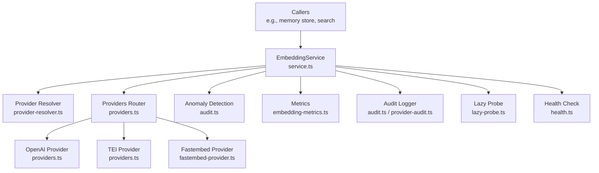
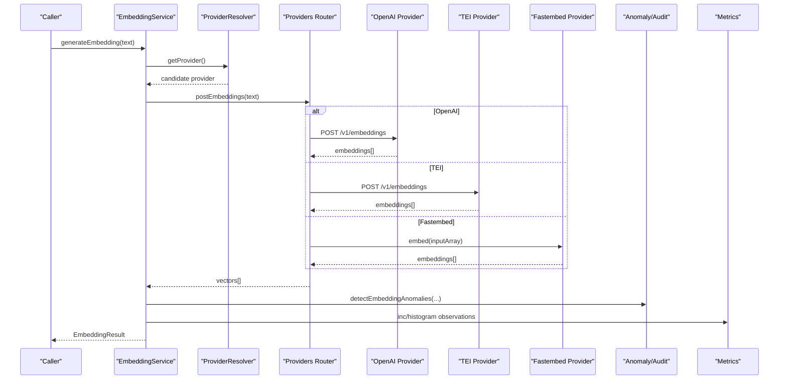
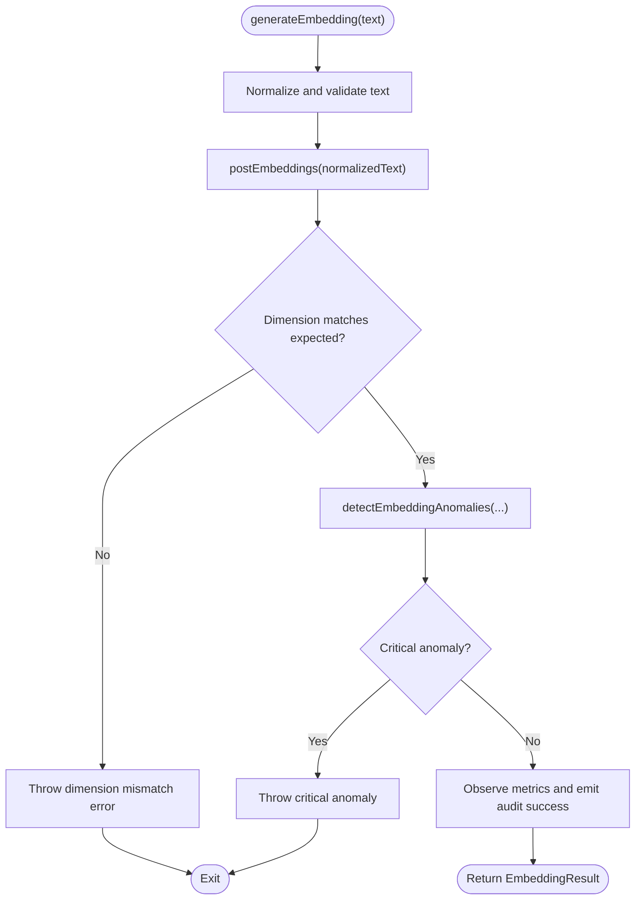
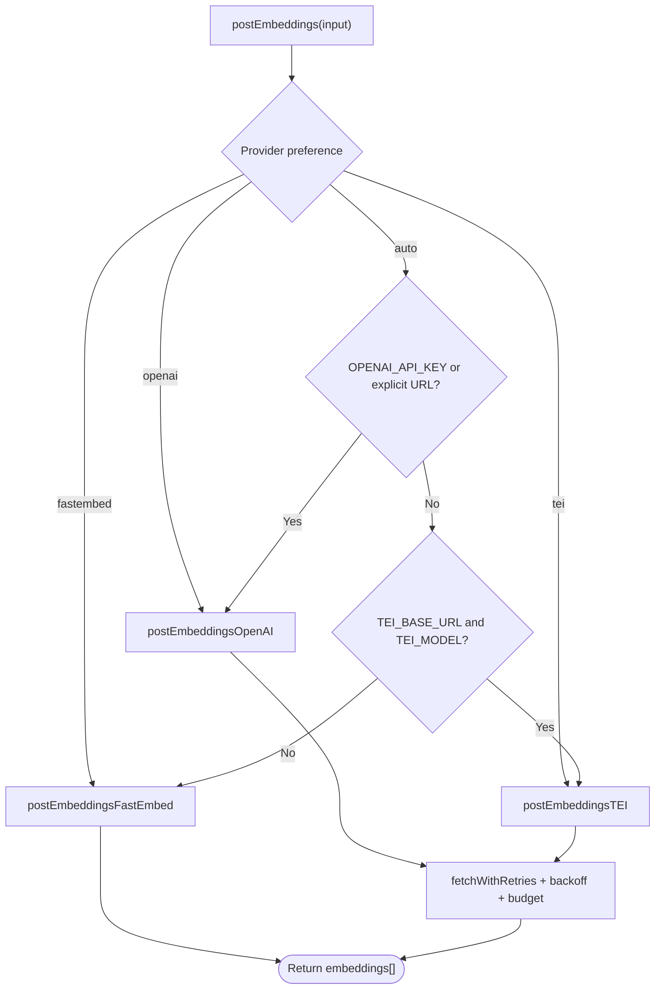
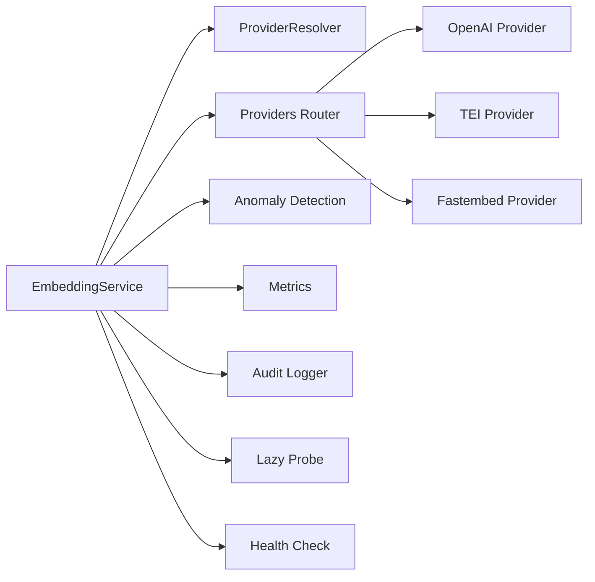

# Embedding Generation Workflow

<cite>
**Referenced Files in This Document**
- [service.ts](file://src/services/embedding/service.ts)
- [providers.ts](file://src/services/embedding/providers.ts)
- [fastembed-provider.ts](file://src/services/embedding/fastembed-provider.ts)
- [config.ts](file://src/services/embedding/config.ts)
- [types.ts](file://src/services/embedding/types.ts)
- [audit.ts](file://src/services/embedding/audit.ts)
- [provider-audit.ts](file://src/services/embedding/provider-audit.ts)
- [embedding-metrics.ts](file://src/services/metrics/embedding-metrics.ts)
- [lazy-probe.ts](file://src/services/embedding/lazy-probe.ts)
- [provider-resolver.ts](file://src/services/embedding/provider-resolver.ts)
- [health.ts](file://src/services/embedding/health.ts)
</cite>

## Table of Contents
1. [Introduction](#introduction)
2. [Project Structure](#project-structure)
3. [Core Components](#core-components)
4. [Architecture Overview](#architecture-overview)
5. [Detailed Component Analysis](#detailed-component-analysis)
6. [Dependency Analysis](#dependency-analysis)
7. [Performance Considerations](#performance-considerations)
8. [Troubleshooting Guide](#troubleshooting-guide)
9. [Conclusion](#conclusion)

## Introduction
This document explains the complete embedding generation workflow from text input to vector output, including batch processing, error handling, retry mechanisms, audit logging, metrics collection, and health checks. It is designed for both developers integrating with the embedding service and operators monitoring performance and quality.

The embedding system supports multiple providers:
- OpenAI-compatible API
- TEI (Text Embeddings Inference) server
- Local fastembed (zero-dependency default)

It also provides:
- Batch embedding generation
- Dimension probing and validation
- Anomaly detection and structured audit logs
- Prometheus metrics for latency, errors, vector sizes, and batch sizes
- Health checks per provider

## Project Structure
The embedding subsystem lives under src/services/embedding and integrates with metrics and utilities:
- Service entry points and orchestration
- Provider implementations and selection logic
- Configuration and dimension resolution
- Audit logging and anomaly detection
- Metrics definitions
- Lazy dimension probe and health checks

**Diagram sources**
- [service.ts:39-278](file://src/services/embedding/service.ts#L39-L278)
- [providers.ts:296-333](file://src/services/embedding/providers.ts#L296-L333)
- [fastembed-provider.ts:41-82](file://src/services/embedding/fastembed-provider.ts#L41-L82)
- [audit.ts:94-157](file://src/services/embedding/audit.ts#L94-L157)
- [embedding-metrics.ts:11-47](file://src/services/metrics/embedding-metrics.ts#L11-L47)
- [lazy-probe.ts:19-27](file://src/services/embedding/lazy-probe.ts#L19-L27)
- [health.ts:92-121](file://src/services/embedding/health.ts#L92-L121)

**Section sources**
- [service.ts:39-278](file://src/services/embedding/service.ts#L39-L278)
- [providers.ts:296-333](file://src/services/embedding/providers.ts#L296-L333)

## Core Components
- EmbeddingService: Public API for single and batch embeddings, similarity calculation, cost estimation placeholder, health check, and provider configuration inspection.
- Providers router: Chooses provider based on environment or explicit preference; implements retries, backoff, budgeting, and rate-limit handling.
- Fastembed provider: Local ONNX-based embeddings with lazy model initialization.
- Config and dimension resolver: Caches and validates embedding dimensions across calls.
- Audit and anomaly detection: Structured logs and anomaly counters for latency, norm, and dimension mismatches.
- Metrics: Prometheus counters and histograms for requests, duration, errors, vector size, and batch size.
- Lazy probe and health: Ensures dimension is resolved once and exposes per-provider health checks.

Key responsibilities:
- Input normalization and validation
- Provider selection and invocation
- Retry and backoff for transient failures
- Dimension consistency enforcement
- Comprehensive audit and metrics emission
- Health diagnostics

**Section sources**
- [service.ts:48-275](file://src/services/embedding/service.ts#L48-L275)
- [providers.ts:76-333](file://src/services/embedding/providers.ts#L76-L333)
- [fastembed-provider.ts:41-82](file://src/services/embedding/fastembed-provider.ts#L41-L82)
- [config.ts:12-36](file://src/services/embedding/config.ts#L12-L36)
- [audit.ts:60-157](file://src/services/embedding/audit.ts#L60-L157)
- [embedding-metrics.ts:11-47](file://src/services/metrics/embedding-metrics.ts#L11-L47)
- [lazy-probe.ts:19-27](file://src/services/embedding/lazy-probe.ts#L19-L27)
- [health.ts:92-121](file://src/services/embedding/health.ts#L92-L121)

## Architecture Overview
End-to-end flow from text to vectors:

**Diagram sources**
- [service.ts:48-127](file://src/services/embedding/service.ts#L48-L127)
- [providers.ts:93-201](file://src/services/embedding/providers.ts#L93-L201)
- [providers.ts:203-295](file://src/services/embedding/providers.ts#L203-L295)
- [fastembed-provider.ts:41-82](file://src/services/embedding/fastembed-provider.ts#L41-L82)
- [audit.ts:94-157](file://src/services/embedding/audit.ts#L94-L157)
- [embedding-metrics.ts:11-47](file://src/services/metrics/embedding-metrics.ts#L11-L47)

## Detailed Component Analysis

### EmbeddingService
Responsibilities:
- Normalize inputs and validate non-empty text
- Invoke provider via postEmbeddings
- Validate output dimension against expected dimension
- Emit metrics and audit logs
- Provide cosine similarity helper
- Expose health check and configuration introspection

Batch processing:
- Filters empty strings
- Tracks total input count and character length
- Observes batch size metric
- Validates all returned embeddings have expected dimension
- Emits per-vector size metrics

Error handling:
- Increments request and error counters on failure
- Logs detailed audit error records
- Preserves original error message for callers

Retry behavior:
- Delegates to providers layer which implements exponential backoff, jitter, Retry-After header support, and wall-clock retry budget.

Dimension probing:
- Uses a startup probe to resolve and cache the embedding dimension before use.

**Diagram sources**
- [service.ts:48-127](file://src/services/embedding/service.ts#L48-L127)
- [audit.ts:94-157](file://src/services/embedding/audit.ts#L94-L157)

**Section sources**
- [service.ts:48-127](file://src/services/embedding/service.ts#L48-L127)
- [service.ts:130-221](file://src/services/embedding/service.ts#L130-L221)
- [service.ts:224-275](file://src/services/embedding/service.ts#L224-L275)
- [service.ts:280-284](file://src/services/embedding/service.ts#L280-L284)

### Providers Router and Retries
Responsibilities:
- Select provider based on explicit preference or auto-detection
- Implement robust retry strategy with:
  - Network error classification
  - HTTP status classification (429, 502, 503, 504)
  - Exponential backoff with full jitter
  - Respect for Retry-After headers (seconds or ms), capped
  - Wall-clock retry budget to prevent long hangs
- Parse and normalize provider responses into number[][]
- Set resolved embedding dimension and successful provider descriptor
- Emit structured provider audit logs

Rate limiting:
- OpenAI insufficient quota is treated as non-retriable billing issue
- Other 429s are retried within budget and backoff rules

Fallbacks:
- Auto mode tries OpenAI first if configured, then TEI, then fastembed
- Explicit preferences bypass fallbacks

**Diagram sources**
- [providers.ts:296-333](file://src/services/embedding/providers.ts#L296-L333)
- [providers.ts:76-92](file://src/services/embedding/providers.ts#L76-L92)
- [providers.ts:93-201](file://src/services/embedding/providers.ts#L93-L201)
- [providers.ts:203-295](file://src/services/embedding/providers.ts#L203-L295)

**Section sources**
- [providers.ts:76-92](file://src/services/embedding/providers.ts#L76-L92)
- [providers.ts:93-201](file://src/services/embedding/providers.ts#L93-L201)
- [providers.ts:203-295](file://src/services/embedding/providers.ts#L203-L295)
- [providers.ts:296-333](file://src/services/embedding/providers.ts#L296-L333)

### Fastembed Provider
Responsibilities:
- Lazily initialize the ONNX model once per process
- Stream embeddings in batches from the SDK
- Validate output shape and set dimension
- Emit provider audit logs

Notes:
- No API key required
- Model weights downloaded to a configurable cache directory on first use
- Initialization errors clear memoization so subsequent calls can retry

**Section sources**
- [fastembed-provider.ts:17-39](file://src/services/embedding/fastembed-provider.ts#L17-L39)
- [fastembed-provider.ts:41-82](file://src/services/embedding/fastembed-provider.ts#L41-L82)

### Configuration and Dimension Resolution
Responsibilities:
- Define endpoints for OpenAI and TEI
- Cache resolved embedding dimension after first successful response
- Enforce dimension consistency across calls
- Provide public getters for dimension

Startup requirement:
- probeEmbeddingDimension must run at startup before embedding-dependent code uses the dimension

**Section sources**
- [config.ts:1-40](file://src/services/embedding/config.ts#L1-L40)
- [service.ts:280-284](file://src/services/embedding/service.ts#L280-L284)

### Audit Logging and Anomaly Detection
Responsibilities:
- Log successful and failed embedding requests with tenant/request context
- Detect anomalies:
  - High latency beyond threshold
  - Unusual vector norms outside configured range
  - Dimension mismatches between expected and actual
- Emit anomaly metrics and structured logs

Provider-level audit:
- Shared logger for each provider call with consistent fields

**Section sources**
- [audit.ts:60-157](file://src/services/embedding/audit.ts#L60-L157)
- [provider-audit.ts:25-42](file://src/services/embedding/provider-audit.ts#L25-L42)

### Metrics Collection
Metrics exposed:
- Total embedding requests by provider, status, tenant
- Duration histogram by provider and tenant
- Error counter by provider, status, tenant
- Vector size histogram by provider and tenant
- Batch size histogram by tenant

These enable:
- Performance monitoring and SLO tracking
- Cost estimation hooks (placeholder currently returns zero)
- Quality assurance through vector size and batch distribution insights

**Section sources**
- [embedding-metrics.ts:11-47](file://src/services/metrics/embedding-metrics.ts#L11-L47)
- [service.ts:76-84](file://src/services/embedding/service.ts#L76-L84)
- [service.ts:172-178](file://src/services/embedding/service.ts#L172-L178)

### Lazy Probe and Health Checks
Lazy probe:
- Memoizes the dimension probe to avoid redundant model loads
- Clears inflight promise on failure to allow retries

Health checks:
- Per-provider health checks that attempt minimal embedding calls
- Distinguish reachable but throttled (429) vs authentication failures (401)
- Mirror provider selection logic used at runtime

**Section sources**
- [lazy-probe.ts:19-27](file://src/services/embedding/lazy-probe.ts#L19-L27)
- [health.ts:17-90](file://src/services/embedding/health.ts#L17-L90)
- [health.ts:92-121](file://src/services/embedding/health.ts#L92-L121)

## Dependency Analysis
High-level dependencies among embedding components:

**Diagram sources**
- [service.ts:39-278](file://src/services/embedding/service.ts#L39-L278)
- [providers.ts:296-333](file://src/services/embedding/providers.ts#L296-L333)
- [fastembed-provider.ts:41-82](file://src/services/embedding/fastembed-provider.ts#L41-L82)
- [audit.ts:94-157](file://src/services/embedding/audit.ts#L94-L157)
- [embedding-metrics.ts:11-47](file://src/services/metrics/embedding-metrics.ts#L11-L47)
- [lazy-probe.ts:19-27](file://src/services/embedding/lazy-probe.ts#L19-L27)
- [health.ts:92-121](file://src/services/embedding/health.ts#L92-L121)

Coupling and cohesion:
- EmbeddingService orchestrates provider calls and emits metrics/audit; low coupling to specific providers via the router.
- Providers encapsulate network and parsing details; cohesive around their respective APIs.
- Audit and anomaly modules are reusable across providers and service methods.
- Metrics module is independent and consumed by service and providers.

Potential circular dependencies:
- Avoided by separating provider audit into its own module and using lazy imports where needed.

External integration points:
- OpenAI-compatible REST API
- TEI server REST API
- Local fastembed SDK

**Section sources**
- [service.ts:39-278](file://src/services/embedding/service.ts#L39-L278)
- [providers.ts:296-333](file://src/services/embedding/providers.ts#L296-L333)
- [provider-audit.ts:25-42](file://src/services/embedding/provider-audit.ts#L25-L42)

## Performance Considerations
- Prefer batch embeddings when possible to reduce overhead and improve throughput.
- Monitor vector size and batch size distributions via metrics to tune batching strategies.
- Use local fastembed for self-contained environments to avoid network latency.
- Ensure dimension probing runs at startup to avoid repeated model loads.
- Configure retry budgets and backoff parameters appropriately for your environment.

[No sources needed since this section provides general guidance]

## Troubleshooting Guide
Common issues and resolutions:
- Empty input:
  - Single embedding throws an error if text is empty; ensure callers trim and validate inputs.
- Dimension mismatch:
  - If provider returns unexpected dimension, the service throws an error; verify provider configuration and model selection.
- Rate limits:
  - OpenAI insufficient quota is non-retriable; add billing/quota.
  - Other 429s are retried respecting Retry-After headers and retry budget.
- Authentication failures:
  - 401 errors indicate missing or invalid keys; verify OPENAI_API_KEY or TEI_API_KEY.
- Non-JSON responses:
  - Provider parsers throw errors for malformed responses; inspect upstream provider health.
- Health checks:
  - Use health check endpoints to determine provider reachability and throttling status.

Operational tips:
- Inspect structured audit logs for category 'audit.embedding' and 'audit.anomaly'.
- Review Prometheus metrics:
  - squadrules_embedding_requests_total
  - squadrules_embedding_duration_seconds
  - squadrules_embedding_errors_total
  - squadrules_embedding_vector_size_bytes
  - squadrules_embedding_batch_size

**Section sources**
- [service.ts:58-63](file://src/services/embedding/service.ts#L58-L63)
- [service.ts:141-153](file://src/services/embedding/service.ts#L141-L153)
- [providers.ts:147-172](file://src/services/embedding/providers.ts#L147-L172)
- [providers.ts:250-261](file://src/services/embedding/providers.ts#L250-L261)
- [health.ts:17-90](file://src/services/embedding/health.ts#L17-L90)

## Conclusion
The embedding generation workflow provides a robust, observable, and multi-provider pipeline from text to vectors. It emphasizes correctness through dimension validation, resilience via retries and backoff, transparency through structured audit logs, and observability via comprehensive metrics. Operators can monitor performance and quality, while developers can integrate confidently using the provided service API and health probes.

[No sources needed since this section summarizes without analyzing specific files]