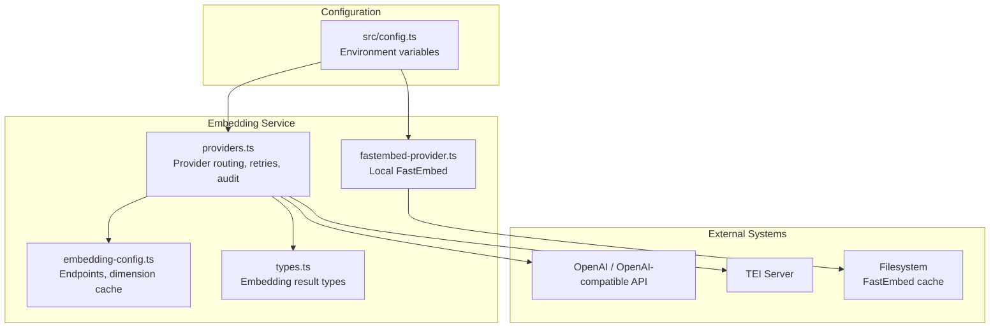
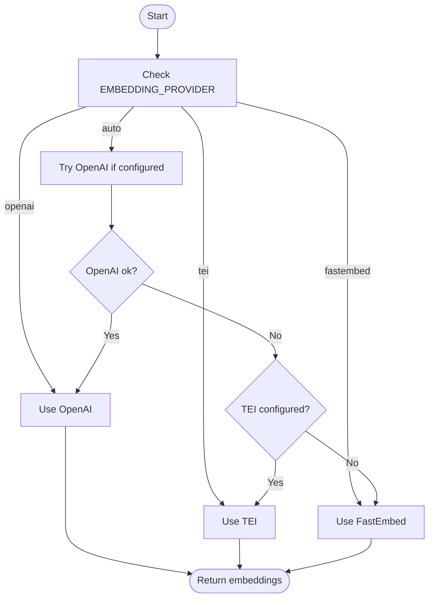
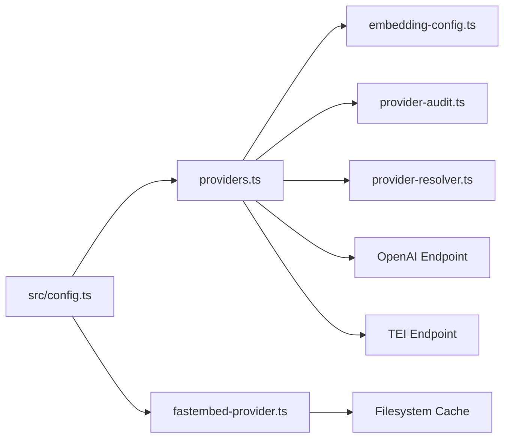

# Embedding Providers

<cite>
**Referenced Files in This Document**
- [providers.ts](file://src/services/embedding/providers.ts)
- [fastembed-provider.ts](file://src/services/embedding/fastembed-provider.ts)
- [config.ts](file://src/config.ts)
- [embedding-config.ts](file://src/services/embedding/config.ts)
- [types.ts](file://src/services/embedding/types.ts)
- [0021-embedding-provider-auto-resolution-and-store-width-binding.md](file://docs/adr/0021-embedding-provider-auto-resolution-and-store-width-binding.md)
</cite>

## Table of Contents
1. [Introduction](#introduction)
2. [Project Structure](#project-structure)
3. [Core Components](#core-components)
4. [Architecture Overview](#architecture-overview)
5. [Detailed Component Analysis](#detailed-component-analysis)
6. [Dependency Analysis](#dependency-analysis)
7. [Performance Considerations](#performance-considerations)
8. [Troubleshooting Guide](#troubleshooting-guide)
9. [Conclusion](#conclusion)

## Introduction
This document explains the embedding provider implementations used by SquadRules for generating vector embeddings. It covers:
- FastEmbed: local, zero-API-key embedding generation using an ONNX-backed model.
- OpenAI: cloud-based embeddings through the OpenAI-compatible `/v1/embeddings` endpoint.
- TEI (Text Embeddings Inference): self-hosted embeddings via a compatible HTTP service.

It also documents configuration options, environment variables, model selection behavior, retry and rate-limit handling, performance characteristics, setup instructions, and common troubleshooting steps.

## Project Structure
The embedding subsystem lives under `src/services/embedding`. The key files are:
- Provider routing and HTTP logic: `providers.ts`
- Local FastEmbed implementation: `fastembed-provider.ts`
- Environment and runtime configuration: `src/config.ts` and `src/services/embedding/config.ts`
- Shared type definitions: `src/services/embedding/types.ts`
- Architectural decision record explaining auto resolution and store width binding: `docs/adr/0021-embedding-provider-auto-resolution-and-store-width-binding.md`



**Diagram sources**
- [providers.ts:1-343](file://src/services/embedding/providers.ts#L1-L343)
- [fastembed-provider.ts:1-83](file://src/services/embedding/fastembed-provider.ts#L1-L83)
- [embedding-config.ts:1-40](file://src/services/embedding/config.ts#L1-L40)
- [types.ts:1-17](file://src/services/embedding/types.ts#L1-L17)
- [config.ts:70-93](file://src/config.ts#L70-L93)

**Section sources**
- [providers.ts:1-343](file://src/services/embedding/providers.ts#L1-L343)
- [fastembed-provider.ts:1-83](file://src/services/embedding/fastembed-provider.ts#L1-L83)
- [config.ts:70-93](file://src/config.ts#L70-L93)
- [embedding-config.ts:1-40](file://src/services/embedding/config.ts#L1-L40)
- [types.ts:1-17](file://src/services/embedding/types.ts#L1-L17)
- [0021-embedding-provider-auto-resolution-and-store-width-binding.md:1-245](file://docs/adr/0021-embedding-provider-auto-resolution-and-store-width-binding.md#L1-L245)

## Core Components
- Provider router (`postEmbeddings`): selects FastEmbed, OpenAI, or TEI based on explicit preference or auto-detection; implements retries, backoff, and rate-limit handling.
- FastEmbed provider: lazy initialization of the local embedding model; streams embeddings from the SDK; records embedding dimension and audits calls.
- Configuration layer: centralizes environment variables for all providers and exposes derived endpoints and retry policy constants.
- Runtime dimension cache: ensures consistent embedding dimensions per process and validates that writes and reads use the same width.

Key responsibilities:
- Provider selection and fallback behavior.
- Network request construction, parsing, and error classification.
- Retry with exponential backoff, jitter, and `Retry-After` header support.
- Auditing provider usage and errors.
- Binding the resolved embedding dimension to downstream stores.

**Section sources**
- [providers.ts:17-74](file://src/services/embedding/providers.ts#L17-L74)
- [providers.ts:93-201](file://src/services/embedding/providers.ts#L93-L201)
- [providers.ts:203-295](file://src/services/embedding/providers.ts#L203-L295)
- [providers.ts:296-333](file://src/services/embedding/providers.ts#L296-L333)
- [fastembed-provider.ts:17-39](file://src/services/embedding/fastembed-provider.ts#L17-L39)
- [fastembed-provider.ts:41-82](file://src/services/embedding/fastembed-provider.ts#L41-L82)
- [embedding-config.ts:12-36](file://src/services/embedding/config.ts#L12-L36)

## Architecture Overview
The embedding system is a small but critical pipeline:
- A caller requests embeddings for one or more text inputs.
- The provider router chooses the backend according to `EMBEDDING_PROVIDER` or auto-detection rules.
- The selected provider returns normalized numeric vectors.
- The first successful response sets the embedding dimension, which is then enforced across the application.

```mermaid
sequenceDiagram
participant Caller as "Caller"
participant Router as "postEmbeddings<br/>(providers.ts)"
participant FastEmbed as "FastEmbed Provider"
participant OpenAI as "OpenAI Endpoint"
participant TEI as "TEI Endpoint"
Caller->>Router : "Embed texts"
alt "Explicit fastembed"
Router->>FastEmbed : "Generate embeddings locally"
FastEmbed-->>Router : "Vectors + dimension"
else "Explicit openai"
Router->>OpenAI : "POST /v1/embeddings"
OpenAI-->>Router : "Vectors + dimension"
else "Explicit tei"
Router->>TEI : "POST /v1/embeddings"
TEI-->>Router : "Vectors + dimension"
else "Auto"
Router->>OpenAI : "Try OpenAI if configured"
alt "OpenAI succeeds"
OpenAI-->>Router : "Vectors + dimension"
else "OpenAI fails"
opt "TEI configured"
Router->>TEI : "Fallback to TEI"
TEI-->>Router : "Vectors + dimension"
else "No TEI"
Router-->>Caller : "Error (no usable provider)"
end
end
end
Router-->>Caller : "Normalized embeddings"
```

**Diagram sources**
- [providers.ts:93-201](file://src/services/embedding/providers.ts#L93-L201)
- [providers.ts:203-295](file://src/services/embedding/providers.ts#L203-L295)
- [providers.ts:296-333](file://src/services/embedding/providers.ts#L296-L333)

## Detailed Component Analysis

### FastEmbed Provider
FastEmbed provides local embedding generation without requiring an external API key. It lazily initializes the model on first use and caches it for subsequent calls. Model weights are downloaded into a configurable cache directory.

Highlights:
- Lazy initialization avoids loading native bindings unless FastEmbed is selected.
- Iterates over streaming batches from the SDK to build the final embedding array.
- Records the embedding dimension and marks FastEmbed as the successful provider.
- Audits both success and failure paths.

Configuration:
- `FASTEMBED_MODEL`: model identifier used by FastEmbed.
- `FASTEMBED_CACHE_DIR`: directory where FastEmbed downloads and caches model weights.

Setup:
- No API key required.
- Ensure sufficient disk space for model weights in the cache directory.
- First run may download model weights; subsequent runs reuse cached models.

Performance:
- CPU-bound inference; latency depends on hardware and model size.
- Suitable for local development, CI, and environments without network access.

Common issues:
- Missing or unreadable cache directory.
- Slow initial load due to model download.
- Native binding failures when dependencies are missing.

**Section sources**
- [fastembed-provider.ts:1-10](file://src/services/embedding/fastembed-provider.ts#L1-L10)
- [fastembed-provider.ts:17-39](file://src/services/embedding/fastembed-provider.ts#L17-L39)
- [fastembed-provider.ts:41-82](file://src/services/embedding/fastembed-provider.ts#L41-L82)
- [config.ts:78-79](file://src/config.ts#L78-L79)

### OpenAI Provider
The OpenAI provider sends embeddings requests to the OpenAI-compatible `/v1/embeddings` endpoint. It supports both the official OpenAI API and compatible endpoints when `OPENAI_API_URL` is explicitly overridden.

Highlights:
- Validates required configuration: model and either an API key or an explicitly overridden URL.
- Sends batched input strings and parses the JSON response shape.
- Implements robust retry logic for transient network errors and retriable HTTP statuses.
- Distinguishes non-retriable quota errors (e.g., billing-related insufficient quota).
- Records the embedding dimension and marks OpenAI as the successful provider.

Configuration:
- `OPENAI_EMBEDDING_MODEL`: embedding model ID (default provided).
- `OPENAI_API_KEY`: bearer token for authentication.
- `OPENAI_API_URL`: base URL for the OpenAI-compatible endpoint (no trailing slash).

Setup:
- Set `OPENAI_API_KEY` for the official OpenAI API.
- For compatible endpoints (e.g., Ollama, vLLM), set `OPENAI_API_URL` explicitly; authentication may be optional depending on the server.

Performance:
- Network latency dominates; batching reduces overhead.
- Retries protect against transient failures but increase wall-clock time.

Common issues:
- Authentication failures (401).
- Rate limiting (429) with insufficient quota requires account/billing changes.
- Non-JSON responses or unexpected response shapes.

**Section sources**
- [providers.ts:93-201](file://src/services/embedding/providers.ts#L93-L201)
- [embedding-config.ts:4-5](file://src/services/embedding/config.ts#L4-L5)
- [config.ts:70-75](file://src/config.ts#L70-L75)

### TEI Provider
The TEI provider targets Text Embeddings Inference servers exposing an OpenAI-compatible `/v1/embeddings` endpoint. It is marked as deprecated in favor of OpenAI-compatible endpoints or FastEmbed.

Highlights:
- Requires both base URL and model name.
- Supports optional API key via a custom header.
- Accepts multiple response shapes returned by different TEI servers.
- Implements the same retry and error-handling strategy as OpenAI.

Configuration:
- `TEI_BASE_URL`: base URL of the TEI server (no trailing slash).
- `TEI_MODEL`: model identifier expected by the TEI server.
- `TEI_API_KEY`: optional API key sent as a custom header.

Setup:
- Deploy a TEI-compatible server and expose `/v1/embeddings`.
- Configure `TEI_BASE_URL` and `TEI_MODEL`; optionally set `TEI_API_KEY`.

Performance:
- Network latency dominates; throughput depends on the self-hosted server capacity.

Common issues:
- Authentication failures (401).
- Rate limiting (429).
- Non-JSON responses or unexpected embedding shapes.

Deprecation note:
- The provider emits a deprecation warning and will be removed in a future release. Prefer OpenAI-compatible endpoints or FastEmbed.

**Section sources**
- [providers.ts:203-295](file://src/services/embedding/providers.ts#L203-L295)
- [embedding-config.ts:7-10](file://src/services/embedding/config.ts#L7-L10)
- [config.ts:80-83](file://src/config.ts#L80-L83)

### Provider Selection and Auto Resolution
Provider selection follows these rules:
- Explicit `EMBEDDING_PROVIDER=openai|tei|fastembed` forces the chosen backend.
- When `EMBEDDING_PROVIDER=auto` (default):
  - If `OPENAI_API_KEY` or an explicitly overridden `OPENAI_API_URL` is present, try OpenAI first.
  - If OpenAI fails and `TEI_BASE_URL` + `TEI_MODEL` are configured, fall back to TEI.
  - Otherwise, use FastEmbed.

Important notes:
- The default model for OpenAI is provided; however, explicit configuration is recommended for clarity.
- Auto resolution logs warnings when falling back to TEI due to its deprecation status.
- The resolved provider and model are recorded alongside the embedding dimension.



**Diagram sources**
- [providers.ts:296-333](file://src/services/embedding/providers.ts#L296-L333)
- [0021-embedding-provider-auto-resolution-and-store-width-binding.md:40-63](file://docs/adr/0021-embedding-provider-auto-resolution-and-store-width-binding.md#L40-L63)

**Section sources**
- [providers.ts:296-333](file://src/services/embedding/providers.ts#L296-L333)
- [0021-embedding-provider-auto-resolution-and-store-width-binding.md:40-63](file://docs/adr/0021-embedding-provider-auto-resolution-and-store-width-binding.md#L40-L63)

## Dependency Analysis
The embedding subsystem depends on:
- Centralized configuration for environment variables and defaults.
- Structured logging for diagnostics.
- Audit utilities for provider call tracking.
- External services: OpenAI-compatible APIs and TEI servers.
- Local filesystem for FastEmbed model caching.



**Diagram sources**
- [providers.ts:1-6](file://src/services/embedding/providers.ts#L1-L6)
- [fastembed-provider.ts:11-15](file://src/services/embedding/fastembed-provider.ts#L11-L15)
- [embedding-config.ts:1-10](file://src/services/embedding/config.ts#L1-L10)
- [config.ts:70-93](file://src/config.ts#L70-L93)

**Section sources**
- [providers.ts:1-6](file://src/services/embedding/providers.ts#L1-L6)
- [fastembed-provider.ts:11-15](file://src/services/embedding/fastembed-provider.ts#L11-L15)
- [embedding-config.ts:1-10](file://src/services/embedding/config.ts#L1-L10)
- [config.ts:70-93](file://src/config.ts#L70-L93)

## Performance Considerations
- FastEmbed:
  - CPU-bound; latency scales with model size and input length.
  - First-run cost includes model download and native binding initialization.
  - Best for local development, CI, and offline environments.
- OpenAI:
  - Network latency dominates; batching improves throughput.
  - Retries add resilience but can extend total wall-clock time.
  - Billing and quotas apply; insufficient quota is non-retriable.
- TEI:
  - Network latency dominated by self-hosted server performance.
  - Throughput depends on deployed server resources and concurrency limits.

Dimension consistency:
- The first successful embedding response sets the embedding dimension for the process.
- Subsequent calls assert the same dimension; mismatches throw errors to prevent schema drift.

**Section sources**
- [fastembed-provider.ts:41-82](file://src/services/embedding/fastembed-provider.ts#L41-L82)
- [providers.ts:93-201](file://src/services/embedding/providers.ts#L93-L201)
- [providers.ts:203-295](file://src/services/embedding/providers.ts#L203-L295)
- [embedding-config.ts:12-36](file://src/services/embedding/config.ts#L12-L36)

## Troubleshooting Guide

### Common Errors and Resolutions
- Missing configuration:
  - OpenAI requires `OPENAI_EMBEDDING_MODEL` and either `OPENAI_API_KEY` or an explicitly overridden `OPENAI_API_URL`.
  - TEI requires `TEI_BASE_URL` and `TEI_MODEL`.
- Authentication failures:
  - OpenAI 401: verify `OPENAI_API_KEY` or correct override URL.
  - TEI 401: verify `TEI_API_KEY` and server configuration.
- Rate limiting:
  - 429 responses trigger retries with exponential backoff and jitter.
  - OpenAI `insufficient_quota` is non-retriable; update billing/quota settings.
- Unexpected response shapes:
  - Both providers validate JSON structure and embedding arrays; malformed responses raise descriptive errors.
- Dimension mismatch:
  - If the embedding dimension changes between runs, the system throws an error to prevent inconsistent storage schemas.

### Environment Variables Summary
- FastEmbed:
  - `FASTEMBED_MODEL`
  - `FASTEMBED_CACHE_DIR`
- OpenAI:
  - `OPENAI_EMBEDDING_MODEL`
  - `OPENAI_API_KEY`
  - `OPENAI_API_URL`
- TEI:
  - `TEI_BASE_URL`
  - `TEI_MODEL`
  - `TEI_API_KEY`
- General:
  - `EMBEDDING_PROVIDER`
  - Retry policy: `EMBEDDING_MAX_RETRIES`, `EMBEDDING_RETRY_BASE_DELAY_MS`, `EMBEDDING_RETRY_MAX_DELAY_MS`, `EMBEDDING_RETRY_AFTER_CAP_MS`, `EMBEDDING_RETRY_BUDGET_MS`

**Section sources**
- [providers.ts:93-98](file://src/services/embedding/providers.ts#L93-L98)
- [providers.ts:203-210](file://src/services/embedding/providers.ts#L203-L210)
- [providers.ts:147-172](file://src/services/embedding/providers.ts#L147-L172)
- [providers.ts:250-261](file://src/services/embedding/providers.ts#L250-L261)
- [embedding-config.ts:12-36](file://src/services/embedding/config.ts#L12-L36)
- [config.ts:70-93](file://src/config.ts#L70-L93)

## Conclusion
SquadRules’ embedding subsystem offers three practical backends:
- FastEmbed for fully local, zero-dependency operation.
- OpenAI for cloud-based embeddings with robust retry and quota handling.
- TEI for self-hosted deployments, now deprecated in favor of OpenAI-compatible endpoints or FastEmbed.

The provider router enforces consistent configuration, resilient networking, and strict dimension binding to ensure reliable semantic search across Qdrant and LanceDB. Operators should prefer explicit provider configuration for predictable behavior, while relying on auto resolution for convenient zero-config setups.