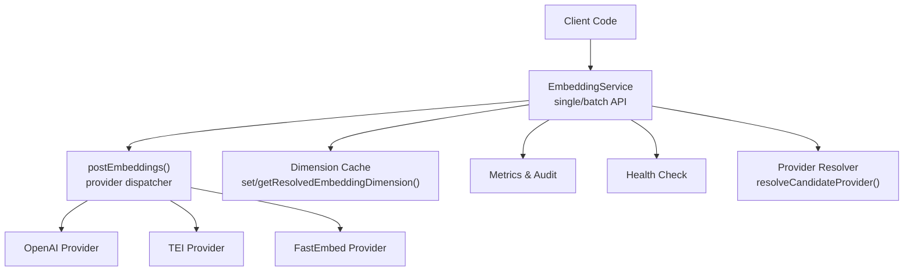
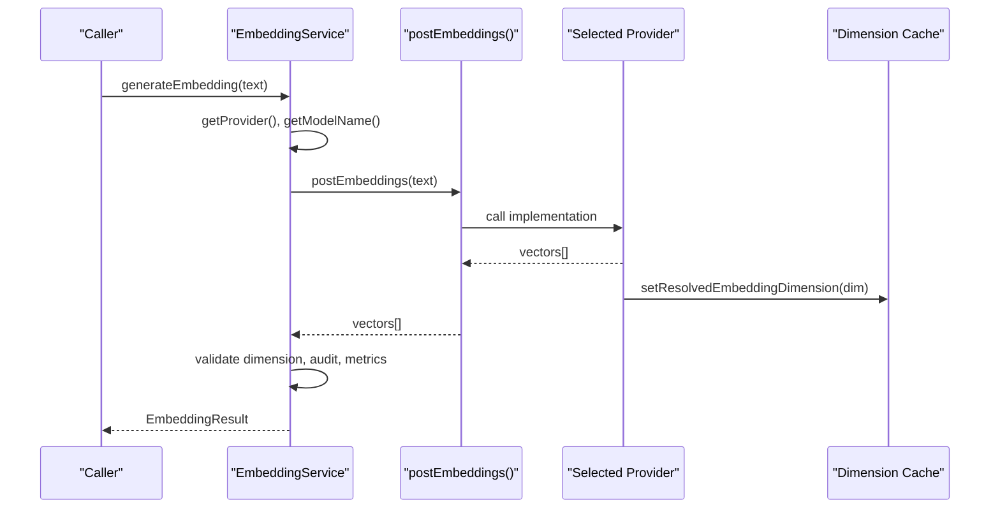
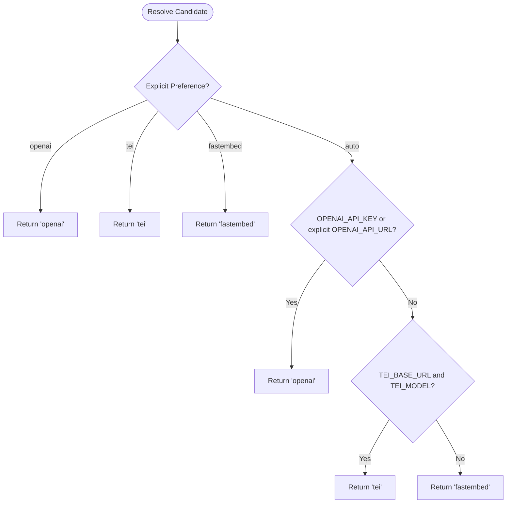
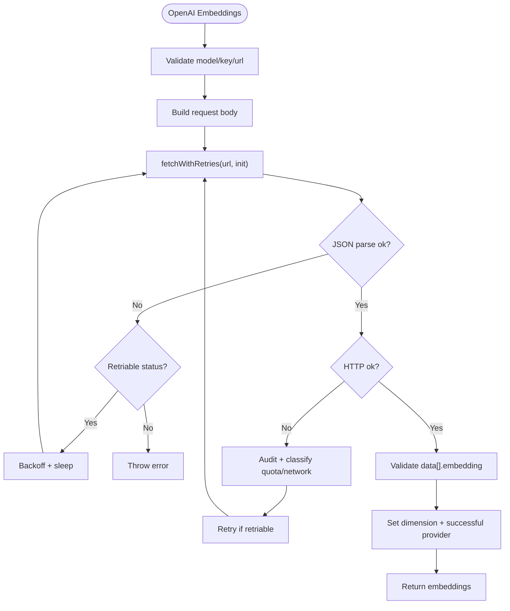
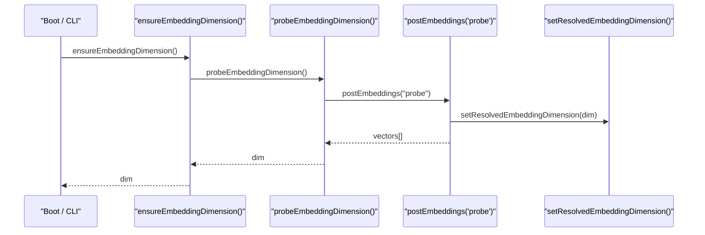
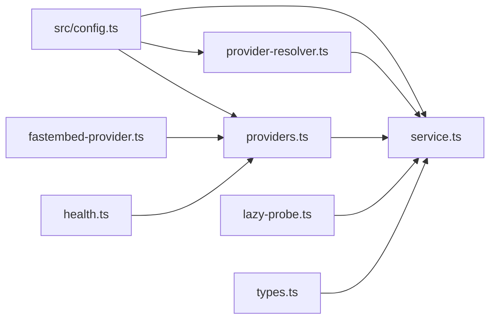

# Embedding System

<cite>
**Referenced Files in This Document**   
- [provider-resolver.ts](file://src/services/embedding/provider-resolver.ts)
- [providers.ts](file://src/services/embedding/providers.ts)
- [service.ts](file://src/services/embedding/service.ts)
- [config.ts](file://src/services/embedding/config.ts)
- [fastembed-provider.ts](file://src/services/embedding/fastembed-provider.ts)
- [health.ts](file://src/services/embedding/health.ts)
- [lazy-probe.ts](file://src/services/embedding/lazy-probe.ts)
- [types.ts](file://src/services/embedding/types.ts)
- [config.ts](file://src/config.ts)
- [0021-embedding-provider-auto-resolution-and-store-width-binding.md](file://docs/adr/0021-embedding-provider-auto-resolution-and-store-width-binding.md)
- [0004-fastembed-default-for-testing.md](file://docs/adr/0004-fastembed-default-for-testing.md)
</cite>

## Table of Contents
1. [Introduction](#introduction)
2. [Project Structure](#project-structure)
3. [Core Components](#core-components)
4. [Architecture Overview](#architecture-overview)
5. [Detailed Component Analysis](#detailed-component-analysis)
6. [Dependency Analysis](#dependency-analysis)
7. [Performance Considerations](#performance-considerations)
8. [Troubleshooting Guide](#troubleshooting-guide)
9. [Conclusion](#conclusion)

## Introduction
This document explains the embedding system architecture: a multi-provider framework that supports FastEmbed, OpenAI-compatible endpoints, and the deprecated TEI provider. It covers automatic provider resolution based on configuration and environment, embedding generation workflows, batch processing, caching strategies, model selection, vector dimension handling, quality metrics, rate limiting, and fallback mechanisms. The design ensures zero-configuration local operation while allowing external providers to be selected automatically when configured.

## Project Structure
The embedding subsystem lives under `src/services/embedding` and is coordinated by shared configuration in `src/config.ts`. Key responsibilities are split across focused modules:

- Provider resolution and successful provider tracking
- Provider implementations (OpenAI, TEI, FastEmbed)
- Service API for single and batch embeddings
- Dimension probing and runtime cache
- Health checks and lazy initialization
- Shared types



**Diagram sources**
- [service.ts:39-275](file://src/services/embedding/service.ts#L39-L275)
- [providers.ts:296-333](file://src/services/embedding/providers.ts#L296-L333)
- [provider-resolver.ts:28-46](file://src/services/embedding/provider-resolver.ts#L28-L46)
- [config.ts:12-36](file://src/services/embedding/config.ts#L12-L36)
- [health.ts:92-121](file://src/services/embedding/health.ts#L92-L121)

**Section sources**
- [service.ts:39-275](file://src/services/embedding/service.ts#L39-L275)
- [providers.ts:296-333](file://src/services/embedding/providers.ts#L296-L333)
- [provider-resolver.ts:28-46](file://src/services/embedding/provider-resolver.ts#L28-L46)
- [config.ts:12-36](file://src/services/embedding/config.ts#L12-L36)
- [health.ts:92-121](file://src/services/embedding/health.ts#L92-L121)

## Core Components
- EmbeddingService: Public API for single and batch embeddings, anomaly detection, metrics, audit logging, health check, and provider/model/dimension exposure.
- Provider Dispatcher: Routes requests to OpenAI, TEI, or FastEmbed with retries, backoff, and fallback behavior.
- Provider Implementations:
  - OpenAI: HTTP client with retry budget, Retry-After support, quota handling, and dimension capture.
  - TEI: HTTP client with flexible response shape parsing and deprecation warning.
  - FastEmbed: Local ONNX-based provider with lazy model loading and process-wide memoization.
- Configuration and Dimension Cache: Centralized env parsing and a process-scoped dimension cache enforced at runtime.
- Lazy Probe: Memoized dimension probe used by server boot and CLI deferred paths.
- Health Checks: Per-provider probes mirroring runtime selection logic.

Key behaviors:
- Automatic provider resolution defaults to FastEmbed unless an OpenAI-compatible endpoint is explicitly configured; TEI is supported as a transitional fallback.
- Vector dimension is resolved from the first successful embedding and asserted consistent across calls.
- Batch APIs accept arrays, validate dimensions, and emit metrics and audit events.

**Section sources**
- [service.ts:48-275](file://src/services/embedding/service.ts#L48-L275)
- [providers.ts:93-333](file://src/services/embedding/providers.ts#L93-L333)
- [fastembed-provider.ts:26-82](file://src/services/embedding/fastembed-provider.ts#L26-L82)
- [config.ts:12-36](file://src/services/embedding/config.ts#L12-L36)
- [lazy-probe.ts:19-27](file://src/services/embedding/lazy-probe.ts#L19-L27)
- [health.ts:17-121](file://src/services/embedding/health.ts#L17-L121)

## Architecture Overview
The embedding system follows a layered approach:

- Configuration layer reads environment variables and exposes constants such as provider preference, model names, endpoints, and retry policy.
- Resolution layer selects the candidate provider based on explicit preference and environment signals.
- Provider layer implements concrete embedding backends with robust error handling and retries.
- Service layer provides typed APIs, validates outputs, tracks metrics, and enforces dimension consistency.
- Health and lazy probe layers ensure readiness and efficient startup.



**Diagram sources**
- [service.ts:48-127](file://src/services/embedding/service.ts#L48-L127)
- [providers.ts:296-333](file://src/services/embedding/providers.ts#L296-L333)
- [config.ts:12-36](file://src/services/embedding/config.ts#L12-L36)

## Detailed Component Analysis

### Provider Resolution and Selection
- Explicit preference wins: openai, tei, fastembed.
- Auto mode:
  - Selects OpenAI if OPENAI_API_KEY is present or OPENAI_API_URL was explicitly overridden.
  - Falls back to TEI if both base URL and model are configured.
  - Otherwise uses FastEmbed.
- Successful provider descriptor is recorded after a provider returns valid vectors, including provider name, model, and dimension.



**Diagram sources**
- [provider-resolver.ts:28-46](file://src/services/embedding/provider-resolver.ts#L28-L46)

**Section sources**
- [provider-resolver.ts:28-81](file://src/services/embedding/provider-resolver.ts#L28-L81)
- [config.ts:70-83](file://src/config.ts#L70-L83)

### Provider Implementations

#### OpenAI Provider
- Validates required model and key/explicit URL conditions.
- Sends batched embeddings via HTTP with JSON body.
- Retries transient network errors and retriable HTTP statuses with exponential backoff and jitter.
- Honors Retry-After headers up to a cap.
- Treats insufficient_quota as non-retriable and fails fast.
- Captures output dimension and records successful provider metadata.



**Diagram sources**
- [providers.ts:93-201](file://src/services/embedding/providers.ts#L93-L201)

**Section sources**
- [providers.ts:93-201](file://src/services/embedding/providers.ts#L93-L201)

#### TEI Provider
- Requires base URL and model; optional API key header.
- Parses multiple response shapes for compatibility.
- Retries transient errors similarly to OpenAI.
- Emits deprecation warning once per process.

**Section sources**
- [providers.ts:203-295](file://src/services/embedding/providers.ts#L203-L295)

#### FastEmbed Provider
- Lazily initializes the ONNX model on first use; failed init clears memo to allow retry.
- Streams embeddings through the SDK iterator.
- Sets resolved dimension and successful provider metadata.
- Audits success/error outcomes.

**Section sources**
- [fastembed-provider.ts:26-82](file://src/services/embedding/fastembed-provider.ts#L26-L82)

### Embedding Service API
- Single embedding:
  - Normalizes input, calls provider, validates dimension, emits metrics and audit logs, returns typed result.
- Batch embeddings:
  - Filters empty inputs, measures total character length, validates all returned vectors have expected dimension, emits per-vector size metrics, and returns typed result.
- Utilities:
  - Cosine similarity calculation.
  - Memory embedding helper composing fields into a single text payload.
  - Health check delegation.
  - Provider and model introspection.

```mermaid
classDiagram
class EmbeddingService {
+generateEmbedding(text) EmbeddingResult
+generateBatchEmbeddings(texts) BatchEmbeddingResult
+calculateCosineSimilarity(a,b) number
+generateMemoryEmbedding(memory) number[]
+estimateCost() number
+healthCheck() Promise~{healthy,message}~
+getProvider() string
+getConfig() object
}
class Types {
<<interface>> EmbeddingResult
<<interface>> BatchEmbeddingResult
}
EmbeddingService --> Types : "returns"
```

**Diagram sources**
- [service.ts:39-275](file://src/services/embedding/service.ts#L39-L275)
- [types.ts:1-17](file://src/services/embedding/types.ts#L1-L17)

**Section sources**
- [service.ts:48-275](file://src/services/embedding/service.ts#L48-L275)
- [types.ts:1-17](file://src/services/embedding/types.ts#L1-L17)

### Dimension Handling and Probing
- First successful embedding sets the process-wide dimension; subsequent calls assert consistency.
- A dedicated probe function runs a minimal embedding to resolve and cache the dimension before store initialization.
- Lazy probe memoizes concurrent and repeated probes to avoid redundant model loads.



**Diagram sources**
- [lazy-probe.ts:19-27](file://src/services/embedding/lazy-probe.ts#L19-L27)
- [service.ts:280-284](file://src/services/embedding/service.ts#L280-L284)
- [config.ts:12-36](file://src/services/embedding/config.ts#L12-L36)

**Section sources**
- [config.ts:12-36](file://src/services/embedding/config.ts#L12-L36)
- [service.ts:280-284](file://src/services/embedding/service.ts#L280-L284)
- [lazy-probe.ts:19-27](file://src/services/embedding/lazy-probe.ts#L19-L27)

### Health Checks
- Mirrors runtime selection: explicit preference first, then auto path.
- For auto mode, a configured-but-failing OpenAI is reported as-is rather than masked by FastEmbed.
- Returns structured health status with messages indicating reachability, authentication failures, and rate limits.

**Section sources**
- [health.ts:17-121](file://src/services/embedding/health.ts#L17-L121)

### Caching Strategies
- Model weights cache:
  - FastEmbed downloads models into FASTEMBED_CACHE_DIR and reuses them across runs.
- Process-wide caches:
  - Resolved embedding dimension cached per process.
  - Successful provider descriptor cached per process.
  - FastEmbed model instance lazily initialized and memoized.
  - Lazy probe memoizes concurrent dimension probes.

**Section sources**
- [fastembed-provider.ts:17-39](file://src/services/embedding/fastembed-provider.ts#L17-L39)
- [config.ts:12-36](file://src/services/embedding/config.ts#L12-L36)
- [provider-resolver.ts:18-81](file://src/services/embedding/provider-resolver.ts#L18-L81)
- [lazy-probe.ts:12-27](file://src/services/embedding/lazy-probe.ts#L12-L27)

### Quality Metrics and Anomaly Detection
- Metrics tracked include request counts, duration histograms, error counts, vector sizes, and batch sizes.
- Anomaly detection compares actual vs expected dimension and can reject critical mismatches.
- Audit logging captures provider, model, latency, input/output sizes, and error details.

**Section sources**
- [service.ts:48-221](file://src/services/embedding/service.ts#L48-L221)

## Dependency Analysis
High-level dependencies between embedding components:



**Diagram sources**
- [config.ts:70-93](file://src/config.ts#L70-L93)
- [provider-resolver.ts:6-81](file://src/services/embedding/provider-resolver.ts#L6-L81)
- [providers.ts:1-343](file://src/services/embedding/providers.ts#L1-L343)
- [service.ts:15-37](file://src/services/embedding/service.ts#L15-L37)
- [fastembed-provider.ts:11-15](file://src/services/embedding/fastembed-provider.ts#L11-L15)
- [health.ts:1-15](file://src/services/embedding/health.ts#L1-L15)
- [lazy-probe.ts:10-10](file://src/services/embedding/lazy-probe.ts#L10-L10)
- [types.ts:1-17](file://src/services/embedding/types.ts#L1-L17)

**Section sources**
- [config.ts:70-93](file://src/config.ts#L70-L93)
- [provider-resolver.ts:6-81](file://src/services/embedding/provider-resolver.ts#L6-L81)
- [providers.ts:1-343](file://src/services/embedding/providers.ts#L1-L343)
- [service.ts:15-37](file://src/services/embedding/service.ts#L15-L37)
- [fastembed-provider.ts:11-15](file://src/services/embedding/fastembed-provider.ts#L11-L15)
- [health.ts:1-15](file://src/services/embedding/health.ts#L1-L15)
- [lazy-probe.ts:10-10](file://src/services/embedding/lazy-probe.ts#L10-L10)
- [types.ts:1-17](file://src/services/embedding/types.ts#L1-L17)

## Performance Considerations
- Prefer batch embeddings to reduce overhead and improve throughput.
- Use FastEmbed for zero-cost local inference; model weights are cached and loaded lazily.
- Tune retry policy via environment variables to balance resilience and latency.
- Ensure dimension probing runs early to avoid repeated model loads during startup.
- Monitor metrics and audit logs to detect anomalies and optimize provider selection.

[No sources needed since this section provides general guidance]

## Troubleshooting Guide
Common issues and resolutions:

- Authentication failures:
  - OpenAI 401 indicates missing or invalid OPENAI_API_KEY.
  - TEI 401 indicates missing or invalid x-api-key.
- Rate limiting:
  - 429 responses trigger retries with backoff; insufficient_quota is non-retriable and requires account billing/quota adjustments.
  - Health checks report reachable but throttled states for 429.
- Dimension mismatch:
  - If the first successful embedding sets a dimension, subsequent calls must match; otherwise, an error is thrown.
  - Ensure the same provider/model is used consistently across processes and stores.
- Provider selection surprises:
  - Auto mode selects OpenAI when OPENAI_API_KEY is set or OPENAI_API_URL is explicitly overridden; otherwise falls back to TEI if configured, else FastEmbed.
  - Verify EMBEDDING_PROVIDER and environment variables to confirm expected resolution.

Operational tips:
- Run health checks per provider to diagnose connectivity and configuration issues.
- Inspect audit logs and metrics for latency spikes, error rates, and dimension anomalies.
- Confirm that the dimension probe has run successfully before initializing vector stores.

**Section sources**
- [providers.ts:93-201](file://src/services/embedding/providers.ts#L93-L201)
- [providers.ts:203-295](file://src/services/embedding/providers.ts#L203-L295)
- [health.ts:17-121](file://src/services/embedding/health.ts#L17-L121)
- [config.ts:12-36](file://src/services/embedding/config.ts#L12-L36)

## Conclusion
The embedding system provides a robust, multi-provider abstraction with automatic resolution, strong dimension consistency, and comprehensive observability. FastEmbed offers a zero-config default, while OpenAI-compatible endpoints and TEI are supported with careful error handling and retries. The design emphasizes predictable behavior, clear diagnostics, and scalable performance through batching and caching. Operators should configure environment variables thoughtfully, monitor health and metrics, and ensure dimension probing completes before downstream storage initialization.

[No sources needed since this section summarizes without analyzing specific files]