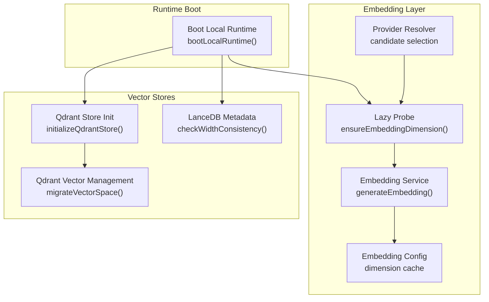
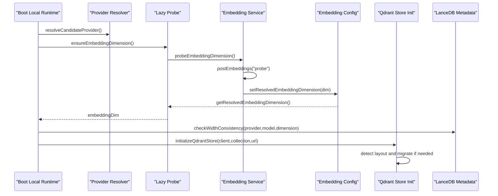
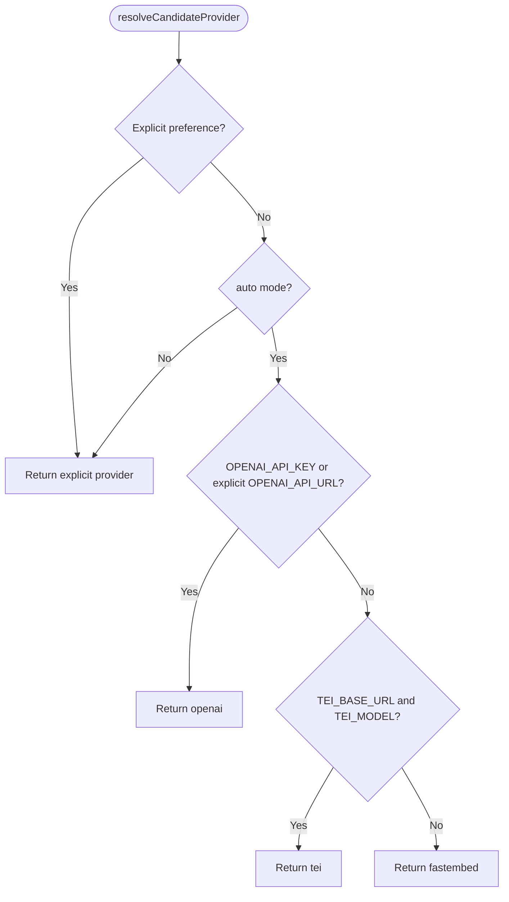
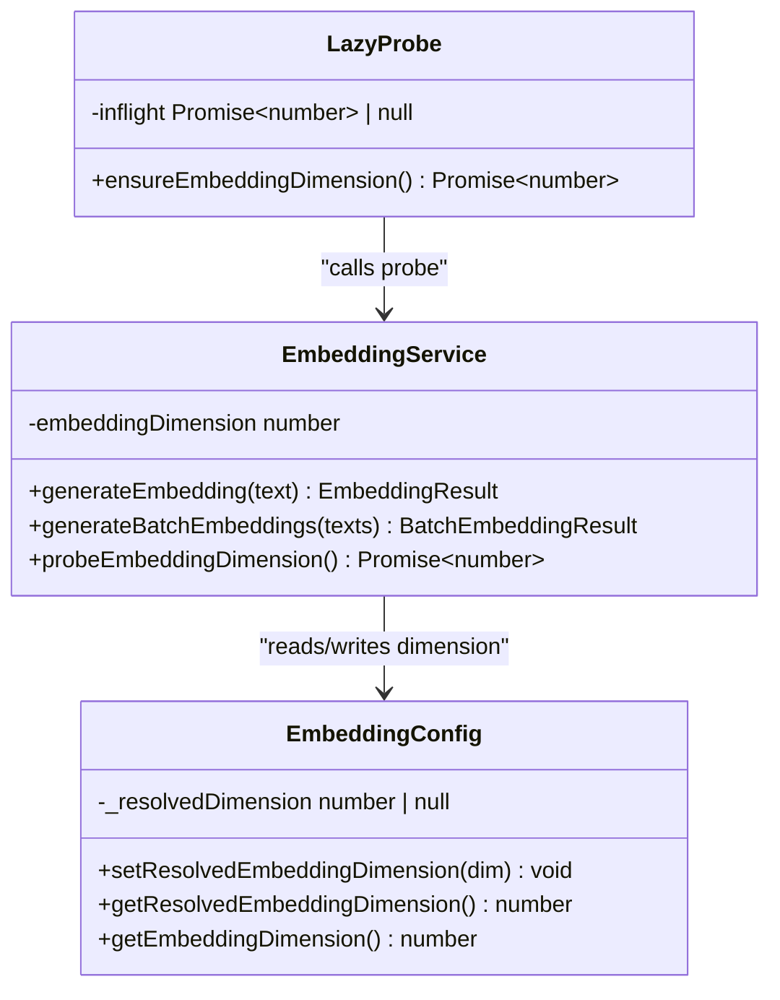
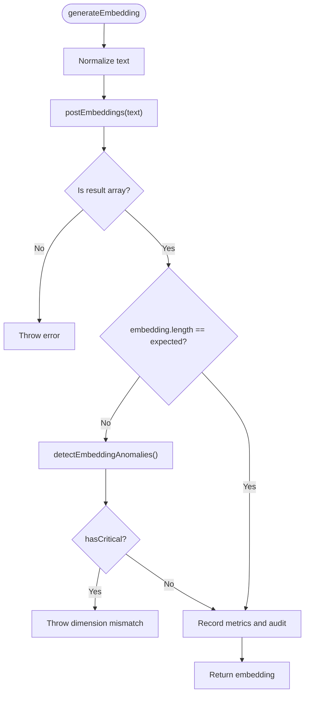
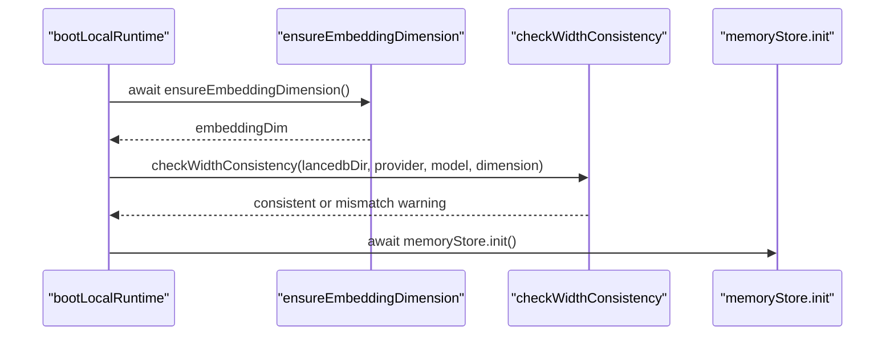
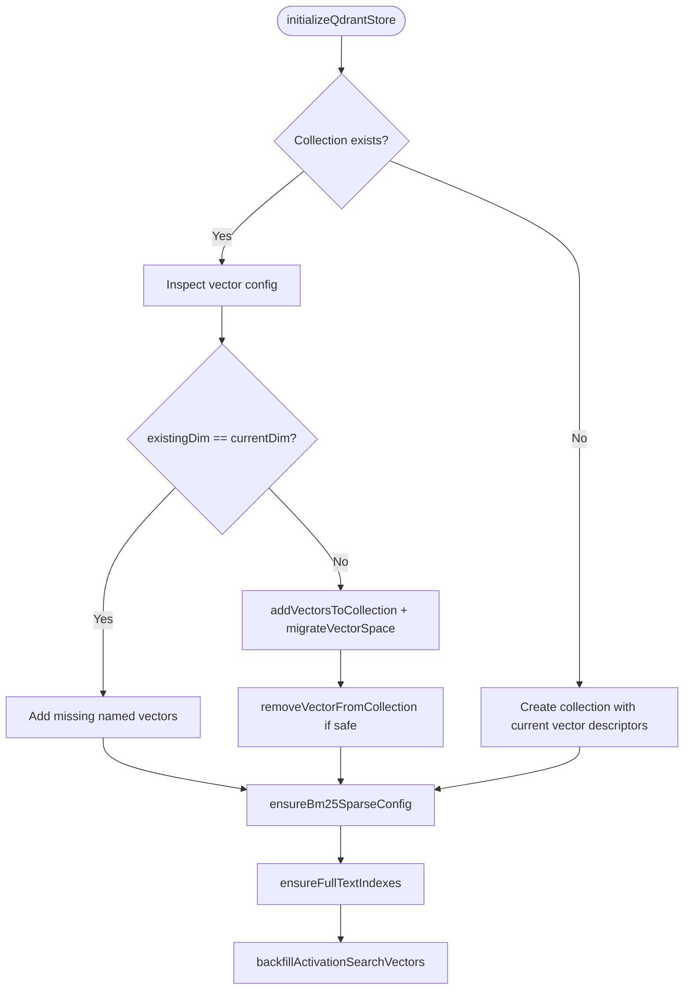
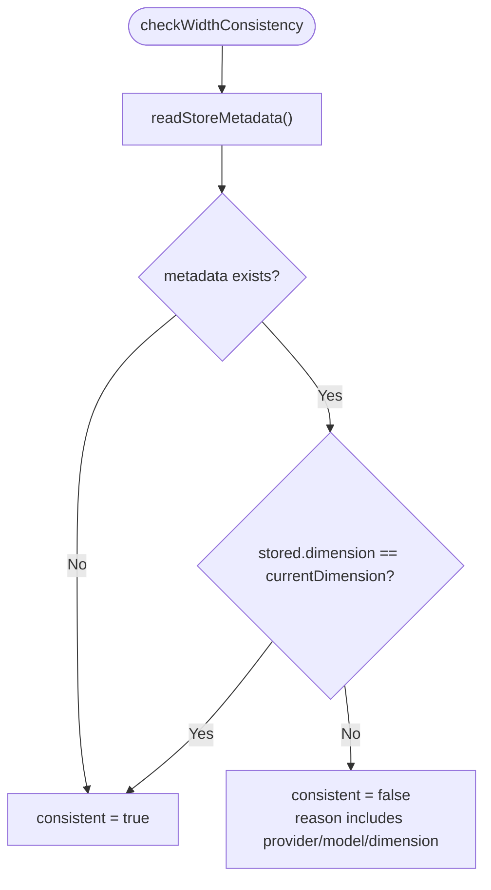
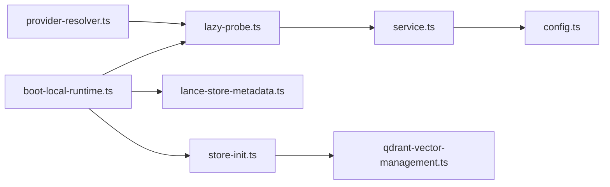

# Vector Dimension Management

<cite>
**Referenced Files in This Document**
- [0021-embedding-provider-auto-resolution-and-store-width-binding.md](file://docs/adr/0021-embedding-provider-auto-resolution-and-store-width-binding.md)
- [config.ts](file://src/services/embedding/config.ts)
- [service.ts](file://src/services/embedding/service.ts)
- [lazy-probe.ts](file://src/services/embedding/lazy-probe.ts)
- [provider-resolver.ts](file://src/services/embedding/provider-resolver.ts)
- [boot-local-runtime.ts](file://src/runtime/boot-local-runtime.ts)
- [store-init.ts](file://src/services/memory/store-init.ts)
- [qdrant-vector-management.ts](file://src/utils/qdrant-vector-management.ts)
- [lance-store-metadata.ts](file://src/services/vector-store/lancedb/lance-store-metadata.ts)
</cite>

## Table of Contents
1. [Introduction](#introduction)
2. [Project Structure](#project-structure)
3. [Core Components](#core-components)
4. [Architecture Overview](#architecture-overview)
5. [Detailed Component Analysis](#detailed-component-analysis)
6. [Dependency Analysis](#dependency-analysis)
7. [Performance Considerations](#performance-considerations)
8. [Troubleshooting Guide](#troubleshooting-guide)
9. [Migration Procedures](#migration-procedures)
10. [Conclusion](#conclusion)

## Introduction
This document explains how the system manages vector dimensions across embedding providers and stores. The goal is to ensure that every embedding, search, and write operation uses a consistent dimension so that semantic retrieval remains correct and failures are visible rather than silent.

The system supports multiple embedding providers:
- OpenAI-compatible endpoints selected when an API key or explicitly overridden URL is configured.
- TEI as a deprecated transitional path.
- Fastembed as the zero-configuration local fallback.

It also supports two vector backends:
- Qdrant (primary), which can migrate named vectors at boot.
- LanceDB (embedded), which records provider/model/dimension metadata and warns on mismatch; it does not automatically re-embed rows.

Key responsibilities include:
- Auto-detecting the embedding provider at startup.
- Probing one minimal embedding to determine the output vector dimension.
- Caching the resolved dimension for the process lifetime.
- Validating embedding outputs against the cached dimension.
- Detecting and handling dimension mismatches between the current provider and stored data.
- Providing migration guidance for changing embedding models.

## Project Structure
The vector dimension management logic spans several layers:

**Diagram sources**
- [provider-resolver.ts:28-46](file://src/services/embedding/provider-resolver.ts#L28-L46)
- [lazy-probe.ts:19-27](file://src/services/embedding/lazy-probe.ts#L19-L27)
- [service.ts:281-284](file://src/services/embedding/service.ts#L281-L284)
- [config.ts:12-36](file://src/services/embedding/config.ts#L12-L36)
- [boot-local-runtime.ts:103-145](file://src/runtime/boot-local-runtime.ts#L103-L145)
- [store-init.ts:172-342](file://src/services/memory/store-init.ts#L172-L342)
- [qdrant-vector-management.ts:126-202](file://src/utils/qdrant-vector-management.ts#L126-L202)
- [lance-store-metadata.ts:66-82](file://src/services/vector-store/lancedb/lance-store-metadata.ts#L66-L82)

**Section sources**
- [provider-resolver.ts:1-82](file://src/services/embedding/provider-resolver.ts#L1-L82)
- [lazy-probe.ts:1-28](file://src/services/embedding/lazy-probe.ts#L1-L28)
- [service.ts:1-285](file://src/services/embedding/service.ts#L1-L285)
- [config.ts:1-40](file://src/services/embedding/config.ts#L1-L40)
- [boot-local-runtime.ts:1-184](file://src/runtime/boot-local-runtime.ts#L1-L184)
- [store-init.ts:1-350](file://src/services/memory/store-init.ts#L1-L350)
- [qdrant-vector-management.ts:1-301](file://src/utils/qdrant-vector-management.ts#L1-L301)
- [lance-store-metadata.ts:1-83](file://src/services/vector-store/lancedb/lance-store-metadata.ts#L1-L83)

## Core Components
- Provider resolver selects the candidate provider based on explicit preference and environment configuration.
- Lazy probe performs a minimal embedding call to resolve and cache the vector dimension.
- Embedding service validates each embedding’s length against the cached dimension and tracks metrics and audit events.
- Boot runtime orchestrates eager or deferred probing, logs the successful provider, and checks embedded store width consistency.
- Qdrant initialization detects existing collection layout, adds missing named vectors, migrates data when dimensions change, and ensures BM25 and full-text indexes.
- LanceDB metadata persists provider/model/dimension and reports mismatches without automatic re-embedding.

**Section sources**
- [provider-resolver.ts:20-82](file://src/services/embedding/provider-resolver.ts#L20-L82)
- [lazy-probe.ts:1-28](file://src/services/embedding/lazy-probe.ts#L1-L28)
- [service.ts:48-128](file://src/services/embedding/service.ts#L48-L128)
- [boot-local-runtime.ts:103-184](file://src/runtime/boot-local-runtime.ts#L103-L184)
- [store-init.ts:172-350](file://src/services/memory/store-init.ts#L172-L350)
- [lance-store-metadata.ts:14-83](file://src/services/vector-store/lancedb/lance-store-metadata.ts#L14-L83)

## Architecture Overview
The dimension lifecycle begins with provider resolution, proceeds through probing, then applies to both read and write paths.

**Diagram sources**
- [boot-local-runtime.ts:103-145](file://src/runtime/boot-local-runtime.ts#L103-L145)
- [provider-resolver.ts:28-46](file://src/services/embedding/provider-resolver.ts#L28-L46)
- [lazy-probe.ts:19-27](file://src/services/embedding/lazy-probe.ts#L19-L27)
- [service.ts:281-284](file://src/services/embedding/service.ts#L281-L284)
- [config.ts:16-36](file://src/services/embedding/config.ts#L16-L36)
- [store-init.ts:172-342](file://src/services/memory/store-init.ts#L172-L342)
- [lance-store-metadata.ts:66-82](file://src/services/vector-store/lancedb/lance-store-metadata.ts#L66-L82)

## Detailed Component Analysis

### Provider Resolution
The provider resolver separates “what we will try” from “what actually succeeded.” It honors explicit preferences first, then applies auto-detection rules:
- Explicit `openai`, `tei`, or `fastembed` wins.
- Auto selects OpenAI-compatible when an API key is present or when the OpenAI URL is explicitly overridden.
- Falls back to TEI if both base URL and model are configured.
- Defaults to fastembed for zero-configuration environments.

After a provider successfully returns valid vectors, the successful descriptor is recorded with provider, model, and dimension.

**Diagram sources**
- [provider-resolver.ts:28-46](file://src/services/embedding/provider-resolver.ts#L28-L46)

**Section sources**
- [provider-resolver.ts:1-82](file://src/services/embedding/provider-resolver.ts#L1-L82)

### Dimension Probing and Caching
The lazy probe loads the embedding model once per process and caches the result. Concurrent callers share a single inflight promise. If the probe fails, the failure is not cached, allowing retries.

At server boot, probing is eager by default. For CLI fastboot, probing is deferred until embeddings are actually needed.

The resolved dimension is stored in a process-scoped cache. Subsequent reads require the dimension to be already resolved; otherwise, they throw to enforce startup probing.

**Diagram sources**
- [lazy-probe.ts:12-27](file://src/services/embedding/lazy-probe.ts#L12-L27)
- [config.ts:12-36](file://src/services/embedding/config.ts#L12-L36)
- [service.ts:281-284](file://src/services/embedding/service.ts#L281-L284)

**Section sources**
- [lazy-probe.ts:1-28](file://src/services/embedding/lazy-probe.ts#L1-L28)
- [config.ts:1-40](file://src/services/embedding/config.ts#L1-L40)
- [service.ts:281-284](file://src/services/embedding/service.ts#L281-L284)

### Embedding Output Validation
Every embedding request validates the returned vector length against the cached dimension:
- Single embedding: throws on critical anomalies or unexpected dimension.
- Batch embedding: throws if any vector has an unexpected length.
- Metrics and audit events record provider, model, latency, input size, and output dimension.

This validation prevents silent corruption where different providers produce different widths.

**Diagram sources**
- [service.ts:48-128](file://src/services/embedding/service.ts#L48-L128)

**Section sources**
- [service.ts:48-128](file://src/services/embedding/service.ts#L48-L128)

### Boot-Time Width Reconciliation
The boot runtime:
- Selects the vector store backend.
- Optionally waits for Qdrant health.
- Probes the embedding dimension eagerly unless disabled.
- Logs the successful provider and its dimension.
- Checks LanceDB metadata for width consistency.
- Initializes the memory store.
- Optionally triggers snapshots and seeds app-space adapters.

For Qdrant, dimension reconciliation happens during store initialization. For LanceDB, the runtime warns on mismatch but does not automatically re-embed.

**Diagram sources**
- [boot-local-runtime.ts:103-145](file://src/runtime/boot-local-runtime.ts#L103-L145)
- [lance-store-metadata.ts:66-82](file://src/services/vector-store/lancedb/lance-store-metadata.ts#L66-L82)

**Section sources**
- [boot-local-runtime.ts:103-184](file://src/runtime/boot-local-runtime.ts#L103-L184)
- [lance-store-metadata.ts:1-83](file://src/services/vector-store/lancedb/lance-store-metadata.ts#L1-L83)

### Qdrant Dimension Migration
Qdrant initialization detects the existing collection layout and compares the stored vector dimension with the current provider’s dimension. When they differ, it:
- Adds missing named vectors.
- Migrates points from the old vector to the new vector by re-embedding content.
- Attempts to remove the old vector when safe.
- Ensures BM25 sparse vector configuration and full-text indexes.
- Backfills activation search vectors.

**Diagram sources**
- [store-init.ts:172-342](file://src/services/memory/store-init.ts#L172-L342)
- [qdrant-vector-management.ts:126-202](file://src/utils/qdrant-vector-management.ts#L126-L202)

**Section sources**
- [store-init.ts:172-350](file://src/services/memory/store-init.ts#L172-L350)
- [qdrant-vector-management.ts:1-301](file://src/utils/qdrant-vector-management.ts#L1-L301)

### LanceDB Width Consistency
LanceDB stores metadata including provider, model, dimension, and timestamps. On boot, the runtime compares the stored dimension with the current provider’s dimension. If they differ, it logs a warning with actionable remediation: delete the embedded store to recreate it, or revert the embedding provider.

Unlike Qdrant, LanceDB does not automatically re-embed rows.

**Diagram sources**
- [lance-store-metadata.ts:66-82](file://src/services/vector-store/lancedb/lance-store-metadata.ts#L66-L82)

**Section sources**
- [lance-store-metadata.ts:1-83](file://src/services/vector-store/lancedb/lance-store-metadata.ts#L1-L83)

## Dependency Analysis
The following diagram shows how components depend on each other during dimension management.

**Diagram sources**
- [provider-resolver.ts:28-46](file://src/services/embedding/provider-resolver.ts#L28-L46)
- [lazy-probe.ts:19-27](file://src/services/embedding/lazy-probe.ts#L19-L27)
- [service.ts:281-284](file://src/services/embedding/service.ts#L281-L284)
- [config.ts:16-36](file://src/services/embedding/config.ts#L16-L36)
- [boot-local-runtime.ts:103-145](file://src/runtime/boot-local-runtime.ts#L103-L145)
- [store-init.ts:172-342](file://src/services/memory/store-init.ts#L172-L342)
- [qdrant-vector-management.ts:126-202](file://src/utils/qdrant-vector-management.ts#L126-L202)
- [lance-store-metadata.ts:66-82](file://src/services/vector-store/lancedb/lance-store-metadata.ts#L66-L82)

**Section sources**
- [provider-resolver.ts:1-82](file://src/services/embedding/provider-resolver.ts#L1-L82)
- [lazy-probe.ts:1-28](file://src/services/embedding/lazy-probe.ts#L1-L28)
- [service.ts:1-285](file://src/services/embedding/service.ts#L1-L285)
- [config.ts:1-40](file://src/services/embedding/config.ts#L1-L40)
- [boot-local-runtime.ts:1-184](file://src/runtime/boot-local-runtime.ts#L1-L184)
- [store-init.ts:1-350](file://src/services/memory/store-init.ts#L1-L350)
- [qdrant-vector-management.ts:1-301](file://src/utils/qdrant-vector-management.ts#L1-L301)
- [lance-store-metadata.ts:1-83](file://src/services/vector-store/lancedb/lance-store-metadata.ts#L1-L83)

## Performance Considerations
- Eager vs lazy probing: Server boot probes eagerly by default to fail fast and bind dimensions before store operations. CLI fastboot defers probing until embeddings are needed to keep read-only commands fast.
- Process-scoped caching: The resolved dimension is cached once per process, avoiding repeated network calls or model loads.
- Qdrant migration cost: Re-embedding all points is CPU-bound and may be billable depending on the provider. Batched upserts reduce memory pressure during migration.
- LanceDB metadata checks are lightweight file reads and JSON comparisons.

[No sources needed since this section provides general guidance]

## Troubleshooting Guide
Common dimension-related issues and their likely causes:

- Embedding dimension mismatch at runtime
  - Cause: A provider returned a vector with a different length than the cached dimension.
  - Where it is enforced: Embedding service validation throws on critical anomalies or unexpected dimensions.
  - Action: Verify the active provider and model; ensure the same provider created the store.

- Embedding dimension not resolved
  - Cause: Code attempted to use the dimension before the startup probe ran.
  - Where it is enforced: Reading the cached dimension throws if it is null.
  - Action: Ensure `ensureEmbeddingDimension()` runs at startup before using Qdrant or embedding-dependent code.

- Vector width mismatch warning at boot
  - Cause: The embedded LanceDB store was created with a different provider/model/dimension than the current process.
  - Where it is checked: `checkWidthConsistency()` compares stored metadata with the current provider.
  - Action: Delete the embedded store directory to recreate it, or revert the embedding provider to match the stored width.

- Qdrant collection requires migration
  - Cause: Existing collection vector dimension differs from the current provider’s dimension.
  - Where it is handled: `initializeQdrantStore()` detects layout differences and migrates data.
  - Action: Allow boot-time migration; monitor logs for migration steps and completion.

- Silent retrieval degradation
  - Cause: Reads derived column names from query vector length instead of stored width, causing cosine similarity to return zero when columns are missing.
  - Context: ADR 0021 documents this historical issue and the need for width binding and stored-width reads.
  - Action: Ensure the store is bound to the provider that created it and that reads use stored width.

**Section sources**
- [service.ts:48-128](file://src/services/embedding/service.ts#L48-L128)
- [config.ts:23-36](file://src/services/embedding/config.ts#L23-L36)
- [lance-store-metadata.ts:66-82](file://src/services/vector-store/lancedb/lance-store-metadata.ts#L66-L82)
- [store-init.ts:172-342](file://src/services/memory/store-init.ts#L172-L342)
- [0021-embedding-provider-auto-resolution-and-store-width-binding.md:72-87](file://docs/adr/0021-embedding-provider-auto-resolution-and-store-width-binding.md#L72-L87)

## Migration Procedures
Changing embedding models changes the vector dimension and therefore the storage schema.

### Qdrant Migration
- Automatic at boot: `initializeQdrantStore()` detects dimension differences and drives migration.
- Steps performed:
  - Add missing named vectors.
  - Re-embed content into the new vector space.
  - Attempt to remove the old vector when safe.
  - Ensure BM25 and full-text indexes.
  - Backfill activation search vectors.
- Monitoring: Watch logs for migration start, batch progress, and completion status.

**Section sources**
- [store-init.ts:172-350](file://src/services/memory/store-init.ts#L172-L350)
- [qdrant-vector-management.ts:126-202](file://src/utils/qdrant-vector-management.ts#L126-L202)

### LanceDB Migration
- No automatic re-embedding: The embedded store does not rebuild vectors on mismatch.
- Warning behavior: Boot logs a warning with the stored provider/model/dimension and the current provider/model/dimension.
- Recommended procedure:
  - Stop writes.
  - Back up the LanceDB directory.
  - Delete the embedded store directory to recreate it with the new provider/model.
  - Re-seed app-space adapters if needed.
  - Alternatively, revert the embedding provider to match the stored width.

**Section sources**
- [lance-store-metadata.ts:66-82](file://src/services/vector-store/lancedb/lance-store-metadata.ts#L66-L82)
- [boot-local-runtime.ts:136-143](file://src/runtime/boot-local-runtime.ts#L136-L143)

### Provider Selection Rules
- Explicit preference always wins.
- Auto selects OpenAI-compatible when an API key is present or when the OpenAI URL is explicitly overridden.
- Falls back to TEI if both base URL and model are configured.
- Defaults to fastembed for zero-configuration environments.

**Section sources**
- [provider-resolver.ts:28-46](file://src/services/embedding/provider-resolver.ts#L28-L46)

## Conclusion
The vector dimension management system enforces consistency by resolving the embedding provider early, probing a minimal embedding to determine the output dimension, caching that dimension for the process lifetime, validating every embedding output, and reconciling stored dimensions with the current provider. Qdrant supports automatic migration at boot, while LanceDB relies on metadata-based warnings and operator-driven recreation. Following the troubleshooting and migration procedures helps avoid silent corruption and ensures reliable semantic search after changing embedding models.

[No sources needed since this section summarizes without analyzing specific files]