# Key-Value Storage Layer

<cite>
**Referenced Files in This Document**
- [key-value-store.ts](file://src/services/key-value-store.ts)
- [key-value-store-factory.ts](file://src/services/key-value-store-factory.ts)
- [redis.ts](file://src/services/redis.ts)
- [memory-store.ts](file://src/services/memory-store.ts)
- [config.ts](file://src/config.ts)
- [redis-cache.ts](file://src/services/redis-cache.ts)
- [oidc-state-store.ts](file://src/services/oidc-state-store.ts)
- [activate-refinement-store.ts](file://src/services/activate-refinement-store.ts)
- [export-download-capability-store.ts](file://src/services/export-download-capability-store.ts)
- [export-artifact-download-capability-store.ts](file://src/services/export-artifact-download-capability-store.ts)
- [forward-runtime-store.ts](file://src/services/forward-runtime-store.ts)
</cite>

## Table of Contents
1. [Introduction](#introduction)
2. [Project Structure](#project-structure)
3. [Core Components](#core-components)
4. [Architecture Overview](#architecture-overview)
5. [Detailed Component Analysis](#detailed-component-analysis)
6. [Dependency Analysis](#dependency-analysis)
7. [Performance Considerations](#performance-considerations)
8. [Troubleshooting Guide](#troubleshooting-guide)
9. [Conclusion](#conclusion)

## Introduction
This document explains the key-value storage layer used for caching, session state, and distributed coordination. It covers:
- The factory pattern that selects Redis or an in-memory backend
- Redis integration for caching, OIDC login state, and transient execution state
- Cache invalidation strategies, TTL management, and consistency models
- Configuration options, connection lifecycle, and error handling patterns
- Performance tuning and monitoring approaches

The design favors a single abstraction over backends so callers remain unaware of whether they are using Redis or in-memory storage.

## Project Structure
The key-value layer is centered around a small interface and two implementations selected at runtime by a factory. Consumers include cache services, OIDC state store, refinement counters, export capability stores, and forward runtime state.

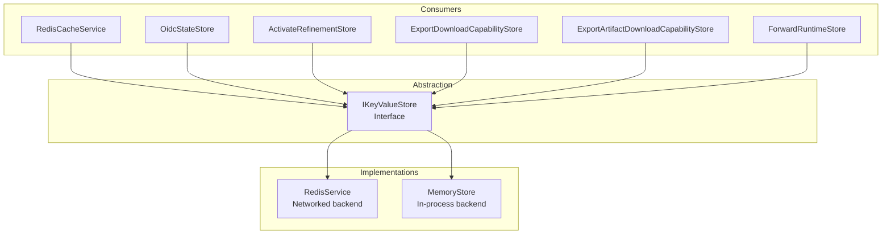

**Diagram sources**
- [key-value-store.ts:7-28](file://src/services/key-value-store.ts#L7-L28)
- [redis.ts:26-292](file://src/services/redis.ts#L26-L292)
- [memory-store.ts:27-201](file://src/services/memory-store.ts#L27-L201)
- [redis-cache.ts:21-274](file://src/services/redis-cache.ts#L21-L274)
- [oidc-state-store.ts:50-62](file://src/services/oidc-state-store.ts#L50-L62)
- [activate-refinement-store.ts:6-46](file://src/services/activate-refinement-store.ts#L6-L46)
- [export-download-capability-store.ts:16-30](file://src/services/export-download-capability-store.ts#L16-L30)
- [export-artifact-download-capability-store.ts:15-29](file://src/services/export-artifact-download-capability-store.ts#L15-L29)
- [forward-runtime-store.ts:27-60](file://src/services/forward-runtime-store.ts#L27-L60)

**Section sources**
- [key-value-store.ts:1-29](file://src/services/key-value-store.ts#L1-L29)
- [key-value-store-factory.ts:1-23](file://src/services/key-value-store-factory.ts#L1-L23)
- [redis.ts:1-293](file://src/services/redis.ts#L1-L293)
- [memory-store.ts:1-202](file://src/services/memory-store.ts#L1-L202)

## Core Components
- IKeyValueStore: Defines the operations used across the system (get/set/getdel/hget/hset/incr/keys/publish/connect/disconnect/isConnected).
- RedisService: Production implementation backed by Redis with namespacing, JSON helpers, pub/sub, and connection lifecycle.
- MemoryStore: In-process implementation with TTL support and no cross-process pub/sub; used when Redis is not configured.
- Factory: Creates the appropriate backend based on configuration.

Key responsibilities:
- Backend selection via environment configuration
- Consistent key naming and space-based isolation
- TTL semantics for both string and JSON values
- Error logging and graceful degradation

**Section sources**
- [key-value-store.ts:7-28](file://src/services/key-value-store.ts#L7-L28)
- [redis.ts:26-292](file://src/services/redis.ts#L26-L292)
- [memory-store.ts:27-201](file://src/services/memory-store.ts#L27-L201)
- [key-value-store-factory.ts:13-22](file://src/services/key-value-store-factory.ts#L13-L22)

## Architecture Overview
The system uses a simple factory to choose between Redis and in-memory storage. Consumers call into the shared keyValueStore singleton without knowing which backend is active.

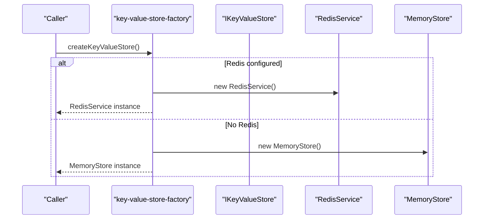

**Diagram sources**
- [key-value-store-factory.ts:13-22](file://src/services/key-value-store-factory.ts#L13-L22)
- [redis.ts:33-108](file://src/services/redis.ts#L33-L108)
- [memory-store.ts:34-38](file://src/services/memory-store.ts#L34-L38)

## Detailed Component Analysis

### Factory Pattern and Backend Selection
- The factory checks whether a networked key-value backend is configured and returns either RedisService or MemoryStore.
- Logging indicates which backend is active.

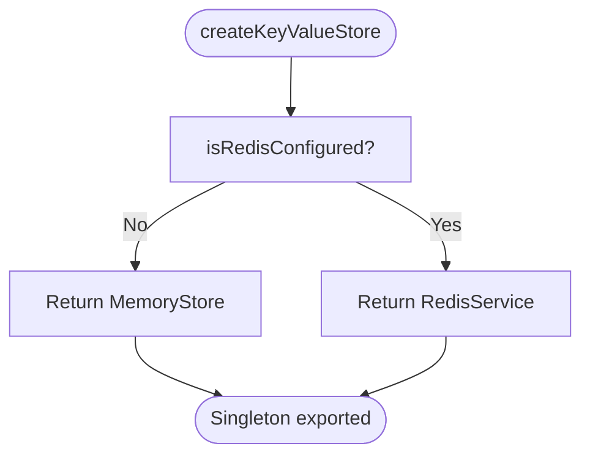

**Diagram sources**
- [key-value-store-factory.ts:13-22](file://src/services/key-value-store-factory.ts#L13-L22)
- [config.ts:50-56](file://src/config.ts#L50-L56)

**Section sources**
- [key-value-store-factory.ts:1-23](file://src/services/key-value-store-factory.ts#L1-L23)
- [config.ts:50-56](file://src/config.ts#L50-L56)

### Redis Integration
- Connection lifecycle: connect/disconnect, event listeners for error/ready/end, and connection status tracking.
- Key namespacing: global prefix plus optional space ID; special prefixes bypass space scoping.
- Operations: strings, hashes, counters, existence checks, pattern scanning, JSON helpers, and pub/sub.

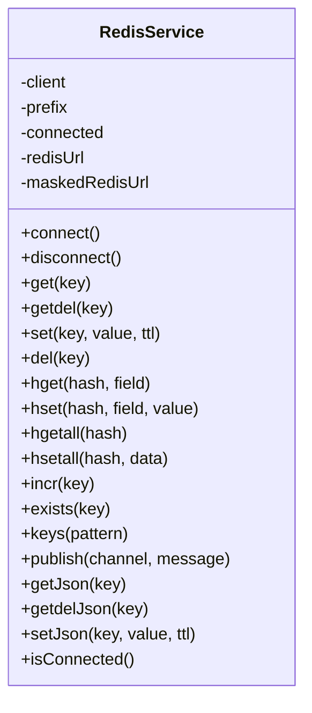

**Diagram sources**
- [redis.ts:26-292](file://src/services/redis.ts#L26-L292)

**Section sources**
- [redis.ts:1-293](file://src/services/redis.ts#L1-L293)

### In-Memory Store
- Provides the same API surface as RedisService for local development.
- Implements TTL via expiration timestamps and simple glob matching for keys().
- publish() is a no-op since there is no cross-process communication.

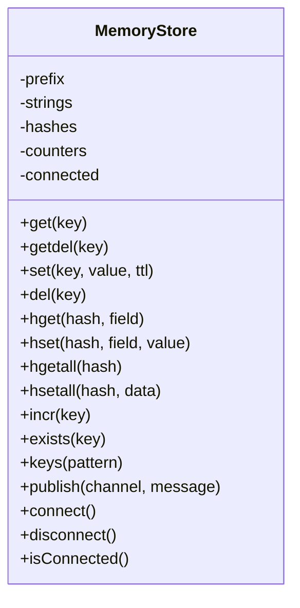

**Diagram sources**
- [memory-store.ts:27-201](file://src/services/memory-store.ts#L27-L201)

**Section sources**
- [memory-store.ts:1-202](file://src/services/memory-store.ts#L1-L202)

### Cache Service (Search and Memory Resources)
- Uses keyValueStore for search result caching and memory resource caching.
- Applies bounded TTLs to prevent stale data if invalidation fails.
- Publishes invalidation events and tracks hit/miss statistics.

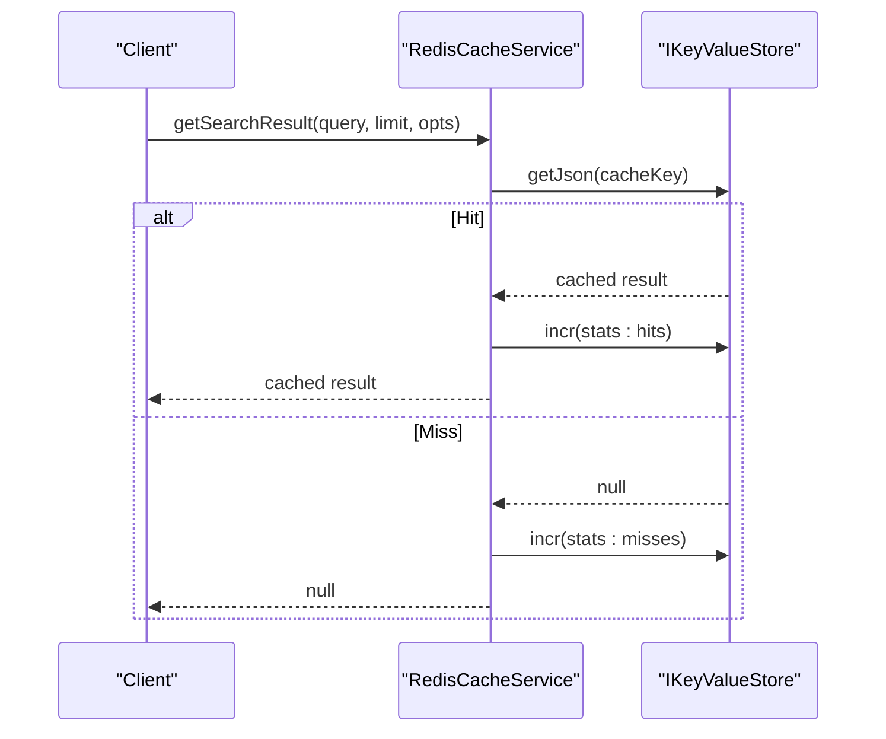

**Diagram sources**
- [redis-cache.ts:43-79](file://src/services/redis-cache.ts#L43-L79)
- [redis-cache.ts:154-184](file://src/services/redis-cache.ts#L154-L184)

**Section sources**
- [redis-cache.ts:1-274](file://src/services/redis-cache.ts#L1-L274)

### OIDC State Store (Session-like State)
- Stores PKCE code_verifier and creation time per state token.
- Uses atomic getdel to consume state exactly once.
- TTL ensures cleanup even if the flow aborts.

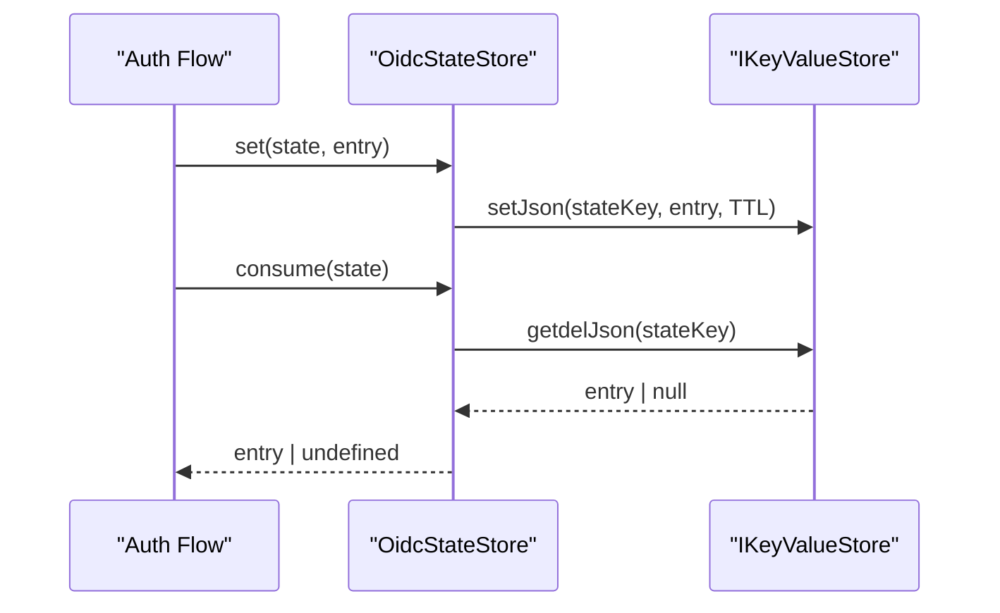

**Diagram sources**
- [oidc-state-store.ts:50-62](file://src/services/oidc-state-store.ts#L50-L62)

**Section sources**
- [oidc-state-store.ts:1-76](file://src/services/oidc-state-store.ts#L1-L76)

### Activation Refinement Counter
- Tracks refine attempts per execution with a bounded TTL.
- Uses atomic increment and explicit TTL refresh.

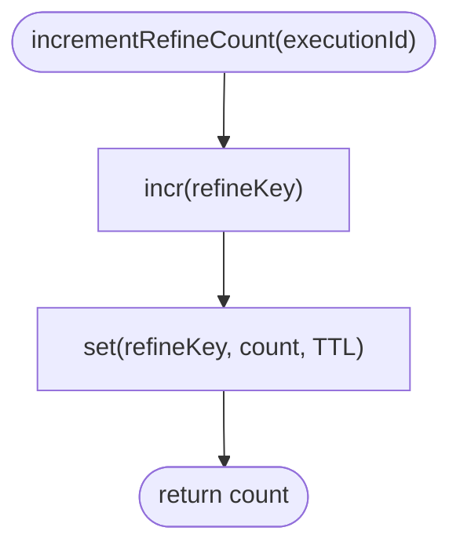

**Diagram sources**
- [activate-refinement-store.ts:13-23](file://src/services/activate-refinement-store.ts#L13-L23)

**Section sources**
- [activate-refinement-store.ts:1-48](file://src/services/activate-refinement-store.ts#L1-L48)

### Export Capability Stores
- Persist temporary download capabilities with TTLs.
- Keys use global prefixes to avoid space scoping.

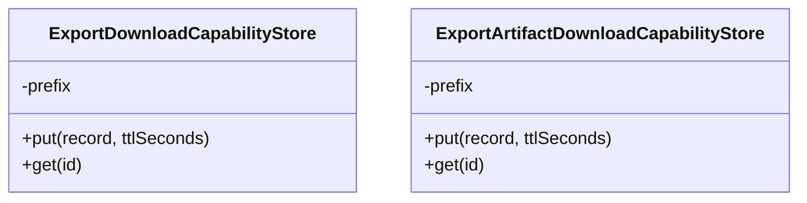

**Diagram sources**
- [export-download-capability-store.ts:16-30](file://src/services/export-download-capability-store.ts#L16-L30)
- [export-artifact-download-capability-store.ts:15-29](file://src/services/export-artifact-download-capability-store.ts#L15-L29)

**Section sources**
- [export-download-capability-store.ts:1-33](file://src/services/export-download-capability-store.ts#L1-L33)
- [export-artifact-download-capability-store.ts:1-33](file://src/services/export-artifact-download-capability-store.ts#L1-L33)

### Forward Runtime Store
- Persists execution metadata and pinned layer manifests with long TTLs.
- Cleans up both meta and manifest keys on deletion.

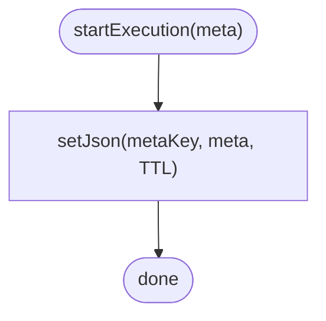

**Diagram sources**
- [forward-runtime-store.ts:27-34](file://src/services/forward-runtime-store.ts#L27-L34)

**Section sources**
- [forward-runtime-store.ts:1-62](file://src/services/forward-runtime-store.ts#L1-L62)

## Dependency Analysis
The following diagram shows how consumers depend on the abstraction and how the factory wires the concrete backend.

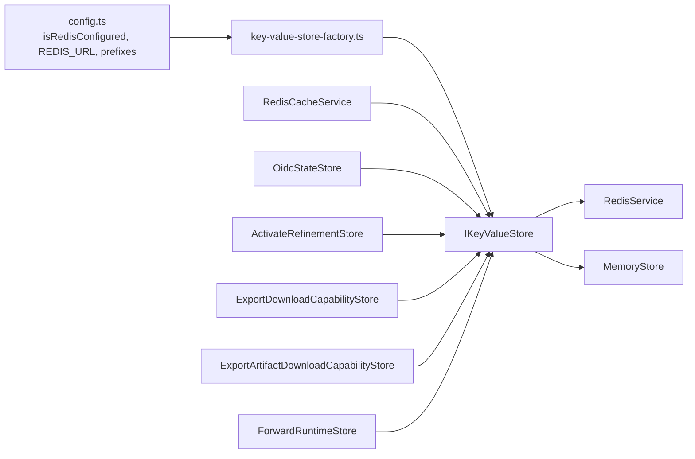

**Diagram sources**
- [config.ts:50-56](file://src/config.ts#L50-L56)
- [key-value-store-factory.ts:7-22](file://src/services/key-value-store-factory.ts#L7-L22)
- [key-value-store.ts:7-28](file://src/services/key-value-store.ts#L7-L28)
- [redis.ts:26-292](file://src/services/redis.ts#L26-L292)
- [memory-store.ts:27-201](file://src/services/memory-store.ts#L27-L201)
- [redis-cache.ts:3-5](file://src/services/redis-cache.ts#L3-L5)
- [oidc-state-store.ts:12-14](file://src/services/oidc-state-store.ts#L12-L14)
- [activate-refinement-store.ts:1-2](file://src/services/activate-refinement-store.ts#L1-L2)
- [export-download-capability-store.ts:1-2](file://src/services/export-download-capability-store.ts#L1-L2)
- [export-artifact-download-capability-store.ts:1-2](file://src/services/export-artifact-download-capability-store.ts#L1-L2)
- [forward-runtime-store.ts:1-3](file://src/services/forward-runtime-store.ts#L1-L3)

**Section sources**
- [config.ts:50-56](file://src/config.ts#L50-L56)
- [key-value-store-factory.ts:1-23](file://src/services/key-value-store-factory.ts#L1-L23)

## Performance Considerations
- Backend selection: When Redis is configured, all consumers benefit from shared state and persistence; otherwise, MemoryStore provides fast local behavior without cross-process guarantees.
- TTL strategy:
  - Search results: short-lived cache entries reduce stale reads while improving repeated query performance.
  - Memory resources: bounded TTL acts as a safety net against missed invalidations.
  - OIDC state: short TTL prevents accumulation of unused transaction state.
  - Execution metadata: longer TTL supports multi-step workflows.
- Key design:
  - Global prefixes for cross-space entities (e.g., memory cache, OIDC state).
  - Space-scoped keys for tenant isolation.
- Pub/sub:
  - Used for cache invalidation signaling; disabled effectively in MemoryStore.
- Monitoring:
  - Cache hits/misses counters provide basic observability.
  - Health endpoints can expose Redis availability.

[No sources needed since this section provides general guidance]

## Troubleshooting Guide
Common issues and diagnostics:
- Redis connectivity:
  - Inspect connection logs and error events for URL masking and detailed error codes.
  - Verify REDIS_URL and SQUADRULES_REDIS_PREFIX environment variables.
- Missing keys or stale data:
  - Ensure invalidation methods are called after writes.
  - Confirm TTLs are set appropriately for your workload.
- Pub/sub not working in development:
  - MemoryStore.publish returns 0; cross-process invalidation requires Redis.
- JSON parsing errors:
  - Corrupted or malformed JSON values will be logged and treated as misses.

Operational tips:
- Use health checks to verify Redis readiness before serving traffic.
- Monitor cache hit/miss ratios to tune TTLs and query shapes.
- Keep key prefixes consistent to avoid collisions across spaces.

**Section sources**
- [redis.ts:33-108](file://src/services/redis.ts#L33-L108)
- [redis-cache.ts:141-184](file://src/services/redis-cache.ts#L141-L184)
- [memory-store.ts:186-188](file://src/services/memory-store.ts#L186-L188)

## Conclusion
The key-value storage layer provides a clean abstraction over Redis and an in-memory store, enabling consistent caching, session-like state, and distributed coordination. The factory pattern keeps backend selection simple and centralized. Consumers apply TTLs and invalidation strategies tailored to their needs, while Redis enables cross-process consistency and pub/sub signaling. Proper configuration, monitoring, and error handling ensure reliable operation across environments.

[No sources needed since this section summarizes without analyzing specific files]