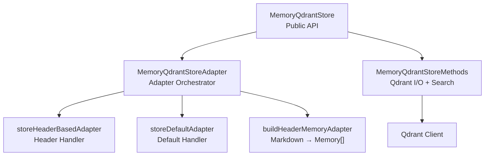
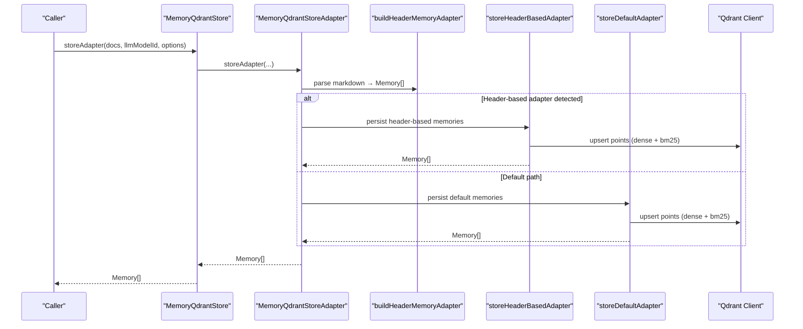
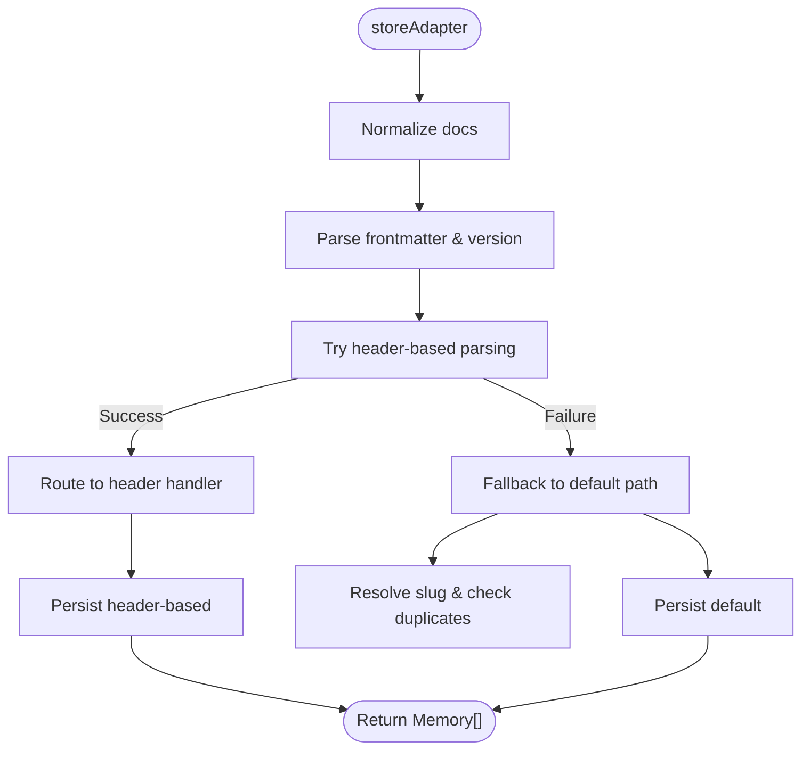
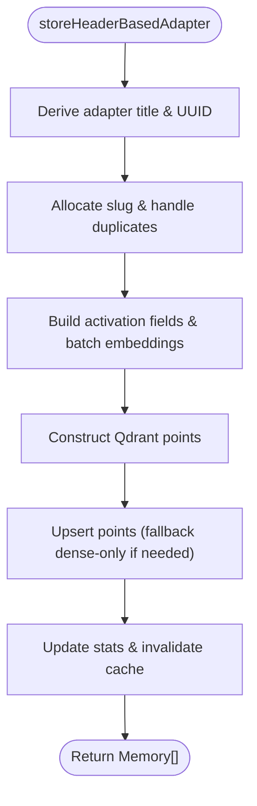
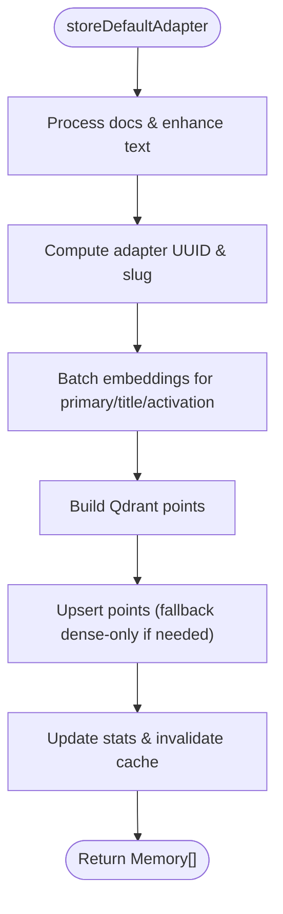
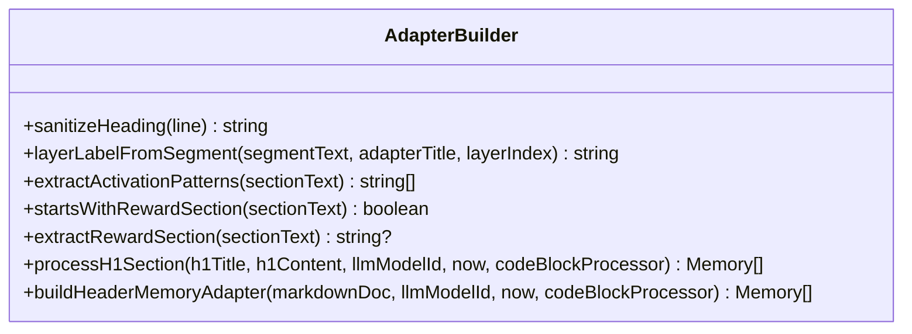
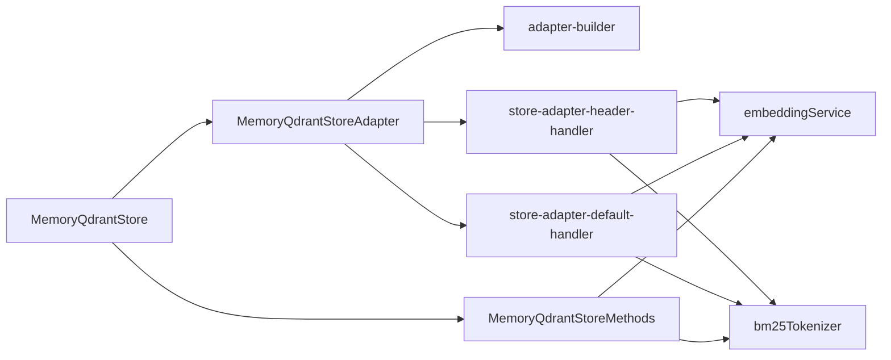

# Adapter Pattern Implementation

<cite>
**Referenced Files in This Document**
- [store.ts](file://src/services/memory/store.ts)
- [store-adapter.ts](file://src/services/memory/store-adapter.ts)
- [store-methods.ts](file://src/services/memory/store-methods.ts)
- [store-adapter-default-handler.ts](file://src/services/memory/store-adapter-default-handler.ts)
- [store-adapter-header-handler.ts](file://src/services/memory/store-adapter-header-handler.ts)
- [adapter-builder.ts](file://src/services/memory/adapter-builder.ts)
- [memory.ts](file://src/types/memory.ts)
</cite>

## Table of Contents
1. [Introduction](#introduction)
2. [Project Structure](#project-structure)
3. [Core Components](#core-components)
4. [Architecture Overview](#architecture-overview)
5. [Detailed Component Analysis](#detailed-component-analysis)
6. [Dependency Analysis](#dependency-analysis)
7. [Performance Considerations](#performance-considerations)
8. [Troubleshooting Guide](#troubleshooting-guide)
9. [Conclusion](#conclusion)

## Introduction
This document explains the adapter pattern implementation used by the memory store system to persist and retrieve structured knowledge as “adapters.” The design centers on a single entry point that normalizes input, selects an appropriate storage strategy (header-based or default), and persists data into Qdrant with dense vectors, sparse BM25 indices, and rich payload metadata.

Key goals:
- Provide a stable interface for storing adapters regardless of underlying storage details.
- Support two processing strategies: header-based adapters (H1/H2 sections) and default adapters (one memory per document).
- Standardize serialization/deserialization between Markdown-like inputs and vector-store payloads.
- Offer clear extension points for custom adapters and handlers.

## Project Structure
The memory subsystem is organized around a small set of cohesive modules:
- Store facade: exposes public operations like storing adapters and artifacts.
- Adapter orchestrator: parses input, chooses a handler, and coordinates persistence.
- Handlers: implement specific storage strategies (header-based vs default).
- Builder: transforms Markdown into intermediate Memory objects.
- Methods: encapsulate Qdrant interactions, search, and mapping.



**Diagram sources**
- [store.ts:29-62](file://src/services/memory/store.ts#L29-L62)
- [store-adapter.ts:35-41](file://src/services/memory/store-adapter.ts#L35-L41)
- [store-adapter-header-handler.ts:30-39](file://src/services/memory/store-adapter-header-handler.ts#L30-L39)
- [store-adapter-default-handler.ts:34-46](file://src/services/memory/store-adapter-default-handler.ts#L34-L46)
- [adapter-builder.ts:212-257](file://src/services/memory/adapter-builder.ts#L212-L257)
- [store-methods.ts:25-36](file://src/services/memory/store-methods.ts#L25-L36)

**Section sources**
- [store.ts:29-62](file://src/services/memory/store.ts#L29-L62)
- [store-adapter.ts:35-41](file://src/services/memory/store-adapter.ts#L35-L41)
- [store-methods.ts:25-36](file://src/services/memory/store-methods.ts#L25-L36)

## Core Components
- MemoryQdrantStore: Public facade that constructs Qdrant client, initializes collection, and delegates to adapter and methods.
- MemoryQdrantStoreAdapter: Orchestrates normalization, parsing, duplicate checks, slug allocation, and dispatch to header/default handlers.
- storeHeaderBasedAdapter: Persists multi-section adapters derived from H1/H2 structure.
- storeDefaultAdapter: Persists one-memory-per-document adapters with enhanced text and code-aware tags.
- MemoryQdrantStoreMethods: Encapsulates retrieval, hybrid search, and mapping between Qdrant points and Memory domain objects.
- buildHeaderMemoryAdapter: Parses Markdown into Memory[] structures, extracting activation patterns, reward signals, and layering.

Responsibilities and contracts:
- Input contract: array of normalized Markdown strings; optional protocol version and fork behavior.
- Output contract: array of Memory objects representing persisted layers.
- Persistence contract: upsert points with dense vectors (primary/title/activation-pattern), sparse BM25, and payload fields including adapter metadata, quality metrics, and slugs.

**Section sources**
- [store.ts:29-62](file://src/services/memory/store.ts#L29-L62)
- [store-adapter.ts:18-41](file://src/services/memory/store-adapter.ts#L18-L41)
- [store-adapter-header-handler.ts:27-39](file://src/services/memory/store-adapter-header-handler.ts#L27-L39)
- [store-adapter-default-handler.ts:31-46](file://src/services/memory/store-adapter-default-handler.ts#L31-L46)
- [store-methods.ts:25-36](file://src/services/memory/store-methods.ts#L25-L36)
- [adapter-builder.ts:70-114](file://src/services/memory/adapter-builder.ts#L70-L114)

## Architecture Overview
The adapter pattern here is implemented as a strategy selection within a single orchestrator class. The orchestrator does not define an abstract base class; instead, it provides a unified interface and delegates to specialized functions based on parsed content.



**Diagram sources**
- [store.ts:132-138](file://src/services/memory/store.ts#L132-L138)
- [store-adapter.ts:43-147](file://src/services/memory/store-adapter.ts#L43-L147)
- [adapter-builder.ts:212-257](file://src/services/memory/adapter-builder.ts#L212-L257)
- [store-adapter-header-handler.ts:30-201](file://src/services/memory/store-adapter-header-handler.ts#L30-L201)
- [store-adapter-default-handler.ts:34-255](file://src/services/memory/store-adapter-default-handler.ts#L34-L255)

## Detailed Component Analysis

### MemoryQdrantStoreAdapter: Orchestrator and Extension Point
Responsibilities:
- Normalize input Markdown blobs.
- Parse frontmatter and determine effective protocol version.
- Attempt header-based parsing; if successful, route to header handler.
- Otherwise, fall back to default handler.
- Enforce slug uniqueness and similarity checks.
- Track metrics and handle fork semantics for new adapter IDs.

Lifecycle highlights:
- Entry: storeAdapter(docs, llmModelId, options).
- Normalization and parsing.
- Decision: header-based vs default.
- Slug resolution and duplicate handling.
- Delegation to handler.
- Metrics emission and return.

Extension points:
- Swap or extend header/default handlers by modifying decision logic.
- Inject custom slug resolution or similarity checks.
- Add pre/post-processing hooks around normalization or embedding generation.



**Diagram sources**
- [store-adapter.ts:43-147](file://src/services/memory/store-adapter.ts#L43-L147)

**Section sources**
- [store-adapter.ts:18-41](file://src/services/memory/store-adapter.ts#L18-L41)
- [store-adapter.ts:43-147](file://src/services/memory/store-adapter.ts#L43-L147)

### Header-Based Handler: Multi-Section Adapters
Purpose:
- Handle adapters composed of multiple layers derived from H1/H2 sections.
- Preserve layer ordering, activation patterns, and reward signals.
- Generate embeddings for primary, title, and activation-pattern vectors.
- Persist points with rich payload including adapter metadata and quality metrics.

Processing steps:
- Derive adapter title and UUID (fork-aware).
- Allocate protocol slug and handle duplicates.
- Build activation search fields and batch embeddings.
- Construct Qdrant points with dense vectors and BM25 sparse index.
- Upsert points, fallback to dense-only if sparse config missing.
- Invalidate cache and update model stats/metrics.



**Diagram sources**
- [store-adapter-header-handler.ts:30-201](file://src/services/memory/store-adapter-header-handler.ts#L30-L201)

**Section sources**
- [store-adapter-header-handler.ts:27-39](file://src/services/memory/store-adapter-header-handler.ts#L27-L39)
- [store-adapter-header-handler.ts:30-201](file://src/services/memory/store-adapter-header-handler.ts#L30-L201)

### Default Handler: One-Memory-Per-Document Adapters
Purpose:
- Process each normalized document independently.
- Enhance text via code block processing and generate tags from identifiers.
- Compute activation-aware embeddings and persist points.
- Maintain adapter layering information even when documents are independent.

Processing steps:
- Generate UUIDs and process Markdown with CodeBlockProcessor.
- Determine adapter UUID (fork-aware) and allocate slug.
- Build activation fields and batch embeddings.
- Map to Qdrant points with dense vectors and BM25 sparse index.
- Upsert points with fallback to dense-only when necessary.
- Update model stats and emit metrics.



**Diagram sources**
- [store-adapter-default-handler.ts:34-255](file://src/services/memory/store-adapter-default-handler.ts#L34-L255)

**Section sources**
- [store-adapter-default-handler.ts:31-46](file://src/services/memory/store-adapter-default-handler.ts#L31-L46)
- [store-adapter-default-handler.ts:34-255](file://src/services/memory/store-adapter-default-handler.ts#L34-L255)

### Adapter Builder: Markdown to Memory Transformation
Purpose:
- Convert Markdown into Memory[] structures suitable for both header-based and default paths.
- Extract activation patterns, reward signals, and inference contracts.
- Sanitize headings and derive layer labels.

Key behaviors:
- Sanitize H2 headings to remove numbering patterns.
- Detect H1 sections; if none, treat first H2 as adapter root.
- Split content by fenced contract blocks to create layered memories.
- Attach activation patterns and reward signal to adapter metadata.
- Produce Memory objects with labels, tags, text, timestamps, and adapter info.



**Diagram sources**
- [adapter-builder.ts:13-31](file://src/services/memory/adapter-builder.ts#L13-L31)
- [adapter-builder.ts:33-68](file://src/services/memory/adapter-builder.ts#L33-L68)
- [adapter-builder.ts:70-210](file://src/services/memory/adapter-builder.ts#L70-L210)
- [adapter-builder.ts:212-257](file://src/services/memory/adapter-builder.ts#L212-L257)

**Section sources**
- [adapter-builder.ts:13-31](file://src/services/memory/adapter-builder.ts#L13-L31)
- [adapter-builder.ts:70-210](file://src/services/memory/adapter-builder.ts#L70-L210)
- [adapter-builder.ts:212-257](file://src/services/memory/adapter-builder.ts#L212-L257)

### MemoryQdrantStoreMethods: Storage Interface and Search
Purpose:
- Provide read/write/search operations over Qdrant.
- Implement hybrid search combining dense vectors and BM25.
- Map Qdrant points to Memory domain objects.

Highlights:
- getMemory/getMemoryFresh: cached and fresh reads with space authorization.
- searchMemories: hybrid query with prefetch legs and fusion ranking.
- pointToMemory: consistent deserialization from Qdrant payload.

```mermaid
classDiagram
class MemoryQdrantStoreMethods {
-client
-collection
-url
-codeBlockProcessor
+getMemory(memory_uuid) Memory?
+getMemoryFresh(memory_uuid) Memory?
+searchMemories(query, limit, collapse) {memories, scores}
+searchAdapterTitlesBySimilarity(query, limit) {memories, scores}
-vectorSearch(query, limit) {memories, scores}
-pointToMemory(point) Memory
+buildHeaderMemoryAdapter(markdownDoc, llmModelId, now) Memory[]
}
```

**Diagram sources**
- [store-methods.ts:25-36](file://src/services/memory/store-methods.ts#L25-L36)
- [store-methods.ts:38-92](file://src/services/memory/store-methods.ts#L38-L92)
- [store-methods.ts:94-114](file://src/services/memory/store-methods.ts#L94-L114)
- [store-methods.ts:121-260](file://src/services/memory/store-methods.ts#L121-L260)
- [store-methods.ts:262-268](file://src/services/memory/store-methods.ts#L262-L268)

**Section sources**
- [store-methods.ts:25-36](file://src/services/memory/store-methods.ts#L25-L36)
- [store-methods.ts:38-92](file://src/services/memory/store-methods.ts#L38-L92)
- [store-methods.ts:94-114](file://src/services/memory/store-methods.ts#L94-L114)
- [store-methods.ts:121-260](file://src/services/memory/store-methods.ts#L121-L260)
- [store-methods.ts:262-268](file://src/services/memory/store-methods.ts#L262-L268)

## Dependency Analysis
High-level dependencies:
- MemoryQdrantStore depends on QdrantClient, configuration, and internal modules for initialization and lifecycle.
- MemoryQdrantStoreAdapter depends on builder, helpers, and handlers for processing and persistence.
- Handlers depend on embedding service, BM25 tokenizer, ID generator, and metrics.
- Methods depend on embedding service, BM25 tokenizer, and mapping utilities.



**Diagram sources**
- [store.ts:29-62](file://src/services/memory/store.ts#L29-L62)
- [store-adapter.ts:35-41](file://src/services/memory/store-adapter.ts#L35-L41)
- [store-adapter-header-handler.ts:30-39](file://src/services/memory/store-adapter-header-handler.ts#L30-L39)
- [store-adapter-default-handler.ts:34-46](file://src/services/memory/store-adapter-default-handler.ts#L34-L46)
- [store-methods.ts:25-36](file://src/services/memory/store-methods.ts#L25-L36)

**Section sources**
- [store.ts:29-62](file://src/services/memory/store.ts#L29-L62)
- [store-adapter.ts:35-41](file://src/services/memory/store-adapter.ts#L35-L41)
- [store-methods.ts:25-36](file://src/services/memory/store-methods.ts#L25-L36)

## Performance Considerations
- Batch embeddings: Both handlers use batch embedding generation to minimize overhead and ensure consistent dimensions.
- Sparse BM25 fallback: If the collection lacks sparse configuration, handlers retry without BM25 to avoid failures.
- Hybrid search: Prefetch legs and RRF fusion improve recall while keeping ranking efficient in Qdrant.
- Caching: Redis-backed shared cache reduces repeated reads and search results.
- Metrics: Duration timers and counters help monitor performance and adapter sizes.

[No sources needed since this section provides general guidance]

## Troubleshooting Guide
Common issues and resolutions:
- Embedding shape mismatch: Handlers detect wrong counts or dimensions and fall back to zero vectors; verify embedding service configuration and dimension settings.
- Sparse index errors: Upsert retries without BM25 when collections lack sparse config; ensure proper collection schema or rely on fallback behavior.
- Duplicate adapters: Duplicate detection and slug allocation enforce uniqueness; consider forceUpdate or forkNewAdapter options.
- Space authorization: Reads filter by allowed spaces; confirm tenant context and space permissions.

Operational tips:
- Inspect logs for warnings about embedding failures or sparse retries.
- Use fresh reads when verifying updates immediately after writes.
- Validate protocol slugs and titles to avoid invalid slug errors.

**Section sources**
- [store-adapter-header-handler.ts:61-89](file://src/services/memory/store-adapter-header-handler.ts#L61-L89)
- [store-adapter-header-handler.ts:166-182](file://src/services/memory/store-adapter-header-handler.ts#L166-L182)
- [store-adapter-default-handler.ts:112-142](file://src/services/memory/store-adapter-default-handler.ts#L112-L142)
- [store-adapter-default-handler.ts:216-232](file://src/services/memory/store-adapter-default-handler.ts#L216-L232)
- [store-methods.ts:38-92](file://src/services/memory/store-methods.ts#L38-L92)

## Conclusion
The memory store’s adapter pattern centers on a single orchestrator that normalizes input, decides between header-based and default strategies, and persists structured memories into Qdrant with robust error handling and performance optimizations. While there is no formal base class, the adapter concept is realized through delegation to specialized handlers and a builder that standardizes transformation from Markdown to Memory objects. This design offers clear extension points for custom adapters, improved search via hybrid queries, and resilient persistence with fallback mechanisms.

[No sources needed since this section summarizes without analyzing specific files]