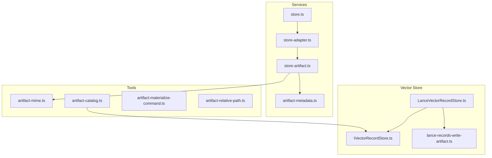
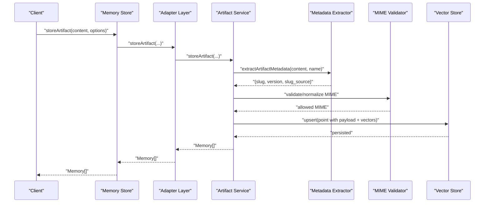
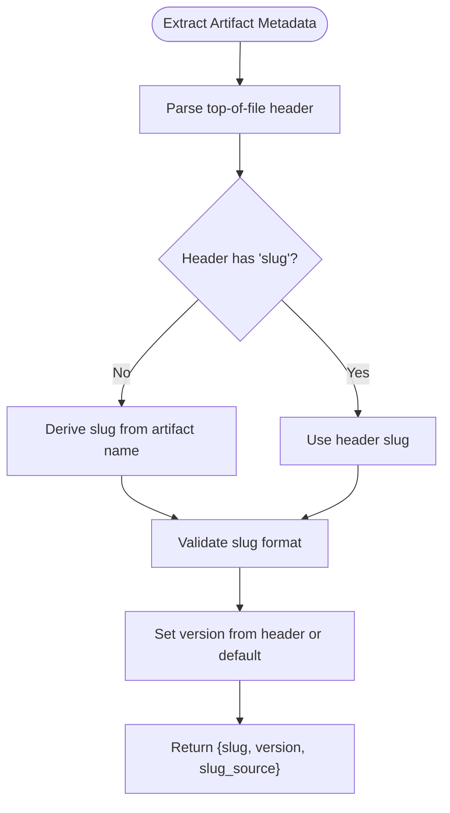
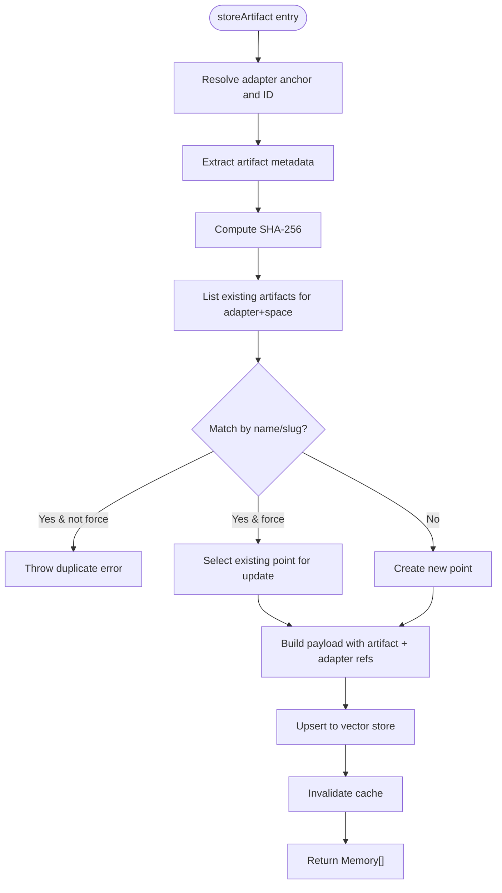
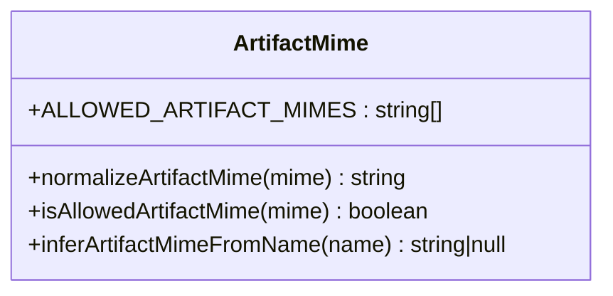
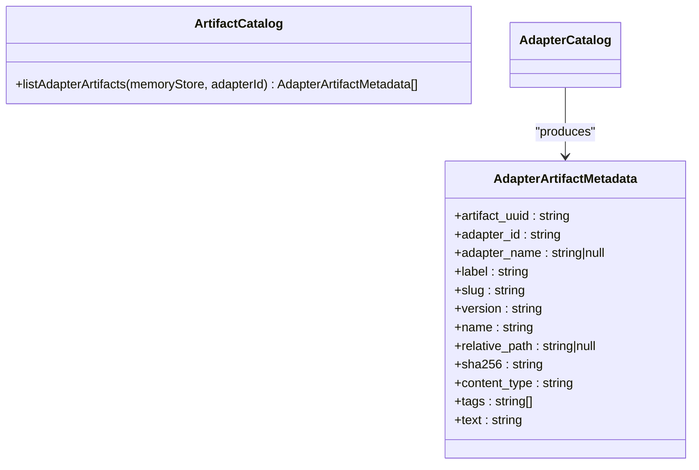
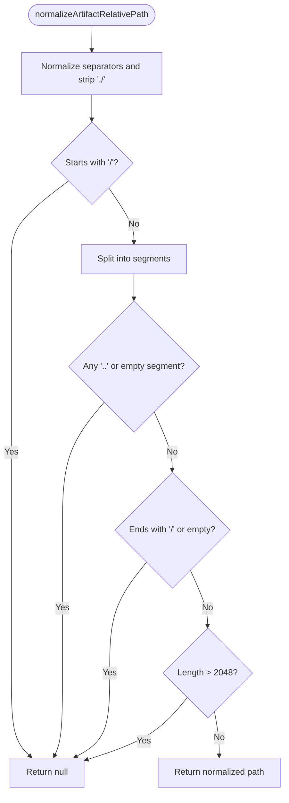
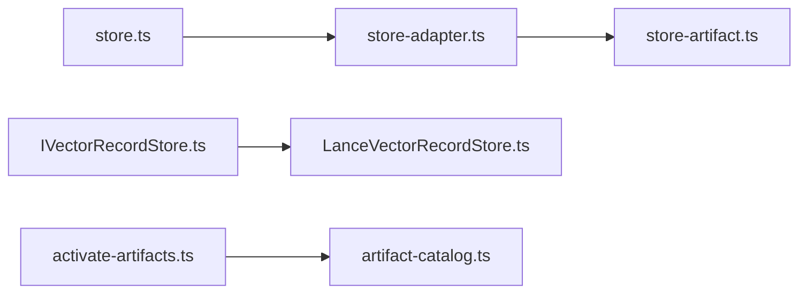
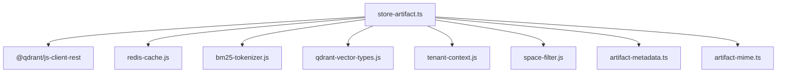

# Artifact Handling System

<cite>
**Referenced Files in This Document**
- [store-artifact.ts](file://src/services/memory/store-artifact.ts)
- [artifact-metadata.ts](file://src/services/memory/artifact-metadata.ts)
- [artifact-mime.ts](file://src/tools/artifact-mime.ts)
- [artifact-catalog.ts](file://src/tools/artifact-catalog.ts)
- [artifact-materialize-command.ts](file://src/tools/artifact-materialize-command.ts)
- [artifact-relative-path.ts](file://src/tools/artifact-relative-path.ts)
- [store-adapter.ts](file://src/services/memory/store-adapter.ts)
- [store.ts](file://src/services/memory/store.ts)
- [IVectorRecordStore.ts](file://src/services/vector-store/IVectorRecordStore.ts)
- [LanceVectorRecordStore.ts](file://src/services/vector-store/lancedb/LanceVectorRecordStore.ts)
- [lance-records-write-artifact.ts](file://src/services/vector-store/lancedb/lance-records-write-artifact.ts)
- [activate-artifacts.ts](file://src/tools/activate-artifacts.ts)
</cite>

## Table of Contents
1. [Introduction](#introduction)
2. [Project Structure](#project-structure)
3. [Core Components](#core-components)
4. [Architecture Overview](#architecture-overview)
5. [Detailed Component Analysis](#detailed-component-analysis)
6. [Dependency Analysis](#dependency-analysis)
7. [Performance Considerations](#performance-considerations)
8. [Troubleshooting Guide](#troubleshooting-guide)
9. [Conclusion](#conclusion)

## Introduction
This document explains the artifact handling system that stores, retrieves, and manages artifacts alongside structured memory records. Artifacts represent files, documents, or binary data attached to adapters. The system integrates with a vector store (Qdrant primary, LanceDB secondary), enforces MIME allowlists, derives stable slugs and versions from content headers or names, and maintains relationships between artifacts and adapter records. It also provides tooling for listing artifacts, materializing them safely, and preserving skill-root-relative paths for export layouts.

## Project Structure
The artifact subsystem spans services and tools:
- Services layer implements storage, metadata extraction, and adapter linkage.
- Tools layer provides MIME validation, cataloging, path normalization, and materialization instructions.
- Vector store interfaces abstract Qdrant and LanceDB implementations.



**Diagram sources**
- [store-artifact.ts:168-301](file://src/services/memory/store-artifact.ts#L168-L301)
- [artifact-metadata.ts:64-77](file://src/services/memory/artifact-metadata.ts#L64-L77)
- [artifact-mime.ts:34-48](file://src/tools/artifact-mime.ts#L34-L48)
- [artifact-catalog.ts:68-86](file://src/tools/artifact-catalog.ts#L68-L86)
- [artifact-materialize-command.ts:36-48](file://src/tools/artifact-materialize-command.ts#L36-L48)
- [artifact-relative-path.ts:7-26](file://src/tools/artifact-relative-path.ts#L7-L26)
- [store-adapter.ts:150-151](file://src/services/memory/store-adapter.ts#L150-L151)
- [store.ts:140-141](file://src/services/memory/store.ts#L140-L141)
- [IVectorRecordStore.ts:36-62](file://src/services/vector-store/IVectorRecordStore.ts#L36-L62)
- [LanceVectorRecordStore.ts:189-190](file://src/services/vector-store/lancedb/LanceVectorRecordStore.ts#L189-L190)
- [lance-records-write-artifact.ts:33-41](file://src/services/vector-store/lancedb/lance-records-write-artifact.ts#L33-L41)

**Section sources**
- [store-artifact.ts:168-301](file://src/services/memory/store-artifact.ts#L168-L301)
- [artifact-metadata.ts:64-77](file://src/services/memory/artifact-metadata.ts#L64-L77)
- [artifact-mime.ts:34-48](file://src/tools/artifact-mime.ts#L34-L48)
- [artifact-catalog.ts:68-86](file://src/tools/artifact-catalog.ts#L68-L86)
- [artifact-materialize-command.ts:36-48](file://src/tools/artifact-materialize-command.ts#L36-L48)
- [artifact-relative-path.ts:7-26](file://src/tools/artifact-relative-path.ts#L7-L26)
- [store-adapter.ts:150-151](file://src/services/memory/store-adapter.ts#L150-L151)
- [store.ts:140-141](file://src/services/memory/store.ts#L140-L141)
- [IVectorRecordStore.ts:36-62](file://src/services/vector-store/IVectorRecordStore.ts#L36-L62)
- [LanceVectorRecordStore.ts:189-190](file://src/services/vector-store/lancedb/LanceVectorRecordStore.ts#L189-L190)
- [lance-records-write-artifact.ts:33-41](file://src/services/vector-store/lancedb/lance-records-write-artifact.ts#L33-L41)

## Core Components
- Artifact metadata extraction: Derives slug, version, and source strategy from top-of-file headers or artifact name.
- Artifact storage: Creates a memory point linked to an adapter, computes SHA-256, sets tags and sparse vectors, and persists via the vector store.
- MIME allowlist and inference: Centralized allowed MIME types and extension-to-MIME mapping used across train/export/source/listing.
- Artifact catalog: Reads stored artifacts per adapter and normalizes payload into a consistent metadata shape.
- Materialization instruction: Generates agent-facing instructions to download, verify, and secure artifacts without CLI dependency.
- Relative path normalization: Validates skill-root-relative paths to prevent traversal and preserve export layout.

**Section sources**
- [artifact-metadata.ts:64-77](file://src/services/memory/artifact-metadata.ts#L64-L77)
- [store-artifact.ts:168-301](file://src/services/memory/store-artifact.ts#L168-L301)
- [artifact-mime.ts:34-48](file://src/tools/artifact-mime.ts#L34-L48)
- [artifact-catalog.ts:68-86](file://src/tools/artifact-catalog.ts#L68-L86)
- [artifact-materialize-command.ts:36-48](file://src/tools/artifact-materialize-command.ts#L36-L48)
- [artifact-relative-path.ts:7-26](file://src/tools/artifact-relative-path.ts#L7-L26)

## Architecture Overview
Artifacts are stored as memory points with rich payloads linking them to adapters. The flow validates MIMEs, extracts metadata, resolves adapter linkage, deduplicates by name/slug, computes digests, and persists both dense and sparse vectors. Consumers list artifacts through the catalog and can generate safe materialization instructions for agents.



**Diagram sources**
- [store.ts:140-141](file://src/services/memory/store.ts#L140-L141)
- [store-adapter.ts:150-151](file://src/services/memory/store-adapter.ts#L150-L151)
- [store-artifact.ts:168-301](file://src/services/memory/store-artifact.ts#L168-L301)
- [artifact-metadata.ts:64-77](file://src/services/memory/artifact-metadata.ts#L64-L77)
- [artifact-mime.ts:34-48](file://src/tools/artifact-mime.ts#L34-L48)

## Detailed Component Analysis

### Artifact Metadata Schema and Extraction
- Schema fields:
  - slug: normalized identifier derived from header or name.
  - version: semantic version string from header or default.
  - slug_source: indicates whether slug came from header or name derivation.
- Header parsing:
  - Recognizes a special marker at the top of the file followed by key-value pairs for slug and version.
  - If no header is present, slug is derived from the artifact name using strict normalization rules.
- Validation:
  - Slug must match a strict lowercase alphanumeric pattern with hyphens.
  - Version defaults to a stable value when absent.



**Diagram sources**
- [artifact-metadata.ts:29-62](file://src/services/memory/artifact-metadata.ts#L29-L62)
- [artifact-metadata.ts:64-77](file://src/services/memory/artifact-metadata.ts#L64-L77)

**Section sources**
- [artifact-metadata.ts:29-77](file://src/services/memory/artifact-metadata.ts#L29-L77)

### Artifact Storage Flow and Deduplication
- Adapter resolution:
  - Accepts adapter URI (slug or UUID). Resolves to chain adapter ID and optional adapter name.
- Deduplication:
  - Lists existing artifacts for the same space and adapter.
  - Matches by normalized name or slug depending on slug source.
  - Prevents duplicate creation unless force update is requested.
- Persistence:
  - Computes SHA-256 digest of content.
  - Builds tags including artifact type and slug-based tag.
  - Stores text content and minimal sparse index; dense vectors are zero-initialized for artifacts.
  - Upserts into the vector store with fallback behavior if sparse indexing fails.



**Diagram sources**
- [store-artifact.ts:20-126](file://src/services/memory/store-artifact.ts#L20-L126)
- [store-artifact.ts:133-166](file://src/services/memory/store-artifact.ts#L133-L166)
- [store-artifact.ts:168-301](file://src/services/memory/store-artifact.ts#L168-L301)

**Section sources**
- [store-artifact.ts:20-126](file://src/services/memory/store-artifact.ts#L20-L126)
- [store-artifact.ts:133-166](file://src/services/memory/store-artifact.ts#L133-L166)
- [store-artifact.ts:168-301](file://src/services/memory/store-artifact.ts#L168-L301)

### MIME Allowlist and Inference
- Canonical allowlist:
  - Aggregates all allowed MIMEs from extension mappings and no-extension rules.
- Normalization:
  - Lowercases and trims MIME strings.
- Inference:
  - Infers primary MIME from file extension when provided.



**Diagram sources**
- [artifact-mime.ts:1-50](file://src/tools/artifact-mime.ts#L1-L50)

**Section sources**
- [artifact-mime.ts:1-50](file://src/tools/artifact-mime.ts#L1-L50)

### Artifact Catalog and Listing
- Catalog model:
  - Normalizes stored payload into a consistent AdapterArtifactMetadata structure.
- Listing:
  - Delegates to the underlying vector store’s adapter artifact listing.
  - Sorts results by name and UUID for deterministic output.



**Diagram sources**
- [artifact-catalog.ts:3-16](file://src/tools/artifact-catalog.ts#L3-L16)
- [artifact-catalog.ts:68-86](file://src/tools/artifact-catalog.ts#L68-L86)

**Section sources**
- [artifact-catalog.ts:3-16](file://src/tools/artifact-catalog.ts#L3-L16)
- [artifact-catalog.ts:68-86](file://src/tools/artifact-catalog.ts#L68-L86)

### Materialization Instructions for Agents
- Purpose:
  - Provide agents with explicit instructions to call the export tool, write to disk, verify SHA-256, and set restrictive permissions.
- Inputs:
  - Transport mode, download URL, relative path under the local artifact directory, and expected digest.
- Output:
  - A structured instruction object specifying tool, arguments, output path, digest, and chmod.

```mermaid
classDiagram
class ArtifactMaterializeCommand {
+SQUADRULES_LOCAL_ARTIFACT_DIR_ENV : string
+buildArtifactMaterializeInstruction(input) MaterializeInstruction
}
class MaterializeInstruction {
+tool : "export"
+arguments : { uri : string; format : "source" }
+out : string
+sha256 : string
+chmod : "700"
}
ArtifactMaterializeCommand --> MaterializeInstruction : "creates"
```

**Diagram sources**
- [artifact-materialize-command.ts:10-48](file://src/tools/artifact-materialize-command.ts#L10-L48)

**Section sources**
- [artifact-materialize-command.ts:10-48](file://src/tools/artifact-materialize-command.ts#L10-L48)

### Relative Path Normalization
- Rules:
  - Normalize backslashes to forward slashes.
  - Strip leading dot segments.
  - Reject absolute paths, parent traversal, empty segments, trailing slashes, and overly long paths.
- Usage:
  - Ensures exported artifacts maintain a safe, predictable layout within the skill root.



**Diagram sources**
- [artifact-relative-path.ts:7-26](file://src/tools/artifact-relative-path.ts#L7-L26)

**Section sources**
- [artifact-relative-path.ts:7-26](file://src/tools/artifact-relative-path.ts#L7-L26)

### Integration Points and Entry Methods
- Public API surface:
  - Memory store exposes storeArtifact and listAdapterArtifacts.
  - Adapter layer delegates to artifact service.
  - Vector store interface defines contract for both Qdrant and LanceDB implementations.
- Activation integration:
  - Activators can list adapter artifacts and include them in activation payloads.



**Diagram sources**
- [store.ts:140-141](file://src/services/memory/store.ts#L140-L141)
- [store-adapter.ts:150-151](file://src/services/memory/store-adapter.ts#L150-L151)
- [store-artifact.ts:168-301](file://src/services/memory/store-artifact.ts#L168-L301)
- [IVectorRecordStore.ts:36-62](file://src/services/vector-store/IVectorRecordStore.ts#L36-L62)
- [LanceVectorRecordStore.ts:189-190](file://src/services/vector-store/lancedb/LanceVectorRecordStore.ts#L189-L190)
- [activate-artifacts.ts:11-49](file://src/tools/activate-artifacts.ts#L11-L49)

**Section sources**
- [store.ts:140-141](file://src/services/memory/store.ts#L140-L141)
- [store-adapter.ts:150-151](file://src/services/memory/store-adapter.ts#L150-L151)
- [store-artifact.ts:168-301](file://src/services/memory/store-artifact.ts#L168-L301)
- [IVectorRecordStore.ts:36-62](file://src/services/vector-store/IVectorRecordStore.ts#L36-L62)
- [LanceVectorRecordStore.ts:189-190](file://src/services/vector-store/lancedb/LanceVectorRecordStore.ts#L189-L190)
- [activate-artifacts.ts:11-49](file://src/tools/activate-artifacts.ts#L11-L49)

## Dependency Analysis
- Cohesion:
  - Artifact storage logic is cohesive around metadata extraction, MIME validation, adapter linkage, and persistence.
- Coupling:
  - Depends on vector store abstractions and tenant context utilities.
  - Uses shared MIME allowlist and tokenization utilities for sparse indexing.
- External integrations:
  - Qdrant client for upsert and scroll operations.
  - Redis cache invalidation after updates.
  - Environment variables for agent-side artifact directories.



**Diagram sources**
- [store-artifact.ts:1-18](file://src/services/memory/store-artifact.ts#L1-L18)

**Section sources**
- [store-artifact.ts:1-18](file://src/services/memory/store-artifact.ts#L1-L18)

## Performance Considerations
- Sparse vs dense vectors:
  - Artifacts use zero-initialized dense vectors and rely on sparse BM25 indices for searchability.
  - Fallback removes sparse indices if the backend rejects them.
- Pagination and scrolling:
  - Existing artifact enumeration uses paginated scrolling to avoid large payloads.
- Caching:
  - Cache invalidation occurs after successful writes to keep listings fresh.
- Large files:
  - Content is stored as text in the payload; consider chunking strategies at higher layers if needed.
  - Avoid unnecessary embedding computation for artifacts; dense vectors remain zeroed.

[No sources needed since this section provides general guidance]

## Troubleshooting Guide
- Duplicate artifact errors:
  - Occur when attempting to store an artifact with an existing name or slug on the same adapter unless force update is specified.
- Invalid MIME types:
  - Ensure MIME is in the canonical allowlist; infer from extension when possible.
- Invalid slug:
  - Slugs must be lowercase alphanumeric with hyphens; derive from header or normalize from name.
- Vector store errors:
  - Sparse indexing failures trigger a retry without BM25; inspect logs for warnings.
- Relative path issues:
  - Paths with traversal, absolute roots, or trailing slashes are rejected; validate before storing.

**Section sources**
- [store-artifact.ts:192-207](file://src/services/memory/store-artifact.ts#L192-L207)
- [store-artifact.ts:260-272](file://src/services/memory/store-artifact.ts#L260-L272)
- [artifact-mime.ts:34-48](file://src/tools/artifact-mime.ts#L34-L48)
- [artifact-metadata.ts:64-77](file://src/services/memory/artifact-metadata.ts#L64-L77)
- [artifact-relative-path.ts:7-26](file://src/tools/artifact-relative-path.ts#L7-L26)

## Conclusion
The artifact handling system provides a robust, validated, and searchable mechanism for attaching files and documents to adapters. It enforces strict metadata and MIME policies, supports deduplication and safe updates, and offers clear interfaces for listing and materializing artifacts. By integrating with vector stores and environment-driven agent workflows, it enables secure, efficient artifact management aligned with the broader memory store architecture.

[No sources needed since this section summarizes without analyzing specific files]