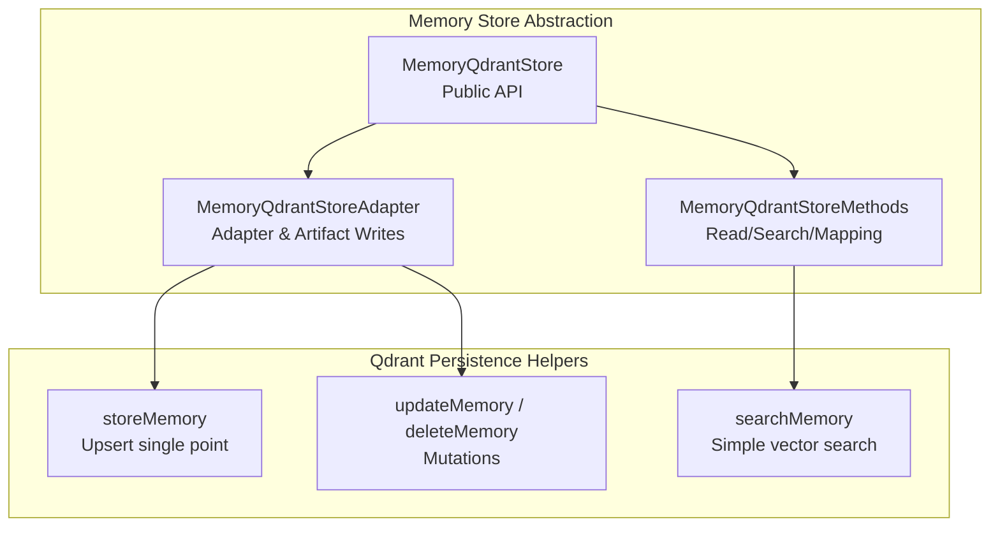
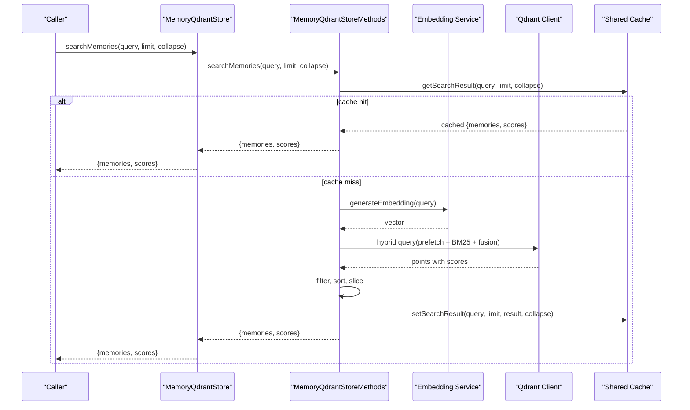
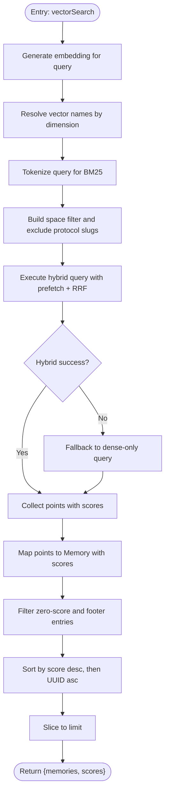
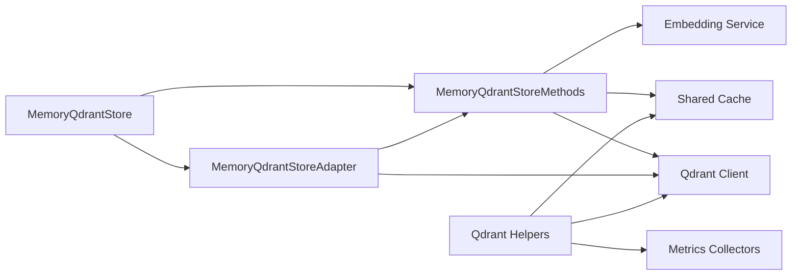

# Core Methods Abstraction Layer

<cite>
**Referenced Files in This Document**
- [store.ts](file://src/services/memory/store.ts)
- [store-methods.ts](file://src/services/memory/store-methods.ts)
- [store-adapter.ts](file://src/services/memory/store-adapter.ts)
- [memory-store.ts](file://src/services/qdrant/memory-store.ts)
- [memory-updates.ts](file://src/services/qdrant/memory-updates.ts)
- [search.ts](file://src/services/qdrant/search.ts)
- [memory.ts](file://src/types/memory.ts)
</cite>

## Table of Contents
1. [Introduction](#introduction)
2. [Project Structure](#project-structure)
3. [Core Components](#core-components)
4. [Architecture Overview](#architecture-overview)
5. [Detailed Component Analysis](#detailed-component-analysis)
6. [Dependency Analysis](#dependency-analysis)
7. [Performance Considerations](#performance-considerations)
8. [Troubleshooting Guide](#troubleshooting-guide)
9. [Conclusion](#conclusion)

## Introduction
This document explains the core methods abstraction layer for the memory store, centered on `MemoryQdrantStore` and its internal `MemoryQdrantStoreMethods`. The goal is to provide a unified interface for CRUD operations, semantic search, adapter metadata management, and related persistence helpers while hiding Qdrant complexity from higher-level components.

The abstraction:
- Exposes a stable API for reading memories, searching by embedding and BM25, and managing adapter artifacts.
- Encapsulates tenant and space scoping, vector naming, caching, metrics, and error handling.
- Keeps performance high through hybrid search, prefetching, quantization rescore, shared cache, and batched writes.

## Project Structure
The memory store abstraction lives under `src/services/memory`, with lower-level Qdrant helpers under `src/services/qdrant`. The public-facing class is `MemoryQdrantStore`; it delegates read/search logic to `MemoryQdrantStoreMethods` and adapter/artifact persistence to `MemoryQdrantStoreAdapter`.

**Diagram sources**
- [store.ts:29-62](file://src/services/memory/store.ts#L29-L62)
- [store-methods.ts:25-36](file://src/services/memory/store-methods.ts#L25-L36)
- [store-adapter.ts:35-41](file://src/services/memory/store-adapter.ts#L35-L41)
- [memory-store.ts:10-25](file://src/services/qdrant/memory-store.ts#L10-L25)
- [memory-updates.ts:15-23](file://src/services/qdrant/memory-updates.ts#L15-L23)
- [search.ts:8-11](file://src/services/qdrant/search.ts#L8-L11)

**Section sources**
- [store.ts:29-62](file://src/services/memory/store.ts#L29-L62)
- [store-methods.ts:25-36](file://src/services/memory/store-methods.ts#L25-L36)
- [store-adapter.ts:35-41](file://src/services/memory/store-adapter.ts#L35-L41)

## Core Components
- `MemoryQdrantStore`: Public facade that initializes Qdrant client/collection, exposes health checks, adapter storage, artifact storage, memory retrieval, search, and low-level scroll/delete utilities.
- `MemoryQdrantStoreMethods`: Internal implementation of read/search logic, including cache-aware retrieval, hybrid search, title similarity search, and mapping Qdrant points to domain models.
- `MemoryQdrantStoreAdapter`: Orchestrates adapter parsing, validation, deduplication, and persistence via header-based or default adapter strategies.
- Qdrant helpers (`storeMemory`, `updateMemory`, `deleteMemory`, `searchMemory`): Lower-level functions that perform upserts, mutations, and simple vector searches with tenant/space scoping and metrics.

Key responsibilities:
- Unified CRUD and search surface for callers.
- Tenant-aware filtering and space scoping.
- Shared Redis/in-memory caching for reads and search results.
- Hybrid dense + sparse (BM25) ranking with fallback to dense-only search.
- Adapter metadata normalization and versioning.

**Section sources**
- [store.ts:29-62](file://src/services/memory/store.ts#L29-L62)
- [store-methods.ts:25-36](file://src/services/memory/store-methods.ts#L25-L36)
- [store-adapter.ts:35-41](file://src/services/memory/store-adapter.ts#L35-L41)

## Architecture Overview
The abstraction separates concerns:
- Public API (`MemoryQdrantStore`) hides connection details and provides typed methods.
- Read/search logic (`MemoryQdrantStoreMethods`) encapsulates embedding generation, hybrid query construction, scoring, filtering, and result mapping.
- Write logic is split into adapter-specific flows (`MemoryQdrantStoreAdapter`) and generic mutation helpers (`memory-updates.ts`).
- Simple vector search helper (`search.ts`) is used internally where needed.

**Diagram sources**
- [store.ts:151-153](file://src/services/memory/store.ts#L151-L153)
- [store-methods.ts:94-104](file://src/services/memory/store-methods.ts#L94-L104)
- [store-methods.ts:121-260](file://src/services/memory/store-methods.ts#L121-L260)

## Detailed Component Analysis

### MemoryQdrantStore
Responsibilities:
- Initialize Qdrant client and resolve collection alias.
- Provide health check with timeout.
- Delegate adapter and artifact persistence to `MemoryQdrantStoreAdapter`.
- Expose memory retrieval and search via `MemoryQdrantStoreMethods`.
- Provide low-level scroll/delete utilities for backend-owned domain reads/writes.

Important behaviors:
- Collection alias resolution allows logical names like “current” to map to environment-driven collections.
- Health check races against a timeout and logs failures without crashing.
- Scroll utility paginates over filtered points and returns neutral `LayerRecord`s.

Common operations exposed:
- `init()`: initialize store.
- `checkHealth(timeoutMs)`: health probe.
- `storeAdapter(docs, llmModelId, options)`: persist adapters.
- `storeArtifact(content, options)`: persist artifacts.
- `getMemory(memory_uuid, options)`: read with optional fresh bypass.
- `searchMemories(query, limit, collapse)`: hybrid search.
- `scrollSpace(spaceId, options)`: enumerate layers in a space.
- `listAdapterArtifacts(adapterId)`: list artifact layers.
- `findProtocolFooterLayers(refineSlug, createSlug)`: find footer layers.
- `getStoredAdapterVersion(slug)`: read stored protocol version.
- `setPayloadOnLayers(layerIds, patch)`: payload patching.
- `deleteAppSpaceBySlug(slug)` / `deleteAppSpaceByAdapterId(adapterId)`: app-space deletions.
- `getQdrantAccess()`: direct access for boot injection.

Error handling:
- Health check failure returns false and logs warnings.
- Direct Qdrant calls propagate errors; higher layers should handle them.

**Section sources**
- [store.ts:29-62](file://src/services/memory/store.ts#L29-L62)
- [store.ts:64-130](file://src/services/memory/store.ts#L64-L130)
- [store.ts:132-153](file://src/services/memory/store.ts#L132-L153)
- [store.ts:162-264](file://src/services/memory/store.ts#L162-L264)
- [store.ts:269-271](file://src/services/memory/store.ts#L269-L271)

### MemoryQdrantStoreMethods
Responsibilities:
- Retrieve a memory by UUID with shared cache support.
- Fresh retrieval bypassing in-process cache.
- Hybrid search combining dense vectors, title vectors, activation pattern vectors, and BM25.
- Title similarity search for adapters.
- Map Qdrant points to domain `Memory` objects.
- Build header-based adapter memories.

Method signatures and behavior:
- `getMemory(memory_uuid: string): Promise<Memory | null>`
  - Validates input, checks shared cache, retrieves from Qdrant, enforces space access, maps to `Memory`, caches result.
- `getMemoryFresh(memory_uuid: string): Promise<Memory | null>`
  - Skips cache, performs direct retrieval and access control, maps to `Memory`.
- `searchMemories(query: string, limit: number, collapse: boolean = true): Promise<{ memories: Memory[], scores: number[] }>`
  - Normalizes query, delegates to private `vectorSearch`, caches result keyed by query and limit with collapse flag.
- `searchAdapterTitlesBySimilarity(query: string, limit: number): Promise<{ memories: Memory[], scores: number[] }>`
  - Delegates to dedicated title similarity search implementation.
- `buildHeaderMemoryAdapter(markdownDoc: string, llmModelId: string, now: Date): Memory[]`
  - Builds adapter header memories using code block processor.

Caching strategy:
- Reads use shared cache service for memory resources.
- Search results are cached per query, limit, and collapse flag.

Hybrid search algorithm:
- Generates embedding for query.
- Determines vector dimensions and names for primary, title, and activation pattern vectors.
- Tokenizes query for BM25.
- Builds space-scoped filter excluding refining/creation protocol slugs.
- Executes prefetch-based hybrid query with RRF fusion across multiple legs.
- Applies formula boosting for title, activation patterns, labels, tags, and attest boost.
- Falls back to dense-only search if hybrid query fails.
- Filters out zero-score and builtin search footer entries, sorts by score then UUID, slices to limit.

Return types and error handling:
- Returns empty arrays when query is blank.
- Maps Qdrant points to `Memory` with default score 0.5 when missing.
- Logs warnings on hybrid query failure and continues with fallback.

**Section sources**
- [store-methods.ts:25-36](file://src/services/memory/store-methods.ts#L25-L36)
- [store-methods.ts:38-92](file://src/services/memory/store-methods.ts#L38-L92)
- [store-methods.ts:94-114](file://src/services/memory/store-methods.ts#L94-L114)
- [store-methods.ts:116-260](file://src/services/memory/store-methods.ts#L116-L260)
- [store-methods.ts:262-268](file://src/services/memory/store-methods.ts#L262-L268)

#### Hybrid Search Flow

**Diagram sources**
- [store-methods.ts:121-260](file://src/services/memory/store-methods.ts#L121-L260)

### MemoryQdrantStoreAdapter
Responsibilities:
- Normalize markdown inputs.
- Parse frontmatter and structure.
- Detect header-based adapters and build header memories.
- Validate slug candidates and detect similar adapters by title.
- Persist adapters via header-based or default strategies.
- Persist artifacts.

Key behaviors:
- If a single document contains header-based adapter metadata, it builds header memories and persists accordingly.
- Otherwise, falls back to default adapter storage.
- Uses similarity checks to avoid duplicate adapters unless forced update.
- Tracks protocol version and chain root metadata.

Common operations:
- `storeAdapter(docs, llmModelId, options)`: main entry for adapter persistence.
- `storeArtifact(content, options)`: artifact persistence.

Error handling:
- Throws structured errors for invalid slugs.
- Returns empty array for invalid input.

**Section sources**
- [store-adapter.ts:18-33](file://src/services/memory/store-adapter.ts#L18-L33)
- [store-adapter.ts:35-41](file://src/services/memory/store-adapter.ts#L35-L41)
- [store-adapter.ts:43-148](file://src/services/memory/store-adapter.ts#L43-L148)
- [store-adapter.ts:150-152](file://src/services/memory/store-adapter.ts#L150-L152)

### Qdrant Persistence Helpers
- `storeMemory(conn, label, text, domain, task, type, tags, embedding, protocol, uuid)`:
  - Upserts a single point with generated or provided UUID, sets payload including quality metrics and timestamps, invalidates caches, and records metrics.
- `updateMemoryByUUID(conn, uuid, updates)` and `updateMemory(conn, id, updates)`:
  - Retrieves existing point, merges updates, recomputes embeddings if text changes, updates quality metadata, invalidates caches, and records metrics.
- `deleteMemory(conn, id)`:
  - Validates ID, deletes point, invalidates caches, and records metrics.
- `searchMemory(conn, query, limit, domain)`:
  - Generates embedding, applies space/domain filters, executes vector search, maps results, and records metrics.

Error handling:
- Missing records throw structured errors with appropriate codes.
- Metrics capture operation status and duration.

**Section sources**
- [memory-store.ts:10-25](file://src/services/qdrant/memory-store.ts#L10-L25)
- [memory-store.ts:26-126](file://src/services/qdrant/memory-store.ts#L26-L126)
- [memory-updates.ts:15-96](file://src/services/qdrant/memory-updates.ts#L15-L96)
- [memory-updates.ts:98-197](file://src/services/qdrant/memory-updates.ts#L98-L197)
- [memory-updates.ts:199-233](file://src/services/qdrant/memory-updates.ts#L199-L233)
- [search.ts:8-11](file://src/services/qdrant/search.ts#L8-L11)
- [search.ts:12-83](file://src/services/qdrant/search.ts#L12-L83)

### Data Model: Memory
The domain model represents a memory record with fields such as UUID, space ID, label, slug, tags, text, LLM model ID, creation timestamp, content type, artifact info, adapter info, and inference contract. It is used throughout the abstraction to normalize payloads and responses.

**Section sources**
- [memory.ts:87-108](file://src/types/memory.ts#L87-L108)

## Dependency Analysis
The abstraction layer depends on:
- Qdrant client for data access.
- Embedding service for generating vectors.
- Shared cache service for read optimization.
- Tenant context utilities for scoping.
- Space filter utilities for building queries.
- Code block processor for adapter parsing.
- Metrics collectors for observability.

**Diagram sources**
- [store.ts:29-62](file://src/services/memory/store.ts#L29-L62)
- [store-methods.ts:25-36](file://src/services/memory/store-methods.ts#L25-L36)
- [store-adapter.ts:35-41](file://src/services/memory/store-adapter.ts#L35-L41)
- [memory-store.ts:1-7](file://src/services/qdrant/memory-store.ts#L1-L7)
- [memory-updates.ts:1-9](file://src/services/qdrant/memory-updates.ts#L1-L9)
- [search.ts:1-6](file://src/services/qdrant/search.ts#L1-L6)

**Section sources**
- [store.ts:29-62](file://src/services/memory/store.ts#L29-L62)
- [store-methods.ts:25-36](file://src/services/memory/store-methods.ts#L25-L36)
- [store-adapter.ts:35-41](file://src/services/memory/store-adapter.ts#L35-L41)
- [memory-store.ts:1-7](file://src/services/qdrant/memory-store.ts#L1-L7)
- [memory-updates.ts:1-9](file://src/services/qdrant/memory-updates.ts#L1-L9)
- [search.ts:1-6](file://src/services/qdrant/search.ts#L1-L6)

## Performance Considerations
- Hybrid search reduces latency and improves relevance by combining dense vectors, title vectors, activation pattern vectors, and BM25 with RRF fusion.
- Prefetching parallelizes multiple search legs before fusion.
- Quantization rescore improves accuracy at scale.
- Shared cache avoids repeated embedding generation and Qdrant queries for identical search requests.
- Batched writes via sanitize-and-upsert reduce round trips.
- Strict cache invalidation after mutations prevents stale reads.
- Health check uses timeout racing to avoid blocking.

[No sources needed since this section provides general guidance]

## Troubleshooting Guide
Common issues and resolutions:
- Empty search results:
  - Ensure query is non-empty; blank queries return empty arrays.
  - Check space scoping and allowed space IDs; results are filtered by tenant context.
  - Verify hybrid query fallback path logs and dense-only results.
- Stale reads after updates:
  - Use `getMemoryFresh` to bypass cache when necessary.
  - Confirm cache invalidation calls succeed after mutations.
- Adapter duplicates:
  - Similarity checks prevent duplicate adapters by title; use force update to override.
  - Validate slug candidates; invalid slugs throw structured errors.
- Health check failures:
  - Inspect Qdrant URL and collection alias resolution.
  - Review timeout configuration and network connectivity.

Operational tips:
- Monitor metrics for upsert/update/delete/search operations and durations.
- Log Qdrant request/response details during debugging.
- Validate tenant and space context before writes to ensure correct scoping.

**Section sources**
- [store-methods.ts:94-104](file://src/services/memory/store-methods.ts#L94-L104)
- [store-methods.ts:121-260](file://src/services/memory/store-methods.ts#L121-L260)
- [store.ts:64-130](file://src/services/memory/store.ts#L64-L130)
- [memory-updates.ts:75-78](file://src/services/qdrant/memory-updates.ts#L75-L78)
- [memory-updates.ts:176-178](file://src/services/qdrant/memory-updates.ts#L176-L178)

## Conclusion
The core methods abstraction layer provides a robust, performant, and tenant-aware interface for memory operations. It unifies CRUD, search, and adapter management behind clean APIs while leveraging hybrid search, caching, and metrics to optimize performance and reliability. Higher-level components can rely on `MemoryQdrantStore` for consistent behavior without needing to manage Qdrant internals directly.

[No sources needed since this section summarizes without analyzing specific files]