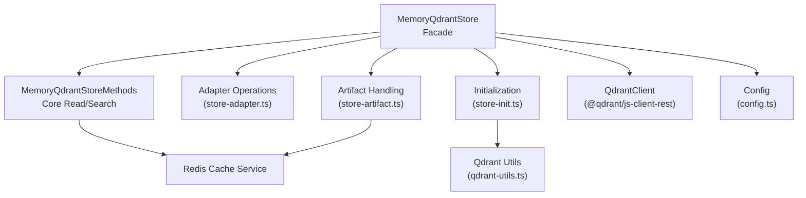
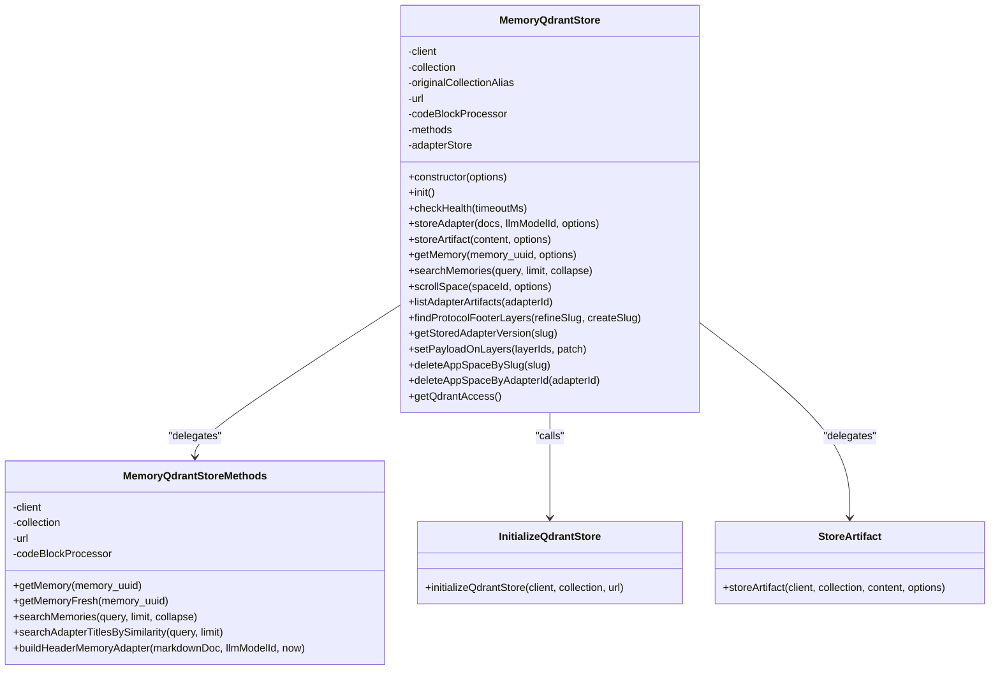
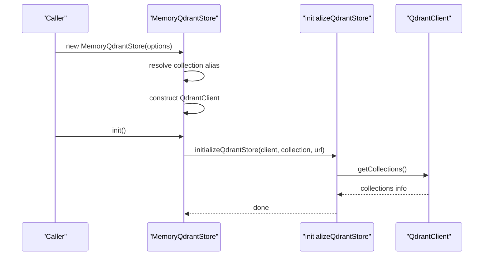
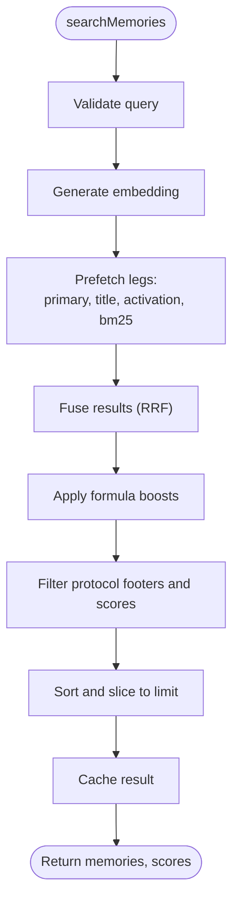
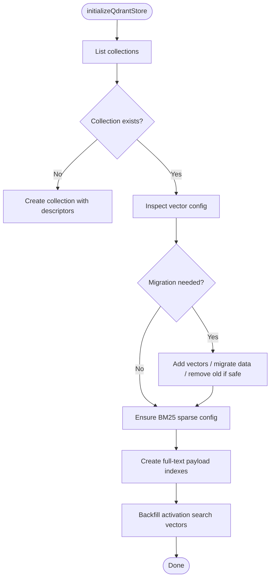
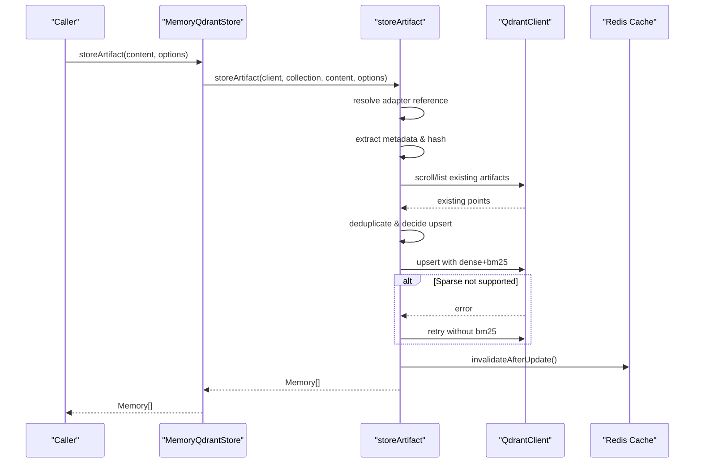
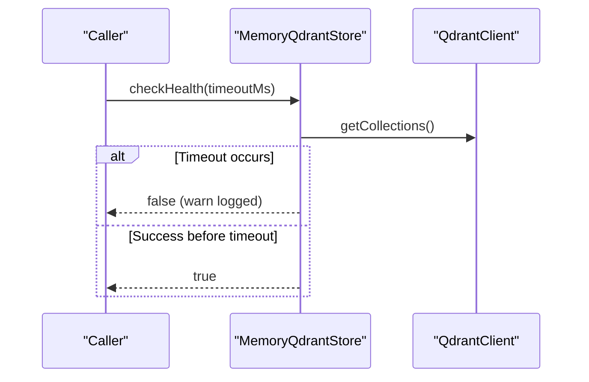
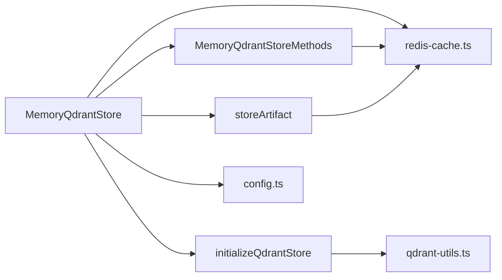

# Memory Store Architecture

<cite>
**Referenced Files in This Document**
- [store.ts](file://src/services/memory/store.ts)
- [store-methods.ts](file://src/services/memory/store-methods.ts)
- [store-init.ts](file://src/services/memory/store-init.ts)
- [store-artifact.ts](file://src/services/memory/store-artifact.ts)
- [memory-store.ts](file://src/services/qdrant/memory-store.ts)
- [connection.ts](file://src/services/qdrant/connection.ts)
- [config.ts](file://src/config.ts)
- [redis-cache.ts](file://src/services/redis-cache.ts)
</cite>

## Table of Contents
1. [Introduction](#introduction)
2. [Project Structure](#project-structure)
3. [Core Components](#core-components)
4. [Architecture Overview](#architecture-overview)
5. [Detailed Component Analysis](#detailed-component-analysis)
6. [Dependency Analysis](#dependency-analysis)
7. [Performance Considerations](#performance-considerations)
8. [Troubleshooting Guide](#troubleshooting-guide)
9. [Conclusion](#conclusion)

## Introduction
This document explains the memory store architecture centered on the MemoryQdrantStore class as the primary abstraction layer over Qdrant-backed storage. It covers initialization, health checking, connection management, separation of concerns between core methods, adapter operations, and artifact handling, plus lifecycle, error handling patterns, transactional considerations, configuration options, caching behavior, and performance tuning guidance.

## Project Structure
The memory store is implemented under src/services/memory with supporting Qdrant utilities and services:
- MemoryQdrantStore: public facade that owns client, collection, and delegates to internal components
- MemoryQdrantStoreMethods: core read/search logic and mapping helpers
- store-init: collection schema detection, migration, BM25 sparse vector setup, full-text indexes, activation search backfill
- store-artifact: artifact ingestion, deduplication, and upsert semantics
- Qdrant helper functions and connection utilities live under src/services/qdrant
- Configuration and environment resolution are provided by src/config.ts
- Shared cache invalidation and reads use Redis via src/services/redis-cache.ts

**Diagram sources**
- [store.ts:29-62](file://src/services/memory/store.ts#L29-L62)
- [store-methods.ts:25-36](file://src/services/memory/store-methods.ts#L25-L36)
- [store-init.ts:172-173](file://src/services/memory/store-init.ts#L172-L173)
- [store-artifact.ts:168-173](file://src/services/memory/store-artifact.ts#L168-L173)
- [config.ts:1-200](file://src/config.ts#L1-L200)

**Section sources**
- [store.ts:1-62](file://src/services/memory/store.ts#L1-L62)
- [store-methods.ts:1-36](file://src/services/memory/store-methods.ts#L1-L36)
- [store-init.ts:1-20](file://src/services/memory/store-init.ts#L1-L20)
- [store-artifact.ts:1-19](file://src/services/memory/store-artifact.ts#L1-L19)
- [config.ts:1-200](file://src/config.ts#L1-L200)

## Core Components
- MemoryQdrantStore: The main abstraction exposing a unified interface for adapters, artifacts, and domain-specific queries. It constructs the Qdrant client, resolves collection aliasing, initializes the store, performs health checks, and delegates work to specialized modules.
- MemoryQdrantStoreMethods: Implements core retrieval and hybrid search, including embedding generation, multi-vector prefetches, BM25 integration, result scoring, filtering, and cache interactions.
- Initialization (initializeQdrantStore): Ensures the collection exists, migrates vector layouts, adds missing named vectors, migrates data, ensures BM25 sparse vector config, creates full-text payload indexes, and backfills activation search vectors.
- Artifact Handling: Resolves adapter references from URIs or IDs, computes content hashes, deduplicates artifacts per adapter/space, and upserts points with dense and sparse vectors while falling back when sparse vectors are unsupported.

Key responsibilities and boundaries:
- Facade vs. implementation: MemoryQdrantStore exposes stable APIs; internals encapsulate Qdrant specifics.
- Separation of concerns:
  - Core methods: getMemory, searchMemories, scrollSpace, listAdapterArtifacts, protocol footer helpers, app-space mutations.
  - Adapter operations: handled through an adapter module exposed via MemoryQdrantStore.storeAdapter.
  - Artifact handling: dedicated function with explicit validation, hashing, deduplication, and upsert fallback.

Configuration and connection:
- URL and API key are resolved at construction time using environment-driven configuration.
- Collection name supports aliases and is resolved lazily to avoid import-time failures.

Caching:
- Reads may be served from Redis-backed shared cache; writes invalidate caches to maintain consistency.

Error handling:
- Health check returns boolean status with warnings on failure.
- Initialization throws on unrecoverable errors (e.g., missing vector config).
- Hybrid search falls back to dense-only query if the Query API fails.
- Artifact upsert retries without BM25 when server rejects sparse vectors.

Lifecycle:
- Construction: create client, resolve collection, instantiate methods and adapter store.
- init(): run schema detection/migration and index setup.
- checkHealth(): race-based timeout against getCollections.
- Runtime operations: delegate to methods/adapter/artifact modules.

Transaction management:
- No explicit multi-point transactions are used; operations rely on Qdrant’s atomic point-level upserts and batched upserts where applicable. Consistency is achieved via careful sequencing and cache invalidation.

**Section sources**
- [store.ts:29-62](file://src/services/memory/store.ts#L29-L62)
- [store.ts:64-130](file://src/services/memory/store.ts#L64-L130)
- [store-methods.ts:38-114](file://src/services/memory/store-methods.ts#L38-L114)
- [store-init.ts:172-350](file://src/services/memory/store-init.ts#L172-L350)
- [store-artifact.ts:168-300](file://src/services/memory/store-artifact.ts#L168-L300)

## Architecture Overview
The system composes a facade (MemoryQdrantStore) with focused subcomponents:
- Client and collection ownership reside in the facade.
- Methods encapsulate read/search logic and cache interaction.
- Initialization orchestrates schema evolution and indexing.
- Artifacts are stored with rich metadata and deduplication.
- Qdrant utilities provide low-level collection/vector operations.
- Redis cache provides cross-process read sharing and write invalidation.

**Diagram sources**
- [store.ts:29-271](file://src/services/memory/store.ts#L29-L271)
- [store-methods.ts:25-268](file://src/services/memory/store-methods.ts#L25-L268)
- [store-init.ts:172-350](file://src/services/memory/store-init.ts#L172-L350)
- [store-artifact.ts:168-300](file://src/services/memory/store-artifact.ts#L168-L300)

## Detailed Component Analysis

### MemoryQdrantStore: Primary Abstraction Layer
Responsibilities:
- Construct Qdrant client with URL and optional API key.
- Resolve collection alias to actual collection name.
- Instantiate code block processor, methods, and adapter store.
- Provide init(), checkHealth(), and high-level domain operations.

Initialization flow:
- Constructor logs configuration and sets up client, collection, and collaborators.
- init() calls initializeQdrantStore to ensure schema readiness.

Health checking:
- Races a getCollections call against a timeout promise.
- Clears timers and suppresses losing promise rejections.
- Logs warnings and returns false on failure.

Connection management:
- Uses QdrantClient directly; no custom pooling is implemented here.
- getQdrantAccess exposes raw client and collection for boot injection scenarios.

Separation of concerns:
- Core reads/writes: getMemory, searchMemories, scrollSpace, listAdapterArtifacts, findProtocolFooterLayers, getStoredAdapterVersion, setPayloadOnLayers, deleteAppSpaceBySlug, deleteAppSpaceByAdapterId.
- Adapter operations: delegated to adapter store via storeAdapter.
- Artifact handling: delegated to storeArtifact.

**Diagram sources**
- [store.ts:38-66](file://src/services/memory/store.ts#L38-L66)
- [store-init.ts:172-199](file://src/services/memory/store-init.ts#L172-L199)

**Section sources**
- [store.ts:29-66](file://src/services/memory/store.ts#L29-L66)
- [store.ts:68-130](file://src/services/memory/store.ts#L68-L130)
- [store.ts:132-271](file://src/services/memory/store.ts#L132-L271)

### Core Methods: Retrieval and Search
Retrieval:
- getMemory checks shared cache first, then retrieves by ID, enforces space access control, maps to Memory, and populates cache.
- getMemoryFresh bypasses cache for fresh reads.

Search:
- searchMemories generates embeddings, runs hybrid search with multiple prefetch legs (primary, title, activation pattern, BM25), fuses results, applies formula boosts, filters out protocol footers, sorts, and caches results.
- Falls back to dense-only query if hybrid query fails.

**Diagram sources**
- [store-methods.ts:94-114](file://src/services/memory/store-methods.ts#L94-L114)
- [store-methods.ts:121-260](file://src/services/memory/store-methods.ts#L121-L260)

**Section sources**
- [store-methods.ts:38-114](file://src/services/memory/store-methods.ts#L38-L114)
- [store-methods.ts:121-260](file://src/services/memory/store-methods.ts#L121-L260)

### Initialization: Schema Detection, Migration, Indexing
Key steps:
- Detect existing collections and determine current vector layout.
- Create collection if missing.
- Add missing named vectors and migrate data from old to new vector spaces.
- Ensure BM25 sparse vector config (with recreation-based migration if updateCollection is unsupported).
- Create full-text payload indexes for specific fields.
- Backfill activation search vectors.

Error handling:
- Throws on unrecoverable errors (e.g., cannot determine vector config).
- Logs detailed progress and warnings for partial migrations.

**Diagram sources**
- [store-init.ts:172-350](file://src/services/memory/store-init.ts#L172-L350)

**Section sources**
- [store-init.ts:172-350](file://src/services/memory/store-init.ts#L172-L350)

### Artifact Handling: Deduplication and Upsert Semantics
Responsibilities:
- Parse and validate adapter URI.
- Resolve adapter chain ID and name.
- Extract artifact metadata and compute SHA-256.
- Identify existing artifact points by slug/name within space and adapter.
- Enforce uniqueness unless forceUpdate is true.
- Upsert with dense vectors and BM25 sparse vector; retry without BM25 if rejected.
- Invalidate cache after successful write.

**Diagram sources**
- [store.ts:140-142](file://src/services/memory/store.ts#L140-L142)
- [store-artifact.ts:168-300](file://src/services/memory/store-artifact.ts#L168-L300)

**Section sources**
- [store-artifact.ts:20-126](file://src/services/memory/store-artifact.ts#L20-L126)
- [store-artifact.ts:168-300](file://src/services/memory/store-artifact.ts#L168-L300)

### Adapter Operations
- Exposed via MemoryQdrantStore.storeAdapter, which delegates to the adapter store module.
- The adapter store coordinates building header memory adapters and related operations (implementation details are encapsulated in the adapter module referenced by MemoryQdrantStore).

**Section sources**
- [store.ts:132-138](file://src/services/memory/store.ts#L132-L138)

### Connection Management and Health Checking
- Health check races a network call against a timeout, ensuring clean resource cleanup and consistent logging.
- No explicit connection pooling is implemented in this layer; it relies on the underlying Qdrant client.

**Diagram sources**
- [store.ts:68-130](file://src/services/memory/store.ts#L68-L130)

**Section sources**
- [store.ts:68-130](file://src/services/memory/store.ts#L68-L130)

## Dependency Analysis
High-level dependencies:
- MemoryQdrantStore depends on:
  - QdrantClient for direct operations
  - MemoryQdrantStoreMethods for core logic
  - Adapter store for adapter operations
  - Initialization routine for schema/index setup
  - Config for URL/collection/API key
  - Redis cache service for shared caching and invalidation
- Qdrant helper utilities provide collection/vector management functions.

**Diagram sources**
- [store.ts:1-15](file://src/services/memory/store.ts#L1-L15)
- [store-methods.ts:1-24](file://src/services/memory/store-methods.ts#L1-L24)
- [store-init.ts:1-18](file://src/services/memory/store-init.ts#L1-L18)
- [store-artifact.ts:1-18](file://src/services/memory/store-artifact.ts#L1-L18)
- [config.ts:1-200](file://src/config.ts#L1-L200)
- [redis-cache.ts:1-200](file://src/services/redis-cache.ts#L1-L200)

**Section sources**
- [store.ts:1-15](file://src/services/memory/store.ts#L1-L15)
- [store-methods.ts:1-24](file://src/services/memory/store-methods.ts#L1-L24)
- [store-init.ts:1-18](file://src/services/memory/store-init.ts#L1-L18)
- [store-artifact.ts:1-18](file://src/services/memory/store-artifact.ts#L1-L18)
- [config.ts:1-200](file://src/config.ts#L1-L200)
- [redis-cache.ts:1-200](file://src/services/redis-cache.ts#L1-L200)

## Performance Considerations
- Hybrid search uses multiple prefetch legs and RRF fusion to improve recall and precision; tune prefetch limits and fusion parameters based on workload.
- Formula boosting allows fine-tuning relevance by title, activation patterns, label, tags, and attest boost.
- Quantization rescore is enabled for vector searches to balance speed and accuracy.
- BM25 sparse vectors enable efficient text matching; ensure they are present via initialization.
- Caching reduces repeated lookups; ensure cache invalidation is triggered on writes.
- Scroll pagination uses page sizes (e.g., 256) to balance throughput and memory usage.
- Avoid unnecessary vector dimensions; initialization detects and migrates vector layouts to minimize overhead.

[No sources needed since this section provides general guidance]

## Troubleshooting Guide
Common issues and resolutions:
- Health check failures:
  - Symptom: checkHealth returns false and logs warnings.
  - Action: verify QDRANT_URL and API key configuration; check network connectivity and Qdrant availability.
- Initialization errors:
  - Symptom: initializeQdrantStore throws when vector config cannot be determined.
  - Action: inspect collection state; ensure compatible Qdrant server version; review logs for migration steps.
- Hybrid search fallback:
  - Symptom: hybrid query fails and falls back to dense-only search.
  - Action: verify BM25 sparse vector config; confirm full-text indexes exist; check server capabilities.
- Artifact upsert errors:
  - Symptom: sparse vector rejection during upsert.
  - Action: system retries without BM25; ensure BM25 support is available or adjust server settings.
- Cache inconsistencies:
  - Symptom: stale reads after writes.
  - Action: verify cache invalidation paths; ensure writes trigger invalidateAfterUpdate.

**Section sources**
- [store.ts:68-130](file://src/services/memory/store.ts#L68-L130)
- [store-init.ts:343-349](file://src/services/memory/store-init.ts#L343-L349)
- [store-methods.ts:218-232](file://src/services/memory/store-methods.ts#L218-L232)
- [store-artifact.ts:260-272](file://src/services/memory/store-artifact.ts#L260-L272)

## Conclusion
MemoryQdrantStore provides a robust, layered abstraction over Qdrant for memory storage and retrieval. Its design separates concerns across initialization, core methods, adapter operations, and artifact handling, while leveraging caching and hybrid search for performance. Initialization ensures schema compatibility and indexing, health checks protect runtime stability, and artifact handling guarantees idempotent updates. Configuration is environment-driven, and error handling is explicit and observable. For production deployments, tune hybrid search parameters, ensure BM25 support, and monitor cache invalidation to maintain consistency and performance.

[No sources needed since this section summarizes without analyzing specific files]