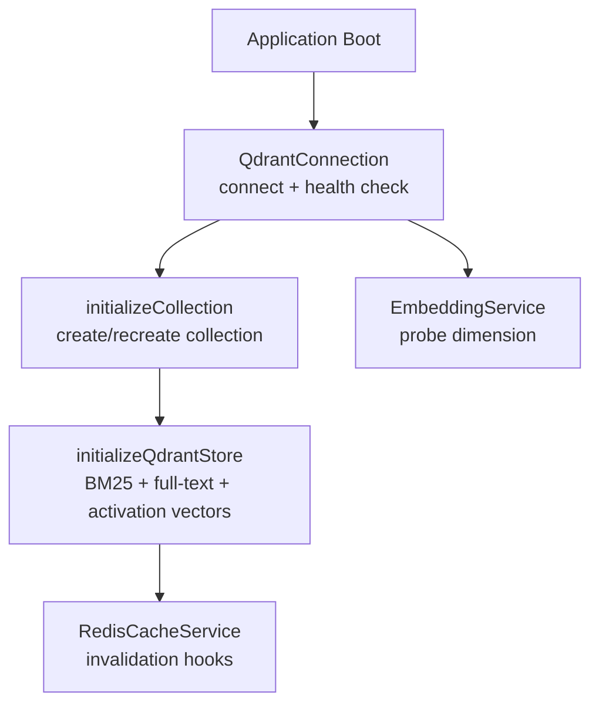
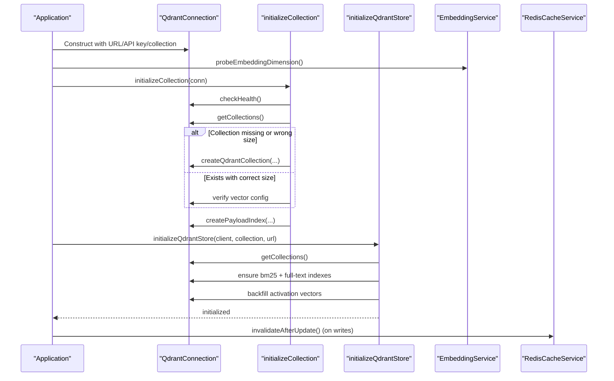
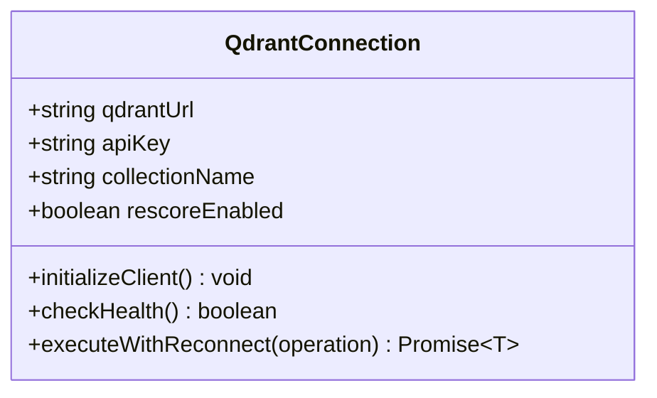
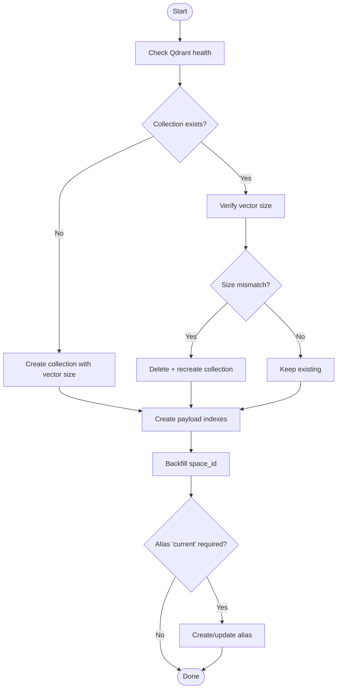
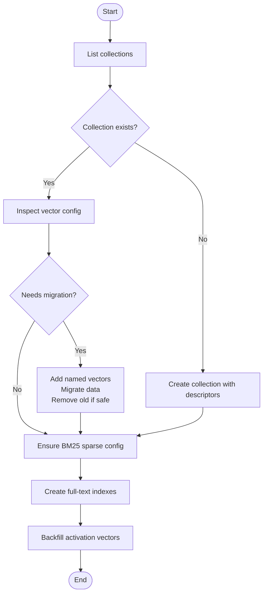
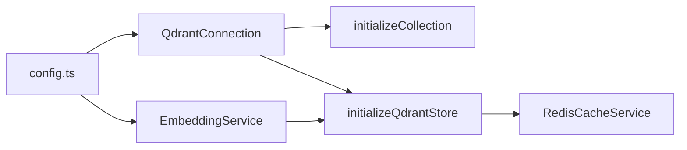

# Store Initialization and Lifecycle

<cite>
**Referenced Files in This Document**
- [memory-store.ts](file://src/services/qdrant/memory-store.ts)
- [connection.ts](file://src/services/qdrant/connection.ts)
- [initialization.ts](file://src/services/qdrant/initialization.ts)
- [store-init.ts](file://src/services/memory/store-init.ts)
- [service.ts](file://src/services/embedding/service.ts)
- [redis-cache.ts](file://src/services/redis-cache.ts)
- [config.ts](file://src/config.ts)
- [mem-boot.ts](file://src/config/mem-boot.ts)
</cite>

## Table of Contents
1. [Introduction](#introduction)
2. [Project Structure](#project-structure)
3. [Core Components](#core-components)
4. [Architecture Overview](#architecture-overview)
5. [Detailed Component Analysis](#detailed-component-analysis)
6. [Dependency Analysis](#dependency-analysis)
7. [Performance Considerations](#performance-considerations)
8. [Troubleshooting Guide](#troubleshooting-guide)
9. [Conclusion](#conclusion)
10. [Appendices](#appendices)

## Introduction
This document explains how the memory store initialization process works, focusing on Qdrant-backed storage. It covers how a connection is created and configured, how collections are validated or created, how embedding dimensions are resolved, and how caches and indexes are prepared at startup. It also documents error handling, retry behavior, graceful degradation patterns, and environment-specific initialization scenarios (development, production, testing).

The system uses:
- Qdrant as the primary vector store for semantic search.
- Embedding providers (OpenAI or TEI) to generate embeddings.
- Redis (optional) for application-level caching and invalidation.
- Environment-driven configuration for all backends.

## Project Structure
The initialization lifecycle spans several modules:
- Connection setup and resilience: `QdrantConnection`
- Collection initialization and aliasing: `initializeCollection`
- Advanced store initialization (BM25, full-text indexes, activation vectors): `initializeQdrantStore`
- Embedding provider resolution and dimension probing: `EmbeddingService`
- Cache service integration: `RedisCacheService`
- Configuration sources: `config.ts`, `mem-boot.ts`

**Diagram sources**
- [connection.ts:24-61](file://src/services/qdrant/connection.ts#L24-L61)
- [initialization.ts:13-93](file://src/services/qdrant/initialization.ts#L13-L93)
- [store-init.ts:172-350](file://src/services/memory/store-init.ts#L172-L350)
- [service.ts:280-284](file://src/services/embedding/service.ts#L280-L284)
- [redis-cache.ts:245-252](file://src/services/redis-cache.ts#L245-L252)

**Section sources**
- [connection.ts:1-131](file://src/services/qdrant/connection.ts#L1-L131)
- [initialization.ts:1-184](file://src/services/qdrant/initialization.ts#L1-L184)
- [store-init.ts:1-350](file://src/services/memory/store-init.ts#L1-L350)
- [service.ts:1-285](file://src/services/embedding/service.ts#L1-L285)
- [redis-cache.ts:1-274](file://src/services/redis-cache.ts#L1-L274)
- [config.ts:1-351](file://src/config.ts#L1-L351)
- [mem-boot.ts:1-21](file://src/config/mem-boot.ts#L1-L21)

## Core Components
- QdrantConnection: Encapsulates client creation, TLS options, API key, health checks, and resilient execution with exponential backoff retries.
- initializeCollection: Ensures the target collection exists with the correct vector size; creates payload indexes; optionally sets an alias.
- initializeQdrantStore: Performs advanced initialization including BM25 sparse vector migration, full-text payload indexes, and activation search vector backfill.
- EmbeddingService: Resolves embedding provider/model, probes embedding dimension, and provides metrics and audit logging.
- RedisCacheService: Provides optional caching and invalidation; integrates with writes to keep cache consistent.
- Configuration: Centralized environment parsing for Qdrant, embedding providers, Redis, and runtime toggles.

**Section sources**
- [connection.ts:11-131](file://src/services/qdrant/connection.ts#L11-L131)
- [initialization.ts:13-93](file://src/services/qdrant/initialization.ts#L13-L93)
- [store-init.ts:172-350](file://src/services/memory/store-init.ts#L172-L350)
- [service.ts:39-285](file://src/services/embedding/service.ts#L39-L285)
- [redis-cache.ts:21-274](file://src/services/redis-cache.ts#L21-L274)
- [config.ts:106-137](file://src/config.ts#L106-L137)

## Architecture Overview
The initialization sequence ensures that the Qdrant backend is reachable, the collection schema matches the current embedding model, and hybrid search capabilities (dense + BM25) are enabled.

**Diagram sources**
- [connection.ts:24-61](file://src/services/qdrant/connection.ts#L24-L61)
- [initialization.ts:13-93](file://src/services/qdrant/initialization.ts#L13-L93)
- [store-init.ts:172-350](file://src/services/memory/store-init.ts#L172-L350)
- [service.ts:280-284](file://src/services/embedding/service.ts#L280-L284)
- [redis-cache.ts:245-252](file://src/services/redis-cache.ts#L245-L252)

## Detailed Component Analysis

### QdrantConnection: Client Construction, Health, and Retry
Responsibilities:
- Build QdrantClient with URL, optional API key, and TLS CA certificate.
- Perform health checks by listing collections.
- Provide executeWithReconnect with exponential backoff and bounded attempts.

Key behaviors:
- TLS: If URL starts with https, use system CA unless a custom CA path is provided.
- Health: Resets reconnect counters on success.
- Retry: On operation failure, attempts reconnection up to a maximum number of times with exponential delay; wraps failures into domain errors.

**Diagram sources**
- [connection.ts:11-131](file://src/services/qdrant/connection.ts#L11-L131)

**Section sources**
- [connection.ts:24-61](file://src/services/qdrant/connection.ts#L24-L61)
- [connection.ts:63-131](file://src/services/qdrant/connection.ts#L63-L131)

### initializeCollection: Collection Creation, Validation, Indexing, Aliasing
Responsibilities:
- Ensure the collection exists with the expected embedding dimension.
- Recreate if mismatched.
- Create payload indexes for filtering and full-text fields.
- Optionally create/update an alias named “current”.

Startup flow:
- Health check via connection.
- List collections and detect existence.
- Compare vector size; recreate if needed.
- Create payload indexes (keyword and text types).
- Backfill space_id for legacy points.
- Alias management (best-effort).

**Diagram sources**
- [initialization.ts:13-93](file://src/services/qdrant/initialization.ts#L13-L93)
- [initialization.ts:99-126](file://src/services/qdrant/initialization.ts#L99-L126)
- [initialization.ts:133-163](file://src/services/qdrant/initialization.ts#L133-L163)

**Section sources**
- [initialization.ts:13-93](file://src/services/qdrant/initialization.ts#L13-L93)
- [initialization.ts:99-126](file://src/services/qdrant/initialization.ts#L99-L126)
- [initialization.ts:133-163](file://src/services/qdrant/initialization.ts#L133-L163)

### initializeQdrantStore: BM25 Migration, Full-Text Indexes, Activation Backfill
Responsibilities:
- Detect layout and migrate vector dimensions/names if needed.
- Ensure BM25 sparse vector support (idempotent; recreation fallback).
- Ensure full-text payload indexes for specific fields.
- Backfill activation search vectors.

Migration strategy:
- If updateCollection(sparse_vectors) is unsupported, copy data to a temporary collection with dense+BM25 schema, then replace original.
- Preserve required vectors during migration; remove old vectors only when safe.

**Diagram sources**
- [store-init.ts:36-125](file://src/services/memory/store-init.ts#L36-L125)
- [store-init.ts:131-149](file://src/services/memory/store-init.ts#L131-L149)
- [store-init.ts:158-170](file://src/services/memory/store-init.ts#L158-L170)
- [store-init.ts:172-350](file://src/services/memory/store-init.ts#L172-L350)

**Section sources**
- [store-init.ts:172-350](file://src/services/memory/store-init.ts#L172-L350)

### Embedding Service: Provider Resolution and Dimension Probing
Responsibilities:
- Resolve provider (OpenAI or TEI) based on environment.
- Probe embedding dimension at startup to align vector schema.
- Provide metrics, anomaly detection, and audit logging.

Startup usage:
- Call probeEmbeddingDimension before initializing stores so vector sizes match.

**Section sources**
- [service.ts:39-285](file://src/services/embedding/service.ts#L39-L285)

### RedisCacheService: Optional Caching and Invalidation
Responsibilities:
- Provide search result and memory resource caching backed by a key-value store (Redis when configured).
- Invalidate caches after writes to maintain consistency.
- Publish invalidation events for multi-process consistency.

Integration:
- Writes to Qdrant trigger cache invalidation to avoid stale reads.

**Section sources**
- [redis-cache.ts:21-274](file://src/services/redis-cache.ts#L21-L274)

## Dependency Analysis
High-level dependencies among initialization components:

**Diagram sources**
- [config.ts:106-137](file://src/config.ts#L106-L137)
- [connection.ts:24-61](file://src/services/qdrant/connection.ts#L24-L61)
- [service.ts:280-284](file://src/services/embedding/service.ts#L280-L284)
- [initialization.ts:13-93](file://src/services/qdrant/initialization.ts#L13-L93)
- [store-init.ts:172-350](file://src/services/memory/store-init.ts#L172-L350)
- [redis-cache.ts:245-252](file://src/services/redis-cache.ts#L245-L252)

**Section sources**
- [config.ts:106-137](file://src/config.ts#L106-L137)
- [connection.ts:24-61](file://src/services/qdrant/connection.ts#L24-L61)
- [service.ts:280-284](file://src/services/embedding/service.ts#L280-L284)
- [initialization.ts:13-93](file://src/services/qdrant/initialization.ts#L13-L93)
- [store-init.ts:172-350](file://src/services/memory/store-init.ts#L172-L350)
- [redis-cache.ts:245-252](file://src/services/redis-cache.ts#L245-L252)

## Performance Considerations
- Batch operations: BM25 migration and index creation use batched scrolling and upserts to minimize round-trips.
- Idempotency: BM25 and full-text index creation are idempotent to allow repeated boots without side effects.
- Vector migration: Preserves required vectors and removes old vectors only when safe to reduce risk and downtime.
- Caching: Redis-based caching reduces read latency; invalidation keeps cache fresh after writes.
- Metrics: Embedding and Qdrant operations emit metrics for observability.

[No sources needed since this section provides general guidance]

## Troubleshooting Guide
Common issues and resolutions:
- Qdrant unavailable: The connection layer retries with exponential backoff; if max attempts are reached, a domain error is thrown indicating unavailability.
- TLS certificate errors: Ensure CA certificate path is valid and readable; otherwise, system CA will be used.
- Collection schema mismatch: initializeCollection recreates the collection when vector size differs from expected.
- BM25 not supported: initializeQdrantStore falls back to recreation-based migration to add BM25 support.
- Cache inconsistencies: After writes, cache invalidation is triggered; if Redis is unavailable, logs are emitted and operations continue.

Operational tips:
- Use MEM_BOOT_FORCE_INJECT to force repair of shipped adapters at boot when the store is corrupted or duplicated.
- Enable QDRANT_RESCORE to tune hybrid scoring behavior.
- Monitor embedding latency and dimension anomalies via metrics and audit logs.

**Section sources**
- [connection.ts:76-131](file://src/services/qdrant/connection.ts#L76-L131)
- [initialization.ts:31-48](file://src/services/qdrant/initialization.ts#L31-L48)
- [store-init.ts:131-149](file://src/services/memory/store-init.ts#L131-L149)
- [redis-cache.ts:245-252](file://src/services/redis-cache.ts#L245-L252)
- [mem-boot.ts:1-21](file://src/config/mem-boot.ts#L1-L21)

## Conclusion
The memory store initialization process ensures robust connectivity to Qdrant, alignment of vector schemas with the active embedding provider, and readiness of hybrid search features. It employs resilient retries, idempotent migrations, and cache invalidation to provide a reliable startup experience across environments. Operators can tailor behavior through environment variables and feature flags, while diagnostics and metrics aid in troubleshooting and performance tuning.

[No sources needed since this section summarizes without analyzing specific files]

## Appendices

### Configuration Reference
- Qdrant
  - QDRANT_URL: Required base URL for Qdrant.
  - QDRANT_API_KEY: Optional API key for authentication.
  - QDRANT_COLLECTION: Target collection name (default squadrules).
  - QDRANT_CA_CERT_PATH: Optional path to CA certificate for HTTPS.
  - QDRANT_RESCORE: Toggle for rescoring behavior.
  - QDRANT_SNAPSHOT_ON_START / QDRANT_SNAPSHOT_DIR: Snapshot configuration.
- Embeddings
  - OPENAI_API_KEY / OPENAI_EMBEDDING_MODEL: OpenAI provider settings.
  - TEI_BASE_URL / TEI_MODEL: TEI provider settings.
  - EMBEDDING_PROVIDER: Provider selection mode.
  - EMBEDDING_*_RETRY_*: Retry policy parameters.
- Redis
  - KEY_VALUE_STORE_URL / REDIS_URL: Key-value backend URL.
  - SQUADRULES_REDIS_PREFIX: Prefix for keys.
  - MEMORY_CACHE_KEY_PREFIX: Prefix for memory cache keys.
- Runtime
  - AUTH_ENABLED / TRANSPORT_TYPE: Determines HTTP vs stdio mode.
  - SQUADRULES_APP_SPACE_ID: Default app space identifier.

**Section sources**
- [config.ts:70-94](file://src/config.ts#L70-L94)
- [config.ts:106-137](file://src/config.ts#L106-L137)
- [config.ts:268-277](file://src/config.ts#L268-L277)
- [config.ts:297-303](file://src/config.ts#L297-L303)
- [config.ts:345-351](file://src/config.ts#L345-L351)

### Initialization Scenarios

- Development
  - Use local Qdrant (e.g., http://localhost:6333), no API key.
  - Embeddings via OpenAI or local fastembed depending on provider settings.
  - Optional Redis for caching; if absent, caching is disabled gracefully.
  - Expect collection creation and index setup on first run.

- Production
  - Configure QDRANT_URL with secure endpoint and QDRANT_API_KEY.
  - Set QDRANT_CA_CERT_PATH for custom TLS CA if needed.
  - Ensure embedding provider credentials and models are set.
  - Enable snapshots and monitoring; validate health checks pass.
  - Use MEM_BOOT_FORCE_INJECT sparingly for repair paths.

- Testing
  - Spin up ephemeral Qdrant instance per test suite.
  - Reset collections between tests or rely on recreation logic.
  - Disable Redis or point to a test instance; cache miss is acceptable.
  - Validate BM25 and full-text indexes exist post-initialization.

[No sources needed since this section provides general guidance]