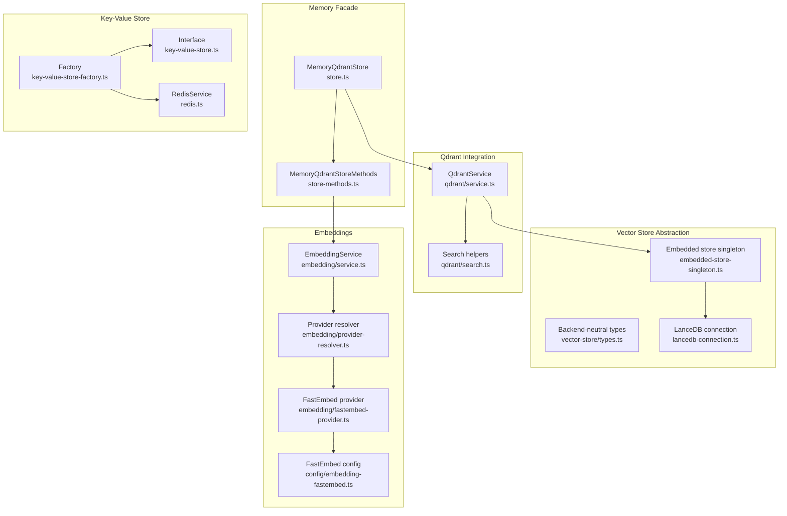
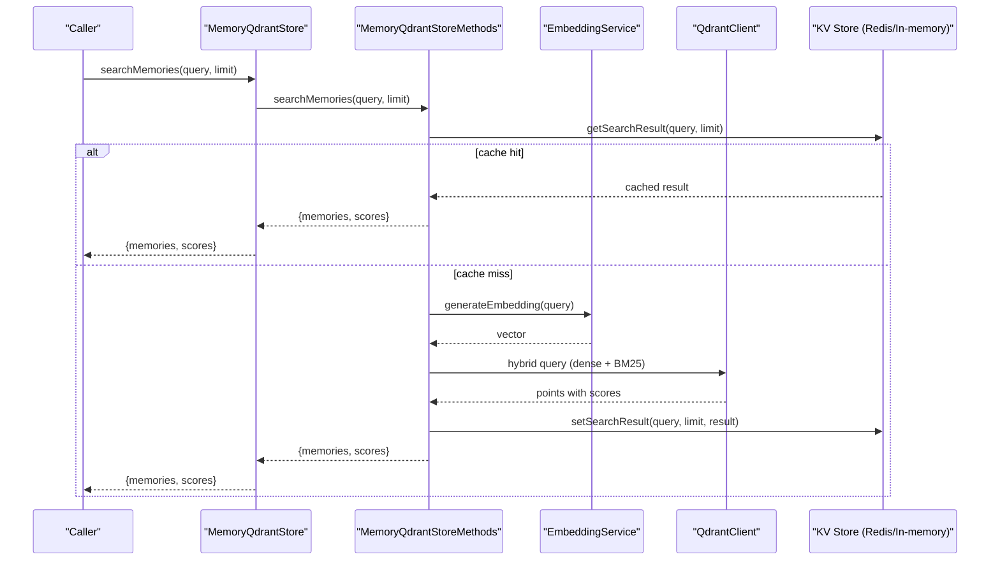
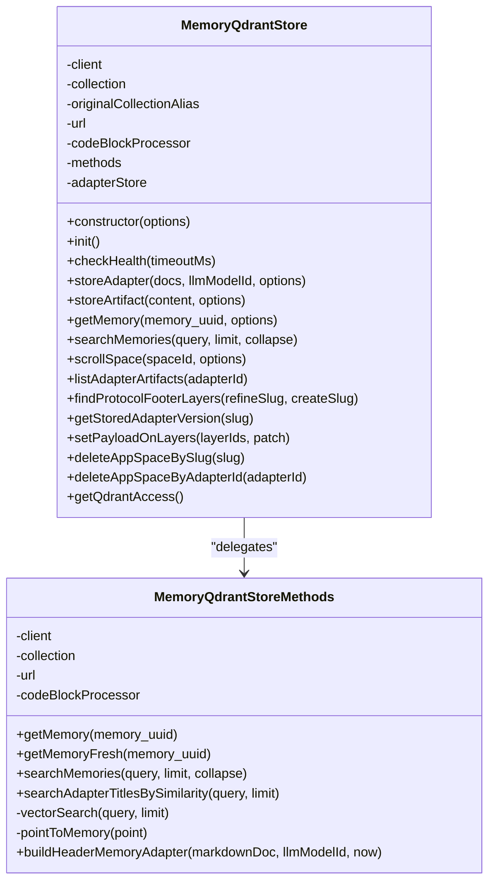
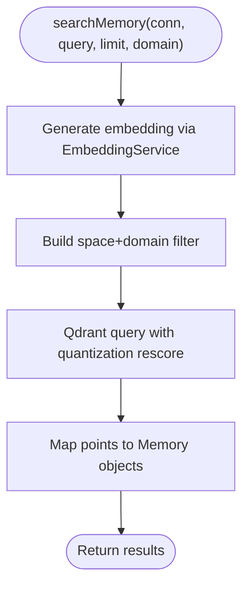
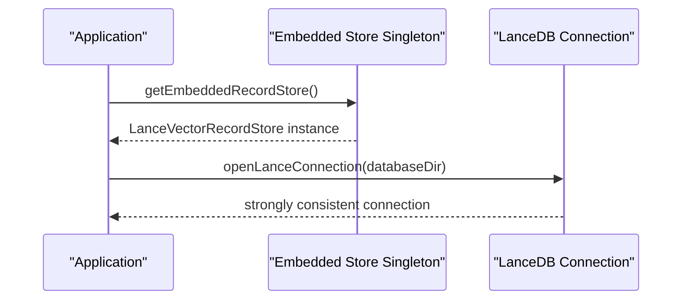
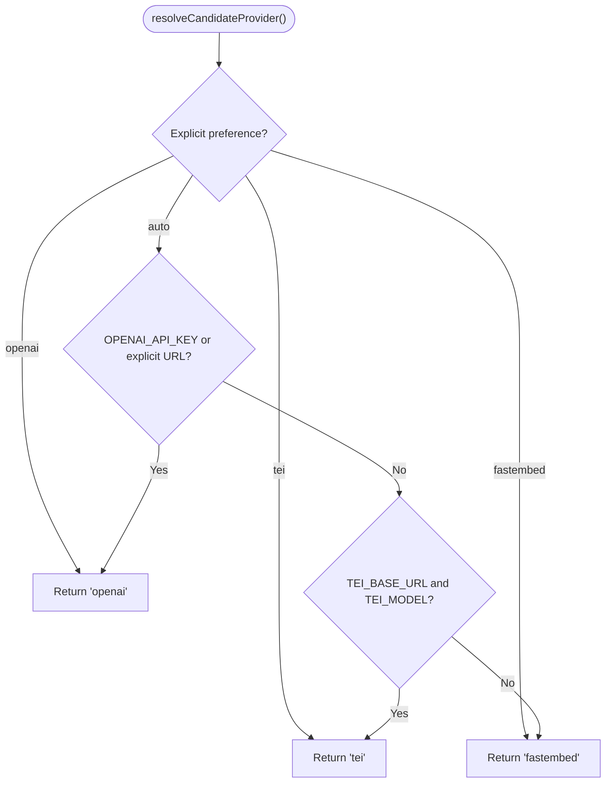
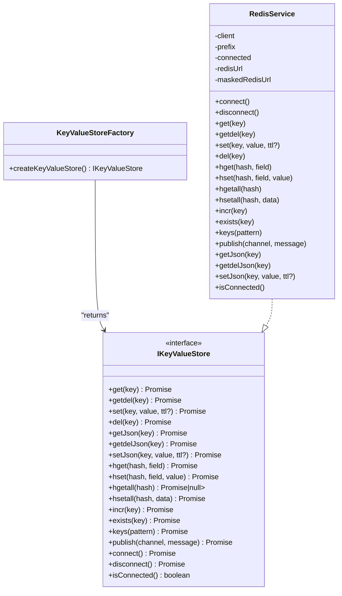
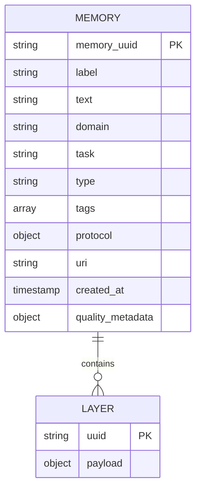
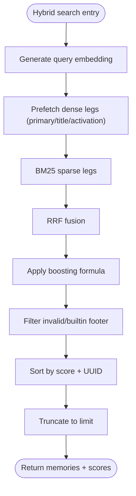
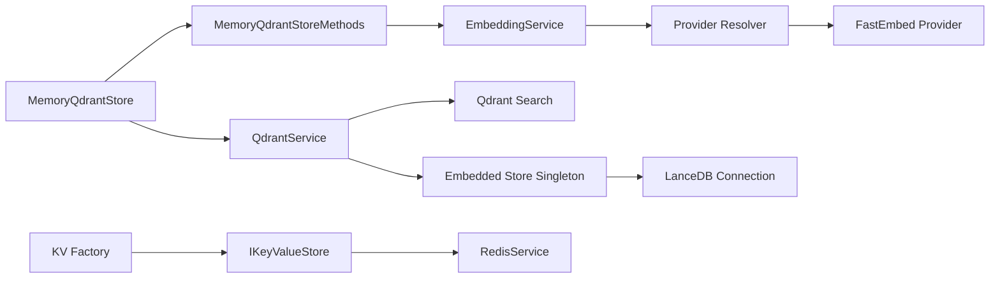

# Memory and Storage System

<cite>
**Referenced Files in This Document**
- [store.ts](file://src/services/memory/store.ts)
- [store-methods.ts](file://src/services/memory/store-methods.ts)
- [service.ts](file://src/services/qdrant/service.ts)
- [search.ts](file://src/services/qdrant/search.ts)
- [types.ts](file://src/services/vector-store/types.ts)
- [embedded-store-singleton.ts](file://src/services/vector-store/embedded-store-singleton.ts)
- [lancedb-connection.ts](file://src/services/vector-store/lancedb-connection.ts)
- [key-value-store-factory.ts](file://src/services/key-value-store-factory.ts)
- [key-value-store.ts](file://src/services/key-value-store.ts)
- [redis.ts](file://src/services/redis.ts)
- [service.ts](file://src/services/embedding/service.ts)
- [provider-resolver.ts](file://src/services/embedding/provider-resolver.ts)
- [fastembed-provider.ts](file://src/services/embedding/fastembed-provider.ts)
- [embedding-fastembed.ts](file://src/config/embedding-fastembed.ts)
</cite>

## Table of Contents
1. [Introduction](#introduction)
2. [Project Structure](#project-structure)
3. [Core Components](#core-components)
4. [Architecture Overview](#architecture-overview)
5. [Detailed Component Analysis](#detailed-component-analysis)
6. [Dependency Analysis](#dependency-analysis)
7. [Performance Considerations](#performance-considerations)
8. [Troubleshooting Guide](#troubleshooting-guide)
9. [Conclusion](#conclusion)

## Introduction
This document explains the SquadRules memory and storage architecture with a focus on:
- The memory store abstraction layer that unifies Qdrant and LanceDB backends
- Qdrant vector database integration for semantic search, aliasing, and hybrid queries
- LanceDB embedded storage option for local-first workflows
- Embedding system supporting multiple providers (FastEmbed, OpenAI-compatible, TEI) with automatic provider resolution
- Key-value store factory for Redis or in-memory backends
- Data models, indexing strategies, search algorithms, query optimization, configuration options, scaling considerations, and migration strategies between storage backends

The design keeps backend-specific details behind clean interfaces so callers can operate against a consistent API regardless of whether data is stored remotely in Qdrant or locally in LanceDB.

## Project Structure
At a high level, the memory subsystem consists of:
- A memory store facade over Qdrant
- A service facade over Qdrant operations
- A backend-neutral vector-store abstraction used by both Qdrant and LanceDB paths
- An embedding service with multi-provider support
- A key-value store factory selecting Redis or an in-memory implementation

**Diagram sources**
- [store.ts:29-62](file://src/services/memory/store.ts#L29-L62)
- [store-methods.ts:25-36](file://src/services/memory/store-methods.ts#L25-L36)
- [service.ts:17-28](file://src/services/qdrant/service.ts#L17-L28)
- [search.ts:11-36](file://src/services/qdrant/search.ts#L11-L36)
- [types.ts:14-40](file://src/services/vector-store/types.ts#L14-L40)
- [embedded-store-singleton.ts:12-17](file://src/services/vector-store/embedded-store-singleton.ts#L12-L17)
- [lancedb-connection.ts:21-33](file://src/services/vector-store/lancedb-connection.ts#L21-L33)
- [service.ts:39-278](file://src/services/embedding/service.ts#L39-L278)
- [provider-resolver.ts:28-62](file://src/services/embedding/provider-resolver.ts#L28-L62)
- [fastembed-provider.ts:26-82](file://src/services/embedding/fastembed-provider.ts#L26-L82)
- [embedding-fastembed.ts:14-22](file://src/config/embedding-fastembed.ts#L14-L22)
- [key-value-store-factory.ts:13-22](file://src/services/key-value-store-factory.ts#L13-L22)
- [key-value-store.ts:7-28](file://src/services/key-value-store.ts#L7-L28)
- [redis.ts:26-85](file://src/services/redis.ts#L26-L85)

**Section sources**
- [store.ts:29-62](file://src/services/memory/store.ts#L29-L62)
- [service.ts:17-28](file://src/services/qdrant/service.ts#L17-L28)
- [types.ts:14-40](file://src/services/vector-store/types.ts#L14-L40)
- [embedded-store-singleton.ts:12-17](file://src/services/vector-store/embedded-store-singleton.ts#L12-L17)
- [lancedb-connection.ts:21-33](file://src/services/vector-store/lancedb-connection.ts#L21-L33)
- [service.ts:39-278](file://src/services/embedding/service.ts#L39-L278)
- [provider-resolver.ts:28-62](file://src/services/embedding/provider-resolver.ts#L28-L62)
- [fastembed-provider.ts:26-82](file://src/services/embedding/fastembed-provider.ts#L26-L82)
- [embedding-fastembed.ts:14-22](file://src/config/embedding-fastembed.ts#L14-L22)
- [key-value-store-factory.ts:13-22](file://src/services/key-value-store-factory.ts#L13-L22)
- [key-value-store.ts:7-28](file://src/services/key-value-store.ts#L7-L28)
- [redis.ts:26-85](file://src/services/redis.ts#L26-L85)

## Core Components
- MemoryQdrantStore: High-level facade for Qdrant-backed memory operations, including adapter storage, artifact handling, retrieval, and hybrid search. It resolves collection aliases and delegates to methods and adapters.
- MemoryQdrantStoreMethods: Implements retrieval, caching, and hybrid search using dense vectors, title/activation pattern vectors, and BM25 sparse indices.
- QdrantService: Service facade exposing initialization, CRUD, quality metrics, protocol helpers, listing, and search. It composes QdrantConnection and routes calls to domain modules.
- Vector-store types: Backend-neutral domain shapes such as MemorySearchResult, LayerRecord, and execution-related records.
- Embedded store singleton: Provides a single shared LanceDB instance injected into both memory and Qdrant service slots when Qdrant is not configured.
- LanceDB connection: Opens a strong-consistency embedded connection to a per-user directory without requiring a daemon.
- EmbeddingService: Multi-provider embedding generation with dimension validation, anomaly detection, metrics, and health checks.
- Provider resolver: Automatic selection among OpenAI-compatible, TEI, and FastEmbed based on environment and explicit preferences.
- Key-value store factory: Selects RedisService or an in-memory store based on configuration.
- RedisService: Production-grade key-value store implementing the IKeyValueStore interface with namespacing, TTL, JSON helpers, and pub/sub.

**Section sources**
- [store.ts:29-62](file://src/services/memory/store.ts#L29-L62)
- [store-methods.ts:25-36](file://src/services/memory/store-methods.ts#L25-L36)
- [service.ts:17-28](file://src/services/qdrant/service.ts#L17-L28)
- [types.ts:14-40](file://src/services/vector-store/types.ts#L14-L40)
- [embedded-store-singleton.ts:12-17](file://src/services/vector-store/embedded-store-singleton.ts#L12-L17)
- [lancedb-connection.ts:21-33](file://src/services/vector-store/lancedb-connection.ts#L21-L33)
- [service.ts:39-278](file://src/services/embedding/service.ts#L39-L278)
- [provider-resolver.ts:28-62](file://src/services/embedding/provider-resolver.ts#L28-L62)
- [key-value-store-factory.ts:13-22](file://src/services/key-value-store-factory.ts#L13-L22)
- [key-value-store.ts:7-28](file://src/services/key-value-store.ts#L7-L28)
- [redis.ts:26-85](file://src/services/redis.ts#L26-L85)

## Architecture Overview
The system supports two primary vector backends:
- Qdrant (remote-capable): Used for production-scale semantic search with rich filtering, aliasing, and hybrid queries.
- LanceDB (embedded): Used for local-first workflows; a single shared instance ensures consistency across memory and Qdrant service facades.

Embeddings are generated through a pluggable provider layer that auto-selects the best available provider. Key-value state (caching, proof-of-work) uses Redis in production and an in-memory store otherwise.

**Diagram sources**
- [store.ts:151-153](file://src/services/memory/store.ts#L151-L153)
- [store-methods.ts:94-104](file://src/services/memory/store-methods.ts#L94-L104)
- [store-methods.ts:121-259](file://src/services/memory/store-methods.ts#L121-L259)
- [service.ts:48-63](file://src/services/qdrant/service.ts#L48-L63)
- [key-value-store-factory.ts:13-22](file://src/services/key-value-store-factory.ts#L13-L22)

## Detailed Component Analysis

### Memory Store Abstraction Layer
- MemoryQdrantStore constructs a Qdrant client, resolves collection aliases, initializes the store, and exposes methods for adapter/artifact storage, retrieval, and search. It also provides direct accessors for boot injection and app-space management.
- MemoryQdrantStoreMethods implements:
  - Cached retrieval with space-aware authorization
  - Hybrid search combining dense vectors, title/activation pattern vectors, and BM25 sparse indices
  - Adapter title similarity search
  - Point-to-memory mapping

**Diagram sources**
- [store.ts:29-62](file://src/services/memory/store.ts#L29-L62)
- [store.ts:132-153](file://src/services/memory/store.ts#L132-L153)
- [store.ts:162-270](file://src/services/memory/store.ts#L162-L270)
- [store-methods.ts:25-36](file://src/services/memory/store-methods.ts#L25-L36)
- [store-methods.ts:38-114](file://src/services/memory/store-methods.ts#L38-L114)
- [store-methods.ts:121-268](file://src/services/memory/store-methods.ts#L121-L268)

**Section sources**
- [store.ts:29-62](file://src/services/memory/store.ts#L29-L62)
- [store.ts:132-153](file://src/services/memory/store.ts#L132-L153)
- [store.ts:162-270](file://src/services/memory/store.ts#L162-L270)
- [store-methods.ts:25-36](file://src/services/memory/store-methods.ts#L25-L36)
- [store-methods.ts:38-114](file://src/services/memory/store-methods.ts#L38-L114)
- [store-methods.ts:121-268](file://src/services/memory/store-methods.ts#L121-L268)

### Qdrant Vector Database Integration
- QdrantService wraps QdrantConnection and exposes initialization, CRUD, quality tracking, protocol helpers, listing, and search.
- Search helper performs embedding generation, applies space/domain filters, and executes vector queries with quantization rescore enabled.

**Diagram sources**
- [service.ts:17-28](file://src/services/qdrant/service.ts#L17-L28)
- [search.ts:11-36](file://src/services/qdrant/search.ts#L11-L36)
- [search.ts:47-72](file://src/services/qdrant/search.ts#L47-L72)

**Section sources**
- [service.ts:17-28](file://src/services/qdrant/service.ts#L17-L28)
- [search.ts:11-36](file://src/services/qdrant/search.ts#L11-L36)
- [search.ts:47-72](file://src/services/qdrant/search.ts#L47-L72)

### LanceDB Embedded Storage Option
- Embedded store singleton provides a single LanceVectorRecordStore instance shared by both memory and Qdrant service slots when Qdrant is not configured.
- LanceDB connection opens a strong-consistency connection to a per-user directory with readConsistencyInterval set to ensure reads see other processes’ latest commits.

**Diagram sources**
- [embedded-store-singleton.ts:12-17](file://src/services/vector-store/embedded-store-singleton.ts#L12-L17)
- [lancedb-connection.ts:21-33](file://src/services/vector-store/lancedb-connection.ts#L21-L33)

**Section sources**
- [embedded-store-singleton.ts:12-17](file://src/services/vector-store/embedded-store-singleton.ts#L12-L17)
- [lancedb-connection.ts:21-33](file://src/services/vector-store/lancedb-connection.ts#L21-L33)

### Embedding System and Automatic Provider Resolution
- EmbeddingService generates embeddings, validates dimensions, tracks metrics, and performs health checks. It delegates actual provider calls to a pluggable provider pipeline.
- Provider resolver selects candidate provider based on explicit preference or auto-detection rules:
  - Explicit preference wins
  - Auto: OPENAI_API_KEY or explicitly overridden OPENAI_API_URL selects OpenAI-compatible
  - Transitional TEI fallback if configured
  - Zero-configuration default is FastEmbed
- FastEmbed provider lazily loads the model, caches weights, sets resolved dimension, and marks successful provider.

**Diagram sources**
- [provider-resolver.ts:28-62](file://src/services/embedding/provider-resolver.ts#L28-L62)
- [service.ts:259-274](file://src/services/embedding/service.ts#L259-L274)
- [fastembed-provider.ts:26-82](file://src/services/embedding/fastembed-provider.ts#L26-L82)
- [embedding-fastembed.ts:14-22](file://src/config/embedding-fastembed.ts#L14-L22)

**Section sources**
- [service.ts:39-278](file://src/services/embedding/service.ts#L39-L278)
- [provider-resolver.ts:28-62](file://src/services/embedding/provider-resolver.ts#L28-L62)
- [fastembed-provider.ts:26-82](file://src/services/embedding/fastembed-provider.ts#L26-L82)
- [embedding-fastembed.ts:14-22](file://src/config/embedding-fastembed.ts#L14-L22)

### Key-Value Store Factory and Backends
- Factory selects RedisService when Redis is configured, otherwise returns an in-memory store.
- RedisService implements IKeyValueStore with namespacing by space ID, TTL support, JSON helpers, and pub/sub.

**Diagram sources**
- [key-value-store.ts:7-28](file://src/services/key-value-store.ts#L7-L28)
- [redis.ts:26-85](file://src/services/redis.ts#L26-L85)
- [redis.ts:119-290](file://src/services/redis.ts#L119-L290)
- [key-value-store-factory.ts:13-22](file://src/services/key-value-store-factory.ts#L13-L22)

**Section sources**
- [key-value-store.ts:7-28](file://src/services/key-value-store.ts#L7-L28)
- [redis.ts:26-85](file://src/services/redis.ts#L26-L85)
- [redis.ts:119-290](file://src/services/redis.ts#L119-L290)
- [key-value-store-factory.ts:13-22](file://src/services/key-value-store-factory.ts#L13-L22)

### Data Models and Indexing Strategies
- Backend-neutral types define core shapes like MemorySearchResult and LayerRecord, decoupling consumers from backend specifics.
- Qdrant indexing strategy includes:
  - Dense vectors for semantic similarity
  - Title and activation pattern vectors for specialized matching
  - BM25 sparse index for lexical matching
  - Quantization with rescore for performance and accuracy balance
- Space-based filtering and slug exclusions refine search scope.

**Diagram sources**
- [types.ts:14-40](file://src/services/vector-store/types.ts#L14-L40)
- [store-methods.ts:121-259](file://src/services/memory/store-methods.ts#L121-L259)

**Section sources**
- [types.ts:14-40](file://src/services/vector-store/types.ts#L14-L40)
- [store-methods.ts:121-259](file://src/services/memory/store-methods.ts#L121-L259)

### Search Algorithms and Query Optimization
- Hybrid search combines:
  - Dense vector prefetches across primary, title, and activation pattern vectors
  - BM25 sparse legs
  - Reciprocal Rank Fusion (RRF) to merge results
  - Final formula boosting title, activation patterns, labels, tags, and attest boost
- Fallback path uses dense-only search if hybrid query fails.
- Results are filtered, sorted by score and stable tie-breakers, then truncated to requested limit.

**Diagram sources**
- [store-methods.ts:121-259](file://src/services/memory/store-methods.ts#L121-L259)

**Section sources**
- [store-methods.ts:121-259](file://src/services/memory/store-methods.ts#L121-L259)

### Configuration Options
- Qdrant:
  - URL and API key are passed to the client; collection name may be an alias resolved at runtime
  - Health check supports timeout and logs failures
- Embeddings:
  - Provider selection via explicit preference or auto-detection
  - FastEmbed defaults include model name and cache directory
  - Dimension probing and validation ensure consistency
- Key-Value Store:
  - Redis URL and prefix control isolation and connectivity
  - In-memory store used when Redis is not configured

**Section sources**
- [store.ts:38-62](file://src/services/memory/store.ts#L38-L62)
- [service.ts:20-28](file://src/services/qdrant/service.ts#L20-L28)
- [service.ts:259-274](file://src/services/embedding/service.ts#L259-L274)
- [embedding-fastembed.ts:14-22](file://src/config/embedding-fastembed.ts#L14-L22)
- [key-value-store-factory.ts:13-22](file://src/services/key-value-store-factory.ts#L13-L22)
- [redis.ts:33-45](file://src/services/redis.ts#L33-L45)

### Scaling Considerations
- Qdrant:
  - Use remote Qdrant for horizontal scaling and high availability
  - Leverage quantization with rescore for balanced performance/accuracy
  - Prefer aliasing for zero-downtime migrations
- LanceDB:
  - Strong consistency via readConsistencyInterval ensures cross-process visibility
  - Suitable for local-first or small-scale deployments
- Embeddings:
  - FastEmbed reduces external dependencies and costs; OpenAI-compatible offers managed scale
  - Dimension validation prevents downstream mismatches
- Key-Value Store:
  - Redis enables distributed caching and pub/sub across processes
  - In-memory store is simple but non-shared

**Section sources**
- [lancedb-connection.ts:21-33](file://src/services/vector-store/lancedb-connection.ts#L21-L33)
- [store-methods.ts:121-259](file://src/services/memory/store-methods.ts#L121-L259)
- [service.ts:259-274](file://src/services/embedding/service.ts#L259-L274)
- [redis.ts:219-235](file://src/services/redis.ts#L219-L235)

### Migration Strategies Between Storage Backends
- Collection aliasing:
  - Create or update aliases to point to new collections without changing callers
- Shared embedded store:
  - When Qdrant is not configured, a single LanceDB instance is injected into both memory and Qdrant service slots to maintain internal consistency
- Data portability:
  - Backend-neutral types allow mapping between Qdrant points and Lance rows during migration tools or scripts

**Section sources**
- [service.ts:132-134](file://src/services/qdrant/service.ts#L132-L134)
- [embedded-store-singleton.ts:12-17](file://src/services/vector-store/embedded-store-singleton.ts#L12-L17)
- [types.ts:14-40](file://src/services/vector-store/types.ts#L14-L40)

## Dependency Analysis
The following diagram highlights key dependencies among components:

**Diagram sources**
- [store.ts:29-62](file://src/services/memory/store.ts#L29-L62)
- [store-methods.ts:25-36](file://src/services/memory/store-methods.ts#L25-L36)
- [service.ts:17-28](file://src/services/qdrant/service.ts#L17-L28)
- [search.ts:11-36](file://src/services/qdrant/search.ts#L11-L36)
- [service.ts:39-278](file://src/services/embedding/service.ts#L39-L278)
- [provider-resolver.ts:28-62](file://src/services/embedding/provider-resolver.ts#L28-L62)
- [fastembed-provider.ts:26-82](file://src/services/embedding/fastembed-provider.ts#L26-L82)
- [key-value-store-factory.ts:13-22](file://src/services/key-value-store-factory.ts#L13-L22)
- [key-value-store.ts:7-28](file://src/services/key-value-store.ts#L7-L28)
- [redis.ts:26-85](file://src/services/redis.ts#L26-L85)
- [embedded-store-singleton.ts:12-17](file://src/services/vector-store/embedded-store-singleton.ts#L12-L17)
- [lancedb-connection.ts:21-33](file://src/services/vector-store/lancedb-connection.ts#L21-L33)

**Section sources**
- [store.ts:29-62](file://src/services/memory/store.ts#L29-L62)
- [store-methods.ts:25-36](file://src/services/memory/store-methods.ts#L25-L36)
- [service.ts:17-28](file://src/services/qdrant/service.ts#L17-L28)
- [search.ts:11-36](file://src/services/qdrant/search.ts#L11-L36)
- [service.ts:39-278](file://src/services/embedding/service.ts#L39-L278)
- [provider-resolver.ts:28-62](file://src/services/embedding/provider-resolver.ts#L28-L62)
- [fastembed-provider.ts:26-82](file://src/services/embedding/fastembed-provider.ts#L26-L82)
- [key-value-store-factory.ts:13-22](file://src/services/key-value-store-factory.ts#L13-L22)
- [key-value-store.ts:7-28](file://src/services/key-value-store.ts#L7-L28)
- [redis.ts:26-85](file://src/services/redis.ts#L26-L85)
- [embedded-store-singleton.ts:12-17](file://src/services/vector-store/embedded-store-singleton.ts#L12-L17)
- [lancedb-connection.ts:21-33](file://src/services/vector-store/lancedb-connection.ts#L21-L33)

## Performance Considerations
- Hybrid search minimizes network round-trips by performing ranking within Qdrant and leveraging RRF fusion.
- Quantization with rescore balances recall and latency.
- Embedding dimension validation avoids costly downstream errors.
- Redis-backed caching reduces repeated vector DB reads and embedding calls.
- Lazy loading of native bindings (FastEmbed, LanceDB) avoids startup overhead when not selected.

[No sources needed since this section provides general guidance]

## Troubleshooting Guide
- Qdrant health checks:
  - Timeout handling and error logging help diagnose connectivity issues
- Embedding anomalies:
  - Dimension mismatch detection and audit logs surface provider misconfigurations
- Redis connectivity:
  - Connection events and masked URL logging assist in diagnosing auth/network problems
- Embedded store consistency:
  - Ensure readConsistencyInterval is set to observe cross-process writes

**Section sources**
- [store.ts:68-130](file://src/services/memory/store.ts#L68-L130)
- [service.ts:255-257](file://src/services/embedding/service.ts#L255-L257)
- [redis.ts:47-85](file://src/services/redis.ts#L47-L85)
- [lancedb-connection.ts:21-33](file://src/services/vector-store/lancedb-connection.ts#L21-L33)

## Conclusion
SquadRules’ memory and storage system provides a flexible, scalable foundation:
- A unified memory facade abstracts Qdrant and LanceDB backends
- Rich hybrid search with dense and sparse signals improves relevance
- Pluggable embedding providers enable cost-effective and managed options
- A key-value store factory supports distributed caching and pub/sub
- Alias-based migrations and backend-neutral types simplify evolution and portability