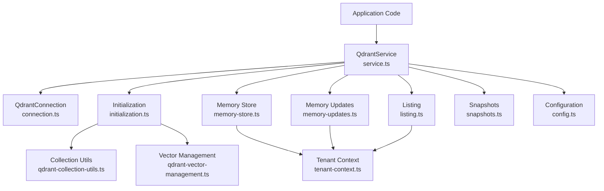
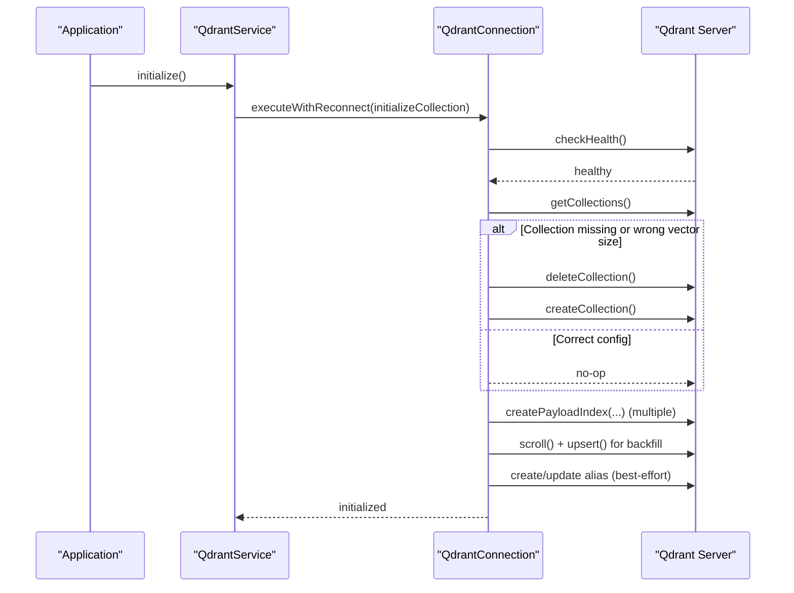
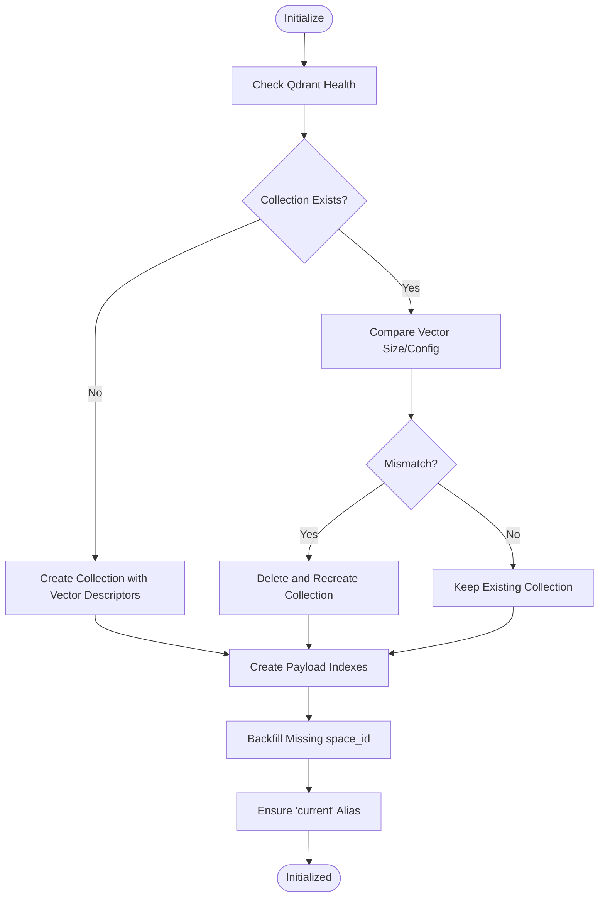
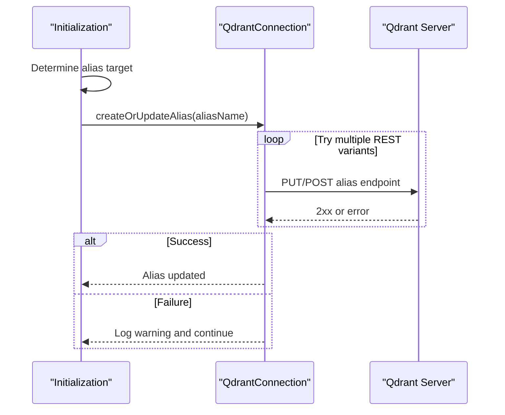
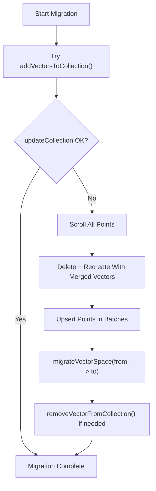
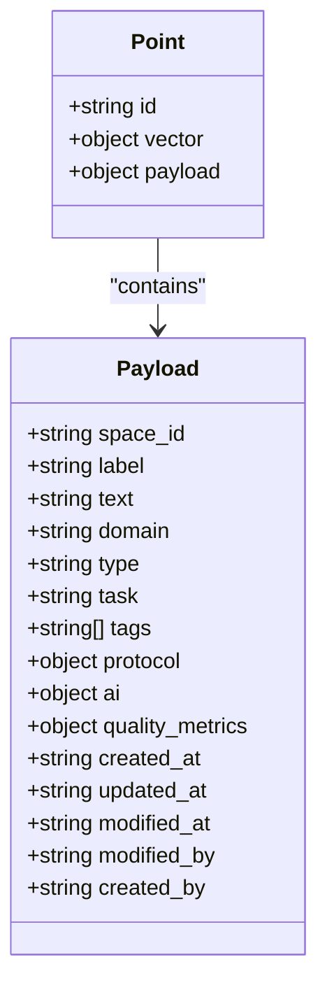
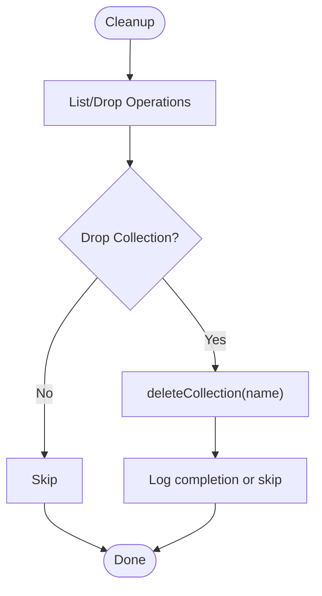
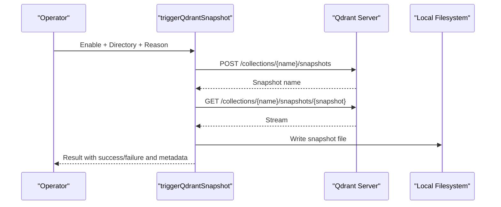
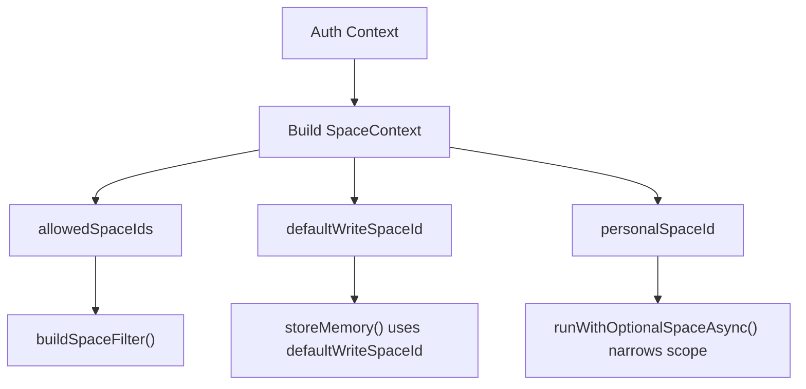
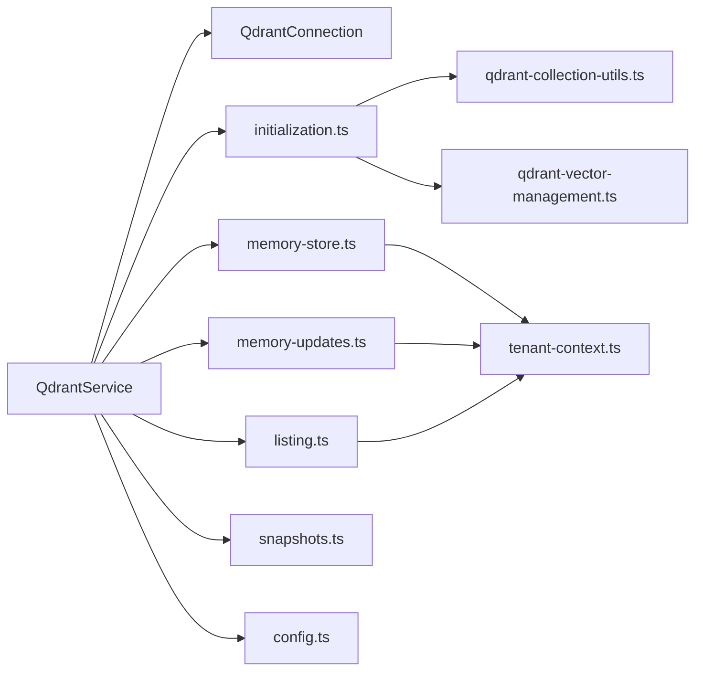

# Collection Management and Lifecycle

<cite>
**Referenced Files in This Document**
- [service.ts](file://src/services/qdrant/service.ts)
- [connection.ts](file://src/services/qdrant/connection.ts)
- [initialization.ts](file://src/services/qdrant/initialization.ts)
- [listing.ts](file://src/services/qdrant/listing.ts)
- [memory-store.ts](file://src/services/qdrant/memory-store.ts)
- [memory-updates.ts](file://src/services/qdrant/memory-updates.ts)
- [snapshots.ts](file://src/services/qdrant/snapshots.ts)
- [qdrant-collection-utils.ts](file://src/utils/qdrant-collection-utils.ts)
- [qdrant-vector-management.ts](file://src/utils/qdrant-vector-management.ts)
- [tenant-context.ts](file://src/utils/tenant-context.ts)
- [config.ts](file://src/config.ts)
</cite>

## Table of Contents
1. [Introduction](#introduction)
2. [Project Structure](#project-structure)
3. [Core Components](#core-components)
4. [Architecture Overview](#architecture-overview)
5. [Detailed Component Analysis](#detailed-component-analysis)
6. [Dependency Analysis](#dependency-analysis)
7. [Performance Considerations](#performance-considerations)
8. [Troubleshooting Guide](#troubleshooting-guide)
9. [Conclusion](#conclusion)
10. [Appendices](#appendices)

## Introduction
This document explains how SquadRules manages Qdrant collections and their lifecycle. It covers collection creation, initialization, alias management, versioning strategies, listing, metadata handling, cleanup, scaling considerations, backup and disaster recovery, multi-tenant setup patterns, and operational maintenance tasks. The goal is to help operators and developers understand the end-to-end flow from application startup through data writes, queries, backups, and recovery.

## Project Structure
The Qdrant integration is centered around a service layer that wraps a resilient connection, an initialization routine, storage and update helpers, listing utilities, and snapshot support. Utility modules provide collection construction, vector schema management, and tenant-aware filtering. Configuration determines whether Qdrant is used or the embedded LanceDB path is selected.

**Diagram sources**
- [service.ts:17-161](file://src/services/qdrant/service.ts#L17-L161)
- [connection.ts:11-131](file://src/services/qdrant/connection.ts#L11-L131)
- [initialization.ts:13-184](file://src/services/qdrant/initialization.ts#L13-L184)
- [memory-store.ts:14-126](file://src/services/qdrant/memory-store.ts#L14-L126)
- [memory-updates.ts:15-235](file://src/services/qdrant/memory-updates.ts#L15-L235)
- [listing.ts:10-96](file://src/services/qdrant/listing.ts#L10-L96)
- [snapshots.ts:68-168](file://src/services/qdrant/snapshots.ts#L68-L168)
- [qdrant-collection-utils.ts:7-65](file://src/utils/qdrant-collection-utils.ts#L7-L65)
- [qdrant-vector-management.ts:13-301](file://src/utils/qdrant-vector-management.ts#L13-L301)
- [tenant-context.ts:23-42](file://src/utils/tenant-context.ts#L23-L42)
- [config.ts:106-137](file://src/config.ts#L106-L137)

**Section sources**
- [service.ts:17-161](file://src/services/qdrant/service.ts#L17-L161)
- [connection.ts:11-131](file://src/services/qdrant/connection.ts#L11-L131)
- [initialization.ts:13-184](file://src/services/qdrant/initialization.ts#L13-L184)
- [memory-store.ts:14-126](file://src/services/qdrant/memory-store.ts#L14-L126)
- [memory-updates.ts:15-235](file://src/services/qdrant/memory-updates.ts#L15-L235)
- [listing.ts:10-96](file://src/services/qdrant/listing.ts#L10-L96)
- [snapshots.ts:68-168](file://src/services/qdrant/snapshots.ts#L68-L168)
- [qdrant-collection-utils.ts:7-65](file://src/utils/qdrant-collection-utils.ts#L7-L65)
- [qdrant-vector-management.ts:13-301](file://src/utils/qdrant-vector-management.ts#L13-L301)
- [tenant-context.ts:23-42](file://src/utils/tenant-context.ts#L23-L42)
- [config.ts:106-137](file://src/config.ts#L106-L137)

## Core Components
- QdrantService: Public facade for collection operations, memory storage, updates, search, aliasing, listing, and snapshots. It composes QdrantConnection and delegates to specialized modules.
- QdrantConnection: Encapsulates client initialization, TLS configuration, health checks, and resilient execution with exponential backoff reconnection.
- Initialization: Creates or validates the collection, ensures payload indexes, backfills missing space_id, optionally creates an alias, and lists/drops collections.
- Memory Store and Updates: Handle point creation, upserts, text embedding regeneration, quality metadata updates, cache invalidation, and deletion.
- Listing: Provides category-based listing and domain overview with tenant-scoped filters.
- Snapshots: Triggers remote Qdrant snapshots, downloads them, and persists them locally with error handling and partial file cleanup.
- Vector Utilities: Create collections with correct vector schemas, add/remove named vectors, and migrate between vector spaces.
- Tenant Context: Derives allowed spaces, default write space, personal space, and request-scoped narrowing for multi-tenant isolation.

**Section sources**
- [service.ts:17-161](file://src/services/qdrant/service.ts#L17-L161)
- [connection.ts:11-131](file://src/services/qdrant/connection.ts#L11-L131)
- [initialization.ts:13-184](file://src/services/qdrant/initialization.ts#L13-L184)
- [memory-store.ts:14-126](file://src/services/qdrant/memory-store.ts#L14-L126)
- [memory-updates.ts:15-235](file://src/services/qdrant/memory-updates.ts#L15-L235)
- [listing.ts:10-96](file://src/services/qdrant/listing.ts#L10-L96)
- [snapshots.ts:68-168](file://src/services/qdrant/snapshots.ts#L68-L168)
- [qdrant-collection-utils.ts:7-65](file://src/utils/qdrant-collection-utils.ts#L7-L65)
- [qdrant-vector-management.ts:13-301](file://src/utils/qdrant-vector-management.ts#L13-L301)
- [tenant-context.ts:23-42](file://src/utils/tenant-context.ts#L23-L42)

## Architecture Overview
At runtime, the application selects either Qdrant or the embedded store. When Qdrant is configured, QdrantService is instantiated with URL, API key, and collection name derived from environment variables. On initialization, the service ensures the collection exists, has the expected vector schema, payload indexes are present, and optional aliasing is set. Writes and updates go through resilient connection wrappers that handle reconnection and metrics. Snapshots can be triggered to create and download remote snapshots for backup and recovery.

**Diagram sources**
- [service.ts:48-50](file://src/services/qdrant/service.ts#L48-L50)
- [initialization.ts:13-92](file://src/services/qdrant/initialization.ts#L13-L92)
- [connection.ts:98-130](file://src/services/qdrant/connection.ts#L98-L130)

**Section sources**
- [service.ts:17-161](file://src/services/qdrant/service.ts#L17-L161)
- [initialization.ts:13-92](file://src/services/qdrant/initialization.ts#L13-L92)
- [connection.ts:98-130](file://src/services/qdrant/connection.ts#L98-L130)

## Detailed Component Analysis

### Collection Creation and Initialization
- Health Check: Initialization verifies Qdrant health before proceeding.
- Collection Existence and Schema Validation: If the collection does not exist, it is created with the current vector descriptors. If it exists but has a different vector size, the collection is deleted and recreated to match the expected schema.
- Payload Indexes: A set of payload indexes is created for efficient filtering and full-text search across fields such as space_id, domain, type, task, protocol step, quality metadata, adapter fields, slug, content_type, and several text fields.
- Backfill: Points missing space_id are updated to include the app space identifier, ensuring backward compatibility and consistent multitenancy behavior.
- Alias: An alias named current may be created or updated to point at the active collection. This is best-effort and supports multiple REST endpoint variants for compatibility.

**Diagram sources**
- [initialization.ts:13-92](file://src/services/qdrant/initialization.ts#L13-L92)
- [qdrant-collection-utils.ts:7-39](file://src/utils/qdrant-collection-utils.ts#L7-L39)

**Section sources**
- [initialization.ts:13-92](file://src/services/qdrant/initialization.ts#L13-L92)
- [qdrant-collection-utils.ts:7-65](file://src/utils/qdrant-collection-utils.ts#L7-L65)

### Alias Management
- Purpose: Aliases allow stable references to collections during deployments and version rollouts.
- Behavior: The system attempts to create or update an alias using multiple REST endpoints to accommodate different Qdrant versions. If all attempts fail, a warning is logged and manual alias creation is suggested.
- Environment Control: Alias creation can be controlled by environment variables and the original collection alias value.

**Diagram sources**
- [initialization.ts:99-126](file://src/services/qdrant/initialization.ts#L99-L126)

**Section sources**
- [initialization.ts:83-126](file://src/services/qdrant/initialization.ts#L83-L126)

### Versioning Strategies
- Vector Schema Versioning: Collections are validated against the current embedding dimension. If mismatched, the collection is recreated to align with the new vector size.
- Named Vectors Migration: Utilities support adding named vectors to existing collections, recreating collections when necessary, and migrating points to new vector spaces by re-embedding content.
- Removal Strategy: Removing a named vector requires recreating the collection without that vector and restoring points without the removed field.

**Diagram sources**
- [qdrant-vector-management.ts:13-114](file://src/utils/qdrant-vector-management.ts#L13-L114)
- [qdrant-vector-management.ts:126-202](file://src/utils/qdrant-vector-management.ts#L126-L202)
- [qdrant-vector-management.ts:208-301](file://src/utils/qdrant-vector-management.ts#L208-L301)

**Section sources**
- [initialization.ts:27-48](file://src/services/qdrant/initialization.ts#L27-L48)
- [qdrant-vector-management.ts:13-301](file://src/utils/qdrant-vector-management.ts#L13-L301)

### Collection Listing and Metadata Management
- Listing by Category: Returns items filtered by domain, type, and task, scoped to allowed spaces.
- Domain Overview: Aggregates tag counts and recent memories within a domain, also scoped to allowed spaces.
- Metadata Fields: Points include label, text, domain, type, task, tags, protocol info, quality metrics, timestamps, and space_id. Quality metadata can be recalculated on updates based on content changes.

**Diagram sources**
- [memory-store.ts:57-96](file://src/services/qdrant/memory-store.ts#L57-L96)
- [memory-updates.ts:35-49](file://src/services/qdrant/memory-updates.ts#L35-L49)
- [memory-updates.ts:136-145](file://src/services/qdrant/memory-updates.ts#L136-L145)

**Section sources**
- [listing.ts:10-96](file://src/services/qdrant/listing.ts#L10-L96)
- [memory-store.ts:14-126](file://src/services/qdrant/memory-store.ts#L14-L126)
- [memory-updates.ts:15-235](file://src/services/qdrant/memory-updates.ts#L15-L235)

### Cleanup Procedures
- Drop Collection: Removes a specified collection; errors are logged and treated as completed or not needed.
- Delete Memory: Deletes a specific point after validation and access checks, followed by strict cache invalidation.
- Backfill and Index Maintenance: Ensures legacy points have required fields and indexes exist; index creation failures are tolerated if already present.

**Diagram sources**
- [initialization.ts:178-184](file://src/services/qdrant/initialization.ts#L178-L184)
- [memory-updates.ts:199-235](file://src/services/qdrant/memory-updates.ts#L199-L235)

**Section sources**
- [initialization.ts:168-184](file://src/services/qdrant/initialization.ts#L168-L184)
- [memory-updates.ts:199-235](file://src/services/qdrant/memory-updates.ts#L199-L235)

### Scaling Considerations
- Resilient Execution: All operations run through QdrantConnection.executeWithReconnect, which performs health checks and retries with exponential backoff.
- Batch Upserts: Backfill and vector migration use batched upserts to reduce memory pressure and improve throughput.
- Quantization: Collections are created with scalar quantization enabled to optimize storage and performance.
- Indexing Strategy: Payload indexes cover common filter and search fields, including keyword and text types.

**Section sources**
- [connection.ts:76-130](file://src/services/qdrant/connection.ts#L76-L130)
- [initialization.ts:50-79](file://src/services/qdrant/initialization.ts#L50-L79)
- [qdrant-collection-utils.ts:27-39](file://src/utils/qdrant-collection-utils.ts#L27-L39)
- [qdrant-vector-management.ts:90-110](file://src/utils/qdrant-vector-management.ts#L90-L110)

### Backup Strategies and Disaster Recovery
- Snapshot Triggering: The snapshot utility calls the Qdrant snapshot API, waits for completion, downloads the snapshot, and writes it to a local directory. Errors are logged, and partial files are cleaned up.
- Operational Use: Snapshots can be triggered at startup or via API, depending on configuration. They provide durable backups for disaster recovery scenarios.

**Diagram sources**
- [snapshots.ts:68-168](file://src/services/qdrant/snapshots.ts#L68-L168)

**Section sources**
- [snapshots.ts:68-168](file://src/services/qdrant/snapshots.ts#L68-L168)

### Multi-Tenant Collection Setup
- Space Context: Derived from authentication context, producing allowedSpaceIds, defaultWriteSpaceId, personalSpaceId, and optional narrowed scopes.
- Filtering: Listing and vector operations apply space filters to ensure tenants only see their data.
- Default Behavior: Without auth, a single-tenant default context is used; with auth enabled and no context, strict isolation prevents sharing.

**Diagram sources**
- [tenant-context.ts:23-42](file://src/utils/tenant-context.ts#L23-L42)
- [tenant-context.ts:156-179](file://src/utils/tenant-context.ts#L156-L179)
- [memory-store.ts:56-57](file://src/services/qdrant/memory-store.ts#L56-L57)
- [listing.ts:12-18](file://src/services/qdrant/listing.ts#L12-L18)

**Section sources**
- [tenant-context.ts:23-42](file://src/utils/tenant-context.ts#L23-L42)
- [tenant-context.ts:156-179](file://src/utils/tenant-context.ts#L156-L179)
- [memory-store.ts:56-57](file://src/services/qdrant/memory-store.ts#L56-L57)
- [listing.ts:12-18](file://src/services/qdrant/listing.ts#L12-L18)

### Operational Maintenance Tasks
- Ensure Payload Indexes: Verify indexes exist for critical fields; creation is idempotent and tolerant of pre-existing indexes.
- Backfill space_id: Run backfill to populate missing space identifiers for older points.
- Validate Vector Schema: Confirm vector sizes match expected dimensions; recreate if mismatched.
- Manage Aliases: Maintain alias mappings for stable routing during deployments.
- Monitor Snapshots: Configure snapshot directories and enable periodic snapshots for backup.
- Cache Invalidation: After updates/deletes, strict cache invalidation is performed to prevent stale reads.

**Section sources**
- [initialization.ts:50-92](file://src/services/qdrant/initialization.ts#L50-L92)
- [initialization.ts:133-163](file://src/services/qdrant/initialization.ts#L133-L163)
- [initialization.ts:27-48](file://src/services/qdrant/initialization.ts#L27-L48)
- [initialization.ts:99-126](file://src/services/qdrant/initialization.ts#L99-L126)
- [snapshots.ts:68-168](file://src/services/qdrant/snapshots.ts#L68-L168)
- [memory-updates.ts:75-78](file://src/services/qdrant/memory-updates.ts#L75-L78)
- [memory-updates.ts:176-178](file://src/services/qdrant/memory-updates.ts#L176-L178)

## Dependency Analysis
The following diagram shows how core components depend on each other and external services.

**Diagram sources**
- [service.ts:1-15](file://src/services/qdrant/service.ts#L1-L15)
- [initialization.ts:1-6](file://src/services/qdrant/initialization.ts#L1-L6)
- [memory-store.ts:1-8](file://src/services/qdrant/memory-store.ts#L1-L8)
- [memory-updates.ts:1-9](file://src/services/qdrant/memory-updates.ts#L1-L9)
- [listing.ts:1-4](file://src/services/qdrant/listing.ts#L1-L4)
- [snapshots.ts:1-7](file://src/services/qdrant/snapshots.ts#L1-L7)
- [qdrant-collection-utils.ts:1-2](file://src/utils/qdrant-collection-utils.ts#L1-L2)
- [qdrant-vector-management.ts:1-7](file://src/utils/qdrant-vector-management.ts#L1-L7)
- [tenant-context.ts:1-18](file://src/utils/tenant-context.ts#L1-L18)
- [config.ts:106-137](file://src/config.ts#L106-L137)

**Section sources**
- [service.ts:1-15](file://src/services/qdrant/service.ts#L1-L15)
- [initialization.ts:1-6](file://src/services/qdrant/initialization.ts#L1-L6)
- [memory-store.ts:1-8](file://src/services/qdrant/memory-store.ts#L1-L8)
- [memory-updates.ts:1-9](file://src/services/qdrant/memory-updates.ts#L1-L9)
- [listing.ts:1-4](file://src/services/qdrant/listing.ts#L1-L4)
- [snapshots.ts:1-7](file://src/services/qdrant/snapshots.ts#L1-L7)
- [qdrant-collection-utils.ts:1-2](file://src/utils/qdrant-collection-utils.ts#L1-L2)
- [qdrant-vector-management.ts:1-7](file://src/utils/qdrant-vector-management.ts#L1-L7)
- [tenant-context.ts:1-18](file://src/utils/tenant-context.ts#L1-L18)
- [config.ts:106-137](file://src/config.ts#L106-L137)

## Performance Considerations
- Connection Resilience: Exponential backoff and health checks minimize downtime impact and avoid cascading failures.
- Batch Operations: Backfill and migration routines process data in batches to control memory usage and network overhead.
- Quantization: Scalar quantization reduces storage footprint while maintaining acceptable retrieval performance.
- Indexing: Keyword and text indexes accelerate filtering and full-text search across high-cardinality fields.
- Embedding Regeneration: Text updates trigger embedding regeneration; consider batching and rate limits for large-scale updates.

[No sources needed since this section provides general guidance]

## Troubleshooting Guide
- Health Check Failures: Initialization throws if Qdrant is unhealthy; verify connectivity and credentials.
- Reconnection Errors: Operation failures trigger reconnection attempts; persistent failures return structured errors with diagnostic details.
- Alias Creation Failures: Multiple REST variants are tried; consult logs for status codes and body details.
- Vector Schema Mismatch: If vector size differs, the collection is recreated; ensure embedding model configuration matches deployment expectations.
- Snapshot Failures: Snapshot creation or download errors are logged; ensure backup directory permissions and Qdrant snapshot API availability.

**Section sources**
- [initialization.ts:13-19](file://src/services/qdrant/initialization.ts#L13-L19)
- [connection.ts:98-130](file://src/services/qdrant/connection.ts#L98-L130)
- [initialization.ts:110-126](file://src/services/qdrant/initialization.ts#L110-L126)
- [initialization.ts:27-48](file://src/services/qdrant/initialization.ts#L27-L48)
- [snapshots.ts:99-168](file://src/services/qdrant/snapshots.ts#L99-L168)

## Conclusion
SquadRules’ Qdrant integration provides robust collection lifecycle management, resilient connections, tenant-aware operations, and practical backup mechanisms. Operators should monitor health, validate vector schemas, maintain aliases, keep payloads indexed, and schedule snapshots. For multi-tenant environments, rely on space context and filters to enforce isolation. Vector migrations and cleanup procedures are designed to be safe and incremental, minimizing risk during upgrades.

[No sources needed since this section summarizes without analyzing specific files]

## Appendices

### Configuration Keys Relevant to Qdrant
- QDRANT_URL: Base URL for Qdrant server.
- QDRANT_API_KEY: Authentication key for Qdrant.
- QDRANT_COLLECTION: Collection alias/name used by the service.
- QDRANT_CA_CERT_PATH: Optional CA certificate for TLS.
- QDRANT_RESCORE: Toggle rescore behavior.
- QDRANT_CREATE_ALIAS: Force alias creation during initialization.

**Section sources**
- [connection.ts:24-37](file://src/services/qdrant/connection.ts#L24-L37)
- [initialization.ts:83-91](file://src/services/qdrant/initialization.ts#L83-L91)
- [config.ts:106-137](file://src/config.ts#L106-L137)