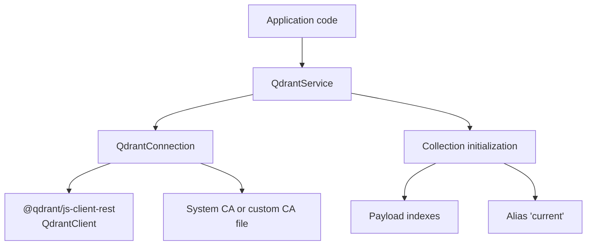
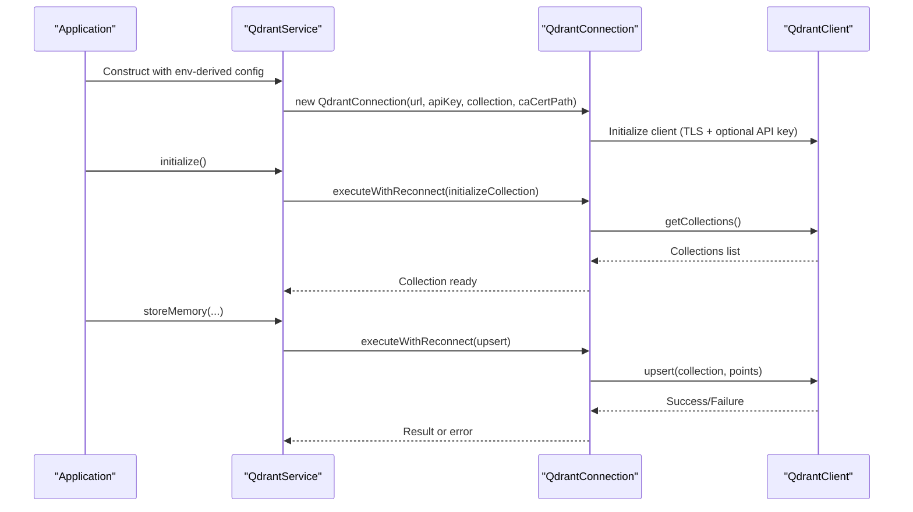
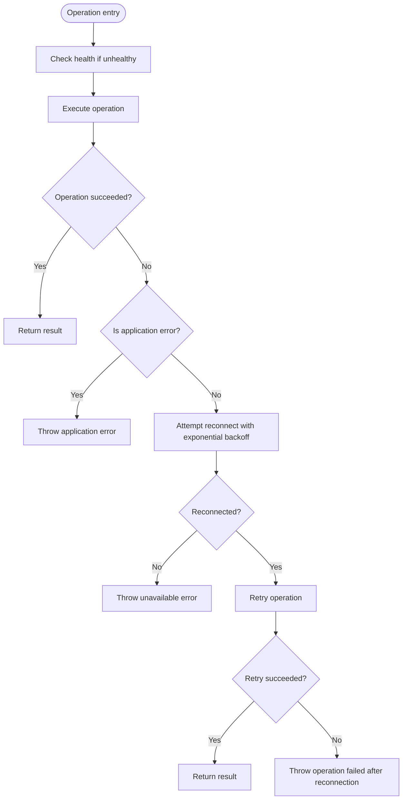
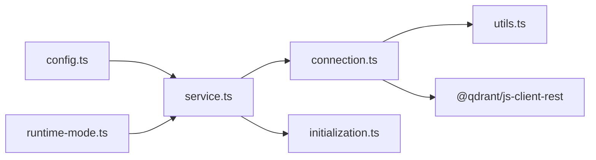

# Connection Management and Configuration

<cite>
**Referenced Files in This Document**   
- [connection.ts](file://src/services/qdrant/connection.ts)
- [service.ts](file://src/services/qdrant/service.ts)
- [initialization.ts](file://src/services/qdrant/initialization.ts)
- [utils.ts](file://src/services/qdrant/utils.ts)
- [config.ts](file://src/config.ts)
- [runtime-mode.ts](file://src/config/runtime-mode.ts)
</cite>

## Table of Contents
1. [Introduction](#introduction)
2. [Project Structure](#project-structure)
3. [Core Components](#core-components)
4. [Architecture Overview](#architecture-overview)
5. [Detailed Component Analysis](#detailed-component-analysis)
6. [Dependency Analysis](#dependency-analysis)
7. [Performance Considerations](#performance-considerations)
8. [Troubleshooting Guide](#troubleshooting-guide)
9. [Conclusion](#conclusion)

## Introduction
This document explains how the application manages connections to Qdrant, including URL configuration, API key authentication, TLS certificate handling, connection health checks, retry behavior, collection initialization, alias management, and environment-driven deployment modes. It is intended for operators and developers who configure or troubleshoot vector storage for SquadRules.

Key points:
- The primary client wrapper is `QdrantConnection`.
- High-level operations are exposed through `QdrantService`, which composes a single `QdrantConnection` instance.
- Environment variables control whether Qdrant is used versus embedded LanceDB, where Qdrant is reachable, and how TLS and API keys are configured.
- Local simple mode intentionally avoids external Qdrant usage.

## Project Structure
The Qdrant integration lives under `src/services/qdrant/`. The most relevant files for connection management are:
- `connection.ts`: Client construction, TLS, health checks, reconnect logic, and resilient operation execution.
- `service.ts`: Service facade that constructs `QdrantConnection` and exposes memory/search/alias/collection APIs.
- `initialization.ts`: Collection creation, payload index setup, alias creation/update, and backfill helpers.
- `utils.ts`: Boolean environment parsing and point sanitization utilities.
- `config.ts`: Centralized environment variable resolution, including Qdrant URL, API key, and collection name.
- `runtime-mode.ts`: Runtime mode resolution and guards that prevent unsafe local-mode configurations.

**Diagram sources**
- [service.ts:17-28](file://src/services/qdrant/service.ts#L17-L28)
- [connection.ts:11-60](file://src/services/qdrant/connection.ts#L11-L60)
- [initialization.ts:13-92](file://src/services/qdrant/initialization.ts#L13-L92)

**Section sources**
- [connection.ts:1-131](file://src/services/qdrant/connection.ts#L1-L131)
- [service.ts:1-161](file://src/services/qdrant/service.ts#L1-L161)
- [initialization.ts:1-184](file://src/services/qdrant/initialization.ts#L1-L184)
- [utils.ts:1-128](file://src/services/qdrant/utils.ts#L1-L128)
- [config.ts:1-351](file://src/config.ts#L1-L351)
- [runtime-mode.ts:1-150](file://src/config/runtime-mode.ts#L1-L150)

## Core Components
- `QdrantConnection`: Encapsulates Qdrant client lifecycle, TLS configuration, health checking, exponential backoff reconnection, and resilient operation execution.
- `QdrantService`: Public service facade that builds a `QdrantConnection` from configuration and delegates store/retrieve/search/alias/collection operations.
- Initialization helpers: Create or verify collections, ensure payload indexes, backfill missing fields, and create/update aliases.
- Configuration layer: Reads environment variables for Qdrant URL, API key, collection name, rescore flag, snapshot settings, and runtime mode.

**Section sources**
- [connection.ts:11-131](file://src/services/qdrant/connection.ts#L11-L131)
- [service.ts:17-161](file://src/services/qdrant/service.ts#L17-L161)
- [initialization.ts:13-184](file://src/services/qdrant/initialization.ts#L13-L184)
- [config.ts:106-107](file://src/config.ts#L106-L107)
- [config.ts:297-303](file://src/config.ts#L297-L303)

## Architecture Overview
At runtime, the application chooses between Qdrant and embedded LanceDB based on environment configuration. When Qdrant is configured, `QdrantService` creates a `QdrantConnection`, initializes the collection, and exposes typed methods for memory and search operations. All network calls go through `executeWithReconnect`, which performs health checks and retries with exponential backoff.

**Diagram sources**
- [service.ts:17-50](file://src/services/qdrant/service.ts#L17-L50)
- [connection.ts:39-60](file://src/services/qdrant/connection.ts#L39-L60)
- [connection.ts:98-130](file://src/services/qdrant/connection.ts#L98-L130)
- [initialization.ts:13-48](file://src/services/qdrant/initialization.ts#L13-L48)

## Detailed Component Analysis

### QdrantConnection: Client Lifecycle, TLS, Health, and Retry
Responsibilities:
- Build `QdrantClient` with URL, optional API key, and TLS options.
- Support HTTPS with system CA certificates by default, or a custom CA file path.
- Track health state and attempt reconnection with exponential backoff.
- Wrap operations in `executeWithReconnect` to fail fast on known application errors and retry transient failures once.

Key behaviors:
- Constructor reads URL, API key, collection alias, and optional CA cert path from parameters or environment.
- `initializeClient` sets `rejectUnauthorized` when using HTTPS; if a custom CA path is provided, it loads the certificate and logs its source.
- `checkHealth` calls `getCollections` to validate connectivity and resets reconnect counters on success.
- `attemptReconnect` uses exponential delay and stops after a maximum number of attempts.
- `executeWithReconnect` catches non-application errors, logs structured details, tries one reconnect, then either retries the operation or throws a standardized error indicating unavailability.

**Diagram sources**
- [connection.ts:63-96](file://src/services/qdrant/connection.ts#L63-L96)
- [connection.ts:98-130](file://src/services/qdrant/connection.ts#L98-L130)

**Section sources**
- [connection.ts:24-60](file://src/services/qdrant/connection.ts#L24-L60)
- [connection.ts:63-130](file://src/services/qdrant/connection.ts#L63-L130)

### QdrantService: Facade and Singleton Selection
Responsibilities:
- Construct `QdrantConnection` using centralized configuration.
- Expose high-level methods for memory storage, retrieval, updates, quality metrics, search, protocol steps, listing, alias management, and collection management.
- Provide a backend-selected singleton: when Qdrant is configured, use `QdrantService`; otherwise, return an embedded store double-cast to the same shape so callers remain unchanged.

Important notes:
- The constructor resolves URL, API key, and collection name via `getQdrantUrl`, `QDRANT_API_KEY`, and `getQdrantCollection`.
- The singleton selection depends on `isQdrantConfigured`, which is true when `QDRANT_URL` is set.

**Section sources**
- [service.ts:17-28](file://src/services/qdrant/service.ts#L17-L28)
- [service.ts:48-151](file://src/services/qdrant/service.ts#L48-L151)
- [service.ts:153-161](file://src/services/qdrant/service.ts#L153-L161)
- [config.ts:297-303](file://src/config.ts#L297-L303)
- [runtime-mode.ts:148-150](file://src/config/runtime-mode.ts#L148-L150)

### Initialization: Collections, Indexes, Aliases, and Backfills
Responsibilities:
- Ensure the target collection exists and has the correct vector configuration.
- Create payload indexes for filtering and text search.
- Backfill missing tenant identifiers for existing points.
- Optionally create or update an alias named `current` pointing to the active collection.

Behavior highlights:
- If the collection does not exist, it is created with descriptors derived from embedding configuration.
- If the vector size differs from expected, the collection is deleted and recreated.
- Payload indexes are created idempotently; existing indexes are tolerated.
- Alias creation tries multiple REST endpoints to support different Qdrant versions.

**Section sources**
- [initialization.ts:13-92](file://src/services/qdrant/initialization.ts#L13-L92)
- [initialization.ts:99-126](file://src/services/qdrant/initialization.ts#L99-L126)
- [initialization.ts:133-163](file://src/services/qdrant/initialization.ts#L133-L163)

### Configuration and Environment Variables
Centralized environment parsing provides:
- `QDRANT_URL`: Required when using Qdrant; resolved by `getQdrantUrl()` which throws if unset.
- `QDRANT_API_KEY`: Optional API key passed to Qdrant client and alias requests.
- `QDRANT_COLLECTION`: Collection alias/name; defaults to `squadrules`.
- `QDRANT_CA_CERT_PATH`: Optional path to a custom CA certificate for HTTPS.
- `QDRANT_RESCORE`: Boolean flag parsed by `parseBooleanEnv`.
- `QDRANT_CREATE_ALIAS`: Boolean flag to create/update the `current` alias during initialization.
- `QDRANT_SNAPSHOT_ON_START` and `QDRANT_SNAPSHOT_DIR`: Snapshot-related settings.

Runtime mode guard:
- In local simple mode (`TRANSPORT_TYPE=stdio`), setting `QDRANT_URL` is rejected because local mode should use embedded storage.

**Section sources**
- [config.ts:106-107](file://src/config.ts#L106-L107)
- [config.ts:268-277](file://src/config.ts#L268-L277)
- [config.ts:297-303](file://src/config.ts#L297-L303)
- [utils.ts:77-84](file://src/services/qdrant/utils.ts#L77-L84)
- [runtime-mode.ts:91-120](file://src/config/runtime-mode.ts#L91-L120)
- [runtime-mode.ts:148-150](file://src/config/runtime-mode.ts#L148-L150)

### URL Parsing and Connection String Formats
The implementation expects a standard HTTP(S) URL:
- For local development: typically `http://localhost:6333`.
- For cloud or self-hosted services: `https://your-qdrant.example.com` or similar.
- The constructor accepts the URL directly; there is no custom query-string parser. TLS behavior is driven by the scheme:
  - `https://` enables TLS.
  - If `QDRANT_CA_CERT_PATH` is set, the custom CA file is loaded and used.
  - Otherwise, system CA certificates are used with `rejectUnauthorized` enabled.

There is no built-in support for embedding credentials inside the URL. Use `QDRANT_API_KEY` for API key authentication.

**Section sources**
- [connection.ts:24-37](file://src/services/qdrant/connection.ts#L24-L37)
- [connection.ts:39-60](file://src/services/qdrant/connection.ts#L39-L60)

### API Key Authentication
API key usage:
- Passed to `QdrantClient` during client initialization when present.
- Also attached as the `api-key` header when creating or updating aliases via raw fetch calls.

Best practices:
- Set `QDRANT_API_KEY` in your environment or secrets manager.
- Avoid logging the key; the service logs masked values at startup.

**Section sources**
- [connection.ts:39-42](file://src/services/qdrant/connection.ts#L39-L42)
- [initialization.ts:107-109](file://src/services/qdrant/initialization.ts#L107-L109)

### SSL/TLS Certificate Handling
TLS behavior:
- If the URL starts with `https://`, TLS is enabled.
- If `QDRANT_CA_CERT_PATH` is set, the file is read synchronously and assigned to the client’s CA configuration.
- If no custom CA is provided, system CA certificates are used.
- On failure to load the custom CA, initialization throws an error.

Operational guidance:
- For managed Qdrant with public trust, omit `QDRANT_CA_CERT_PATH`.
- For internal PKI or private CAs, provide the absolute path to the CA bundle.

**Section sources**
- [connection.ts:43-58](file://src/services/qdrant/connection.ts#L43-L58)

### Connection Pooling
The codebase does not implement explicit connection pooling beyond what the underlying `@qdrant/js-client-rest` library may provide internally. Each `QdrantConnection` holds a single `QdrantClient` instance. Application-level concurrency is handled by higher layers; this module focuses on resilience rather than pool tuning.

[No sources needed since this section provides general guidance]

### Retry Mechanisms and Error Handling
Retry strategy:
- `executeWithReconnect` wraps operations and attempts one reconnection with exponential backoff after a transient failure.
- Maximum reconnect attempts are bounded; exceeding them results in a standardized unavailable error.
- Known application errors (`SquadrulesError`) are propagated without triggering reconnection.

Error handling strategy:
- Health check failures are logged and marked as unhealthy.
- Operation failures include structured logs with error details, collection name, URL, and timestamp.
- Reconnection failures produce warnings; final failures throw domain-specific errors.

**Section sources**
- [connection.ts:63-96](file://src/services/qdrant/connection.ts#L63-L96)
- [connection.ts:98-130](file://src/services/qdrant/connection.ts#L98-L130)

### Deployment Scenarios

#### Local Development
Recommended configuration:
- Do not set `QDRANT_URL` in local simple mode; use embedded storage.
- If you must run against a local Qdrant manually, use `http://localhost:6333` and avoid enabling authentication unless your local server requires it.

Notes:
- Local simple mode rejects `QDRANT_URL` to prevent accidental sharing of external state.

**Section sources**
- [runtime-mode.ts:91-120](file://src/config/runtime-mode.ts#L91-L120)

#### Cloud Qdrant
Recommended configuration:
- Set `QDRANT_URL=https://your-cloud-endpoint`.
- Set `QDRANT_API_KEY` from your cloud provider’s secret store.
- Omit `QDRANT_CA_CERT_PATH` unless your provider requires a custom CA.

Security best practices:
- Enforce HTTPS.
- Rotate API keys regularly.
- Restrict network access to trusted CIDRs.

**Section sources**
- [connection.ts:39-60](file://src/services/qdrant/connection.ts#L39-L60)
- [config.ts:297-303](file://src/config.ts#L297-L303)

#### Self-Hosted Qdrant with Private CA
Recommended configuration:
- Set `QDRANT_URL=https://internal-qdrant`.
- Set `QDRANT_API_KEY` if required.
- Set `QDRANT_CA_CERT_PATH` to the absolute path of your CA bundle.

Operational tips:
- Ensure the process can read the CA file.
- Verify DNS and firewall rules allow outbound HTTPS to the endpoint.

**Section sources**
- [connection.ts:43-58](file://src/services/qdrant/connection.ts#L43-L58)

### Troubleshooting Common Connection Issues

Symptoms and likely causes:
- Startup fails with a missing required URL:
  - Cause: `QDRANT_URL` is unset when Qdrant is intended.
  - Action: Set `QDRANT_URL` or disable Qdrant by leaving it unset to use embedded storage.
- TLS handshake or certificate errors:
  - Cause: Missing or incorrect custom CA, or misconfigured hostname.
  - Action: Confirm `QDRANT_CA_CERT_PATH` points to the correct bundle and the URL matches the certificate subject.
- API key rejection:
  - Cause: Incorrect or expired `QDRANT_API_KEY`.
  - Action: Refresh the key and restart the process.
- Local mode conflicts:
  - Cause: `QDRANT_URL` set while running in local simple mode.
  - Action: Unset `QDRANT_URL` or switch to clustered mode.
- Alias creation failures:
  - Cause: Older Qdrant version or permission issues.
  - Action: Manually create the alias or adjust permissions; the code falls back gracefully.

Diagnostics:
- Inspect logs for health check failures, reconnection attempts, and structured error details.
- Validate collection existence and payload indexes via Qdrant tools or admin UI.

**Section sources**
- [connection.ts:63-96](file://src/services/qdrant/connection.ts#L63-L96)
- [connection.ts:98-130](file://src/services/qdrant/connection.ts#L98-L130)
- [initialization.ts:107-126](file://src/services/qdrant/initialization.ts#L107-L126)
- [runtime-mode.ts:91-120](file://src/config/runtime-mode.ts#L91-L120)

## Dependency Analysis
High-level dependencies:
- `QdrantService` depends on `QdrantConnection` and initialization helpers.
- `QdrantConnection` depends on `@qdrant/js-client-rest` and the structured logger.
- Configuration is centralized in `config.ts`, with runtime-mode guards in `runtime-mode.ts`.

**Diagram sources**
- [service.ts:1-16](file://src/services/qdrant/service.ts#L1-L16)
- [connection.ts:1-5](file://src/services/qdrant/connection.ts#L1-L5)
- [initialization.ts:1-6](file://src/services/qdrant/initialization.ts#L1-L6)
- [config.ts:1-15](file://src/config.ts#L1-L15)
- [runtime-mode.ts:1-15](file://src/config/runtime-mode.ts#L1-L15)

**Section sources**
- [service.ts:1-16](file://src/services/qdrant/service.ts#L1-L16)
- [connection.ts:1-5](file://src/services/qdrant/connection.ts#L1-L5)
- [initialization.ts:1-6](file://src/services/qdrant/initialization.ts#L1-L6)
- [config.ts:1-15](file://src/config.ts#L1-L15)
- [runtime-mode.ts:1-15](file://src/config/runtime-mode.ts#L1-L15)

## Performance Considerations
- Keep `QDRANT_URL` stable across deployments to avoid unnecessary reconnections.
- Prefer system CA certificates for well-known providers to reduce startup overhead.
- Tune collection payload indexes according to query patterns to improve filter performance.
- Monitor health check latency and reconnection frequency; frequent reconnects indicate network or service instability.

[No sources needed since this section provides general guidance]

## Conclusion
The Qdrant integration centers around a resilient `QdrantConnection` wrapped by `QdrantService`. Configuration is environment-driven, with clear separation between local simple mode and clustered deployments. TLS and API key handling are straightforward, and retry logic protects against transient failures. Operators should focus on correct URL configuration, secure credential management, and appropriate CA setup for their deployment model.

[No sources needed since this section summarizes without analyzing specific files]