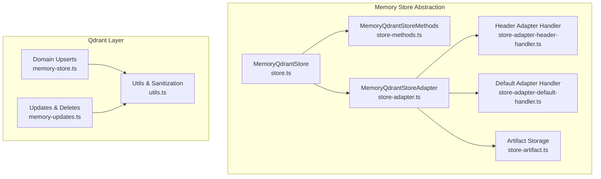
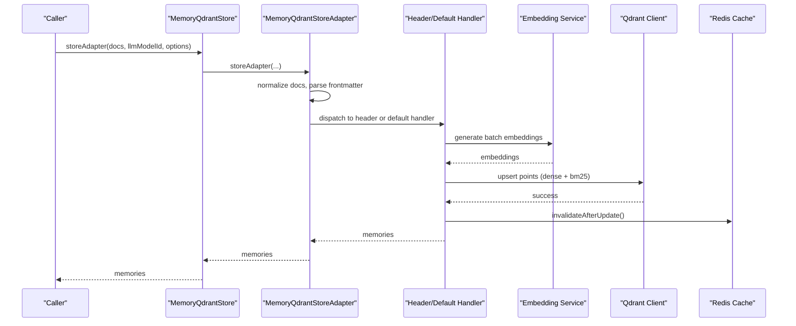
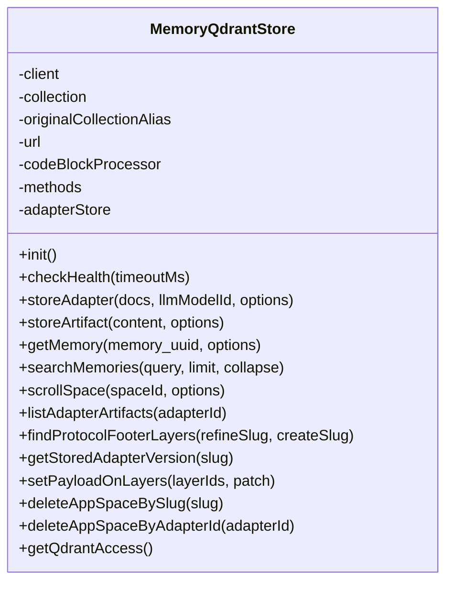
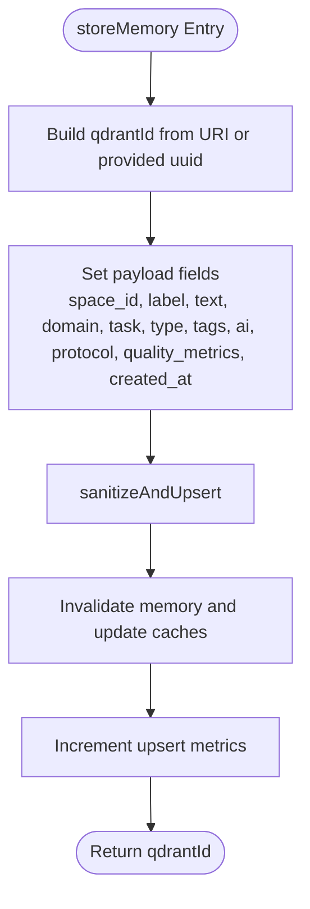
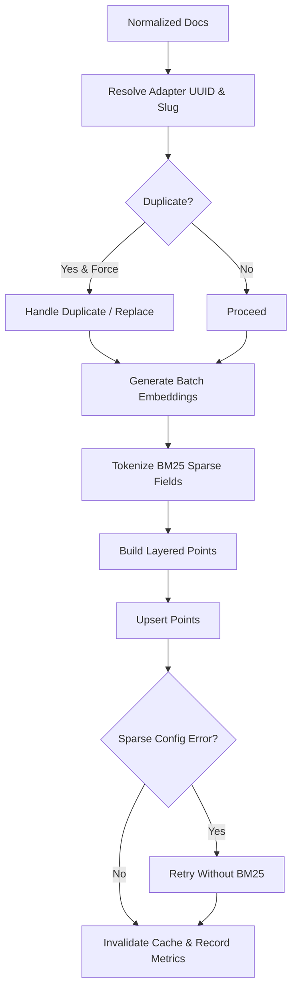
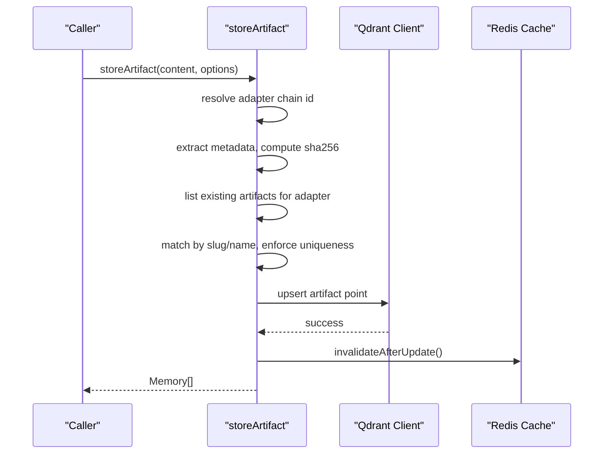
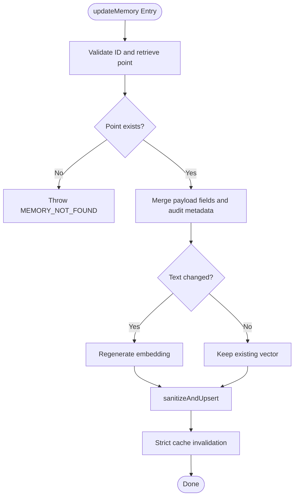
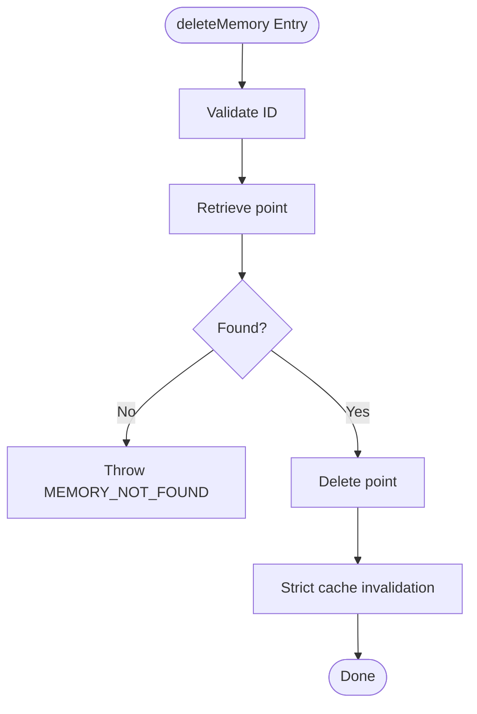
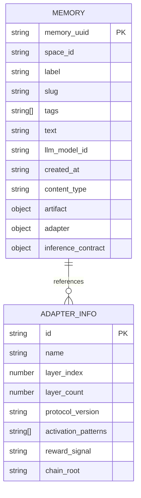
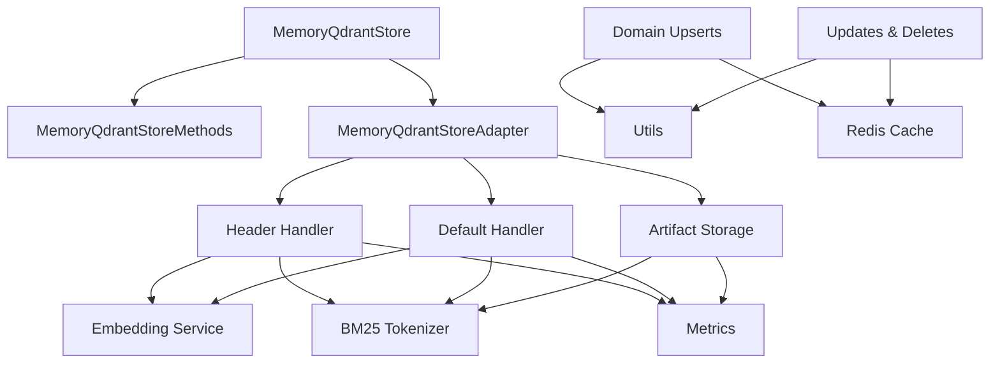

# Memory Persistence and Data Operations

<cite>
**Referenced Files in This Document**
- [store.ts](file://src/services/memory/store.ts)
- [store-methods.ts](file://src/services/memory/store-methods.ts)
- [store-adapter.ts](file://src/services/memory/store-adapter.ts)
- [store-adapter-header-handler.ts](file://src/services/memory/store-adapter-header-handler.ts)
- [store-adapter-default-handler.ts](file://src/services/memory/store-adapter-default-handler.ts)
- [store-artifact.ts](file://src/services/memory/store-artifact.ts)
- [memory-store.ts](file://src/services/qdrant/memory-store.ts)
- [memory-updates.ts](file://src/services/qdrant/memory-updates.ts)
- [utils.ts](file://src/services/qdrant/utils.ts)
- [memory.ts](file://src/types/memory.ts)
- [types.ts](file://src/services/vector-store/types.ts)
</cite>

## Table of Contents
1. [Introduction](#introduction)
2. [Project Structure](#project-structure)
3. [Core Components](#core-components)
4. [Architecture Overview](#architecture-overview)
5. [Detailed Component Analysis](#detailed-component-analysis)
6. [Dependency Analysis](#dependency-analysis)
7. [Performance Considerations](#performance-considerations)
8. [Troubleshooting Guide](#troubleshooting-guide)
9. [Conclusion](#conclusion)

## Introduction
This document explains memory persistence and data operations for Qdrant in the project. It focuses on:
- The memory store abstraction over Qdrant
- Upsert, update, and delete operations
- Batch processing for adapters and artifacts
- Transaction-like consistency through cache invalidation and retry helpers
- Data models, schema definitions, and field mappings
- Update strategies, deletion behavior, and consistency patterns
- Bulk operation examples, error handling, and migration considerations

The system uses Qdrant as the primary vector database, with Redis used for shared caching and metrics collection. Adapters are stored as multi-layer memories with dense vectors, sparse BM25 indices, and rich payload metadata.

## Project Structure
The memory persistence layer is split into a high-level memory store API and lower-level Qdrant-specific utilities:
- `src/services/memory` provides the application-facing memory store abstraction, adapter parsing, artifact storage, and search methods.
- `src/services/qdrant` provides connection management, upsert helpers, retrieval, updates, and domain operations.
- `src/types/memory.ts` defines the core `Memory`, `AdapterInfo`, and related types.
- `src/services/vector-store/types.ts` defines backend-neutral types such as `LayerRecord`.

**Diagram sources**
- [store.ts:29-62](file://src/services/memory/store.ts#L29-L62)
- [store-methods.ts:25-36](file://src/services/memory/store-methods.ts#L25-L36)
- [store-adapter.ts:35-41](file://src/services/memory/store-adapter.ts#L35-L41)
- [store-adapter-header-handler.ts:30-39](file://src/services/memory/store-adapter-header-handler.ts#L30-L39)
- [store-adapter-default-handler.ts:34-46](file://src/services/memory/store-adapter-default-handler.ts#L34-L46)
- [store-artifact.ts:168-173](file://src/services/memory/store-artifact.ts#L168-L173)
- [memory-store.ts:14-25](file://src/services/qdrant/memory-store.ts#L14-L25)
- [memory-updates.ts:15-19](file://src/services/qdrant/memory-updates.ts#L15-L19)
- [utils.ts:120-128](file://src/services/qdrant/utils.ts#L120-L128)

**Section sources**
- [store.ts:29-62](file://src/services/memory/store.ts#L29-L62)
- [store-methods.ts:25-36](file://src/services/memory/store-methods.ts#L25-L36)
- [store-adapter.ts:35-41](file://src/services/memory/store-adapter.ts#L35-L41)
- [memory-store.ts:14-25](file://src/services/qdrant/memory-store.ts#L14-L25)
- [memory-updates.ts:15-19](file://src/services/qdrant/memory-updates.ts#L15-L19)
- [utils.ts:120-128](file://src/services/qdrant/utils.ts#L120-L128)

## Core Components
- `MemoryQdrantStore`: High-level entry point for memory operations, health checks, adapter/artifact storage, and space-scoped reads/writes.
- `MemoryQdrantStoreMethods`: Read/search logic, hybrid search, and adapter header building.
- `MemoryQdrantStoreAdapter`: Orchestrates adapter normalization, slug resolution, duplicate handling, and dispatch to header or default handlers; also stores artifacts.
- Header and Default Handlers: Convert normalized documents into layered points with dense vectors, sparse BM25, and payload fields.
- Qdrant Domain Functions: Low-level upsert/update/delete helpers with sanitization, validation, and cache invalidation.
- Data Models: `Memory`, `AdapterInfo`, and backend-neutral `LayerRecord`.

Key responsibilities:
- Normalize markdown and frontmatter into structured memories.
- Generate embeddings and sparse tokens for multiple vector fields.
- Enforce adapter uniqueness via slugs and UUIDs.
- Provide consistent read paths with optional fresh access.
- Invalidate caches after writes to maintain consistency.

**Section sources**
- [store.ts:29-62](file://src/services/memory/store.ts#L29-L62)
- [store-methods.ts:25-36](file://src/services/memory/store-methods.ts#L25-L36)
- [store-adapter.ts:35-41](file://src/services/memory/store-adapter.ts#L35-L41)
- [memory.ts:87-108](file://src/types/memory.ts#L87-L108)
- [types.ts:37-40](file://src/services/vector-store/types.ts#L37-L40)

## Architecture Overview
The memory persistence architecture separates concerns between application-facing APIs and Qdrant-specific implementation details.

**Diagram sources**
- [store.ts:132-142](file://src/services/memory/store.ts#L132-L142)
- [store-adapter.ts:43-147](file://src/services/memory/store-adapter.ts#L43-L147)
- [store-adapter-header-handler.ts:61-89](file://src/services/memory/store-adapter-header-handler.ts#L61-L89)
- [store-adapter-default-handler.ts:112-142](file://src/services/memory/store-adapter-default-handler.ts#L112-L142)
- [store-adapter-header-handler.ts:166-184](file://src/services/memory/store-adapter-header-handler.ts#L166-L184)
- [store-adapter-default-handler.ts:216-234](file://src/services/memory/store-adapter-default-handler.ts#L216-L234)

## Detailed Component Analysis

### Memory Store Abstraction
`MemoryQdrantStore` initializes the Qdrant client, resolves collection aliases, constructs helper objects, and exposes:
- Initialization and health check
- Adapter and artifact storage
- Single memory retrieval with optional fresh mode
- Hybrid search
- Space-scoped scrolling and filtering
- Direct Qdrant access for boot injection

**Diagram sources**
- [store.ts:29-62](file://src/services/memory/store.ts#L29-L62)
- [store.ts:64-153](file://src/services/memory/store.ts#L64-L153)
- [store.ts:162-271](file://src/services/memory/store.ts#L162-L271)

**Section sources**
- [store.ts:29-62](file://src/services/memory/store.ts#L29-L62)
- [store.ts:64-153](file://src/services/memory/store.ts#L64-L153)
- [store.ts:162-271](file://src/services/memory/store.ts#L162-L271)

### Upsert Operations
There are two main upsert paths:
- Domain-level single-memory upsert via `storeMemory`
- Adapter-level batched upsert via header/default handlers

`storeMemory` builds a point with a generated ID from a URI, sets payload fields including quality metrics and timestamps, sanitizes vectors, performs an upsert, and invalidates caches.

**Diagram sources**
- [memory-store.ts:14-25](file://src/services/qdrant/memory-store.ts#L14-L25)
- [memory-store.ts:26-126](file://src/services/qdrant/memory-store.ts#L26-L126)
- [utils.ts:120-128](file://src/services/qdrant/utils.ts#L120-L128)

**Section sources**
- [memory-store.ts:14-126](file://src/services/qdrant/memory-store.ts#L14-L126)
- [utils.ts:120-128](file://src/services/qdrant/utils.ts#L120-L128)

### Batch Processing for Adapters
Both header-based and default adapter handlers:
- Normalize input documents
- Resolve adapter UUID and slug
- Handle duplicates based on force-update flag
- Generate embeddings for primary, title, and activation pattern vectors
- Tokenize sparse BM25 fields
- Construct layered points with payload metadata
- Upsert points and handle sparse vector fallback
- Invalidate caches and record metrics

**Diagram sources**
- [store-adapter-header-handler.ts:47-89](file://src/services/memory/store-adapter-header-handler.ts#L47-L89)
- [store-adapter-header-handler.ts:96-156](file://src/services/memory/store-adapter-header-handler.ts#L96-L156)
- [store-adapter-header-handler.ts:166-184](file://src/services/memory/store-adapter-header-handler.ts#L166-L184)
- [store-adapter-default-handler.ts:49-77](file://src/services/memory/store-adapter-default-handler.ts#L49-L77)
- [store-adapter-default-handler.ts:112-142](file://src/services/memory/store-adapter-default-handler.ts#L112-L142)
- [store-adapter-default-handler.ts:147-206](file://src/services/memory/store-adapter-default-handler.ts#L147-L206)
- [store-adapter-default-handler.ts:216-234](file://src/services/memory/store-adapter-default-handler.ts#L216-L234)

**Section sources**
- [store-adapter-header-handler.ts:47-184](file://src/services/memory/store-adapter-header-handler.ts#L47-L184)
- [store-adapter-default-handler.ts:49-234](file://src/services/memory/store-adapter-default-handler.ts#L49-L234)

### Artifact Storage
Artifacts are attached to adapters by resolving the adapter chain anchor, extracting metadata, computing SHA-256, and storing a point with zero dense vectors and BM25 sparse index. Existing artifacts can be matched by slug/name and updated with `forceUpdate`.

**Diagram sources**
- [store-artifact.ts:91-126](file://src/services/memory/store-artifact.ts#L91-L126)
- [store-artifact.ts:133-166](file://src/services/memory/store-artifact.ts#L133-L166)
- [store-artifact.ts:168-208](file://src/services/memory/store-artifact.ts#L168-L208)
- [store-artifact.ts:220-273](file://src/services/memory/store-artifact.ts#L220-L273)

**Section sources**
- [store-artifact.ts:91-273](file://src/services/memory/store-artifact.ts#L91-L273)

### Update Operations
Two update functions exist:
- `updateMemoryByUUID`: For protocol reconstruction, merges AI context and regenerates embedding if text changes.
- `updateMemory`: General update with optional quality metadata recalculation and embedding regeneration.

Both validate existence, merge payloads, preserve vector shape, sanitize and upsert, then invalidate caches strictly.

**Diagram sources**
- [memory-updates.ts:98-197](file://src/services/qdrant/memory-updates.ts#L98-L197)
- [memory-updates.ts:15-96](file://src/services/qdrant/memory-updates.ts#L15-L96)
- [utils.ts:120-128](file://src/services/qdrant/utils.ts#L120-L128)

**Section sources**
- [memory-updates.ts:15-197](file://src/services/qdrant/memory-updates.ts#L15-L197)
- [utils.ts:120-128](file://src/services/qdrant/utils.ts#L120-L128)

### Deletion Strategies
Deletion validates the ID, retrieves the point to ensure it exists, deletes it from Qdrant, and invalidates caches strictly.

**Diagram sources**
- [memory-updates.ts:199-233](file://src/services/qdrant/memory-updates.ts#L199-L233)

**Section sources**
- [memory-updates.ts:199-233](file://src/services/qdrant/memory-updates.ts#L199-L233)

### Data Models and Schema Definitions
Core model:
- `Memory`: Identifies a persisted unit with label, slug, tags, text, model reference, timestamps, optional content type, artifact metadata, adapter info, and inference contract.
- `AdapterInfo`: Stable adapter identity, name, layer indexing, optional protocol version, activation patterns, reward signal, and chain root.
- `LayerRecord`: Backend-neutral representation containing a UUID and payload shaped as `Memory`.

Schema mapping highlights:
- Dense vectors are named by dimension (`vs${dimension}`), plus title and activation pattern vectors.
- Sparse BM25 vectors use `{ indices, values }`.
- Payload includes space scoping, labels, tags, text, model IDs, timestamps, adapter metadata, slug, and derived text fields for search boosting.

**Diagram sources**
- [memory.ts:3-13](file://src/types/memory.ts#L3-L13)
- [memory.ts:87-108](file://src/types/memory.ts#L87-L108)
- [types.ts:37-40](file://src/services/vector-store/types.ts#L37-L40)

**Section sources**
- [memory.ts:3-13](file://src/types/memory.ts#L3-L13)
- [memory.ts:87-108](file://src/types/memory.ts#L87-L108)
- [types.ts:37-40](file://src/services/vector-store/types.ts#L37-L40)

### Field Mappings and Search Boosting
Search boosting uses payload text fields:
- `adapter_name_text`
- `label_text`
- `activation_patterns_text`
- `tags_text`

These fields are populated during adapter storage to improve hybrid search relevance.

**Section sources**
- [store-adapter-header-handler.ts:122-154](file://src/services/memory/store-adapter-header-handler.ts#L122-L154)
- [store-adapter-default-handler.ts:173-204](file://src/services/memory/store-adapter-default-handler.ts#L173-L204)

### Consistency Patterns
- Cache invalidation: After writes, both per-memory and global update caches are invalidated.
- Strict invalidation: Update and delete operations propagate errors from cache invalidation so callers can detect stale-cache risks.
- Retry helpers: Connection-level reconnect wrapper ensures resilience around network issues.
- Sanitization: Vectors are sanitized before upsert; sparse BM25 is dropped when unsupported by the collection.

**Section sources**
- [memory-store.ts:103-105](file://src/services/qdrant/memory-store.ts#L103-L105)
- [memory-updates.ts:75-78](file://src/services/qdrant/memory-updates.ts#L75-L78)
- [memory-updates.ts:176-178](file://src/services/qdrant/memory-updates.ts#L176-L178)
- [memory-updates.ts:212-214](file://src/services/qdrant/memory-updates.ts#L212-L214)
- [utils.ts:90-118](file://src/services/qdrant/utils.ts#L90-L118)

### Examples of Bulk Operations
- Adapter bulk insert: Pass an array of markdown documents to `storeAdapter`; each document becomes a layer with its own vectors and payload.
- Artifact bulk attach: Call `storeArtifact` per artifact; existing artifacts can be replaced using `forceUpdate`.

Operational notes:
- Embedding failures fall back to zero vectors to keep persistence resilient.
- Sparse BM25 upserts retry without BM25 if the collection lacks sparse configuration.

**Section sources**
- [store-adapter.ts:43-147](file://src/services/memory/store-adapter.ts#L43-L147)
- [store-adapter-header-handler.ts:61-89](file://src/services/memory/store-adapter-header-handler.ts#L61-L89)
- [store-adapter-default-handler.ts:112-142](file://src/services/memory/store-adapter-default-handler.ts#L112-L142)
- [store-artifact.ts:168-208](file://src/services/memory/store-artifact.ts#L168-L208)

### Error Handling
Common error categories:
- Invalid ID format or UUID conversion failure
- Missing required payload fields
- Not found errors for memory updates/deletes
- Slug validation errors during adapter creation
- Embedding shape mismatches handled with fallbacks
- Sparse vector configuration errors handled with retries

Error propagation:
- Validation utilities throw typed errors.
- Update/delete functions wrap operations with metrics and strict cache invalidation.
- Adapter handlers log warnings and continue with zero-vector fallbacks.

**Section sources**
- [utils.ts:22-39](file://src/services/qdrant/utils.ts#L22-L39)
- [utils.ts:41-75](file://src/services/qdrant/utils.ts#L41-L75)
- [memory-updates.ts:20-24](file://src/services/qdrant/memory-updates.ts#L20-L24)
- [memory-updates.ts:104-108](file://src/services/qdrant/memory-updates.ts#L104-L108)
- [memory-updates.ts:205-209](file://src/services/qdrant/memory-updates.ts#L205-L209)
- [store-adapter-header-handler.ts:72-89](file://src/services/memory/store-adapter-header-handler.ts#L72-L89)
- [store-adapter-default-handler.ts:120-142](file://src/services/memory/store-adapter-default-handler.ts#L120-L142)

### Data Migration Procedures
Migration scenarios:
- Collection alias resolution: The store resolves aliases like `current` to actual collection names at runtime.
- Sparse vector compatibility: If the collection lacks sparse config, upserts retry without BM25.
- Adapter slug allocation: Slugs are allocated atomically during minting; duplicates are handled via force-update semantics.
- Payload evolution: New payload fields (e.g., derived text fields, quality metadata) are added during write paths; readers should tolerate missing fields.

Recommended steps:
- Verify collection alias resolution before bulk migrations.
- Ensure embedding service returns expected dimensions; otherwise, zero-vector fallback will apply.
- Use `forceUpdate` carefully to replace existing adapters or artifacts.
- After migrations, invalidate caches to avoid stale reads.

**Section sources**
- [store.ts:38-61](file://src/services/memory/store.ts#L38-L61)
- [store-adapter-header-handler.ts:166-184](file://src/services/memory/store-adapter-header-handler.ts#L166-L184)
- [store-adapter-default-handler.ts:216-234](file://src/services/memory/store-adapter-default-handler.ts#L216-L234)
- [store-artifact.ts:260-273](file://src/services/memory/store-artifact.ts#L260-L273)

## Dependency Analysis
The memory persistence stack depends on:
- Qdrant client for vector operations
- Embedding service for dense vectors
- BM25 tokenizer for sparse vectors
- Redis cache for shared read/write consistency
- Metrics collectors for operational observability
- Tenant and space context utilities for scoping

**Diagram sources**
- [store.ts:29-62](file://src/services/memory/store.ts#L29-L62)
- [store-methods.ts:25-36](file://src/services/memory/store-methods.ts#L25-L36)
- [store-adapter.ts:35-41](file://src/services/memory/store-adapter.ts#L35-L41)
- [store-adapter-header-handler.ts:61-89](file://src/services/memory/store-adapter-header-handler.ts#L61-L89)
- [store-adapter-default-handler.ts:112-142](file://src/services/memory/store-adapter-default-handler.ts#L112-L142)
- [store-artifact.ts:220-232](file://src/services/memory/store-artifact.ts#L220-L232)
- [memory-store.ts:103-105](file://src/services/qdrant/memory-store.ts#L103-L105)
- [memory-updates.ts:75-78](file://src/services/qdrant/memory-updates.ts#L75-L78)

**Section sources**
- [store.ts:29-62](file://src/services/memory/store.ts#L29-L62)
- [store-methods.ts:25-36](file://src/services/memory/store-methods.ts#L25-L36)
- [store-adapter.ts:35-41](file://src/services/memory/store-adapter.ts#L35-L41)
- [store-adapter-header-handler.ts:61-89](file://src/services/memory/store-adapter-header-handler.ts#L61-L89)
- [store-adapter-default-handler.ts:112-142](file://src/services/memory/store-adapter-default-handler.ts#L112-L142)
- [store-artifact.ts:220-232](file://src/services/memory/store-artifact.ts#L220-L232)
- [memory-store.ts:103-105](file://src/services/qdrant/memory-store.ts#L103-L105)
- [memory-updates.ts:75-78](file://src/services/qdrant/memory-updates.ts#L75-L78)

## Performance Considerations
- Batch embeddings: Adapter handlers request embeddings in batches to reduce overhead.
- Hybrid search: Prefetches across multiple vector fields and BM25 legs, then fuses results server-side.
- Quantization rescore: Enabled for dense searches to balance speed and accuracy.
- Zero-vector fallback: Ensures persistence continues even if embedding service fails.
- Sparse BM25 fallback: Retries without BM25 when the collection lacks sparse configuration.
- Pagination: Scroll operations paginate efficiently for large datasets.

[No sources needed since this section provides general guidance]

## Troubleshooting Guide
Common issues and resolutions:
- Health check failures: Inspect Qdrant URL, API key configuration, and collection alias resolution.
- Upsert failures due to sparse vectors: Confirm collection supports BM25; otherwise, rely on dense-only fallback.
- Not found errors: Verify UUID validity and that the point exists before updating or deleting.
- Stale cache reads: Ensure cache invalidation succeeds; strict invalidation propagates errors to callers.
- Embedding dimension mismatch: Check embedding service configuration and dimension settings.

Operational tips:
- Use `getMemoryFresh` after updates to bypass caches.
- Monitor metrics for upsert/update/delete operations and durations.
- Validate inputs early using utility functions for IDs and payloads.

**Section sources**
- [store.ts:68-130](file://src/services/memory/store.ts#L68-L130)
- [store-adapter-header-handler.ts:166-184](file://src/services/memory/store-adapter-header-handler.ts#L166-L184)
- [store-adapter-default-handler.ts:216-234](file://src/services/memory/store-adapter-default-handler.ts#L216-L234)
- [memory-updates.ts:20-24](file://src/services/qdrant/memory-updates.ts#L20-L24)
- [memory-updates.ts:104-108](file://src/services/qdrant/memory-updates.ts#L104-L108)
- [memory-updates.ts:205-209](file://src/services/qdrant/memory-updates.ts#L205-L209)

## Conclusion
The memory persistence layer provides a robust abstraction over Qdrant for storing and retrieving memories, adapters, and artifacts. It emphasizes:
- Clear separation between application-facing APIs and Qdrant-specific logic
- Resilient batch processing with fallbacks
- Strong consistency via cache invalidation and strict error propagation
- Rich payload schemas enabling advanced search and analytics
- Operational visibility through metrics and logging

Adopt these patterns when extending or maintaining memory operations to ensure correctness, performance, and reliability.

[No sources needed since this section summarizes without analyzing specific files]