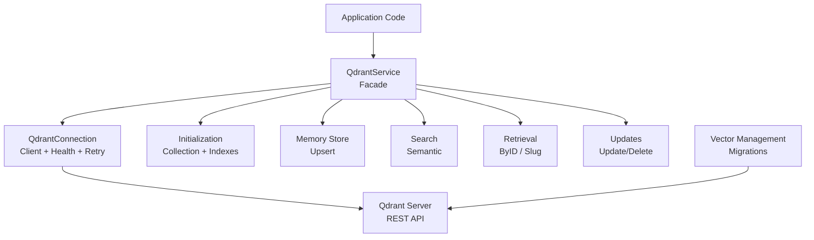
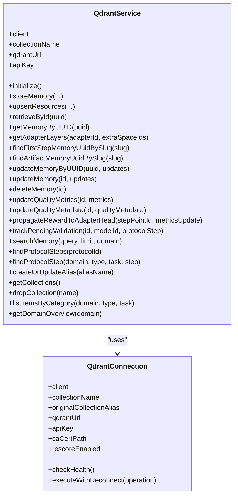
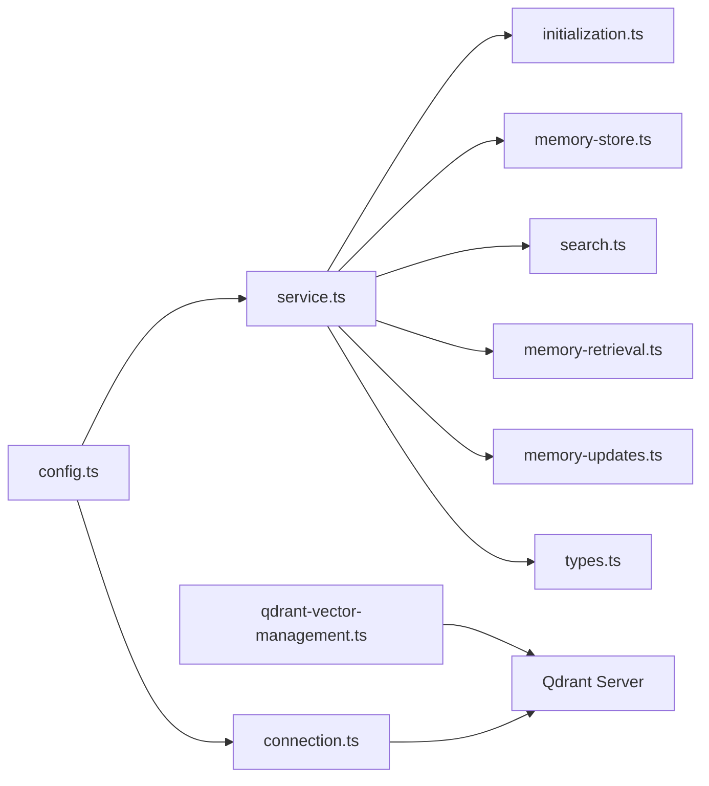

# Qdrant Vector Database Integration

<cite>
**Referenced Files in This Document**
- [service.ts](file://src/services/qdrant/service.ts)
- [connection.ts](file://src/services/qdrant/connection.ts)
- [initialization.ts](file://src/services/qdrant/initialization.ts)
- [memory-store.ts](file://src/services/qdrant/memory-store.ts)
- [search.ts](file://src/services/qdrant/search.ts)
- [memory-retrieval.ts](file://src/services/qdrant/memory-retrieval.ts)
- [memory-updates.ts](file://src/services/qdrant/memory-updates.ts)
- [types.ts](file://src/services/qdrant/types.ts)
- [qdrant-vector-management.ts](file://src/utils/qdrant-vector-management.ts)
- [config.ts](file://src/config.ts)
</cite>

## Table of Contents
1. [Introduction](#introduction)
2. [Project Structure](#project-structure)
3. [Core Components](#core-components)
4. [Architecture Overview](#architecture-overview)
5. [Detailed Component Analysis](#detailed-component-analysis)
6. [Dependency Analysis](#dependency-analysis)
7. [Performance Considerations](#performance-considerations)
8. [Troubleshooting Guide](#troubleshooting-guide)
9. [Conclusion](#conclusion)

## Introduction
This document explains the Qdrant vector database integration used by the project for semantic search and memory storage. It covers the QdrantService implementation, connection management, client configuration, vector operations (indexing, search), collection management, schema/index definitions, data migration patterns, performance considerations, scaling strategies, monitoring approaches, and security/authentication best practices.

The system supports:
- Remote Qdrant via REST with optional TLS and custom CA certificates
- Optional API key authentication to Qdrant
- Named vectors sized dynamically from embedding dimensions
- Payload indexes for filtering and text search fields
- Space-based multi-tenancy and access control
- Resilient operations with health checks and reconnection
- Metrics and structured logging for observability

## Project Structure
The Qdrant integration is implemented under src/services/qdrant with supporting utilities under src/utils and configuration in src/config. Key responsibilities:
- service.ts: Public facade exposing QdrantService and a backend-selected singleton
- connection.ts: Client initialization, TLS handling, health checks, and resilient execution
- initialization.ts: Collection creation, payload index setup, alias management, and backfills
- memory-store.ts: Upsert of memory points with embeddings and metadata
- search.ts: Semantic search using generated query embeddings
- memory-retrieval.ts: Point retrieval, slug resolution, and adapter layer queries
- memory-updates.ts: Update and delete operations with cache invalidation
- types.ts: Shared upsert interfaces
- qdrant-vector-management.ts: Vector schema migrations and recreation helpers
- config.ts: Environment-driven configuration for Qdrant URL, API key, collection name, and behavior flags

**Diagram sources**
- [service.ts:17-161](file://src/services/qdrant/service.ts#L17-L161)
- [connection.ts:11-131](file://src/services/qdrant/connection.ts#L11-L131)
- [initialization.ts:13-184](file://src/services/qdrant/initialization.ts#L13-L184)
- [memory-store.ts:14-126](file://src/services/qdrant/memory-store.ts#L14-L126)
- [search.ts:11-83](file://src/services/qdrant/search.ts#L11-L83)
- [memory-retrieval.ts:25-340](file://src/services/qdrant/memory-retrieval.ts#L25-L340)
- [memory-updates.ts:15-235](file://src/services/qdrant/memory-updates.ts#L15-L235)
- [qdrant-vector-management.ts:13-301](file://src/utils/qdrant-vector-management.ts#L13-L301)

**Section sources**
- [service.ts:17-161](file://src/services/qdrant/service.ts#L17-L161)
- [connection.ts:11-131](file://src/services/qdrant/connection.ts#L11-L131)
- [initialization.ts:13-184](file://src/services/qdrant/initialization.ts#L13-L184)
- [memory-store.ts:14-126](file://src/services/qdrant/memory-store.ts#L14-L126)
- [search.ts:11-83](file://src/services/qdrant/search.ts#L11-L83)
- [memory-retrieval.ts:25-340](file://src/services/qdrant/memory-retrieval.ts#L25-L340)
- [memory-updates.ts:15-235](file://src/services/qdrant/memory-updates.ts#L15-L235)
- [qdrant-vector-management.ts:13-301](file://src/utils/qdrant-vector-management.ts#L13-L301)
- [config.ts:106-116](file://src/config.ts#L106-L116)
- [config.ts:297-303](file://src/config.ts#L297-L303)

## Core Components
- QdrantService: Public facade that composes connection, initialization, store, retrieval, updates, quality, resources, search, protocol, listing, and reward propagation. Exposes safe getters for client, collectionName, qdrantUrl, apiKey. Provides methods for initialize, storeMemory, upsertResources, retrieveById, getMemoryByUUID, getAdapterLayers, slug lookups, update/delete, quality metrics, reward propagation, search, protocol steps, alias/collection management, and listing.
- QdrantConnection: Encapsulates QdrantClient initialization, TLS with optional custom CA, environment-derived settings, health checks, exponential backoff reconnection, and executeWithReconnect wrapper for resilient operations.
- Initialization: Creates or validates collections, ensures vector size matches embedding dimension, creates payload indexes, backfills missing space_id, optionally creates an alias, lists/drops collections.
- Memory Store: Builds points with named vectors based on embedding length, writes payloads including space_id, label, text, domain, task, type, tags, ai context, protocol info, quality metrics, timestamps; invalidates Redis caches after write.
- Search: Generates query embedding, applies space filters, performs vector similarity search with optional rescore, maps results to application model.
- Retrieval: Retrieves points by ID with access control, resolves adapter layers and slugs deterministically across spaces, paginates scroll queries.
- Updates: Update by UUID or ID with optional re-embedding when text changes, recalculates quality metadata, strict cache invalidation, delete with validation and cache invalidation.
- Types: Shared interfaces for resource upserts and results.
- Vector Management: Utilities to add/remove vectors, migrate between vector spaces, and recreate collections safely.

**Section sources**
- [service.ts:17-161](file://src/services/qdrant/service.ts#L17-L161)
- [connection.ts:11-131](file://src/services/qdrant/connection.ts#L11-L131)
- [initialization.ts:13-184](file://src/services/qdrant/initialization.ts#L13-L184)
- [memory-store.ts:14-126](file://src/services/qdrant/memory-store.ts#L14-L126)
- [search.ts:11-83](file://src/services/qdrant/search.ts#L11-L83)
- [memory-retrieval.ts:25-340](file://src/services/qdrant/memory-retrieval.ts#L25-L340)
- [memory-updates.ts:15-235](file://src/services/qdrant/memory-updates.ts#L15-L235)
- [types.ts:1-39](file://src/services/qdrant/types.ts#L1-L39)
- [qdrant-vector-management.ts:13-301](file://src/utils/qdrant-vector-management.ts#L13-L301)

## Architecture Overview
The integration follows a layered architecture:
- Facade layer: QdrantService exposes high-level operations.
- Connection layer: QdrantConnection manages client lifecycle, TLS, auth, health, retry.
- Domain modules: Initialization, store, retrieval, updates, search encapsulate specific responsibilities.
- Utilities: Vector management and shared types support schema evolution and consistency.
- Configuration: Centralized env parsing controls Qdrant URL, API key, collection name, and feature toggles.

**Diagram sources**
- [service.ts:17-161](file://src/services/qdrant/service.ts#L17-L161)
- [connection.ts:11-131](file://src/services/qdrant/connection.ts#L11-L131)

## Detailed Component Analysis

### QdrantService Implementation
- Composes QdrantConnection and delegates to submodules for initialization, store, retrieval, updates, quality, resources, search, protocol, listing, and reward propagation.
- Safe getters expose client, collectionName, qdrantUrl, apiKey without direct private field access.
- Backend-selected singleton: if Qdrant is configured, constructs QdrantService; otherwise returns embedded store double-cast to this shape to avoid import-time failures.

Key behaviors:
- initialize(): Ensures collection exists, vector sizes match, payload indexes created, alias managed.
- storeMemory(): Writes memory point with named vector vs{dimension}, payload includes space_id, label, text, domain, task, type, tags, ai context, protocol info, quality metrics, timestamps.
- searchMemory(): Embeds query, builds space filter, runs vector search with optional rescore, maps results to application model.
- Retrieval and updates: Provide access-controlled reads, deterministic slug resolution, and strict cache invalidation.

**Section sources**
- [service.ts:17-161](file://src/services/qdrant/service.ts#L17-L161)

### Connection Management and Client Configuration
- QdrantConnection constructor reads QDRANT_URL, QDRANT_API_KEY, QDRANT_COLLECTION, QDRANT_CA_CERT_PATH, QDRANT_RESCORE.
- TLS handling: If URL starts with https://, uses system CA unless QDRANT_CA_CERT_PATH is provided; sets rejectUnauthorized accordingly.
- Health check: Calls getCollections to verify connectivity; resets reconnect attempts on success.
- Reconnection: Exponential backoff with max attempts; logs details and throws SquadrulesError with codes like QDRANT_UNAVAILABLE.
- executeWithReconnect: Wraps operations, logs errors, retries once after successful reconnect, propagates SquadrulesError unchanged.

Configuration highlights:
- QDRANT_API_KEY: Optional API key for Qdrant authentication.
- QDRANT_COLLECTION: Collection alias/name; default 'squadrules'.
- QDRANT_RESCORE: Enables/disables rescore in search params.
- QDRANT_CA_CERT_PATH: Path to custom CA certificate file for TLS.

**Section sources**
- [connection.ts:11-131](file://src/services/qdrant/connection.ts#L11-L131)
- [config.ts:106-116](file://src/config.ts#L106-L116)
- [config.ts:297-303](file://src/config.ts#L297-L303)

### Vector Operations: Indexing and Search Algorithms
Indexing:
- Initialization creates payload indexes for multitenancy and filtering: space_id (keyword, is_tenant), domain, type, task, protocol.step, quality_metadata fields, ai.memory_uuid, adapter fields, slug, content_type, and text fields (adapter_name_text, label_text, activation_patterns_text, tags_text).
- Vector descriptors are derived from embedding dimension; collection recreated if mismatch.

Search:
- searchMemory generates query embedding via embeddingService, builds space filter, executes vector similarity search using named vector vs{queryEmbedding.length}.
- Supports optional rescore via conn.rescoreEnabled.
- Maps Qdrant results to application model including id, description, content, confidence/relevance, domain/task/type/tags, timestamps, protocol, uri, memory_uuid, step_number, quality_metadata.

Note on hybrid semantic + keyword:
- The current search implementation is semantic-only (vector similarity). Keyword/text search can be achieved via payload indexes and filters; hybrid combining both would require additional query composition not present in the referenced files.

**Section sources**
- [initialization.ts:13-93](file://src/services/qdrant/initialization.ts#L13-L93)
- [search.ts:11-83](file://src/services/qdrant/search.ts#L11-L83)

### Query Optimization Strategies
- Space filtering: buildSpaceFilter enforces allowedSpaceIds and optional domain constraints to reduce result set.
- Named vectors: Using vs{dimension} aligns with embedding dimension to avoid mismatches.
- Rescore toggle: conn.rescoreEnabled allows enabling quantization rescore for improved accuracy at potential cost.
- Text payload indexes: Predefined text fields enable efficient filtering and potential future hybrid queries.
- Scroll pagination: Retrieval functions use scroll with limits and offsets to avoid truncation.

**Section sources**
- [search.ts:11-83](file://src/services/qdrant/search.ts#L11-L83)
- [memory-retrieval.ts:152-200](file://src/services/qdrant/memory-retrieval.ts#L152-L200)
- [initialization.ts:50-79](file://src/services/qdrant/initialization.ts#L50-L79)

### Collection Management and Schema Definitions
- Collection creation/validation: initializeCollection checks existence, verifies vector size, recreates if mismatched, then creates payload indexes.
- Alias management: createOrUpdateAlias tries multiple REST endpoints to support various Qdrant versions; best-effort.
- Backfill: backfillSpaceId iterates points lacking space_id and upserts with SQUADRULES_APP_SPACE_ID.
- List/Drop: getCollections and dropCollection provide administrative operations.

Schema:
- Points include vector(s) named vs{dimension}, payload fields: space_id, label, text, domain, task, type, tags, ai, protocol, quality_metrics, quality_metadata, created_at, updated_at, modified_by, etc.
- Payload indexes defined for keyword and text fields to support filtering and search optimization.

**Section sources**
- [initialization.ts:13-184](file://src/services/qdrant/initialization.ts#L13-L184)
- [memory-store.ts:57-97](file://src/services/qdrant/memory-store.ts#L57-L97)

### Data Migration Patterns
- Vector descriptor changes: addVectorsToCollection attempts updateCollection; if unsupported, falls back to recreation: scroll all points, delete collection, recreate with merged vectors, upsert in batches.
- Vector space migration: migrateVectorSpace scrolls points, re-embeds content to generate new vector, upserts with new vector name while preserving payload.
- Remove vector: removeVectorFromCollection gathers points, strips specified vector, recreates collection without it, restores points.

These utilities ensure schema evolution without data loss and handle server/client capability differences gracefully.

**Section sources**
- [qdrant-vector-management.ts:13-301](file://src/utils/qdrant-vector-management.ts#L13-L301)

### Authentication Methods, API Key Management, and Security Best Practices
- Qdrant API key: QDRANT_API_KEY passed to QdrantClient; optional but recommended for production.
- TLS: For https URLs, system CA used unless QDRANT_CA_CERT_PATH provided; rejectUnauthorized enforced.
- Space-based access control: retrievePointAccessById checks point.space_id against allowedSpaceIds; app space is globally readable.
- Audit/logging: Structured logger emits operation details, errors, and timestamps; metrics track operations and durations.

Best practices:
- Always set QDRANT_API_KEY in secure environments.
- Use TLS with custom CA when required.
- Enforce space isolation via OIDC groups and space filters.
- Avoid storing secrets in logs; use structured logging with sensitive fields masked.

**Section sources**
- [connection.ts:39-61](file://src/services/qdrant/connection.ts#L39-L61)
- [memory-retrieval.ts:25-61](file://src/services/qdrant/memory-retrieval.ts#L25-L61)
- [config.ts:106-116](file://src/config.ts#L106-L116)

## Dependency Analysis

**Diagram sources**
- [config.ts:106-116](file://src/config.ts#L106-L116)
- [service.ts:17-161](file://src/services/qdrant/service.ts#L17-L161)
- [connection.ts:11-131](file://src/services/qdrant/connection.ts#L11-L131)
- [initialization.ts:13-184](file://src/services/qdrant/initialization.ts#L13-L184)
- [memory-store.ts:14-126](file://src/services/qdrant/memory-store.ts#L14-L126)
- [search.ts:11-83](file://src/services/qdrant/search.ts#L11-L83)
- [memory-retrieval.ts:25-340](file://src/services/qdrant/memory-retrieval.ts#L25-L340)
- [memory-updates.ts:15-235](file://src/services/qdrant/memory-updates.ts#L15-L235)
- [qdrant-vector-management.ts:13-301](file://src/utils/qdrant-vector-management.ts#L13-L301)

**Section sources**
- [service.ts:17-161](file://src/services/qdrant/service.ts#L17-L161)
- [connection.ts:11-131](file://src/services/qdrant/connection.ts#L11-L131)
- [initialization.ts:13-184](file://src/services/qdrant/initialization.ts#L13-L184)
- [memory-store.ts:14-126](file://src/services/qdrant/memory-store.ts#L14-L126)
- [search.ts:11-83](file://src/services/qdrant/search.ts#L11-L83)
- [memory-retrieval.ts:25-340](file://src/services/qdrant/memory-retrieval.ts#L25-L340)
- [memory-updates.ts:15-235](file://src/services/qdrant/memory-updates.ts#L15-L235)
- [qdrant-vector-management.ts:13-301](file://src/utils/qdrant-vector-management.ts#L13-L301)
- [config.ts:106-116](file://src/config.ts#L106-L116)

## Performance Considerations
- Embedding latency: Embedding generation is external; consider caching query embeddings where appropriate and tuning EMBEDDING_* settings.
- Vector dimension alignment: Ensure embedding dimension matches collection vector size; mismatches trigger recreation which is expensive.
- Rescore: Enable only when needed; may increase latency but improve accuracy.
- Batch operations: Use batch upserts during migrations/backfills to reduce overhead.
- Pagination: Scroll with reasonable limits (e.g., 256) to balance memory and throughput.
- Cache invalidation: Strict invalidation after updates/deletes prevents stale reads at the cost of transient misses.

[No sources needed since this section provides general guidance]

## Troubleshooting Guide
Common issues and resolutions:
- Qdrant unavailable: executeWithReconnect throws QDRANT_UNAVAILABLE after max attempts; verify QDRANT_URL, network, and service health.
- TLS errors: Ensure QDRANT_CA_CERT_PATH points to valid CA file when using custom CA; confirm HTTPS URL and system CA availability.
- Collection vector size mismatch: Initialization recreates collection; plan maintenance windows and backfills.
- Alias creation failures: createOrUpdateAlias tries multiple endpoints; if all fail, manually create alias pointing to target collection.
- Space access denied: retrievePointAccessById returns forbidden when point.space_id not in allowedSpaceIds; verify OIDC groups and space filters.
- Stale cache after updates: Strict invalidation should propagate; monitor Redis and ensure cache service is healthy.

Operational tips:
- Monitor qdrantOperations and qdrantQueryDuration metrics for latency and error rates.
- Review structured logs for operation names, collection, qdrantUrl, timestamps, and error details.
- Use getCollections and dropCollection for administrative tasks; exercise caution with dropCollection.

**Section sources**
- [connection.ts:63-131](file://src/services/qdrant/connection.ts#L63-L131)
- [initialization.ts:83-126](file://src/services/qdrant/initialization.ts#L83-L126)
- [memory-retrieval.ts:25-61](file://src/services/qdrant/memory-retrieval.ts#L25-L61)
- [memory-updates.ts:15-235](file://src/services/qdrant/memory-updates.ts#L15-L235)

## Conclusion
The Qdrant integration provides a robust, configurable, and observable foundation for semantic search and memory storage. QdrantService offers a clean facade over resilient connections, well-defined collection initialization, indexed payloads, and carefully managed vector schemas. Migrations and backfills ensure schema evolution without data loss. Security is reinforced through API keys, TLS, and space-based access control. Monitoring via structured logs and metrics enables proactive operations. For hybrid semantic + keyword search, extend query composition beyond the current semantic-only path while leveraging existing payload indexes.

[No sources needed since this section summarizes without analyzing specific files]