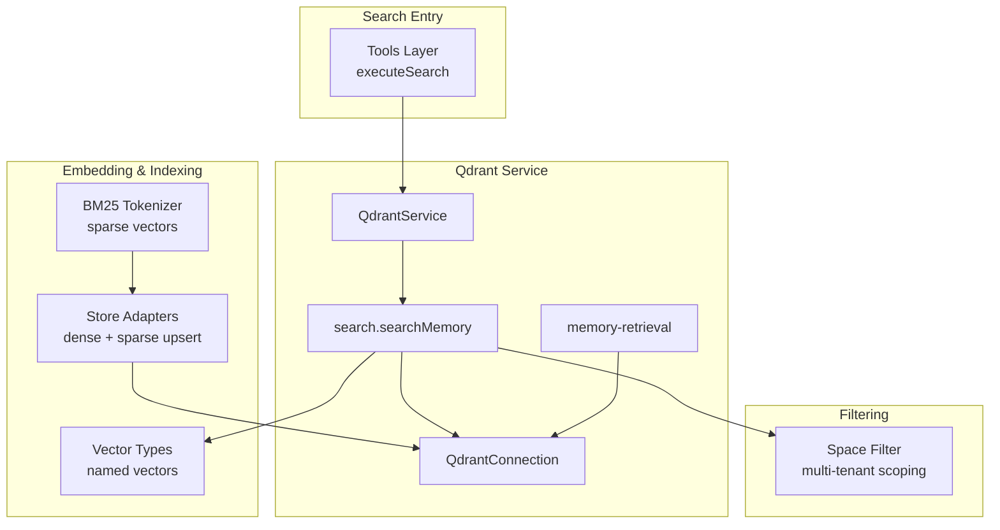
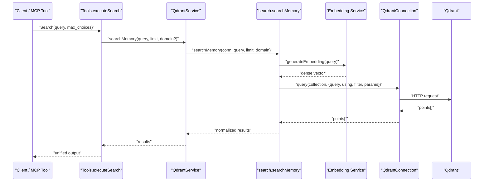
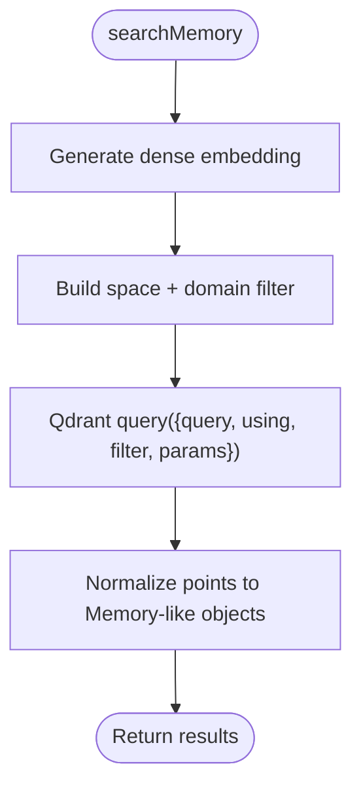
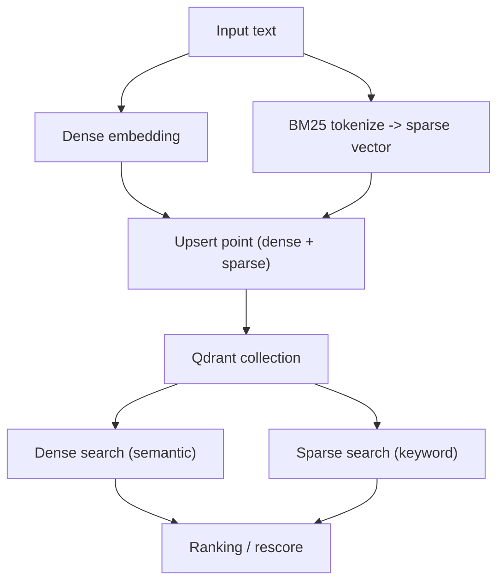
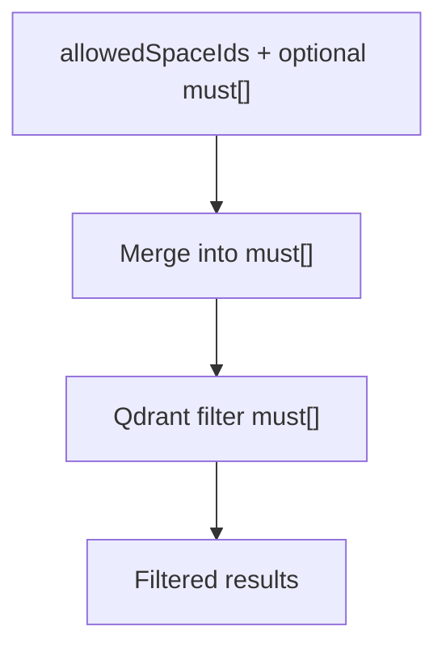
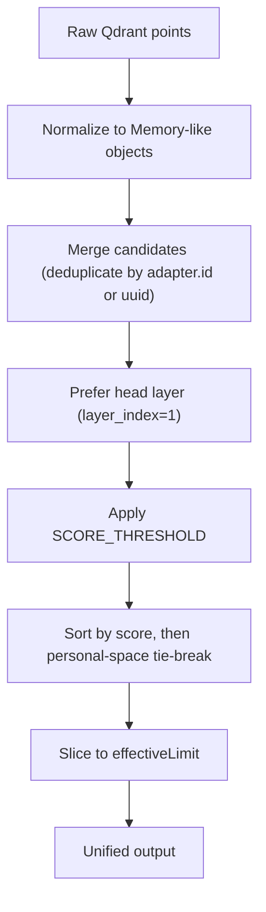
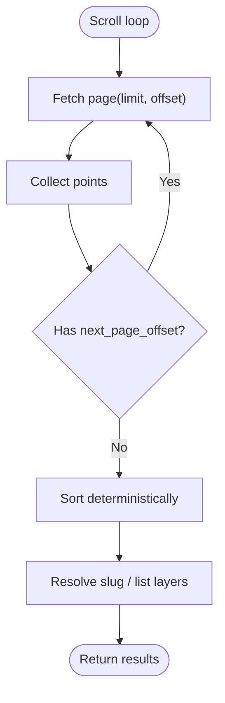
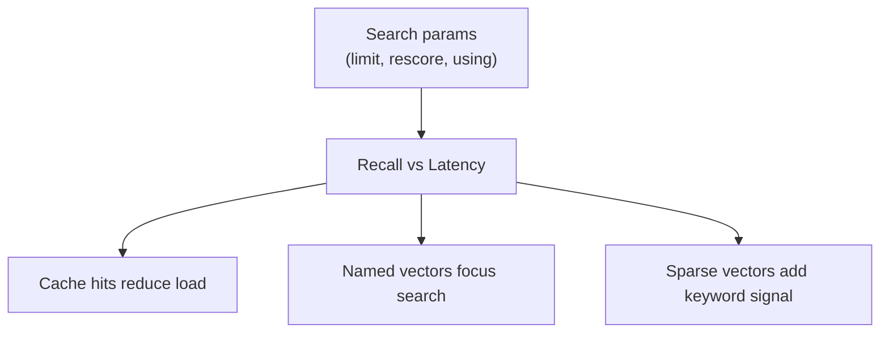
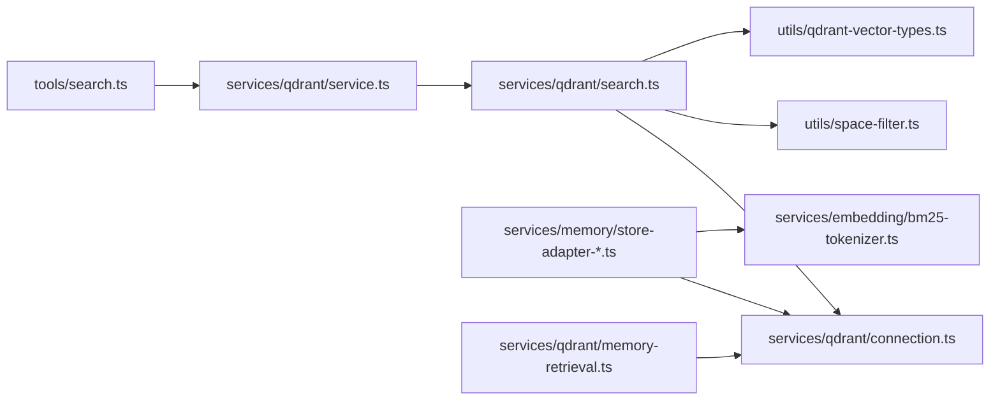

# Search Operations and Query Processing

<cite>
**Referenced Files in This Document**
- [search.ts](file://src/services/qdrant/search.ts)
- [memory-retrieval.ts](file://src/services/qdrant/memory-retrieval.ts)
- [service.ts](file://src/services/qdrant/service.ts)
- [connection.ts](file://src/services/qdrant/connection.ts)
- [types.ts](file://src/services/qdrant/types.ts)
- [qdrant-vector-types.ts](file://src/utils/qdrant-vector-types.ts)
- [space-filter.ts](file://src/utils/space-filter.ts)
- [bm25-tokenizer.ts](file://src/services/embedding/bm25-tokenizer.ts)
- [store-adapter-default-handler.ts](file://src/services/memory/store-adapter-default-handler.ts)
- [store-adapter-header-handler.ts](file://src/services/memory/store-adapter-header-handler.ts)
- [store-artifact.ts](file://src/services/memory/store-artifact.ts)
- [store-title-similarity-search.ts](file://src/services/memory/store-title-similarity-search.ts)
- [tools_search.ts](file://src/tools/search.ts)
</cite>

## Table of Contents
1. [Introduction](#introduction)
2. [Project Structure](#project-structure)
3. [Core Components](#core-components)
4. [Architecture Overview](#architecture-overview)
5. [Detailed Component Analysis](#detailed-component-analysis)
6. [Dependency Analysis](#dependency-analysis)
7. [Performance Considerations](#performance-considerations)
8. [Troubleshooting Guide](#troubleshooting-guide)
9. [Conclusion](#conclusion)

## Introduction
This document explains how Qdrant-based search and query processing work in the project, focusing on hybrid semantic + keyword search, vector similarity calculations, filtering, ranking, and optimization strategies. It covers:
- How queries are embedded and searched against named vectors
- How sparse BM25-style vectors enable keyword search alongside dense embeddings
- Filtering by space isolation and domain constraints
- Result ranking, deduplication, and pagination patterns
- Performance tuning via rescore, limits, caching, and index configuration

## Project Structure
The search stack spans services and utilities:
- Qdrant service layer exposes search and retrieval operations
- Connection layer provides resilient client access with reconnection logic
- Vector type utilities define named vectors and dimensions
- Space filter utilities enforce multi-tenant scoping
- Embedding tokenizer produces sparse vectors for BM25-style keyword search
- Memory store adapters write both dense and sparse vectors to Qdrant
- Tools layer orchestrates search execution, caching, and result formatting

**Diagram sources**
- [tools_search.ts:192-253](file://src/tools/search.ts#L192-L253)
- [service.ts:17-150](file://src/services/qdrant/service.ts#L17-L150)
- [search.ts:11-83](file://src/services/qdrant/search.ts#L11-L83)
- [connection.ts:11-131](file://src/services/qdrant/connection.ts#L11-L131)
- [qdrant-vector-types.ts:8-35](file://src/utils/qdrant-vector-types.ts#L8-L35)
- [space-filter.ts:14-26](file://src/utils/space-filter.ts#L14-L26)
- [bm25-tokenizer.ts:37-56](file://src/services/embedding/bm25-tokenizer.ts#L37-L56)
- [store-adapter-default-handler.ts:157-171](file://src/services/memory/store-adapter-default-handler.ts#L157-L171)

**Section sources**
- [service.ts:17-150](file://src/services/qdrant/service.ts#L17-L150)
- [search.ts:11-83](file://src/services/qdrant/search.ts#L11-L83)
- [connection.ts:11-131](file://src/services/qdrant/connection.ts#L11-L131)
- [qdrant-vector-types.ts:8-35](file://src/utils/qdrant-vector-types.ts#L8-L35)
- [space-filter.ts:14-26](file://src/utils/space-filter.ts#L14-L26)
- [bm25-tokenizer.ts:37-56](file://src/services/embedding/bm25-tokenizer.ts#L37-L56)

## Core Components
- QdrantService: Central facade exposing search, retrieval, updates, and collection management.
- QdrantConnection: Resilient client wrapper with health checks and exponential backoff reconnection.
- search.searchMemory: Dense vector similarity search with optional domain filter and rescore.
- memory-retrieval: Point retrieval, slug resolution, and adapter layer listing with pagination.
- qdrant-vector-types: Named vector descriptors (primary, adapter title, activation pattern).
- space-filter: Multi-tenant space isolation filters.
- bm25-tokenizer: Sparse vector generation for BM25-style keyword search.
- Store adapters: Write dense and sparse vectors; handle fallback when sparse config is missing.

Key responsibilities:
- Search orchestration and metrics
- Resilient transport and error handling
- Hybrid indexing (dense + sparse)
- Tenant-scoped filtering
- Pagination and deterministic ordering

**Section sources**
- [service.ts:17-150](file://src/services/qdrant/service.ts#L17-L150)
- [connection.ts:11-131](file://src/services/qdrant/connection.ts#L11-L131)
- [search.ts:11-83](file://src/services/qdrant/search.ts#L11-L83)
- [memory-retrieval.ts:25-102](file://src/services/qdrant/memory-retrieval.ts#L25-L102)
- [qdrant-vector-types.ts:8-35](file://src/utils/qdrant-vector-types.ts#L8-L35)
- [space-filter.ts:14-26](file://src/utils/space-filter.ts#L14-L26)
- [bm25-tokenizer.ts:37-56](file://src/services/embedding/bm25-tokenizer.ts#L37-L56)

## Architecture Overview
End-to-end search flow from tools to Qdrant:

**Diagram sources**
- [tools_search.ts:192-253](file://src/tools/search.ts#L192-L253)
- [service.ts:120-122](file://src/services/qdrant/service.ts#L120-L122)
- [search.ts:11-83](file://src/services/qdrant/search.ts#L11-L83)
- [connection.ts:98-131](file://src/services/qdrant/connection.ts#L98-L131)

## Detailed Component Analysis

### Dense Vector Similarity Search
- The search module generates a dense embedding for the query and performs a nearest-neighbor search against a named vector (e.g., vs{dimension}).
- A domain filter can be added; otherwise, space isolation is enforced via buildSpaceFilter.
- Results are normalized into a consistent shape with confidence/relevance scores derived from Qdrant’s score field.
- Rescore can be enabled via connection configuration to improve accuracy at the cost of latency.

**Diagram sources**
- [search.ts:11-83](file://src/services/qdrant/search.ts#L11-L83)
- [space-filter.ts:14-26](file://src/utils/space-filter.ts#L14-L26)

**Section sources**
- [search.ts:11-83](file://src/services/qdrant/search.ts#L11-L83)

### Hybrid Semantic + Keyword Search
- Dense vectors capture semantic similarity; sparse vectors encode BM25-style keyword signals.
- The BM25 tokenizer converts text into indices/values suitable for Qdrant sparse vector fields.
- Store adapters attach sparse vectors during upserts; if the collection lacks sparse config, they retry without sparse data.
- Title similarity search uses dense vectors with rescore enabled for improved ranking.

**Diagram sources**
- [bm25-tokenizer.ts:37-56](file://src/services/embedding/bm25-tokenizer.ts#L37-L56)
- [store-adapter-default-handler.ts:157-171](file://src/services/memory/store-adapter-default-handler.ts#L157-L171)
- [store-adapter-header-handler.ts:106-120](file://src/services/memory/store-adapter-header-handler.ts#L106-L120)
- [store-artifact.ts:221-231](file://src/services/memory/store-artifact.ts#L221-L231)
- [store-title-similarity-search.ts:38-38](file://src/services/memory/store-title-similarity-search.ts#L38-L38)

**Section sources**
- [bm25-tokenizer.ts:37-56](file://src/services/embedding/bm25-tokenizer.ts#L37-L56)
- [store-adapter-default-handler.ts:157-171](file://src/services/memory/store-adapter-default-handler.ts#L157-L171)
- [store-adapter-header-handler.ts:106-120](file://src/services/memory/store-adapter-header-handler.ts#L106-L120)
- [store-artifact.ts:221-231](file://src/services/memory/store-artifact.ts#L221-L231)
- [store-title-similarity-search.ts:38-38](file://src/services/memory/store-title-similarity-search.ts#L38-L38)

### Filtering Capabilities and Space Isolation
- Space isolation ensures queries only return points within allowed spaces.
- Filters can combine space_id constraints with additional must conditions (e.g., domain, slug, content_type).
- Adapter sibling scrolling supports retrieving related records across spaces or legacy rows without space_id.

**Diagram sources**
- [space-filter.ts:14-26](file://src/utils/space-filter.ts#L14-L26)
- [space-filter.ts:32-47](file://src/utils/space-filter.ts#L32-L47)

**Section sources**
- [space-filter.ts:14-26](file://src/utils/space-filter.ts#L14-L26)
- [space-filter.ts:32-47](file://src/utils/space-filter.ts#L32-L47)

### Result Ranking and Deduplication
- Scores come from Qdrant’s similarity scoring; normalization maps them to confidence/relevance fields.
- The tools layer merges candidates, prefers head layers, applies a score threshold, and sorts by score with personal-space tie-breaking.
- Group collapse may expand the initial candidate set to improve recall before final selection.

**Diagram sources**
- [search.ts:48-70](file://src/services/qdrant/search.ts#L48-L70)
- [tools_search.ts:58-91](file://src/tools/search.ts#L58-L91)
- [tools_search.ts:143-186](file://src/tools/search.ts#L143-L186)

**Section sources**
- [search.ts:48-70](file://src/services/qdrant/search.ts#L48-L70)
- [tools_search.ts:58-91](file://src/tools/search.ts#L58-L91)
- [tools_search.ts:143-186](file://src/tools/search.ts#L143-L186)

### Pagination Handling
- Scroll-based pagination is used for adapter layer listing and slug resolution.
- Offset-based loops collect all matching points, then sort deterministically (e.g., by layer_index or id).
- Slug resolution returns disambiguation notes when multiple adapters match.

**Diagram sources**
- [memory-retrieval.ts:152-199](file://src/services/qdrant/memory-retrieval.ts#L152-L199)
- [memory-retrieval.ts:228-300](file://src/services/qdrant/memory-retrieval.ts#L228-L300)
- [memory-retrieval.ts:303-338](file://src/services/qdrant/memory-retrieval.ts#L303-L338)

**Section sources**
- [memory-retrieval.ts:152-199](file://src/services/qdrant/memory-retrieval.ts#L152-L199)
- [memory-retrieval.ts:228-300](file://src/services/qdrant/memory-retrieval.ts#L228-L300)
- [memory-retrieval.ts:303-338](file://src/services/qdrant/memory-retrieval.ts#L303-L338)

### Query Optimization Strategies
- Rescore: Enable rescore in search parameters to refine top-k results using a more expensive pass.
- Limits: Tune first-limit and second-limit in candidate building to balance recall and performance.
- Caching: Activate/search results are cached with TTL to reduce repeated computation.
- Named vectors: Use appropriate named vectors (primary, adapter_title, activation_pattern) for targeted searches.
- Sparse vectors: Ensure collections include sparse vector schema to leverage BM25-style keyword search.

**Diagram sources**
- [search.ts:27-33](file://src/services/qdrant/search.ts#L27-L33)
- [tools_search.ts:93-111](file://src/tools/search.ts#L93-L111)
- [tools_search.ts:206-248](file://src/tools/search.ts#L206-L248)
- [qdrant-vector-types.ts:28-35](file://src/utils/qdrant-vector-types.ts#L28-L35)

**Section sources**
- [search.ts:27-33](file://src/services/qdrant/search.ts#L27-L33)
- [tools_search.ts:93-111](file://src/tools/search.ts#L93-L111)
- [tools_search.ts:206-248](file://src/tools/search.ts#L206-L248)
- [qdrant-vector-types.ts:28-35](file://src/utils/qdrant-vector-types.ts#L28-L35)

## Dependency Analysis
High-level dependencies among core components:

**Diagram sources**
- [tools_search.ts:192-253](file://src/tools/search.ts#L192-L253)
- [service.ts:17-150](file://src/services/qdrant/service.ts#L17-L150)
- [search.ts:11-83](file://src/services/qdrant/search.ts#L11-L83)
- [connection.ts:11-131](file://src/services/qdrant/connection.ts#L11-L131)
- [space-filter.ts:14-26](file://src/utils/space-filter.ts#L14-L26)
- [qdrant-vector-types.ts:8-35](file://src/utils/qdrant-vector-types.ts#L8-L35)
- [store-adapter-default-handler.ts:157-171](file://src/services/memory/store-adapter-default-handler.ts#L157-L171)
- [store-adapter-header-handler.ts:106-120](file://src/services/memory/store-adapter-header-handler.ts#L106-L120)
- [store-artifact.ts:221-231](file://src/services/memory/store-artifact.ts#L221-L231)
- [memory-retrieval.ts:25-102](file://src/services/qdrant/memory-retrieval.ts#L25-L102)

**Section sources**
- [tools_search.ts:192-253](file://src/tools/search.ts#L192-L253)
- [service.ts:17-150](file://src/services/qdrant/service.ts#L17-L150)
- [search.ts:11-83](file://src/services/qdrant/search.ts#L11-L83)
- [connection.ts:11-131](file://src/services/qdrant/connection.ts#L11-L131)
- [memory-retrieval.ts:25-102](file://src/services/qdrant/memory-retrieval.ts#L25-L102)

## Performance Considerations
- Rescore tuning: Enable rescore for higher-quality top-k results; disable for lower latency.
- Limit sizing: Increase first/second limits cautiously to improve recall; cap to avoid excessive compute.
- Named vectors: Choose the correct named vector for the task (primary vs adapter title vs activation pattern).
- Sparse vectors: Ensure sparse vector schema exists to benefit from BM25-style keyword search; handle fallback gracefully.
- Caching: Leverage activate/search cache to reduce repeated work; tune TTL based on data freshness needs.
- Space filters: Always apply space isolation to minimize scan scope.
- Connection resilience: Rely on exponential backoff and health checks to recover from transient failures.

[No sources needed since this section provides general guidance]

## Troubleshooting Guide
Common issues and diagnostics:
- Qdrant unavailable: Connection retries with exponential backoff; check health endpoint and environment variables.
- Missing sparse vector schema: Upserts retry without sparse data; verify collection configuration includes sparse vectors.
- No results: Validate space isolation filters and domain constraints; ensure embeddings exist and vector names match configured dimension.
- Ambiguous slug resolution: Disambiguation notes indicate multiple matches; prefer explicit adapter URIs.

Operational tips:
- Inspect logs for Qdrant operation errors and reconnection attempts.
- Verify environment variables for URL, API key, CA certificate path, and collection alias.
- Confirm that embedding dimension matches the configured named vectors.

**Section sources**
- [connection.ts:63-131](file://src/services/qdrant/connection.ts#L63-L131)
- [store-adapter-default-handler.ts:224-227](file://src/services/memory/store-adapter-default-handler.ts#L224-L227)
- [store-adapter-header-handler.ts:174-177](file://src/services/memory/store-adapter-header-handler.ts#L174-L177)
- [memory-retrieval.ts:228-300](file://src/services/qdrant/memory-retrieval.ts#L228-L300)

## Conclusion
The system implements robust hybrid search combining dense embeddings for semantic similarity and sparse BM25-style vectors for keyword recall. Filtering by space and domain ensures secure, scoped results. Ranking leverages Qdrant scores with application-level deduplication and tie-breaking. Performance is tuned through rescore, limits, named vectors, sparse vectors, and caching. Resilient connections and clear diagnostics help maintain reliability under failure conditions.

[No sources needed since this section summarizes without analyzing specific files]