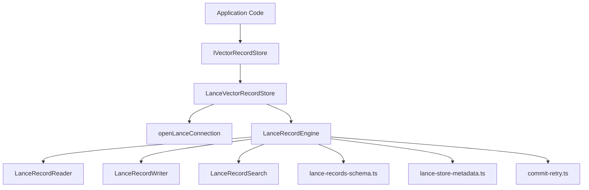
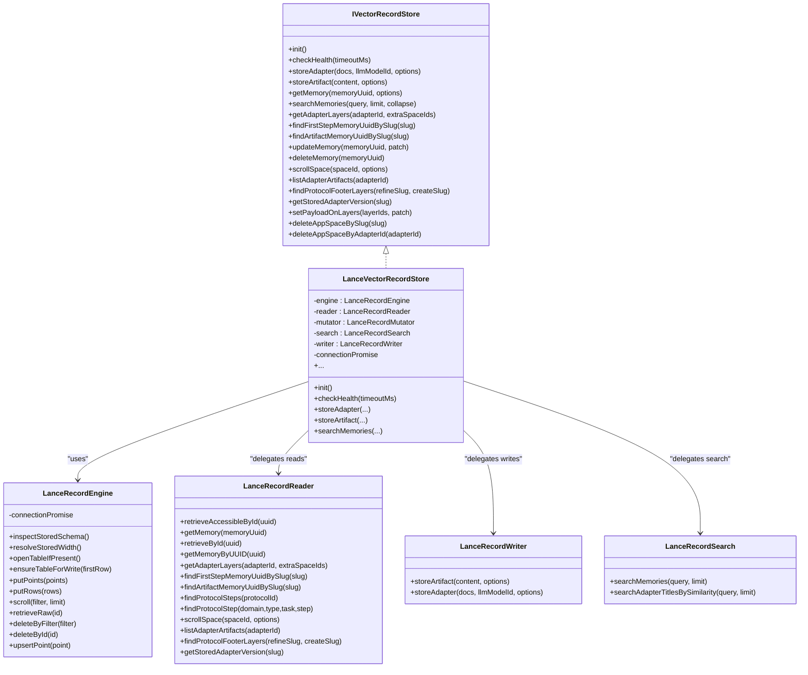
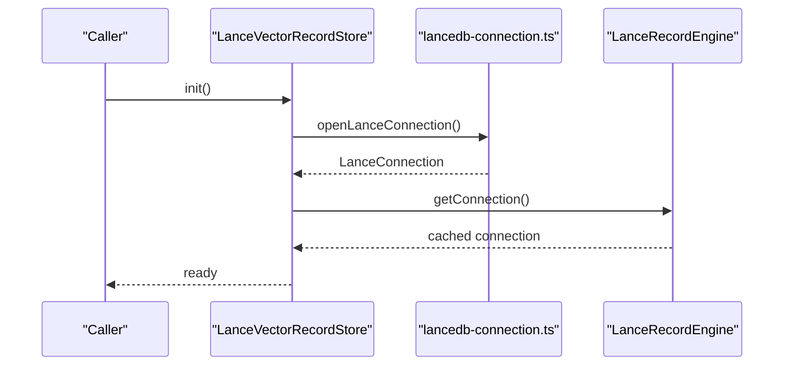
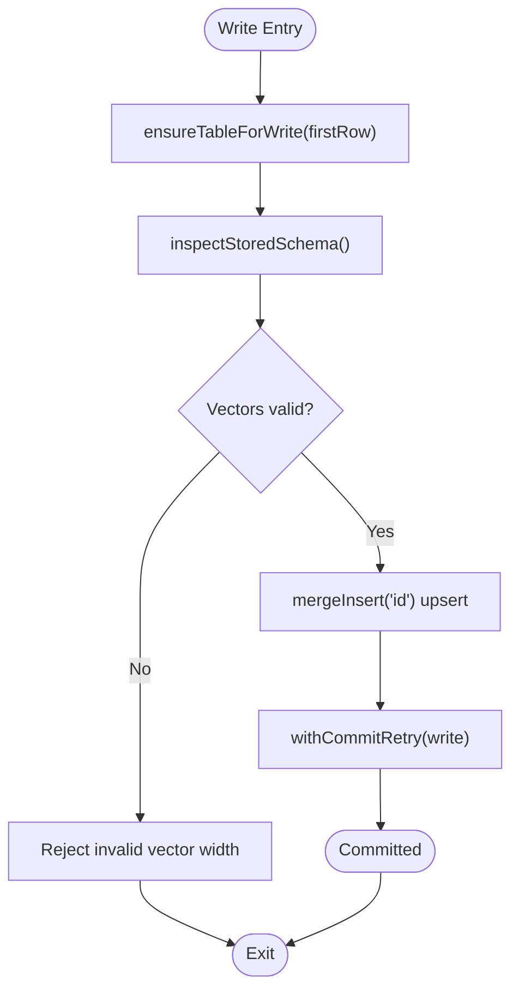
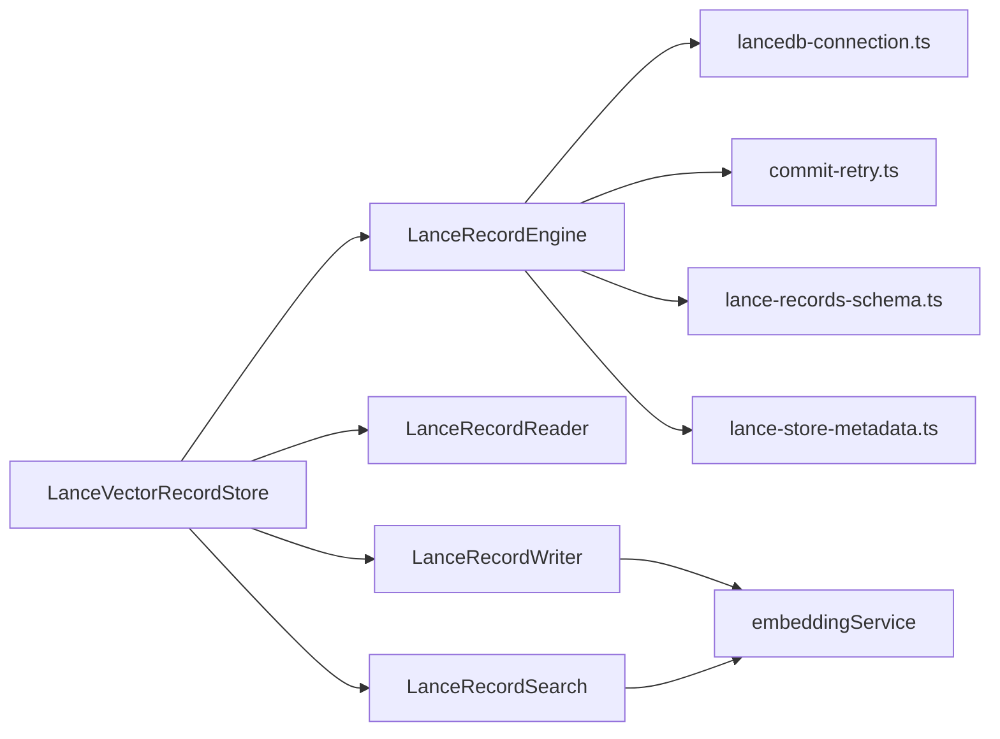

# Vector Store Backends

<cite>
**Referenced Files in This Document**
- [IVectorRecordStore.ts](file://src/services/vector-store/IVectorRecordStore.ts)
- [types.ts](file://src/services/vector-store/types.ts)
- [LanceVectorRecordStore.ts](file://src/services/vector-store/lancedb/LanceVectorRecordStore.ts)
- [lancedb-connection.ts](file://src/services/vector-store/lancedb-connection.ts)
- [embedded-store-singleton.ts](file://src/services/vector-store/embedded-store-singleton.ts)
- [lance-records-engine.ts](file://src/services/vector-store/lancedb/lance-records-engine.ts)
- [lance-records-reads.ts](file://src/services/vector-store/lancedb/lance-records-reads.ts)
- [lance-records-writes.ts](file://src/services/vector-store/lancedb/lance-records-writes.ts)
- [lance-records-search.ts](file://src/services/vector-store/lancedb/lance-records-search.ts)
- [lance-records-schema.ts](file://src/services/vector-store/lancedb/lance-records-schema.ts)
- [lance-store-metadata.ts](file://src/services/vector-store/lancedb/lance-store-metadata.ts)
- [commit-retry.ts](file://src/services/vector-store/commit-retry.ts)
</cite>

## Table of Contents
1. [Introduction](#introduction)
2. [Project Structure](#project-structure)
3. [Core Components](#core-components)
4. [Architecture Overview](#architecture-overview)
5. [Detailed Component Analysis](#detailed-component-analysis)
6. [Dependency Analysis](#dependency-analysis)
7. [Performance Considerations](#performance-considerations)
8. [Migration Strategies and Data Compatibility](#migration-strategies-and-data-compatibility)
9. [Troubleshooting Guide](#troubleshooting-guide)
10. [Conclusion](#conclusion)

## Introduction
This document explains the vector store backend abstractions used for semantic search of rules, workflows, and artifacts. The system exposes a backend-neutral interface for storing and retrieving memory records with vectors, plus a concrete embedded LanceDB implementation. It also covers connection management, operational characteristics, trade-offs between embedded and remote backends, migration strategies, and data compatibility requirements.

The project uses Qdrant as the primary (remote-capable) vector store and LanceDB as the secondary embedded store. Both are used for semantic search over adapters and artifacts.

## Project Structure
The vector store abstraction lives under `src/services/vector-store`. The key files are:
- Interface and domain types: `IVectorRecordStore.ts`, `types.ts`
- Embedded LanceDB entry point: `LanceVectorRecordStore.ts`
- Connection and singleton: `lancedb-connection.ts`, `embedded-store-singleton.ts`
- Record engine and layers: `lance-records-engine.ts`, `lance-records-reads.ts`, `lance-records-writes.ts`, `lance-records-search.ts`
- Schema and metadata: `lance-records-schema.ts`, `lance-store-metadata.ts`
- Concurrency safety: `commit-retry.ts`

**Diagram sources**
- [IVectorRecordStore.ts:27-73](file://src/services/vector-store/IVectorRecordStore.ts#L27-L73)
- [LanceVectorRecordStore.ts:35-46](file://src/services/vector-store/lancedb/LanceVectorRecordStore.ts#L35-L46)
- [lancedb-connection.ts:21-33](file://src/services/vector-store/lancedb-connection.ts#L21-L33)
- [lance-records-engine.ts:25-34](file://src/services/vector-store/lancedb/lance-records-engine.ts#L25-L34)
- [lance-records-reads.ts:46-47](file://src/services/vector-store/lancedb/lance-records-reads.ts#L46-L47)
- [lance-records-writes.ts:42-53](file://src/services/vector-store/lancedb/lance-records-writes.ts#L42-L53)
- [lance-records-search.ts:96-97](file://src/services/vector-store/lancedb/lance-records-search.ts#L96-L97)
- [lance-records-schema.ts:15-42](file://src/services/vector-store/lancedb/lance-records-schema.ts#L15-L42)
- [lance-store-metadata.ts:14-20](file://src/services/vector-store/lancedb/lance-store-metadata.ts#L14-L20)
- [commit-retry.ts:53-80](file://src/services/vector-store/commit-retry.ts#L53-L80)

**Section sources**
- [IVectorRecordStore.ts:1-74](file://src/services/vector-store/IVectorRecordStore.ts#L1-L74)
- [types.ts:1-95](file://src/services/vector-store/types.ts#L1-L95)

## Core Components
- IVectorRecordStore: Backend-neutral port defining lifecycle, writes, reads, search, adapter structure operations, enumeration/bulk ops, and admin helpers.
- LanceVectorRecordStore: Embedded LanceDB implementation satisfying the port and exposing additional read/admin methods required by existing callers.
- LanceRecordEngine: Low-level table manager providing open-or-create, upserts, scans, retrieval, and deletes with commit retry.
- LanceRecordReader: Read/query layer mirroring Qdrant semantics for adapter layers, slug resolution, protocol steps, and space-scoped enumeration.
- LanceRecordWriter: Adapter/artifact write path that builds points, computes embeddings, deduplicates, allocates slugs, and persists rows.
- LanceRecordSearch: In-process cosine similarity ranking over stored dense vectors plus text boosts.
- lancedb-connection.ts: Strong-consistency connection to the per-user LanceDB directory.
- embedded-store-singleton.ts: Shared singleton ensuring one LanceDB connection across DI slots.
- lance-records-schema.ts: Row schema, promoted scalar columns, filter-to-SQL translation, and row conversion.
- lance-store-metadata.ts: Persisted provider/model/dimension metadata for width consistency checks.
- commit-retry.ts: Bounded optimistic-concurrency retry for MVCC conflicts.

**Section sources**
- [IVectorRecordStore.ts:27-73](file://src/services/vector-store/IVectorRecordStore.ts#L27-L73)
- [LanceVectorRecordStore.ts:35-192](file://src/services/vector-store/lancedb/LanceVectorRecordStore.ts#L35-L192)
- [lance-records-engine.ts:25-195](file://src/services/vector-store/lancedb/lance-records-engine.ts#L25-L195)
- [lance-records-reads.ts:46-256](file://src/services/vector-store/lancedb/lance-records-reads.ts#L46-L256)
- [lance-records-writes.ts:42-350](file://src/services/vector-store/lancedb/lance-records-writes.ts#L42-L350)
- [lance-records-search.ts:96-141](file://src/services/vector-store/lancedb/lance-records-search.ts#L96-L141)
- [lancedb-connection.ts:21-33](file://src/services/vector-store/lancedb-connection.ts#L21-L33)
- [embedded-store-singleton.ts:12-17](file://src/services/vector-store/embedded-store-singleton.ts#L12-L17)
- [lance-records-schema.ts:15-189](file://src/services/vector-store/lancedb/lance-records-schema.ts#L15-L189)
- [lance-store-metadata.ts:14-82](file://src/services/vector-store/lancedb/lance-store-metadata.ts#L14-L82)
- [commit-retry.ts:53-80](file://src/services/vector-store/commit-retry.ts#L53-L80)

## Architecture Overview
The system separates concerns into a stable interface and layered implementations:
- Callers depend only on `IVectorRecordStore`.
- The embedded path injects a single `LanceVectorRecordStore` instance into both the memory store and legacy qdrant service slots, ensuring internal consistency.
- The LanceDB implementation delegates to specialized sub-layers: reader, writer, search, and engine.
- The engine owns the LanceDB connection and table, while higher layers translate domain concepts to LanceQL filters and rows.

**Diagram sources**
- [IVectorRecordStore.ts:27-73](file://src/services/vector-store/IVectorRecordStore.ts#L27-L73)
- [LanceVectorRecordStore.ts:35-46](file://src/services/vector-store/lancedb/LanceVectorRecordStore.ts#L35-L46)
- [lance-records-engine.ts:25-34](file://src/services/vector-store/lancedb/lance-records-engine.ts#L25-L34)
- [lance-records-reads.ts:46-47](file://src/services/vector-store/lancedb/lance-records-reads.ts#L46-L47)
- [lance-records-writes.ts:42-53](file://src/services/vector-store/lancedb/lance-records-writes.ts#L42-L53)
- [lance-records-search.ts:96-97](file://src/services/vector-store/lancedb/lance-records-search.ts#L96-L97)

## Detailed Component Analysis

### IVectorRecordStore Interface
Responsibilities:
- Lifecycle: initialization and health check.
- Writes: adapter chains and artifact documents.
- Reads: single memory retrieval with optional cache bypass.
- Search: semantic search returning memories and scores.
- Adapter structure: layer enumeration, slug resolution, payload patches, deletion.
- Enumeration/bulk ops: space scrolling, artifact listing, protocol footer lookup, version queries, bulk payload updates, app-space deletions.

Design notes:
- Methods marked delegated mirror existing Qdrant-facing signatures to preserve caller behavior.
- Neutral return shapes ensure backend independence.

**Section sources**
- [IVectorRecordStore.ts:27-73](file://src/services/vector-store/IVectorRecordStore.ts#L27-L73)

### LanceVectorRecordStore Implementation
Responsibilities:
- Implements the full `IVectorRecordStore` contract.
- Exposes additional read/admin methods required by legacy consumers.
- Manages a single LanceDB connection via lazy initialization.
- Delegates to reader, mutator, search, and writer components.

Operational characteristics:
- Health check validates connectivity.
- Admin methods like alias/collection management are no-ops for embedded mode.
- Collection name and URL reflect embedded usage.

**Section sources**
- [LanceVectorRecordStore.ts:35-192](file://src/services/vector-store/lancedb/LanceVectorRecordStore.ts#L35-L192)

### LanceDB Embedded Storage Configuration and Connection Management
Key behaviors:
- Per-user directory derived from the shared config directory.
- Lazy import of the LanceDB SDK to avoid native bindings on unrelated paths.
- Strong consistency: every read checks the latest committed version; writes use MVCC.
- Singleton pattern ensures one connection across DI slots.

**Diagram sources**
- [LanceVectorRecordStore.ts:43-52](file://src/services/vector-store/lancedb/LanceVectorRecordStore.ts#L43-L52)
- [lancedb-connection.ts:21-33](file://src/services/vector-store/lancedb-connection.ts#L21-L33)
- [lance-records-engine.ts:29-34](file://src/services/vector-store/lancedb/lance-records-engine.ts#L29-L34)

**Section sources**
- [lancedb-connection.ts:1-35](file://src/services/vector-store/lancedb-connection.ts#L1-L35)
- [embedded-store-singleton.ts:1-18](file://src/services/vector-store/embedded-store-singleton.ts#L1-L18)

### LanceRecordEngine: Table and Commit Semantics
Responsibilities:
- Open-or-create the `memory_records` table.
- Persist store metadata on first creation.
- Upsert points and rows with commit retry.
- Filtered scans and delete-by-filter.
- Resolve stored embedding width from metadata or schema inspection.

Concurrency:
- Uses bounded retry with exponential backoff and jitter for MVCC conflicts.

**Diagram sources**
- [lance-records-engine.ts:73-118](file://src/services/vector-store/lancedb/lance-records-engine.ts#L73-L118)
- [commit-retry.ts:53-80](file://src/services/vector-store/commit-retry.ts#L53-L80)

**Section sources**
- [lance-records-engine.ts:25-195](file://src/services/vector-store/lancedb/lance-records-engine.ts#L25-L195)
- [commit-retry.ts:1-81](file://src/services/vector-store/commit-retry.ts#L1-L81)

### LanceRecordReader: Reads and Query Semantics
Responsibilities:
- Accessible-by-space retrieval.
- Memory object mapping.
- Adapter layer enumeration sorted by index.
- Slug resolution with deterministic precedence and disambiguation notes.
- Protocol step queries and footer lookups.
- Space-scoped scrolling and artifact listing.

Behavioral parity:
- Mirrors Qdrant helper semantics including space gating, pagination, and exact returned shapes.

**Section sources**
- [lance-records-reads.ts:46-256](file://src/services/vector-store/lancedb/lance-records-reads.ts#L46-L256)

### LanceRecordWriter: Writes and Artifacts
Responsibilities:
- Normalize markdown, parse frontmatter, build header/default adapter flows.
- Compute embeddings and construct Qdrant-shaped points.
- Deduplicate adapters, allocate slugs, and persist rows.
- Record metrics and invalidate caches after updates.

Embedding fallback:
- On embedding failures, zero vectors are used to keep writes resilient.

**Section sources**
- [lance-records-writes.ts:42-350](file://src/services/vector-store/lancedb/lance-records-writes.ts#L42-L350)

### LanceRecordSearch: In-Process Ranking
Responsibilities:
- Embed query, derive column names from stored width, scan head records, compute hybrid score using three dense vectors and text boosts.
- Finalize results by filtering built-in footers, sorting by score then UUID, slicing to limit, and applying fallback scoring when needed.

Characteristics:
- Pure JavaScript cosine similarity; does not rely on LanceDB ANN index.

**Section sources**
- [lance-records-search.ts:96-141](file://src/services/vector-store/lancedb/lance-records-search.ts#L96-L141)

### Schema and Metadata
Schema:
- Promotes frequently filtered payload keys to real columns.
- Keeps full payload as JSON string for byte-identical reconstruction.
- Converts Qdrant-shaped points to Lance rows and translates filters to SQL-like conditions.

Metadata:
- Persists provider, model, dimension, and timestamps.
- Provides width consistency checks to detect mismatches between stored vectors and current embedding configuration.

**Section sources**
- [lance-records-schema.ts:15-189](file://src/services/vector-store/lancedb/lance-records-schema.ts#L15-L189)
- [lance-store-metadata.ts:14-82](file://src/services/vector-store/lancedb/lance-store-metadata.ts#L14-L82)

## Dependency Analysis
High-level dependencies:
- `LanceVectorRecordStore` depends on `LanceRecordEngine`, `LanceRecordReader`, `LanceRecordWriter`, `LanceRecordSearch`, and `lancedb-connection`.
- `LanceRecordEngine` depends on `lancedb-connection`, `commit-retry`, schema utilities, and metadata utilities.
- `LanceRecordWriter` depends on embedding services, ID generation, BM25 tokenization, and metrics.
- `LanceRecordSearch` depends on embedding services and vector type utilities.

**Diagram sources**
- [LanceVectorRecordStore.ts:35-46](file://src/services/vector-store/lancedb/LanceVectorRecordStore.ts#L35-L46)
- [lance-records-engine.ts:11-19](file://src/services/vector-store/lancedb/lance-records-engine.ts#L11-L19)
- [lance-records-writes.ts:14-38](file://src/services/vector-store/lancedb/lance-records-writes.ts#L14-L38)
- [lance-records-search.ts:14-30](file://src/services/vector-store/lancedb/lance-records-search.ts#L14-L30)

**Section sources**
- [LanceVectorRecordStore.ts:35-46](file://src/services/vector-store/lancedb/LanceVectorRecordStore.ts#L35-L46)
- [lance-records-engine.ts:11-19](file://src/services/vector-store/lancedb/lance-records-engine.ts#L11-L19)
- [lance-records-writes.ts:14-38](file://src/services/vector-store/lancedb/lance-records-writes.ts#L14-L38)
- [lance-records-search.ts:14-30](file://src/services/vector-store/lancedb/lance-records-search.ts#L14-L30)

## Performance Considerations
- Embedded vs remote:
  - Embedded LanceDB avoids network latency and is suitable for local development and single-host deployments.
  - Remote Qdrant provides centralized storage, horizontal scaling, and multi-process/multi-node sharing without filesystem contention.
- Search performance:
  - LanceDB search uses in-process cosine similarity over scanned head records; this is accurate but may be slower than server-side ANN at scale.
  - Qdrant can leverage optimized ANN indexes for large datasets.
- Write throughput:
  - LanceDB writes go through merge-insert with commit retry; concurrency is limited to local processes and benefits from MVCC.
  - Qdrant handles concurrent writes at the server level.
- Caching and metrics:
  - Writes invalidate caches and record metrics; embedding failures fall back to zero vectors to maintain availability.

[No sources needed since this section provides general guidance]

## Migration Strategies and Data Compatibility
- Width consistency:
  - The embedded store persists provider/model/dimension metadata. If the embedding provider changes dimensions, the store detects mismatch and advises recreating the store or reverting the provider.
- Data shape compatibility:
  - The Lance row format mirrors Qdrant points: payload is preserved verbatim, and scalar fields are promoted for efficient filtering.
  - Readers reconstruct payloads identically to the Qdrant path, preserving byte-identical memory objects.
- Migration steps:
  - Validate current embedding dimension against stored metadata before switching providers.
  - If migrating from Qdrant to LanceDB, ensure all writes produce compatible point shapes and that slug resolution and space scoping remain consistent.
  - After migration, run integration tests to verify search ordering and train parity.

**Section sources**
- [lance-store-metadata.ts:66-82](file://src/services/vector-store/lancedb/lance-store-metadata.ts#L66-L82)
- [lance-records-schema.ts:150-189](file://src/services/vector-store/lancedb/lance-records-schema.ts#L150-L189)
- [lance-records-reads.ts:46-65](file://src/services/vector-store/lancedb/lance-records-reads.ts#L46-L65)

## Troubleshooting Guide
Common issues and remedies:
- Embedding dimension mismatch:
  - Symptom: errors indicating stored dimension differs from current provider/model.
  - Resolution: recreate the LanceDB store directory or revert to the original embedding provider.
- Commit conflicts:
  - Symptom: conflict errors during concurrent writes.
  - Resolution: retries are automatic; if persistent, reduce concurrent writers or investigate underlying SDK errors.
- Search returns unexpected results:
  - Check that stored width matches query vector length; the code derives column names from stored width.
  - Verify space context and slug precedence rules for ambiguous slugs.
- Health check failures:
  - Ensure the LanceDB directory exists and is writable; confirm process has access to the per-user config directory.

**Section sources**
- [lance-store-metadata.ts:66-82](file://src/services/vector-store/lancedb/lance-store-metadata.ts#L66-L82)
- [commit-retry.ts:31-36](file://src/services/vector-store/commit-retry.ts#L31-L36)
- [lance-records-search.ts:100-124](file://src/services/vector-store/lancedb/lance-records-search.ts#L100-L124)
- [LanceVectorRecordStore.ts:54-62](file://src/services/vector-store/lancedb/LanceVectorRecordStore.ts#L54-L62)

## Conclusion
The vector store abstraction cleanly separates backend concerns behind `IVectorRecordStore`. The embedded LanceDB implementation provides a fully functional, strongly consistent, and locally deployable option with careful attention to data compatibility, concurrency, and metadata-driven width validation. For production-scale deployments requiring multi-node sharing and optimized ANN search, Qdrant remains the preferred backend. Migration between backends should prioritize embedding dimension consistency and payload shape compatibility, validated by integration tests.

[No sources needed since this section summarizes without analyzing specific files]