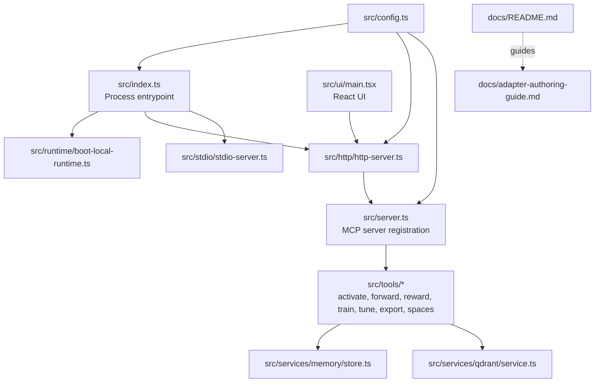
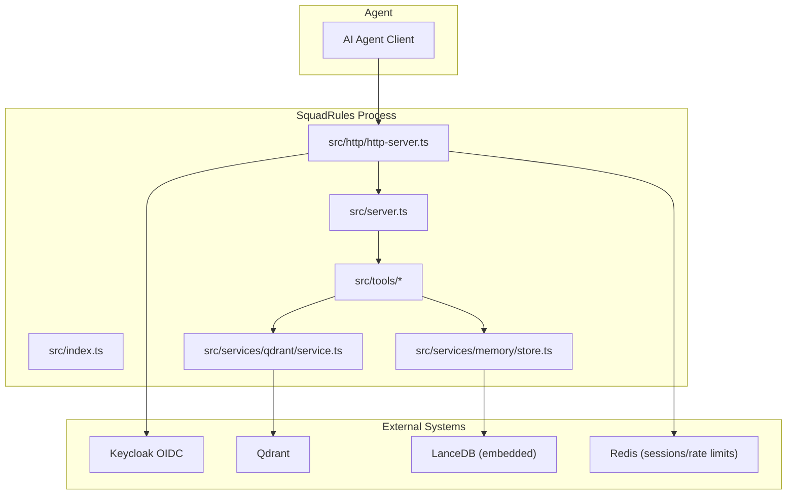
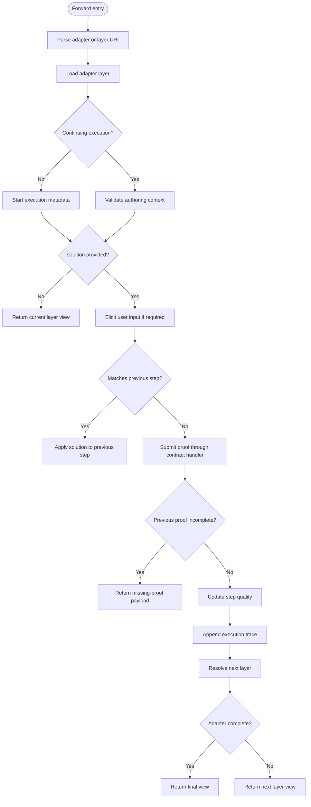
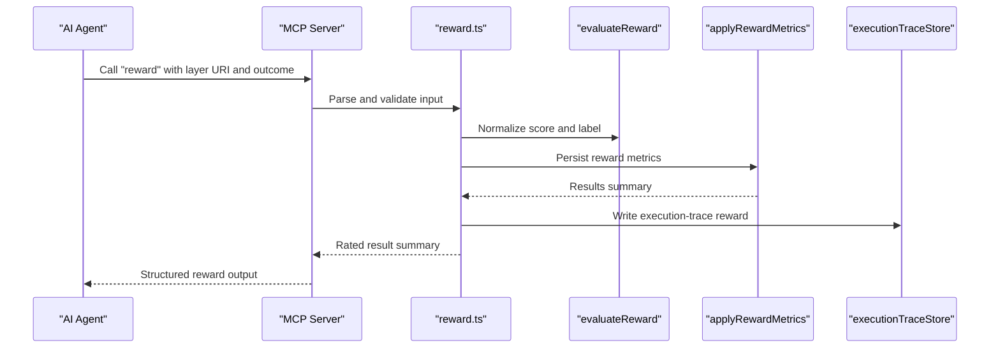
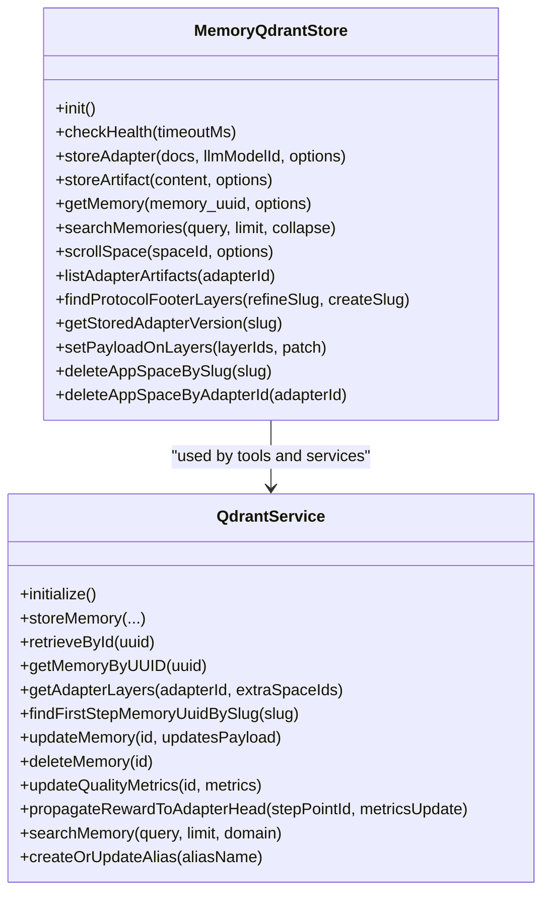
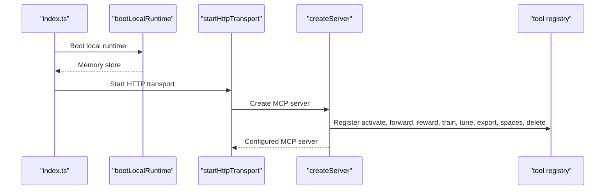
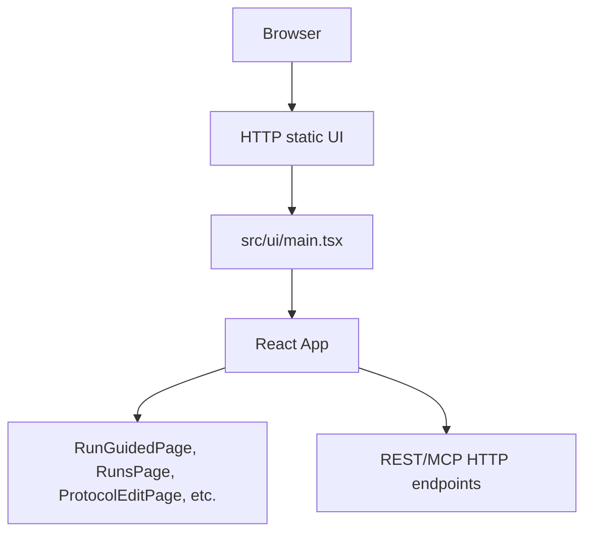
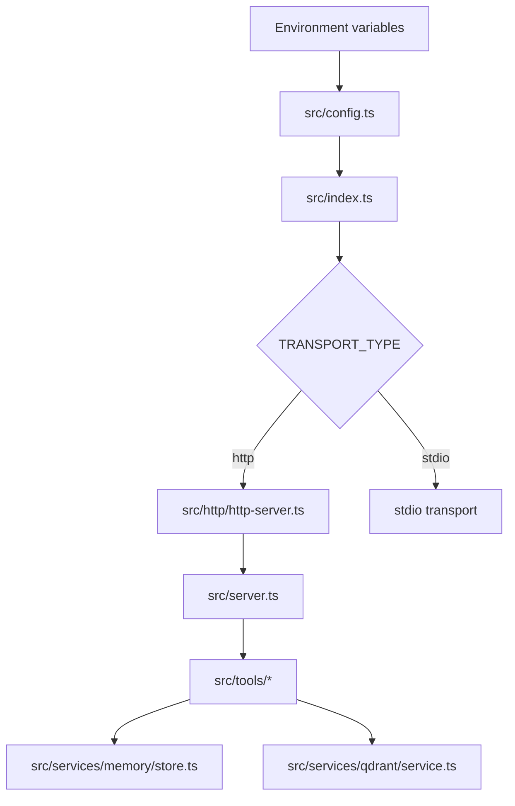

# Project Overview

<cite>
**Referenced Files in This Document**
- [index.ts](file://src/index.ts)
- [server.ts](file://src/server.ts)
- [config.ts](file://src/config.ts)
- [http-server.ts](file://src/http/http-server.ts)
- [activate.ts](file://src/tools/activate.ts)
- [forward.ts](file://src/tools/forward.ts)
- [reward.ts](file://src/tools/reward.ts)
- [store.ts](file://src/services/memory/store.ts)
- [service.ts](file://src/services/qdrant/service.ts)
- [main.tsx](file://src/ui/main.tsx)
- [README.md](file://docs/README.md)
- [adapter-authoring-guide.md](file://docs/adapter-authoring-guide.md)
</cite>

## Table of Contents
1. [Introduction](#introduction)
2. [Project Structure](#project-structure)
3. [Core Components](#core-components)
4. [Architecture Overview](#architecture-overview)
5. [Detailed Component Analysis](#detailed-component-analysis)
6. [Dependency Analysis](#dependency-analysis)
7. [Performance Considerations](#performance-considerations)
8. [Troubleshooting Guide](#troubleshooting-guide)
9. [Conclusion](#conclusion)
10. [Appendices](#appendices)

## Introduction
SquadRules is an agent-first Model Context Protocol (MCP) framework. Its primary users are AI agents; humans configure preferences, author adapters, and review outcomes through the same system. The core workflow is the activate→forward→reward chain:

- **Activate** finds or creates an adapter for a query.
- **Forward** executes deterministic, auditable steps inside adapters.
- **Reward** records success, failure, scores, and feedback to improve future activation and search.

Adapters define workflows as layered memory structures with contracts that enforce verification. Spaces provide tenant-scoped isolation. Vector stores back semantic search over rules, protocols, and artifacts. Authentication integrates with Keycloak for both human and agent requests.

This document explains how SquadRules fits into AI agent ecosystems, how agents interact through MCP tools, and how the codebase implements deterministic execution, adapter management, and semantic search.

## Project Structure
The repository separates runtime entrypoints, HTTP transport, MCP tool implementations, services, UI, configuration, documentation, and examples.



**Diagram sources**
- [index.ts:60-107](file://src/index.ts#L60-L107)
- [http-server.ts:22-58](file://src/http/http-server.ts#L22-L58)
- [server.ts:44-80](file://src/server.ts#L44-L80)
- [config.ts:245-280](file://src/config.ts#L245-L280)
- [main.tsx:11-19](file://src/ui/main.tsx#L11-L19)

**Section sources**
- [index.ts:1-130](file://src/index.ts#L1-L130)
- [http-server.ts:1-59](file://src/http/http-server.ts#L1-L59)
- [server.ts:1-115](file://src/server.ts#L1-L115)
- [config.ts:1-351](file://src/config.ts#L1-L351)
- [main.tsx:1-20](file://src/ui/main.tsx#L1-L20)
- [README.md:1-33](file://docs/README.md#L1-L33)

## Core Components
SquadRules exposes MCP tools that implement the agent workflow:

| Tool | Purpose | Primary Data Flow |
|---|---|---|
| `activate` | Semantic search and adapter selection | Query → vector search → ranked choices → next-action guidance |
| `forward` | Deterministic step execution | Adapter layer → contract evaluation → proof submission → next layer |
| `reward` | Outcome recording | Layer URI → outcome/score → metrics and trace persistence |
| `train` / `tune` | Adapter creation and refinement | Markdown/artifacts → validation → embedding → storage |
| `export` | Skill and artifact packaging | Stored adapters → bundles for distribution |
| `spaces` | Tenant and space discovery | Auth context → space listing and filtering |
| `delete` | Adapter cleanup | Identifier → removal from memory store |

Agents call these tools through MCP clients. Human operators use the React UI and CLI for authoring, inspection, and administration.

**Section sources**
- [server.ts:60-80](file://src/server.ts#L60-L80)
- [activate.ts:231-281](file://src/tools/activate.ts#L231-L281)
- [forward.ts:91-339](file://src/tools/forward.ts#L91-L339)
- [reward.ts:132-176](file://src/tools/reward.ts#L132-L176)

## Architecture Overview
At runtime, SquadRules selects either HTTP or stdio transport. In HTTP mode it serves the REST API, MCP Streamable HTTP endpoints, static UI assets, health routes, and OIDC authentication flows. In stdio mode it runs as a local MCP child process without an HTTP listener.



**Diagram sources**
- [index.ts:60-107](file://src/index.ts#L60-L107)
- [http-server.ts:22-58](file://src/http/http-server.ts#L22-L58)
- [server.ts:44-80](file://src/server.ts#L44-L80)
- [store.ts:29-66](file://src/services/memory/store.ts#L29-L66)
- [service.ts:17-28](file://src/services/qdrant/service.ts#L17-L28)
- [config.ts:245-280](file://src/config.ts#L245-L280)

## Detailed Component Analysis

### Activate Tool
`activate` performs semantic search over stored adapters and returns ranked choices. It supports:

- Normal queries resolved through vector search.
- Authoring mode that routes to the built-in author adapter.
- Space-scoped resolution when a space or space ID is provided.
- Artifact linking instructions so agents can materialize scripts before execution.

```mermaid
sequenceDiagram
participant Agent as "AI Agent"
participant MCP as "MCP Server"
participant Activate as "activate.ts"
participant Search as "search logic"
participant Store as "MemoryQdrantStore"
participant Qdrant as "QdrantService"
Agent->>MCP : Call "activate" with query and optional space
MCP->>Activate : Parse input schema
Activate->>Search : Execute semantic search
Search->>Store : Read memories
Search->>Qdrant : Vector retrieval
Qdrant-->>Search : Ranked results
Search-->>Activate : Choices with scores
Activate-->>MCP : Structured activation output
MCP-->>Agent : Choices, next_action, transport hints
```

**Diagram sources**
- [activate.ts:168-229](file://src/tools/activate.ts#L168-L229)
- [activate.ts:231-281](file://src/tools/activate.ts#L231-L281)
- [store.ts:144-153](file://src/services/memory/store.ts#L144-L153)
- [service.ts:120-122](file://src/services/qdrant/service.ts#L120-L122)

**Section sources**
- [activate.ts:1-281](file://src/tools/activate.ts#L1-L281)

### Forward Tool
`forward` drives the deterministic workflow inside an adapter. It handles:

- Adapter and layer URI parsing.
- Execution lifecycle tracking per `execution_id`.
- Proof-of-work submission, missing-proof handling, and previous-step application.
- Contract evaluation, user-input elicitation, and step quality updates.
- Finalization guidance toward `reward`.



**Diagram sources**
- [forward.ts:91-156](file://src/tools/forward.ts#L91-L156)
- [forward.ts:157-339](file://src/tools/forward.ts#L157-L339)

**Section sources**
- [forward.ts:1-340](file://src/tools/forward.ts#L1-L340)

### Reward Tool
`reward` records the outcome of a completed layer. It validates that a layer whose last stored proof failed cannot be marked successful, evaluates scoring and eligibility, persists metrics, and writes execution-trace rewards.



**Diagram sources**
- [reward.ts:28-130](file://src/tools/reward.ts#L28-L130)
- [reward.ts:132-176](file://src/tools/reward.ts#L132-L176)

**Section sources**
- [reward.ts:1-176](file://src/tools/reward.ts#L1-L176)

### Memory and Vector Services
SquadRules uses two vector-store paths:

- **Qdrant**: primary, remote-capable, used for semantic search, protocol lookup, quality metrics, and reward propagation.
- **LanceDB**: secondary, embedded, used in local stdio mode when Qdrant is not configured.

`MemoryQdrantStore` wraps Qdrant client operations, collection alias resolution, health checks, adapter storage, artifact listing, and space-scoped scrolling. `QdrantService` composes connection, initialization, memory CRUD, search, protocol helpers, and reward propagation. When Qdrant is unavailable, the shared embedded record store is double-cast to the service shape so callers remain consistent.



**Diagram sources**
- [store.ts:29-272](file://src/services/memory/store.ts#L29-L272)
- [service.ts:17-161](file://src/services/qdrant/service.ts#L17-L161)

**Section sources**
- [store.ts:1-272](file://src/services/memory/store.ts#L1-L272)
- [service.ts:1-161](file://src/services/qdrant/service.ts#L1-L161)

### MCP Server and Tool Registration
The MCP server registers tools, resources, prompts, and UI capabilities. It also installs a strict tools list handler that reflects the internal tool registry and JSON schemas.



**Diagram sources**
- [index.ts:60-107](file://src/index.ts#L60-L107)
- [server.ts:44-80](file://src/server.ts#L44-L80)

**Section sources**
- [server.ts:1-115](file://src/server.ts#L1-L115)

### UI and Human Interaction
The React UI is served by the HTTP transport and provides pages for account management, protocol editing, guided runs, runs history, skill bundles, and Squadrules workspace navigation. The UI entrypoint initializes React, theme provider, and query client.



**Diagram sources**
- [http-server.ts:38-44](file://src/http/http-server.ts#L38-L44)
- [main.tsx:11-19](file://src/ui/main.tsx#L11-L19)

**Section sources**
- [http-server.ts:1-59](file://src/http/http-server.ts#L1-L59)
- [main.tsx:1-20](file://src/ui/main.tsx#L1-L20)

## Dependency Analysis
The runtime boot sequence resolves configuration, selects transport, boots the memory store, optionally starts metrics, and then starts HTTP or stdio. Configuration centralizes environment variables for Redis, Qdrant, Keycloak, embedding providers, search behavior, rate limits, and ports.



**Diagram sources**
- [config.ts:50-137](file://src/config.ts#L50-L137)
- [config.ts:245-351](file://src/config.ts#L245-L351)
- [index.ts:60-107](file://src/index.ts#L60-L107)
- [http-server.ts:22-58](file://src/http/http-server.ts#L22-L58)

**Section sources**
- [config.ts:1-351](file://src/config.ts#L1-L351)
- [index.ts:1-130](file://src/index.ts#L1-L130)

## Performance Considerations
- Embedding latency and retries are configurable through environment variables, including retry budgets, backoff caps, and warning thresholds.
- Search behavior includes overfetch factors, maximum fetch counts, minimum and maximum choice bounds, and group collapse toggles.
- Health checks for Qdrant include timeouts and race-safe cancellation.
- Embedded LanceDB avoids external dependencies in local stdio mode.
- Metrics are collected for tool calls, durations, input/output sizes, and system-level telemetry.

[No sources needed since this section provides general guidance]

## Troubleshooting Guide
Common operational issues include:

- **Missing Qdrant configuration**: Qdrant URL must be set when using the remote vector backend; otherwise, the system falls back to embedded LanceDB.
- **Authentication misconfiguration**: When `AUTH_ENABLED=true`, Keycloak URL, realm, client ID, callback base URL, and session secret must be present.
- **Reward conflicts**: Recording success for a layer whose last stored proof failed is rejected; fix the step and rerun.
- **Authoring context mismatch**: Continuing an authoring run requires matching adapter, operation, and target adapter URI.
- **Forward contract violations**: A `forward` contract must link to another adapter; bare tool calls are rejected.

**Section sources**
- [config.ts:252-266](file://src/config.ts#L252-L266)
- [reward.ts:19-54](file://src/tools/reward.ts#L19-L54)
- [forward.ts:113-131](file://src/tools/forward.ts#L113-L131)
- [adapter-authoring-guide.md:115-139](file://docs/adapter-authoring-guide.md#L115-L139)

## Conclusion
SquadRules is an agent-first MCP framework that turns adapters into deterministic, auditable workflows. Agents drive the activate→forward→reward chain, while humans author, review, and operate those adapters through the CLI, UI, and MCP tools. The architecture cleanly separates transport, server registration, tool logic, memory storage, vector search, and authentication. For newcomers, think of adapters as protocols and spaces as teams; for experienced developers, focus on the tool contracts, proof handling, vector-backed search, and environment-driven deployment topology.

[No sources needed since this section summarizes without analyzing specific files]

## Appendices

### Practical Agent Examples
Conceptual examples showing how agents interact with SquadRules:

- **Deterministic workflow execution**: An agent calls `activate` with a natural-language request, receives a ranked adapter choice, then calls `forward` repeatedly until the adapter completes, finally calling `reward` with `success` or `failure`.
- **Adapter management**: An agent uses `train` to publish a new adapter, `tune` to refine it after critic-loop review, and `export` to bundle it for distribution.
- **Semantic search capabilities**: An agent queries `activate` across spaces, inspects linked artifacts, and chooses between existing adapters or creates a new one based on activation scores and next-action guidance.

These examples align with the documented MCP tools and the adapter authoring guide’s verification ladder.

**Section sources**
- [server.ts:60-80](file://src/server.ts#L60-L80)
- [adapter-authoring-guide.md:23-83](file://docs/adapter-authoring-guide.md#L23-L83)
- [adapter-authoring-guide.md:202-234](file://docs/adapter-authoring-guide.md#L202-L234)