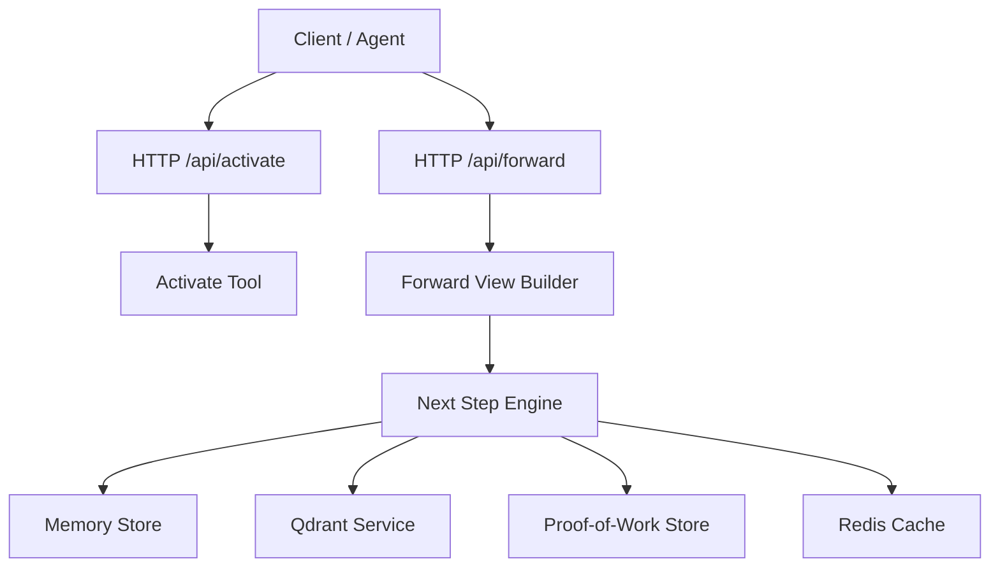
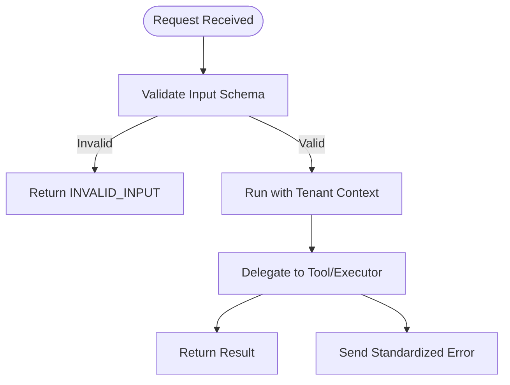
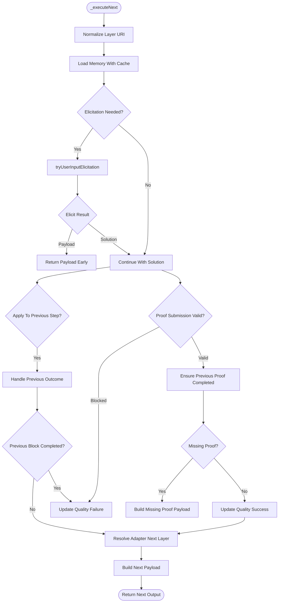
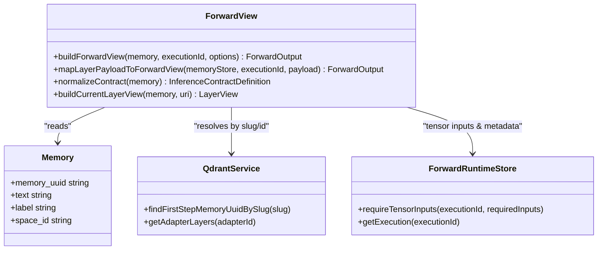
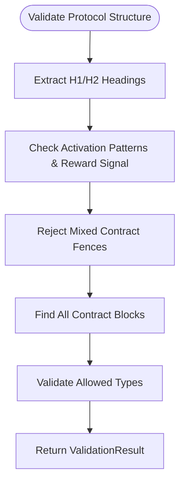
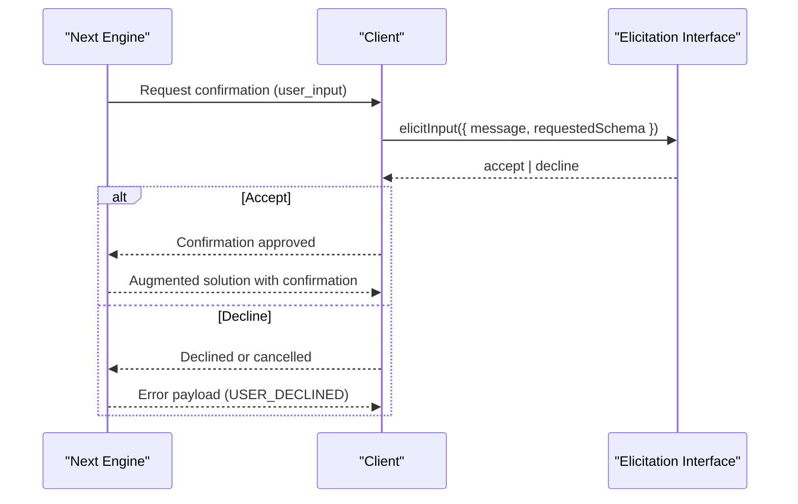
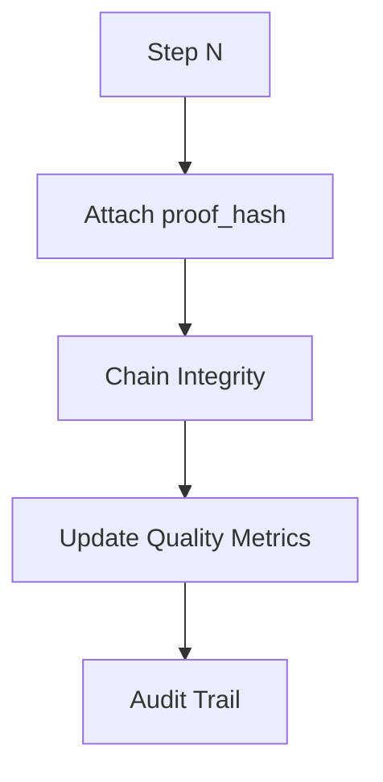
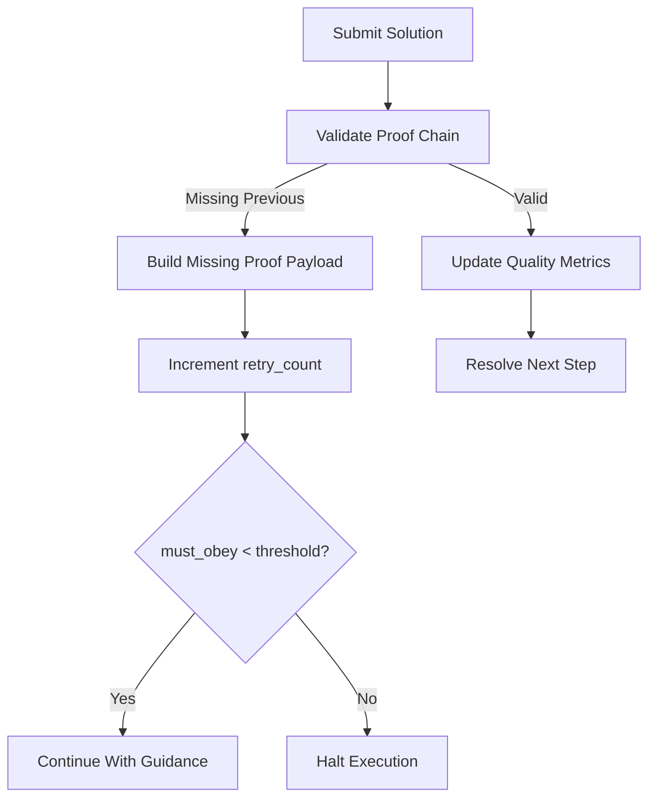
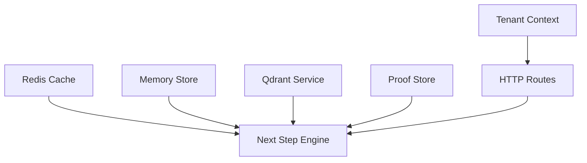
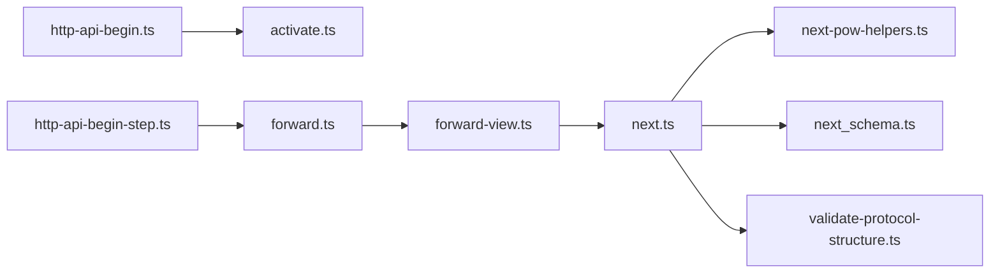

# Protocol Execution Engine

<cite>
**Referenced Files in This Document**
- [src/tools/next.ts](file://src/tools/next.ts)
- [src/tools/forward-view.ts](file://src/tools/forward-view.ts)
- [src/http/http-api-begin.ts](file://src/http/http-api-begin.ts)
- [src/http/http-api-begin-step.ts](file://src/http/http-api-begin-step.ts)
- [src/services/memory/validate-protocol-structure.ts](file://src/services/memory/validate-protocol-structure.ts)
- [src/tools/next-pow-helpers.ts](file://src/tools/next-pow-helpers.ts)
- [src/tools/next_schema.ts](file://src/tools/next_schema.ts)
</cite>

## Table of Contents
1. [Introduction](#introduction)
2. [Project Structure](#project-structure)
3. [Core Components](#core-components)
4. [Architecture Overview](#architecture-overview)
5. [Detailed Component Analysis](#detailed-component-analysis)
6. [Dependency Analysis](#dependency-analysis)
7. [Performance Considerations](#performance-considerations)
8. [Troubleshooting Guide](#troubleshooting-guide)
9. [Conclusion](#conclusion)

## Introduction
This document explains the protocol execution engine that manages multi-step workflows (adapters). Protocols define deterministic, auditable task sequences with state persistence and recovery mechanisms. The engine coordinates activation, forward steps, and reward finalization while supporting human-in-the-loop approvals, execution tracing for auditability, robust error handling with retry strategies, and graceful degradation across distributed deployments.

Key principles:
- Deterministic step sequencing via adapter layers.
- Auditable proof-of-work chaining to ensure integrity.
- Human-in-the-loop elicitation for user_input contracts.
- State persistence through memory stores and vector services.
- Retry and escalation patterns for missing proofs and failed submissions.
- Consistent UI-facing output via a normalized forward view.

## Project Structure
The protocol execution engine spans HTTP routes, tool implementations, and shared utilities:
- HTTP routes expose activate and forward endpoints.
- Tool logic implements next-step resolution, proof validation, and quality updates.
- Forward view normalization maps internal payloads to a stable UI contract.
- Protocol structure validation ensures adapters are well-formed before training.



**Diagram sources**
- [src/http/http-api-begin.ts:14-38](file://src/http/http-api-begin.ts#L14-L38)
- [src/http/http-api-begin-step.ts:13-37](file://src/http/http-api-begin-step.ts#L13-L37)
- [src/tools/forward-view.ts:242-290](file://src/tools/forward-view.ts#L242-L290)
- [src/tools/next.ts:137-272](file://src/tools/next.ts#L137-L272)

**Section sources**
- [src/http/http-api-begin.ts:14-38](file://src/http/http-api-begin.ts#L14-L38)
- [src/http/http-api-begin-step.ts:13-37](file://src/http/http-api-begin-step.ts#L13-L37)
- [src/tools/forward-view.ts:242-290](file://src/tools/forward-view.ts#L242-L290)
- [src/tools/next.ts:137-272](file://src/tools/next.ts#L137-L272)

## Core Components
- HTTP API entry points:
  - Activate route validates input and delegates to the activate tool.
  - Forward route validates input and delegates to the forward executor.
- Next step engine:
  - Resolves current layer, applies solutions, validates proofs, and determines next action.
  - Updates step quality metrics on success/failure.
  - Integrates human-in-the-loop elicitation for user_input contracts.
- Forward view builder:
  - Normalizes internal payloads into a consistent ForwardOutput shape for UI and clients.
  - Handles tensor inputs, challenge reuse, and finalization hints.
- Protocol structure validator:
  - Ensures adapters have required sections and valid contract blocks before training.

**Section sources**
- [src/http/http-api-begin.ts:14-38](file://src/http/http-api-begin.ts#L14-L38)
- [src/http/http-api-begin-step.ts:13-37](file://src/http/http-api-begin-step.ts#L13-L37)
- [src/tools/next.ts:85-129](file://src/tools/next.ts#L85-L129)
- [src/tools/next.ts:137-272](file://src/tools/next.ts#L137-L272)
- [src/tools/forward-view.ts:242-290](file://src/tools/forward-view.ts#L242-L290)
- [src/services/memory/validate-protocol-structure.ts:113-185](file://src/services/memory/validate-protocol-structure.ts#L113-L185)

## Architecture Overview
The engine orchestrates a three-phase workflow:
1. Activate: Selects an adapter and prepares the first layer.
2. Forward: Executes one or more layers, validating proofs and optionally eliciting human approval.
3. Reward: Finalizes the adapter with outcome and feedback.

```mermaid
sequenceDiagram
participant Client as "Client"
participant HTTP as "HTTP Routes"
participant Activate as "Activate Tool"
participant Forward as "Forward Executor"
participant Next as "Next Step Engine"
participant Memory as "Memory Store"
participant Qdrant as "Qdrant Service"
participant Proof as "Proof Store"
participant Cache as "Redis Cache"
Client->>HTTP : POST /api/activate
HTTP->>Activate : executeActivate(...)
Activate-->>Client : First layer context
Client->>HTTP : POST /api/forward
HTTP->>Forward : executeForward(...)
Forward->>Next : _executeNext(input)
Next->>Cache : loadMemoryWithCache(uuid)
Cache-->>Next : Memory or null
Next->>Memory : getMemory(uuid) if miss
Next->>Proof : handleProofSubmission(solution)
Next->>Qdrant : updateStepQuality(outcome)
Next-->>Forward : Next payload (current_step, challenge, next_action)
Forward-->>Client : ForwardOutput (normalized)
```

**Diagram sources**
- [src/http/http-api-begin.ts:14-38](file://src/http/http-api-begin.ts#L14-L38)
- [src/http/http-api-begin-step.ts:13-37](file://src/http/http-api-begin-step.ts#L13-L37)
- [src/tools/next.ts:24-34](file://src/tools/next.ts#L24-L34)
- [src/tools/next.ts:137-272](file://src/tools/next.ts#L137-L272)
- [src/tools/forward-view.ts:242-290](file://src/tools/forward-view.ts#L242-L290)

## Detailed Component Analysis

### HTTP API Entry Points
- Activate route:
  - Validates input using a schema.
  - Logs request details.
  - Delegates to activate tool within tenant context.
  - Returns result or standardized error.
- Forward route:
  - Validates input using a schema.
  - Logs request details.
  - Delegates to forward executor within tenant context.
  - Returns result or standardized error.



**Diagram sources**
- [src/http/http-api-begin.ts:14-38](file://src/http/http-api-begin.ts#L14-L38)
- [src/http/http-api-begin-step.ts:13-37](file://src/http/http-api-begin-step.ts#L13-L37)

**Section sources**
- [src/http/http-api-begin.ts:14-38](file://src/http/http-api-begin.ts#L14-L38)
- [src/http/http-api-begin-step.ts:13-37](file://src/http/http-api-begin-step.ts#L13-L37)

### Next Step Engine (_executeNext)
Responsibilities:
- Normalize layer URIs and resolve memory with cache.
- Optionally elicit human confirmation for user_input contracts.
- Apply solutions to previous steps when applicable.
- Validate proof-of-work chain and enforce expected previous hashes.
- Update step quality metrics on success/failure.
- Determine next layer and build display payload.



**Diagram sources**
- [src/tools/next.ts:137-272](file://src/tools/next.ts#L137-L272)
- [src/tools/next-pow-helpers.ts:58-120](file://src/tools/next-pow-helpers.ts#L58-L120)

**Section sources**
- [src/tools/next.ts:24-34](file://src/tools/next.ts#L24-L34)
- [src/tools/next.ts:85-129](file://src/tools/next.ts#L85-L129)
- [src/tools/next.ts:137-272](file://src/tools/next.ts#L137-L272)
- [src/tools/next-pow-helpers.ts:58-120](file://src/tools/next-pow-helpers.ts#L58-L120)

### Forward View Builder
Responsibilities:
- Normalize internal payloads into a stable ForwardOutput shape.
- Handle tensor inputs from runtime store.
- Reuse challenges via nonce/proof_hash when available.
- Provide next_call guidance (forward vs reward).
- Include UI summary fields and artifact directory hints.



**Diagram sources**
- [src/tools/forward-view.ts:242-290](file://src/tools/forward-view.ts#L242-L290)
- [src/tools/forward-view.ts:146-177](file://src/tools/forward-view.ts#L146-L177)
- [src/tools/forward-view.ts:178-220](file://src/tools/forward-view.ts#L178-L220)

**Section sources**
- [src/tools/forward-view.ts:242-290](file://src/tools/forward-view.ts#L242-L290)
- [src/tools/forward-view.ts:146-177](file://src/tools/forward-view.ts#L146-L177)
- [src/tools/forward-view.ts:178-220](file://src/tools/forward-view.ts#L178-L220)

### Protocol Structure Validation
Purpose:
- Enforce required sections (Activation Patterns, Reward Signal).
- Require at least one JSON contract block.
- Reject mixed-fence documents.
- Validate allowed contract types.



**Diagram sources**
- [src/services/memory/validate-protocol-structure.ts:113-185](file://src/services/memory/validate-protocol-structure.ts#L113-L185)

**Section sources**
- [src/services/memory/validate-protocol-structure.ts:113-185](file://src/services/memory/validate-protocol-structure.ts#L113-L185)

### Human-in-the-Loop Approval Workflow
- When a contract type is user_input, the engine may elicit a confirmation prompt.
- If the client supports elicitation, the engine requests a structured confirmation.
- On acceptance, the solution is augmented with confirmation and timestamp.
- On decline or cancellation, the engine returns an error payload with code USER_DECLINED.
- If elicitation fails, it returns ELICITATION_FAILED.



**Diagram sources**
- [src/tools/next-pow-helpers.ts:58-120](file://src/tools/next-pow-helpers.ts#L58-L120)

**Section sources**
- [src/tools/next-pow-helpers.ts:58-120](file://src/tools/next-pow-helpers.ts#L58-L120)

### Execution Tracing and Auditability
- Each step can carry a proof_hash to link to prior steps, forming an auditable chain.
- The forward view includes optional proof_hash, error_code, and retry_count fields.
- Quality metrics are updated per step to track success/failure over time.
- The next schema defines fields for two-phase retry escalation (error_code, retry_count).



**Diagram sources**
- [src/tools/forward-view.ts:281-288](file://src/tools/forward-view.ts#L281-L288)
- [src/tools/next_schema.ts:1-14](file://src/tools/next_schema.ts#L1-L14)
- [src/tools/next.ts:85-129](file://src/tools/next.ts#L85-L129)

**Section sources**
- [src/tools/forward-view.ts:281-288](file://src/tools/forward-view.ts#L281-L288)
- [src/tools/next_schema.ts:1-14](file://src/tools/next_schema.ts#L1-L14)
- [src/tools/next.ts:85-129](file://src/tools/next.ts#L85-L129)

### Error Handling, Retry, and Graceful Degradation
- Missing proof errors:
  - When a previous step’s proof is not completed, the engine builds a missing-proof payload with retry_count and error_code.
  - must_obey may be false after retries exceed thresholds.
- Two-phase retry escalation:
  - The next schema includes error_code and retry_count to support escalation strategies.
- Quality metric updates:
  - Failures and successes update step quality metrics; failures decrement bonus, successes increment.
- Graceful degradation:
  - If qdrant service is unavailable during slug resolution, the engine throws a clear error.
  - Redis cache misses fall back to direct memory store reads.



**Diagram sources**
- [src/tools/next.ts:229-256](file://src/tools/next.ts#L229-L256)
- [src/tools/next_schema.ts:1-14](file://src/tools/next_schema.ts#L1-L14)
- [src/tools/forward-view.ts:292-321](file://src/tools/forward-view.ts#L292-L321)

**Section sources**
- [src/tools/next.ts:229-256](file://src/tools/next.ts#L229-L256)
- [src/tools/next_schema.ts:1-14](file://src/tools/next_schema.ts#L1-L14)
- [src/tools/forward-view.ts:292-321](file://src/tools/forward-view.ts#L292-L321)

### Coordination Across Components and Distributed Deployments
- Memory caching:
  - Redis cache is used to reduce memory store load and improve latency.
- Qdrant integration:
  - Slug-based adapter resolution and layer enumeration rely on Qdrant service.
- Tenant context:
  - HTTP routes run tools within tenant context to isolate spaces and data.
- Consistency:
  - Proof-of-work store maintains hash linkage across steps.
  - Quality metrics provide observable consistency signals.



**Diagram sources**
- [src/tools/next.ts:24-34](file://src/tools/next.ts#L24-L34)
- [src/tools/forward-view.ts:146-177](file://src/tools/forward-view.ts#L146-L177)
- [src/http/http-api-begin.ts:30-32](file://src/http/http-api-begin.ts#L30-L32)
- [src/http/http-api-begin-step.ts:29-31](file://src/http/http-api-begin-step.ts#L29-L31)

**Section sources**
- [src/tools/next.ts:24-34](file://src/tools/next.ts#L24-L34)
- [src/tools/forward-view.ts:146-177](file://src/tools/forward-view.ts#L146-L177)
- [src/http/http-api-begin.ts:30-32](file://src/http/http-api-begin.ts#L30-L32)
- [src/http/http-api-begin-step.ts:29-31](file://src/http/http-api-begin-step.ts#L29-L31)

## Dependency Analysis


**Diagram sources**
- [src/http/http-api-begin.ts:14-38](file://src/http/http-api-begin.ts#L14-L38)
- [src/http/http-api-begin-step.ts:13-37](file://src/http/http-api-begin-step.ts#L13-L37)
- [src/tools/forward-view.ts:242-290](file://src/tools/forward-view.ts#L242-L290)
- [src/tools/next.ts:137-272](file://src/tools/next.ts#L137-L272)
- [src/tools/next-pow-helpers.ts:58-120](file://src/tools/next-pow-helpers.ts#L58-L120)
- [src/tools/next_schema.ts:1-14](file://src/tools/next_schema.ts#L1-L14)
- [src/services/memory/validate-protocol-structure.ts:113-185](file://src/services/memory/validate-protocol-structure.ts#L113-L185)

**Section sources**
- [src/http/http-api-begin.ts:14-38](file://src/http/http-api-begin.ts#L14-L38)
- [src/http/http-api-begin-step.ts:13-37](file://src/http/http-api-begin-step.ts#L13-L37)
- [src/tools/forward-view.ts:242-290](file://src/tools/forward-view.ts#L242-L290)
- [src/tools/next.ts:137-272](file://src/tools/next.ts#L137-L272)
- [src/tools/next-pow-helpers.ts:58-120](file://src/tools/next-pow-helpers.ts#L58-L120)
- [src/tools/next_schema.ts:1-14](file://src/tools/next_schema.ts#L1-L14)
- [src/services/memory/validate-protocol-structure.ts:113-185](file://src/services/memory/validate-protocol-structure.ts#L113-L185)

## Performance Considerations
- Use Redis cache for memory reads to reduce database load and latency.
- Batch quality metric updates where possible to minimize write amplification.
- Avoid unnecessary slug resolution by passing explicit layer UUIDs when known.
- Reuse challenges via nonce/proof_hash to reduce redundant computation.
- Monitor Qdrant service health and degrade gracefully when unavailable.

[No sources needed since this section provides general guidance]

## Troubleshooting Guide
Common issues and resolutions:
- Invalid input:
  - Symptom: 400 response with INVALID_INPUT.
  - Action: Validate request body against schemas for activate and forward.
- Missing proof:
  - Symptom: Error code MISSING_PROOF with retry_count.
  - Action: Provide the required previous step’s proof_hash and evidence.
- User declined confirmation:
  - Symptom: Error code USER_DECLINED.
  - Action: Review elicitation prompts and ensure client supports user_input flows.
- Elicitation failure:
  - Symptom: Error code ELICITATION_FAILED.
  - Action: Verify client capabilities and elicitInput implementation.
- Slug resolution failure:
  - Symptom: Error indicating adapter resolution requires qdrantService.
  - Action: Ensure Qdrant service is available and configured correctly.
- Protocol structure invalid:
  - Symptom: Training rejects adapter due to missing sections or invalid contract blocks.
  - Action: Add Activation Patterns and Reward Signal sections; use ```json for contract blocks; set allowed types.

**Section sources**
- [src/http/http-api-begin.ts:17-26](file://src/http/http-api-begin.ts#L17-L26)
- [src/http/http-api-begin-step.ts:16-25](file://src/http/http-api-begin-step.ts#L16-L25)
- [src/tools/next.ts:229-256](file://src/tools/next.ts#L229-L256)
- [src/tools/next-pow-helpers.ts:89-118](file://src/tools/next-pow-helpers.ts#L89-L118)
- [src/tools/forward-view.ts:155-157](file://src/tools/forward-view.ts#L155-L157)
- [src/services/memory/validate-protocol-structure.ts:113-185](file://src/services/memory/validate-protocol-structure.ts#L113-L185)

## Conclusion
The protocol execution engine provides a robust, auditable framework for multi-step workflows. It enforces deterministic sequencing, integrates human-in-the-loop approvals, and offers strong error handling with retry strategies. Through caching, Qdrant integration, and proof-of-work chaining, it maintains consistency and observability across distributed deployments. Adhering to protocol structure validation and following the troubleshooting guide ensures reliable operation and easier debugging.

[No sources needed since this section summarizes without analyzing specific files]