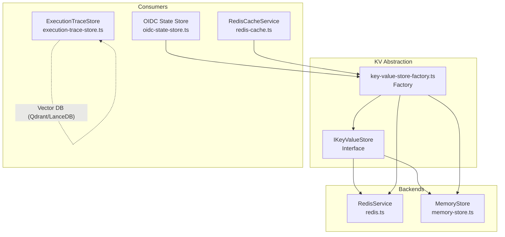
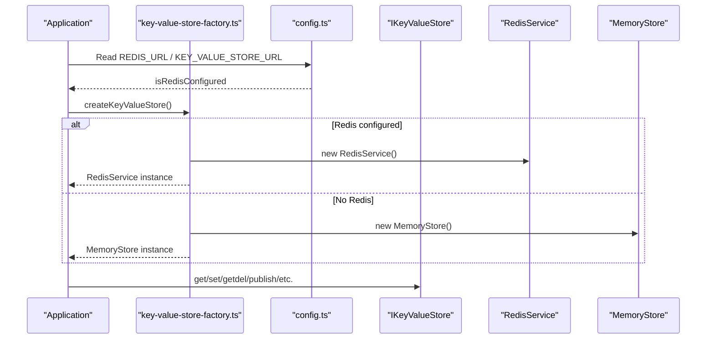
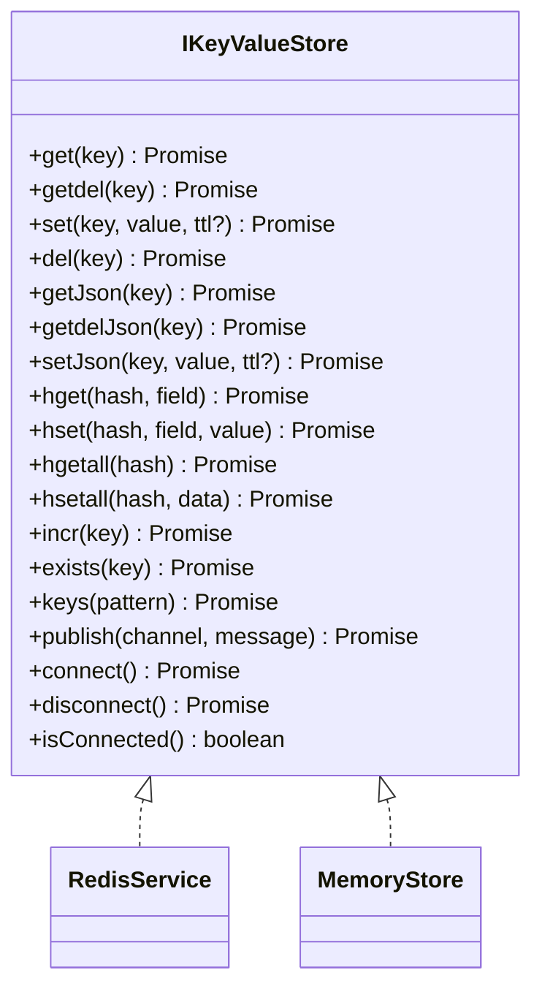
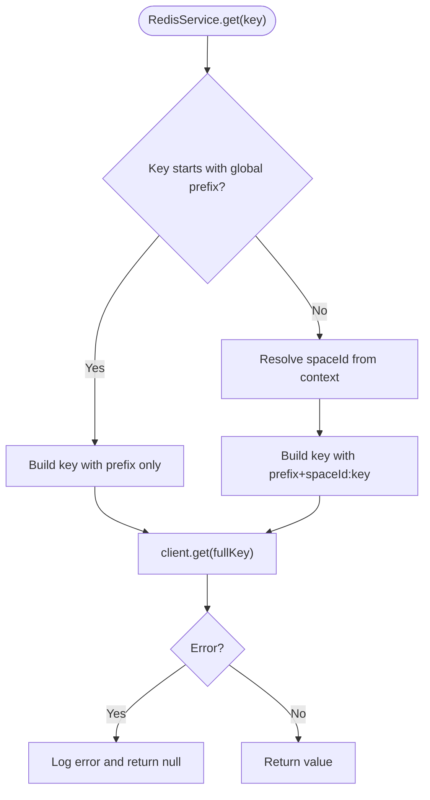
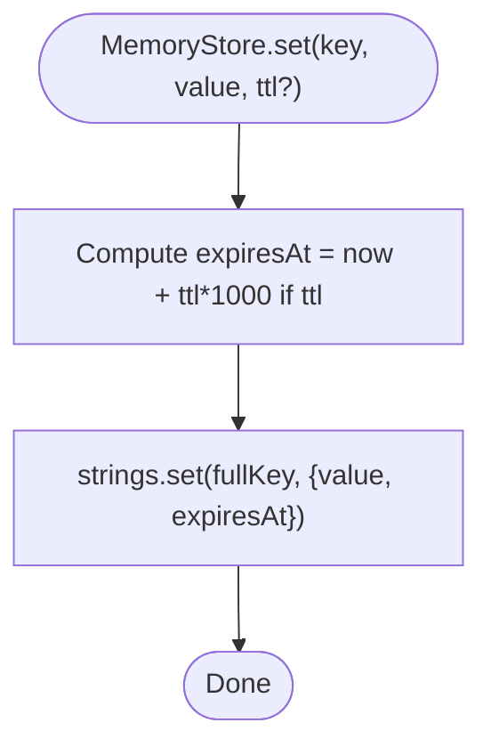
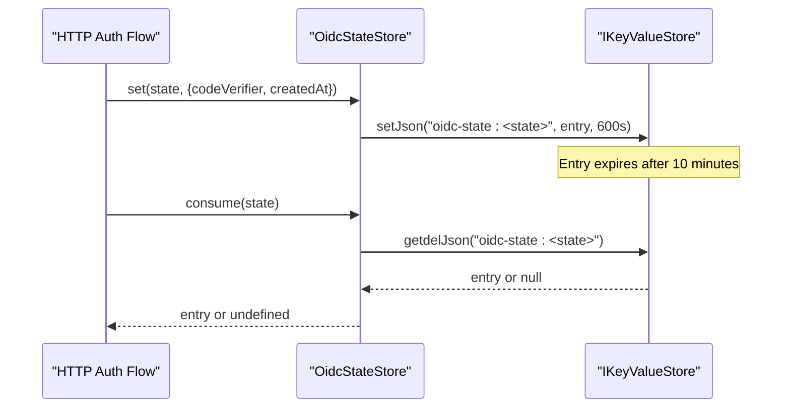
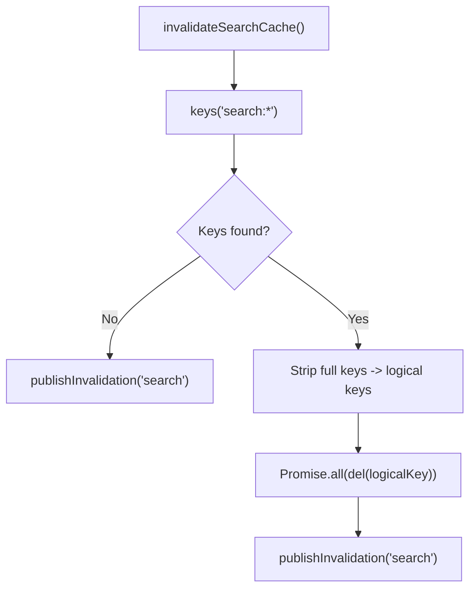
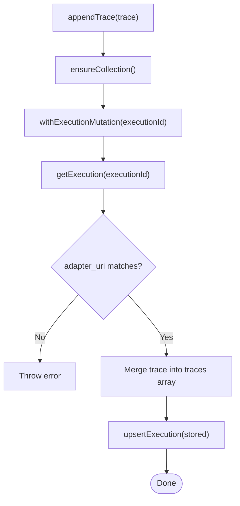
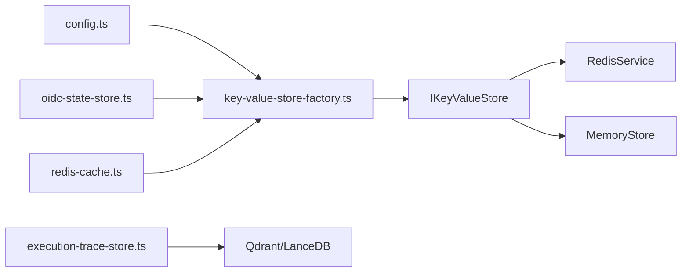

# Key-Value Stores

<cite>
**Referenced Files in This Document**
- [key-value-store.ts](file://src/services/key-value-store.ts)
- [key-value-store-factory.ts](file://src/services/key-value-store-factory.ts)
- [redis.ts](file://src/services/redis.ts)
- [memory-store.ts](file://src/services/memory-store.ts)
- [oidc-state-store.ts](file://src/services/oidc-state-store.ts)
- [execution-trace-store.ts](file://src/services/execution-trace-store.ts)
- [redis-cache.ts](file://src/services/redis-cache.ts)
- [config.ts](file://src/config.ts)
</cite>

## Table of Contents
1. [Introduction](#introduction)
2. [Project Structure](#project-structure)
3. [Core Components](#core-components)
4. [Architecture Overview](#architecture-overview)
5. [Detailed Component Analysis](#detailed-component-analysis)
6. [Dependency Analysis](#dependency-analysis)
7. [Performance Considerations](#performance-considerations)
8. [Troubleshooting Guide](#troubleshooting-guide)
9. [Conclusion](#conclusion)

## Introduction
This document explains the key-value store abstraction and its multiple backend implementations used across the application. It covers:
- The factory pattern that selects Redis or an in-memory store based on environment configuration.
- Redis integration, including connection management, namespacing, TTLs, pub/sub, and JSON helpers.
- OIDC state store for OAuth2 flow state and security token handling.
- Execution trace store for capturing and retrieving workflow execution history.
- Cache invalidation strategies, TTL policies, and data expiration behavior.
- High availability, failover considerations, and consistency guarantees.
- Performance characteristics and capacity planning guidance.

## Project Structure
The key-value layer is composed of a small interface, two concrete backends (Redis and in-memory), a factory for selection, and higher-level consumers such as OIDC state and cache services. The execution trace store uses vector storage (Qdrant or LanceDB) rather than the KV store.

**Diagram sources**
- [key-value-store.ts:7-28](file://src/services/key-value-store.ts#L7-L28)
- [key-value-store-factory.ts:13-22](file://src/services/key-value-store-factory.ts#L13-L22)
- [redis.ts:26-292](file://src/services/redis.ts#L26-L292)
- [memory-store.ts:27-201](file://src/services/memory-store.ts#L27-L201)
- [oidc-state-store.ts:50-75](file://src/services/oidc-state-store.ts#L50-L75)
- [redis-cache.ts:21-274](file://src/services/redis-cache.ts#L21-L274)
- [execution-trace-store.ts:31-289](file://src/services/execution-trace-store.ts#L31-L289)

**Section sources**
- [key-value-store.ts:1-29](file://src/services/key-value-store.ts#L1-L29)
- [key-value-store-factory.ts:1-23](file://src/services/key-value-store-factory.ts#L1-L23)
- [redis.ts:1-293](file://src/services/redis.ts#L1-L293)
- [memory-store.ts:1-202](file://src/services/memory-store.ts#L1-L202)
- [oidc-state-store.ts:1-76](file://src/services/oidc-state-store.ts#L1-L76)
- [execution-trace-store.ts:1-289](file://src/services/execution-trace-store.ts#L1-L289)
- [redis-cache.ts:1-274](file://src/services/redis-cache.ts#L1-L274)
- [config.ts:50-57](file://src/config.ts#L50-L57)

## Core Components
- IKeyValueStore: Defines the shared API for string, hash, increment, existence checks, keys scanning, publish, and JSON helpers.
- RedisService: Production backend with connection lifecycle, error logging, space-aware key namespacing, TTL support, and pub/sub.
- MemoryStore: In-process backend with TTL tracking, simple glob-based keys matching, and no cross-process pub/sub.
- Factory: Selects RedisService when REDIS_URL/KEY_VALUE_STORE_URL is configured; otherwise MemoryStore.
- OIDC State Store: Uses the factory-backed KV store to persist PKCE state with atomic get-and-delete semantics.
- RedisCacheService: Application-level search and memory resource caching using the KV store with TTLs and invalidation events.
- ExecutionTraceStore: Persists workflow traces via Qdrant or LanceDB (not the KV store).

Key responsibilities:
- Backend selection: single decision point driven by environment variables.
- Namespacing: per-space isolation except for global prefixes (memory cache and OIDC state).
- TTL and expiration: enforced at the backend level.
- Atomic operations: GETDEL for one-time tokens and state.
- Pub/Sub: cross-instance invalidation via Redis channels.

**Section sources**
- [key-value-store.ts:7-28](file://src/services/key-value-store.ts#L7-L28)
- [key-value-store-factory.ts:13-22](file://src/services/key-value-store-factory.ts#L13-L22)
- [redis.ts:26-292](file://src/services/redis.ts#L26-L292)
- [memory-store.ts:27-201](file://src/services/memory-store.ts#L27-L201)
- [oidc-state-store.ts:50-75](file://src/services/oidc-state-store.ts#L50-L75)
- [redis-cache.ts:21-274](file://src/services/redis-cache.ts#L21-L274)
- [execution-trace-store.ts:31-289](file://src/services/execution-trace-store.ts#L31-L289)

## Architecture Overview
The system chooses a KV backend once at startup and exposes it through a singleton. Consumers never inspect environment variables directly for backend selection.

**Diagram sources**
- [key-value-store-factory.ts:13-22](file://src/services/key-value-store-factory.ts#L13-L22)
- [config.ts:50-57](file://src/config.ts#L50-L57)
- [redis.ts:26-108](file://src/services/redis.ts#L26-L108)
- [memory-store.ts:27-46](file://src/services/memory-store.ts#L27-L46)

## Detailed Component Analysis

### Key-Value Store Interface and Factory
- IKeyValueStore defines methods for strings, hashes, counters, existence checks, key scans, pub/sub, and JSON wrappers.
- Factory reads `isRedisConfigured` from config and returns either RedisService or MemoryStore.
- Consumers receive a single IKeyValueStore instance without knowing the backend.

**Diagram sources**
- [key-value-store.ts:7-28](file://src/services/key-value-store.ts#L7-L28)
- [redis.ts:26-292](file://src/services/redis.ts#L26-L292)
- [memory-store.ts:27-201](file://src/services/memory-store.ts#L27-L201)

**Section sources**
- [key-value-store.ts:7-28](file://src/services/key-value-store.ts#L7-L28)
- [key-value-store-factory.ts:13-22](file://src/services/key-value-store-factory.ts#L13-L22)

### Redis Service
Responsibilities:
- Connection lifecycle: connect/disconnect, readiness, and close events.
- Error logging: detailed logs for client errors, including inner errors.
- Key namespacing: applies a configurable prefix and per-space ID unless the key starts with global prefixes (memory cache or OIDC state).
- Operations: strings, hashes, incr, exists, keys, publish, plus JSON helpers.
- TTL: setEx for time-bounded values.

**Diagram sources**
- [redis.ts:110-126](file://src/services/redis.ts#L110-L126)

**Section sources**
- [redis.ts:26-292](file://src/services/redis.ts#L26-L292)

### In-Memory Store
Responsibilities:
- Process-local key/value store with TTL tracking.
- Same naming strategy as RedisService (prefix + optional spaceId), except global prefixes are not namespaced.
- Simple glob-to-regex for keys(pattern).
- publish() is a no-op (returns 0); no cross-process invalidation.

**Diagram sources**
- [memory-store.ts:40-77](file://src/services/memory-store.ts#L40-L77)

**Section sources**
- [memory-store.ts:27-201](file://src/services/memory-store.ts#L27-L201)

### OIDC State Store
Purpose:
- Persist PKCE code_verifier and creation timestamp for login transactions.
- Provide atomic consume (read-then-delete) to prevent replay.
- Use global keys (no space namespace) because login has no space context.

Behavior:
- set(): stores entry with a fixed TTL (10 minutes).
- consume(): uses getdelJson to atomically retrieve and remove the entry.

**Diagram sources**
- [oidc-state-store.ts:50-61](file://src/services/oidc-state-store.ts#L50-L61)

**Section sources**
- [oidc-state-store.ts:1-76](file://src/services/oidc-state-store.ts#L1-L76)

### Redis Cache Service
Purpose:
- Application-level caching for search results and memory resources.
- Disabled when Redis is not configured (shouldCache=false).
- TTLs:
  - Search results: 5 minutes.
  - Memory resources: bounded TTL (1 hour) as a safety net.
- Invalidation:
  - Pattern-based deletion for search and begin/activate caches.
  - Per-UUID invalidation for memory resources.
  - Pub/Sub event to notify other instances.

**Diagram sources**
- [redis-cache.ts:81-104](file://src/services/redis-cache.ts#L81-L104)

**Section sources**
- [redis-cache.ts:21-274](file://src/services/redis-cache.ts#L21-L274)

### Execution Trace Store
Purpose:
- Capture and retrieve workflow execution history and rewards.
- Persists traces to Qdrant when configured; otherwise uses embedded LanceDB.
- Ensures collection/indexes exist before writes.
- Serializes mutations per executionId to avoid concurrent updates.

Key behaviors:
- startExecution(): initializes or reuses an execution record.
- appendTrace(): merges trace entries by layer index/uri.
- setReward(): attaches reward metadata.
- listAdapterExecutions(): paginated listing by adapter_id.
- buildTrainingPairsForAdapter(): materializes training pairs from traces.

**Diagram sources**
- [execution-trace-store.ts:147-174](file://src/services/execution-trace-store.ts#L147-L174)

**Section sources**
- [execution-trace-store.ts:31-289](file://src/services/execution-trace-store.ts#L31-L289)

## Dependency Analysis
- Factory depends on config to determine backend.
- RedisService and MemoryStore implement IKeyValueStore.
- OIDC state store and RedisCacheService depend on the factory-provided KV store.
- ExecutionTraceStore depends on vector storage (Qdrant/LanceDB), not the KV store.

**Diagram sources**
- [key-value-store-factory.ts:13-22](file://src/services/key-value-store-factory.ts#L13-L22)
- [config.ts:50-57](file://src/config.ts#L50-L57)
- [redis.ts:26-292](file://src/services/redis.ts#L26-L292)
- [memory-store.ts:27-201](file://src/services/memory-store.ts#L27-L201)
- [oidc-state-store.ts:50-75](file://src/services/oidc-state-store.ts#L50-L75)
- [redis-cache.ts:21-274](file://src/services/redis-cache.ts#L21-L274)
- [execution-trace-store.ts:31-289](file://src/services/execution-trace-store.ts#L31-L289)

**Section sources**
- [key-value-store-factory.ts:1-23](file://src/services/key-value-store-factory.ts#L1-L23)
- [config.ts:50-57](file://src/config.ts#L50-L57)

## Performance Considerations
- Backend selection:
  - Redis provides shared state across processes and supports pub/sub invalidation.
  - MemoryStore is process-local; suitable for development or single-process deployments.
- TTL and expiration:
  - Redis uses server-side TTLs; MemoryStore tracks expiry timestamps and lazily evicts on access.
  - Bounded TTLs act as a safety net for cache invalidation failures.
- Key scanning:
  - RedisService delegates KEYS to Redis; use cautiously in production.
  - MemoryStore converts globs to regex and scans all maps; complexity grows with total keys.
- Pub/Sub:
  - Only available with Redis; MemoryStore.publish returns 0.
- JSON overhead:
  - JSON serialization/deserialization adds CPU cost; consider payload sizes.
- Concurrency:
  - Redis operations are atomic at the server level.
  - MemoryStore is single-threaded within a process; no cross-process concurrency.
- Execution traces:
  - Qdrant/LanceDB persistence avoids KV store bottlenecks for large trace payloads.

[No sources needed since this section provides general guidance]

## Troubleshooting Guide
Common issues and diagnostics:
- Redis connectivity:
  - Check masked URL logs and error codes during connect/read/write.
  - Verify REDIS_URL/KEY_VALUE_STORE_URL and password configuration.
- Key collisions:
  - Ensure SQUADRULES_REDIS_PREFIX is unique per deployment.
  - Confirm spaceId resolution for non-global keys.
- Missing OIDC state:
  - Verify TTL (10 minutes) and that consume is called exactly once.
- Cache misses or stale data:
  - Inspect invalidation events and ensure pub/sub channel is reachable.
  - For MemoryStore, remember there is no cross-process invalidation.
- Execution trace errors:
  - Ensure QDRANT_URL is set when using Qdrant; otherwise LanceDB path is selected automatically.
  - Check collection existence and indexes created on first write.

**Section sources**
- [redis.ts:47-108](file://src/services/redis.ts#L47-L108)
- [redis.ts:110-126](file://src/services/redis.ts#L110-L126)
- [oidc-state-store.ts:50-61](file://src/services/oidc-state-store.ts#L50-L61)
- [redis-cache.ts:81-104](file://src/services/redis-cache.ts#L81-L104)
- [execution-trace-store.ts:50-74](file://src/services/execution-trace-store.ts#L50-L74)

## Conclusion
The key-value store abstraction cleanly separates backend concerns from consumers. The factory ensures a single, environment-driven selection between Redis and an in-memory store. Redis provides production-grade features like TTL, pub/sub, and shared state, while MemoryStore offers simplicity for local development. OIDC state leverages atomic operations for secure flows, and the cache service adds scalable read performance with robust invalidation. Execution traces are persisted separately in vector storage to optimize query patterns. Proper configuration of prefixes, TTLs, and invalidation strategies ensures correctness and performance across deployment scenarios.

[No sources needed since this section summarizes without analyzing specific files]