# LanceDB Embedded Storage

<cite>
**Referenced Files in This Document**
- [LanceVectorRecordStore.ts](file://src/services/vector-store/lancedb/LanceVectorRecordStore.ts)
- [lance-records-engine.ts](file://src/services/vector-store/lancedb/lance-records-engine.ts)
- [lance-width-validation.ts](file://src/services/vector-store/lancedb/lance-width-validation.ts)
- [lance-records-search.ts](file://src/services/vector-store/lancedb/lance-records-search.ts)
- [lance-store-metadata.ts](file://src/services/vector-store/lancedb/lance-store-metadata.ts)
- [lance-records-schema.ts](file://src/services/vector-store/lancedb/lance-records-schema.ts)
- [lance-records-writes.ts](file://src/services/vector-store/lancedb/lance-records-writes.ts)
- [lance-records-mutations.ts](file://src/services/vector-store/lancedb/lance-records-mutations.ts)
- [lance-records-reads.ts](file://src/services/vector-store/lancedb/lance-records-reads.ts)
- [lancedb-connection.ts](file://src/services/vector-store/lancedb-connection.ts)
- [0013-embedded-store-multiprocess-safety.md](file://docs/adr/0013-embedded-store-multiprocess-safety.md)
- [0021-embedding-provider-auto-resolution-and-store-width-binding.md](file://docs/adr/0021-embedding-provider-auto-resolution-and-store-width-binding.md)
</cite>

## Table of Contents
1. [Introduction](#introduction)
2. [Project Structure](#project-structure)
3. [Core Components](#core-components)
4. [Architecture Overview](#architecture-overview)
5. [Detailed Component Analysis](#detailed-component-analysis)
6. [Dependency Analysis](#dependency-analysis)
7. [Performance Considerations](#performance-considerations)
8. [Troubleshooting Guide](#troubleshooting-guide)
9. [Conclusion](#conclusion)
10. [Appendices](#appendices)

## Introduction
This document explains the embedded LanceDB storage system used for local development and lightweight deployments. It covers file-based persistence, concurrent access through process isolation, the record engine architecture, schema validation, data serialization, version management, search capabilities optimized for embedded environments, vector width validation, migration considerations relative to Qdrant, performance characteristics, memory usage patterns, scalability limitations, and deployment guidance for containerized and multi-process scenarios.

The embedded store is designed as a zero-config backend that shares one per-user directory across processes. It uses LanceDB’s MVCC, strong-consistency reads, bounded commit retries, and atomic batched upserts to provide safe concurrency without a centralized writer daemon. Vector columns are named by embedding dimension, and the store binds its width to the provider that created it. Search performs JS cosine similarity over three stored dense vectors plus text boosts while honoring metadata filters.

## Project Structure
The embedded LanceDB implementation lives under `src/services/vector-store/lancedb`. The public store class delegates to focused subcomponents: an engine for table operations, readers for query semantics, mutators for read-modify-write updates, writers for adapter and artifact ingestion, and a search layer for semantic ranking. A separate connection module opens the shared directory with strong consistency and lazy SDK loading.

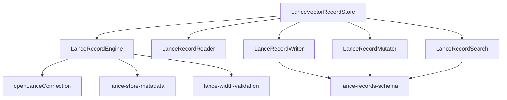

**Diagram sources**
- [LanceVectorRecordStore.ts:35-46](file://src/services/vector-store/lancedb/LanceVectorRecordStore.ts#L35-L46)
- [lance-records-engine.ts:25-34](file://src/services/vector-store/lancedb/lance-records-engine.ts#L25-L34)
- [lancedb-connection.ts:21-33](file://src/services/vector-store/lancedb-connection.ts#L21-L33)
- [lance-store-metadata.ts:14-20](file://src/services/vector-store/lancedb/lance-store-metadata.ts#L14-L20)
- [lance-width-validation.ts:11-15](file://src/services/vector-store/lancedb/lance-width-validation.ts#L11-L15)
- [lance-records-schema.ts:15-42](file://src/services/vector-store/lancedb/lance-records-schema.ts#L15-L42)

**Section sources**
- [LanceVectorRecordStore.ts:1-46](file://src/services/vector-store/lancedb/LanceVectorRecordStore.ts#L1-L46)
- [lancedb-connection.ts:1-33](file://src/services/vector-store/lancedb-connection.ts#L1-L33)

## Core Components
- **LanceVectorRecordStore**: Public port implementing the vector record interface. It initializes a single connection, exposes health checks, delegates reads, mutations, admin no-ops, search, and writes to specialized components.
- **LanceRecordEngine**: Owns the LanceDB connection, table lifecycle, schema inspection, stored-width resolution, atomic upserts, filtered scans, retrieval, and deletes. It enforces vector width validation before commits and wraps mutations with optimistic retry.
- **LanceRecordReader**: Mirrors Qdrant-style reads, including space-scoped retrieval, slug resolution, protocol step queries, artifact listing, and adapter layer traversal.
- **LanceRecordMutator**: Implements read-modify-write operations such as payload updates, quality metric accumulation, reward propagation, and app-space deletions while preserving named vectors.
- **LanceRecordWriter**: Handles adapter and artifact ingestion, markdown normalization, BM25 tokenization, activation vector generation, slug minting, duplicate handling, and metrics recording.
- **LanceRecordSearch**: Performs hybrid-style semantic search using JS cosine similarity over primary, title, and activation vectors plus label/tag boosts and attest boost.
- **lance-store-metadata**: Persists provider, model, and dimension so the store can detect width mismatches at boot or write time.
- **lance-width-validation**: Inspects the table schema for consistent vector widths and validates incoming vectors against the expected width.
- **lance-records-schema**: Defines row shape, promoted scalar columns, filter-to-SQL translation, and conversion helpers between Qdrant-shaped points and Lance rows.
- **lancedb-connection**: Opens a strong-consistency connection to the shared per-user directory and resolves the directory path.

**Section sources**
- [LanceVectorRecordStore.ts:35-191](file://src/services/vector-store/lancedb/LanceVectorRecordStore.ts#L35-L191)
- [lance-records-engine.ts:25-195](file://src/services/vector-store/lancedb/lance-records-engine.ts#L25-L195)
- [lance-records-reads.ts:46-256](file://src/services/vector-store/lancedb/lance-records-reads.ts#L46-L256)
- [lance-records-mutations.ts:58-226](file://src/services/vector-store/lancedb/lance-records-mutations.ts#L58-L226)
- [lance-records-writes.ts:42-350](file://src/services/vector-store/lancedb/lance-records-writes.ts#L42-L350)
- [lance-records-search.ts:96-141](file://src/services/vector-store/lancedb/lance-records-search.ts#L96-L141)
- [lance-store-metadata.ts:14-82](file://src/services/vector-store/lancedb/lance-store-metadata.ts#L14-L82)
- [lance-width-validation.ts:11-155](file://src/services/vector-store/lancedb/lance-width-validation.ts#L11-L155)
- [lance-records-schema.ts:15-189](file://src/services/vector-store/lancedb/lance-records-schema.ts#L15-L189)
- [lancedb-connection.ts:21-33](file://src/services/vector-store/lancedb-connection.ts#L21-L33)

## Architecture Overview
The embedded store is a layered architecture around a single Lance table named `memory_records`. Writes normalize input into Qdrant-shaped points, promote selected payload fields to columns, persist verbatim JSON payloads, and store multiple named vectors keyed by embedding dimension. Reads reconstruct memories from the payload and apply space scoping and slug precedence. Search computes cosine similarity in JavaScript because the data-inferred embedding columns are variable-length lists rather than fixed-size list types required by native ANN.

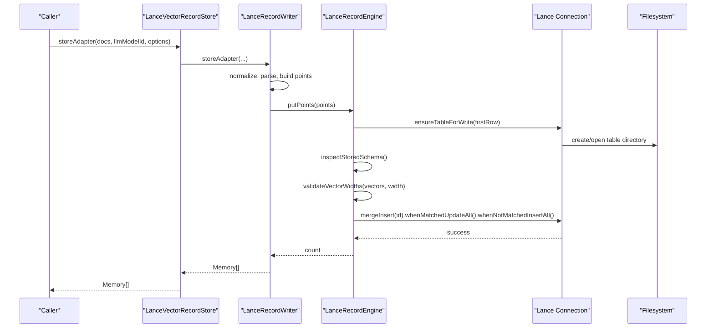

**Diagram sources**
- [LanceVectorRecordStore.ts:185-191](file://src/services/vector-store/lancedb/LanceVectorRecordStore.ts#L185-L191)
- [lance-records-writes.ts:59-115](file://src/services/vector-store/lancedb/lance-records-writes.ts#L59-L115)
- [lance-records-engine.ts:73-118](file://src/services/vector-store/lancedb/lance-records-engine.ts#L73-L118)
- [lancedb-connection.ts:30-33](file://src/services/vector-store/lancedb-connection.ts#L30-L33)

## Detailed Component Analysis

### File-Based Persistence and Concurrent Access
The embedded store persists data in a shared per-user directory resolved from the application config directory. Each process opens the same directory directly; there is no daemon or lock file. Concurrency safety relies on:
- Strong-consistency reads via `readConsistencyInterval: 0`, ensuring readers check the latest committed manifest.
- Bounded commit retry wrapping every mutation with exponential backoff and jitter.
- Atomic batched publish using `mergeInsert` keyed by row id.

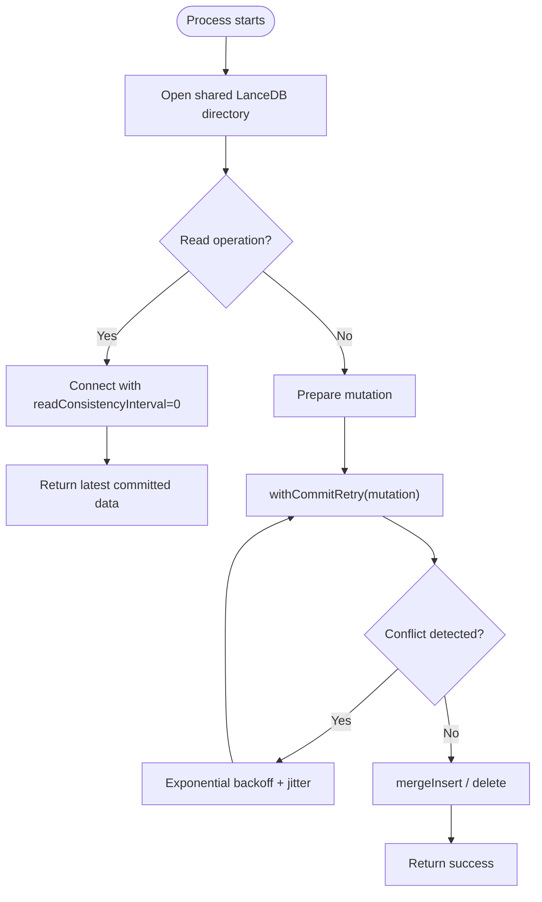

**Diagram sources**
- [lancedb-connection.ts:26-33](file://src/services/vector-store/lancedb-connection.ts#L26-L33)
- [0013-embedded-store-multiprocess-safety.md:27-51](file://docs/adr/0013-embedded-store-multiprocess-safety.md#L27-L51)

**Section sources**
- [lancedb-connection.ts:1-33](file://src/services/vector-store/lancedb-connection.ts#L1-L33)
- [0013-embedded-store-multiprocess-safety.md:1-109](file://docs/adr/0013-embedded-store-multiprocess-safety.md#L1-L109)

### Record Engine and Version Management
The engine owns the `memory_records` table and provides primitives for open-or-create, upsert, scan, retrieve, and delete. On first creation, it persists store metadata containing the embedding provider, model, and dimension. This metadata enables width binding and mismatch detection. Schema inspection caches results per engine instance and supports clearing after schema-changing writes.

Key behaviors:
- `ensureTableForWrite` creates the table once and records metadata.
- `putPoints` and `putRows` validate vector widths before committing.
- `scroll` translates Qdrant-style filters into LanceQL WHERE clauses.
- `retrieveRaw` returns full rows for read-modify-write paths.

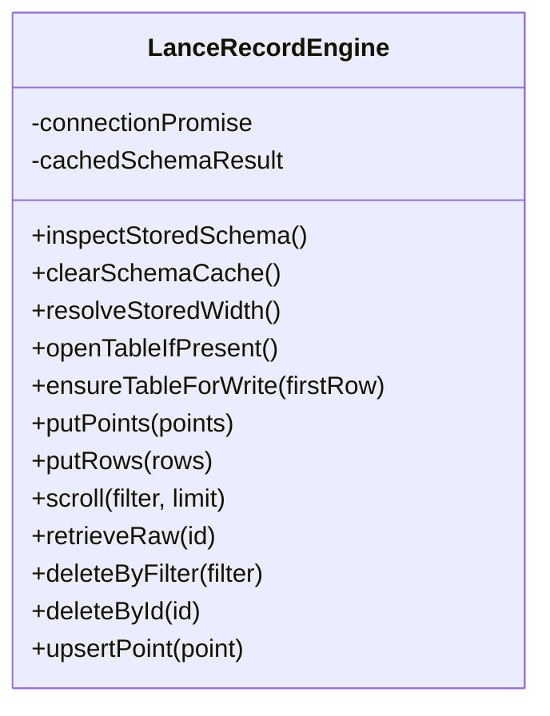

**Diagram sources**
- [lance-records-engine.ts:25-195](file://src/services/vector-store/lancedb/lance-records-engine.ts#L25-L195)

**Section sources**
- [lance-records-engine.ts:1-195](file://src/services/vector-store/lancedb/lance-records-engine.ts#L1-L195)
- [lance-store-metadata.ts:45-82](file://src/services/vector-store/lancedb/lance-store-metadata.ts#L45-L82)

### Schema Validation and Data Serialization
Records are serialized as Lance rows where:
- The entire payload is stored as a JSON string.
- Selected payload keys are promoted to typed columns for filtering.
- Named vectors are stored as numeric arrays, with column names derived from embedding dimension.
- BM25 sparse tokens are persisted as JSON.

Schema inspection identifies the primary vector column `vs{dim}` and companion columns `adapter_title_vs{dim}` and `activation_pattern_vs{dim}`, enforcing a single consistent width.

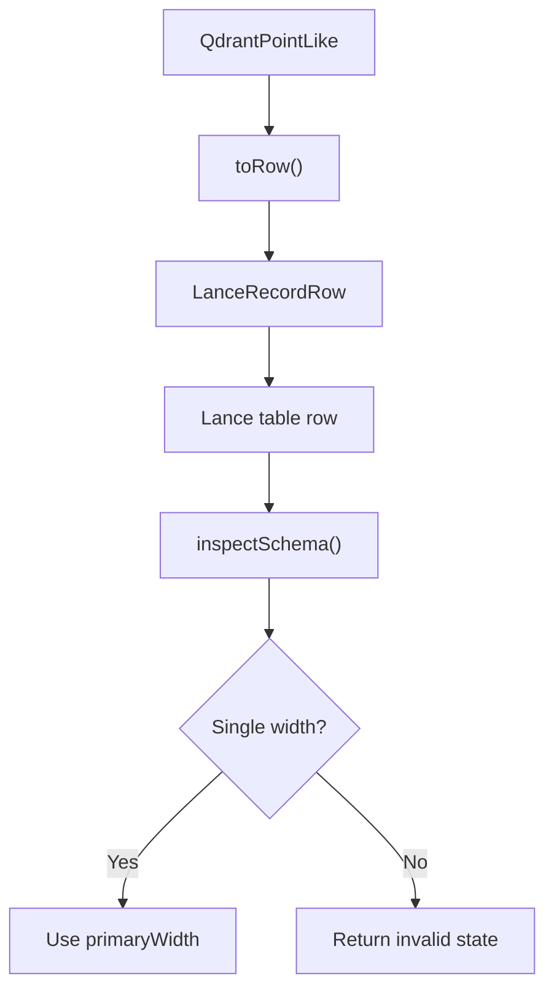

**Diagram sources**
- [lance-records-schema.ts:150-189](file://src/services/vector-store/lancedb/lance-records-schema.ts#L150-L189)
- [lance-width-validation.ts:22-91](file://src/services/vector-store/lancedb/lance-width-validation.ts#L22-L91)

**Section sources**
- [lance-records-schema.ts:1-189](file://src/services/vector-store/lancedb/lance-records-schema.ts#L1-L189)
- [lance-width-validation.ts:1-155](file://src/services/vector-store/lancedb/lance-width-validation.ts#L1-L155)

### Search Capabilities Optimized for Embedded Environments
Search avoids native ANN requirements by scanning adapter heads within allowed spaces and scoring in JavaScript. The score combines:
- Cosine similarity over the primary vector.
- Title vector similarity boosted by a constant factor.
- Activation pattern vector similarity boosted by a constant factor.
- Label and tag text matches tokenized from the query.
- Stored `attest_boost`.

Column names are derived from the store’s bound width, not the query vector length, preventing silent zero scores when dimensions differ.

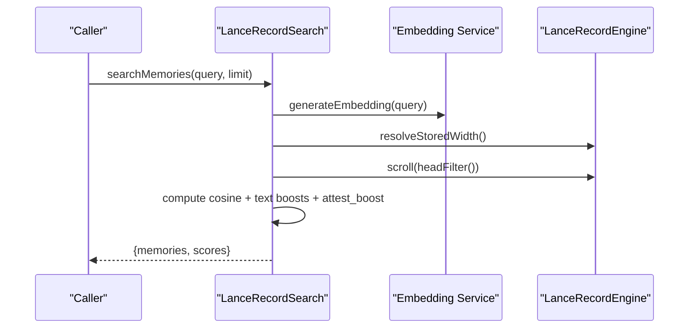

**Diagram sources**
- [lance-records-search.ts:96-141](file://src/services/vector-store/lancedb/lance-records-search.ts#L96-L141)
- [lance-records-engine.ts:147-159](file://src/services/vector-store/lancedb/lance-records-engine.ts#L147-L159)

**Section sources**
- [lance-records-search.ts:1-141](file://src/services/vector-store/lancedb/lance-records-search.ts#L1-L141)

### Width Validation System
The width validation system ensures vector dimension consistency across operations:
- `inspectSchema` detects absent, valid, or invalid schemas based on vector column naming.
- `validateVectorWidths` throws structured errors when incoming vectors do not match the expected width or contain non-finite values.
- Errors include `EMBEDDING_STORE_WIDTH_MISMATCH` and `EMBEDDING_STORE_SCHEMA_INVALID`.

Writes call validation before committing; reads derive column names from the stored width.

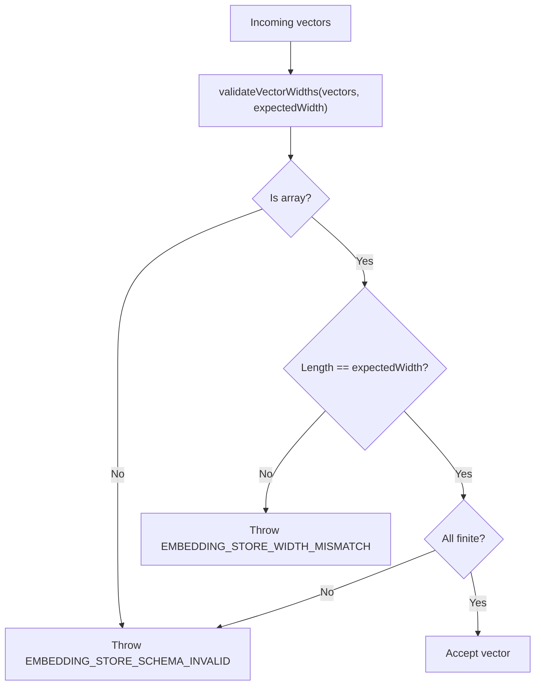

**Diagram sources**
- [lance-width-validation.ts:97-119](file://src/services/vector-store/lancedb/lance-width-validation.ts#L97-L119)

**Section sources**
- [lance-width-validation.ts:1-155](file://src/services/vector-store/lancedb/lance-width-validation.ts#L1-L155)

### Migration Strategies: Qdrant to LanceDB and Vice Versa
- **Qdrant auto-migration**: At boot, the Qdrant path compares existing collection vector configuration with the resolved current dimension and drives migration routines when they differ.
- **LanceDB embedded store**: There is no automatic re-embed migration in this codebase. The SDK exposes primitives such as adding or altering columns, updating rows, creating indexes, and restoring versions, but they are unused by the embedded store. Boot-time checks warn about width mismatches, and writes throw actionable errors. Operators must recreate the store or revert the embedding provider.

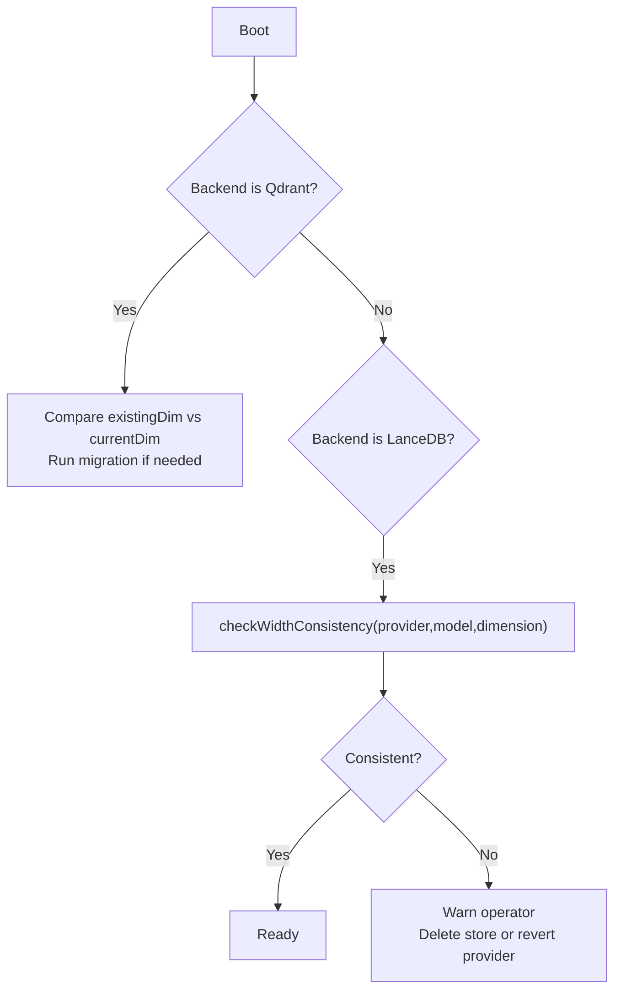

**Diagram sources**
- [0021-embedding-provider-auto-resolution-and-store-width-binding.md:89-124](file://docs/adr/0021-embedding-provider-auto-resolution-and-store-width-binding.md#L89-L124)
- [lance-store-metadata.ts:66-82](file://src/services/vector-store/lancedb/lance-store-metadata.ts#L66-L82)

**Section sources**
- [0021-embedding-provider-auto-resolution-and-store-width-binding.md:1-245](file://docs/adr/0021-embedding-provider-auto-resolution-and-store-width-binding.md#L1-L245)
- [lance-store-metadata.ts:1-82](file://src/services/vector-store/lancedb/lance-store-metadata.ts#L1-L82)

### Write Path and Mutation Semantics
The write path normalizes markdown, parses frontmatter, builds header or default adapters, generates activation embeddings, mints slugs, deduplicates adapters, and persists points with BM25 sparse tokens and named vectors. Mutations preserve named vectors, recalculate quality metadata when relevant fields change, update attest boosts, and invalidate caches consistently.

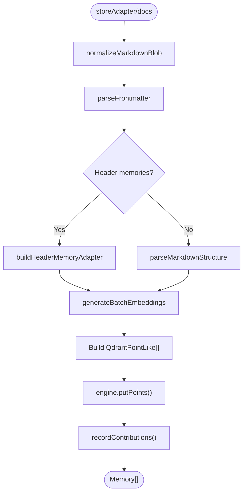

**Diagram sources**
- [lance-records-writes.ts:59-115](file://src/services/vector-store/lancedb/lance-records-writes.ts#L59-L115)
- [lance-records-writes.ts:124-155](file://src/services/vector-store/lancedb/lance-records-writes.ts#L124-L155)
- [lance-records-writes.ts:330-349](file://src/services/vector-store/lancedb/lance-records-writes.ts#L330-L349)

**Section sources**
- [lance-records-writes.ts:1-350](file://src/services/vector-store/lancedb/lance-records-writes.ts#L1-L350)
- [lance-records-mutations.ts:70-119](file://src/services/vector-store/lancedb/lance-records-mutations.ts#L70-L119)

### Read Path and Query Semantics
Reads mirror Qdrant behavior: space-scoped retrieval, slug disambiguation with deterministic precedence, protocol step lookup, artifact listing, and adapter layer traversal. Rows are converted back to memories using the verbatim payload.

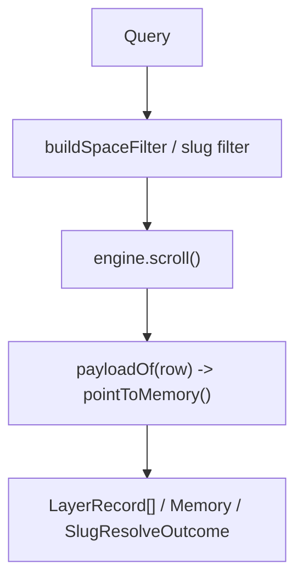

**Diagram sources**
- [lance-records-reads.ts:49-65](file://src/services/vector-store/lancedb/lance-records-reads.ts#L49-L65)
- [lance-records-reads.ts:130-172](file://src/services/vector-store/lancedb/lance-records-reads.ts#L130-L172)

**Section sources**
- [lance-records-reads.ts:1-256](file://src/services/vector-store/lancedb/lance-records-reads.ts#L1-L256)

## Dependency Analysis
The store depends on:
- Embedding service for generating query and activation vectors.
- Tenant context and space filter utilities for scoping.
- BM25 tokenizer for sparse text indexing.
- Redis cache service for cache invalidation.
- Structured logger for diagnostics.
- LanceDB SDK for table operations and MVCC.

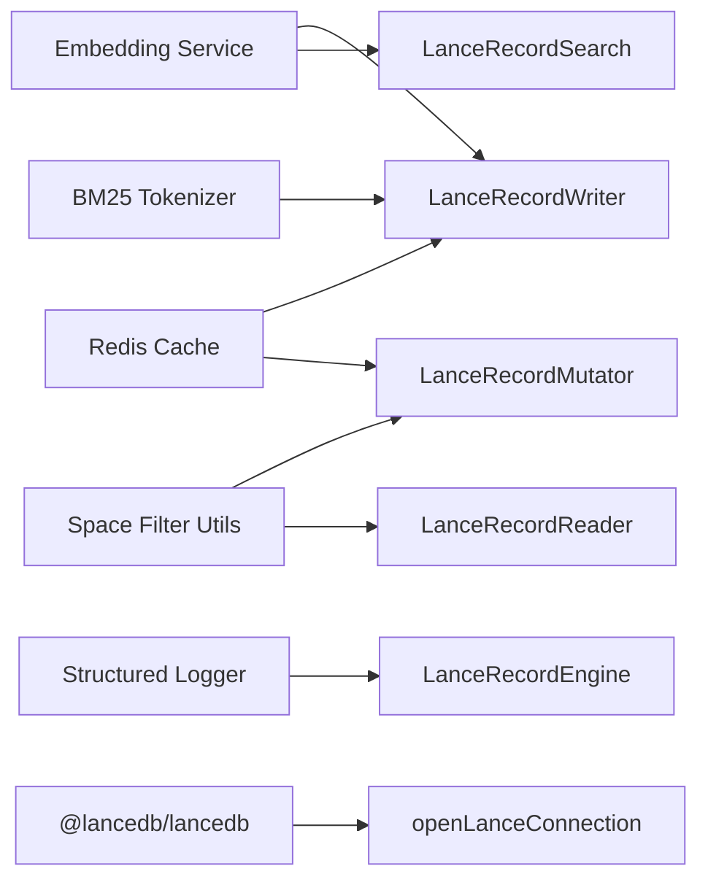

**Diagram sources**
- [lance-records-search.ts:15-30](file://src/services/vector-store/lancedb/lance-records-search.ts#L15-L30)
- [lance-records-writes.ts:18-38](file://src/services/vector-store/lancedb/lance-records-writes.ts#L18-L38)
- [lance-records-mutations.ts:12-21](file://src/services/vector-store/lancedb/lance-records-mutations.ts#L12-L21)
- [lancedb-connection.ts:17-33](file://src/services/vector-store/lancedb-connection.ts#L17-L33)

**Section sources**
- [lance-records-search.ts:1-141](file://src/services/vector-store/lancedb/lance-records-search.ts#L1-L141)
- [lance-records-writes.ts:1-350](file://src/services/vector-store/lancedb/lance-records-writes.ts#L1-L350)
- [lance-records-mutations.ts:1-226](file://src/services/vector-store/lancedb/lance-records-mutations.ts#L1-L226)
- [lancedb-connection.ts:1-33](file://src/services/vector-store/lancedb-connection.ts#L1-L33)

## Performance Considerations
- **Vector similarity computation**: Performed in JavaScript over scanned rows. This avoids native ANN constraints but scales linearly with the number of candidate rows. For small to medium stores typical of local development, this is acceptable.
- **Metadata-driven column selection**: Deriving column names from stored width prevents silent failures and reduces unnecessary embedding regeneration.
- **Atomic upserts**: `mergeInsert` reduces race conditions and simplifies concurrency.
- **Deferred compaction**: Delete tombstones are not compacted automatically; heavily churned stores may retain historical fragments until compaction is added.
- **Per-process cache window**: Application-level caches (outside LanceDB) may briefly serve stale values across processes; this is acceptable at target scale.

[No sources needed since this section provides general guidance]

## Troubleshooting Guide
Common issues and resolutions:
- **Width mismatch error**: Occurs when the current embedding provider produces vectors of a different dimension than the store was created with. Recreate the store or revert the provider.
- **Schema invalid error**: Indicates ambiguous or missing vector columns. Inspect the table schema and ensure only one primary width exists.
- **Stale reads across processes**: Ensure strong-consistency reads are enabled and avoid relying solely on application-level caches for freshness.
- **Slow searches**: Expect linear scoring over candidates; consider reducing dataset size or limiting search scope via space filters.

Operational hints:
- Check store metadata for provider/model/dimension alignment.
- Review logs for conflict retries and commit outcomes.
- Validate that vector columns follow the `vs{dim}` naming convention.

**Section sources**
- [lance-width-validation.ts:124-155](file://src/services/vector-store/lancedb/lance-width-validation.ts#L124-L155)
- [lance-store-metadata.ts:66-82](file://src/services/vector-store/lancedb/lance-store-metadata.ts#L66-L82)
- [0013-embedded-store-multiprocess-safety.md:46-69](file://docs/adr/0013-embedded-store-multiprocess-safety.md#L46-L69)

## Conclusion
The embedded LanceDB store provides a safe, zero-config backend for local development and lightweight deployments. It uses file-based persistence with MVCC, strong-consistency reads, bounded commit retries, and atomic upserts to support multi-process access. The record engine enforces schema and width validation, serializes records faithfully, and manages version metadata. Search is optimized for embedded environments by performing JS cosine similarity over three dense vectors plus text boosts. Migration from Qdrant is supported at the remote backend level, while the embedded store requires explicit operator action when widths change. Performance is suitable for small to medium datasets, with known limitations around compaction and linear search scaling.

[No sources needed since this section summarizes without analyzing specific files]

## Appendices

### Deployment Considerations
- **Containerized environments**: Share the per-user LanceDB directory across containers running as the same user. Avoid sharing across unrelated users unless explicitly intended.
- **Multi-process scenarios**: Each process opens the shared directory directly; rely on MVCC and retry logic. Do not introduce external lock files.
- **Health checks**: Use the store’s health check to verify connectivity and readiness.
- **Backups**: Back up the LanceDB directory and metadata file together to preserve provider/model/dimension alignment.

[No sources needed since this section provides general guidance]