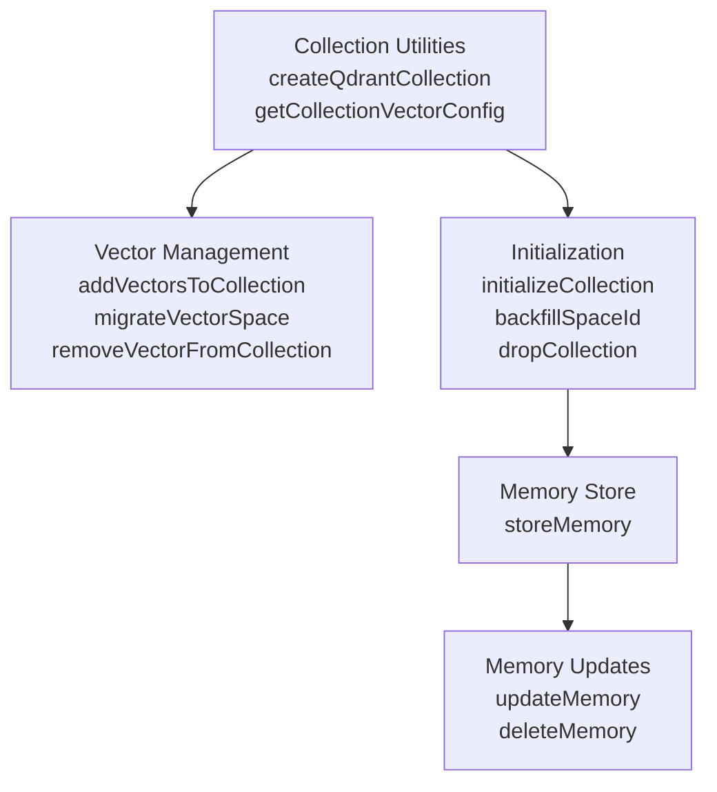
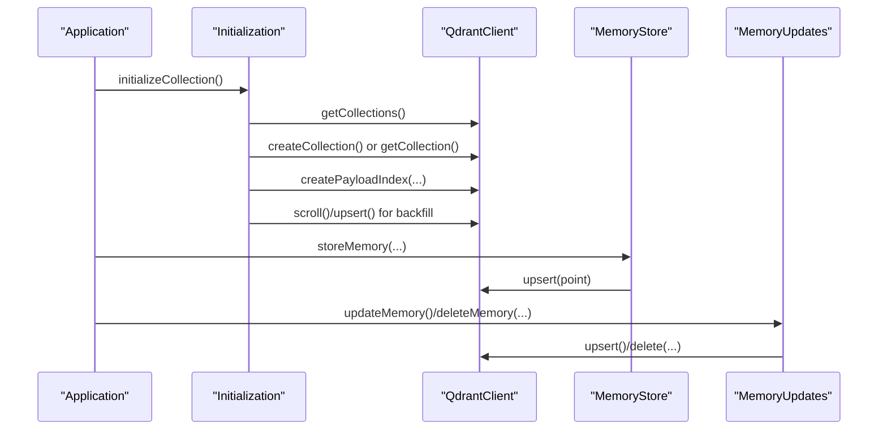
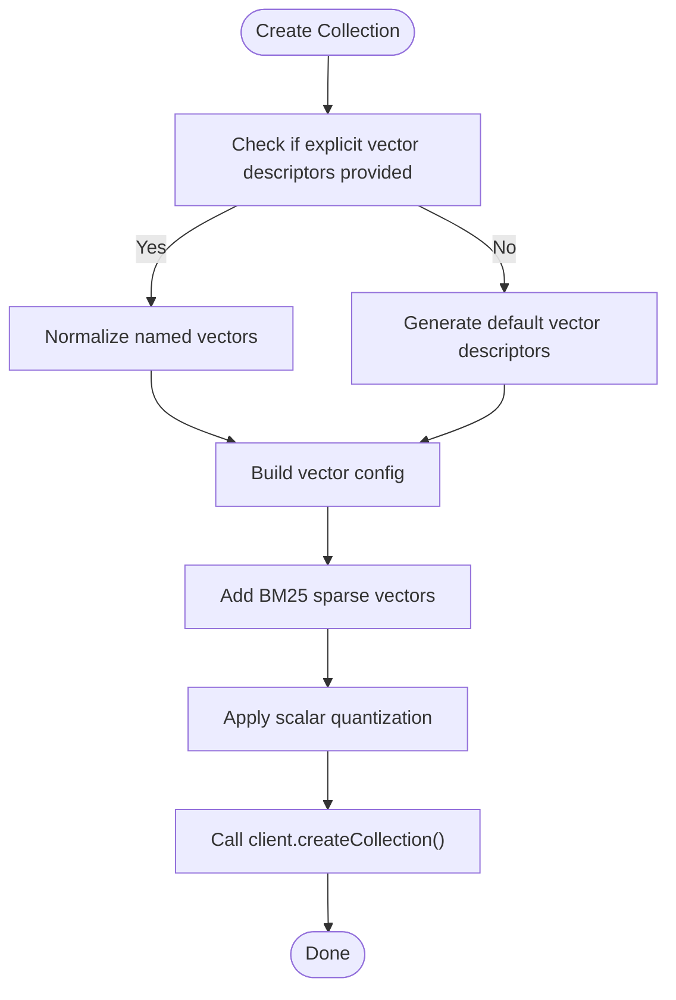
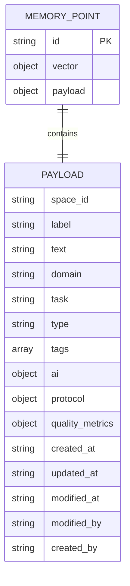
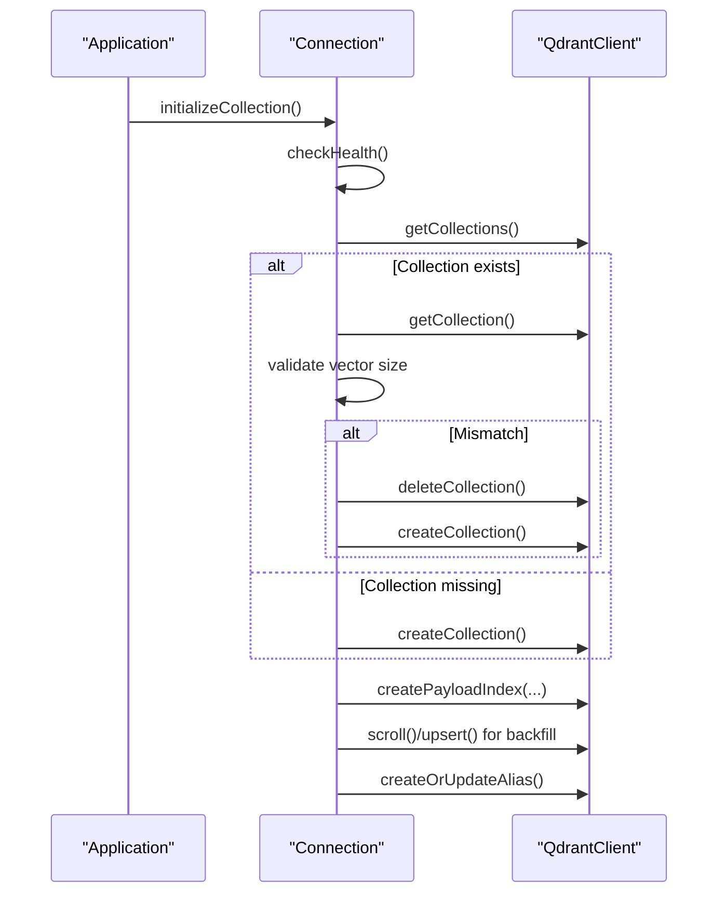
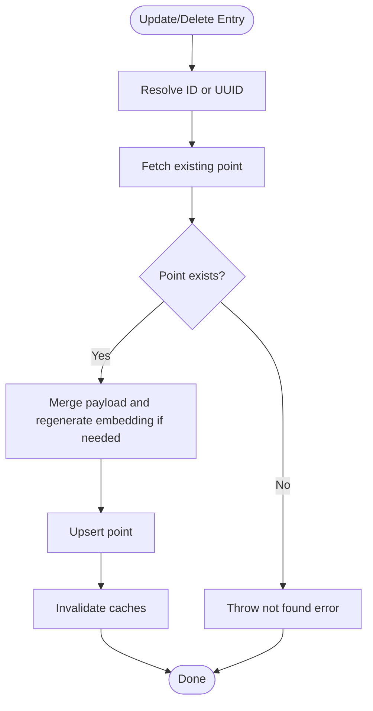
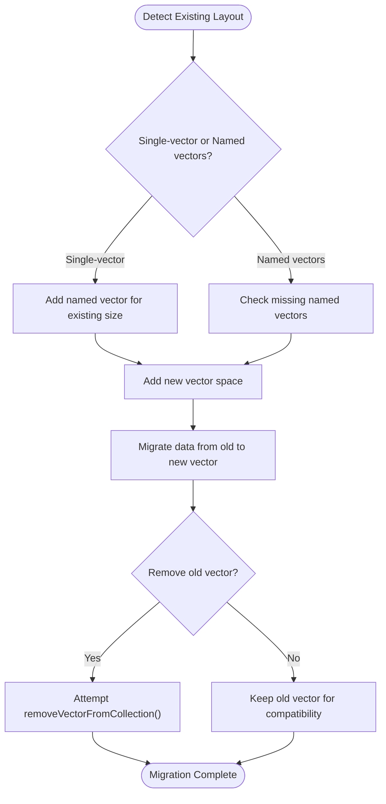
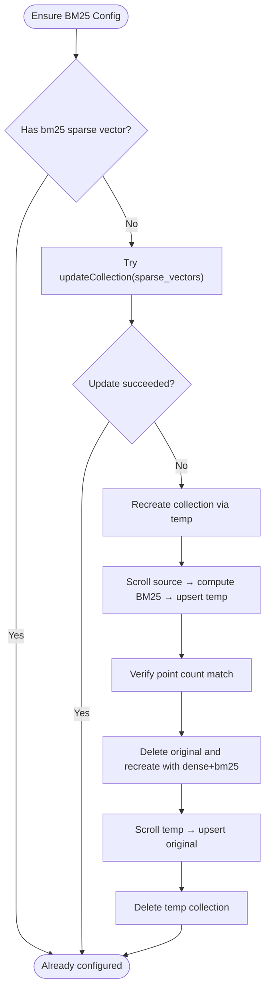
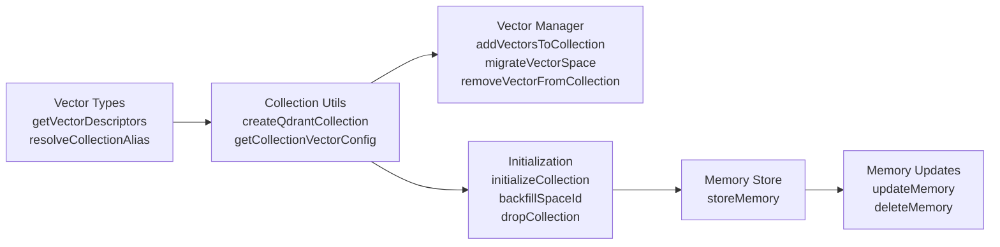

# Collection Management

<cite>
**Referenced Files in This Document**
- [qdrant-collection-utils.ts](file://src/utils/qdrant-collection-utils.ts)
- [qdrant-vector-management.ts](file://src/utils/qdrant-vector-management.ts)
- [qdrant-vector-types.ts](file://src/utils/qdrant-vector-types.ts)
- [initialization.ts](file://src/services/qdrant/initialization.ts)
- [store-init.ts](file://src/services/memory/store-init.ts)
- [memory-store.ts](file://src/services/qdrant/memory-store.ts)
- [memory-updates.ts](file://src/services/qdrant/memory-updates.ts)
</cite>

## Table of Contents
1. [Introduction](#introduction)
2. [Project Structure](#project-structure)
3. [Core Components](#core-components)
4. [Architecture Overview](#architecture-overview)
5. [Detailed Component Analysis](#detailed-component-analysis)
6. [Dependency Analysis](#dependency-analysis)
7. [Performance Considerations](#performance-considerations)
8. [Troubleshooting Guide](#troubleshooting-guide)
9. [Conclusion](#conclusion)

## Introduction
This document explains how Qdrant collections are created, configured, migrated, and managed in the project. It focuses on:
- Vector configuration and naming conventions
- Payload schema and indexing policies
- Lifecycle operations including creation, updates, migrations, and deletion
- Bulk ingestion patterns and batch update/delete flows
- Schema evolution strategies for vector dimensions and sparse BM25 vectors
- Monitoring, size management, and cleanup procedures
- Practical design patterns and naming conventions for robust collection usage

The implementation uses Qdrant as the primary vector store, with a layered approach that separates collection utilities, initialization logic, memory storage, and migration helpers.

## Project Structure
The Qdrant-related code is organized around these responsibilities:
- Collection utilities: create collections, read vector configuration, and normalize single vs named vectors
- Vector management: add/remove vectors, migrate between vector spaces, and recreate collections when needed
- Initialization: ensure health, create or recreate collections, build payload indexes, backfill tenant fields, and manage aliases
- Memory store: write memory points with structured payloads and vector embeddings
- Memory updates: update and delete memory points, recalculate embeddings when text changes, and invalidate caches

**Diagram sources**
- [qdrant-collection-utils.ts:7-39](file://src/utils/qdrant-collection-utils.ts#L7-L39)
- [qdrant-vector-management.ts:13-114](file://src/utils/qdrant-vector-management.ts#L13-L114)
- [initialization.ts:13-93](file://src/services/qdrant/initialization.ts#L13-L93)
- [memory-store.ts:14-126](file://src/services/qdrant/memory-store.ts#L14-L126)
- [memory-updates.ts:15-235](file://src/services/qdrant/memory-updates.ts#L15-L235)

**Section sources**
- [qdrant-collection-utils.ts:1-65](file://src/utils/qdrant-collection-utils.ts#L1-L65)
- [qdrant-vector-management.ts:1-301](file://src/utils/qdrant-vector-management.ts#L1-L301)
- [initialization.ts:1-184](file://src/services/qdrant/initialization.ts#L1-L184)
- [memory-store.ts:1-126](file://src/services/qdrant/memory-store.ts#L1-L126)
- [memory-updates.ts:1-235](file://src/services/qdrant/memory-updates.ts#L1-L235)

## Core Components
- Collection creation normalizes vector descriptors into either a single root vector (legacy) or named vectors, adds BM25 sparse vectors, and applies scalar quantization.
- Vector management supports adding named vectors to existing collections, migrating from one vector space to another by re-embedding content, and removing vectors through recreation-based workflows.
- Initialization ensures collection existence, validates vector dimension consistency, creates payload indexes, backfills missing tenant identifiers, and optionally manages an alias.
- Memory store writes structured memory points with labels, text, domain/task/type metadata, tags, AI context, protocol information, quality metrics, and timestamps.
- Memory updates handle point updates by UUID or ID, optional embedding regeneration, cache invalidation, and deletion with strict error handling.

**Section sources**
- [qdrant-collection-utils.ts:7-39](file://src/utils/qdrant-collection-utils.ts#L7-L39)
- [qdrant-vector-management.ts:13-114](file://src/utils/qdrant-vector-management.ts#L13-L114)
- [initialization.ts:13-93](file://src/services/qdrant/initialization.ts#L13-L93)
- [memory-store.ts:14-126](file://src/services/qdrant/memory-store.ts#L14-L126)
- [memory-updates.ts:15-235](file://src/services/qdrant/memory-updates.ts#L15-L235)

## Architecture Overview
The system follows a clear separation of concerns:
- Configuration and naming come from vector type utilities and embedding dimension resolution
- Initialization orchestrates collection lifecycle and index setup
- Storage and updates encapsulate point-level operations with caching and metrics
- Migration utilities provide safe, idempotent transitions for vector schemas

**Diagram sources**
- [initialization.ts:13-93](file://src/services/qdrant/initialization.ts#L13-L93)
- [memory-store.ts:14-126](file://src/services/qdrant/memory-store.ts#L14-L126)
- [memory-updates.ts:15-235](file://src/services/qdrant/memory-updates.ts#L15-L235)

## Detailed Component Analysis

### Collection Creation and Vector Configuration
- Single-vector legacy shape is supported; otherwise, named vectors are used.
- Default vector names include a primary vector and auxiliary vectors for adapter titles and activation patterns.
- Sparse BM25 vectors are added during collection creation.
- Scalar quantization is enabled for memory efficiency.

Key behaviors:
- If explicit vector descriptors are provided, they are normalized into Qdrant’s expected structure.
- If no descriptors are provided, defaults are generated based on the current embedding dimension.
- The function handles both single-vector and named-vector layouts.

**Diagram sources**
- [qdrant-collection-utils.ts:7-39](file://src/utils/qdrant-collection-utils.ts#L7-L39)

**Section sources**
- [qdrant-collection-utils.ts:7-39](file://src/utils/qdrant-collection-utils.ts#L7-L39)
- [qdrant-vector-types.ts:28-35](file://src/utils/qdrant-vector-types.ts#L28-L35)

### Payload Schema and Indexing Policies
Payloads include:
- Tenant isolation: `space_id`
- Content metadata: `label`, `text`, `domain`, `task`, `type`, `tags`
- AI context: `ai.model_id`, `ai.memory_uuid`
- Protocol context: `protocol.step`, `protocol.total`, `protocol.enforcement`, `protocol.skip_allowed`, `protocol.title`, `protocol.memory_uuid`
- Quality metrics: nested quality tracking and step success rates
- Timestamps: `created_at`, `updated_at`, `modified_at`, `modified_by`, `created_by`

Indexing policy includes:
- Keyword indexes for filtering and multitenancy (`space_id`)
- Text indexes for full-text search across adapter names, labels, activation patterns, and tags
- Integer indexes for protocol steps and quality scores
- Adapter-specific indexes for layer metadata and activation patterns

**Diagram sources**
- [memory-store.ts:57-96](file://src/services/qdrant/memory-store.ts#L57-L96)
- [initialization.ts:50-69](file://src/services/qdrant/initialization.ts#L50-L69)

**Section sources**
- [memory-store.ts:57-96](file://src/services/qdrant/memory-store.ts#L57-L96)
- [initialization.ts:50-69](file://src/services/qdrant/initialization.ts#L50-L69)

### Collection Lifecycle Operations

#### Initialization and Health Checks
- Health check before initialization
- List existing collections and detect presence
- Create collection if missing
- Validate vector dimension and recreate if mismatched
- Create payload indexes
- Backfill missing `space_id` values
- Optionally create/update alias for stable routing

**Diagram sources**
- [initialization.ts:13-93](file://src/services/qdrant/initialization.ts#L13-L93)

**Section sources**
- [initialization.ts:13-93](file://src/services/qdrant/initialization.ts#L13-L93)

#### Updates and Deletion Procedures
- Update by UUID merges existing payload with new fields, regenerates embedding if text changed, and persists via upsert.
- Update by ID performs similar merging, recalculates quality metadata when relevant fields change, and invalidates caches strictly.
- Delete validates the point exists, removes it, and invalidates caches.

**Diagram sources**
- [memory-updates.ts:15-96](file://src/services/qdrant/memory-updates.ts#L15-L96)
- [memory-updates.ts:98-197](file://src/services/qdrant/memory-updates.ts#L98-L197)
- [memory-updates.ts:199-235](file://src/services/qdrant/memory-updates.ts#L199-L235)

**Section sources**
- [memory-updates.ts:15-235](file://src/services/qdrant/memory-updates.ts#L15-L235)

### Schema Evolution and Versioning Strategies

#### Vector Dimension Migration
- Detect older single-vector layout and convert to named vectors
- Add missing named vectors to existing collections
- Migrate data from old vector name to new vector name by re-embedding content
- Attempt removal of old vector after successful migration

**Diagram sources**
- [store-init.ts:172-350](file://src/services/memory/store-init.ts#L172-L350)
- [qdrant-vector-management.ts:126-202](file://src/utils/qdrant-vector-management.ts#L126-L202)

**Section sources**
- [store-init.ts:172-350](file://src/services/memory/store-init.ts#L172-L350)
- [qdrant-vector-management.ts:126-202](file://src/utils/qdrant-vector-management.ts#L126-L202)

#### BM25 Sparse Vector Migration
- Ensure BM25 sparse vector configuration exists
- Prefer updateCollection if supported; otherwise, recreate collection via temp collection
- Copy points, compute sparse indices, upsert to temp, verify counts, replace original, restore points

**Diagram sources**
- [store-init.ts:36-125](file://src/services/memory/store-init.ts#L36-L125)
- [store-init.ts:131-149](file://src/services/memory/store-init.ts#L131-L149)

**Section sources**
- [store-init.ts:36-125](file://src/services/memory/store-init.ts#L36-L125)
- [store-init.ts:131-149](file://src/services/memory/store-init.ts#L131-L149)

### Bulk Operations for Efficient Data Ingestion
- Point insertion uses upsert with structured payloads and vectors
- Batch restoration during migration uses fixed batch sizes to prevent memory pressure
- BM25 migration copies points in batches and verifies counts before replacing collections

Guidelines:
- Use upsert for idempotent bulk ingestion
- Split large datasets into batches (e.g., 256 points per batch)
- Validate point counts after copy/restore phases
- Log progress and failures for observability

**Section sources**
- [memory-store.ts:99-101](file://src/services/qdrant/memory-store.ts#L99-L101)
- [qdrant-vector-management.ts:90-110](file://src/utils/qdrant-vector-management.ts#L90-L110)
- [store-init.ts:50-79](file://src/services/memory/store-init.ts#L50-L79)

### Monitoring, Size Management, and Cleanup
- Metrics track operation counts and durations for upsert, update, and delete
- Cache invalidation ensures consistency after mutations
- Alias management provides stable routing to active collections
- Drop collection utility safely deletes collections with logging

Best practices:
- Monitor operation metrics and latency
- Use aliases for zero-downtime collection swaps
- Clean up temporary collections after migrations
- Backfill tenant fields to maintain multitenancy integrity

**Section sources**
- [memory-store.ts:107-113](file://src/services/qdrant/memory-store.ts#L107-L113)
- [memory-updates.ts:75-85](file://src/services/qdrant/memory-updates.ts#L75-L85)
- [initialization.ts:83-91](file://src/services/qdrant/initialization.ts#L83-L91)
- [initialization.ts:178-184](file://src/services/qdrant/initialization.ts#L178-L184)

### Design Patterns and Naming Conventions
- Vector naming: use `vs{dimension}` for primary vectors and descriptive names for auxiliary vectors
- Payload structure: keep tenant isolation at `space_id`, embed rich metadata for filtering and search
- Indexing strategy: keyword indexes for filters, text indexes for full-text search, integer indexes for numeric fields
- Migration pattern: prefer additive changes (add vectors, add indexes), then remove deprecated elements after validation

Naming examples:
- Primary vector: `vs1024`, `vs1536`
- Adapter title vector: `adapter_title_vs1024`
- Activation pattern vector: `activation_pattern_vs1024`

**Section sources**
- [qdrant-vector-types.ts:12-35](file://src/utils/qdrant-vector-types.ts#L12-L35)
- [initialization.ts:50-69](file://src/services/qdrant/initialization.ts#L50-L69)

## Dependency Analysis
The following diagram shows key dependencies among components:

**Diagram sources**
- [qdrant-vector-types.ts:1-57](file://src/utils/qdrant-vector-types.ts#L1-L57)
- [qdrant-collection-utils.ts:1-65](file://src/utils/qdrant-collection-utils.ts#L1-L65)
- [qdrant-vector-management.ts:1-301](file://src/utils/qdrant-vector-management.ts#L1-L301)
- [initialization.ts:1-184](file://src/services/qdrant/initialization.ts#L1-L184)
- [memory-store.ts:1-126](file://src/services/qdrant/memory-store.ts#L1-L126)
- [memory-updates.ts:1-235](file://src/services/qdrant/memory-updates.ts#L1-L235)

**Section sources**
- [qdrant-vector-types.ts:1-57](file://src/utils/qdrant-vector-types.ts#L1-L57)
- [qdrant-collection-utils.ts:1-65](file://src/utils/qdrant-collection-utils.ts#L1-L65)
- [qdrant-vector-management.ts:1-301](file://src/utils/qdrant-vector-management.ts#L1-L301)
- [initialization.ts:1-184](file://src/services/qdrant/initialization.ts#L1-L184)
- [memory-store.ts:1-126](file://src/services/qdrant/memory-store.ts#L1-L126)
- [memory-updates.ts:1-235](file://src/services/qdrant/memory-updates.ts#L1-L235)

## Performance Considerations
- Use batched upserts to reduce memory pressure during migrations and bulk ingestion
- Enable scalar quantization to reduce vector storage footprint
- Leverage payload indexes for efficient filtering and full-text search
- Avoid unnecessary embedding regeneration by checking text changes before recomputation
- Monitor operation metrics and cache invalidation to detect performance regressions

[No sources needed since this section provides general guidance]

## Troubleshooting Guide
Common issues and resolutions:
- Missing `space_id`: run backfill to populate tenant identifiers
- Vector dimension mismatch: recreate collection with correct dimension
- BM25 not available: attempt updateCollection; if unsupported, run recreation-based migration
- Stale cache after updates: ensure strict cache invalidation is called
- Alias not created: manually create alias or enable automatic alias creation

Operational checks:
- Verify collection health before initialization
- Confirm payload indexes exist for required fields
- Validate point counts after migration phases
- Inspect logs for failed upserts or deletions

**Section sources**
- [initialization.ts:13-93](file://src/services/qdrant/initialization.ts#L13-L93)
- [store-init.ts:172-350](file://src/services/memory/store-init.ts#L172-L350)
- [memory-updates.ts:75-85](file://src/services/qdrant/memory-updates.ts#L75-L85)

## Conclusion
The Qdrant collection management in this project emphasizes safe schema evolution, robust indexing, and clear operational boundaries. By separating collection utilities, initialization, storage, and migration logic, the system supports scalable vector operations while maintaining backward compatibility. Following the recommended design patterns, naming conventions, and migration strategies ensures reliable collection lifecycle management and optimal performance.

[No sources needed since this section summarizes without analyzing specific files]